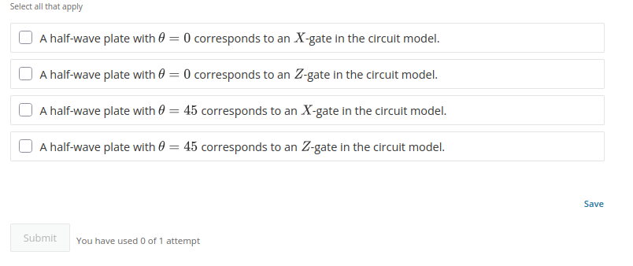
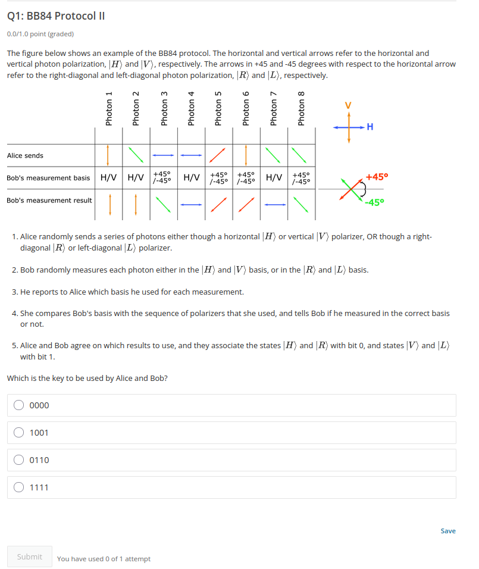
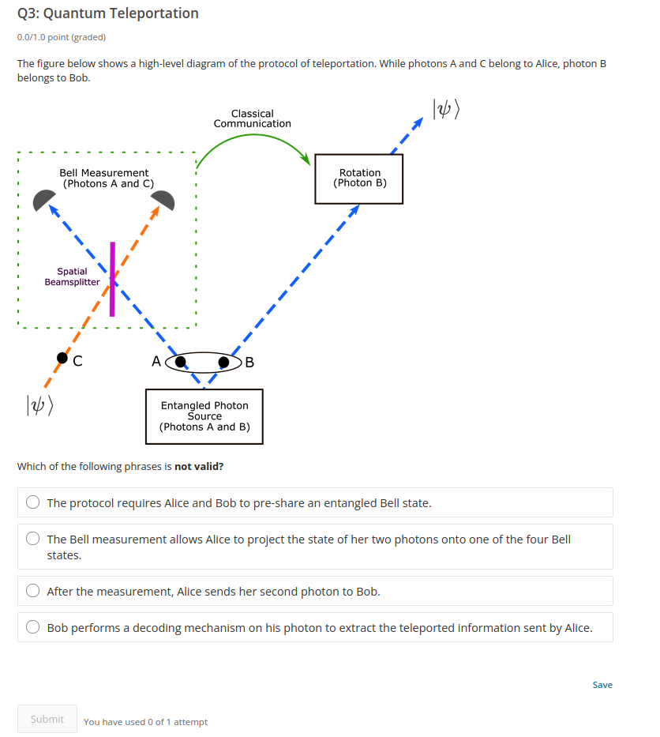
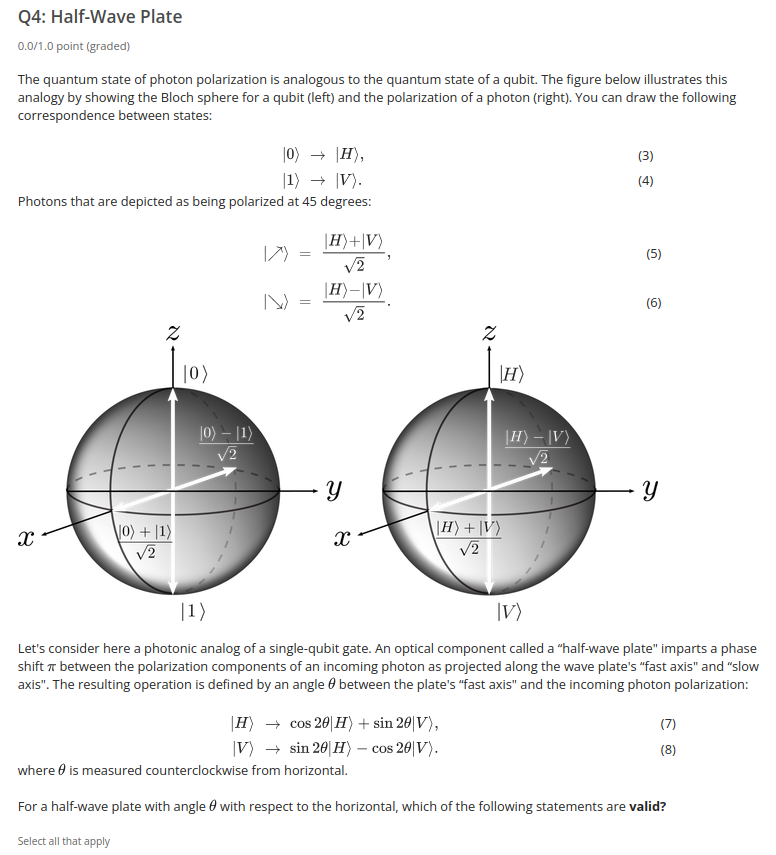
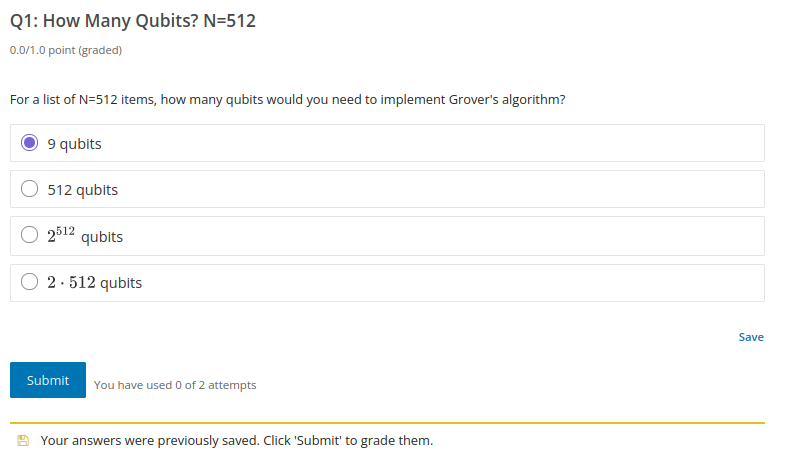
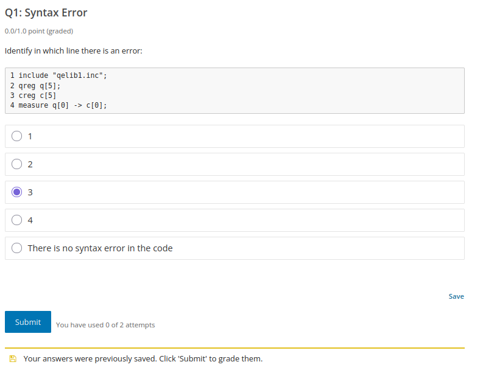
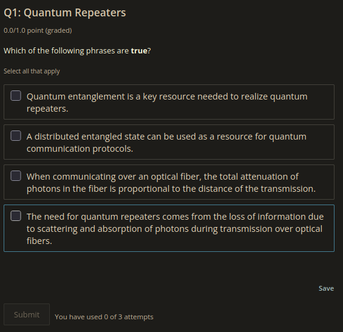
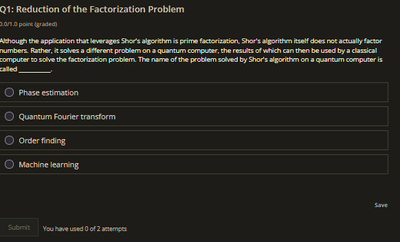
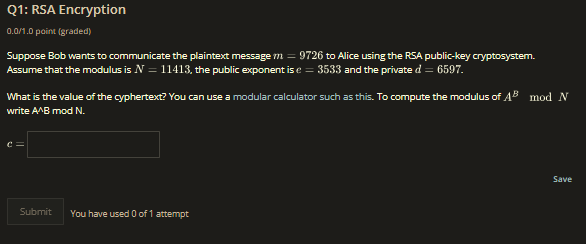

# Graph Report - mit-x-pro-wiki  (2026-11-22)

## Corpus Check
- 90 files · ~137,673 words
- Verdict: corpus is large enough that graph structure adds value.

## Summary
- 1120 nodes · 1331 edges · 180 communities (144 shown, 36 thin omitted)
- Extraction: 100% EXTRACTED · 0% INFERRED · 0% AMBIGUOUS
- Token cost: 0 input · 0 output

## Community Hubs (Navigation)
- mit-raw (247)
- wiki (93)
- mit-raw (43)
- mit-raw (32)
- mit-raw (28)
- mit-raw (21)
- AGENTS.md (10)
- mit-raw (11)
- mit-raw (10)
- wiki (10)
- wiki (10)
- wiki (9)
- mit-raw (8)
- wiki (8)
- wiki (8)
- mit-raw (7)
- wiki (7)
- wiki (7)
- mit-raw (6)
- mit-raw (6)
- mit-raw (6)
- wiki (6)
- mit-raw (5)
- mit-raw (5)
- mit-raw (5)
- mit-raw (5)
- mit-raw (5)
- mit-raw (5)
- mit-raw (5)
- mit-raw (5)
- mit-raw (5)
- mit-raw (5)
- wiki (5)
- wiki (5)
- wiki (5)
- wiki (5)
- wiki (5)
- wiki (5)
- wiki (5)
- wiki (5)
- wiki (5)
- mit-raw (4)
- mit-raw (4)
- mit-raw (4)
- mit-raw (4)
- mit-raw (4)
- mit-raw (4)
- mit-raw (4)
- mit-raw (4)
- mit-raw (4)
- mit-raw (4)
- mit-raw (4)
- mit-raw (4)
- mit-raw (4)
- mit-raw (4)
- mit-raw (4)
- mit-raw (4)
- wiki (4)
- wiki (4)
- wiki (4)
- wiki (4)
- wiki (4)
- wiki (4)
- wiki (4)
- wiki (4)
- wiki (4)
- wiki (4)
- wiki (4)
- wiki (4)
- wiki (4)
- wiki (4)
- wiki (4)
- wiki (4)
- wiki (4)
- wiki (4)
- wiki (4)
- wiki (4)
- wiki (4)
- wiki (4)
- wiki (4)
- wiki (4)
- wiki (4)
- wiki (4)
- wiki (4)
- wiki (4)
- wiki (4)
- wiki (4)
- mit-raw (3)
- mit-raw (3)
- mit-raw (3)
- mit-raw (3)
- mit-raw (3)
- mit-raw (3)
- mit-raw (3)
- mit-raw (3)
- mit-raw (3)
- mit-raw (3)
- mit-raw (3)
- mit-raw (3)
- mit-raw (3)
- mit-raw (3)
- mit-raw (3)
- mit-raw (3)
- mit-raw (3)
- mit-raw (3)
- mit-raw (3)
- mit-raw (3)
- mit-raw (3)
- mit-raw (3)
- mit-raw (3)
- mit-raw (3)
- mit-raw (3)
- mit-raw (3)
- mit-raw (3)
- mit-raw (3)
- wiki (3)
- wiki (3)
- wiki (3)
- wiki (3)
- wiki (3)
- wiki (3)
- wiki (3)
- wiki (3)
- wiki (3)
- wiki (3)
- wiki (3)
- wiki (3)
- wiki (3)
- wiki (3)
- wiki (3)
- wiki (3)
- wiki (3)
- wiki (3)
- wiki (3)
- wiki (3)
- wiki (3)
- wiki (3)
- wiki (3)
- wiki (3)
- wiki (3)
- wiki (3)
- wiki (3)
- wiki (3)
- wiki (3)
- mit-raw (2)
- mit-raw (2)
- mit-raw (2)
- mit-raw (2)
- mit-raw (2)
- mit-raw (2)
- mit-raw (2)
- mit-raw (2)
- mit-raw (2)
- mit-raw (2)
- mit-raw (2)
- mit-raw (2)
- mit-raw (2)
- mit-raw (2)
- mit-raw (2)
- mit-raw (2)
- mit-raw (2)
- mit-raw (2)
- mit-raw (2)
- mit-raw (2)
- mit-raw (2)
- mit-raw (2)
- mit-raw (2)
- mit-raw (2)
- mit-raw (2)
- mit-raw (2)
- mit-raw (2)
- mit-raw (2)
- mit-raw (2)
- mit-raw (2)
- mit-raw (2)
- mit-raw (2)
- mit-raw (2)
- mit-raw (2)
- mit-raw (2)
- mit-raw (2)

## God Nodes (most connected - your core abstractions)
1. `Shor\'s Algorithm: Order Finding Algorithm Measurement Result as a Geometric Sum` - 247 edges
2. `RSA cryptosystem` - 9 edges
3. `Quiz → concept map` - 8 edges
4. `Log` - 8 edges
5. `Quiz and graded-question inventory` - 7 edges
6. `Exactly-1 3-SAT` - 7 edges
7. `**Learn**` - 7 edges
8. `Q1: Grover's Algorithm` - 7 edges
9. `Photon polarization as a qubit` - 6 edges
10. `Sources` - 6 edges

## Surprising Connections (you probably didn't know these)
- None detected - all connections are within the same source files.

## Communities (180 total, 36 thin omitted)

### Community 0 - "mit-raw (247)"
Cohesion: 0.01
Nodes (247): **0**, **00:00:00,000 \--\> 00:00:00,840**, **00:00:00,840 \--\> 00:00:03,540**, **00:00:03,540 \--\> 00:00:05,640**, **00:00:05,640 \--\> 00:00:08,380**, **00:00:08,380 \--\> 00:00:15,480**, **00:00:15,480 \--\> 00:00:17,130**, **00:00:17,130 \--\> 00:00:19,740** (+239 more)

### Community 1 - "wiki (93)"
Cohesion: 0.07
Nodes (12): Course map, Notes, Ekert 91 and BBM92, Sources, Hamiltonian simulation, Sources, Phase estimation, Sources (+4 more)

### Community 2 - "mit-raw (43)"
Cohesion: 0.05
Nodes (42): Commutation, Diatomic potential-energy curve, Electronic Structure Problem, Hamilton's Equations, Hamiltonian Mechanics, Hamiltonian Simulation: Trotterization, Ideas and Issues, Implementing a Hamiltonian with Two Terms (+34 more)

### Community 3 - "mit-raw (32)"
Cohesion: 0.06
Nodes (31): Choose prime numbers, Connecting Period Finding to Factoring, Determining e and d, Exponentiation and modular arithmetic, Exponentiation and modular arithmetic, Exponentiation and modular arithmetic, Fourier Transform, Fourier Transform (+23 more)

### Community 4 - "mit-raw (28)"
Cohesion: 0.07
Nodes (27): Collective entangling gates + individual light shifts, Experimental results: Quantum Order-Finding with 3 ions, Factoring N=15, Factoring N=15, Factoring N=15, Factoring (quadratic sieve), Page Title:, Page Title: Demonstrations of Shor\'s Algorithm: Perspective on NMR (+19 more)

### Community 5 - "mit-raw (21)"
Cohesion: 0.10
Nodes (20): Attenuation, Bell's inequality (spin singlet), Global phase on a Bell-state transformation, Page Title:, Page Title:, Page Title:bell's inequality, Page Title:Bell\'s Inequality and Certifiable Random Number Generation, Page Title: entangled proton sources and detectors (+12 more)

### Community 6 - "AGENTS.md (10)"
Cohesion: 0.13
Nodes (13): Ingest, Lint, Obsidian, Operations, Query, Raw conventions, Schema — MIT xPRO QCFx2 LLM wiki, Three layers (+5 more)

### Community 7 - "mit-raw (11)"
Cohesion: 0.18
Nodes (10): **Images**, **Learn**, Page Title: Adiabatic quantum computing: concept, Page Title:Adiabatic Quantum Computing: Expert View, Page Title: Grover's algorithm: Introduction, Page Title:Grover's Algorithm: Quantum Search, Page Title: Introduction to Grover's Algorithm on the Quantum Experience, Page Title: Introduction to Quantum optimization (+2 more)

### Community 8 - "mit-raw (10)"
Cohesion: 0.20
Nodes (10): Geometric Interpretation, Grover's Algorithm, Initial State, Number of Iterations, Oracle, Orthogonal Vectors, **PRACTICE (1 question)**, Q1: Grover's Algorithm (+2 more)

### Community 9 - "wiki (10)"
Cohesion: 0.20
Nodes (10): Course conflicts (recorded, not resolved), Graded items that use this concept, Notation trap: $e^{-1}$ is not $1/e$, RSA cryptosystem, Sources, The four steps, Where quantum enters: the same period, seen from the attacker's side, Why decryption works: the period (+2 more)

### Community 10 - "wiki (10)"
Cohesion: 0.20
Nodes (10): Analyses, Concepts, How this vault is organized, Index, Sources, Week 1, Week 2, Week 3 (+2 more)

### Community 11 - "wiki (9)"
Cohesion: 0.22
Nodes (8): [2026-11-20] ingest | MIT xPRO QCFx1 course capture, [2026-11-20] lint | open questions, [2026-11-21] lint | first lint pass (Claude), [2026-11-21] query | are all quizzes captured?, [2026-11-22] ingest | concept: RSA cryptosystem, [2026-11-22] query + ingest | quiz → concept map (all 52 questions), [2026-11-22] query + ingest | test question: Week 4 Quiz Q5 "Exactly-1 3-SAT Problem II", Log

### Community 12 - "mit-raw (8)"
Cohesion: 0.25
Nodes (8): Classical and Quantum Fourier Transforms, Factoring with a quantum computer: shor\'s algorithm, **Images**, **Learn**, **Text with Formulas**, The Classical Discrete Time Fourier Transform, The (continuous) Classical Fourier Transform, The Quantum Fourier Transform

### Community 13 - "wiki (8)"
Cohesion: 0.25
Nodes (8): Notes, Pre-Assessment, Quiz → concept map, Reverse index: which questions test each concept, Week 1 · Modern Cryptography and Shor's Algorithm, Week 2 · Quantum Cryptography, Week 3 · Hamiltonian Simulation, Week 4 · Quantum Optimization

### Community 14 - "wiki (8)"
Cohesion: 0.25
Nodes (8): Classical and Quantum Fourier Transforms, Factoring with a quantum computer: shor's algorithm, Learn, Notes for the wiki, Related concepts, The Classical Discrete Time Fourier Transform, The (continuous) Classical Fourier Transform, The Quantum Fourier Transform

### Community 15 - "mit-raw (7)"
Cohesion: 0.29
Nodes (7): **Beamsplitters**, **Images**, **Learn**, **Single-Photon Detection**, **Single Photon Generation**, Spatial Beamsplitter, **Transcript**

### Community 16 - "wiki (7)"
Cohesion: 0.29
Nodes (7): Pre-Assessment: 9/9 ✓, Quiz and graded-question inventory, To re-capture from the platform, Week 1: Modern Cryptography and Shor's Algorithm (9/10), Week 2: Quantum Cryptography (12/12 ✓), Week 3: Hamiltonian Simulation (11/12), Week 4: Quantum Optimization (11/14 incl. Lab)

### Community 17 - "wiki (7)"
Cohesion: 0.29
Nodes (7): Exactly-1 3-SAT, Grover on this instance, Oracle construction (course circuit), Plain 3-SAT vs. Exactly-1 3-SAT, Sources, The course instance, Vocabulary

### Community 18 - "mit-raw (6)"
Cohesion: 0.33
Nodes (6): , , , , Page Title: Quantum Cryptography Quiz (4 questions), **PRACTICE**

### Community 19 - "mit-raw (6)"
Cohesion: 0.33
Nodes (6): $$f(x)=\begin{cases}0& \text{if }x=00,01,11,\\ 1& \text{if }x=10.\end{cases}$$, Grover's Algorithm: Introduction, **Learn**, , **PRACTICE ( 1 question)**, **Transcript (there is no video in this page)**

### Community 20 - "mit-raw (6)"
Cohesion: 0.33
Nodes (6): **Learn**, , **PRACTICE (1 question)**, Q1: Syntax Error, **Syntax of QASM**, **Transcript (no video in this page)**

### Community 21 - "wiki (6)"
Cohesion: 0.33
Nodes (6): Entangled pairs measured far apart, Photon polarization as a qubit, Polarizers as measurements, Sources, The mapping, Waveplates as single-qubit gates

### Community 22 - "mit-raw (5)"
Cohesion: 0.40
Nodes (5): **Images**, **Learn**, **PRACTICE (no practice)**, Simon's Algorithm, **Transcript (no video)**

### Community 23 - "mit-raw (5)"
Cohesion: 0.40
Nodes (5): **Images**, **Learn**, **PRACTICE (there is no practice on this page )**, Shor\'s Algorithm: Detailed Steps of the Quantum Order Finding Algorithm, **Transcript**

### Community 24 - "mit-raw (5)"
Cohesion: 0.40
Nodes (5): **Images**, **Learn**, Page Title, **PRACTICE**, **Transcript**

### Community 25 - "mit-raw (5)"
Cohesion: 0.40
Nodes (5): **Images**, **Learn**, **PRACTICE**, **(there is no practice for this page )**, **Transcript**

### Community 26 - "mit-raw (5)"
Cohesion: 0.40
Nodes (5): **Images**, **Learn**, **PRACTICE**, **(there is no practice for this page )**, **Transcript**

### Community 27 - "mit-raw (5)"
Cohesion: 0.40
Nodes (5): **Learn**, Modern cryptography, PRACTICE, The Engima Machine and Modern Cryptography, **Transcripts**

### Community 28 - "mit-raw (5)"
Cohesion: 0.40
Nodes (5): **Images**, **Learn**, Page Title:single-photon sources and detectors, **PRACTICE (1 question)**, **Transcript**

### Community 29 - "mit-raw (5)"
Cohesion: 0.40
Nodes (5): **Images (no video i this page.**, **Learn**, , **PRACTICE (1 question)**, **Transcript (no video in this page)**

### Community 30 - "mit-raw (5)"
Cohesion: 0.40
Nodes (5): **Images**, **Learn**, **PRACTICE ( 1 question)**, Q1: Adiabatic Quantum Computation I, **Transcript**

### Community 31 - "mit-raw (5)"
Cohesion: 0.40
Nodes (5): **Images**, **Learn**, **PRACTICE : one question on this page**, Q1: Adiabatic Quantum Computation II, **Transcript**

### Community 32 - "wiki (5)"
Cohesion: 0.40
Nodes (5): Modern cryptography, Sources, Symmetric vs. asymmetric, Vocabulary, Where quantum fits

### Community 33 - "wiki (5)"
Cohesion: 0.40
Nodes (5): Circuit, Course sources, Period finding, Related, Worked example from the course: $f(x) = 11^x \bmod 21$

### Community 34 - "wiki (5)"
Cohesion: 0.40
Nodes (5): Beam splitters, Entangled pairs: spontaneous parametric down-conversion (SPDC), Photon sources, beam splitters and detectors, Single-photon sources, Sources

### Community 35 - "wiki (5)"
Cohesion: 0.40
Nodes (5): How the course reads out energies, Known Hamiltonian, unknown answer, Quantum chemistry simulation, Sources, The molecular Hamiltonian

### Community 36 - "wiki (5)"
Cohesion: 0.40
Nodes (5): How bad fiber loss is, Quantum repeaters, Sources, The repeater idea, Why amplifiers don't work

### Community 37 - "wiki (5)"
Cohesion: 0.40
Nodes (5): Experimental demonstrations of Shor's algorithm, NMR, IBM, 2001: seven qubits for N = 15, "Pretending to factor": the compilation trap, Sources, Trapped ions, 2016: Kitaev QFT plus qubit recycling

### Community 38 - "wiki (5)"
Cohesion: 0.40
Nodes (5): Learn, Modern cryptography, Notes for the wiki, Related concepts, The Engima Machine and Modern Cryptography

### Community 39 - "wiki (5)"
Cohesion: 0.40
Nodes (5): Learn, Notes for the wiki, Related concepts, RSA Algorithm, RSA cryptosystem

### Community 40 - "wiki (5)"
Cohesion: 0.40
Nodes (5): Learn, Notes for the wiki, Related concepts, **Single Photon Generation**, Single-photon sources and detectors

### Community 41 - "mit-raw (4)"
Cohesion: 0.50
Nodes (3): Definitions, External source: Boolean satisfiability, Relation to the course

### Community 42 - "mit-raw (4)"
Cohesion: 0.50
Nodes (4): Demonstrations of Shor\'s Algorithm: Introduction, **Images**, **Learn**, **Transcript**

### Community 43 - "mit-raw (4)"
Cohesion: 0.50
Nodes (4): Experiment, Future, **PRACTICE (there is no practice for this page )**, Quantum Factoring with Trapped Ions: a Test of Scalability

### Community 44 - "mit-raw (4)"
Cohesion: 0.50
Nodes (4): **Images**, **Learn**, Shor's Algorithm: introduction to the short quantum factorization algorithm, **Transcript**

### Community 45 - "mit-raw (4)"
Cohesion: 0.50
Nodes (4): , Page Title:Case Study Concept Questions, **PRACTICE (3 questions)**, **Transcript (no video in this practice )**

### Community 46 - "mit-raw (4)"
Cohesion: 0.50
Nodes (4): **PRACTICE**, Simulation of Decoherence, **(there is no practice for this introduction page )**, **Transcript**

### Community 47 - "mit-raw (4)"
Cohesion: 0.50
Nodes (4): Factoring with a quantum computer: How Shor\'s algorithm works, **Images**, **Learn**, **Transcript**

### Community 48 - "mit-raw (4)"
Cohesion: 0.50
Nodes (4): **Images**, **Learn**, RSA Algorithm, RSA cryptosystem

### Community 49 - "mit-raw (4)"
Cohesion: 0.50
Nodes (4): **Learn**, **Practice (no practice in this page)**, Quantum Fourier Transform, **Transcript (no video , only text in this page)**

### Community 50 - "mit-raw (4)"
Cohesion: 0.50
Nodes (4): **Images**, **Learn**, **PRACTICE**, **Transcript**

### Community 51 - "mit-raw (4)"
Cohesion: 0.50
Nodes (4): **Images**, **Learn**, **Random Number Generation**, **Transcript**

### Community 52 - "mit-raw (4)"
Cohesion: 0.50
Nodes (4): **PRACTICE (1 question)**, Practice (single choice; stem not in this frame), Section: quantum makes new cryptography: entangled proton schemes, **Transcript**

### Community 53 - "mit-raw (4)"
Cohesion: 0.50
Nodes (4): a — H₂, b — LiH, c — BeH₂, Molecular energy curves (H₂, LiH, BeH₂)

### Community 54 - "mit-raw (4)"
Cohesion: 0.50
Nodes (4): **Images**, **Learn**, **PRACTICE (1 question)**, **Transcript**

### Community 55 - "mit-raw (4)"
Cohesion: 0.50
Nodes (4): **Learn**, **PRACTICE**, **(there is no practice for this introduction page )**, **Transcript (no video in this page)**

### Community 56 - "mit-raw (4)"
Cohesion: 0.50
Nodes (4): Page Title: Quantum optimization Qiz, **PRACTICE (5 questions)**, Q1: Adiabatic Evolution, Q2: Quantum Annealing III

### Community 57 - "wiki (4)"
Cohesion: 0.50
Nodes (4): Adiabatic quantum computing, Ising-type problem Hamiltonians, Sources, Why it's hard in practice: the minimum gap

### Community 58 - "wiki (4)"
Cohesion: 0.50
Nodes (4): Grover's algorithm, In this course, Related, Step

### Community 59 - "wiki (4)"
Cohesion: 0.50
Nodes (4): Access note, OpenQASM, Sources, The course's minimal program

### Community 60 - "wiki (4)"
Cohesion: 0.50
Nodes (4): Post-quantum cryptography, Sources, What's being done, Why care before the quantum computer exists

### Community 61 - "wiki (4)"
Cohesion: 0.50
Nodes (4): Product form and the 2-qubit circuit, Quantum Fourier transform, Sources, Where the course uses it

### Community 62 - "wiki (4)"
Cohesion: 0.50
Nodes (4): Approaches, Ideas and issues (Chuang's slide list), Quantum simulation: approaches and issues, Sources

### Community 63 - "wiki (4)"
Cohesion: 0.50
Nodes (4): Quantum part, Reduction, Shor's algorithm, Where this is in the course

### Community 64 - "wiki (4)"
Cohesion: 0.50
Nodes (4): Circuit, Course sources, Promise, Simon's algorithm

### Community 65 - "wiki (4)"
Cohesion: 0.50
Nodes (4): Demonstrations of Shor's Algorithm: Introduction, Learn, Notes for the wiki, Related concepts

### Community 66 - "wiki (4)"
Cohesion: 0.50
Nodes (4): Demonstrations of Shor's Algorithm: Shor's Algorithm with NMR, Learn, Notes for the wiki, Related concepts

### Community 67 - "wiki (4)"
Cohesion: 0.50
Nodes (4): Demonstrations of Shor's Algorithm: Perspective on NMR, Learn, Notes for the wiki, Related concepts

### Community 68 - "wiki (4)"
Cohesion: 0.50
Nodes (4): Demonstrations of Shor's Algorithm: Quantum Factoring With Trapped Ions - Challenge Setup, Learn, Notes for the wiki, Related concepts

### Community 69 - "wiki (4)"
Cohesion: 0.50
Nodes (4): Demonstrations of Shor's Algorithm: Quantum Factoring With Trapped Ions - Ion Trapping System, Learn, Notes for the wiki, Related concepts

### Community 70 - "wiki (4)"
Cohesion: 0.50
Nodes (4): Demonstrations of Shor's Algorithm: Quantum Factoring With Trapped Ions - Experimental Results, Learn, Notes for the wiki, Related concepts

### Community 71 - "wiki (4)"
Cohesion: 0.50
Nodes (4): Demonstrations of Shor's Algorithm: Pretending to Factor, Learn, Notes for the wiki, Related concepts

### Community 72 - "wiki (4)"
Cohesion: 0.50
Nodes (4): Case Study Concept Questions, Learn, Notes for the wiki, Related concepts

### Community 73 - "wiki (4)"
Cohesion: 0.50
Nodes (4): Classical and quantum gates from course number 1, Learn, Notes for the wiki, Related concepts

### Community 74 - "wiki (4)"
Cohesion: 0.50
Nodes (4): Learn, Notes for the wiki, Post-Quantum Cryptography, Related concepts

### Community 75 - "wiki (4)"
Cohesion: 0.50
Nodes (4): Learn, Notes for the wiki, quantum key distribution bb84, Related concepts

### Community 76 - "wiki (4)"
Cohesion: 0.50
Nodes (4): entangled proton sources and detectors, Learn, Notes for the wiki, Related concepts

### Community 77 - "wiki (4)"
Cohesion: 0.50
Nodes (4): Learn, Notes for the wiki, Quantum Repeaters, Related concepts

### Community 78 - "wiki (4)"
Cohesion: 0.50
Nodes (4): Learn, Notes for the wiki, Quantum Cryptography Quiz (4 questions), Related concepts

### Community 79 - "wiki (4)"
Cohesion: 0.50
Nodes (4): Introduction: quantum simulation (Manin, Feynman, ultra-cold atoms), Learn, Notes for the wiki, Related concepts

### Community 80 - "wiki (4)"
Cohesion: 0.50
Nodes (4): Learn, Notes for the wiki, Related concepts, What s a Hamiltonian?

### Community 81 - "wiki (4)"
Cohesion: 0.50
Nodes (4): Learn, Notes for the wiki, Related concepts, Simulation example: Particle in a box

### Community 82 - "wiki (4)"
Cohesion: 0.50
Nodes (4): Learn, Notes for the wiki, Related concepts, Simulation of chemistry problems

### Community 83 - "wiki (4)"
Cohesion: 0.50
Nodes (4): Learn, Notes for the wiki, Related concepts, VQE in practice

### Community 84 - "wiki (4)"
Cohesion: 0.50
Nodes (4): Introduction to Grover's Algorithm on the Quantum Experience, Learn, Notes for the wiki, Related concepts

### Community 85 - "wiki (4)"
Cohesion: 0.50
Nodes (4): Lab practicum: Grover's algorythm, Learn, Notes for the wiki, Related concepts

### Community 86 - "wiki (4)"
Cohesion: 0.50
Nodes (4): Learn, Notes for the wiki, Quantum optimization Qiz, Related concepts

### Community 87 - "mit-raw (3)"
Cohesion: 0.67
Nodes (3): 3-ion circuit using qubit memory and feed-forward control, 5-qubit circuit, Challenge 2: memory + feedforward → Order-Finding Alg.

### Community 88 - "mit-raw (3)"
Cohesion: 0.67
Nodes (3): **Images**, **Learn**, Period finding algorithm

### Community 89 - "mit-raw (3)"
Cohesion: 0.67
Nodes (3): **Images**, **Learn**, Shor\'s algorithm: reduction of factoring to order finding

### Community 90 - "mit-raw (3)"
Cohesion: 0.67
Nodes (3): **Images**, **Learn**, **Transcript**

### Community 91 - "mit-raw (3)"
Cohesion: 0.67
Nodes (3): **Images**, **Learn**, **Transcript**

### Community 92 - "mit-raw (3)"
Cohesion: 0.67
Nodes (3): **Images**, **Learn**, **Transcript**

### Community 93 - "mit-raw (3)"
Cohesion: 0.67
Nodes (3): **Images**, **Learn**, **Transcript**

### Community 94 - "mit-raw (3)"
Cohesion: 0.67
Nodes (3): Issues:, Strategic Goals:, TIQC Realization of Shor's Algorithm: Goals & Challenge

### Community 95 - "mit-raw (3)"
Cohesion: 0.67
Nodes (3): , Page Title: Modern Cryptography and Shor's Algorithm Quiz, **PRACTICE (5 questions)**

### Community 96 - "mit-raw (3)"
Cohesion: 0.67
Nodes (3): Period-finding derivation (continued; frame starts and ends mid-page), **PRACTICE (no practice in this page)**, **Transcript (video in this pageonly text )**

### Community 97 - "mit-raw (3)"
Cohesion: 0.67
Nodes (3): **PRACTICE**, Pulse Sequence (a=7), **(there is no practice for this page )**

### Community 98 - "mit-raw (3)"
Cohesion: 0.67
Nodes (3): **PRACTICE**, **(there is no practice for this page and the next )**, TIQC Capabilities at a glance: Qubits & Gates (2014)

### Community 99 - "mit-raw (3)"
Cohesion: 0.67
Nodes (3): Introduction to quantum algorithms and cryptography, **Learn**, **Transcripts**

### Community 100 - "mit-raw (3)"
Cohesion: 0.67
Nodes (3): **PRACTICE**, Q1: RSA Key Generation, **Transcripts**

### Community 101 - "mit-raw (3)"
Cohesion: 0.67
Nodes (3): **Entanglement and Bell\'s Inequality**, **Images**, **Learn**

### Community 102 - "mit-raw (3)"
Cohesion: 0.67
Nodes (3): **Generating Four Bell States**, **Images**, **Learn**

### Community 103 - "mit-raw (3)"
Cohesion: 0.67
Nodes (3): **Images**, **Learn**, **Transcript**

### Community 104 - "mit-raw (3)"
Cohesion: 0.67
Nodes (3): **Images**, **Learn**, **Transcript**

### Community 105 - "mit-raw (3)"
Cohesion: 0.67
Nodes (3): **Images**, **Learn**, **Transcript**

### Community 106 - "mit-raw (3)"
Cohesion: 0.67
Nodes (3): **Images**, **Learn**, **Transcript**

### Community 107 - "mit-raw (3)"
Cohesion: 0.67
Nodes (3): **PRACTICE**, The Importance of Randomness, **(there is no practice for this introduction page )**

### Community 108 - "mit-raw (3)"
Cohesion: 0.67
Nodes (3): **PRACTICE**, **(there is no practice for this page )**, Verifiable Random Number Generation

### Community 109 - "mit-raw (3)"
Cohesion: 0.67
Nodes (3): **PRACTICE**, Testing for Randomness, **(there is no practice for this page )**

### Community 110 - "mit-raw (3)"
Cohesion: 0.67
Nodes (3): Bottom, Hardware-efficient ansatz circuits (6 qubits), Top

### Community 111 - "mit-raw (3)"
Cohesion: 0.67
Nodes (3): **Images**, **Learn**, **Transcript**

### Community 112 - "mit-raw (3)"
Cohesion: 0.67
Nodes (3): **PRACTICE (1 question)**, Practice: which phrase is not valid?, **Transcript**

### Community 113 - "mit-raw (3)"
Cohesion: 0.67
Nodes (3): Rotation of 90 degrees around the x axis and rotation of 45 degrees around x, Rotation of 90 degrees around the x axis and rotation of 45 degrees around y, Rotations of a 3D cow (non-commuting axes)

### Community 114 - "mit-raw (3)"
Cohesion: 0.67
Nodes (3): Q3: Adiabatic Quantum Computing: Ising Model, Q4: Grover Operator, Q5: Exactly-1 3-SAT Problem II

### Community 115 - "wiki (3)"
Cohesion: 0.67
Nodes (3): BB84, Sources, The course's polarization version

### Community 116 - "wiki (3)"
Cohesion: 0.67
Nodes (3): Bell inequality, Local realism and the loopholes, Sources

### Community 117 - "wiki (3)"
Cohesion: 0.67
Nodes (3): Protocol, Quantum teleportation, Sources

### Community 118 - "wiki (3)"
Cohesion: 0.67
Nodes (3): Sources, Trotterization, Why it's needed: non-commuting terms

### Community 119 - "wiki (3)"
Cohesion: 0.67
Nodes (3): Learn, Notes for the wiki, Period finding algorithm

### Community 120 - "wiki (3)"
Cohesion: 0.67
Nodes (3): Learn, Notes for the wiki, Shor's algorithm: reduction of factoring to order finding

### Community 121 - "wiki (3)"
Cohesion: 0.67
Nodes (3): Learn, Notes for the wiki, Shor's Algorithm: introduction to the short quantum factorization algorithm

### Community 122 - "wiki (3)"
Cohesion: 0.67
Nodes (3): Learn, Notes for the wiki, Simon's Algorithm

### Community 123 - "wiki (3)"
Cohesion: 0.67
Nodes (3): Learn, Notes for the wiki, Shor's Algorithm: Detailed Steps of the Quantum Order Finding Algorithm

### Community 124 - "wiki (3)"
Cohesion: 0.67
Nodes (3): Learn, Notes for the wiki, Shor's Algorithm: Order Finding Algorithm Measurement Result as a Geometric Sum

### Community 125 - "wiki (3)"
Cohesion: 0.67
Nodes (3): Learn, Modern Cryptography and Shor's Algorithm Quiz, Notes for the wiki

### Community 126 - "wiki (3)"
Cohesion: 0.67
Nodes (3): Learn, Notes for the wiki, Qiz: 9 questions

### Community 127 - "wiki (3)"
Cohesion: 0.67
Nodes (3): Introduction to quantum algorithms and cryptography, Learn, Notes for the wiki

### Community 128 - "wiki (3)"
Cohesion: 0.67
Nodes (3): Factoring with a quantum computer: How Shor's algorithm works, Learn, Notes for the wiki

### Community 129 - "wiki (3)"
Cohesion: 0.67
Nodes (3): Learn, Notes for the wiki, Quantum Fourier Transform

### Community 130 - "wiki (3)"
Cohesion: 0.67
Nodes (3): Learn, Notes for the wiki, Quantum Cryptography - Making Codes

### Community 131 - "wiki (3)"
Cohesion: 0.67
Nodes (3): Learn, Notes for the wiki, Quantum Key Distribution - Ekert91 and BBM92

### Community 132 - "wiki (3)"
Cohesion: 0.67
Nodes (3): Learn, Notes for the wiki, random numbers: an introduction

### Community 133 - "wiki (3)"
Cohesion: 0.67
Nodes (3): bell's inequality, Learn, Notes for the wiki

### Community 134 - "wiki (3)"
Cohesion: 0.67
Nodes (3): Bell's Inequality and Certifiable Random Number Generation, Learn, Notes for the wiki

### Community 135 - "wiki (3)"
Cohesion: 0.67
Nodes (3): Learn, Notes for the wiki, Quantum Teleportation

### Community 136 - "wiki (3)"
Cohesion: 0.67
Nodes (3): Hamiltonian simulation : Trotterization, Learn, Notes for the wiki

### Community 137 - "wiki (3)"
Cohesion: 0.67
Nodes (3): Learn, Notes for the wiki, Phase estimation

### Community 138 - "wiki (3)"
Cohesion: 0.67
Nodes (3): Learn, Notes for the wiki, Variational Quantum Eigensolver

### Community 139 - "wiki (3)"
Cohesion: 0.67
Nodes (3): Introduction to Quantum optimization, Learn, Notes for the wiki

### Community 140 - "wiki (3)"
Cohesion: 0.67
Nodes (3): Adiabatic quantum computing: concept, Learn, Notes for the wiki

### Community 141 - "wiki (3)"
Cohesion: 0.67
Nodes (3): Adiabatic Quantum Computing: Expert View, Learn, Notes for the wiki

### Community 142 - "wiki (3)"
Cohesion: 0.67
Nodes (3): Grover's Algorithm: Quantum Search, Learn, Notes for the wiki

### Community 143 - "wiki (3)"
Cohesion: 0.67
Nodes (3): Grover's algorithm: Introduction, Learn, Notes for the wiki

## Knowledge Gaps
- **36 thin communities (<3 nodes) omitted from report** — run `graphify query` to explore isolated nodes.

## Suggested Questions
_Questions this graph is uniquely positioned to answer:_

- **Why does `Shor\'s Algorithm: Order Finding Algorithm Measurement Result as a Geometric Sum` connect `mit-raw (247)` to `mit-raw (28)`?**
  _High betweenness centrality (0.111) - this node is a cross-community bridge._
- **Should `mit-raw (247)` be split into smaller, more focused modules?**
  _Cohesion score 0.008097165991902834 - nodes in this community are weakly interconnected._
- **Why does `Index` connect `wiki (10)` to `wiki (93)`?**
  _High betweenness centrality (0.010) - this node is a cross-community bridge._
- **Should `wiki (93)` be split into smaller, more focused modules?**
  _Cohesion score 0.07223001402524544 - nodes in this community are weakly interconnected._
- **Should `mit-raw (43)` be split into smaller, more focused modules?**
  _Cohesion score 0.046511627906976744 - nodes in this community are weakly interconnected._
- **Should `mit-raw (32)` be split into smaller, more focused modules?**
  _Cohesion score 0.0625 - nodes in this community are weakly interconnected._
- **Should `mit-raw (28)` be split into smaller, more focused modules?**
  _Cohesion score 0.07142857142857142 - nodes in this community are weakly interconnected._