# Period finding algorithm 

## **Learn**

The quantum part of Shor\'s algorithm is called "period finding.\" In
this section, you will learn about this quantum subroutine.

## **Images**

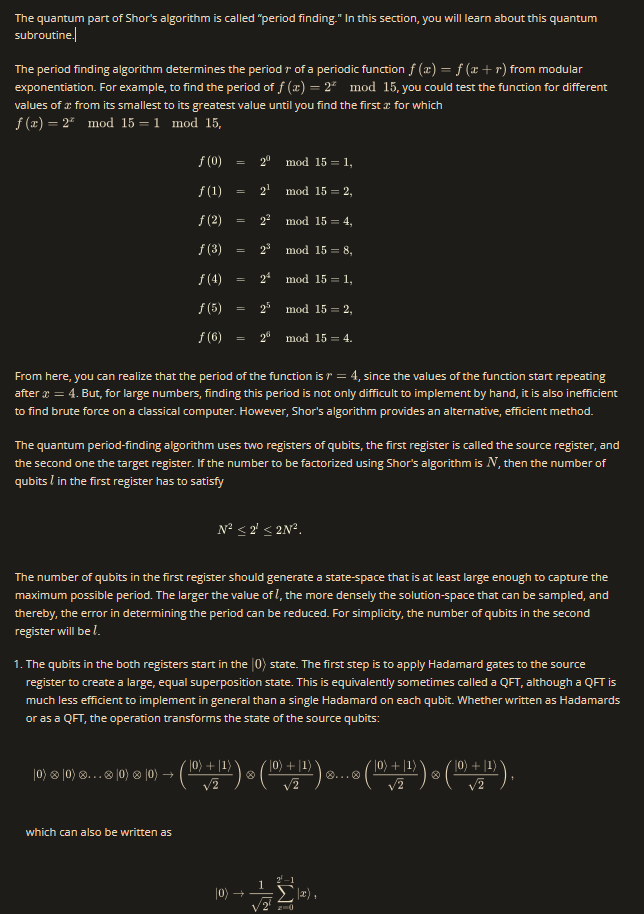

$$f(x) = f(x+r)$$
$$f(x) = 2^{x} \bmod 15 = 1 \bmod 15$$
$$f(0) = 2^{0} \bmod 15 = 1$$
$$f(1) = 2^{1} \bmod 15 = 2$$
$$f(2) = 2^{2} \bmod 15 = 4$$
$$f(3) = 2^{3} \bmod 15 = 8$$
$$f(4) = 2^{4} \bmod 15 = 1$$
$$f(5) = 2^{5} \bmod 15 = 2$$
$$f(6) = 2^{6} \bmod 15 = 4$$
$$N^{2} \le 2^{l} \le 2N^{2}$$
$$|0\rangle\otimes|0\rangle\otimes\ldots\otimes|0\rangle\otimes|0\rangle \rightarrow \left(\frac{|0\rangle+|1\rangle}{\sqrt{2}}\right)\otimes\left(\frac{|0\rangle+|1\rangle}{\sqrt{2}}\right)\otimes\ldots\otimes\left(\frac{|0\rangle+|1\rangle}{\sqrt{2}}\right)\otimes\left(\frac{|0\rangle+|1\rangle}{\sqrt{2}}\right)$$
$$|0\rangle \rightarrow \frac{1}{\sqrt{2^{l}}}\sum_{x=0}^{2^{l}-1}|x\rangle$$

Course-notes page (no video clock) on the period-finding subroutine of Shor's algorithm.

The quantum part of Shor's algorithm is called "period finding." In this section, you will learn about this quantum subroutine.

The period finding algorithm determines the period r of a periodic function f(x) = f(x + r) from modular exponentiation. For example, to find the period of f(x) = 2^x mod 15, you could test the function for different values of x from its smallest to its greatest value until you find the first x for which
$$f(x) = 2^{x} \bmod 15 = 1 \bmod 15,$$

$$f(0) = 2^{0} \bmod 15 = 1,$$
$$f(1) = 2^{1} \bmod 15 = 2,$$
$$f(2) = 2^{2} \bmod 15 = 4,$$
$$f(3) = 2^{3} \bmod 15 = 8,$$
$$f(4) = 2^{4} \bmod 15 = 1,$$
$$f(5) = 2^{5} \bmod 15 = 2,$$
$$f(6) = 2^{6} \bmod 15 = 4.$$

From here, you can realize that the period of the function is r = 4, since the values of the function start repeating after x = 4. But, for large numbers, finding this period is not only difficult to implement by hand, it is also inefficient to find brute force on a classical computer. However, Shor's algorithm provides an alternative, efficient method.

The quantum period-finding algorithm uses two registers of qubits, the first register is called the source register, and the second one the target register. If the number to be factorized using Shor's algorithm is N, then the number of qubits l in the first register has to satisfy
$$N^{2} \le 2^{l} \le 2N^{2}.$$

The number of qubits in the first register should generate a state-space that is at least large enough to capture the maximum possible period. The larger the value of l, the more densely the solution-space can be sampled, and thereby, the error in determining the period can be reduced. For simplicity, the number of qubits in the second register will be l.

1. The qubits in the both registers start in the |0⟩ state. The first step is to apply Hadamard gates to the source register to create a large, equal superposition state. This is equivalently sometimes called a QFT, although a QFT is much less efficient to implement in general than a single Hadamard on each qubit. Whether written as Hadamards or as a QFT, the operation transforms the state of the source qubits:
$$|0\rangle\otimes|0\rangle\otimes\ldots\otimes|0\rangle\otimes|0\rangle \rightarrow \left(\frac{|0\rangle+|1\rangle}{\sqrt{2}}\right)\otimes\left(\frac{|0\rangle+|1\rangle}{\sqrt{2}}\right)\otimes\ldots\otimes\left(\frac{|0\rangle+|1\rangle}{\sqrt{2}}\right)\otimes\left(\frac{|0\rangle+|1\rangle}{\sqrt{2}}\right),$$

which can also be written as
$$|0\rangle \rightarrow \frac{1}{\sqrt{2^{l}}}\sum_{x=0}^{2^{l}-1}|x\rangle.$$

$$\frac{1}{\sqrt{2^{l}}}\sum_{x=0}^{2^{l}-1}|x\rangle|0\rangle$$
$$x \rightarrow f(x) = a^{x} \bmod N$$
$$\frac{1}{\sqrt{2^{l}}}\sum_{x=0}^{2^{l}-1}|x\rangle|a^{x} \bmod N\rangle.$$
$$f(x) = a^{x} \bmod N$$
$$|f(x_0)\rangle = |a^{x_0} \bmod N\rangle$$
$$f(x_0) = f(r+x_0) = f(2r+x_0) = f(3r+x_0) = \ldots = a^{x_0} \bmod N$$
$$f(x) = a^{x_0} \bmod N$$
$$f(x_0) = f(r+x_0) = f(2r+x_0) = \ldots = f\left(\frac{2^{l}}{r}r + x_0\right) = a^{x_0} \bmod N,$$
$$\sum_{y=0}^{2^{l}/r-1} f(yr+x_0) = a^{x_0} \bmod N,$$
$$\frac{1}{\sqrt{2^{l}/r}}\sum_{y=0}^{2^{l}/r-1}|yr+x_0\rangle|f(x_0)\rangle.$$

where now $|0\rangle$ is in the $l$-qubit basis. This leaves the system in the state

$$\frac{1}{\sqrt{2^{l}}}\sum_{x=0}^{2^{l}-1}|x\rangle|0\rangle$$

2. The unitary operation $U_f$ is applied. This gate implements the modular exponentiation, $x \to f(x) = a^x \bmod N$, such that the system ends in the state

$$\frac{1}{\sqrt{2^{l}}}\sum_{x=0}^{2^{l}-1}|x\rangle|a^{x} \bmod N\rangle.$$

From here, you can see that the result of the period function $f(x) = a^x \bmod N$ gets stored on the target register.

3. The second register is measured, and assume that this measurement projects the second register to the state $|f(x_0)\rangle = |a^{x_0} \bmod N\rangle$, where $x_0$ are the unique values of $x$ in the first period of $f(x)$ values.

Now, remember that a periodic function with period $r$ only takes $r$ different values. The function $f(x)$ is unique for distinct periodic values of $x$,

$$f(x_0) = f(r+x_0) = f(2r+x_0) = f(3r+x_0) = \ldots = a^{x_0} \bmod N$$

If the second register is projected to $|f(x_0)\rangle$, the first register will be in a superposition of the states $|x\rangle$ for which $f(x) = a^{x_0} \bmod N$. For simplicity, let's assume that there are $2^l/r$ different values of $x$ for which $f(x) = a^{x_0} \bmod N$, such that

$$f(x_0) = f(r+x_0) = f(2r+x_0) = \ldots = f\left(\frac{2^{l}}{r}r + x_0\right) = a^{x_0} \bmod N,$$

or

$$\sum_{y=0}^{2^{l}/r-1} f(yr+x_0) = a^{x_0} \bmod N,$$

with $y$ an integer from $0$ to $2^l/r - 1$. Once the second register is projected to $|f(x_0)\rangle$, state of the system can be written as

$$\frac{1}{\sqrt{2^{l}/r}}\sum_{y=0}^{2^{l}/r-1}|yr+x_0\rangle|f(x_0)\rangle.$$

$$
\frac{1}{\sqrt{r}}\sum_{z=0}^{r-1}\exp\!\left(\frac{2\pi i}{r} z x_0\right)\left|z\frac{2^l}{r}\right\rangle.
$$
$$
\frac{C}{2^l}=\frac{z}{r}.
$$
$$
\frac{C}{2^l}=a_0+\frac{1}{a_1+\frac{1}{a_2+\cdots}}.
$$
$$
\begin{aligned}
z_0&=a_0,& r_0&=1,\\
z_1&=a_0 a_1+1,& r_1&=a_1,\\
z_n&=a_n z_{n-1}+z_{n-2},& r_n&=a_n r_{n-1}+r_{n-2}.
\end{aligned}
$$

4. Even though the period $r$ is encoded in the first register, a second QFT is applied, leaving the state in the first display. 5. Measuring the first register projects the $l$-qubit system onto $|C\rangle$ with $C=z 2^l/r$. If $\gcd(z,r)=1$, the ratio is an irreducible continued fraction. 6. Test candidate $r_j$ until $\gcd(z_j,r_j)=1$, then evaluate $f(x)=a^x \bmod N$ at $x=r_j$. If $f(r_j)=1$, the period is $r_j$; otherwise return to step 1.

Example: period of $f(x)=11^x \bmod 21$. Choose $l$ so $21^2\le 2^l\le 2\times 21^2$, i.e. $441\le 2^l\le 882$, so $l=9$. All qubits start in $|0\rangle$; Hadamards on the first register.

$$|0\rangle \rightarrow \frac{1}{\sqrt{2^{9}}}\sum_{x=0}^{2^{9}-1}|x\rangle.$$
$$\frac{1}{\sqrt{2^{9}}}\sum_{x=0}^{511}|x\rangle|0\rangle$$
$$\frac{1}{\sqrt{2^{9}}}\sum_{x=0}^{511}|x\rangle|11^{x}\bmod 21\rangle = \frac{1}{\sqrt{2^{9}}}\big(|0\rangle|1\rangle+|1\rangle|11\rangle+|2\rangle|16\rangle+\cdots+|509\rangle|2\rangle+|510\rangle|1\rangle+|511\rangle|11\rangle\big)$$
$$\frac{1}{\sqrt{2^{9}/r}}\sum_{y=0}^{2^{9}/r-1}|yr+2\rangle|16\rangle$$
$$\frac{1}{\sqrt{2^{9}/r}}\sum_{y=0}^{2^{9}/r-1}|yr+2\rangle|16\rangle \rightarrow \frac{1}{\sqrt{r}}\sum_{z=0}^{r-1}\exp\!\left(2\frac{2\pi i}{r}z\right)\left|z\frac{2^{9}}{r}\right\rangle.$$

# Period-finding derivation (continued; frame starts and ends mid-page)

No video player. The visible text begins in the middle of a derivation (factoring via \(11^x \bmod 21\), 9-qubit register).

\[
|0\rangle \rightarrow \frac{1}{\sqrt{2^9}} \sum_{x=0}^{2^9 - 1} |x\rangle.
\]

This leaves the system in the state

\[
\frac{1}{\sqrt{2^9}} \sum_{x=0}^{511} |x\rangle |0\rangle,
\]

where \(|0\rangle\) represents the ground state of 9 qubits.

**2.** The unitary operation \(U_f\) is applied, leaving the system in the state

\[
\frac{1}{\sqrt{2^9}} \sum_{x=0}^{511} |x\rangle |11^x \bmod 21\rangle
\]

\[
= \frac{1}{\sqrt{2^9}} \big(|0\rangle |11^0 \bmod 21\rangle + |1\rangle |11^1 \bmod 21\rangle + |2\rangle |11^2 \bmod 21\rangle\big)
\]

\[
+ \cdots + \big(|509\rangle |11^{509} \bmod 21\rangle + |510\rangle |11^{510} \bmod 21\rangle + |511\rangle |11^{511} \bmod 21\rangle\big)
\]

\[
= \frac{1}{\sqrt{2^9}} \big(|0\rangle |1\rangle + |1\rangle |11\rangle + |2\rangle |16\rangle + \cdots + |509\rangle |2\rangle + |510\rangle |1\rangle + |511\rangle |11\rangle\big)
\]

**3.** Assume the second register is measured, projecting it into the state \(|f(2)\rangle = |16\rangle\). This leaves the first register in

\[
\frac{1}{\sqrt{2^9 / r}} \sum_{y=0}^{2^9 / r - 1} |yr + 2\rangle |16\rangle
\]

\[
= \frac{1}{\sqrt{2^9 / r}} \left(|2\rangle + |r+2\rangle + |2r+2\rangle + \cdots + \left|\left(\frac{2^9}{r} - 1\right)r + 2\right\rangle\right) |16\rangle
\]

**4.** A Quantum Fourier Transform is applied on the first register such that

\[
\frac{1}{\sqrt{2^9 / r}} \sum_{y=0}^{2^9 / r - 1} |yr + 2\rangle |16\rangle \rightarrow \frac{1}{\sqrt{r}} \sum_{z=0}^{r-1} \exp\!\left(2 \frac{2\pi i}{r} z\right) \left| z \frac{2^9}{r} \right\rangle.
\]

**5.** Assume the first register is measured, projecting it into the state \(|427\rangle\). The irreducible fraction of the ratio \(C / 2^9\) is given by

(the sentence is cut off at the bottom of the frame; the fraction itself is not visible).

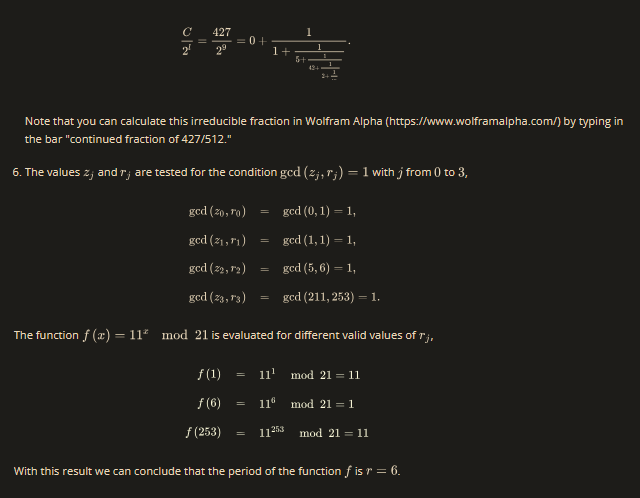

$$\frac{c}{2^l}=\frac{427}{2^9}=0+\cfrac{1}{1+\cfrac{1}{5+\cfrac{1}{42+\cfrac{1}{2}}}}$$
$$\gcd(z_0,r_0)=\gcd(0,1)=1$$
$$\gcd(z_1,r_1)=\gcd(1,1)=1$$
$$\gcd(z_2,r_2)=\gcd(5,6)=1$$
$$\gcd(z_3,r_3)=\gcd(211,253)=1$$
$$f(x)=11^x\bmod 21$$
$$f(1)=11^1\bmod 21=11$$
$$f(6)=11^6\bmod 21=1$$
$$f(253)=11^{253}\bmod 21=11$$
$$r=6$$

Course notes page (no player clock), continued-fraction step of an order-finding example.

\[
\frac{c}{2^l}=\frac{427}{2^9}=0+\cfrac{1}{1+\cfrac{1}{5+\cfrac{1}{42+\cfrac{1}{2}}}}.
\]

Note that you can calculate this irreducible fraction in Wolfram Alpha (https://www.wolframalpha.com/) by typing in the bar "continued fraction of 427/512."

6. The values \(z_j\) and \(r_j\) are tested for the condition \(\gcd(z_j,r_j)=1\) with \(j\) from 0 to 3,

- \(\gcd(z_0,r_0)=\gcd(0,1)=1\)
- \(\gcd(z_1,r_1)=\gcd(1,1)=1\)
- \(\gcd(z_2,r_2)=\gcd(5,6)=1\)
- \(\gcd(z_3,r_3)=\gcd(211,253)=1\)

The function \(f(x)=11^x \bmod 21\) is evaluated for different valid values of \(r_j\),

- \(f(1)=11^1 \bmod 21=11\)
- \(f(6)=11^6 \bmod 21=1\)
- \(f(253)=11^{253} \bmod 21=11\)

With this result we can conclude that the period of the function \(f\) is \(r=6\).

## **Transcript (video in this pageonly text )**

## **PRACTICE (no practice in this page)**

##  

## 

Section

# Page Title

## **Learn**

The quantum part of Shor\'s algorithm is called "period finding.\" In
this section, you will learn about this quantum subroutine.

## **Images**

## **Transcript** 

## **PRACTICE** 

##  

## 

Deep dive. cryptography and shor\'s algorithm

# Shor\'s algorithm: reduction of factoring to order finding 

## **Learn**

In the next several videos and text units, you will take a deep dive
with Peter Shor into several details behind Shor\'s algorithm, including
a discussion of the reduction of factoring to order finding, the related
Simon\'s algorithm that helped inspire Shor\'s algorithm, and the use of
Shor\'s algorithm to perform order finding.

## **Images**

$$N=PQ$$
$$x^{2}\equiv y^{2}\pmod{N},\qquad x\not\equiv \pm y\pmod{N}$$
$$4\equiv 25\pmod{21}$$
$$2^{2}\equiv 5^{2}$$
$$(5-2)(5+2)\equiv 0\pmod{21}$$

# Factoring (quadratic sieve)

Chalkboard. No video player clock is visible. A faint play-button overlay sits on the middle of the board.

\[
N = PQ
\]

Find

\[
x^2 \equiv y^2 \pmod{N}
\]

\[
x \not\equiv \pm y \pmod{N}
\]

Example:

\[
4 \equiv 25 \pmod{21}
\]

\[
2^2 \equiv 5^2
\]

\[
(5 - 2)(5 + 2) \equiv 0 \pmod{21}
\]

## **Transcript** 

0

00:00:00,000 \--\> 00:00:00,500

1

00:00:00,500 \--\> 00:00:03,890

How do you get factoring from order finding?

2

00:00:03,890 \--\> 00:00:08,570

So first, let me say the second fastest classical algorithm is

3

00:00:08,570 \--\> 00:00:10,340

the quadratic sieve.

4

00:00:10,340 \--\> 00:00:13,470

So I'd say most classical algorithms...

5

00:00:13,470 \--\> 00:00:20,810

So suppose you have N equals P times Q. Actually, they

6

00:00:20,810 \--\> 00:00:23,240

work in more general cases, but we\'ll just worry

7

00:00:23,240 \--\> 00:00:28,700

about the case of two products.

8

00:00:28,700 \--\> 00:00:32,030

So the first step, really the only step,

9

00:00:32,030 \--\> 00:00:36,140

the trick is to find x squared congruent to y

10

00:00:36,140 \--\> 00:00:43,740

squared mod N x not congruent to plus or minus y mod N.

11

00:00:43,740 \--\> 00:00:46,670

So suppose you\'re trying to factor 21.

12

00:00:46,670 \--\> 00:00:52,970

You get 4 is congruent to 25 mod 21, right?

13

00:00:52,970 \--\> 00:00:58,550

Because 25 minus 4 is a multiple of 21.

14

00:00:58,550 \--\> 00:01:01,310

So 4, these are both squares.

15

00:01:01,310 \--\> 00:01:05,900

And now we have 5 minus 2 times 5 plus 2

16

00:01:05,900 \--\> 00:01:09,140

is congruent to zero mod 21.

17

00:01:09,140 \--\> 00:01:13,270

And whenever this happens, one of these

18

00:01:13,270 \--\> 00:01:19,970

contains P and the other contains Q.

19

00:01:19,970 \--\> 00:01:28,610

Or rather, whenever neither of these is 0,

20

00:01:28,610 \--\> 00:01:32,930

you have a product of two numbers, which is zero mod 21.

21

00:01:32,930 \--\> 00:01:37,850

And so we know that the product has to contain three somewhere,

22

00:01:37,850 \--\> 00:01:40,550

and it has to contain \[INAUDIBLE\] somewhere.

23

00:01:40,550 \--\> 00:01:44,810

And if neither of these factors is 0 mod 21,

24

00:01:44,810 \--\> 00:01:49,400

3 has to be contained in one factor and 7 in the other.

25

00:01:49,400 \--\> 00:01:56,360

And then what you can do is you can use Euclid\'s algorithm

26

00:01:56,360 \--\> 00:02:03,560

for gcd to get P and Q.

27

00:02:03,560 \--\> 00:02:08,060

So whenever you get two squares, which are equal to each other,

28

00:02:08,060 \--\> 00:02:10,039

you\'re essentially done.

29

00:02:10,039 \--\> 00:02:13,500

And this is how the quadratic sieve works.

30

00:02:13,500 \--\> 00:02:15,970

And that\'s the second fastest classical factoring algorithm

31

<!-- frame 2:16 · formula · week1/media/media/image3.png -->

$$
N = PQ
$$
$$
x^{2} = y^{2} \pmod{N}
$$
$$
x \neq \pm y \pmod{N}
$$
$$
4 \equiv 25 \pmod{21}
$$
$$
2^{2} \equiv 5^{2}
$$
$$
(5 - 2)(5 + 2) \equiv 0 \pmod{21}
$$

# Factoring (quadratic sieve)

Chalkboard. Find x² = y² (mod N) with x ≠ ± y (mod N).

Worked example: 4 ≡ 25 (mod 21), written also as 2² ≡ 5², so (5 − 2)(5 + 2) ≡ 0 (mod 21). An arrow to the left factor (5 − 2) is labeled “contains P”; an arrow to the right factor (5 + 2) is labeled “contains Q”.

00:02:15,970 \--\> 00:02:18,210

known.

32

00:02:18,210 \--\> 00:02:23,180

How do we find x squared y squared?

33

00:02:23,180 \--\> 00:02:33,080

Well, let\'s look at the function f of x equals g to the x mod N.

34

00:02:33,080 \--\> 00:02:41,990

So this is periodic because if g to the r is congruent to 1,

35

00:02:41,990 \--\> 00:02:52,160

then g to the x plus r is congruent to g to the x mod N.

36

00:02:52,160 \--\> 00:02:55,850

Because if g to the r plus is congruent to 1,

37

00:02:55,850 \--\> 00:02:59,090

then g to the x plus r congruent to g to the x\--

38

00:02:59,090 \--\> 00:03:02,000

because it\'s just multiplying both sides of this by g

39

00:03:02,000 \--\> 00:03:03,230

to the x.

40

00:03:03,230 \--\> 00:03:08,980

So that says that f of x is periodic.

41

00:03:08,980 \--\> 00:03:12,230

I mean, it has to start repeating some time

42

00:03:12,230 \--\> 00:03:17,820

because there are only N possible things here.

43

00:03:17,820 \--\> 00:03:19,540

And whenever it starts repeating,

44

00:03:19,540 \--\> 00:03:22,780

you get a g to the x plus r congruent to g to the x.

45

00:03:22,780 \--\> 00:03:26,590

And that means g to the r is congruent to 1.

46

00:03:26,590 \--\> 00:03:30,845

g to the r over 2 squared is congruent to 1

47

00:03:30,845 \--\> 00:03:34,730

squared if r is even.

48

<!-- frame 3:32 · formula · week1/media/media/image6.png -->

$$
f(x) = g^{x} \pmod{N}
$$
$$
\text{If } g^{r} \equiv 1,\ \text{then } g^{x+r} \equiv g^{x} \pmod{N}
$$
$$
\left(g^{r/2}\right)^{2} \equiv 1^{2}
$$

# How do we find x² and y²?

Chalkboard.

- f(x) = gˣ (mod N)
- If gʳ ≡ 1, then g^{x+r} ≡ gˣ (mod N)
- (g^{r/2})² ≡ 1² (If r is even). The letter r in “If r is even” is highlighted blue.

00:03:34,730 \--\> 00:03:36,930

So let\'s do an example.

49

00:03:36,930 \--\> 00:03:40,230

Suppose we\'re trying to factor 21.

50

00:03:40,230 \--\> 00:03:43,930

So 2 to the 0, 2 to the first, 2 squared, et cetera.

51

00:03:43,930 \--\> 00:03:49,580

So this is 1, 2, 4, 8, 16, 32.

52

00:03:49,580 \--\> 00:03:54,850

32 minus 21 is 11, so the next column then is 11.

53

00:03:54,850 \--\> 00:03:58,070

And 22 minus 21 is 1.

54

00:03:58,070 \--\> 00:04:00,600

1\.

55

00:04:00,600 \--\> 00:04:09,200

So 2 to the sixth is congruent to 1 mod 21.

56

00:04:09,200 \--\> 00:04:14,990

That means 2 cubed minus 1 minus times 2 cubed plus 1 is

57

00:04:14,990 \--\> 00:04:18,579

congruent to 0 mod 21.

58

00:04:18,579 \--\> 00:04:22,340

And this is 7 and this is 9.

59

<!-- frame 4:22 · formula · week1/media/media/image27.png -->

$$2^{0},\ 2^{1},\ 2^{2},\ 2^{3},\ 2^{4},\ 2^{5},\ 2^{6},\ 2^{7}\ldots$$
$$1,\ 2,\ 4,\ 8,\ 16,\ 11,\ 1,\ 2\ldots$$
$$2^{6} \equiv 1 \pmod{21}$$
$$(2^{3}-1)(2^{3}+1) \equiv 0 \pmod{21}$$
$$7 \qquad 9$$

Chalkboard example, factoring 21 from the order of 2 modulo 21.

21

Powers: 2^0, 2^1, 2^2, 2^3, 2^4, 2^5, 2^6, 2^7...

Values mod 21: 1, 2, 4, 8, 16, 11, 1, 2...

2^6 ≡ 1 (mod 21)

(2^3 − 1)(2^3 + 1) ≡ 0 (mod 21)

The two factors are labeled 7 and 9.

00:04:22,340 \--\> 00:04:29,400

And 7 contains the factor 7, 9 contains the factor 3.

60

00:04:29,400 \--\> 00:04:32,190

So the question is how can this go wrong?

61

00:04:32,190 \--\> 00:04:37,700

And well, there\'s a couple of things that could go wrong.

62

00:04:37,700 \--\> 00:04:40,320

We could have started with 4.

63

00:04:40,320 \--\> 00:04:42,690

4, 16.

64

00:04:42,690 \--\> 00:04:48,970

16 squared, well, we know 2 to the sixth is congruent to 1 mod

65

00:04:48,970 \--\> 00:04:49,470

21\.

66

00:04:49,470 \--\> 00:04:54,230

So 4 cubed is congruent to 1 mod 21.

67

00:04:54,230 \--\> 00:05:02,100

So we get 4 cubed is congruent to 1 mod 21.

68

00:05:02,100 \--\> 00:05:07,790

4 to the 3/2 doesn\'t exist.

69

00:05:07,790 \--\> 00:05:11,280

Well, we can\'t compute it.

70

00:05:11,280 \--\> 00:05:14,510

So this shows that 4 could go wrong.

71

<!-- frame 5:12 · formula · week1/media/media/image49.png -->

$$4^0,\ 4^1,\ 4^2,\ 4^3,\ 4^4,\ldots$$
$$4^3\equiv 1\pmod{21}$$
$$4^{3/2}$$

Chalkboard title: How can this go wrong?

Could have started with 4

\(4^0,\ 4^1,\ 4^2,\ 4^3,\ 4^4,\ldots\)

\(1,\ 4,\ 16,\ 1,\ 4,\ldots\)

\(4^3\equiv 1 \pmod{21}\)

\(4^{3/2}\) ← can't compute it
(exponent must be an integer)

00:05:14,510 \--\> 00:05:18,420

The only thing that could go wrong is we could do this.

72

00:05:18,420 \--\> 00:05:24,890

And when we look at the middle element, it\'s minus 1.

73

00:05:24,890 \--\> 00:05:29,180

And that would be a problem because then we

74

00:05:29,180 \--\> 00:05:35,990

have x is equal to minus y mod N.

75

00:05:35,990 \--\> 00:05:41,740

And we can\'t use that, we can\'t use this trick then.

76

00:05:41,740 \--\> 00:05:46,310

So some things can go wrong, but the great theorem

77

00:05:46,310 \--\> 00:05:53,440

is probability of success with g to the xth

78

00:05:53,440 \--\> 00:06:00,320

is greater than or equal to 1/2 for a random g between 0

79

00:06:00,320 \--\> 00:06:05,150

or a random g less than N.

80

<!-- frame 6:01 · formula · week1/media/media/image9.png -->

$$
g^{x} \geq \frac{1}{2} \quad \text{for random } g < N
$$

Chalkboard heading: Probability of success with gˣ ≥ 1/2 for random g < N.

00:06:05,150 \--\> 00:06:08,570

So you choose a random g less than N.

81

00:06:08,570 \--\> 00:06:13,220

You do this repeated squaring.

82

00:06:13,220 \--\> 00:06:22,830

And the probability this will work is at least 1/2.

83

00:06:22,830 \--\> 00:06:25,530

And if it doesn\'t work, you choose another random g.

84

00:06:25,530 \--\> 00:06:28,980

So eventually, with high probability,

85

00:06:28,980 \--\> 00:06:33,050

you will get a g which lets you factor.

86

00:06:33,050 \--\> 00:06:39,019

## **PRACTICE (there is no practice in this page)**

##  

## 

Deep dive. cryptography and shor\'s algorithm

# Shor's Algorithm: introduction to the short quantum factorization algorithm 

## **Learn**

The quantum part of Shor\'s algorithm is called "period finding.\" In
this section, you will learn about this quantum subroutine.

## **Images**

## **Transcript**

0

00:00:00,000 \--\> 00:00:00,500

1

00:00:00,500 \--\> 00:00:02,790

I discovered the factoring algorithm

2

00:00:02,790 \--\> 00:00:06,930

after seeing Simon\'s algorithm before before Simon\'s algorithm

3

00:00:06,930 \--\> 00:00:08,800

actually got published.

4

00:00:08,800 \--\> 00:00:12,540

And I\'m going to show you\--

5

00:00:12,540 \--\> 00:00:15,390

write down a circuit diagram so you can see the similarity.

6

00:00:15,390 \--\> 00:00:19,380

So Simon\'s algorithm, remember, we started with n qubits

7

00:00:19,380 \--\> 00:00:21,480

in the plus.

8

00:00:21,480 \--\> 00:00:28,830

And then we went, and here is a black box

9

00:00:28,830 \--\> 00:00:34,050

that computes 0 to the n.

10

00:00:34,050 \--\> 00:00:36,600

From x, it computes f of x.

11

00:00:36,600 \--\> 00:00:41,220

And then we did a Hadamard transform

12

00:00:41,220 \--\> 00:00:52,600

to the n, which is just the quantum Fourier transform over

13

00:00:52,600 \--\> 00:00:57,610

the group of two elements to the n-th power.

14

00:00:57,610 \--\> 00:01:00,800

So n copies of the group of two elements.

15

00:01:00,800 \--\> 00:01:06,560

So this is just binary strings under addition without carries.

16

00:01:06,560 \--\> 00:01:13,400

And after that, I believe you measured this register,

17

00:01:13,400 \--\> 00:01:17,300

and then did classical post-processing.

18

<!-- frame 1:17 · diagram · week1/media/media/image67.png -->

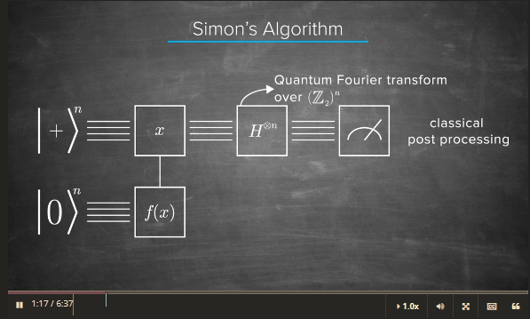

$$|+\rangle^{n}\xrightarrow{\;x\;} H^{\otimes n}\;\text{measure},\qquad |0\rangle^{n}\xrightarrow{\;f(x)\;}$$
$$H^{\otimes n}=\text{QFT over }(\mathbb{Z}_2)^{n}$$

# Simon's Algorithm

Chalkboard circuit.

- **Top register** enters as \(|+\rangle^{n}\) (a bundle of \(n\) wires). It passes through a box labeled \(x\), then a box \(H^{\otimes n}\), then a measurement symbol. To the right: **classical post processing**.
- An arrow labels the \(H^{\otimes n}\) box: **Quantum Fourier transform over \((\mathbb{Z}_2)^n\)**.
- **Bottom register** enters as \(|0\rangle^{n}\) and passes through a box \(f(x)\). A vertical wire ties the \(x\) box to the \(f(x)\) box (the oracle).

Video player clock: 1:17 / 6:37.

00:01:17,300 \--\> 00:01:21,590

So what is factoring?

19

00:01:21,590 \--\> 00:01:23,990

So what we\'re not going to do directly

20

00:01:23,990 \--\> 00:01:26,360

is a quantum algorithm for factoring.

21

00:01:26,360 \--\> 00:01:31,450

We\'re going to do a quantum algorithm for order finding\--

22

00:01:31,450 \--\> 00:01:37,880

quantum algorithm for periodicity.

23

00:01:37,880 \--\> 00:01:43,860

So suppose we have a function over

24

00:01:43,860 \--\> 00:01:54,140

integers, f of x is equal to f of x plus c for some c.

25

00:01:54,140 \--\> 00:01:57,020

And here you can see that f of x 2c

26

00:01:57,020 \--\> 00:02:01,460

equals f of x plus 3c, et cetera.

27

00:02:01,460 \--\> 00:02:06,770

So it\'s a periodic function, and a period is\--

28

00:02:06,770 \--\> 00:02:10,077

well, I\'m calling it C right now,

29

00:02:10,077 \--\> 00:02:11,660

but at some point during this lecture,

30

00:02:11,660 \--\> 00:02:14,840

I\'m going to start calling it r because that\'s

31

00:02:14,840 \--\> 00:02:17,450

what I\'m used to calling it.

32

00:02:17,450 \--\> 00:02:18,380

Find c.

33

00:02:18,380 \--\> 00:02:21,530

34

00:02:21,530 \--\> 00:02:23,120

Now you might think this is easy.

35

00:02:23,120 \--\> 00:02:26,960

You just start with f of 0, f of 1, f of 2, f of 3,

36

00:02:26,960 \--\> 00:02:30,510

and keep on going until f starts repeating.

37

00:02:30,510 \--\> 00:02:39,460

So even if period is exponentially long.

38

<!-- frame 2:33 · formula · week1/media/media/image71.png -->

$$f(x)=f(x+c)\quad\text{for some }c$$
$$f(x)=f(x+c)=f(x+2c)=f(x+3c)\ldots$$

# Quantum Algorithm for Periodicity

Suppose we have a function over \(\mathbb{Z}\)

\[
f(x) = f(x+c) \quad \text{for some } c
\]

\[
f(x) = f(x+c) = f(x+2c) = f(x+3c)\ldots
\]

In blue: **Find \(c\), even if period is exponentially long.**

Video player clock: 2:33 / 6:37.

00:02:39,460 \--\> 00:02:42,650

And that means that if you want to try

39

00:02:42,650 \--\> 00:02:54,560

to find a period of length r, we can do this length polynomial

40

00:02:54,560 \--\> 00:02:55,640

and log of r.

41

00:02:55,640 \--\> 00:02:58,820

42

00:02:58,820 \--\> 00:03:05,130

So we can find the period.

43

00:03:05,130 \--\> 00:03:07,970

And on the classical computer, if you have a black box

44

00:03:07,970 \--\> 00:03:12,440

function, the best you can do is just keep on testing values

45

00:03:12,440 \--\> 00:03:13,680

until it starts repeating.

46

00:03:13,680 \--\> 00:03:18,410

So that means the best you can do is period r.

47

00:03:18,410 \--\> 00:03:21,930

And in quantum mechanics, quantum computing,

48

00:03:21,930 \--\> 00:03:23,330

you can do log r.

49

00:03:23,330 \--\> 00:03:26,090

So it\'s going to be exponentially long in a period

50

00:03:26,090 \--\> 00:03:29,170

of a number, we want to factor.

51

00:03:29,170 \--\> 00:03:30,800

But if we\'re just finding period\--

52

00:03:30,800 \--\> 00:03:37,460

53

00:03:37,460 \--\> 00:03:44,690

find period in time O of log c.

54

00:03:44,690 \--\> 00:03:49,530

55

00:03:49,530 \--\> 00:03:53,160

So we will be able to find the period and time\--

56

00:03:53,160 \--\> 00:04:00,212

well, that\'s actually going to be quicker than log c if we

57

00:04:00,212 \--\> 00:04:01,420

really want to do it quicker.

58

00:04:01,420 \--\> 00:04:05,000

Log c squared if we want to do it quicker because we can not

59

00:04:05,000 \--\> 00:04:07,670

use the exact quantum Fourier transform,

60

00:04:07,670 \--\> 00:04:09,900

but the approximate quantum Fourier transform,

61

00:04:09,900 \--\> 00:04:13,860

which has like log c, log log c gates..

62

00:04:13,860 \--\> 00:04:18,089

But here, so we want to find a period.

63

00:04:18,089 \--\> 00:04:21,029

We have a black box function for f.

64

00:04:21,029 \--\> 00:04:24,800

And f has some period of c.

65

00:04:24,800 \--\> 00:04:27,924

So what is the quantum algorithm for this?

66

00:04:27,924 \--\> 00:04:30,090

Well, we\'re going to do exactly the same thing here.

67

00:04:30,090 \--\> 00:04:33,900

We\'re going to start at plus to the c, 0, the n here.

68

00:04:33,900 \--\> 00:04:38,750

69

00:04:38,750 \--\> 00:04:42,120

And here we have a black box function,

70

00:04:42,120 \--\> 00:04:46,190

which if you put in x, it computes f of x.

71

00:04:46,190 \--\> 00:04:48,510

Or actually, it computes\--

72

00:04:48,510 \--\> 00:05:00,710

well, remember this took x, t to x, t xr f of x.

73

00:05:00,710 \--\> 00:05:02,900

We can assume this does the same thing.

74

00:05:02,900 \--\> 00:05:10,310

x, t to x t xr f of x.

75

00:05:10,310 \--\> 00:05:13,370

And now here\'s the only difference, really,

76

00:05:13,370 \--\> 00:05:14,720

between the circuits.

77

00:05:14,720 \--\> 00:05:20,480

We use the quantum for each transform over 2 to the\--

78

00:05:20,480 \--\> 00:05:22,760

actually, let\'s do this right.

79

00:05:22,760 \--\> 00:05:25,220

There\'s 2n.

80

00:05:25,220 \--\> 00:05:27,870

We want 2n qubits here, n qubits here.

81

00:05:27,870 \--\> 00:05:31,250

Quantum Fourier transform over 2 to the n.

82

00:05:31,250 \--\> 00:05:32,870

And then we measure.

83

00:05:32,870 \--\> 00:05:36,080

And then we do classical post-processing.

84

<!-- frame 5:36 · diagram · week1/media/media/image19.png -->

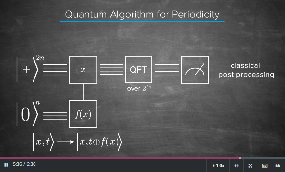

$$|+\rangle^{2n}$$
$$|0\rangle^{n}$$
$$|x,t\rangle \rightarrow |x, t \oplus f(x)\rangle$$

Title: Quantum Algorithm for Periodicity

Chalkboard quantum-circuit diagram.

- Top register starts in $|+\rangle^{2n}$ (three bundled wires). It enters a box labeled $x$, then a box labeled QFT with the caption "over $2^{2n}$", then a measurement box (meter symbol). To the right of the measurement: "classical post processing".
- Bottom register starts in $|0\rangle^{n}$ (three bundled wires) and enters a box labeled $f(x)$. A vertical wire connects the $x$ box down to the $f(x)$ box.
- Under the circuit: $|x,t\rangle \rightarrow |x, t \oplus f(x)\rangle$.

00:05:36,080 \--\> 00:05:37,430

So it looks very similar.

85

00:05:37,430 \--\> 00:05:40,680

86

00:05:40,680 \--\> 00:05:41,891

So let\'s go into the detail\--

87

00:05:41,891 \--\> 00:05:42,390

yeah?

88

00:05:42,390 \--\> 00:05:45,080

In both these cases, what happens to the bottom branch?

89

00:05:45,080 \--\> 00:05:47,750

We do nothing to the bottom branch.

90

00:05:47,750 \--\> 00:05:54,620

I mean, if we want to, we could measure the bottom branch

91

00:05:54,620 \--\> 00:05:56,750

and throw away the results.

92

00:05:56,750 \--\> 00:05:59,150

Or we don\'t have to.

93

00:05:59,150 \--\> 00:06:02,600

Because if you measure something and throw away the results,

94

00:06:02,600 \--\> 00:06:05,330

it doesn\'t matter whether or not you measure it.

95

00:06:05,330 \--\> 00:06:07,370

But we do need to compute it.

96

00:06:07,370 \--\> 00:06:09,600

Because if you don\'t compute it, what have we done?

97

00:06:09,600 \--\> 00:06:13,160

We\'ve taken the Hadamard transform of x to the n.

98

00:06:13,160 \--\> 00:06:14,120

That\'s just all 0\'s.

99

00:06:14,120 \--\> 00:06:18,170

So if you don\'t compute f of x, it

100

00:06:18,170 \--\> 00:06:21,710

destroys the interference in the upper half.

101

00:06:21,710 \--\> 00:06:28,200

Again, action in a quantum circuit has back action.

102

00:06:28,200 \--\> 00:06:36,139

## **PRACTICE (no practice in this page)**

##  

## 

Deep dive. cryptography and shor\'s algorithm

# Simon's Algorithm

## **Learn**

In the last video, Professor Shor mentioned *Simon\'s Algorithm* as a
motivation for his discovery of the factoring algorithm. In this text
unit, we\'ll learn how Simon\'s algorithm works and see how it relates
to Shor\'s algorithm.

Assume we have a function that maps each -bit binary number to another
-bit binary number. is known to be either a *one-to-one* or *two-to-one*
with the following restrictions:

## **Images**

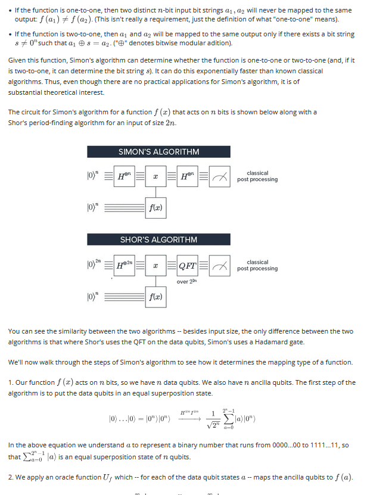

$$f(a_1)\neq f(a_2)$$
$$a_1\oplus s=a_2,\quad s\neq 0^n$$
$$|0\rangle\ldots|0\rangle=|0^n\rangle|0^n\rangle\xrightarrow{H^{\otimes n} I^{\otimes n}}\frac{1}{\sqrt{2^n}}\sum_{a=0}^{2^n-1}|a\rangle|0^n\rangle$$

Course text page (no player clock), Simon's algorithm compared with Shor.

- If the function is one-to-one, then two distinct \(n\)-bit input bit strings \(a_1, a_2\) will never be mapped to the same output: \(f(a_1)\neq f(a_2)\). (This isn't really a requirement, just the definition of what "one-to-one" means).
- If the function is two-to-one, then \(a_1\) and \(a_2\) will be mapped to the same output only if there exists a bit string \(s\neq 0^n\) such that \(a_1\oplus s=a_2\). ("\(\oplus\)" denotes bitwise modular addition).

Given this function, Simon's algorithm can determine whether the function is one-to-one or two-to-one (and, if it is two-to-one, it can determine the bit string \(s\)). It can do this exponentially faster than known classical algorithms. Thus, even though there are no practical applications for Simon's algorithm, it is of substantial theoretical interest.

The circuit for Simon's algorithm for a function \(f(x)\) that acts on \(n\) bits is shown below along with a Shor's period-finding algorithm for an input of size \(2n\).

**SIMON'S ALGORITHM** (both registers are bundles of \(n\) wires)
- Top `|0⟩^n`: \(H^{\otimes n}\) — oracle box labeled \(x\) — \(H^{\otimes n}\) — measurement — classical post processing
- Bottom `|0⟩^n`: oracle box \(f(x)\), wired vertically to the \(x\) box

**SHOR'S ALGORITHM**
- Top `|0⟩^{2n}`: \(H^{\otimes 2n}\) — oracle box \(x\) — QFT labeled "over \(2^{2n}\)" — measurement — classical post processing
- Bottom `|0⟩^n`: oracle box \(f(x)\)

You can see the similarity between the two algorithms — besides input size, the only difference between the two algorithms is that where Shor's uses the QFT on the data qubits, Simon's uses a Hadamard gate.

We'll now walk through the steps of Simon's algorithm to see how it determines the mapping type of a function.

1. Our function \(f(x)\) acts on \(n\) bits, so we have \(n\) data qubits. We also have \(n\) ancilla qubits. The first step of the algorithm is to put the data qubits in an equal superposition state.

\[
|0\rangle\ldots|0\rangle=|0^n\rangle|0^n\rangle\xrightarrow{H^{\otimes n} I^{\otimes n}}\frac{1}{\sqrt{2^n}}\sum_{a=0}^{2^n-1}|a\rangle|0^n\rangle
\]

In the above equation we understand \(a\) to represent a binary number that runs from 0000...00 to 1111...11, so that \(\sum_{a=0}^{2^n-1}|a\rangle\) is an equal superposition state of \(n\) qubits.

2. We apply an oracle function \(U_f\) which — for each of the data qubit states \(a\) — maps the ancilla qubits to \(f(a)\).

The frame cuts off at the start of the next displayed equation.

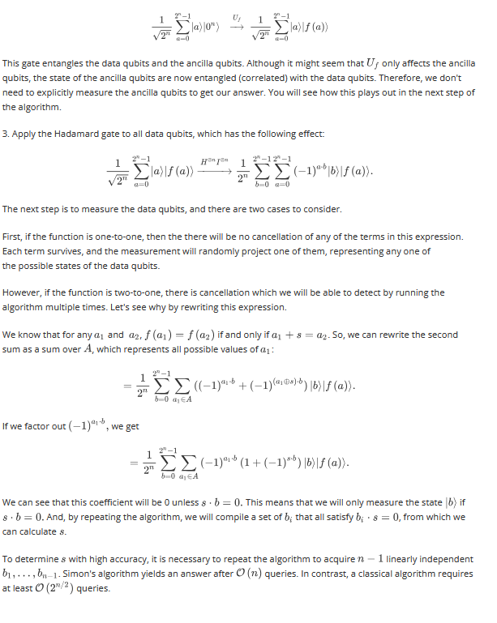

$$\frac{1}{\sqrt{2^{n}}}\sum_{a=0}^{2^{n}-1}|a\rangle|0^{n}\rangle \xrightarrow{U_f} \frac{1}{\sqrt{2^{n}}}\sum_{a=0}^{2^{n}-1}|a\rangle|f(a)\rangle$$
$$\frac{1}{\sqrt{2^{n}}}\sum_{a=0}^{2^{n}-1}|a\rangle|f(a)\rangle \xrightarrow{H^{\otimes n} I^{\otimes n}} \frac{1}{2^{n}}\sum_{b=0}^{2^{n}-1}\sum_{a=0}^{2^{n}-1}(-1)^{a\cdot b}|b\rangle|f(a)\rangle.$$
$$= \frac{1}{2^{n}}\sum_{b=0}^{2^{n}-1}\sum_{a_1\in A}\left((-1)^{a_1\cdot b}+(-1)^{(a_1\oplus s)\cdot b}\right)|b\rangle|f(a_1)\rangle.$$
$$= \frac{1}{2^{n}}\sum_{b=0}^{2^{n}-1}\sum_{a_1\in A}(-1)^{a_1\cdot b}\left(1+(-1)^{s\cdot b}\right)|b\rangle|f(a_1)\rangle.$$

Course-notes page (no video clock) continuing Simon's algorithm.

Shown state after the oracle:
$$\frac{1}{\sqrt{2^{n}}}\sum_{a=0}^{2^{n}-1}|a\rangle|0^{n}\rangle \xrightarrow{U_f} \frac{1}{\sqrt{2^{n}}}\sum_{a=0}^{2^{n}-1}|a\rangle|f(a)\rangle$$

This gate entangles the data qubits and the ancilla qubits. Although it might seem that U_f only affects the ancilla qubits, the state of the ancilla qubits are now entangled (correlated) with the data qubits. Therefore, we don't need to explicitly measure the ancilla qubits to get our answer. You will see how this plays out in the next step of the algorithm.

3. Apply the Hadamard gate to all data qubits, which has the following effect:
$$\frac{1}{\sqrt{2^{n}}}\sum_{a=0}^{2^{n}-1}|a\rangle|f(a)\rangle \xrightarrow{H^{\otimes n} I^{\otimes n}} \frac{1}{2^{n}}\sum_{b=0}^{2^{n}-1}\sum_{a=0}^{2^{n}-1}(-1)^{a\cdot b}|b\rangle|f(a)\rangle.$$

The next step is to measure the data qubits, and there are two cases to consider.

First, if the function is one-to-one, then there will be no cancellation of any of the terms in this expression. Each term survives, and the measurement will randomly project one of them, representing any one of the possible states of the data qubits.

However, if the function is two-to-one, there is cancellation which we will be able to detect by running the algorithm multiple times. Let's see why by rewriting this expression.

We know that for any a_1 and a_2, f(a_1) = f(a_2) if and only if a_1 + s = a_2. So, we can rewrite the second sum as a sum over A, which represents all possible values of a_1:
$$= \frac{1}{2^{n}}\sum_{b=0}^{2^{n}-1}\sum_{a_1\in A}\left((-1)^{a_1\cdot b}+(-1)^{(a_1\oplus s)\cdot b}\right)|b\rangle|f(a_1)\rangle.$$

If we factor out (−1)^{a_1·b}, we get
$$= \frac{1}{2^{n}}\sum_{b=0}^{2^{n}-1}\sum_{a_1\in A}(-1)^{a_1\cdot b}\left(1+(-1)^{s\cdot b}\right)|b\rangle|f(a_1)\rangle.$$

We can see that this coefficient will be 0 unless s · b = 0. This means that we will only measure the state |b⟩ if s · b = 0. And, by repeating the algorithm, we will compile a set of b_i that all satisfy b_i · s = 0, from which we can calculate s.

To determine s with high accuracy, it is necessary to repeat the algorithm to acquire n − 1 linearly independent b_1, …, b_{n−1}. Simon's algorithm yields an answer after O(n) queries. In contrast, a classical algorithm requires at least O(2^{n/2}) queries.

## **Transcript (no video)**

## **PRACTICE (no practice)**

##  

## 

Deep dive. cryptography and shor\'s algorithm

# Shor\'s Algorithm: Detailed Steps of the Quantum Order Finding Algorithm 

## **Learn**

## **Images**

## **Transcript** 

0

00:00:00,000 \--\> 00:00:00,500

1

00:00:00,500 \--\> 00:00:02,070

What is the algorithm in detail?

2

00:00:02,070 \--\> 00:00:05,550

So suppose we have a bound on r\--

3

00:00:05,550 \--\> 00:00:07,950

maybe I should call it r-max\--

4

00:00:07,950 \--\> 00:00:13,830

and choose a power of 2 bigger than 2 r-max.

5

00:00:13,830 \--\> 00:00:18,990

And well, I will write down the algorithm.

6

00:00:18,990 \--\> 00:00:23,580

We start with plus to the 2l 0.

7

00:00:23,580 \--\> 00:00:24,330

That\'s here.

8

00:00:24,330 \--\> 00:00:35,660

Next, we take the compute f with x.

9

00:00:35,660 \--\> 00:00:39,560

And you know, whatever ends in the first register,

10

00:00:39,560 \--\> 00:00:41,330

we compute that in the second register.

11

00:00:41,330 \--\> 00:00:48,000

But this is just sum i equals 0 to 2 to the 2l.

12

00:00:48,000 \--\> 00:00:54,140

i, where i is just the binary representation of the number.

13

00:00:54,140 \--\> 00:01:00,560

And we need to divide by 2 to the l because we

14

00:01:00,560 \--\> 00:01:02,730

want this to be a unit vector.

15

00:01:02,730 \--\> 00:01:04,670

So we compute f.

16

00:01:04,670 \--\> 00:01:12,254

So this becomes sum to the 2l i f of i.

17

00:01:12,254 \--\> 00:01:15,100

i equals 0 to 2 to the 2l.

18

00:01:15,100 \--\> 00:01:17,930

Do the quantum Fourier transform.

19

00:01:17,930 \--\> 00:01:22,670

So that\'s 1 over to 2 to the 2l summation.

20

00:01:22,670 \--\> 00:01:25,700

You know, i is a really bad letter

21

00:01:25,700 \--\> 00:01:29,750

to use because it\'s also the square root of minus 1.

22

00:01:29,750 \--\> 00:01:33,590

So let\'s use x.

23

00:01:33,590 \--\> 00:01:37,040

So the quantum Fourier transform takes

24

00:01:37,040 \--\> 00:01:43,606

x to, let\'s call it, z f of x.

25

00:01:43,606 \--\> 00:01:50,330

z equals 0 to 2 to the 2l minus 1. e to the 2 pi i xz

26

<!-- frame 1:49 · formula · week1/media/media/image43.png -->

$$2^l>2r_{\max}$$
$$|+\rangle^{2l}|0\rangle=\frac{1}{2^l}\sum_{x=0}^{2^{2l}-1}|x\rangle$$
$$\frac{1}{2^l}\sum_{x=0}^{2^{2l}-1}|x\rangle|f(x)\rangle$$
$$\frac{1}{2^{2l}}\sum_{z=0}^{2^{2l}-1}|z\rangle|f(x)\rangle\, e^{-2\pi i x z/2^{2l}}$$

Chalkboard title: Quantum Order Finding Algorithm

Suppose we have a bound on \(r\): \(r_{\max}\).
Choose \(2^l > 2 r_{\max}\).

Prepare
\[
|+\rangle^{2l}|0\rangle=\frac{1}{2^l}\sum_{x=0}^{2^{2l}-1}|x\rangle
\]

compute \(f\)
\[
\frac{1}{2^l}\sum_{x=0}^{2^{2l}-1}|x\rangle|f(x)\rangle
\]

QFT (this line is written in blue)
\[
\frac{1}{2^{2l}}\sum_{z=0}^{2^{2l}-1}|z\rangle|f(x)\rangle\, e^{-2\pi i x z/2^{2l}}
\]

00:01:50,330 \--\> 00:01:53,540

over 2 to the 2l.

27

00:01:53,540 \--\> 00:01:57,920

So we\'ve taken x and taken the Fourier transform of it,

28

00:01:57,920 \--\> 00:02:00,020

and that gives us this.

29

00:02:00,020 \--\> 00:02:05,380

30

00:02:05,380 \--\> 00:02:05,890

Now,

31

00:02:05,890 \--\> 00:02:08,320

What happens if we measure f of x?

32

00:02:08,320 \--\> 00:02:11,130

Well, we\'re going to get some value for f of x.

33

00:02:11,130 \--\> 00:02:13,180

And I\'m going to leave that out the normalization

34

00:02:13,180 \--\> 00:02:16,297

constant for the time being because figuring out

35

00:02:16,297 \--\> 00:02:18,130

exactly what\'s going on with a normalization

36

00:02:18,130 \--\> 00:02:22,930

constant is possible, but it\'s a lot of tedious algebra.

37

00:02:22,930 \--\> 00:02:26,280

And I\'ll come back to it later.

38

00:02:26,280 \--\> 00:02:32,210

So without a normalized, z equals 0 through 2 to the 2l.

39

00:02:32,210 \--\> 00:02:40,710

Let x0 be the smallest x giving f of x.

40

00:02:40,710 \--\> 00:02:43,920

41

00:02:43,920 \--\> 00:02:52,020

So this is going to be z of the form x0 plus y times pi.

42

00:02:52,020 \--\> 00:02:57,990

Because when you measure f of x, we only get z\--

43

00:02:57,990 \--\> 00:02:58,800

no, not z.

44

00:02:58,800 \--\> 00:03:03,990

45

00:03:03,990 \--\> 00:03:06,300

When we measure f of x, we only get

46

00:03:06,300 \--\> 00:03:19,600

x equals x0 plus yr f of x0 z e to the 2 minus 2 pi i x\--

47

00:03:19,600 \--\> 00:03:29,890

well, xz, but x is of the form x0 plus yrz over 2 to the 2l.

48

<!-- frame 3:27 · formula · week1/media/media/image47.png -->

$$\sum_{z=0}^{2^{2l}-1}\sum_{x=x_0+yr}\lvert f(x_0)\rangle\lvert z\rangle\, e^{-2\pi i(x_0+yr)z/2^{2l}}$$

Chalkboard title: What if we measure \(f(x)\)?

Let \(x_0\) be the smallest \(x\) giving unique values of \(f(x)\) (the first period of \(f(x)\)).

\[
\sum_{z=0}^{2^{2l}-1}\sum_{x=x_0+yr}\lvert f(x_0)\rangle\lvert z\rangle\, e^{-2\pi i(x_0+yr)z/2^{2l}}
\]

00:03:29,890 \--\> 00:03:30,850

So what did we do?

49

00:03:30,850 \--\> 00:03:33,810

We measured f of x here.

50

00:03:33,810 \--\> 00:03:38,670

And we\'re just looking at the ones which give us f of x0.

51

00:03:38,670 \--\> 00:03:44,050

And we know all of these x\'s are the form x0 plus yr.

52

00:03:44,050 \--\> 00:03:54,270

And the phase factor doesn\'t change and z doesn\'t change.

53

00:03:54,270 \--\> 00:03:56,520

So now we have the sum.

54

00:03:56,520 \--\> 00:03:58,230

And we have to figure out how big it is.

55

00:03:58,230 \--\> 00:04:08,060

56

00:04:08,060 \--\> 00:04:16,820

Well, we can write sum z equals 0 through 2 to the 2l.

57

00:04:16,820 \--\> 00:04:23,390

Sum y equals 0 through 2 to the 2l over r, plus or minus 1

58

00:04:23,390 \--\> 00:04:26,960

here, but that doesn\'t matter.

59

00:04:26,960 \--\> 00:04:41,667

f of x0 z e to the 2 pi i x0 plus yrz over 2 to the 2l.

60

<!-- frame 4:39 · formula · week1/media/media/image52.png -->

$$\sum_{z=0}^{2^{2l}-1}\sum_{x=x_0+yr}\lvert f(x_0)\rangle\lvert z\rangle\, e^{-2\pi i(x_0+yr)z/2^{2l}}$$
$$\sum_{z=0}^{2^{2l}-1}\sum_{y=0}^{2^{2l}/r-1}\lvert f(x_0)\rangle\lvert z\rangle\, e^{-2\pi i(x_0+yr)z/2^{2l}}$$

Chalkboard title: What if we measure \(f(x)\)?

Let \(x_0\) be the smallest \(x\) giving unique values of \(f(x)\) (the first period of \(f(x)\)).

Same double sum as the previous frame:
\[
\sum_{z=0}^{2^{2l}-1}\sum_{x=x_0+yr}\lvert f(x_0)\rangle\lvert z\rangle\, e^{-2\pi i(x_0+yr)z/2^{2l}}
\]

Then, with the inner index changed to \(y\):
\[
\sum_{z=0}^{2^{2l}-1}\sum_{y=0}^{\frac{2^{2l}}{r}-1}\lvert f(x_0)\rangle\lvert z\rangle\, e^{-2\pi i(x_0+yr)z/2^{2l}}
\]

00:04:41,667 \--\> 00:04:44,800

61

00:04:44,800 \--\> 00:04:48,940

And what is this?

62

00:04:48,940 \--\> 00:04:51,660

This is a geometric sum.

63

00:04:51,660 \--\> 00:05:01,739

## **PRACTICE (there is no practice on this page )**

##  

## 

Deep dive. cryptography and shor\'s algorithm

# Shor\'s Algorithm: Order Finding Algorithm Measurement Result as a Geometric Sum

## **Learn**

The quantum part of Shor\'s algorithm is called "period finding.\" In
this section, you will learn about this quantum subroutine.

## **Images**

## **Transcript**

## **0**

## **00:00:00,000 \--\> 00:00:00,840**

## 

## 

## **1**

## **00:00:00,840 \--\> 00:00:03,540**

## **So first I\'ll do the intuition, and then I\'ll do the math.**

## 

## **2**

## **00:00:03,540 \--\> 00:00:05,640**

## **So it\'s a geometric sum, and it\'s**

## 

## **3**

## **00:00:05,640 \--\> 00:00:08,380**

## **a whole bunch of points around the unit circle.**

## 

## **4**

## **00:00:08,380 \--\> 00:00:15,480**

## **So we start with e to the minus 2 pi i x0.**

## 

## **5**

## **00:00:15,480 \--\> 00:00:17,130**

## **Let\'s plot these points\--**

## 

## **6**

## **00:00:17,130 \--\> 00:00:19,740**

## **minus 2 pi i x0.**

## 

## **7**

## **00:00:19,740 \--\> 00:00:23,580**

## **And now we go r, z over to the 2 to the 2l.**

## 

## **8**

## **00:00:23,580 \--\> 00:00:26,460**

## **So the next one we want to plot is y equals 1.**

## 

## **9**

## **00:00:26,460 \--\> 00:00:28,570**

## **So we go some distance around the circle.**

## 

## **10**

## **00:00:28,570 \--\> 00:00:31,240**

## **And let\'s plot another point.**

## 

## **11**

## **00:00:31,240 \--\> 00:00:34,460**

## **And then we plot another point, another point, another point.**

## 

## **12**

## **00:00:34,460 \--\> 00:00:35,310**

## **We keep on going.**

## 

## **13**

## **00:00:35,310 \--\> 00:00:38,080**

## 

## 

## **14**

## **00:00:38,080 \--\> 00:00:41,560**

## **And what we get is quite possibly**

## 

## **15**

## **00:00:41,560 \--\> 00:00:45,010**

## **points that are nearly exactly uniformly distributed**

## 

## **16**

## **00:00:45,010 \--\> 00:00:50,440**

## **over the unit circle, sum close 0.**

## 

## **17**

## **00:00:50,440 \--\> 00:00:57,310**

## **Well and next what happens is, here was e to the 2 pi i x0**

## 

## **18**

## **00:00:57,310 \--\> 00:00:58,600**

## **2 to the 2l.**

## 

## **19**

## **00:00:58,600 \--\> 00:01:08,110**

## **And here is e to the minus 2 pi i x0 plus rz zero over 2**

## 

## **20**

## **00:01:08,110 \--\> 00:01:09,190**

## **to the 2l.**

## 

## **21**

## **00:01:09,190 \--\> 00:01:13,300**

## **So unless what happens is when we plot the point,**

## 

## **22**

## **00:01:13,300 \--\> 00:01:19,980**

## **we move around by the angle 2 pi i rz over 2 to the 2l.**

## 

## **23**

## **00:01:19,980 \--\> 00:01:22,360**

## **And suppose this angle is tiny.**

## 

## **24**

## **00:01:22,360 \--\> 00:01:24,730**

## **Well, what happens then is we get points**

## 

## **25**

## **00:01:24,730 \--\> 00:01:27,430**

## **uniformly distributed.**

## 

## **26**

## **00:01:27,430 \--\> 00:01:31,405**

## **Suppose it\'s tiny enough so that when we add all of these 2**

## 

## **27**

## **00:01:31,405 \--\> 00:01:38,155**

## **to the l over r points, we get points that are\--**

## 

## **28**

## **00:01:38,155 \--\> 00:01:40,360**

## **you know, some kind of an arc, which doesn\'t even**

## 

## **29**

## **00:01:40,360 \--\> 00:01:42,560**

## **go all the way around the unit circle\--**

## 

## **30**

## **00:01:42,560 \--\> 00:01:45,390**

## **sum is close to\--**

## 

## **31**

## **00:01:45,390 \--\> 00:01:47,990**

## 

## 

## **32**

## **00:01:47,990 \--\> 00:01:50,230**

## **well, how many points were there?**

## 

## **33**

## **00:01:50,230 \--\> 00:01:53,670**

## **There were 2 to the 2l over r.**

## 

## **34**

## **00:01:53,670 \--\> 00:01:55,420**

## **And they were all pointing in more or less**

## 

## **35**

## **00:01:55,420 \--\> 00:01:57,820**

## **the same direction.**

## 

## **36**

## **00:01:57,820 \--\> 00:02:00,190**

## **So an absolute value.**

## 

## **37**

## **00:02:00,190 \--\> 00:02:01,360**

## **So there\'s two cases here.**

## 

## **38**

## **00:02:01,360 \--\> 00:02:06,045**

## 

## 

## **39**

## **00:02:06,045 \--\> 00:02:11,540**

## **2 pi i yr\--**

## 

## **40**

## **00:02:11,540 \--\> 00:02:20,530**

## **If 2 pi i rz over 2 to the 2l is close to 1, which means y\--**

## 

## **41**

## **00:02:20,530 \--\> 00:02:23,635**

<!-- frame 2:22 · diagram · week1/media/media/image32.png -->

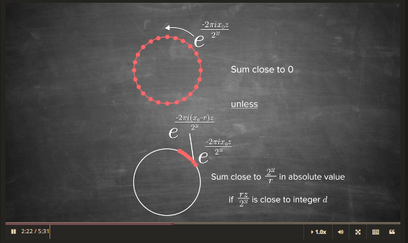

$$e^{\frac{-2\pi i x_{0} z}{2^{2l}}}$$
$$e^{\frac{-2\pi i (x_{0}-r) z}{2^{2l}}}$$
$$e^{\frac{-2\pi i x_{n} z}{2^{2l}}}$$
$$\frac{2^{2l}}{r}$$
$$\frac{r z}{2^{2l}}$$

Chalkboard geometric-sum picture (phasors).

Top: red dots equally spaced around a full circle, with a curved arrow labeled
$$e^{\frac{-2\pi i x_{0} z}{2^{2l}}}$$
Caption: "Sum close to 0" then underlined "unless".

Bottom: the same points collapse onto a short red arc of a circle. The left end of the arc is labeled
$$e^{\frac{-2\pi i (x_{0}-r) z}{2^{2l}}}$$
and the right end
$$e^{\frac{-2\pi i x_{n} z}{2^{2l}}}$$

Caption: Sum close to 2^{2l}/r in absolute value, if rz/2^{2l} is close to integer d.

## **rz over 2 to the 2l is close to an integer.**

## 

## **42**

## **00:02:23,635 \--\> 00:02:26,230**

## **And let\'s call that integer d.**

## 

## **43**

## **00:02:26,230 \--\> 00:02:28,930**

## **So if this is close to an integer,**

## 

## **44**

## **00:02:28,930 \--\> 00:02:34,960**

## **then we get a large probability of seeing this.**

## 

## **45**

## **00:02:34,960 \--\> 00:02:37,570**

## **If it\'s not close to an integer we**

## 

## **46**

## **00:02:37,570 \--\> 00:02:40,450**

## **get a tiny probability of seeing it.**

## 

## **47**

## **00:02:40,450 \--\> 00:02:47,130**

## **So the geometric sum is 1 minus e to the 2 pi i.**

## 

## **48**

## **00:02:47,130 \--\> 00:02:49,450**

## **We want the last term of the sum.**

## 

## **49**

## **00:02:49,450 \--\> 00:02:55,180**

## **So that\'s 2 to the 2l rz over 2 to the 2l.**

## 

## **50**

## **00:02:55,180 \--\> 00:03:05,440**

## 

## 

## **51**

## **00:03:05,440 \--\> 00:03:14,590**

## **No, it\'s y goes from 1 to 2 to the 2l over r.**

## 

## **52**

## **00:03:14,590 \--\> 00:03:22,510**

## **So the last term you substitute in 2 to the 2l r over z.**

## 

## **53**

## **00:03:22,510 \--\> 00:03:27,880**

## **So something like 2 to the 2l over r.**

## 

## **54**

## **00:03:27,880 \--\> 00:03:30,400**

## **I will have to take the floor of that times**

## 

## **55**

## **00:03:30,400 \--\> 00:03:35,840**

## **r times z over 2 to the 2l.**

## 

## **56**

## **00:03:35,840 \--\> 00:03:38,140**

## **Which really, because of this floor**

## 

## **57**

## **00:03:38,140 \--\> 00:03:41,526**

## **could be anywhere on the unit circle.**

## 

## **58**

## **00:03:41,526 \--\> 00:03:45,040**

## **But it\'s always less than 2 in absolute value.**

## 

## **59**

## **00:03:45,040 \--\> 00:03:53,200**

## **And we\'re dividing that by 1 minus e to the 2 pi i rz**

## 

## **60**

## **00:03:53,200 \--\> 00:03:54,980**

## **over 2 to the 2l.**

## 

## **61**

## **00:03:54,980 \--\> 00:04:00,310**

## **And remember, the sum is really\--**

## 

## **62**

## **00:04:00,310 \--\> 00:04:03,040**

## **so we\'re dividing something by something else.**

## 

## **63**

## **00:04:03,040 \--\> 00:04:06,730**

## **And it\'s going to be relatively small, unless the something**

## 

## **64**

## **00:04:06,730 \--\> 00:04:10,420**

## **else we\'re dividing is really really, really close to 0.**

## 

## **65**

## **00:04:10,420 \--\> 00:04:18,244**

## **So this is roughly something O of 1 divided by\--**

## 

## **66**

## **00:04:18,244 \--\> 00:04:19,329**

## **oh, what is this?**

## 

## **67**

## **00:04:19,329 \--\> 00:04:24,350**

## **This is roughly rz over 2 to the 2l.**

## 

## **68**

## **00:04:24,350 \--\> 00:04:27,100**

## 

## 

## **69**

## **00:04:27,100 \--\> 00:04:34,850**

## **So the probability of seeing a number z is roughly rz over 2**

## 

## **70**

## **00:04:34,850 \--\> 00:04:42,940**

## **to the 2l squared minus d because d was our integer.**

## 

## **71**

## **00:04:42,940 \--\> 00:04:52,790**

## **So we have d over r is roughly z over 2 to the 2l.**

## 

## **72**

## **00:04:52,790 \--\> 00:04:56,080**

## **So what our algorithm does is it output z.**

## 

## **73**

## **00:04:56,080 \--\> 00:04:59,200**

## **We know 2 to the 2l, and we need to round it off**

## 

## **74**

## **00:04:59,200 \--\> 00:05:02,080**

## **to something like d over r.**

## 

## **75**

## **00:05:02,080 \--\> 00:05:05,980**

<!-- frame 5:06 · formula · week1/media/media/image24.png -->

$$\frac{\left|1-e^{\frac{2\pi i\left[\frac{2^{2l}}{r}\right]rz}{2^{2l}}}\right|}{1-e^{\frac{2\pi i rz}{2^{2l}}}} < 2 \approx \frac{\mathcal{O}(1)}{\frac{rz}{2^{2l}}-d}$$
$$\frac{d}{r} \approx \frac{z}{2^{2l}}$$

Title: Geometric sum

Chalkboard. Absolute-value bars enclose only the numerator:

$$\frac{\left|1-e^{\frac{2\pi i\left[\frac{2^{2l}}{r}\right]rz}{2^{2l}}}\right|}{1-e^{\frac{2\pi i rz}{2^{2l}}}} < 2 \approx \frac{\mathcal{O}(1)}{\frac{rz}{2^{2l}}-d}$$

The "< 2" sits beside the absolute value; the "≈" is centered on the fraction and the right-hand side $\mathcal{O}(1)/(\frac{rz}{2^{2l}}-d)$.

So we have (blue boxes): d/r ≈ z/2^{2l}.

## **And there is a procedure for rounding**

## 

## **76**

## **00:05:05,980 \--\> 00:05:11,050**

## **real numbers of two smaller fractions that is efficient.**

## 

## **77**

## **00:05:11,050 \--\> 00:05:13,029**

## **And it\'s called continuous fractions.**

## 

## **78**

## **00:05:13,029 \--\> 00:05:14,320**

## **But it\'s a classical algorithm.**

## 

## **79**

## **00:05:14,320 \--\> 00:05:18,520**

## **So once we get this we can round it to d over r,**

## 

## **80**

## **00:05:18,520 \--\> 00:05:21,520**

## **and then we\'re found r, which was**

## 

## **81**

## **00:05:21,520 \--\> 00:05:24,030**

## **the period we were looking for.**

## 

## **82**

## **00:05:24,030 \--\> 00:05:30,734**

## 

## 

##  

## **PRACTICE (there is no practice on this page )**

##  

## 

Case study: demonstrations of shor\'s algorithms

# Demonstrations of Shor\'s Algorithm: Introduction

## **Learn**

In the next several videos, you will explore two demonstrations of
Shor\'s algorithm on small-scale quantum-computers realized using
liquid-state NMR and trapped ions. Although the numbers of qubits and
the number being factored is rather small (15 = 3 x 5), the
demonstrations illustrate that Shor\'s algorithm works in principle. You
will also learn how many demonstrations have used \"compiled\" versions
of Shor\'s algorithm that are not generalizable.

## **Images**

## **Transcript** 

0

00:00:00,000 \--\> 00:00:00,210

1

00:00:00,210 \--\> 00:00:01,620

To date there have been a handful

2

00:00:01,620 \--\> 00:00:04,170

of prototype demonstrations of Shor\'s Algorithm

3

00:00:04,170 \--\> 00:00:06,150

using different qubit modalities, including

4

00:00:06,150 \--\> 00:00:09,240

nuclear spins, photonic qubits, superconducting qubits,

5

00:00:09,240 \--\> 00:00:10,890

and trapped ions.

6

00:00:10,890 \--\> 00:00:13,830

In this case study, we\'ll look at two of these demonstrations

7

00:00:13,830 \--\> 00:00:15,280

in detail.

8

00:00:15,280 \--\> 00:00:17,370

The first is a demonstration of Shor\'s Algorithm

9

00:00:17,370 \--\> 00:00:20,970

using liquid state nuclear magnetic resonance, NMR.

10

00:00:20,970 \--\> 00:00:23,850

This was, in fact, the first such experimental demonstration

11

00:00:23,850 \--\> 00:00:27,450

and it showed the factorization of 15 into the primes 3 times

12

00:00:27,450 \--\> 00:00:28,560

5\.

13

00:00:28,560 \--\> 00:00:30,960

It used molecules with seven individually

14

00:00:30,960 \--\> 00:00:33,870

addressable nuclear spins in liquid solution at room

15

00:00:33,870 \--\> 00:00:36,750

temperature, and the algorithm comprised a sequence

16

00:00:36,750 \--\> 00:00:38,790

of around 300 pulses.

17

<!-- frame 0:39 · diagram · week1/media/media/image7.png -->

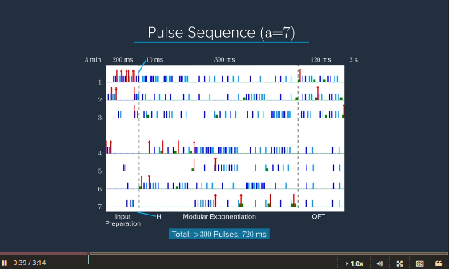

# Pulse Sequence (a=7)

Timing diagram with seven horizontal channels labeled 1–7. Pulses are drawn as dense blue vertical ticks, with taller red pulses (some marked by small upward arrows) and a few short green pulses.

Time annotations along the top, left to right: 3 min, 200 ms, 10 ms, 300 ms, 120 ms, 2 s. A blue leader from “10 ms” points at a cluster of red pulses near the left side of channel 1.

Dashed vertical lines split the trace into regions labeled underneath:

- Input Preparation (left)
- H (narrow band; a blue arrow from the label points at that band)
- Modular Exponentiation (wide middle)
- QFT (right)

Blue callout: Total: >300 Pulses, 720 ms.

00:00:38,790 \--\> 00:00:41,530

We\'ll hear about this work from TU Delft Professor Lieven

18

00:00:41,530 \--\> 00:00:45,030

Vendersypen, who performed these experiments as part of his PhD

19

00:00:45,030 \--\> 00:00:47,940

thesis work at Stanford University in collaboration

20

00:00:47,940 \--\> 00:00:50,700

with Ike Chuang, then at IBM Almaden.

21

00:00:50,700 \--\> 00:00:53,070

The second demonstration is relatively recent

22

00:00:53,070 \--\> 00:00:55,440

and it was performed using trapped ions.

23

00:00:55,440 \--\> 00:00:58,590

In this case, seven ions were used to again factor the number

24

00:00:58,590 \--\> 00:01:01,680

15 into primes 3 and 5.

25

00:01:01,680 \--\> 00:01:03,900

In this example, modular multiplication

26

00:01:03,900 \--\> 00:01:06,090

was implemented and no simplifications

27

00:01:06,090 \--\> 00:01:09,300

that presumed prior knowledge of the result were employed.

28

00:01:09,300 \--\> 00:01:12,150

Instead, a concept called qubit recycling

29

00:01:12,150 \--\> 00:01:14,760

was used to make up for the fact that seven qubits is

30

00:01:14,760 \--\> 00:01:17,610

insufficient to implement the general algorithm.

31

00:01:17,610 \--\> 00:01:19,680

Still to date, this demonstration

32

00:01:19,680 \--\> 00:01:22,110

constitutes the most realistic implementation

33

00:01:22,110 \--\> 00:01:23,640

of Shor\'s Algorithm.

34

00:01:23,640 \--\> 00:01:26,370

And we\'ll hear from MIT Professor Ike Chuang, who

35

00:01:26,370 \--\> 00:01:28,800

participated in this demonstration with Professor

36

00:01:28,800 \--\> 00:01:31,440

Rainer Blatt\'s team at Innsbruck.

37

00:01:31,440 \--\> 00:01:33,510

To factor 15 in a straightforward manner,

38

00:01:33,510 \--\> 00:01:36,540

it\'s estimated that one needs about 12 qubits, eight qubits

39

00:01:36,540 \--\> 00:01:38,490

in the period register and four qubits

40

00:01:38,490 \--\> 00:01:40,950

in the modular multiplication register.

41

00:01:40,950 \--\> 00:01:43,260

The demonstrations you\'ll hear about in this case study

42

00:01:43,260 \--\> 00:01:46,320

had fewer than 12 qubits, and so certain simplifications

43

<!-- frame 1:46 · diagram · week1/media/media/image57.png -->

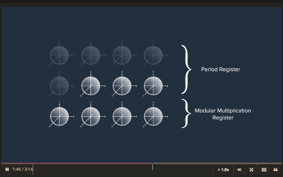

# Bloch spheres: period register and modular-multiplication register

Dark slide, no title text. Twelve Bloch spheres in a 3×4 grid. Each sphere shows the usual \(x\), \(y\), \(z\) axes; the individual Bloch vectors are faint and not reliably readable in this frame.

Braces on the right group the spheres into two registers:

- Upper brace, covering the top two rows (8 spheres): **Period Register**
- Lower brace, covering the bottom row (4 spheres): **Modular Multiplication Register**

A small white “66” sits at the lower-right of the video frame (slide number).

Video player clock: 1:46 / 3:14.

00:01:46,320 \--\> 00:01:47,240

had to be made.

44

00:01:47,240 \--\> 00:01:49,470

Now in many cases, the simplifications

45

00:01:49,470 \--\> 00:01:50,560

were quite reasonable.

46

00:01:50,560 \--\> 00:01:53,220

For example, the use of qubit recycling.

47

00:01:53,220 \--\> 00:01:55,020

Nonetheless, it\'s important to understand

48

00:01:55,020 \--\> 00:01:58,170

the impact of various types of simplifying assumptions,

49

00:01:58,170 \--\> 00:02:02,700

and we\'ll hear about them from IBM researcher Dr. John Smolin.

50

00:02:02,700 \--\> 00:02:04,860

Finally, from a business perspective,

51

00:02:04,860 \--\> 00:02:07,530

these prototype demonstrations of Shor\'s Algorithm

52

00:02:07,530 \--\> 00:02:10,139

illustrate that quantum computing is real.

53

00:02:10,139 \--\> 00:02:12,990

Although these implementations are not yet at scale,

54

00:02:12,990 \--\> 00:02:16,980

they are concrete indications of and steps towards the promise

55

00:02:16,980 \--\> 00:02:18,840

of quantum computing.

56

00:02:18,840 \--\> 00:02:22,080

From an engineering perspective, these types of demonstrations

57

00:02:22,080 \--\> 00:02:24,330

force groups to confront practical realities

58

00:02:24,330 \--\> 00:02:26,700

of implementation, from qubit control engineering

59

00:02:26,700 \--\> 00:02:28,830

to algorithmic compilation.

60

00:02:28,830 \--\> 00:02:30,990

Although not yet at scale, these algorithms

61

00:02:30,990 \--\> 00:02:32,715

motivate experimental groups to go

62

00:02:32,715 \--\> 00:02:36,000

beyond scientific demonstrations and to meet face-to-face

63

00:02:36,000 \--\> 00:02:37,560

with the practical realities that

64

00:02:37,560 \--\> 00:02:39,990

will need to be accommodated to enable scalable quantum

65

00:02:39,990 \--\> 00:02:41,400

computing.

66

00:02:41,400 \--\> 00:02:44,040

And scientifically, these demonstrations

67

00:02:44,040 \--\> 00:02:47,520

test our knowledge of system noise and decoherence.

68

00:02:47,520 \--\> 00:02:50,040

Lastly, from a technology standpoint,

69

00:02:50,040 \--\> 00:02:52,560

these demonstrations serve as a benchmark of progress

70

00:02:52,560 \--\> 00:02:55,980

in the field, indicating where the technology currently stands

71

00:02:55,980 \--\> 00:02:58,440

and clarifying what needs to be addressed in order to reach

72

00:02:58,440 \--\> 00:03:00,250

future milestones.

73

00:03:00,250 \--\> 00:03:02,220

And so with that brief introduction,

74

00:03:02,220 \--\> 00:03:05,030

let\'s hear from Professor Lieven Vandersypen, Professor Ike

75

00:03:05,030 \--\> 00:03:07,880

Chuang, and Dr. John Smolin.

76

00:03:07,880 \--\> 00:03:13,280

## **PRACTICE (there is no practice for this introduction page )**

Section: case of study: demonstrations of shor\'s algorithm

# Page Title: Demonstrations of Shor\'s Algorithm: Shor\'s Algorithm with NMR

# **Learn**

## **Images**

<!-- frame 7:56 · slide · week1/media/media/image55.png -->

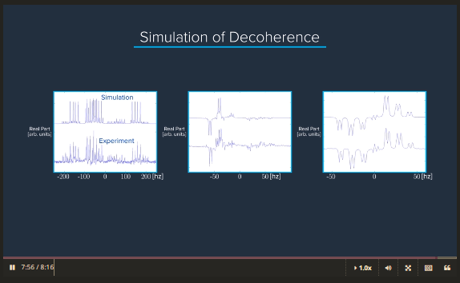

# Simulation of Decoherence

Three side-by-side spectra. Each panel plots **Real Part [arb. units]** and stacks a **Simulation** trace (top) over an **Experiment** trace (bottom).

- **Left panel.** Horizontal axis labeled −200, −100, 0, 100, 200 Hz. Both traces are a dense comb of sharp peaks concentrated around 0 Hz, with smaller side structure out toward ±200 Hz. The experiment follows the simulated peak positions but is noisier and the peak heights differ.
- **Middle panel.** Horizontal axis labeled −50, 0, 50 Hz. Zoomed real-part lineshape: an oscillatory pattern with a dip near 0 Hz and lobes on either side. The experimental trace tracks the same envelope with added noise.
- **Right panel.** Further zoom. Visible axis labels are 0 and 50 Hz (the left-hand tick is not clearly labeled). Simulation is a smooth oscillation; experiment is the same feature with noise.

Video player clock: 7:56 / 8:16.

## **Transcript**

## 

## **PRACTICE** 

## **(there is no practice for this introduction page )**

##  

Section:

# Page Title:

# **Learn**

In the next several videos,

## **Images**
## **Transcript**

0

00:00:00,000 \--\> 00:00:00,550

1

00:00:00,550 \--\> 00:00:03,970

In 1998, after we had implemented the first two qubit

2

00:00:03,970 \--\> 00:00:06,160

algorithms on the chloroform molecule

3

00:00:06,160 \--\> 00:00:09,760

and using NMR, Ike Chuang, who supervised the research,

4

00:00:09,760 \--\> 00:00:11,650

gave me a great challenge\--

5

00:00:11,650 \--\> 00:00:15,550

to factor the number 15 within the time span of my PhD

6

00:00:15,550 \--\> 00:00:17,170

at Stanford.

7

00:00:17,170 \--\> 00:00:19,000

At that time, Ike was transitioning

8

00:00:19,000 \--\> 00:00:22,180

from Los Alamos National Laboratory to the IBM Almaden

9

00:00:22,180 \--\> 00:00:24,220

Research Center outside San Jose.

10

00:00:24,220 \--\> 00:00:27,760

And I was finishing the first year of my PhD at Stanford.

11

00:00:27,760 \--\> 00:00:30,370

At that time, I helped Ike set up his new lab

12

00:00:30,370 \--\> 00:00:33,966

at Almaden, some 30 minutes away from Stanford.

13

00:00:33,966 \--\> 00:00:36,340

I didn\'t know what it would take to factor the number 15,

14

00:00:36,340 \--\> 00:00:38,320

but it did seem like a great challenge.

15

00:00:38,320 \--\> 00:00:40,990

And certainly, it was clear that there was an enormous interest

16

<!-- frame 0:39 · diagram · week1/media/media/image7.png -->

# Pulse Sequence (a=7)

Timing diagram with seven horizontal channels labeled 1–7. Pulses are drawn as dense blue vertical ticks, with taller red pulses (some marked by small upward arrows) and a few short green pulses.

Time annotations along the top, left to right: 3 min, 200 ms, 10 ms, 300 ms, 120 ms, 2 s. A blue leader from “10 ms” points at a cluster of red pulses near the left side of channel 1.

Dashed vertical lines split the trace into regions labeled underneath:

- Input Preparation (left)
- H (narrow band; a blue arrow from the label points at that band)
- Modular Exponentiation (wide middle)
- QFT (right)

Blue callout: Total: >300 Pulses, 720 ms.

00:00:40,990 \--\> 00:00:42,790

in Shor\'s Algorithm and that it was

17

00:00:42,790 \--\> 00:00:44,840

a major driver for our field.

18

00:00:44,840 \--\> 00:00:48,160

So I thought it would be very awesome to demonstrate Shor\'s

19

00:00:48,160 \--\> 00:00:49,880

Algorithm experimentally.

20

00:00:49,880 \--\> 00:00:51,760

So what would it take to run Shor\'s Algorithm

21

00:00:51,760 \--\> 00:00:53,500

experimentally?

22

00:00:53,500 \--\> 00:00:55,540

The simplest instance of quantum factoring

23

00:00:55,540 \--\> 00:00:57,400

is to factor the number 15, to pull

24

00:00:57,400 \--\> 00:00:59,770

it apart into 3 times 5.

25

00:00:59,770 \--\> 00:01:03,630

But how many qubits does that take, and how many operations?

26

00:01:03,630 \--\> 00:01:06,180

We got great insight from a pedagogical article

27

00:01:06,180 \--\> 00:01:09,960

by Dave Beckman from the Preskill group at Caltech.

28

00:01:09,960 \--\> 00:01:12,360

In particular, he analyzed the steps

29

00:01:12,360 \--\> 00:01:14,790

for factoring the number 15.

30

00:01:14,790 \--\> 00:01:16,420

Shor\'s Algorithm in general consists

31

00:01:16,420 \--\> 00:01:18,250

of two parts, a classical part and

32

00:01:18,250 \--\> 00:01:20,080

the quantum mechanical part.

33

00:01:20,080 \--\> 00:01:22,930

The quantum part that we run on our quantum computer

34

00:01:22,930 \--\> 00:01:26,740

is designed to find the period of a function, specifically

35

00:01:26,740 \--\> 00:01:31,210

the function a to the power x modulo N, that

36

00:01:31,210 \--\> 00:01:36,550

is to say the remainder after division of a to the x by N.

37

00:01:36,550 \--\> 00:01:39,310

N here is the number we\'re trying to factor.

38

00:01:39,310 \--\> 00:01:41,590

a is a number that can be anything

39

00:01:41,590 \--\> 00:01:43,940

as long as it is co-prime with N,

40

00:01:43,940 \--\> 00:01:46,210

and x is the argument of the function.

41

00:01:46,210 \--\> 00:01:48,680

For period finding on a quantum computer,

42

00:01:48,680 \--\> 00:01:51,700

we divide the number of qubits into two registers.

43

00:01:51,700 \--\> 00:01:53,350

One register needs to be large enough

44

00:01:53,350 \--\> 00:01:55,720

that it can store the number N.

45

00:01:55,720 \--\> 00:01:58,780

For 15, we need four bits, so four qubits

46

00:01:58,780 \--\> 00:02:00,539

are needed for that register.

47

00:02:00,539 \--\> 00:02:02,080

The other register in principle needs

48

00:02:02,080 \--\> 00:02:04,300

to be twice as large or eight qubits,

49

00:02:04,300 \--\> 00:02:08,320

bringing the total to 12 qubits to factor the number 15.

50

00:02:08,320 \--\> 00:02:11,170

The algorithm consists of, first, a Hadamard operation

51

00:02:11,170 \--\> 00:02:13,690

that prepares an equal superposition of all the states

52

00:02:13,690 \--\> 00:02:17,465

of the first register then a function call of the function

53

00:02:17,465 \--\> 00:02:21,310

a to the x modulo N where x are the states

54

00:02:21,310 \--\> 00:02:22,360

of the first register.

55

00:02:22,360 \--\> 00:02:24,340

And the result is mapped into the state

56

00:02:24,340 \--\> 00:02:26,230

of the second register.

57

00:02:26,230 \--\> 00:02:28,480

And the third step is the Quantum Fourier Transform

58

00:02:28,480 \--\> 00:02:30,755

applied to the first register.

59

00:02:30,755 \--\> 00:02:32,130

At the end of the computation, we

60

00:02:32,130 \--\> 00:02:35,110

read out this first register.

61

00:02:35,110 \--\> 00:02:37,450

Now, if you begin to analyze how to implement

62

00:02:37,450 \--\> 00:02:40,480

this complex function a to the x modulo N,

63

00:02:40,480 \--\> 00:02:42,370

you realize that it can be broken apart

64

00:02:42,370 \--\> 00:02:45,970

into multiple simpler operations, where each of them

65

00:02:45,970 \--\> 00:02:49,330

is a operation controlled by just one bit out of all

66

00:02:49,330 \--\> 00:02:51,490

the bits of the first register.

67

00:02:51,490 \--\> 00:02:54,580

And then you find for the number 15 that we\'re lucky.

68

00:02:54,580 \--\> 00:02:57,730

Only two of the control qubits actually

69

00:02:57,730 \--\> 00:03:00,310

play a role in factoring 15.

70

00:03:00,310 \--\> 00:03:03,190

And in some cases, some choices of a, even just one

71

00:03:03,190 \--\> 00:03:05,270

of the control qubits plays a role.

72

00:03:05,270 \--\> 00:03:08,380

So that actually allows us to eliminate many qubits

73

00:03:08,380 \--\> 00:03:09,325

of the first register.

74

00:03:09,325 \--\> 00:03:11,200

In principle, you could eliminate all of them

75

00:03:11,200 \--\> 00:03:12,620

except two.

76

00:03:12,620 \--\> 00:03:15,310

Now, we decided that for a meaningful Quantum Fourier

77

00:03:15,310 \--\> 00:03:17,830

Transform, we would like to have not just two qubits,

78

00:03:17,830 \--\> 00:03:19,450

but at least three qubits.

79

00:03:19,450 \--\> 00:03:21,730

With two qubits the Quantum Fourier Transform

80

00:03:21,730 \--\> 00:03:23,350

comes down to a single two qubit gate.

81

00:03:23,350 \--\> 00:03:25,100

And we thought that was too trivial.

82

00:03:25,100 \--\> 00:03:27,250

So in the end, we went with an experiment

83

00:03:27,250 \--\> 00:03:30,580

with a total of seven qubits to factor the number 15.

84

00:03:30,580 \--\> 00:03:32,920

So in NMR, the qubits are represented

85

00:03:32,920 \--\> 00:03:35,020

by the nuclear spins in the molecule,

86

00:03:35,020 \--\> 00:03:38,340

the spins of the atomic nuclei in a molecule.

87

00:03:38,340 \--\> 00:03:42,520

For a successful molecule for NMR qubit experiments,

88

00:03:42,520 \--\> 00:03:45,860

the molecule needs to have a rather unusual properties.

89

00:03:45,860 \--\> 00:03:48,350

We need what we call large chemical shifts, that

90

00:03:48,350 \--\> 00:03:51,340

is to say, large separations in frequency between all the

91

00:03:51,340 \--\> 00:03:54,290

spins that we want to involve in the computation

92

00:03:54,290 \--\> 00:03:56,660

for selective addressing of the qubits.

93

00:03:56,660 \--\> 00:03:58,340

And we want a coupling network that

94

00:03:58,340 \--\> 00:04:00,860

allows sufficient pairs of qubit, pairs of

95

00:04:00,860 \--\> 00:04:02,840

spins, to be coupled to each other

96

00:04:02,840 \--\> 00:04:06,500

so that all the required two qubit gates can be implemented

97

00:04:06,500 \--\> 00:04:07,550

on the molecule.

98

00:04:07,550 \--\> 00:04:11,180

So \[INAUDIBLE\],, a staff member at IBM Almaden,

99

00:04:11,180 \--\> 00:04:15,350

did an extensive search looking through fast tables

100

00:04:15,350 \--\> 00:04:20,140

and documents with tabulated NMR properties of known molecules.

101

00:04:20,140 \--\> 00:04:23,120

And after spending days and weeks in this process,

102

00:04:23,120 \--\> 00:04:26,180

he came to the conclusion that none of the tabulated molecules

103

00:04:26,180 \--\> 00:04:28,100

were good enough for the experiment

104

00:04:28,100 \--\> 00:04:29,730

that we were attempting.

105

00:04:29,730 \--\> 00:04:32,180

However, there was one that came close.

106

00:04:32,180 \--\> 00:04:35,620

It consisted of a backbone of four carbon atoms.

107

00:04:35,620 \--\> 00:04:38,990

And surrounding it there were five fluorine atoms

108

00:04:38,990 \--\> 00:04:42,269

that all could serve as a spin one-half and provide a qubit.

109

00:04:42,269 \--\> 00:04:44,060

And in addition, there was an iron complex.

110

00:04:44,060 \--\> 00:04:47,480

The iron complex created asymmetry in the molecule

111

00:04:47,480 \--\> 00:04:49,420

so that the resonance frequencies of the five

112

00:04:49,420 \--\> 00:04:51,830

fluorine atoms would be separated.

113

00:04:51,830 \--\> 00:04:54,410

To go from five fluorine spins to seven,

114

00:04:54,410 \--\> 00:04:57,230

what we needed to do was to isotopically label

115

00:04:57,230 \--\> 00:05:01,020

two of the carbon spins so that they became carbon-13

116

00:05:01,020 \--\> 00:05:03,430

and also acquired a spin one-half.

117

00:05:03,430 \--\> 00:05:06,860

Synthesizing this molecule was a real tour de force.

118

00:05:06,860 \--\> 00:05:09,050

Greg Breyta, IBM staff member who

119

00:05:09,050 \--\> 00:05:11,750

usually worked on chemical synthesis

120

00:05:11,750 \--\> 00:05:14,960

in the Resist program, spent over one year trying

121

00:05:14,960 \--\> 00:05:16,310

to synthesize this molecule.

122

00:05:16,310 \--\> 00:05:19,520

And at any point in time in this multi-step synthesis,

123

00:05:19,520 \--\> 00:05:22,580

we didn\'t know if this next step was going to be successful.

124

00:05:22,580 \--\> 00:05:25,310

But finally, after more than a year, actually just in time

125

00:05:25,310 \--\> 00:05:27,560

when I was ready to try the experiment,

126

00:05:27,560 \--\> 00:05:29,550

he delivered the molecule.

127

00:05:29,550 \--\> 00:05:32,300

So the next challenge was to develop the control techniques

128

00:05:32,300 \--\> 00:05:35,600

to take the seven spins through the steps of Shor\'s Algorithm,

129

00:05:35,600 \--\> 00:05:38,090

basically to make them do the spin dance

130

00:05:38,090 \--\> 00:05:40,040

with a great degree of control.

131

00:05:40,040 \--\> 00:05:42,320

Here we could benefit from decades of technology

132

00:05:42,320 \--\> 00:05:44,420

development in NMR spectroscopy,

133

00:05:44,420 \--\> 00:05:46,160

where people were interested in revealing

134

00:05:46,160 \--\> 00:05:48,530

the structure of molecules they were synthesizing.

135

00:05:48,530 \--\> 00:05:51,510

And we got great advice from experienced NMR spectroscopist

136

00:05:51,510 \--\> 00:05:53,300

at IBM, Mark Sherwood.

137

00:05:53,300 \--\> 00:05:55,670

In the years that followed in \'99 and 2000,

138

00:05:55,670 \--\> 00:05:58,250

we did experiments with first two, then three,

139

00:05:58,250 \--\> 00:06:01,250

and five spins to learn how to control the time evolution

140

00:06:01,250 \--\> 00:06:02,780

of increasing numbers of spins.

141

00:06:02,780 \--\> 00:06:04,904

They were all coupled together.

142

00:06:04,904 \--\> 00:06:06,320

But the factoring experiment, it

143

00:06:06,320 \--\> 00:06:09,860

became clear it was beyond anything that anyone had ever

144

00:06:09,860 \--\> 00:06:14,360

done in terms of controlling many coupled quantum spins.

145

00:06:14,360 \--\> 00:06:17,600

It required more than 300 radio frequency pulses,

146

00:06:17,600 \--\> 00:06:20,390

specially tailored in amplitude and phase

147

00:06:20,390 \--\> 00:06:23,960

to allow selective addressing of each of the seven spins.

148

00:06:23,960 \--\> 00:06:27,080

In addition, we had to account for unintended phase shifts that

149

00:06:27,080 \--\> 00:06:29,900

occurred on any of the qubits when we were driving

150

00:06:29,900 \--\> 00:06:31,280

any other of the qubits.

151

00:06:31,280 \--\> 00:06:33,560

In addition to that, since we were competing

152

00:06:33,560 \--\> 00:06:35,060

against the decoherence timescale,

153

00:06:35,060 \--\> 00:06:37,080

we had to apply simultaneous rotations

154

00:06:37,080 \--\> 00:06:40,280

where cross-talk effects were actually even more severe.

155

00:06:40,280 \--\> 00:06:43,020

And we had to account for those as well.

156

00:06:43,020 \--\> 00:06:45,290

And then finally, in NMR in these molecules,

157

00:06:45,290 \--\> 00:06:47,000

the couplings are always on.

158

00:06:47,000 \--\> 00:06:49,220

So we had to use some rather sophisticated

159

00:06:49,220 \--\> 00:06:53,390

so-called decoupling sequences that effectively remove

160

00:06:53,390 \--\> 00:06:56,240

the effect of all the couplings except the one coupling

161

00:06:56,240 \--\> 00:07:00,500

that we needed to run a two qubit gate between two spins.

162

00:07:00,500 \--\> 00:07:03,290

So, together with Matthias Stephan, fellow PhD student

163

00:07:03,290 \--\> 00:07:05,840

at Stanford who started one year after me,

164

00:07:05,840 \--\> 00:07:08,370

we went out to try and control the seven spins,

165

00:07:08,370 \--\> 00:07:10,830

starting in September of 2000.

166

00:07:10,830 \--\> 00:07:13,960

And throughout that fall and the winter of 2001,

167

00:07:13,960 \--\> 00:07:16,200

we made a lot of progress.

168

00:07:16,200 \--\> 00:07:18,920

We used a variant NMR four channel spectrometer

169

00:07:18,920 \--\> 00:07:20,960

to control the seven spins.

170

00:07:20,960 \--\> 00:07:22,820

And after some time, we were far enough

171

00:07:22,820 \--\> 00:07:25,820

that the output spectra actually revealed

172

00:07:25,820 \--\> 00:07:29,760

us the information of the period of a to the x modulo 15.

173

00:07:29,760 \--\> 00:07:32,445

And from that, we could say that we had factored 15.

174

00:07:32,445 \--\> 00:07:34,820

At the same time, we were disappointed because the output

175

00:07:34,820 \--\> 00:07:37,790

spectra, even though they did give us the right information,

176

00:07:37,790 \--\> 00:07:40,700

they didn\'t look like what we ideally expected.

177

00:07:40,700 \--\> 00:07:43,520

And even though we added more and more sophistication

178

00:07:43,520 \--\> 00:07:45,080

in our control techniques, it seemed

179

00:07:45,080 \--\> 00:07:46,940

like we were hitting a wall.

180

00:07:46,940 \--\> 00:07:49,160

At some point, I set out to write a model

181

00:07:49,160 \--\> 00:07:52,970

to capture the main effects of decoherence in a simple way.

182

00:07:52,970 \--\> 00:07:55,430

And there it was, beautifully reproducing

183

00:07:55,430 \--\> 00:07:57,860

the experimental spectra, the simulated spectra

184

00:07:57,860 \--\> 00:08:00,020

accounting for decoherence.

185

00:08:00,020 \--\> 00:08:02,780

This was interesting because in our four years of experience

186

00:08:02,780 \--\> 00:08:05,520

programming NMR sequences and operating on molecules,

187

00:08:05,520 \--\> 00:08:07,670

this was the first time that decoherence

188

00:08:07,670 \--\> 00:08:10,060

had become our limiter.

189

00:08:10,060 \--\> 00:08:16,384

0

00:00:00,000 \--\> 00:00:00,210

1

00:00:00,210 \--\> 00:00:01,620

To date there have been a handful

## **PRACTICE** 

## **(there is no practice for this page )**

##  

Section: case-of-study demonstrations of shor\'s algorithm

# Page Title: Demonstrations of Shor\'s Algorithm: Perspective on NMR

# **Learn**

## **Images**
## **Transcript**

## 

0

0

00:00:00,000 \--\> 00:00:00,500

1

00:00:00,500 \--\> 00:00:03,904

So let\'s reflect on what made this experiment successful.

2

00:00:03,904 \--\> 00:00:05,570

The first is that the coherence times,

3

00:00:05,570 \--\> 00:00:08,090

the t2's in this specially designed molecule

4

00:00:08,090 \--\> 00:00:11,185

were extremely long\-- all in excess of 1 second.

5

00:00:11,185 \--\> 00:00:13,310

We have to compare, of course, the coherence time

6

00:00:13,310 \--\> 00:00:15,280

to the time scale of the operations that

7

00:00:15,280 \--\> 00:00:18,080

for a single qubit-shaped pulses here varied

8

00:00:18,080 \--\> 00:00:20,982

between 0.2 and 2 milliseconds.

9

00:00:20,982 \--\> 00:00:23,315

And we also have to compare to the value of the coupling

10

00:00:23,315 \--\> 00:00:25,490

strings between the spins in the molecule.

11

00:00:25,490 \--\> 00:00:29,330

They varied from about a hertz, which was too low to be usable,

12

00:00:29,330 \--\> 00:00:31,330

to about 200 hertz.

13

00:00:31,330 \--\> 00:00:33,200

In total, the longest sequences we

14

00:00:33,200 \--\> 00:00:35,390

had to run to implement Shor's Algorithm

15

00:00:35,390 \--\> 00:00:37,950

lasted about 700 milliseconds.

16

00:00:37,950 \--\> 00:00:40,670

The second success factor is that in these experiments

17

00:00:40,670 \--\> 00:00:43,550

we used liquid state NMR based on ensembles

18

00:00:43,550 \--\> 00:00:45,380

of many copies of a molecule\--

19

00:00:45,380 \--\> 00:00:47,150

making the detection trivially easy,

20

00:00:47,150 \--\> 00:00:49,430

almost, compared to the great challenge

21

00:00:49,430 \--\> 00:00:51,740

of trying to work with individual

22

00:00:51,740 \--\> 00:00:54,050

spins as is done today.

23

00:00:54,050 \--\> 00:00:56,720

Furthermore, the liquid state NMR Hamiltonian

24

00:00:56,720 \--\> 00:00:59,570

is actually relatively transparent and simple.

25

00:00:59,570 \--\> 00:01:02,240

All the terms in the Hamiltonian commute with each other.

26

00:01:02,240 \--\> 00:01:05,552

Single qubit terms have to form omega times sigma z.

27

00:01:05,552 \--\> 00:01:07,010

And the two qubit interactions have

28

00:01:07,010 \--\> 00:01:10,450

to form J times sigma z on one qubit and sigma z

29

00:01:10,450 \--\> 00:01:12,050

on another qubit.

30

00:01:12,050 \--\> 00:01:14,210

Scaling this approach, however, is hard.

31

00:01:14,210 \--\> 00:01:16,460

First, I\'ve already commented on the difficulty

32

00:01:16,460 \--\> 00:01:19,430

in finding a suitable molecule with seven spins.

33

00:01:19,430 \--\> 00:01:22,010

And finding molecules with larger numbers of qubits,

34

00:01:22,010 \--\> 00:01:24,320

with larger numbers of suitable spins,

35

00:01:24,320 \--\> 00:01:26,720

to solve more complex problems quickly gets

36

00:01:26,720 \--\> 00:01:28,520

extremely difficult. But there is

37

00:01:28,520 \--\> 00:01:31,340

a more fundamental and severe limitation to the liquid state

38

00:01:31,340 \--\> 00:01:34,760

NMR approach and it is that even though we

39

00:01:34,760 \--\> 00:01:37,700

work in large magnetic fields, the fact that we

40

00:01:37,700 \--\> 00:01:40,430

use liquid states pushes us to work at relatively

41

00:01:40,430 \--\> 00:01:41,430

large temperatures.

42

00:01:41,430 \--\> 00:01:43,460

In fact, we operated at room temperature.

43

00:01:43,460 \--\> 00:01:46,490

And nuclear spins in a magnetic field at room temperature

44

00:01:46,490 \--\> 00:01:48,680

are in a highly mixed state, that

45

00:01:48,680 \--\> 00:01:50,270

is to say the probability for a spin

46

00:01:50,270 \--\> 00:01:53,180

to start off in the up state or the down state are almost

47

00:01:53,180 \--\> 00:01:54,890

equal.

48

00:01:54,890 \--\> 00:01:56,960

We used techniques developed in our community

49

00:01:56,960 \--\> 00:01:59,670

to prepare so-called effectively pure states.

50

00:01:59,670 \--\> 00:02:01,880

These are states that produce a signal that

51

00:02:01,880 \--\> 00:02:05,420

is proportional to that of a pure state,

52

00:02:05,420 \--\> 00:02:07,010

but the cost of this technique is

53

00:02:07,010 \--\> 00:02:10,229

that the signal is halved for every qubit that we add.

54

00:02:10,229 \--\> 00:02:13,070

And so this obviously induces exponential cost

55

00:02:13,070 \--\> 00:02:14,950

that offsets any exponential gain

56

00:02:14,950 \--\> 00:02:17,390

that we hope to get from the quantum algorithms.

57

00:02:17,390 \--\> 00:02:19,400

The NMR experiments, and in particular the short

58

00:02:19,400 \--\> 00:02:21,080

experiment, had really been great fun.

59

00:02:21,080 \--\> 00:02:24,010

And I think we learned a great deal from it that also benefit

60

00:02:24,010 \--\> 00:02:26,590

and still benefits, today, the community.

61

00:02:26,590 \--\> 00:02:29,060

But certainly I wanted to move to technology

62

00:02:29,060 \--\> 00:02:31,700

where the potential for scaling was better.

63

00:02:31,700 \--\> 00:02:34,440

I decided to move from nuclear spins to electron spins

64

00:02:34,440 \--\> 00:02:37,360

and from molecules to artificial molecules.

65

00:02:37,360 \--\> 00:02:39,650

The artificial molecules we make use of

66

00:02:39,650 \--\> 00:02:41,810

are built from Silicon quantum dots

67

00:02:41,810 \--\> 00:02:44,000

in which we can find individual electrons

68

00:02:44,000 \--\> 00:02:46,160

and use their spins as qubits.

69

00:02:46,160 \--\> 00:02:49,060

Similar to the NMR molecules, these electron spins in

70

00:02:49,060 \--\> 00:02:51,620

silicon offer really long coherence times,

71

00:02:51,620 \--\> 00:02:53,420

but the devices are much more scalable

72

00:02:53,420 \--\> 00:02:56,944

and the control, in the end, can take us much further.

73

00:02:56,944 \--\> 00:02:58,610

Matthias Stephan, instead, made

74

00:02:58,610 \--\> 00:03:01,130

a choice to work on superconducting qubits and he

75

00:03:01,130 \--\> 00:03:03,860

was one of the early members of the IBM team working

76

00:03:03,860 \--\> 00:03:07,010

on superconducting qubits, a very large and successful

77

00:03:07,010 \--\> 00:03:09,010

program today.

78

00:03:09,010 \--\> 00:03:10,570

Ike Chuang finally, decided

79

00:03:10,570 \--\> 00:03:12,490

to move to trapped ions.

80

00:03:12,490 \--\> 00:03:14,920

He set up a lab at MIT and in collaboration

81

00:03:14,920 \--\> 00:03:17,470

with the group of Reiner Blatt Some years later,

82

00:03:17,470 \--\> 00:03:19,220

they redid the factoring experiments\--

83

00:03:19,220 \--\> 00:03:22,120

a beautiful experiment implementing the factoring

84

00:03:22,120 \--\> 00:03:24,580

of 15 on trapped ions.

85

00:03:24,580 \--\> 00:03:27,990

As for the silicon spins that I work on myself,

86

00:03:27,990 \--\> 00:03:30,370

we set the state of the art earlier this year

87

00:03:30,370 \--\> 00:03:33,040

in implementing for the first time, in this type of system,

88

00:03:33,040 \--\> 00:03:35,020

again, a two qubit algorithm.

89

00:03:35,020 \--\> 00:03:38,290

For me this brought back great memories from \'98.

90

00:03:38,290 \--\> 00:03:40,990

But different from the NMR approach and these early

91

00:03:40,990 \--\> 00:03:44,340

memories, my expectation is that with our group at QuTech

92

00:03:44,340 \--\> 00:03:46,930

in Delft and in close collaboration with Intel,

93

00:03:46,930 \--\> 00:03:49,600

with the silicon spin qubits, we can go all the way\--

94

00:03:49,600 \--\> 00:03:52,350

much beyond factoring 15.

95

00:03:52,350 \--\> 00:03:59,210

## **PRACTICE** 

## **(there is no practice for this page )**

##  

Section: case of study demonstrations of shor\'s algorithm

# Page Title: Demonstrations of Shor's Algorithm: Quantum Factoring With Trapped Ions - Challenge Setup

# **Learn**

## **Images**

## **Transcript**

## 

0

0

00:00:00,000 \--\> 00:00:00,490

1

00:00:00,490 \--\> 00:00:02,490

ISAAC CHUANG: Shor\'s quantum factoring algorithm

2

00:00:02,490 \--\> 00:00:05,230

has been implemented by a number of physical systems,

3

00:00:05,230 \--\> 00:00:06,930

including trapped ions.

4

00:00:06,930 \--\> 00:00:09,900

Let us consider what was done and why.

5

00:00:09,900 \--\> 00:00:11,700

Perhaps the most important starting point

6

00:00:11,700 \--\> 00:00:13,260

is to consider the question, what

7

00:00:13,260 \--\> 00:00:17,250

is the smallest meaningful instance of the Shor quantum

8

00:00:17,250 \--\> 00:00:18,570

factoring algorithm?

9

00:00:18,570 \--\> 00:00:21,480

Recall that the intent of Shor\'s factoring algorithm

10

00:00:21,480 \--\> 00:00:23,910

is to compute the period of this function\--

11

00:00:23,910 \--\> 00:00:29,010

f of x equals a to the x mod N. In this expression,

12

00:00:29,010 \--\> 00:00:32,159

N is a number we wish to factor, x

13

00:00:32,159 \--\> 00:00:36,000

is the argument to the function, and a is a random number which

14

00:00:36,000 \--\> 00:00:38,530

is chosen that is co-primed to N.

15

00:00:38,530 \--\> 00:00:42,120

It shares no prime factors in common with N.

16

00:00:42,120 \--\> 00:00:46,140

The period of this function r allows us to find with some

17

00:00:46,140 \--\> 00:00:48,570

probability\-- a high probability\--

18

00:00:48,570 \--\> 00:00:51,210

a factor of N which is non-trivial.

19

00:00:51,210 \--\> 00:00:55,620

Quantum factoring thus has as a goal finding this period r.

20

00:00:55,620 \--\> 00:00:58,440

Solving this problem takes an amount of time,

21

00:00:58,440 \--\> 00:01:02,310

or a number of operations, roughly proportional to L

22

00:01:02,310 \--\> 00:01:06,000

cubed, where L is the number of digits of the number N.

23

00:01:06,000 \--\> 00:01:09,760

Classically, using the best-known algorithm,

24

00:01:09,760 \--\> 00:01:12,540

the time required, or number of operations required,

25

00:01:12,540 \--\> 00:01:17,040

roughly goes as e to the 2L to the 1 over 3.

26

00:01:17,040 \--\> 00:01:19,470

The difficulty of this factoring problem

27

00:01:19,470 \--\> 00:01:23,550

is at the root of what secures widely-used cryptosystems

28

00:01:23,550 \--\> 00:01:25,080

such as RSA.

29

00:01:25,080 \--\> 00:01:28,170

To appreciate what the smallest meaning for instance

30

00:01:28,170 \--\> 00:01:31,050

of Shor\'s quantum factoring algorithm is,

31

00:01:31,050 \--\> 00:01:33,030

it is helpful to review the quantum

32

00:01:33,030 \--\> 00:01:34,860

circuit for the algorithm.

33

00:01:34,860 \--\> 00:01:38,290

Recall that there are two registers\-- the top one here,

34

00:01:38,290 \--\> 00:01:41,070

which holds the value x in a superposition

35

00:01:41,070 \--\> 00:01:43,860

of all possible values, and a bottom

36

00:01:43,860 \--\> 00:01:48,930

register where the result of the modular exponentiation is held.

37

00:01:48,930 \--\> 00:01:52,020

The top register is then fed through a inverse quantum

38

00:01:52,020 \--\> 00:01:54,780

Fourier transform, which returns the result.

39

00:01:54,780 \--\> 00:01:57,780

There are three main steps in this procedure.

40

00:01:57,780 \--\> 00:02:01,350

First, the input superposition of the top register

41

00:02:01,350 \--\> 00:02:03,330

must be created.

42

00:02:03,330 \--\> 00:02:06,390

Second, the modular exponentiation\--

43

00:02:06,390 \--\> 00:02:08,100

a to the x mod N\--

44

00:02:08,100 \--\> 00:02:10,320

must be computed.

45

00:02:10,320 \--\> 00:02:13,470

This is the most difficult part of Shor\'s quantum factoring

46

00:02:13,470 \--\> 00:02:17,790

algorithm because multi-qubit gates are required.

47

00:02:17,790 \--\> 00:02:21,120

The third step is the quantum Fourier transform.

48

<!-- frame 2:21 · diagram · week1/media/media/image13.png -->

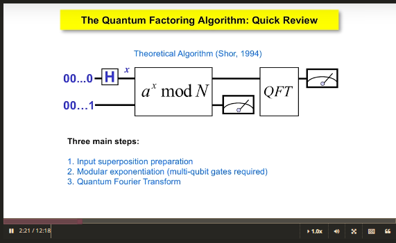

$$a^x \bmod N$$

# The Quantum Factoring Algorithm: Quick Review

Theoretical Algorithm (Shor, 1994). Circuit: input register $|00\ldots 0\rangle$ through Hadamard, labeled $x$, into a box $a^x \bmod N$; second register $|00\ldots 1\rangle$ into the same box; then QFT on the first register and measurement of both registers.

Three main steps:
1. Input superposition preparation
2. Modular exponentiation (multi-qubit gates required)
3. Quantum Fourier Transform

00:02:21,120 \--\> 00:02:24,780

And because the result of the Fourier transform is measured,

49

00:02:24,780 \--\> 00:02:27,150

only single-qubit gates\--

50

00:02:27,150 \--\> 00:02:30,030

some of them controlled by classical results\--

51

00:02:30,030 \--\> 00:02:32,010

are required in principle.

52

00:02:32,010 \--\> 00:02:34,230

After the result is measured, there

53

00:02:34,230 \--\> 00:02:36,480

is some classical post-processing.

54

00:02:36,480 \--\> 00:02:38,640

And this can be done by essentially

55

00:02:38,640 \--\> 00:02:40,800

any classical computer.

56

00:02:40,800 \--\> 00:02:43,170

Now, the number we are factoring is N.

57

00:02:43,170 \--\> 00:02:46,320

And it is clear that the algorithm is too trivial when

58

00:02:46,320 \--\> 00:02:48,090

N is an even number\--

59

00:02:48,090 \--\> 00:02:51,420

that is, it has a factor which is 2.

60

00:02:51,420 \--\> 00:02:55,720

Thus, the smallest meaningful factors are 3 and 5.

61

00:02:55,720 \--\> 00:02:58,560

Here is a generic quantum factoring circuit

62

00:02:58,560 \--\> 00:03:02,850

for the case of N equal 15, namely 3 times 5.

63

00:03:02,850 \--\> 00:03:06,990

What makes this specific for N equal 15

64

00:03:06,990 \--\> 00:03:12,306

is the choices available for the random base to be chosen a.

65

00:03:12,306 \--\> 00:03:15,730

a must be coprime with N. In other words,

66

00:03:15,730 \--\> 00:03:18,390

it must not share any factors with N.

67

00:03:18,390 \--\> 00:03:20,910

And furthermore, it must be less than N.

68

00:03:20,910 \--\> 00:03:23,880

And therefore, the only two meaningful cases

69

00:03:23,880 \--\> 00:03:26,910

are a being 7 and 11.

70

<!-- frame 3:26 · diagram · week1/media/media/image12.png -->

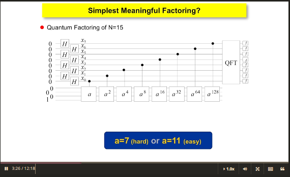

$$
a,\ a^{2},\ a^{4},\ a^{8},\ a^{16},\ a^{32},\ a^{64},\ a^{128}
$$

# Simplest Meaningful Factoring?

- Quantum Factoring of N=15

Order-finding circuit. Eight phase qubits, each starting at |0⟩ with an H, labeled top to bottom x₇, x₆, x₅, x₄, x₃, x₂, x₁, x₀. Each has a filled control dot whose vertical line drops onto one modular-multiplication box on a two-wire target register. The target wires are initialized 0 (upper) and 1 (lower). Boxes, left to right, spanning both target wires:

- x₀ controls a
- x₁ controls a²
- x₂ controls a⁴
- x₃ controls a⁸
- x₄ controls a¹⁶
- x₅ controls a³²
- x₆ controls a⁶⁴
- x₇ controls a¹²⁸

A tall QFT box then acts only on the eight x wires, followed by a meter on each x wire. The target register is not measured in this figure.

Blue banner: a=7 (hard) or a=11 (easy).

00:03:26,910 \--\> 00:03:31,230

Thus, the modular exponentiation circuit in the middle

71

00:03:31,230 \--\> 00:03:34,290

reduces to looking like this, where

72

00:03:34,290 \--\> 00:03:37,350

we have used repeated squaring, as is common,

73

00:03:37,350 \--\> 00:03:40,590

to realize the modular exponentiation.

74

<!-- frame 3:38 · diagram · week1/media/media/image70.png -->

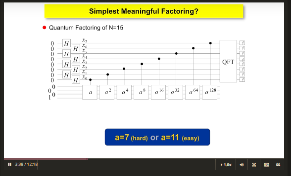

# Simplest Meaningful Factoring?

- Quantum Factoring of N = 15

Full controlled-multiplication circuit, before the 7-qubit simplification.

**Period register.** Eight wires, each initialized to 0 and passed through a Hadamard. Labels from top to bottom: \(x_7, x_6, x_5, x_4, x_3, x_2, x_1, x_0\).

Each wire controls one modular multiplication on the lower register. The boxes, left to right, and the matching control, are:

| Control | Gate |
| --- | --- |
| \(x_0\) | \(a\) |
| \(x_1\) | \(a^2\) |
| \(x_2\) | \(a^4\) |
| \(x_3\) | \(a^8\) |
| \(x_4\) | \(a^{16}\) |
| \(x_5\) | \(a^{32}\) |
| \(x_6\) | \(a^{64}\) |
| \(x_7\) | \(a^{128}\) |

Control dots step upward from the \(a\) box at the lower left to the \(a^{128}\) box at the upper right.

**Then** a QFT box covers the eight period-register wires, followed by a measurement on each of those wires.

**Lower register.** Drawn under the multiplications, with visible initial labels 0 and 1 (no Hadamards). The \(a^{2^k}\) boxes act on this register.

Blue callout: **a=7 (hard) or a=11 (easy)**.

Video player clock: 3:38 / 12:18.

00:03:40,590 \--\> 00:03:43,140

Note that each one of these exponentiations

75

00:03:43,140 \--\> 00:03:45,780

is calculated mod 15.

76

00:03:45,780 \--\> 00:03:47,970

So we began with a controlled multiplication

77

00:03:47,970 \--\> 00:03:51,910

by a, then a controlled multiplication by a squared, a

78

00:03:51,910 \--\> 00:03:55,350

to the fourth, a to the eighth, a to the 16th,

79

00:03:55,350 \--\> 00:03:59,730

and so forth, all the way up to a to the 128th power.

80

00:03:59,730 \--\> 00:04:02,880

Of course, the result of each of these multiplications

81

00:04:02,880 \--\> 00:04:05,580

is still a number between 0 and 14

82

00:04:05,580 \--\> 00:04:09,280

because of the modular multiplication being performed.

83

00:04:09,280 \--\> 00:04:12,390

So there are two non-trivial possible values

84

00:04:12,390 \--\> 00:04:15,570

of a that may be used in factoring 15.

85

00:04:15,570 \--\> 00:04:18,420

I claim that one of these is easy to handle,

86

00:04:18,420 \--\> 00:04:20,410

and the other is hard.

87

00:04:20,410 \--\> 00:04:22,330

Why is this the case?

88

00:04:22,330 \--\> 00:04:26,340

Well, let\'s see why by working out the two cases explicitly.

89

00:04:26,340 \--\> 00:04:30,430

Consider the case of a being equal to 11.

90

00:04:30,430 \--\> 00:04:35,460

Now, what we want is to take powers of a modulo 15.

91

00:04:35,460 \--\> 00:04:38,890

a to the 1 is clearly equal to 11.

92

00:04:38,890 \--\> 00:04:43,560

Now, if we multiply 11 by 11, we get 121.

93

00:04:43,560 \--\> 00:04:47,490

That value modulo 15 is simply equal to 1.

94

00:04:47,490 \--\> 00:04:49,950

And so the pattern continues to repeat.

95

00:04:49,950 \--\> 00:04:54,090

If we multiply again by 11, we get 11 and then

96

00:04:54,090 \--\> 00:04:56,460

1 and then 11 and 1.

97

00:04:56,460 \--\> 00:04:59,780

So computing 11 to the x modulo 15

98

00:04:59,780 \--\> 00:05:03,300

for any value of x is really easy because it only

99

00:05:03,300 \--\> 00:05:05,550

requires one bit of x.

100

00:05:05,550 \--\> 00:05:08,670

And thus, the quantum circuit looks simply like this.

101

00:05:08,670 \--\> 00:05:10,990

Because the period is 2 in this case,

102

00:05:10,990 \--\> 00:05:14,770

we find that the quantum circuit required is very simple.

103

00:05:14,770 \--\> 00:05:19,620

All it is is a single controlled a multiplication circuit

104

00:05:19,620 \--\> 00:05:24,100

with one bit of x involved\-- the least significant bit.

105

<!-- frame 5:23 · slide · week1/media/media/image8.png -->

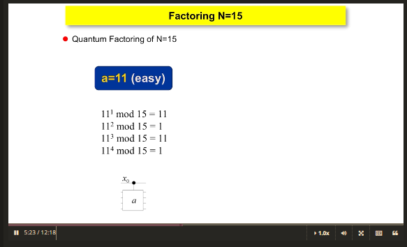

$$
11^{1} \bmod 15 = 11
$$
$$
11^{2} \bmod 15 = 1
$$
$$
11^{3} \bmod 15 = 11
$$
$$
11^{4} \bmod 15 = 1
$$

# Factoring N=15

- Quantum Factoring of N=15
- Blue box: a=11 (easy)

Powers:

- 11¹ mod 15 = 11
- 11² mod 15 = 1
- 11³ mod 15 = 11
- 11⁴ mod 15 = 1

Small circuit at the bottom: one wire labeled x₀ with a filled control dot, and a vertical line down into a gate box labeled a (controlled-a).

00:05:24,100 \--\> 00:05:27,180

And furthermore, since only two possible values

106

00:05:27,180 \--\> 00:05:29,370

of multiplication by a matter\--

107

00:05:29,370 \--\> 00:05:32,670

11 and 1\-- it is really tempting to replace

108

00:05:32,670 \--\> 00:05:37,140

this controlled a by just a single controlled NOT gate.

109

00:05:37,140 \--\> 00:05:40,110

And thus, this case is the easy one.

110

00:05:40,110 \--\> 00:05:45,210

Now, consider the other case of a being equal to 7.

111

00:05:45,210 \--\> 00:05:50,325

Here, we find 7 to the 1 is equal to 7.

112

00:05:50,325 \--\> 00:05:53,310

7 squared is equal to 49.

113

00:05:53,310 \--\> 00:05:56,874

Modulo 15 is equal to 4.

114

00:05:56,874 \--\> 00:05:59,010

4 times 7 is 28.

115

00:05:59,010 \--\> 00:06:03,360

28 modulo 15 is equal to 13.

116

00:06:03,360 \--\> 00:06:08,760

13 times 7 modulo 15 gives us 1.

117

<!-- frame 6:06 · formula · week1/media/media/image59.png -->

$$11^{1}\bmod 15=11,\quad 11^{2}\bmod 15=1,\quad 11^{3}\bmod 15=11,\quad 11^{4}\bmod 15=1$$
$$7^{1}\bmod 15=7,\quad 7^{2}\bmod 15=4,\quad 7^{3}\bmod 15=13,\quad 7^{4}\bmod 15=1$$

# Factoring N=15

- Quantum Factoring of N = 15

Two columns compare bases modulo 15.

**a = 11 (easy)**

- \(11^1 \bmod 15 = 11\)
- \(11^2 \bmod 15 = 1\)
- \(11^3 \bmod 15 = 11\)
- \(11^4 \bmod 15 = 1\)

Under this column, a small circuit fragment: a control labeled \(x_0\) (black dot) connected down into a box labeled \(a\).

**a = 7 (hard)**

- \(7^1 \bmod 15 = 7\)
- \(7^2 \bmod 15 = 4\)
- \(7^3 \bmod 15 = 13\)
- \(7^4 \bmod 15 = 1\)

Video player clock: 6:06 / 12:18.

00:06:08,760 \--\> 00:06:12,450

And thus, the period here is 4.

118

00:06:12,450 \--\> 00:06:16,380

So the quantum circuit required needs two bits of x.

119

00:06:16,380 \--\> 00:06:20,580

And thus, we find the quantum circuit is much less trivial.

120

00:06:20,580 \--\> 00:06:23,460

It involves a controlled multiplication by 7,

121

00:06:23,460 \--\> 00:06:29,890

as well as a controlled multiplication by 49 modulo 15.

122

00:06:29,890 \--\> 00:06:33,140

In contrast to the a equal 11 case,

123

<!-- frame 6:31 · formula · week1/media/media/image64.png -->

$$11^{1}\bmod 15=11,\quad 11^{2}\bmod 15=1,\quad 11^{3}\bmod 15=11,\quad 11^{4}\bmod 15=1$$
$$7^{1}\bmod 15=7,\quad 7^{2}\bmod 15=4,\quad 7^{3}\bmod 15=13,\quad 7^{4}\bmod 15=1$$

# Factoring N=15

- Quantum Factoring of N = 15

Same two-column comparison as the earlier frame, now with a circuit fragment under **both** columns. Player clock 6:31 / 12:18.

**a = 11 (easy)**

- \(11^1 \bmod 15 = 11\)
- \(11^2 \bmod 15 = 1\)
- \(11^3 \bmod 15 = 11\)
- \(11^4 \bmod 15 = 1\)

Circuit: one control, labeled \(x_0\), into a single box \(a\).

**a = 7 (hard)**

- \(7^1 \bmod 15 = 7\)
- \(7^2 \bmod 15 = 4\)
- \(7^3 \bmod 15 = 13\)
- \(7^4 \bmod 15 = 1\)

Circuit: two controls.

- Top wire labeled \(x_1\), control dot into the right-hand box \(a^2\).
- Lower wire labeled \(x_0\), control dot into the left-hand box \(a\).

Video player clock: 6:31 / 12:18.

00:06:33,140 \--\> 00:06:35,920

this circuit is much more complicated,

124

00:06:35,920 \--\> 00:06:38,950

and thus, this is known as the hard case.

125

00:06:38,950 \--\> 00:06:42,160

From this analysis, it is clear that only seven qubits

126

00:06:42,160 \--\> 00:06:46,630

are needed to realize Shor\'s algorithm for factoring 15.

127

00:06:46,630 \--\> 00:06:48,340

Here is the quantum circuit.

128

00:06:48,340 \--\> 00:06:52,600

This circuit includes both the easy and the hard cases.

129

<!-- frame 6:49 · diagram · week1/media/media/image56.png -->

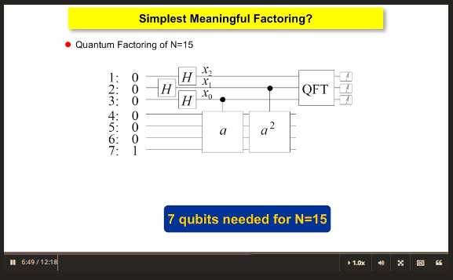

# Simplest Meaningful Factoring?

- Quantum Factoring of N = 15

Seven-qubit circuit. Lines are numbered 1–7 on the left, with initial states written beside them.

| Qubit | Initial state | What is drawn on the wire |
| --- | --- | --- |
| 1 | 0 | Hadamard, then the label \(x_2\); wire continues into the QFT and a measurement |
| 2 | 0 | Hadamard, then the label \(x_1\); a control dot on this upper register feeds \(a^2\) |
| 3 | 0 | Hadamard, then the label \(x_0\); a control dot on this wire feeds \(a\) |
| 4 | 0 | target rail through the \(a\) and \(a^2\) boxes |
| 5 | 0 | target rail through the \(a\) and \(a^2\) boxes |
| 6 | 0 | target rail through the \(a\) and \(a^2\) boxes |
| 7 | 1 | target rail through the \(a\) and \(a^2\) boxes |

- Three Hadamard gates act on qubits 1–3 (the period register). Those wires are labeled \(x_2\), \(x_1\), \(x_0\) from top to bottom.
- A controlled box labeled \(a\) acts on qubits 4–7, controlled from the \(x_0\) wire.
- A controlled box labeled \(a^2\) acts on qubits 4–7, controlled from the higher period-register wire (the control dot is drawn above the \(a\) control, immediately left of the QFT).
- A **QFT** box then covers the top three wires.
- Measurement meters are drawn on the top three wires only.

Blue callout: **7 qubits needed for N=15**.

Video player clock: 6:49 / 12:18.

00:06:52,600 \--\> 00:06:54,520

If we further consider what is needed

130

00:06:54,520 \--\> 00:06:56,050

for the controlled multiplication

131

00:06:56,050 \--\> 00:07:00,160

by a, as well as the controlled multiplication by a squared

132

00:07:00,160 \--\> 00:07:06,010

modulo 15, we find that this sequence of gates suffices.

133

<!-- frame 7:05 · diagram · week1/media/media/image10.png -->

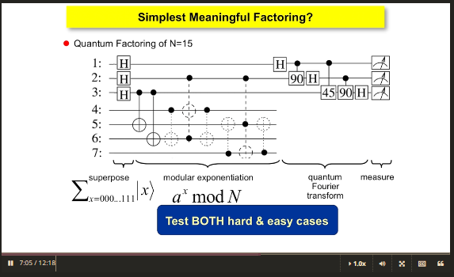

$$
\sum_{x=000\ldots111} |x\rangle
$$
$$
a^{x} \bmod N
$$

# Simplest Meaningful Factoring?

- Quantum Factoring of N=15

Seven-wire circuit. Wires 1–3 are the phase register; wires 4–7 are the work register. Braces underneath label the stages superpose, modular exponentiation, quantum Fourier transform, and measure. Under the superpose brace: ∑_{x=000…111} |x⟩. Under modular exponentiation: aˣ mod N. Blue banner: Test BOTH hard & easy cases.

Solid gates are drawn with solid lines; another set is drawn dashed (both cases are overlaid; the slide does not label which set is hard vs easy).

Superpose: H on wires 1, 2, and 3.

Modular exponentiation, left to right:

- Solid CNOT, control wire 3, open-circle target wire 5.
- Solid CNOT, control wire 3, open-circle target wire 6 (line crosses 4 and 5).
- Dashed CNOT, control wire 4, dashed open-circle target wire 6.
- Dashed Toffoli-like gate: filled controls on wire 2 and wire 6, dashed open-circle target on wire 4.
- Dashed CNOT, control wire 4, dashed open-circle target on wire 6.
- Dashed CNOT, filled control on wire 7, dashed open-circle target on wire 5.
- Dashed Toffoli-like gate: filled controls on wire 2 and wire 5, dashed open-circle target on wire 7.
- Dashed gate, filled control on wire 7, dashed open-circle targets on both wire 5 and wire 6.

Inverse QFT on wires 1–3, then meters only on wires 1–3 (wires 4–7 stop):

- Wire 1: H, control into the 90° box on wire 2, control into the 45° box on wire 3, meter.
- Wire 2: 90 box, H, control into the 90° box on wire 3, meter.
- Wire 3: 45 box, 90 box, H, meter.

00:07:06,010 \--\> 00:07:08,230

This includes two controlled NOT gates

134

00:07:08,230 \--\> 00:07:13,210

for the easy case and four additional controlled NOT gates

135

00:07:13,210 \--\> 00:07:16,300

and to Toffoli gates for the hard case.

136

00:07:16,300 \--\> 00:07:19,120

Altogether, including the quantum Fourier transform

137

00:07:19,120 \--\> 00:07:22,300

and the superposition creation Hadamard gates,

138

00:07:22,300 \--\> 00:07:24,460

around 20 gates are required.

139

00:07:24,460 \--\> 00:07:26,950

Of course, some of these are not elementary gates.

140

00:07:26,950 \--\> 00:07:30,160

The Toffoli gates are three-qubit gates, controlled

141

00:07:30,160 \--\> 00:07:32,290

controlled NOT gates, and they can

142

00:07:32,290 \--\> 00:07:35,870

be very highly nontrivial to realize in a physical system.

143

00:07:35,870 \--\> 00:07:38,950

The first realization of Shor\'s quantum factoring algorithm

144

00:07:38,950 \--\> 00:07:41,140

was done with a nuclear magnetic resonance

145

00:07:41,140 \--\> 00:07:44,890

system, as you have heard from Professor Lieven Vandersypen.

146

00:07:44,890 \--\> 00:07:49,000

The NMR experiment did both the easy and the hard cases

147

00:07:49,000 \--\> 00:07:53,950

and required around 200 pulses, each of these pulses realizing

148

00:07:53,950 \--\> 00:07:56,590

some elementary operation, a sequence of which,

149

00:07:56,590 \--\> 00:07:58,990

for example, realized the Toffoli gate.

150

00:07:58,990 \--\> 00:08:02,260

This was done in 2001 at IBM.

151

00:08:02,260 \--\> 00:08:05,530

More recently, in 2007, Shor\'s algorithm

152

00:08:05,530 \--\> 00:08:09,310

was also realized using a linear optics setup.

153

00:08:09,310 \--\> 00:08:13,270

However, only the easy case was implemented in that experiment,

154

00:08:13,270 \--\> 00:08:16,000

thus, only three qubits were required,

155

00:08:16,000 \--\> 00:08:19,420

and 13 elementary grades were performed.

156

00:08:19,420 \--\> 00:08:23,320

Furthermore, this experiment required post-selection,

157

00:08:23,320 \--\> 00:08:26,170

meaning that the results were only correct when

158

00:08:26,170 \--\> 00:08:30,310

conditioned on a specific output being in a certain state.

159

00:08:30,310 \--\> 00:08:33,490

The first solid-state qubit implementation

160

00:08:33,490 \--\> 00:08:36,309

of Shor\'s algorithm was done with a superconducting qubit

161

00:08:36,309 \--\> 00:08:39,520

system in 2012.

162

00:08:39,520 \--\> 00:08:42,820

Again, this was for factoring the number 15

163

00:08:42,820 \--\> 00:08:46,780

using three qubits and two controlled NOT gates.

164

00:08:46,780 \--\> 00:08:50,980

A more complicated case factoring the number 21

165

00:08:50,980 \--\> 00:08:55,660

was also done, this using linear optics quantum computing.

166

<!-- frame 8:53 · slide · week1/media/media/image1.png -->

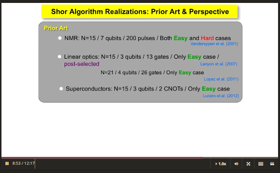

# Shor Algorithm Realizations: Prior Art & Perspective

## Prior Art

- NMR: N=15 / 7 qubits / 200 pulses / Both **Easy** and **Hard** cases. Vandersypen et al. (2001). Easy is highlighted green; Hard is highlighted red.
- Linear optics: N=15 / 3 qubits / 13 gates / Only **Easy** case / **post-selected** (post-selected in purple). Lanyon et al. (2007).
  - N=21 / 4 qubits / 26 gates / Only **Easy** case. Lopez et al. (2011).
- Superconductors: N=15 / 3 qubits / 2 CNOTs / Only **Easy** case. Lucero et al. (2012).

00:08:55,660 \--\> 00:08:58,960

But again, only an easy case was performed,

167

00:08:58,960 \--\> 00:09:03,700

with a four-qubit system and 26 gates, in 2011.

168

00:09:03,700 \--\> 00:09:06,220

One of the lessons from these experiments

169

00:09:06,220 \--\> 00:09:10,510

is that it is incredibly tempting to reduce the quantum

170

00:09:10,510 \--\> 00:09:12,760

factoring algorithm into something

171

00:09:12,760 \--\> 00:09:16,640

increasingly simple to realize with an experiment.

172

00:09:16,640 \--\> 00:09:18,820

And, in fact, factoring almost any number

173

00:09:18,820 \--\> 00:09:21,430

using a quantum algorithm can be done trivially

174

00:09:21,430 \--\> 00:09:25,900

by choosing an a such that the period r is equal to 2.

175

00:09:25,900 \--\> 00:09:29,050

In this case, the quantum circuit for Shor\'s algorithm

176

00:09:29,050 \--\> 00:09:33,100

reduces to a very simple two-qubit circuit, shown here.

177

00:09:33,100 \--\> 00:09:35,680

This illustrates the ridiculousness

178

00:09:35,680 \--\> 00:09:39,130

of what happens when one compiles the quantum factoring

179

00:09:39,130 \--\> 00:09:41,440

algorithm down too far.

180

00:09:41,440 \--\> 00:09:44,350

This point is driven home by a beautiful article

181

<!-- frame 9:43 · slide · week1/media/media/image15.png -->

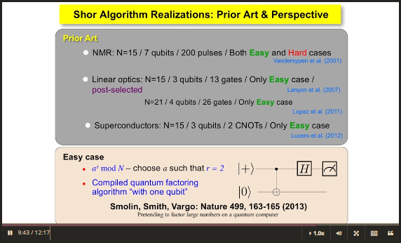

$$a^2 \bmod N$$

The easy case chooses $a$ so the order is $r=2$.

# Shor Algorithm Realizations: Prior Art & Perspective

Prior art:
- NMR: $N=15$, 7 qubits, 200 pulses, both easy and hard cases. Vandersypen et al. (2001).
- Linear optics: $N=15$, 3 qubits, 13 gates, only the easy case, post-selected. Lanyon et al. (2007).
- $N=21$, 4 qubits, 26 gates, only the easy case. Lopez et al. (2011).
- Superconductors: $N=15$, 3 qubits, 2 CNOTs, only the easy case. Lucero et al. (2012).

Easy case: choose $a$ so $r=2$. Compiled factoring "with one qubit". Circuit sketch $|+\rangle$ into a phase gate and meter, $|0\rangle$ below. Smolin, Smith, Vargo, Nature 499, 163–165 (2013): pretending to factor large numbers on a quantum computer.

00:09:44,350 \--\> 00:09:48,310

by John Smolin, Graeme Smith, and Alex Vargo,

182

00:09:48,310 \--\> 00:09:51,460

which appeared in Nature in 2013,

183

00:09:51,460 \--\> 00:09:55,210

titled \"Pretending to Factor Large Numbers on a Quantum

184

00:09:55,210 \--\> 00:09:56,050

Computer.\"

185

00:09:56,050 \--\> 00:09:58,750

They observed that actually running algorithms

186

00:09:58,750 \--\> 00:10:02,950

on such tiny experiments is a somewhat frivolous endeavor

187

00:10:02,950 \--\> 00:10:06,950

when such extreme compilation is performed.

188

00:10:06,950 \--\> 00:10:09,070

So one has to be very careful in choosing

189

00:10:09,070 \--\> 00:10:11,560

a meaningful instance of Shor\'s algorithm,

190

00:10:11,560 \--\> 00:10:15,500

as well as a meaningful rendition of that instance

191

00:10:15,500 \--\> 00:10:17,170

in a physical system.

192

00:10:17,170 \--\> 00:10:20,230

If this is done, in fact, quantum factoring

193

00:10:20,230 \--\> 00:10:24,190

can be a useful test of scalability.

194

00:10:24,190 \--\> 00:10:27,550

One of the main points of the trapped ion quantum computing

195

<!-- frame 10:27 · slide · week1/media/media/image30.png -->

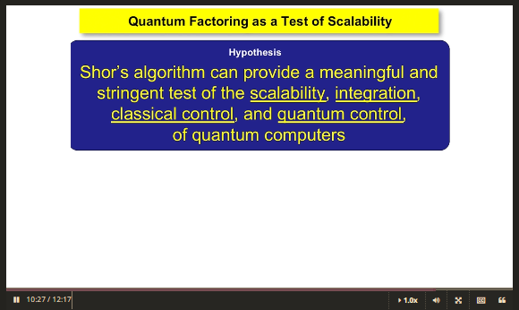

Title (yellow banner): Quantum Factoring as a Test of Scalability

Hypothesis (white heading on a blue panel):
Shor's algorithm can provide a meaningful and stringent test of the scalability, integration, classical control, and quantum control, of quantum computers.

The phrases "scalability", "integration", "classical control", and "quantum control" are underlined.

00:10:27,550 \--\> 00:10:31,090

realization was to show how Shor\'s algorithm can provide

196

00:10:31,090 \--\> 00:10:34,390

a meaningful and stringent test of the scalability,

197

00:10:34,390 \--\> 00:10:38,710

integration, classical control, and quantum control of quantum

198

00:10:38,710 \--\> 00:10:39,730

computers.

199

00:10:39,730 \--\> 00:10:43,240

In the trapped ion realization of Shor\'s quantum factoring

200

00:10:43,240 \--\> 00:10:45,970

algorithm, there were four main goals.

201

00:10:45,970 \--\> 00:10:50,300

First, when doing both the easy and hard cases,

202

00:10:50,300 \--\> 00:10:55,810

it is clear that a cascade of multi-qubit gates is required.

203

00:10:55,810 \--\> 00:10:59,680

And if each one of these gates fails with a small probability,

204

00:10:59,680 \--\> 00:11:02,770

the cascade rapidly fails because

205

00:11:02,770 \--\> 00:11:05,890

of the product of those probabilities decreasing

206

00:11:05,890 \--\> 00:11:07,370

very fast.

207

00:11:07,370 \--\> 00:11:11,230

So to achieve high-fidelity, non-pole selected,

208

00:11:11,230 \--\> 00:11:16,160

deterministic output is a challenging goal to realize.

209

00:11:16,160 \--\> 00:11:20,000

A second goal of the trapped ion demonstration

210

00:11:20,000 \--\> 00:11:23,540

was to demonstrate the feed forward control needed

211

00:11:23,540 \--\> 00:11:27,320

for the recipes used in fault-tolerant quantum

212

00:11:27,320 \--\> 00:11:28,700

computation.

213

00:11:28,700 \--\> 00:11:32,030

A third goal was to perform not just quantum computation

214

00:11:32,030 \--\> 00:11:35,030

but also to integrate quantum memory with the quantum

215

00:11:35,030 \--\> 00:11:36,230

computation.

216

00:11:36,230 \--\> 00:11:38,540

And finally, one of the most important goals

217

<!-- frame 11:38 · slide · week1/media/media/image53.png -->

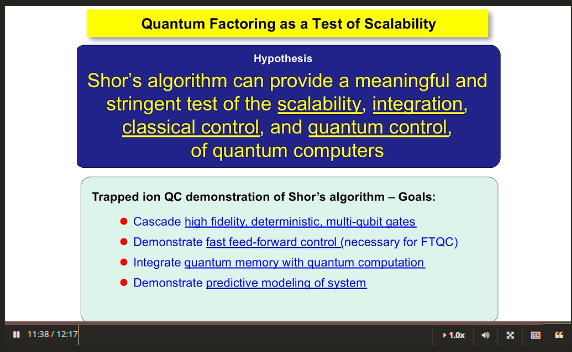

Yellow title: Quantum Factoring as a Test of Scalability

Navy box, heading Hypothesis:
Shor's algorithm can provide a meaningful and stringent test of the scalability, integration, classical control, and quantum control, of quantum computers.
(The phrases scalability, integration, classical control, and quantum control are underlined.)

Pale box: Trapped ion QC demonstration of Shor's algorithm – Goals:
- Cascade high fidelity, deterministic, multi-qubit gates (that phrase underlined)
- Demonstrate fast feed-forward control (necessary for FTQC) ("fast feed-forward control" underlined)
- Integrate quantum memory with quantum computation (phrase underlined)
- Demonstrate predictive modeling of system ("predictive modeling" underlined)

00:11:38,540 \--\> 00:11:42,920

of building a process for building quantum computers

218

00:11:42,920 \--\> 00:11:46,280

is to be able to predict their performance in advance

219

00:11:46,280 \--\> 00:11:48,140

of realizing the hardware.

220

00:11:48,140 \--\> 00:11:51,350

And thus, one of the goals of the trapped ion demonstration

221

00:11:51,350 \--\> 00:11:53,480

of Shor\'s quantum factoring algorithm

222

00:11:53,480 \--\> 00:11:56,900

was to demonstrate such predictive modeling of expected

223

00:11:56,900 \--\> 00:11:58,350

system behavior.

224

00:11:58,350 \--\> 00:12:02,870

Altogether, this meant that the goal of the trapped ion quantum

225

00:12:02,870 \--\> 00:12:06,290

computing realization of Shor\'s quantum factoring algorithm

226

00:12:06,290 \--\> 00:12:11,020

was to use it as a strategic test of scalability elements.

227

00:12:11,020 \--\> 00:12:17,494

## **PRACTICE (there is no practice for this introduction page )** 

Section: case of study demonstrations of shor\'s algorithm

# Page Title: Demonstrations of Shor's Algorithm: Quantum Factoring With Trapped Ions - Ion Trapping System

# **Learn**

## **Images**

## **Transcript**

## 

0

00:00:00,000 \--\> 00:00:00,500

1

00:00:00,500 \--\> 00:00:02,540

Let me now share with you a description

2

00:00:02,540 \--\> 00:00:05,450

of the trapped ion quantum computing system employed

3

00:00:05,450 \--\> 00:00:09,510

for the demonstration of Shor\'s quantum factoring algorithm.

4

00:00:09,510 \--\> 00:00:13,250

Two energy levels of an atom can be employed as a qubit.

5

00:00:13,250 \--\> 00:00:16,970

But it\'s ordinarily very hard to hold onto a single atom

6

00:00:16,970 \--\> 00:00:18,740

and not lose it.

7

00:00:18,740 \--\> 00:00:20,630

On the other hand, if an electron

8

00:00:20,630 \--\> 00:00:22,650

is removed from the atom it becomes

9

00:00:22,650 \--\> 00:00:25,190

a positively charged ion, which is

10

00:00:25,190 \--\> 00:00:27,410

much easier to trap and hold.

11

00:00:27,410 \--\> 00:00:30,680

Calcium 40 is a common ion which can be trapped in this way

12

00:00:30,680 \--\> 00:00:33,080

and employed for quantum computation because

13

00:00:33,080 \--\> 00:00:35,900

of its internal level structure.

14

00:00:35,900 \--\> 00:00:41,000

The so-called D5/2 and S1/2 levels of calcium 40

15

00:00:41,000 \--\> 00:00:43,200

make excellent two\-- level systems usable

16

00:00:43,200 \--\> 00:00:46,220

as a qubit because of its approximately one

17

00:00:46,220 \--\> 00:00:48,650

second lifetime, and because the transition can

18

00:00:48,650 \--\> 00:00:52,010

be excited by photons, which is accessible to the solid state

19

00:00:52,010 \--\> 00:00:53,450

lasers.

20

00:00:53,450 \--\> 00:00:57,950

In reality, however, the atom has other energy levels

21

00:00:57,950 \--\> 00:00:59,190

also involved.

22

00:00:59,190 \--\> 00:01:02,960

For example, the higher energy P3/2 level

23

00:01:02,960 \--\> 00:01:07,430

can connect with the D5/2 level via an 854 nanometer

24

<!-- frame 1:07 · diagram · week1/media/media/image40.png -->

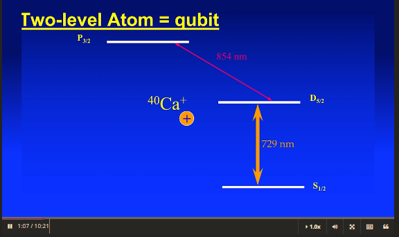

Title: Two-level Atom = qubit

Energy-level diagram for a trapped ion, labeled `⁴⁰Ca⁺` (orange circle with +).

- Top short level: P₁/₂. A magenta arrow slopes down-right to the middle level, labeled 854 nm.
- Middle level: D₅/₂.
- Bottom level: S₁/₂.
- Orange double-headed vertical arrow between D₅/₂ and S₁/₂, labeled 729 nm (the qubit transition).

00:01:07,430 \--\> 00:01:09,680

optical transition.

25

00:01:09,680 \--\> 00:01:14,420

The P3/2 level can also decay to the S1/2 ground

26

00:01:14,420 \--\> 00:01:20,270

state via a short wavelength 393 nanometer optical transition.

27

00:01:20,270 \--\> 00:01:23,210

This produces a closed cycle, which

28

00:01:23,210 \--\> 00:01:26,790

is useful for controlling the ion\'s motion.

29

00:01:26,790 \--\> 00:01:30,470

This cycle and the short wavelength photon emitted

30

00:01:30,470 \--\> 00:01:35,810

are also employed to measure the qubit state since this emission

31

00:01:35,810 \--\> 00:01:38,940

occurs if the qubit is in the S1/2 state

32

00:01:38,940 \--\> 00:01:42,180

but not in the D5/2 state.

33

00:01:42,180 \--\> 00:01:46,920

Two additional levels, the P1/2 and D3/2 levels

34

00:01:46,920 \--\> 00:01:50,940

also form a closed cycle and provide the primary transitions

35

<!-- frame 1:49 · diagram · week1/media/media/image17.png -->

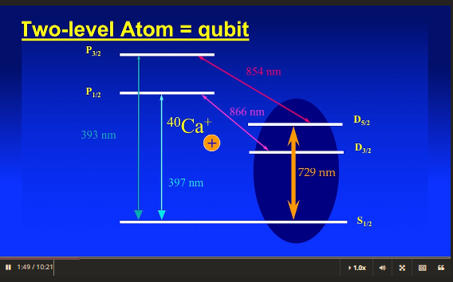

# Two-level Atom = qubit

Level diagram of $^{40}\mathrm{Ca}^+$. Levels shown: $P_{3/2}$, $P_{1/2}$, $D_{5/2}$, $D_{3/2}$, $S_{1/2}$. Transitions: 393 nm ($S_{1/2}\leftrightarrow P_{1/2}$), 397 nm (down to $S_{1/2}$), 854 nm ($P_{3/2}\to D_{5/2}$), 866 nm ($P_{1/2}\to D_{3/2}$), 729 nm (the qubit transition $S_{1/2}\leftrightarrow D_{5/2}$, highlighted).

00:01:50,940 \--\> 00:01:54,330

used for laser cooling of the ion.

36

00:01:54,330 \--\> 00:01:56,640

How the ion itself is trapped, however,

37

00:01:56,640 \--\> 00:01:58,560

only involves its charge.

38

00:01:58,560 \--\> 00:02:00,000

Consider a single ion.

39

00:02:00,000 \--\> 00:02:03,450

Trapping is accomplished based on the following idea.

40

00:02:03,450 \--\> 00:02:06,630

Surround the ion with four electrodes shown here

41

00:02:06,630 \--\> 00:02:07,980

in cross-section.

42

00:02:07,980 \--\> 00:02:11,730

Two additional end cap electrodes in front and in back

43

00:02:11,730 \--\> 00:02:13,290

are not pictured.

44

00:02:13,290 \--\> 00:02:17,370

These metal electrodes hold positive and negative charges

45

00:02:17,370 \--\> 00:02:20,920

via electrical voltage is applied.

46

<!-- frame 2:20 · diagram · week1/media/media/image21.png -->

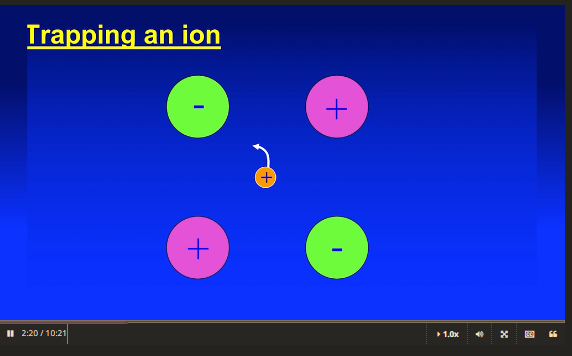

Title (yellow, underlined): Trapping an ion

Blue-background schematic of a quadrupole trap. Four circular electrodes sit at the corners of a square:
- top-left: green, labeled −
- top-right: magenta, labeled +
- bottom-left: magenta, labeled +
- bottom-right: green, labeled −

At the center is a smaller orange ion labeled +, with a curved white arrow indicating motion around the center.

00:02:20,920 \--\> 00:02:24,400

Opposite charges attract and equal charges repel.

47

00:02:24,400 \--\> 00:02:27,610

But if the ion were exactly in the middle,

48

00:02:27,610 \--\> 00:02:29,650

all forces would balance.

49

00:02:29,650 \--\> 00:02:32,500

More likely than not, an ion would initially

50

00:02:32,500 \--\> 00:02:35,860

be off center and thus it would move towards the nearest

51

00:02:35,860 \--\> 00:02:39,340

oppositely charged electrode such as the negatively

52

00:02:39,340 \--\> 00:02:42,550

charged one on the upper left.

53

00:02:42,550 \--\> 00:02:45,970

As the ion moves, we change voltages such

54

00:02:45,970 \--\> 00:02:49,090

that the close electrode becomes positive,

55

00:02:49,090 \--\> 00:02:52,150

repelling the ion before it reaches the electrode.

56

00:02:52,150 \--\> 00:02:54,580

The ion then moves onward, for example,

57

00:02:54,580 \--\> 00:02:58,870

to the next closest negative electrode on the bottom left.

58

00:02:58,870 \--\> 00:03:03,250

Again, we change voltages to keep the ion dancing around,

59

00:03:03,250 \--\> 00:03:06,580

never reaching one of the electrodes, always confined

60

00:03:06,580 \--\> 00:03:10,160

within the region defined by the electrodes.

61

00:03:10,160 \--\> 00:03:13,420

This idea is at the heart of the physical process

62

00:03:13,420 \--\> 00:03:18,130

for which Wolfgang Paul was awarded the 1989 Nobel

63

00:03:18,130 \--\> 00:03:19,210

Prize in physics.

64

00:03:19,210 \--\> 00:03:23,260

Shown on the left is a picture of an actual four electrode

65

00:03:23,260 \--\> 00:03:26,350

quadripolar linear ion guide, which

66

00:03:26,350 \--\> 00:03:29,980

can be employed as an ion trap when the end cap electrodes are

67

00:03:29,980 \--\> 00:03:31,500

added.

68

00:03:31,500 \--\> 00:03:34,800

By applying lasers, which cool the motion of the ion using

69

00:03:34,800 \--\> 00:03:38,310

its internal level structure, the trapped ions

70

00:03:38,310 \--\> 00:03:41,910

can be made to come to rest at the very center

71

00:03:41,910 \--\> 00:03:45,060

of the electrical potential.

72

00:03:45,060 \--\> 00:03:48,660

Such trapping and cooling has been demonstrated

73

00:03:48,660 \--\> 00:03:51,720

with a wide variety of atomic and molecular ions,

74

00:03:51,720 \--\> 00:03:56,620

including strontium, beryllium, ytterbium, barium, magnesium,

75

00:03:56,620 \--\> 00:03:58,440

calcium, and others.

76

00:03:58,440 \--\> 00:04:01,140

Physical parameters determined by the lasers

77

00:04:01,140 \--\> 00:04:05,460

and by the atomic structure determine how cold the ions get

78

00:04:05,460 \--\> 00:04:08,940

and how cooling competes with heating processes.

79

00:04:08,940 \--\> 00:04:11,740

For scalable quantum computation,

80

00:04:11,740 \--\> 00:04:16,899

the quadripolar ion structure can be simplified as follows.

81

00:04:16,899 \--\> 00:04:19,829

First, imagine rotating the electrode configuration

82

<!-- frame 4:20 · diagram · week1/media/media/image42.png -->

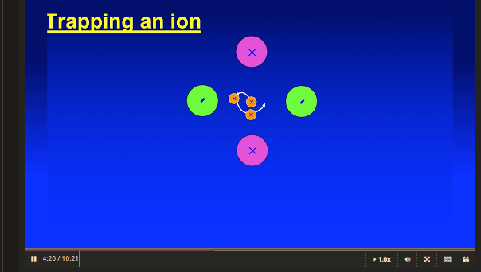

Title: Trapping an ion

Quadrupole-style electrode sketch on a blue background:
- Top and bottom electrodes: pink circles marked ×.
- Left and right electrodes: green circles marked with a center dot.
- Center: two orange ions, each marked +, with small curved arrows showing orbital/micromotion between the four electrodes.

00:04:19,829 \--\> 00:04:22,400

by 90 degrees.

83

00:04:22,400 \--\> 00:04:25,510

Next, envision replacing the three lower

84

00:04:25,510 \--\> 00:04:30,490

electrodes with three coplanar electrodes beneath the ion.

85

00:04:30,490 \--\> 00:04:35,230

The top electrode becomes a top metallic conductor,

86

00:04:35,230 \--\> 00:04:40,210

which may be far away or part of the confining vacuum chamber.

87

00:04:40,210 \--\> 00:04:44,920

This configuration still traps ions.

88

<!-- frame 4:44 · diagram · week1/media/media/image51.png -->

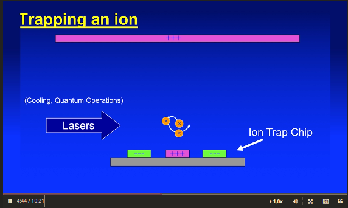

Title: Trapping an ion

Surface-electrode ion-trap sketch:
- Top: a long pink electrode bar with ++ near its center.
- Label at left: (Cooling, Quantum Operations). A dark-blue arrow labeled Lasers points toward the ions.
- Two orange ions marked + hover above the chip, with curved arrows for their motion.
- Chip: gray substrate; green end electrodes marked −−; pink center electrode marked +++. A white arrow labels this Ion Trap Chip.

00:04:44,920 \--\> 00:04:47,260

Lasers can be applied from the side

89

00:04:47,260 \--\> 00:04:52,980

just as before for cooling and also to perform quantum gates.

90

00:04:52,980 \--\> 00:04:57,150

Moreover, the substrate can be cooled, for example,

91

00:04:57,150 \--\> 00:05:00,540

to liquid helium temperatures, to allow integration

92

00:05:00,540 \--\> 00:05:04,120

with devices such as superconducting electronics.

93

00:05:04,120 \--\> 00:05:06,330

This substrate can be micro-fabricated

94

00:05:06,330 \--\> 00:05:09,570

with modern semiconductor lithography techniques

95

00:05:09,570 \--\> 00:05:13,200

with geometries that include sophisticated patterning

96

00:05:13,200 \--\> 00:05:17,220

in the third dimension, such as the segmented structures shown

97

00:05:17,220 \--\> 00:05:19,290

here, comoving ions.

98

00:05:19,290 \--\> 00:05:22,590

A wide variety of such surface electrode ion traps

99

00:05:22,590 \--\> 00:05:25,870

have now been realized in laboratories around the world,

100

00:05:25,870 \--\> 00:05:29,010

including six pictured here from research groups

101

00:05:29,010 \--\> 00:05:33,090

at the University of Mainz, MIT, Maryland, Sussex, Sandia

102

<!-- frame 5:30 · slide · week1/media/media/image2.png -->

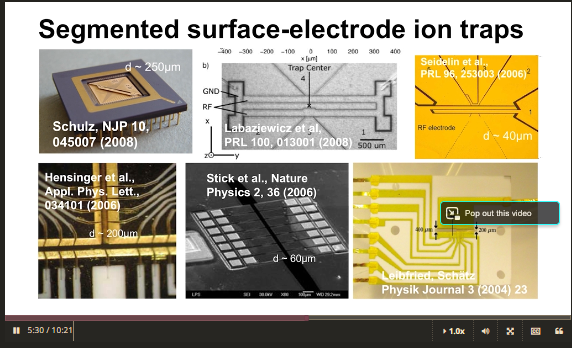

# Segmented surface-electrode ion traps

Collage of ion-trap chips and one electrode schematic, with length scales and citations.

- Top left photo: packaged chip. Label d ~ 250 μm. Schulz, NJP 10, 045007 (2008).
- Center schematic, panel (b): top-view surface-electrode layout. Horizontal axis marked about −300 to 400 μm; vertical axis arrow labeled x and horizontal arrow labeled y. Electrodes labeled GND and RF; a callout marks the Trap Center. Scale bar 500 μm. Labaziewicz et al., PRL 100, 013001 (2008).
- Top right photo: gold RF electrode, d ~ 40 μm. Seidelin et al., PRL 96, 253003 (2006).
- Bottom left photo: linear electrode array, d ~ 200 μm. Hensinger et al., Appl. Phys. Lett., 034101 (2006).
- Bottom center SEM: multi-electrode trap chip, d ~ 60 μm. Stick et al., Nature Physics 2, 36 (2006).
- Bottom right photo: gold surface electrodes with on-image scale labels (about 50 μm and 20 μm). Leibfried, Schätz, Physik Journal 3 (2004) 23.

00:05:33,090 \--\> 00:05:36,050

National Lab, and NIST.

103

00:05:36,050 \--\> 00:05:38,540

Designs for trapped ion chips include

104

00:05:38,540 \--\> 00:05:41,300

ones fabricated using sophisticated modern

105

00:05:41,300 \--\> 00:05:45,860

semiconductor line processes such as this one fabricated

106

00:05:45,860 \--\> 00:05:49,190

by Lucent Technologies and pictured installed in a vacuum

107

00:05:49,190 \--\> 00:05:50,930

chamber at MIT.

108

00:05:50,930 \--\> 00:05:53,630

The ion trapped chips have also been

109

<!-- frame 5:54 · slide · week1/media/media/image22.png -->

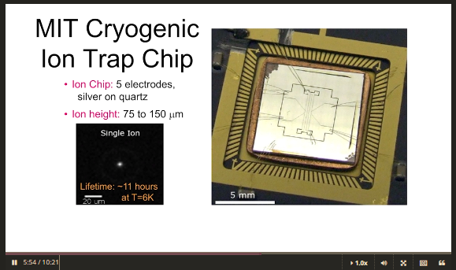

Title: MIT Cryogenic Ion Trap Chip

- Ion Chip: 5 electrodes, silver on quartz
- Ion height: 75 to 150 μm

Inset fluorescence image labeled "Single Ion" (bright spot on a dark background), scale bar 20 um. Caption: Lifetime: ~11 hours at T=6K.

Right: photograph of the packaged ion-trap chip (gold/silver electrodes on a square substrate in a ceramic package), scale bar 5 mm.

00:05:53,630 \--\> 00:05:55,880

operated at cryogenic temperatures,

110

00:05:55,880 \--\> 00:05:58,175

including this one made of silver

111

00:05:58,175 \--\> 00:06:02,960

on quartz used at MIT to trap crystals of strontium ions,

112

00:06:02,960 \--\> 00:06:07,190

shown here with one, two, three, four,

113

00:06:07,190 \--\> 00:06:12,830

and over 20 individual atomic ions visible in the CCD image.

114

00:06:12,830 \--\> 00:06:15,890

The quantum factoring demonstration with trapped ions

115

00:06:15,890 \--\> 00:06:18,290

was carried out in this laboratory

116

00:06:18,290 \--\> 00:06:21,140

at the University of Innsbruck.

117

00:06:21,140 \--\> 00:06:24,170

Pictured here from photos I took during our opening

118

00:06:24,170 \--\> 00:06:27,590

collaboration in 2001, the ion trap

119

00:06:27,590 \--\> 00:06:31,850

here is a macroscopic hand machined quadripolar trap

120

00:06:31,850 \--\> 00:06:36,060

at the center of these magnetic field coils.

121

00:06:36,060 \--\> 00:06:39,140

This shows the same setup from another angle showing

122

00:06:39,140 \--\> 00:06:42,710

the optical components needed to guide all the laser

123

00:06:42,710 \--\> 00:06:46,190

beams to the trapped ions.

124

00:06:46,190 \--\> 00:06:49,850

And this is the control computer and electronics

125

00:06:49,850 \--\> 00:06:54,530

used to generate the frequency and amplitude controlled laser

126

00:06:54,530 \--\> 00:07:01,660

pulses, which perform quantum operations on the ion state.

127

00:07:01,660 \--\> 00:07:03,480

I learned the art of ion trapping

128

00:07:03,480 \--\> 00:07:07,410

from Professor Dr. Rainer Blatt, shown here in his office

129

00:07:07,410 \--\> 00:07:10,570

at the University of Innsbruck in Austria.

130

00:07:10,570 \--\> 00:07:14,910

His group and that led by Dr. David Wineland at NIST

131

00:07:14,910 \--\> 00:07:17,010

set the standard for the field, as well as

132

00:07:17,010 \--\> 00:07:20,790

the character of scientific openness and collaboration

133

00:07:20,790 \--\> 00:07:25,200

that shaped the field of trapped ion quantum information science

134

00:07:25,200 \--\> 00:07:26,910

today.

135

00:07:26,910 \--\> 00:07:29,730

The trapped ion quantum factoring demonstration

136

00:07:29,730 \--\> 00:07:33,120

was done with a linear ion chain of five calcium

137

00:07:33,120 \--\> 00:07:37,290

ions, each of which has the internal level structure shown

138

00:07:37,290 \--\> 00:07:40,020

earlier and reproduced here.

139

00:07:40,020 \--\> 00:07:42,120

Recall that the qubit transition is

140

00:07:42,120 \--\> 00:07:48,460

between the D5/2 level and the ground state S1/2 level.

141

00:07:48,460 \--\> 00:07:51,400

Laser pulses focused on individual ions

142

00:07:51,400 \--\> 00:07:56,110

realize single qubit rotations addressed at individual qubits.

143

00:07:56,110 \--\> 00:07:58,900

The laser is typically tuned to affect rotations

144

00:07:58,900 \--\> 00:08:02,240

about the qubit\'s z axes.

145

00:08:02,240 \--\> 00:08:05,060

Multi-qubit collective gates are realized

146

00:08:05,060 \--\> 00:08:07,700

either by applying a monochromatic laser

147

00:08:07,700 \--\> 00:08:10,490

beam to multiple ions, which implements

148

00:08:10,490 \--\> 00:08:13,880

in parallel many single qubit rotations,

149

00:08:13,880 \--\> 00:08:18,770

or by applying two simultaneous laser frequencies tuned such

150

00:08:18,770 \--\> 00:08:20,810

that a multi-qubit gate operation is

151

<!-- frame 8:21 · slide · week1/media/media/image33.png -->

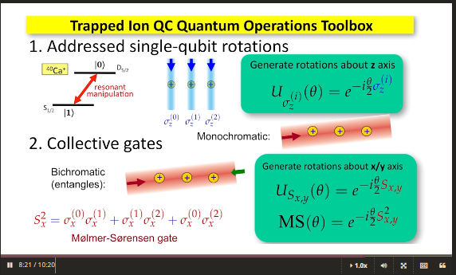

$$U_{\sigma_z^{(j)}}(\theta) = e^{-i\frac{\theta}{2}\sigma_z^{(j)}}$$
$$S_x^{2} = \sigma_x^{(0)}\sigma_x^{(1)} + \sigma_x^{(1)}\sigma_x^{(2)} + \sigma_x^{(0)}\sigma_x^{(2)}$$
$$U_{S_{x,y}}(\theta) = e^{-i\frac{\theta}{2} S_{x,y}}$$
$$\mathrm{MS}(\theta) = e^{-i\frac{\theta}{2} S_{x,y}^{2}}$$

Title (yellow banner): Trapped Ion QC Quantum Operations Toolbox

1. Addressed single-qubit rotations
- Level diagram for ^{40}Ca^{+}: upper level |0⟩ is D_{5/2}; lower level |1⟩ is S_{1/2}. A red double arrow between them is labeled "resonant manipulation".
- Three ions, each under a blue downward arrow, labeled σ_z^{(0)}, σ_z^{(1)}, σ_z^{(2)}.
- Green box: Generate rotations about z axis
$$U_{\sigma_z^{(j)}}(\theta) = e^{-i\frac{\theta}{2}\sigma_z^{(j)}}$$
- Monochromatic: one red beam from the left onto a chain of three + ions.

2. Collective gates
- Bichromatic (entangles): a red beam from the left and a green beam from the right onto three + ions.
$$S_x^{2} = \sigma_x^{(0)}\sigma_x^{(1)} + \sigma_x^{(1)}\sigma_x^{(2)} + \sigma_x^{(0)}\sigma_x^{(2)}$$
- Label: Mølmer-Sørensen gate
- Green box: Generate rotations about x/y axis
$$U_{S_{x,y}}(\theta) = e^{-i\frac{\theta}{2} S_{x,y}}$$
$$\mathrm{MS}(\theta) = e^{-i\frac{\theta}{2} S_{x,y}^{2}}$$

00:08:20,810 \--\> 00:08:24,170

realized, known as the Molmer-Sorensen gate,

152

00:08:24,170 \--\> 00:08:25,940

after its inventors.

153

00:08:25,940 \--\> 00:08:28,280

This is the mathematical form of the gate, which

154

00:08:28,280 \--\> 00:08:33,350

you can learn more about in the MITx 8422 xOnline course

155

00:08:33,350 \--\> 00:08:36,929

sequence on atomic physics.

156

00:08:36,929 \--\> 00:08:41,340

The basic set of Molmer-Sorensen collective spin flip

157

<!-- frame 8:38 · slide · week1/media/media/image14.png -->

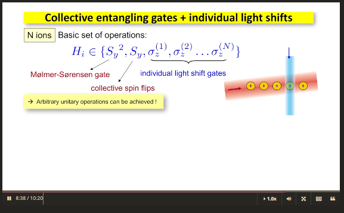

$$H_i \in \{ S_y^{\,2},\, S_y,\, \sigma_z^{(1)},\, \sigma_z^{(2)},\, \ldots,\, \sigma_z^{(N)} \}$$

# Collective entangling gates + individual light shifts

N ions. Basic set of operations as in the formula. The pair $S_y^2, S_y$ is the Mølmer–Sørensen gate (collective spin flips). The $\sigma_z^{(i)}$ are individual light-shift gates. Together: arbitrary unitary operations can be achieved. Right panel: a chain of ions in a trap with a focused beam on one ion.

00:08:41,340 \--\> 00:08:44,280

and individual light shift operations available

158

00:08:44,280 \--\> 00:08:48,090

can be combined to realize arbitrary multi-qubit quantum

159

00:08:48,090 \--\> 00:08:49,020

gates.

160

00:08:49,020 \--\> 00:08:51,150

For example, the quantum Toffoli gate

161

00:08:51,150 \--\> 00:08:55,350

can be realized as this sequence of five collective three

162

00:08:55,350 \--\> 00:09:00,960

Molmer-Sorensen and three single qubit light shift gates.

163

00:09:00,960 \--\> 00:09:04,500

How well do the traps and gates work in practice?

164

00:09:04,500 \--\> 00:09:07,650

Here are performance numbers for the system

165

00:09:07,650 \--\> 00:09:11,550

employed for the quantum factoring demonstration.

166

00:09:11,550 \--\> 00:09:15,750

The system was demonstrated to reliably trap

167

00:09:15,750 \--\> 00:09:21,480

up to 14 ions with state preparation of 99.5%

168

00:09:21,480 \--\> 00:09:24,150

fidelity, taking a few milliseconds

169

00:09:24,150 \--\> 00:09:29,040

for each preparation, routinely realizing T1 and T2 coherence

170

00:09:29,040 \--\> 00:09:33,180

times of one second and five seconds respectively.

171

00:09:33,180 \--\> 00:09:37,950

Requiring about 400 microseconds for a quantum state measurement

172

00:09:37,950 \--\> 00:09:42,900

when using a photomultiplier tube, and between 20 and 45

173

00:09:42,900 \--\> 00:09:46,650

microseconds to realize single and multi-qubit gates,

174

00:09:46,650 \--\> 00:09:50,220

which have gate fidelities of over 99%

175

00:09:50,220 \--\> 00:09:55,230

for single-qubit operations, and between 99% and 94%

176

00:09:55,230 \--\> 00:09:58,590

for two and five ion gates.

177

00:09:58,590 \--\> 00:10:01,500

Additional energy levels within the ions

178

00:10:01,500 \--\> 00:10:04,860

can also be employed as quantum memories

179

<!-- frame 10:05 · slide · week1/media/media/image62.png -->

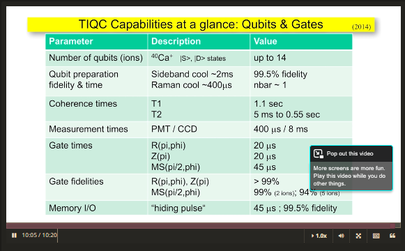

# TIQC Capabilities at a glance: Qubits & Gates (2014)

Table, columns **Parameter | Description | Value**.

| Parameter | Description | Value |
| --- | --- | --- |
| Number of qubits (ions) | \(^{40}\mathrm{Ca}^{+}\) \(\|S\rangle\), \(\|D\rangle\) states | up to 14 |
| Qubit preparation fidelity & time | Sideband cool ~2 ms; Raman cool ~400 μs | 99.5% fidelity; \(\bar{n} \sim 1\) |
| Coherence times | T1; T2 | 1.1 sec; 5 ms to 0.55 sec |
| Measurement times | PMT / CCD | 400 μs / 8 ms |
| Gate times | \(R(\pi,\phi)\); \(Z(\pi)\); \(\mathrm{MS}(\pi/2,\phi)\) | 20 μs; 20 μs; 45 μs |
| Gate fidelities | \(R(\pi,\phi)\), \(Z(\pi)\); \(\mathrm{MS}(\pi/2,\phi)\) | > 99%; 99% (2 ions); 94% (5 ions) |
| Memory I/O | "hiding pulse" | 45 μs / 99.5% fidelity |

A player tooltip overlaps the lower-right of the table: “Pop out this video. More screens are more fun. Play this video while you do other things.”

Video player clock: 10:05 / 10:20.

00:10:04,860 \--\> 00:10:09,360

with storage fidelity of 99.5% and write times

180

00:10:09,360 \--\> 00:10:12,820

of 45 microseconds.

181

00:10:12,820 \--\> 00:10:21,100

## **PRACTICE** 

## **(there is no practice for this page and the next )**

##  

Section:case-of-study demonstrations of shor\'s algorithm

# Page Title: Demonstrations of Shor's Algorithm: Quantum Factoring With Trapped Ions - Experimental Results

# **Learn**

## **Images**

## **Transcript**

## 

0

0

00:00:00,000 \--\> 00:00:00,500

1

00:00:00,500 \--\> 00:00:03,180

Let us now go in-depth into the actual experimental

2

00:00:03,180 \--\> 00:00:06,960

demonstration of quantum factoring with trapped ions.

3

00:00:06,960 \--\> 00:00:10,810

Recall that this demonstration has four strategic goals.

4

00:00:10,810 \--\> 00:00:14,470

First, to demonstrate fast feed-forward control,

5

00:00:14,470 \--\> 00:00:17,370

the capability needed for quantum error correction

6

00:00:17,370 \--\> 00:00:20,460

used in fault tolerant quantum computation.

7

00:00:20,460 \--\> 00:00:22,800

Second, to integrate quantum memory

8

00:00:22,800 \--\> 00:00:25,950

with quantum computation, noting that data memory

9

00:00:25,950 \--\> 00:00:30,580

is a vital component of modern classical computation.

10

00:00:30,580 \--\> 00:00:33,550

Third, to cascade a sizable number

11

00:00:33,550 \--\> 00:00:36,400

of multi-qubit quantum gates deterministically

12

00:00:36,400 \--\> 00:00:38,530

and with high fidelity.

13

00:00:38,530 \--\> 00:00:41,440

And fourth, to demonstrate predictive modeling

14

00:00:41,440 \--\> 00:00:44,920

of the system behavior allowing extrapolation to large scale

15

00:00:44,920 \--\> 00:00:46,780

system performance.

16

00:00:46,780 \--\> 00:00:51,110

These four goals are challenged by the following four issues.

17

00:00:51,110 \--\> 00:00:53,200

First, the Quantum Fourier Transform

18

00:00:53,200 \--\> 00:00:56,290

and the modular exponentiation circuit for the hard case

19

00:00:56,290 \--\> 00:00:58,540

naively requires over 200 gates.

20

00:00:58,540 \--\> 00:01:01,750

And even if the fidelity of each is around 99%,

21

00:01:01,750 \--\> 00:01:04,599

the product of these is expected to have a fidelity lower

22

00:01:04,599 \--\> 00:01:06,100

than 10%.

23

00:01:06,100 \--\> 00:01:08,410

Second, multi-qubit gates, measurement,

24

00:01:08,410 \--\> 00:01:10,330

and state initialization can be slow,

25

00:01:10,330 \--\> 00:01:12,460

meaning that the total time required can exceed

26

00:01:12,460 \--\> 00:01:15,490

a millisecond, which approaches the available quantum coherence

27

00:01:15,490 \--\> 00:01:16,540

time.

28

00:01:16,540 \--\> 00:01:18,940

Third, multi-qubit gate fidelities

29

<!-- frame 1:17 · slide · week1/media/media/image74.png -->

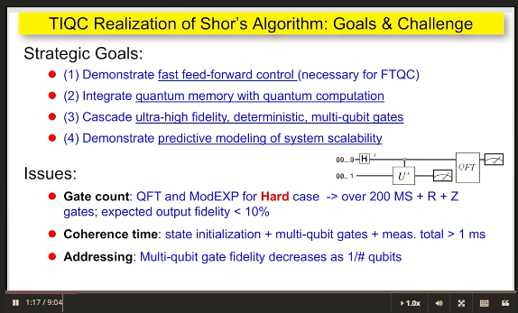

# TIQC Realization of Shor's Algorithm: Goals & Challenge

## Strategic Goals:
- (1) Demonstrate fast feed-forward control (necessary for FTQC)
- (2) Integrate quantum memory with quantum computation
- (3) Cascade ultra-high fidelity, deterministic, multi-qubit gates
- (4) Demonstrate predictive modeling of system scalability

## Issues:
- Gate count: QFT and ModEXP for **Hard** case -> over 200 MS + R + Z gates; expected output fidelity < 10%
- Coherence time: state initialization + multi-qubit gates + meas. total > 1 ms
- Addressing: Multi-qubit gate fidelity decreases as 1/# qubits

Diagram (right): two-register circuit.
- Top wire labeled `00...0`: box $H^{x}$, control dot, box QFT, then a measurement meter.
- Bottom wire labeled `00..1`: controlled box $U^{x}$ (controlled from the top wire), then a measurement meter.

00:01:18,940 \--\> 00:01:22,320

typically decrease inversely with the number of qubits.

30

00:01:22,320 \--\> 00:01:25,960

Fourth, measurement readout causes ions to fluoresce,

31

00:01:25,960 \--\> 00:01:30,550

and this scattered light can decohere near ion qubits.

32

00:01:30,550 \--\> 00:01:33,310

This experiment brings two main new ideas

33

00:01:33,310 \--\> 00:01:34,820

to address these challenges.

34

00:01:34,820 \--\> 00:01:38,500

These are a new way to use additional magnetic sub-levels

35

00:01:38,500 \--\> 00:01:40,540

of electronic states as a quantum memory

36

00:01:40,540 \--\> 00:01:43,750

and an algorithmic structure for the Quantum Fourier

37

00:01:43,750 \--\> 00:01:47,560

Transform originally developed by Alexei Kitaev, which reduces

38

00:01:47,560 \--\> 00:01:49,540

the number of qubits required.

39

00:01:49,540 \--\> 00:01:51,340

We now go through the challenge for each

40

00:01:51,340 \--\> 00:01:53,470

of the four goals starting with the first

41

00:01:53,470 \--\> 00:01:56,470

to demonstrate feed-forward control.

42

00:01:56,470 \--\> 00:01:59,860

For this, we employ Kitaev\'s version of the Quantum Fourier

43

00:01:59,860 \--\> 00:02:03,250

Transform, which replaces the multi-qubit circuit

44

00:02:03,250 \--\> 00:02:06,610

by a serial single-qubit circuit based on the fact

45

00:02:06,610 \--\> 00:02:09,130

that the outputs are measured.

46

00:02:09,130 \--\> 00:02:12,490

This example is for the 3-qubit QFT,

47

00:02:12,490 \--\> 00:02:16,170

which is what we need for the factoring demonstration.

48

00:02:16,170 \--\> 00:02:19,260

The trapped ion system is suitable for demonstrating

49

00:02:19,260 \--\> 00:02:21,960

Kitaev\'s QFT because of the ability

50

00:02:21,960 \--\> 00:02:25,890

to read out single qubits and to re-initialize and reset

51

<!-- frame 2:26 · slide · week1/media/media/image39.png -->

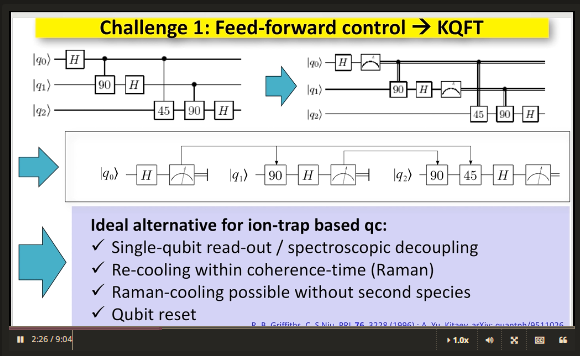

Slide title (yellow banner): Challenge 1: Feed-forward control → KQFT

Three related circuits, read left to right, then a linearized version, then a bullet box.

**Left circuit (coherent, 3 qubit lines)**
- `|q0⟩`: H, then two filled control dots on the continuing wire.
- `|q1⟩`: rotation box 90, then H, then a filled control dot.
- `|q2⟩`: rotation boxes 45, then 90, then H.
- Vertical wires join the controls: q0's first dot drops to the q1 wire between the 90 and H; q0's second dot drops through q1's control toward q2 near the final H.

**Right circuit (same skeleton, with meters and classical feed-forward)** — blue arrow from the left circuit.
- `|q0⟩`: H, measurement (semicircle meter), then a classical wire carrying control dots.
- `|q1⟩`: box 90, H, meter, then a control dot.
- `|q2⟩`: boxes 45, 90, then H (no meter on this line).
- Classical verticals from the measured qubits land on later phase gates.

**Linearized feed-forward circuit** (blue arrow into a single wire; classical bus drawn above):
`|q0⟩` — H — meter — `|q1⟩` — 90 — H — meter — `|q2⟩` — 90 — 45 — H — meter

**Purple box**
Ideal alternative for ion-trap based qc:
- Single-qubit read-out / spectroscopic decoupling
- Re-cooling within coherence-time (Raman)
- Raman-cooling possible without second species
- Qubit reset

Footer (small, partly under the player bar): R. B. Griffiths, C. S. Niu, PRL 76, 3228 (1996); A. Yu. Kitaev, arXiv:quant-ph/9511026.

00:02:25,890 \--\> 00:02:29,640

qubit states, all within a given computation which

52

00:02:29,640 \--\> 00:02:32,100

continues onward.

53

00:02:32,100 \--\> 00:02:36,270

We test Kitaev\'s QFT using this 3-qubit circuit

54

00:02:36,270 \--\> 00:02:38,430

with three different inputs.

55

00:02:38,430 \--\> 00:02:41,460

Shown here are the experimental results in red

56

00:02:41,460 \--\> 00:02:44,130

and the expected theoretical results in blue

57

00:02:44,130 \--\> 00:02:46,290

for the three input states.

58

00:02:46,290 \--\> 00:02:49,140

The expected outputs match the experimental data

59

00:02:49,140 \--\> 00:02:51,480

with classical squared statistical output

60

00:02:51,480 \--\> 00:02:54,120

fidelity of 95%.

61

00:02:54,120 \--\> 00:02:58,270

This is much better than the full three ion qubit QFT

62

00:02:58,270 \--\> 00:03:00,930

fidelity, due to the quantum memory performance

63

00:03:00,930 \--\> 00:03:04,830

being higher than that of multi-qubit gates.

64

00:03:04,830 \--\> 00:03:08,250

The second challenge goal to integrate quantum memory

65

00:03:08,250 \--\> 00:03:10,410

with quantum computation is tested

66

00:03:10,410 \--\> 00:03:13,950

by implementing the quantum order-finding algorithm.

67

00:03:13,950 \--\> 00:03:18,210

Recall, this takes a permutation of N objects as input,

68

00:03:18,210 \--\> 00:03:21,630

and finds the power r such that the permutation returns

69

00:03:21,630 \--\> 00:03:24,060

to identity.

70

00:03:24,060 \--\> 00:03:27,000

The quantum phase estimation circuit shown here

71

00:03:27,000 \--\> 00:03:29,710

solves the problem with an exponential speed

72

00:03:29,710 \--\> 00:03:32,550

up over the classical algorithm compared

73

00:03:32,550 \--\> 00:03:36,780

by counting the number of uses of the permutation operation.

74

<!-- frame 3:37 · slide · week1/media/media/image23.png -->

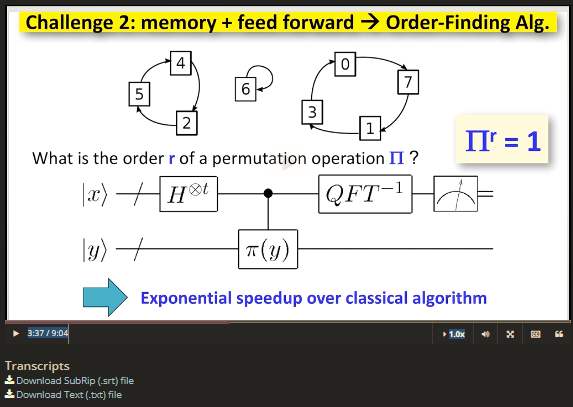

$$\Pi^{r} = 1$$
$$|x\rangle \xrightarrow{H^{\otimes \ell}} \bullet \xrightarrow{QFT^{-1}} \text{measure}$$
$$|y\rangle \xrightarrow{\pi(y)}$$

Title (yellow banner): Challenge 2: memory + feed forward → Order-Finding Alg.

Permutation drawn as disjoint cycles:
- a 3-cycle on the numbers 5, 4, and 2 (5 at the left, 4 at the top, 2 at the lower right, arrows around the loop)
- a 1-cycle: 6 with a small self-loop arrow
- a 4-cycle on 0 (top), 7 (right), 1 (bottom), and 3 (left), arrows circulating around the loop

Question: What is the order r of a permutation operation Π ?

Highlighted box: Π^r = 1

Circuit:
- Top register |x⟩ (bundled wire) through H^{⊗ℓ}, a control dot, QFT^{-1}, then a measurement meter, followed by "=".
- Bottom register |y⟩ (bundled wire) through a box π(y). The control on the top wire connects down to that box.

Blue arrow callout: Exponential speedup over classical algorithm

00:03:36,780 \--\> 00:03:39,730

75

00:03:39,730 \--\> 00:03:42,610

For permutations of N equal 4 objects,

76

00:03:42,610 \--\> 00:03:44,740

this is the required quantum circuit.

77

00:03:44,740 \--\> 00:03:48,700

And it simplifies to this 3-qubit quantum

78

<!-- frame 3:49 · diagram · week1/media/media/image4.png -->

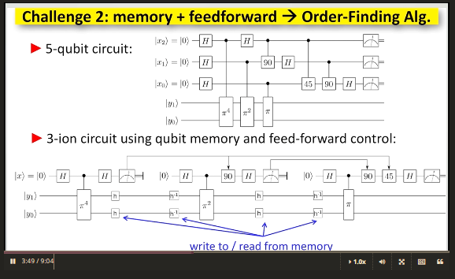

$$
|x_2\rangle = |0\rangle,\quad |x_1\rangle = |0\rangle,\quad |x_0\rangle = |0\rangle
$$
$$
\pi^{4},\quad \pi^{2},\quad \pi
$$

# Challenge 2: memory + feedforward → Order-Finding Alg.

## 5-qubit circuit

Five wires, top to bottom: |x₂⟩ = |0⟩, |x₁⟩ = |0⟩, |x₀⟩ = |0⟩, |y₁⟩, |y₀⟩. The three π-power gates are tall boxes spanning both |y₁⟩ and |y₀⟩.

- |x₂⟩: H, control dot down to the π⁴ gate, H, control dot down to the 90° gate on |x₁⟩, control dot down to the 45° gate on |x₀⟩, then a meter.
- |x₁⟩: H, control dot down to the π² gate, controlled-90 box, H, control dot down to the 90° gate on |x₀⟩, then a meter.
- |x₀⟩: H, control dot down to the π gate, 45 box, 90 box, H, then a meter.
- |y₁⟩ and |y₀⟩ together: π⁴, then π², then π (each controlled by x₂, x₁, and x₀ respectively).

## 3-ion circuit using qubit memory and feed-forward control

Same algorithm with one recycled ion |x⟩ and two memory ions |y₁⟩, |y₀⟩. |x⟩ is measured and re-prepared three times:

1. |x⟩ = |0⟩ — H — ● — H — meter. The ● controls a π⁴ gate spanning |y₁⟩ and |y₀⟩.
2. Re-prepare |0⟩ — H — ● — 90 — H — meter. The ● controls π² on both y ions. The 90 is a classical feed-forward phase.
3. Re-prepare |0⟩ — H — ● — 90 — 45 — H — meter. The ● controls π on both y ions.

Classical wires leave the meters: the first measurement feeds the 90° rotations in segments 2 and 3; the second measurement feeds the 45° rotation in segment 3.

On both |y₁⟩ and |y₀⟩, between the controlled-π gates, there are paired boxes h then h⁻¹ (after π⁴, and again after π²). Blue arrows under those pairs are labeled “write to / read from memory”.

00:03:48,700 \--\> 00:03:52,970

circuit using Kitaev\'s Quantum Fourier Transform.

79

00:03:52,970 \--\> 00:03:56,240

The experimental implementation of quantum order-finding

80

00:03:56,240 \--\> 00:03:59,330

tested these four possible permutations

81

00:03:59,330 \--\> 00:04:03,210

and produced these results shown in red,

82

<!-- frame 4:03 · diagram · week1/media/media/image16.png -->

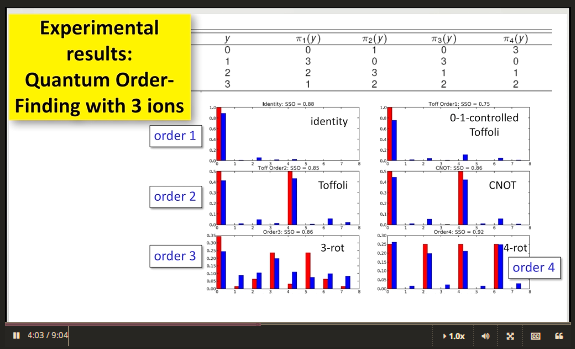

# Experimental results: Quantum Order-Finding with 3 ions

Table of truth outputs $y$ for $\pi_1(y)\ldots\pi_4(y)$ (rows $y=0,1,2$):
- $\pi_1$: 0, 3, 2
- $\pi_2$: 1, 3, 2
- $\pi_3$: 0, 1, 1
- $\pi_4$: 3, 1, 2

Histograms (blue/red bars) for orders 1–4: identity (SSD≈0.86), 0-1-controlled Toffoli (SSD≈0.75), Toffoli (SSD≈0.85), CNOT (SSD≈0.95), 3-rot (SSD≈0.86), 4-rot (SSD≈0.92).

00:04:03,210 \--\> 00:04:06,200

which matched theoretical expectations shown in blue,

83

00:04:06,200 \--\> 00:04:09,570

with fidelities of the 80% level.

84

00:04:09,570 \--\> 00:04:11,910

The third challenge goal is to implement

85

00:04:11,910 \--\> 00:04:15,720

both the easy and hard cases of Shor\'s quantum factoring

86

00:04:15,720 \--\> 00:04:16,709

algorithm.

87

00:04:16,709 \--\> 00:04:18,690

Recall that this algorithm is essentially

88

00:04:18,690 \--\> 00:04:20,760

a special case of order-finding, where

89

00:04:20,760 \--\> 00:04:24,210

the permutation is defined by this modular multiplication

90

00:04:24,210 \--\> 00:04:25,520

function.

91

00:04:25,520 \--\> 00:04:28,920

Shor\'s Algorithm begins with a random choice of a number a,

92

00:04:28,920 \--\> 00:04:33,210

and the algorithm finds the order of a to the x mod N.

93

<!-- frame 4:33 · slide · week1/media/media/image31.png -->

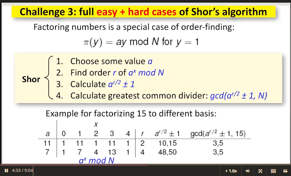

$$\pi(y) = ay \bmod N \text{ for } y = 1$$
$$a^{r/2} \pm 1$$
$$\gcd(a^{r/2} \pm 1, N)$$

Title (yellow banner): Challenge 3: full easy + hard cases of Shor's algorithm

Factoring numbers is a special case of order-finding:
$$\pi(y) = ay \bmod N \text{ for } y = 1$$

Shor
1. Choose some value a
2. Find order r of a^x mod N
3. Calculate a^{r/2} ± 1
4. Calculate greatest common divisor: gcd(a^{r/2} ± 1, N)

Example for factorizing 15 to different basis:

Table. Column group x is labeled a^x mod N (blue). Columns: a | x = 0, 1, 2, 3, 4 | r | a^{r/2} ± 1 | gcd(a^{r/2} ± 1, 15)

- a = 11: 1, 11, 1, 11, 1; r = 2; 10,15; gcd 3,5
- a = 7: 1, 7, 4, 13, 1; r = 4; 48,50; gcd 3,5

00:04:33,210 \--\> 00:04:36,330

For factoring 15, there are two non-trivial choices

94

00:04:36,330 \--\> 00:04:39,440

of a, namely 11 and 7, as we have seen.

95

00:04:39,440 \--\> 00:04:42,870

The a equal 11 case is easy because it has a power of 2,

96

00:04:42,870 \--\> 00:04:45,750

while the a equals 7 cases hard because it

97

00:04:45,750 \--\> 00:04:48,450

has a longer period of 4.

98

00:04:48,450 \--\> 00:04:51,840

We employ the Kitaev version of the QFT for the factoring

99

00:04:51,840 \--\> 00:04:55,050

algorithm with 5 qubits, an extra quantum memory qubit

100

00:04:55,050 \--\> 00:04:57,570

state and feed-forward control.

101

00:04:57,570 \--\> 00:05:02,440

And observe that for the a equal 11 easy case,

102

00:05:02,440 \--\> 00:05:05,100

only the controlled a multiplication need

103

00:05:05,100 \--\> 00:05:09,090

be implemented, and that requires only two CNOT gates

104

00:05:09,090 \--\> 00:05:12,850

realized using 16 laser pulses.

105

00:05:12,850 \--\> 00:05:15,910

For the a equals 7 hard case, both the

106

00:05:15,910 \--\> 00:05:19,750

controlled a and controlled a squared multiplications

107

00:05:19,750 \--\> 00:05:21,340

must be implemented.

108

00:05:21,340 \--\> 00:05:24,130

And after peephole compilation, which

109

00:05:24,130 \--\> 00:05:28,390

only uses local information and is blind to the final result,

110

<!-- frame 5:25 · diagram · week1/media/media/image48.png -->

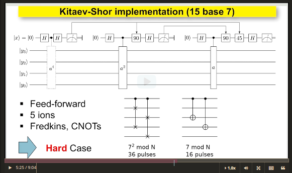

Yellow title: Kitaev-Shor implementation (15 base 7)

Semiclassical / feed-forward circuit. Control register is reused as three stages, each prepared in `|0⟩`. Target register, top to bottom: `|y3⟩`, `|y2⟩`, `|y1⟩`, `|y0⟩`. A faint play icon sits over the middle of the circuit.

**Stage 1:** `|x⟩=|0⟩` — H — control dot — H — meter. Dashed vertical from the dot into a dashed box labeled \(a^4\) spanning all four target lines.

**Stage 2:** `|0⟩` — H — control dot — 90 — H — meter. Solid box labeled \(a^2\) on the target register. Classical arrow from an earlier measurement into the 90 gate.

**Stage 3:** `|0⟩` — H — control dot — 90 — 45 — H — meter. Solid box labeled \(a\) on the target register. Classical arrows into the 90 and 45 gates.

Bullets:
- Feed-forward
- 5 ions
- Fredkins, CNOTs

Blue arrow to red text: Hard Case

Two small gate counts:
- Left, 5 wires: top control connected by a vertical line to several × targets on the lower wires (some × offset along the line). Caption: \(7^2 \bmod N\), 36 pulses.
- Right: top control with a vertical line to two ⊕ targets on lower wires. Caption: \(7 \bmod N\), 16 pulses.

00:05:28,390 \--\> 00:05:32,410

the circuits required involve two 3-qubit quantum Fredkin

111

00:05:32,410 \--\> 00:05:36,550

gates and two CNOT gates, altogether needing 52 laser

112

00:05:36,550 \--\> 00:05:37,660

pulses.

113

00:05:37,660 \--\> 00:05:40,750

Such complex 3-qubit gates had not

114

00:05:40,750 \--\> 00:05:45,560

been realized with trapped ion systems before this experiment.

115

<!-- frame 5:45 · diagram · week1/media/media/image54.png -->

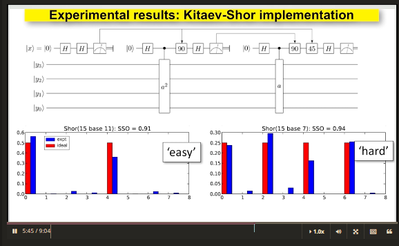

Yellow title: Experimental results: Kitaev-Shor implementation

**Circuit** (control register reused; targets `|y3⟩` `|y2⟩` `|y1⟩` `|y0⟩` top to bottom)
- Stage 1: `|x⟩=|0⟩` — H — H — meter. No controlled modular multiply on this stage.
- Stage 2: `|0⟩` — H — control — 90 — H — meter. Control hits a tall box \(a^2\) on the target register. Classical feed-forward arrow into the 90.
- Stage 3: `|0⟩` — H — control — 90 — 45 — H — meter. Control hits a tall box \(a\). Classical arrows into 90 and 45.

**Left bar chart** — Shor(15 base 11): SSO = 0.91. Legend: blue expt, red ideal. y-axis 0 to 0.6, x-axis 0 to 8. Callout: 'easy'.
Approximate bars: at 0, red ≈ 0.50 and blue ≈ 0.56; at 4, red ≈ 0.50 and blue ≈ 0.36; small blue bars only near 2, 3, 6, and 7 (a few hundredths).

**Right bar chart** — Shor(15 base 7): SSO = 0.94. y-axis 0 to 0.30, x-axis 0 to 8. Callout: 'hard'.
Approximate bars: at 0, red ≈ 0.25 and blue ≈ 0.24; at 2, red ≈ 0.25 and blue ≈ 0.30; at 4, red ≈ 0.25 and blue ≈ 0.16; at 6, red ≈ 0.25 and blue ≈ 0.25; small blue bars near 1, 3, and 7.

00:05:45,560 \--\> 00:05:47,420

Here are the experimental results

116

00:05:47,420 \--\> 00:05:51,280

for the easy and hard cases of Shor\'s Algorithm.

117

00:05:51,280 \--\> 00:05:54,670

The data shown in blue and the ideal noiseless

118

00:05:54,670 \--\> 00:05:58,870

theoretical expectations shown in red agree to over 90%

119

00:05:58,870 \--\> 00:06:00,370

for both cases.

120

00:06:00,370 \--\> 00:06:02,260

Incidentally, this is an improvement

121

00:06:02,260 \--\> 00:06:05,590

over the NMR implementation from 15 years ago,

122

00:06:05,590 \--\> 00:06:08,320

which had much worse performance for the hard case

123

00:06:08,320 \--\> 00:06:11,740

compared with the easy case.

124

00:06:11,740 \--\> 00:06:15,780

The fourth challenge is to be able to predict

125

00:06:15,780 \--\> 00:06:18,420

the actual results, taking into consideration

126

00:06:18,420 \--\> 00:06:20,430

all known imperfections and noise

127

00:06:20,430 \--\> 00:06:23,040

sources without fine tuning.

128

00:06:23,040 \--\> 00:06:26,070

We developed a tool for this, known as TIQC-SPICE,

129

00:06:26,070 \--\> 00:06:28,770

inspired by the similarly-named SPICE

130

00:06:28,770 \--\> 00:06:33,120

tool important in simulating integrated electronic circuits.

131

00:06:33,120 \--\> 00:06:37,980

TIQC-SPICE compiles quantum algorithms into laser pulses,

132

<!-- frame 6:36 · diagram · week1/media/media/image25.png -->

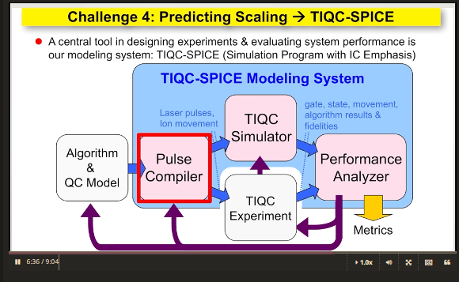

Title (yellow banner): Challenge 4: Predicting Scaling → TIQC-SPICE

Bullet: A central tool in designing experiments & evaluating system performance is our modeling system: TIQC-SPICE (Simulation Program with IC Emphasis)

Flow diagram titled "TIQC-SPICE Modeling System" (blue rounded container):
- Algorithm & QC Model (left, outside) feeds a blue arrow into Pulse Compiler (red outline).
- Pulse Compiler sends "Laser pulses, ion movement" up into TIQC Simulator, and another blue arrow down into TIQC Experiment.
- TIQC Experiment sends a blue arrow up into TIQC Simulator and a blue arrow right into Performance Analyzer.
- TIQC Simulator sends "gate, state, movement, algorithm results & fidelities" right into Performance Analyzer.
- Performance Analyzer outputs a yellow downward arrow labeled Metrics.
- Purple feedback arrows return from the Metrics / Performance Analyzer side: one points left into TIQC Experiment, and a long purple path runs back left and up into Pulse Compiler.

00:06:37,980 \--\> 00:06:41,670

simulates the resulting ion internal and motional state

133

00:06:41,670 \--\> 00:06:45,150

from the pulses, and analyzes performance

134

00:06:45,150 \--\> 00:06:51,140

to produce the same metrics as obtained from the experiment.

135

00:06:51,140 \--\> 00:06:57,020

Shown here, our experimental in red, ideal theoretical in blue,

136

00:06:57,020 \--\> 00:07:02,450

and TIQC-SPICE simulated results in green for the easy and hard

137

00:07:02,450 \--\> 00:07:05,540

cases of the quantum factoring demonstration.

138

<!-- frame 7:04 · slide · week1/media/media/image20.png -->

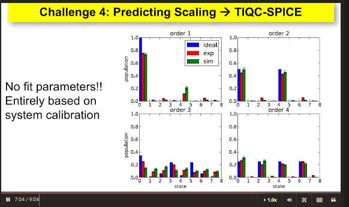

Title (yellow banner): Challenge 4: Predicting Scaling → TIQC-SPICE

Left callout: "No fit parameters!! Entirely based on system calibration"

Four population-vs-state bar charts compare ideal (blue), exp (red), and sim (green). Y-axis: population (0.0 to 1.0). X-axis: state (0 to 8).

- order 1 (top left): one dominant peak at state 0 (ideal near 1, experiment and simulation a bit lower, roughly 0.7–0.8), with only small residuals on other states.
- order 2 (top right): two main peaks at states 0 and 4, each near 0.5 for ideal and slightly lower for exp and sim.
- order 3 (bottom left): three main peaks near states 0, 3, and 5, each around 0.3.
- order 4 (bottom right): four main peaks at states 0, 2, 4, and 6, each around 0.25.

Ideal, experiment, and simulation agree on the peak locations; experiment and simulation are slightly below ideal at the peaks and show small extra population elsewhere.

00:07:05,540 \--\> 00:07:07,790

The TIQC-SPICE results accurately

139

00:07:07,790 \--\> 00:07:11,840

predict the experimental results to within error bars, including

140

00:07:11,840 \--\> 00:07:15,380

four sources of major errors, namely addressing

141

00:07:15,380 \--\> 00:07:20,120

of individual ions by laser beams, dephasing of ion states

142

00:07:20,120 \--\> 00:07:23,360

due to fluctuations in the laser or magnetic field,

143

00:07:23,360 \--\> 00:07:26,480

the spontaneous emission lifetime of the ion qubits,

144

00:07:26,480 \--\> 00:07:29,920

and measurement and gate times.

145

00:07:29,920 \--\> 00:07:32,470

In conclusion, the trapped ion demonstration

146

00:07:32,470 \--\> 00:07:36,370

of quantum factoring provides a meaningful test of scalability

147

00:07:36,370 \--\> 00:07:39,130

by demonstrating fast feed-forward control,

148

00:07:39,130 \--\> 00:07:42,520

quantum memory interleaved with quantum computation,

149

00:07:42,520 \--\> 00:07:44,830

multiple cascaded and deterministic

150

00:07:44,830 \--\> 00:07:47,590

multi-qubit gates, and predictive simulation

151

00:07:47,590 \--\> 00:07:50,320

of outputs using TIQC-SPICE.

152

00:07:50,320 \--\> 00:07:53,650

These results indicate that scalability is largely

153

<!-- frame 7:52 · slide · week1/media/media/image66.png -->

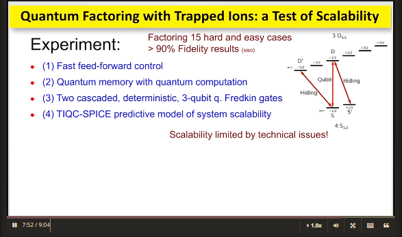

# Quantum Factoring with Trapped Ions: a Test of Scalability

**Experiment:**

- Factoring 15 hard and easy cases
- \(> 90\%\) Fidelity results (550)

- (1) Fast feed-forward control
- (2) Quantum memory with quantum computation
- (3) Two cascaded, deterministic, 3-qubit q. Fredkin gates
- (4) TIQC-SPICE predictive model of system scalability

**Level diagram (right side)** for the optical qubit, red arrows marking transitions:

- Upper manifold labeled \(3\, D_{5/2}\), with Zeeman sublevels marked \(+5/2\), \(+1/2\), and \(-1/2\).
- A separate level labeled \(D'\) to the left of that manifold.
- Lower manifold labeled \(4\, S_{1/2}\) (two ground sublevels).
- Red arrows are annotated **Qubit** (the computational transition) and **Hiding** (two shelving / hiding transitions, one on each side).

Red footer: **Scalability limited by technical issues!**

Video player clock: 7:52 / 9:04.

00:07:53,650 \--\> 00:07:57,960

limited by technical and not fundamental issues.

154

00:07:57,960 \--\> 00:08:00,180

For the future, we now understand

155

00:08:00,180 \--\> 00:08:02,700

how modular multiplication circuits

156

00:08:02,700 \--\> 00:08:05,780

can be realized using an algorithm known as the Quantum

157

00:08:05,780 \--\> 00:08:09,480

Fourier Montgomery Multiplier as an elementary building block,

158

<!-- frame 8:09 · slide · week1/media/media/image11.png -->

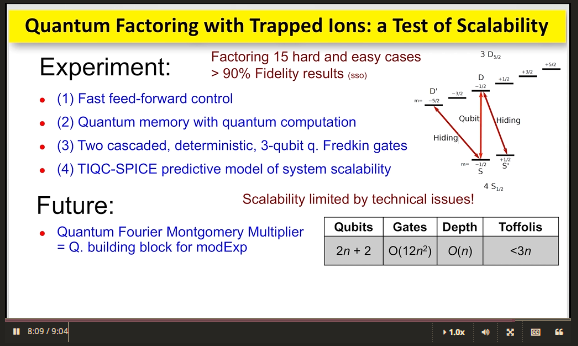

$$
2n+2,\quad O(12n^{2}),\quad O(n),\quad <3n
$$
$$
3\,D_{5/2},\quad 4\,S_{1/2}
$$

# Quantum Factoring with Trapped Ions: a Test of Scalability

## Experiment

- Factoring 15 hard and easy cases
- > 90% Fidelity results (sso)

Blue bullets:

- (1) Fast feed-forward control
- (2) Quantum memory with quantum computation
- (3) Two cascaded, deterministic, 3-qubit q. Fredkin gates
- (4) TIQC-SPICE predictive model of system scalability

Right side: Ca⁺-style level diagram. Upper manifold labeled 3 D_{5/2}, lower manifold 4 S_{1/2}.

- Upper Zeeman levels, left to right: D′ (m = −5/2), m = −3/2, D (m = −1/2), m = +1/2, m = +3/2, m = +5/2.
- Lower levels: S (m = −1/2) and S′ (m = +1/2).
- Red arrow labeled Qubit from D (m = −1/2) down to S (m = −1/2).
- Red arrow labeled Hiding from D′ down to S.
- Red arrow labeled Hiding from D down to S′.

## Future

Red text: Scalability limited by technical issues!

- Quantum Fourier Montgomery Multiplier = Q. building block for modExp

Table:

| Qubits | Gates | Depth | Toffolis |
| --- | --- | --- | --- |
| 2n + 2 | O(12n²) | O(n) | <3n |

00:08:09,480 \--\> 00:08:12,570

such that the factoring of an N bit number

159

00:08:12,570 \--\> 00:08:16,110

would require 2n plus 2 qubits.

160

00:08:16,110 \--\> 00:08:18,930

And on the order of N squared gates,

161

00:08:18,930 \--\> 00:08:21,610

of which less than 3N and are 3-qubit

162

00:08:21,610 \--\> 00:08:24,660

Toffoli gates, the hard ones to implement.

163

00:08:24,660 \--\> 00:08:27,510

A feasible future experiment could thus

164

00:08:27,510 \--\> 00:08:30,630

demonstrate the factoring of N equal 21

165

00:08:30,630 \--\> 00:08:33,840

for which the hard case has a period of 6.

166

00:08:33,840 \--\> 00:08:36,990

Using the Quantum Fourier Montgomery Multiplier circuit,

167

00:08:36,990 \--\> 00:08:41,204

this would require 7 ions and 52 Molmer-Sorensen laser pulses.

168

00:08:41,204 \--\> 00:08:44,300

169

00:08:44,300 \--\> 00:08:48,020

Altogether, this experiment, while tiny compared with those

170

00:08:48,020 \--\> 00:08:50,090

needed to break cryptographic codes,

171

00:08:50,090 \--\> 00:08:53,360

shows how meaningful conclusions and serious extrapolations

172

00:08:53,360 \--\> 00:08:56,740

can be drawn from this scientific endeavor.

173

00:08:56,740 \--\> 00:09:04,467

## **PRACTICE (there is no practice for this page )**

Section: case-of-study demonstrations of shor\'s algorithm

# Page Title: Demonstrations of Shor\'s Algorithm: Pretending to Factor

# **Learn** 

## **Images**

## **Transcript**

## 

0

00:00:00,000 \--\> 00:00:03,240

JOHN SMOLIN: Peter Shor\'s 1994 polynomial time quantum

1

00:00:03,240 \--\> 00:00:05,680

factoring algorithm is what really started the quantum

2

00:00:05,680 \--\> 00:00:07,020

computing revolution.

3

00:00:07,020 \--\> 00:00:10,600

Using it, it was discovered at IBM Research in 2001,

4

00:00:10,600 \--\> 00:00:14,640

that 15 equals 3 times 5 using seven NMR qubits.

5

00:00:14,640 \--\> 00:00:17,040

Then it was discovered again in 2007

6

00:00:17,040 \--\> 00:00:20,720

using a different technology, photonics, with just four

7

00:00:20,720 \--\> 00:00:25,340

qubits, and in 2009 using five, finally, in 2012,

8

00:00:25,340 \--\> 00:00:27,840

using only three superconducting qubits.

9

00:00:27,840 \--\> 00:00:32,080

Also, 21 was factored using a photonic qubit and qutrit, which

10

00:00:32,080 \--\> 00:00:33,500

is a three-level system.

11

00:00:33,500 \--\> 00:00:35,220

I\'ve plotted these results versus time,

12

00:00:35,220 \--\> 00:00:37,120

and you may notice something strange.

13

00:00:37,120 \--\> 00:00:39,280

The number of qubits is going down.

14

00:00:39,280 \--\> 00:00:41,560

And one can extrapolate that 15 will be factored

15

00:00:41,560 \--\> 00:00:43,440

without any qubits at all.

16

00:00:43,440 \--\> 00:00:46,040

So my collaborators and I started to wonder just

17

00:00:46,040 \--\> 00:00:47,420

what\'s going on here.

18

00:00:47,420 \--\> 00:00:50,440

How many qubits do you really need to factor a number anyway?

19

00:00:50,440 \--\> 00:00:53,320

First, a quick review of Shor\'s algorithm.

20

00:00:53,320 \--\> 00:00:55,800

The core of the algorithm is as follows.

21

00:00:55,800 \--\> 00:00:58,600

To factor a number N, you first pick a base, a,

22

00:00:58,600 \--\> 00:01:00,400

which is some integer.

23

00:01:00,400 \--\> 00:01:03,600

Then you find the period, r, of a to the power

24

00:01:03,600 \--\> 00:01:07,960

x modulo N. This period finding is the only quantum

25

00:01:07,960 \--\> 00:01:10,080

part of the algorithm.

26

00:01:10,080 \--\> 00:01:13,560

If you find that r is odd, or that a to the r over 2

27

00:01:13,560 \--\> 00:01:16,840

is minus 1 mod N, you try again.

28

00:01:16,840 \--\> 00:01:19,440

Otherwise, the greatest common divisor

29

00:01:19,440 \--\> 00:01:24,800

of a to the r over 2 plus or minus 1 and N is a factor.

30

00:01:24,800 \--\> 00:01:28,240

Euclid\'s algorithm, which is rather old technology, circa 300

31

00:01:28,240 \--\> 00:01:31,440

BCE, is efficient for finding the GCD.

32

00:01:31,440 \--\> 00:01:34,400

The quantum period-finding step requires a register big enough

33

00:01:34,400 \--\> 00:01:36,122

to hold N and one more bit, which

34

00:01:36,122 \--\> 00:01:38,080

is used to pull out bits of the quantum Fourier

35

00:01:38,080 \--\> 00:01:41,920

transform using a technique known as qubit recycling.

36

00:01:41,920 \--\> 00:01:45,280

So to factor n we need log n plus 1 qubits.

37

00:01:45,280 \--\> 00:01:48,660

For 15, this works out to five bits as the minimum,

38

00:01:48,660 \--\> 00:01:51,440

and even more if qubit recycling isn\'t used.

39

00:01:51,440 \--\> 00:01:54,680

So how did people factor 15 with so few qubits?

40

00:01:54,680 \--\> 00:01:57,600

It turns out that even the original 2001 experiment

41

00:01:57,600 \--\> 00:02:00,420

with seven qubits used an additional trick called,

42

00:02:00,420 \--\> 00:02:03,160

in an abuse of the term, compiling.

43

00:02:03,160 \--\> 00:02:05,800

What was noticed was that for some bases a,

44

00:02:05,800 \--\> 00:02:07,840

the period r is small.

45

00:02:07,840 \--\> 00:02:10,600

Then the quantum register used to find the period only

46

00:02:10,600 \--\> 00:02:12,690

needs to be big enough to hold r instead

47

00:02:12,690 \--\> 00:02:16,450

of N. Can we always find a base which results in a small r?

48

00:02:16,450 \--\> 00:02:18,650

It turns out the answer is yes.

49

00:02:18,650 \--\> 00:02:20,330

We employ a much more modern result

50

00:02:20,330 \--\> 00:02:22,770

than Euclid\'s algorithm, the Chinese remainder

51

00:02:22,770 \--\> 00:02:25,210

theorem from 400 CE.

52

00:02:25,210 \--\> 00:02:28,170

It says that given two primes, p and q,

53

00:02:28,170 \--\> 00:02:32,530

then a squared is 1 mod pq if and only if a squared is

54

00:02:32,530 \--\> 00:02:35,730

1 mod p and also mod q.

55

00:02:35,730 \--\> 00:02:40,890

If we then choose a equals plus or minus p pq plus or minus

56

00:02:40,890 \--\> 00:02:45,770

q qp, where pq is the inverse of p mod q

57

00:02:45,770 \--\> 00:02:50,170

and qp is the inverse of q mod p, then by construction,

58

<!-- frame 2:48 · slide · week1/media/media/image41.png -->

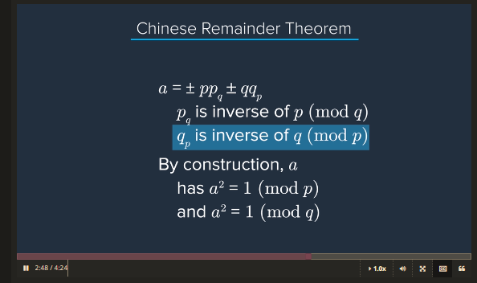

$$a=\pm p p_q \pm q q_p$$
$$a^2=1 \pmod{p}$$
$$a^2=1 \pmod{q}$$

Title: Chinese Remainder Theorem

Displayed construction:
- \(a = \pm p p_q \pm q q_p\)
- \(p_q\) is inverse of \(p \pmod{q}\)
- \(q_p\) is inverse of \(q \pmod{p}\) — this line is highlighted in blue
- By construction, \(a\) has \(a^2 = 1 \pmod{p}\) and \(a^2 = 1 \pmod{q}\)

00:02:50,170 \--\> 00:02:53,250

a squared equals 1 mod p and mod q.

59

00:02:53,250 \--\> 00:02:58,150

Furthermore, we can find pq and qp efficiently using what else?

60

00:02:58,150 \--\> 00:02:59,650

Euclid\'s algorithm.

61

00:02:59,650 \--\> 00:03:03,330

In other words, for any N equals p times q,

62

00:03:03,330 \--\> 00:03:05,170

we have an efficient algorithm for finding

63

00:03:05,170 \--\> 00:03:11,050

a base a with a squared equals 1 mod N, or period r equals 2.

64

00:03:11,050 \--\> 00:03:12,810

So we can now implement Shor\'s algorithm

65

00:03:12,810 \--\> 00:03:15,530

using exactly two qubits and factor an arbitrary

66

00:03:15,530 \--\> 00:03:17,550

N. The circuit looks like this.

67

00:03:17,550 \--\> 00:03:20,460

We can further simplify if we notice that the bottom qubit is

68

00:03:20,460 \--\> 00:03:22,380

never measured and realize that the circuit

69

00:03:22,380 \--\> 00:03:24,220

makes a maximally entangled state

70

00:03:24,220 \--\> 00:03:26,300

and measures just one of the qubits.

71

00:03:26,300 \--\> 00:03:28,660

So all it does is produce random bits.

72

00:03:28,660 \--\> 00:03:31,527

We actually implemented this using the device shown (image of a coin).

73

00:03:31,527 \--\> 00:03:33,860

Here is the back of the device with a quarter next to it (joke: a coin,
next to other coin , because electronics use to compare sizes with
coins)

74

00:03:33,860 \--\> 00:03:34,900

for scale.

75

00:03:34,900 \--\> 00:03:39,740

We factored 15 RSA-768, which I believe is the largest number

76

00:03:39,740 \--\> 00:03:41,880

ever factored on classical computers,

77

00:03:41,880 \--\> 00:03:46,420

and a 20,000-digit number of our own creation called N20,000.

78

00:03:46,420 \--\> 00:03:49,200

Now obviously, this devolved somewhere into nonsense.

79

00:03:49,200 \--\> 00:03:52,180

The trick, the cheating part, is that finding a base

80

00:03:52,180 \--\> 00:03:54,900

with a small period is easy only if we already

81

00:03:54,900 \--\> 00:03:56,860

know the factors p and q.

82

00:03:56,860 \--\> 00:03:58,620

Naturally, factoring is easy, provided

83

00:03:58,620 \--\> 00:04:00,360

only that you know the factors.

84

00:04:00,360 \--\> 00:04:02,900

As I\'m recording this, it is the 100th birthday of Richard

85

00:04:02,900 \--\> 00:04:03,640

Feynman.

86

00:04:03,640 \--\> 00:04:06,015

So let me leave you with this quote from his commencement

87

00:04:06,015 \--\> 00:04:08,740

address to the 1974 class at Caltech.

88

00:04:08,740 \--\> 00:04:11,320

The first principle is that you must not fool yourself,

89

00:04:11,320 \--\> 00:04:13,500

and you are the easiest person to fool.

90

00:04:13,500 \--\> 00:04:15,160

After you\'ve not fooled yourself,

91

00:04:15,160 \--\> 00:04:18,410

it\'s easy not to fool other scientists.

92

00:04:18,410 \--\> 00:04:25,000

## **PRACTICE** 

## **(there is no practice for this page )**

##   

Section: case study: demonstrations of shor\'s algorithm

# Page Title:Case Study Concept Questions

## **Transcript (no video in this practice )**

## **PRACTICE (3 questions)**

## 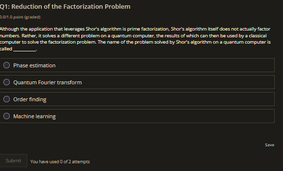

Graded question (no video clock).

**Q1: Reduction of the Factorization Problem**
0.0/1.0 point (graded)

Although the application that leverages Shor's algorithm is prime factorization, Shor's algorithm itself does not actually factor numbers. Rather, it solves a different problem on a quantum computer, the results of which can then be used by a classical computer to solve the factorization problem. The name of the problem solved by Shor's algorithm on a quantum computer is called ________.

Radio options (none selected):
- Phase estimation
- Quantum Fourier transform
- Order finding
- Machine learning

Save. Submit. You have used 0 of 2 attempts.

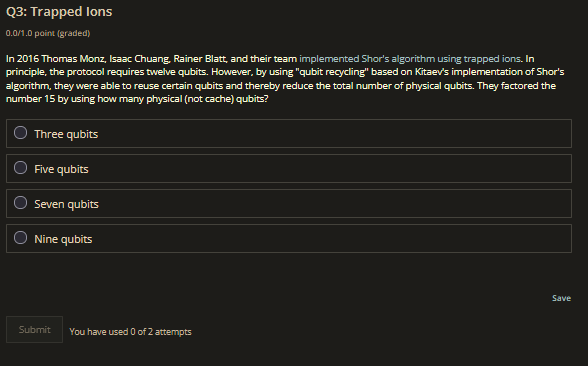

# Q3: Trapped Ions

0.0/1.0 point (graded)

In 2016 Thomas Monz, Isaac Chuang, Rainer Blatt, and their team implemented Shor's algorithm using trapped ions. In principle, the protocol requires twelve qubits. However, by using "qubit recycling" based on Kitaev's implementation of Shor's algorithm, they were able to reuse certain qubits and thereby reduce the total number of physical qubits. They factored the number 15 by using how many physical (not cache) qubits?

- ( ) Three qubits
- ( ) Five qubits
- ( ) Seven qubits
- ( ) Nine qubits

Submit · You have used 0 of 2 attempts · Save

No video player clock on this page.

Section: Week 1 qiz

# Page Title: Modern Cryptography and Shor's Algorithm Quiz

## **PRACTICE (5 questions)**

## 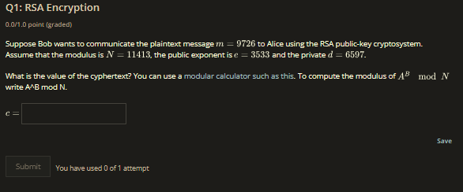

$$m = 9726$$
$$N = 11413$$
$$e = 3533$$
$$d = 6597$$
$$A^{B} \bmod N$$

Q1: RSA Encryption
0.0/1.0 point (graded)

Suppose Bob wants to communicate the plaintext message m = 9726 to Alice using the RSA public-key cryptosystem. Assume that the modulus is N = 11413, the public exponent is e = 3533 and the private d = 6597.

What is the value of the ciphertext? You can use a modular calculator such as this. To compute the modulus of A^B mod N write A^B mod N.

c = [empty text box]

Save
Submit
You have used 0 of 1 attempt

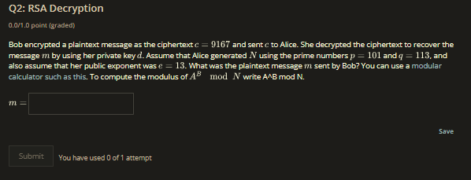

$$c=9167,\quad p=101,\quad q=113,\quad e=13$$

# Q2: RSA Decryption

0.0/1.0 point (graded)

Bob encrypted a plaintext message as the ciphertext \(c = 9167\) and sent it to Alice. She decrypted the ciphertext to recover the message \(m\) by using her private key \(d\). Assume that Alice generated \(N\) using the prime numbers \(p = 101\) and \(q = 113\), and also assume that her public exponent was \(e = 13\). What was the plaintext message \(m\) sent by Bob? You can use a modular calculator such as this. To compute the modulus of \(A^B \bmod N\) write \(A^B \bmod N\).

\(m =\) [empty text box]

Submit · You have used 0 of 1 attempt · Save

No video player clock on this page.

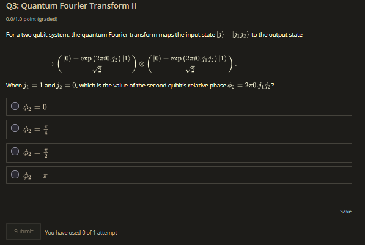

$$|j\rangle=|j_1 j_2\rangle \rightarrow \left(\frac{|0\rangle+\exp(2\pi i\, 0.j_2)|1\rangle}{\sqrt{2}}\right)\otimes\left(\frac{|0\rangle+\exp(2\pi i\, 0.j_1 j_2)|1\rangle}{\sqrt{2}}\right)$$
$$\phi_2=2\pi\, 0.j_1 j_2$$

# Q3: Quantum Fourier Transform II

0.0/1.0 point (graded)

For a two qubit system, the quantum Fourier transform maps the input state \(|j\rangle = |j_1 j_2\rangle\) to the output state

\[
\rightarrow \left(\frac{|0\rangle + \exp(2\pi i\, 0.j_2)|1\rangle}{\sqrt{2}}\right) \otimes \left(\frac{|0\rangle + \exp(2\pi i\, 0.j_1 j_2)|1\rangle}{\sqrt{2}}\right).
\]

When \(j_1 = 1\) and \(j_2 = 0\), which is the value of the second qubit's relative phase \(\phi_2 = 2\pi\, 0.j_1 j_2\)?

- ( ) \(\phi_2 = 0\)
- ( ) \(\phi_2 = \pi/4\)
- ( ) \(\phi_2 = \pi/2\)
- ( ) \(\phi_2 = \pi\)

Submit · You have used 0 of 1 attempt · Save

No video player clock on this page.

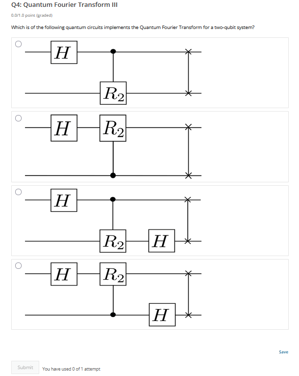

Graded question (no video clock).

**Q4: Quantum Fourier Transform III**
0.0/1.0 point (graded)

Which of the following quantum circuits implements the Quantum Fourier Transform for a two-qubit system?

Four radio options, none selected. Each ends in a SWAP (× on both wires, joined vertically). \(R_2\) is a controlled phase.

1. Top: H, then control •, then SWAP. Bottom: \(R_2\) (target of that control), then SWAP.
2. Top: H, \(R_2\), SWAP. Bottom: control • under the \(R_2\), then SWAP. (\(R_2\) controlled from below.)
3. Top: H, control •, SWAP. Bottom: \(R_2\) (controlled from the top •), then H, then SWAP.
4. Top: H, \(R_2\), SWAP. Bottom: control • under the \(R_2\), then H, then SWAP.

Save. Submit. You have used 0 of 1 attempt.

# Q5: Period Finding Algorithm

0.0/1.0 point (graded)

Shor's quantum algorithm finds the period of a modular exponentiation function \(f(x)\). The figure below shows the generic diagram of the period finding algorithm. The quantum circuit reads as follows:

1. All qubits start in the \(|0\rangle\) state.
2. A quantum Fourier transform is applied on the first register. (Recall that this is equivalent to applying Hadamard gates to all input qubits.)
3. The quantum gate \(U_f\) is applied on both registers, leaving the values of the states in the first register unaffected, but correlating the states of the two registers.
4. The second register is optionally measured.
5. A quantum Fourier transform is applied to the first register.

**Circuit**

- **Register 1** (several wires): QFT → box \(U_f\) → QFT.
- **Register 2** (several wires): enters the bottom of \(U_f\), then a measurement symbol.

**Which of the following phrases is not valid?**

- ( ) The role of the first quantum Fourier transform is to place all qubits in the first register in to state \(|1\rangle\)
- ( ) The unitary \(U_f\) implements the periodic function \(f(x)\)
- ( ) The optional measurement of the second register leaves a reduced superposition state in the first register that retains its periodic structure
- ( ) The second quantum Fourier transform leaves the first register in a superposition of states which can be measured to extract the period of \(f(x)\)

Submit · You have used 0 of 1 attempt · Save

No video player clock on this page.

##  
