**MIT x Pro notes**

Pre-Assesment

# Qiz: 9 questions

Please take 10 minutes to complete this required Pre-Assessment. Once completed, the rest of the course content will unlock and course materials will become available to you.

The goal of the Pre-Assessment is to capture what you know about the topic *before* taking the course. At the end of the course, a Post-Assessment will be administered and your results from the two assessments will be compared.

You will receive credit towards your overall grade for completing both the Pre- and Post-Assessments, but they are not "graded" in the traditional sense; points are not awarded or taken away for correct / incorrect answers.

**Note:** You will not see whether or not you submitted the correct answer, but you will see a confirmation notice that an answer has been submitted.

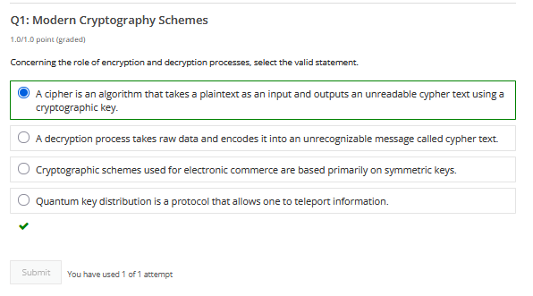

# Q1: Modern Cryptography Schemes
1.0/1.0 point (graded)

Concerning the role of encryption and decryption processes, select the valid statement.

- **Selected (correct):** A cipher is an algorithm that takes a plaintext as an input and outputs an unreadable cypher text using a cryptographic key.
- A decryption process takes raw data and encodes it into an unrecognizable message called cypher text.
- Cryptographic schemes used for electronic commerce are based primarily on symmetric keys.
- Quantum key distribution is a protocol that allows one to teleport information.

Green check mark shown. Submit. You have used 1 of 1 attempt.

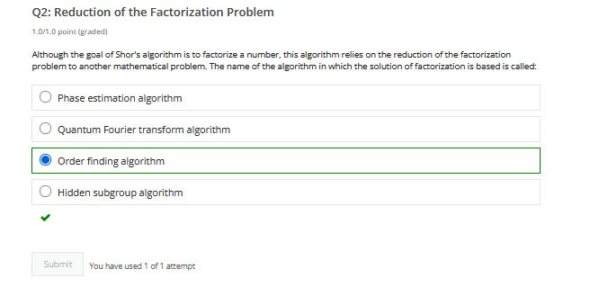

# Q2: Reduction of the Factorization Problem
1.0/1.0 point (graded)

Although the goal of Shor's algorithm is to factorize a number, this algorithm relies on the reduction of the factorization problem to another mathematical problem. The name of the algorithm in which the solution of factorization is based is called:

- Phase estimation algorithm
- Quantum Fourier transform algorithm
- Order finding algorithm **(selected, correct)**
- Hidden subgroup algorithm

Green check mark. Submit. You have used 1 of 1 attempt.

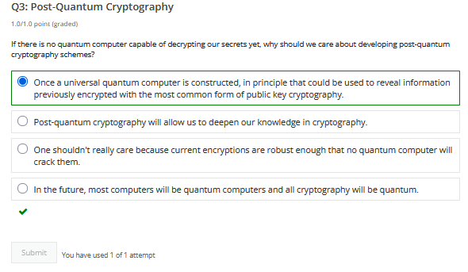

# Q3: Post-Quantum Cryptography
1.0/1.0 point (graded)

If there is no quantum computer capable of decrypting our secrets yet, why should we care about developing post-quantum cryptography schemes?

- Once a universal quantum computer is constructed, in principle that could be used to reveal information previously encrypted with the most common form of public key cryptography. **(selected, correct)**
- Post-quantum cryptography will allow us to deepen our knowledge in cryptography.
- One shouldn't really care because current encryptions are robust enough that no quantum computer will crack them.
- In the future, most computers will be quantum computers and all cryptography will be quantum.

Green check mark. Submit. You have used 1 of 1 attempt.

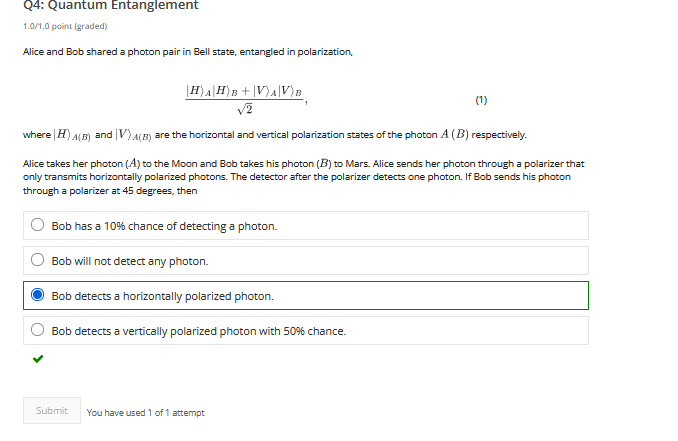

$$\frac{|H\rangle_A|H\rangle_B + |V\rangle_A|V\rangle_B}{\sqrt{2}}, \qquad (1)$$

# Q4: Quantum Entanglement
1.0/1.0 point (graded)

Alice and Bob shared a photon pair in Bell state, entangled in polarization,

$$\frac{|H\rangle_A|H\rangle_B + |V\rangle_A|V\rangle_B}{\sqrt{2}}, \qquad (1)$$

where $|H\rangle_{A(B)}$ and $|V\rangle_{A(B)}$ are the horizontal and vertical polarization states of the photon $A$ ($B$) respectively.

Alice takes her photon ($A$) to the Moon and Bob takes his photon ($B$) to Mars. Alice sends her photon through a polarizer that only transmits horizontally polarized photons. The detector after the polarizer detects one photon. If Bob sends his photon through a polarizer at 45 degrees, then

- Bob has a 10% chance of detecting a photon.
- Bob will not detect any photon.
- **Selected:** Bob detects a horizontally polarized photon.
- Bob detects a vertically polarized photon with 50% chance.

Green check mark shown. Submit. You have used 1 of 1 attempt.

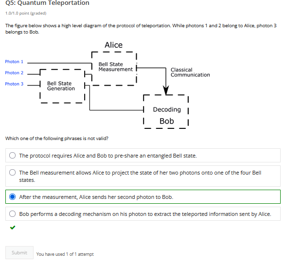

# Q5: Quantum Teleportation
1.0/1.0 point (graded)

The figure below shows a high level diagram of the protocol of teleportation. While photons 1 and 2 belong to Alice, photon 3 belongs to Bob.

Diagram:
- Photon 1, Photon 2, and Photon 3 enter on the left.
- Photons 2 and 3 go into a dashed box **Bell State Generation**.
- Photon 1 and the upper output of that box go into Alice's dashed box **Bell State Measurement**.
- A downward arrow labeled **Classical Communication** goes from Alice's measurement to Bob.
- The lower output of Bell State Generation goes to Bob's dashed box **Decoding**.
- Alice is the upper dashed region; Bob is the lower dashed region.

Which one of the following phrases is not valid?

- The protocol requires Alice and Bob to pre-share an entangled Bell state.
- The Bell measurement allows Alice to project the state of her two photons onto one of the four Bell states.
- After the measurement, Alice sends her second photon to Bob. **(selected, correct — this statement is the one that is not valid)**
- Bob performs a decoding mechanism on his photon to extract the teleported information sent by Alice.

Green check mark. Submit. You have used 1 of 1 attempt.

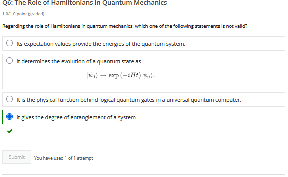

$$|\psi_0\rangle \to \exp(-iHt)|\psi_0\rangle.$$

# Q6: The Role of Hamiltonians in Quantum Mechanics
1.0/1.0 point (graded)

Regarding the role of Hamiltonians in quantum mechanics, which one of the following statements is not valid?

- Its expectation values provide the energies of the quantum system.
- It determines the evolution of a quantum state as

$$|\psi_0\rangle \to \exp(-iHt)|\psi_0\rangle.$$

- It is the physical function behind logical quantum gates in a universal quantum computer.
- **Selected (graded correct):** It gives the degree of entanglement of a system.

Submit. You have used 1 of 1 attempt.

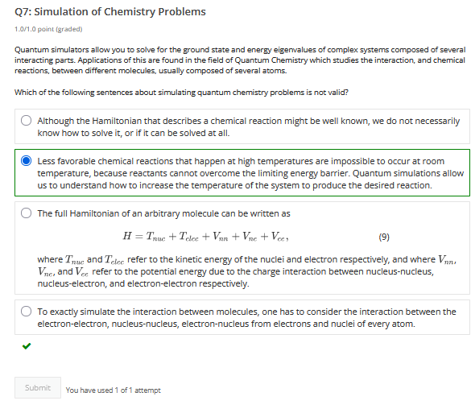

$$H = T_{nuc} + T_{elec} + V_{nn} + V_{nc} + V_{ee}, \qquad (9)$$

# Q7: Simulation of Chemistry Problems
1.0/1.0 point (graded)

Quantum simulators allow you to solve for the ground state and energy eigenvalues of complex systems composed of several interacting parts. Applications of this are found in the field of Quantum Chemistry which studies the interaction, and chemical reactions, between different molecules, usually composed of several atoms.

Which of the following sentences about simulating quantum chemistry problems is not valid?

- Although the Hamiltonian that describes a chemical reaction might be well known, we do not necessarily know how to solve it, or if it can be solved at all.
- **Selected (graded correct):** Less favorable chemical reactions that happen at high temperatures are impossible to occur at room temperature, because reactants cannot overcome the limiting energy barrier. Quantum simulations allow us to understand how to increase the temperature of the system to produce the desired reaction.
- The full Hamiltonian of an arbitrary molecule can be written as

$$H = T_{nuc} + T_{elec} + V_{nn} + V_{nc} + V_{ee}, \qquad (9)$$

where $T_{nuc}$ and $T_{elec}$ refer to the kinetic energy of the nuclei and electron respectively, and where $V_{nn}$, $V_{nc}$, and $V_{ee}$ refer to the potential energy due to the charge interaction between nucleus-nucleus, nucleus-electron, and electron-electron respectively.
- To exactly simulate the interaction between molecules, one has to consider the interaction between the electron-electron, nucleus-nucleus, electron-nucleus from electrons and nuclei of every atom.

Submit. You have used 1 of 1 attempt.

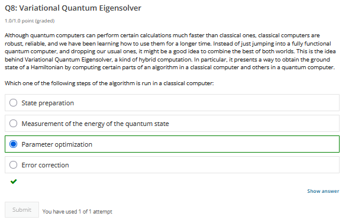

# Q8: Variational Quantum Eigensolver
1.0/1.0 point (graded)

Although quantum computers can perform certain calculations much faster than classical ones, classical computers are robust, reliable, and we have been learning how to use them for a longer time. Instead of just jumping into a fully functional quantum computer, and dropping our usual ones, it might be a good idea to combine the best of both worlds. This is the idea behind Variational Quantum Eigensolver, a kind of hybrid computation. In particular, it presents a way to obtain the ground state of a Hamiltonian by computing certain parts of an algorithm in a classical computer and others in a quantum computer.

Which one of the following steps of the algorithm is run in a classical computer:

- State preparation
- Measurement of the energy of the quantum state
- Parameter optimization **(selected, correct)**
- Error correction

Green check mark. Show answer. Submit. You have used 1 of 1 attempt.

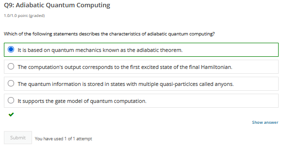

# Q9: Adiabatic Quantum Computing
1.0/1.0 point (graded)

Which of the following statements describes the characteristics of adiabatic quantum computing?

- It is based on quantum mechanics known as the adiabatic theorem. **(selected, correct)**
- The computation's output corresponds to the first excited state of the final Hamiltonian.
- The quantum information is stored in states with multiple quasi-particles called anyons.
- It supports the gate model of quantum computation.

Green check mark. Show answer. Submit. You have used 1 of 1 attempt.

\
WEEK 1

Introduction

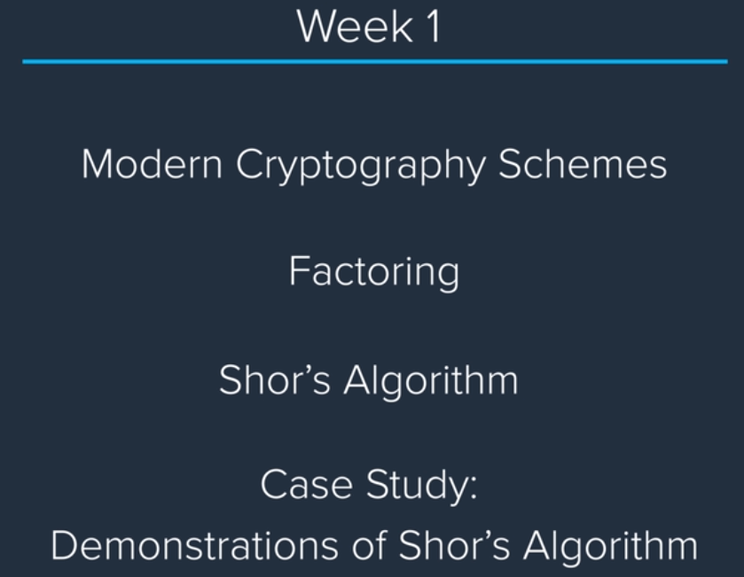

# Week 1

- Modern Cryptography Schemes
- Factoring
- Shor's Algorithm
- Case Study: Demonstrations of Shor's Algorithm

# Introduction to quantum algorithms and cryptography 
## 

## **Learn**

Welcome to Course 2, *Quantum Algorithms for Cybersecurity, Chemistry,
and Optimization*. In this first video, we will briefly review what you
have learned in Course 1, *Introduction to Quantum Computing*. We will
then preview where we are headed in Course 2. (Courses 3 and 4,
mentioned at the end of the video, refer to our [[Quantum Realities
program.]{.underline}](https://xpro.mit.edu/programs/program-v1:xPRO+QCR/))

## **Transcripts**

0

00:00:00,000 \--\> 00:00:02,760

Welcome to course two in our continuing program

1

00:00:02,760 \--\> 00:00:05,430

on the applications of quantum computing.

2

00:00:05,430 \--\> 00:00:08,250

In course 1 we introduced quantum computing, and how

3

00:00:08,250 \--\> 00:00:10,110

it works at an intuitive level.

4

00:00:10,110 \--\> 00:00:12,150

And the material presented in course 1

5

00:00:12,150 \--\> 00:00:15,420

will serve as a foundation for the remainder of the program.

6

00:00:15,420 \--\> 00:00:17,310

We talked through how a quantum computer

7

00:00:17,310 \--\> 00:00:19,320

is different than a classical computer.

8

00:00:19,320 \--\> 00:00:22,290

Introducing important concepts such as quantum parallelism,

9

00:00:22,290 \--\> 00:00:25,230

and quantum interference, manifestly quantum mechanical

10

00:00:25,230 \--\> 00:00:27,150

effects, that enable quantum computers

11

00:00:27,150 \--\> 00:00:29,400

to process information efficiently.

12

00:00:29,400 \--\> 00:00:32,070

We learned about universal quantum computers, quantum

13

00:00:32,070 \--\> 00:00:34,920

emulators, quantum simulators, and quantum annealers,

14

00:00:34,920 \--\> 00:00:37,350

and the types of problems they can address.

15

00:00:37,350 \--\> 00:00:40,680

We discussed what makes a good qubit, the DiVincenzo Criteria,

16

00:00:40,680 \--\> 00:00:43,600

and compared several of the leading qubit modalities today,

17

00:00:43,600 \--\> 00:00:46,530

including superconducting qubits and trapped ions.

18

00:00:46,530 \--\> 00:00:49,170

We introduced the Bloch sphere, and Dirac notation.

19

00:00:49,170 \--\> 00:00:51,810

And we learned how to control qubits using single qubit

20

00:00:51,810 \--\> 00:00:53,550

and two qubit gate.

21

00:00:53,550 \--\> 00:00:55,945

We found that qubits are susceptible to noise,

22

00:00:55,945 \--\> 00:00:57,570

and they lose their quantum information

23

00:00:57,570 \--\> 00:01:00,510

over time, that is they decohere, by processes

24

00:01:00,510 \--\> 00:01:03,360

such as energy relaxation and dephasing.

25

00:01:03,360 \--\> 00:01:05,069

Coherence time and gate speed are

26

00:01:05,069 \--\> 00:01:07,200

both important characteristics of qubits.

27

00:01:07,200 \--\> 00:01:09,780

It\'s not solely a long coherence time that\'s important,

28

00:01:09,780 \--\> 00:01:11,640

but rather, the number of gates one

29

00:01:11,640 \--\> 00:01:14,430

can perform, before quantum information is lost.

30

00:01:14,430 \--\> 00:01:17,400

In fact, what matters most, is the gate fidelity.

31

00:01:17,400 \--\> 00:01:20,220

And we discussed how to measure it using process tomography

32

00:01:20,220 \--\> 00:01:22,230

and randomized benchmarking.

33

00:01:22,230 \--\> 00:01:24,990

We then talked about the promise of quantum computing, quantum

34

00:01:24,990 \--\> 00:01:27,780

speed-up, and methods for developing new algorithms.

35

00:01:27,780 \--\> 00:01:29,970

Similarly, we talked about the promise of quantum

36

00:01:29,970 \--\> 00:01:31,740

communication, quantum cryptography,

37

00:01:31,740 \--\> 00:01:33,630

and distributed entanglement.

38

00:01:33,630 \--\> 00:01:36,330

Finally, in week four, we looked at the circuit model

39

00:01:36,330 \--\> 00:01:38,430

for classical and quantum computation\--

40

00:01:38,430 \--\> 00:01:41,550

initialize, compute, and measure, as well as

41

00:01:41,550 \--\> 00:01:44,587

the software stack required to implement such a circuit.

42

00:01:44,587 \--\> 00:01:46,920

We then walked through the Deutsche-Jozsa algorithm, how

43

00:01:46,920 \--\> 00:01:49,800

it works, and then the lab practicum you implemented it

44

00:01:49,800 \--\> 00:01:52,080

on the IBM quantum experience.

45

00:01:52,080 \--\> 00:01:54,330

And so with that, let me welcome you again to course

46

00:01:54,330 \--\> 00:01:57,270

two, quantum computing algorithms for cybersecurity,

47

00:01:57,270 \--\> 00:01:59,520

chemistry, and optimization.

48

00:01:59,520 \--\> 00:02:01,560

Course two builds on the foundation you just

49

00:02:01,560 \--\> 00:02:03,840

studied, and uses it to probe more deeply,

50

00:02:03,840 \--\> 00:02:05,460

the applications of quantum computing

51

00:02:05,460 \--\> 00:02:07,260

and quantum cryptography.

52

00:02:07,260 \--\> 00:02:10,380

We\'ll take a look at algorithms for cybersecurity, chemistry,

53

00:02:10,380 \--\> 00:02:11,790

and optimization.

54

00:02:11,790 \--\> 00:02:14,520

We won\'t worry about practical issues such as noise.

55

00:02:14,520 \--\> 00:02:17,550

Rather, we want to understand how these algorithms work,

56

00:02:17,550 \--\> 00:02:19,800

and their applications realized.

57

00:02:19,800 \--\> 00:02:22,230

We\'ll begin by looking at how quantum can be used

58

00:02:22,230 \--\> 00:02:24,180

to break public key encryption.

59

00:02:24,180 \--\> 00:02:26,610

We\'ve seen in course one, and we\'ll go into more detail

60

00:02:26,610 \--\> 00:02:28,950

now, that Shor\'s algorithm can efficiently

61

00:02:28,950 \--\> 00:02:31,470

defeat certain important encryption protocols,

62

00:02:31,470 \--\> 00:02:33,720

for example RSA encryption.

63

00:02:33,720 \--\> 00:02:36,330

Those that serve as the basis for our information security

64

00:02:36,330 \--\> 00:02:37,380

today.

65

00:02:37,380 \--\> 00:02:40,380

In week one we\'ll look at modern cryptography schemes based

66

00:02:40,380 \--\> 00:02:43,530

on one way functions we\'ll look at how factoring is performed,

67

00:02:43,530 \--\> 00:02:46,208

and why it\'s so hard on a classical computer.

68

00:02:46,208 \--\> 00:02:48,000

We\'ll then look at how Shor\'s algorithm can

69

00:02:48,000 \--\> 00:02:50,790

perform the same task, in a much more efficient manner.

70

00:02:50,790 \--\> 00:02:53,910

First, at an intuitive level, and then Peter Shor, himself,

71

00:02:53,910 \--\> 00:02:56,850

will present a deep dive on how his algorithm works.

72

00:02:56,850 \--\> 00:02:58,410

Finally, we\'ll close out the week

73

00:02:58,410 \--\> 00:03:00,390

with a case study that looks at prototype

74

00:03:00,390 \--\> 00:03:04,190

experimental demonstrations of Shor\'s algorithm, to date.

75

00:03:04,190 \--\> 00:03:10,000

Introduction

# Classical and quantum gates from course number 1 

## 

## **Learn**

The following tables present a list of classical gates and quantum gates
that were used in Course 1, *Introduction to Quantum Computing*. They
may be used for reference throughout Course 2, *Quantum Algorithms for
Cybersecurity, Chemistry, and Optimization*.

there are three images. the first image is a list of classical gates.
the second is a list of quantum one-qubit gates and the third is a list
of two-qubit gates

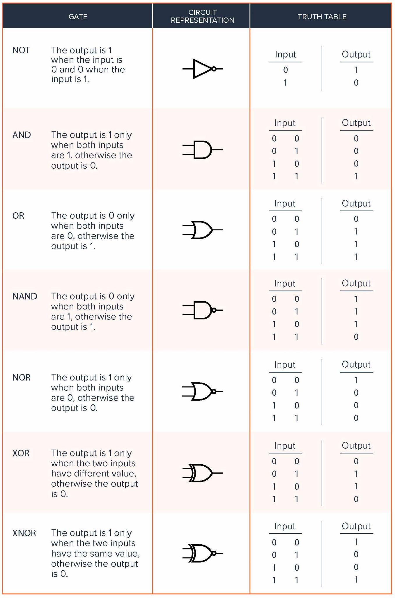

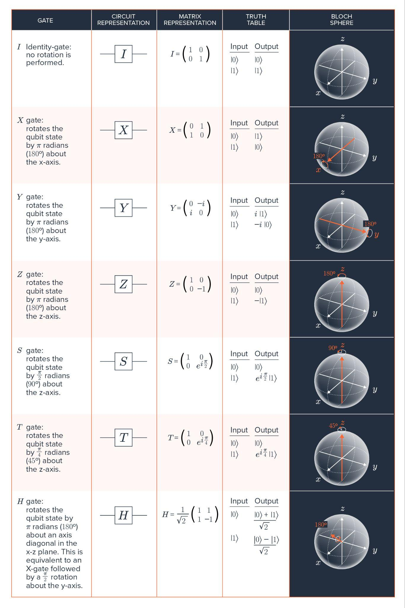

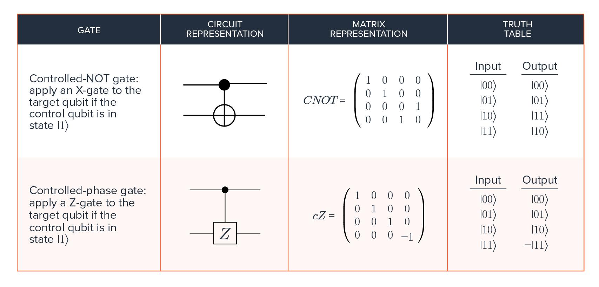

Modern Cryptography

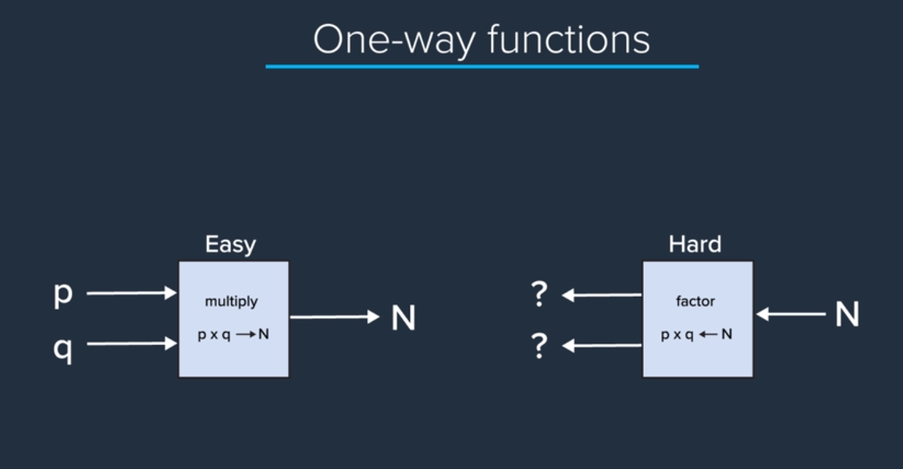

$$p \times q \rightarrow N$$
$$p \times q \leftarrow N$$

# One-way functions

**Easy** (left): inputs $p$ and $q$ enter a box labeled multiply, $p \times q \rightarrow N$, and the box outputs $N$.

**Hard** (right): $N$ enters a box labeled factor, $p \times q \leftarrow N$, and the two outputs are marked $?$ and $?.$

# RSA Algorithm

Diagram on a dark background:
- Left: blue computer labeled **Alice**, with a green key labeled **D** to its right.
- Right: blue computer labeled **Bob**. Above Bob is an open (unlocked) padlock; a yellow key labeled **E** is to Bob's left; a black envelope icon is below Bob.
- Bottom center: red computer labeled **Eve**.

# RSA Algorithm

Later frame of the same RSA diagram:
- Left: blue computer **Alice**, with a closed padlock above and a green key labeled **D** beside her.
- Right: blue computer **Bob**, with a yellow key labeled **E** to his left.
- Bottom center: red computer **Eve**, with a small closed padlock and a small yellow key to her right.

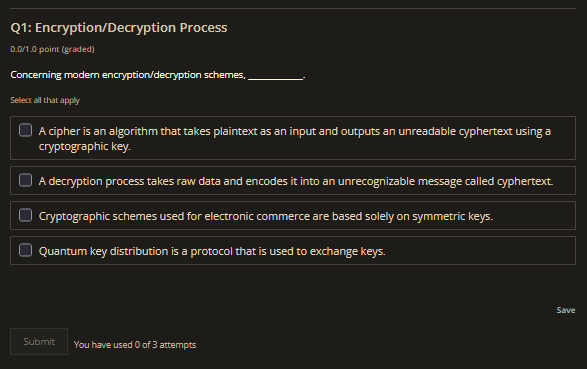

# Q1: Encryption/Decryption Process
0.0/1.0 point (graded)

Concerning modern encryption/decryption schemes, ________.

Select all that apply.

- [ ] A cipher is an algorithm that takes plaintext as an input and outputs an unreadable cyphertext using a cryptographic key.
- [ ] A decryption process takes raw data and encodes it into an unrecognizable message called cyphertext.
- [ ] Cryptographic schemes used for electronic commerce are based solely on symmetric keys.
- [ ] Quantum key distribution is a protocol that is used to exchange keys.

Save / Submit. You have used 0 of 3 attempts. No options are selected.

# Modern cryptography 

## 

## **Learn**

We generate and communicate tremendous amounts of digital data every
day. But, how do we protect this data from eavesdroppers? In this video,
you will learn about modern cryptography and how it is used to protect
data through the use of encryption.

### The Engima Machine and Modern Cryptography

The Enigma machine is a legendary cipher machine used by German forces
before and during World War II. Enigma is an electro-mechanical rotor
cipher machine. A message -- called \"plaintext\" -- written by an
operator is encoded by a machine -- similar to a typewriter in
appearance -- in the following manner: a single character is
pseudo-randomly replaced with a different letter according to the wiring
of the machine. The subsequent letter is replaced following the same
mechanism, but with the rotor shifted to a different position. The
shifted rotor position causes the letter to be substituted according to
a different electrical pathway and hence character substitution table.
Thus, each character of the message is replaced according to a different
encoding scheme. The resulting \"ciphertext\" can subsequently be
transmitted via regular public communication channels, and it can only
be decoded using a machine with the same configuration and capability to
reverse the encoding. Finally, a successful decipher trial reveals the
true content of the message in the form of a plaintext again.

In 1941, at Bletchley Park, a British team including Alan Turing
uncovered the working principles of Enigma for the Allies. The
deciphered information of the intercepted messages provided the Allies
with a significant advantage that ultimately became a key element in
their victory over the Axis powers.

The Enigma machine is an example of a *symmetric encryption* scheme,
where the same key is used to encode and decode a message. Symmetric
encryption schemes are still in use today. However, since World War II,
crypotgraphic key generation has evolved from electro-mechanical methods
to classically constructed digital bit strings serving as encrypting
keys. The keys are mathematically difficult to derive and require a
significant amount of computational power and time. The computational
power and time required to decode determines the security of an encoding
key.

In 1975, the Data Encryption Standard (DES) was introduced by IBM. The
DES algorithm generates a 56-bit symmetric encryption key using a
complex mathematical method. Despite this mathematical complexity, DES
was known from the beginning to be potentially susceptible to a
brute-force key-search attack due to its relatively limited key size. In
fact, by the beginning of the 21st century, computational power had
sufficiently advanced to the point that one could determine the key in
less than a day. For example, Distributed.Net -- an organization
specializing in the use of idle computer time -- utilized more than
100,000 computers ranging from slow PCs to powerful multiprocessor
machines to test 250 billion keys per second and thereby determine a
particular 56-bit key in about 23 hours. Given the increasing
vulnerability of DES, in 2001, DES was replaced by the Advanced
Encryption Standard (AES), a more secure symmetric key cryptography
scheme.

However, there remained a conundrum: how can two parties exchange a
symmetric key to initiate secure communication, before they have a
secure channel on which to send it? In 1976, a new method for
distributing cryptographic keys was introduced by Whitfield Diffie and
Martin Hellman -- referred to as the Diffie-Hellman key exchange
protocol -- which heralded the era of *public key cryptography* with
*asymmetric keys*. Asymmetric keys comprise a *public key* -- used to
encrypt messages -- and a mathematically related (but unique) *private
key* -- used to decrypt messages. The security of public key
cryptosystems is premised on the use of *one-way mathematical functions*
to create the public and private keys. One-way mathematical functions
are straightforward to calculate in the forward direction, but
prohibitively complex to calculate in the inverse direction. A widely
used public-key distribution algorithm was published in 1978 by Ronald
Rivest, Adi Shamir, and Len Adleman -- referred to as the RSA algorithm.
It was later declassified in the late 1990\'s that asymmetric encryption
schemes like RSA had already been developed by the British Government
Communications Headquarters (GCHQ) in the early 1970\'s. With public key
cryptosystems, one could exchange public keys and thereby establish a
secure link, without having symmetric keys in hand at the beginning.
Once a secure link was established, one then has the option of
continuing to communicate using asymmetric keys, or one can
alternatively use this newly established secure link to exchange
symmetric keys and use symmetric encryption/decryption protocols.

In practice, public-key encryption techniques are primarily used to
establish a secure channel and distribute symmetric keys, which are in
turn used to encrypt messages. This is because encryption using an
asymmetric-key protocol is generally less resource efficient than using
a symmetric-key protocol. For example, a -bit symmetric key has
different possible key combinations. In contrast, a -bit asymmetric key
can leverage only the fraction of the possible bit strings that comply
with the conditions required by the underlying one-way function.
Therefore, whereas a symmetric key of bits and a bit public key afford a
similar level of security, the symmetric-key approach is generally more
efficient to implement.

## **Transcripts**
0

00:00:00,000 \--\> 00:00:00,090

1

00:00:00,090 \--\>
00:00:02,820
In this section, we\'ll take a look at modern cryptography

2

00:00:02,820 \--\> 00:00:06,270

schemes and their use in information security today.
3

00:00:06,270 \--\> 00:00:09,330

Every day we generate, accumulate, and communicate

4

00:00:09,330 \--\> 00:00:10,920

tremendous amounts of data.

5

00:00:10,920 \--\> 00:00:12,720

Everything from our personal emails,

6

00:00:12,720 \--\> 00:00:15,360

financial transactions, and medical records,

7

00:00:15,360 \--\> 00:00:17,280

to a corporation\'s intellectual property,

8

00:00:17,280 \--\> 00:00:19,650

business strategy, and online sales,

9

00:00:19,650 \--\> 00:00:22,020

to the daily operation and functioning of our government

10

00:00:22,020 \--\> 00:00:24,060

and military organizations.

11

00:00:24,060 \--\> 00:00:27,210

In each of these cases we expect, even require,

12

00:00:27,210 \--\> 00:00:30,000

that our information is stored and communicated securely such

13

00:00:30,000 \--\> 00:00:33,150

that it\'s available to ourselves and to our intended recipients,

14

00:00:33,150 \--\> 00:00:34,680

but to nobody else.

15

00:00:34,680 \--\> 00:00:36,810

And in general, information is protected

16

00:00:36,810 \--\> 00:00:38,710

through the use of encryption.

17

00:00:38,710 \--\> 00:00:41,560

Encryption takes raw data, for example, a message,

18

00:00:41,560 \--\> 00:00:44,850

often referred to as plain text, and translates it

19

00:00:44,850 \--\> 00:00:47,490

or encodes it into an unrecognizable message called

20

00:00:47,490 \--\> 00:00:49,140

a cyphertext.

21

00:00:49,140 \--\> 00:00:52,400

It does this by using an algorithm called a cypher.

22

00:00:52,400 \--\> 00:00:55,590

A cypher takes as inputs the plaintext being encoded

23

00:00:55,590 \--\> 00:00:58,350

and a key, typically a numerical bit string in today\'s

24

00:00:58,350 \--\> 00:01:00,090

cryptography schemes.

25

00:01:00,090 \--\> 00:01:03,750

The cypher then combines them into an unreadable cyphertext

26

00:01:03,750 \--\> 00:01:06,000

through a prescribed algorithmic protocol based

27

00:01:06,000 \--\> 00:01:08,250

on mathematical operations.

28

00:01:08,250 \--\> 00:01:10,590

Similarly, a decryption key is used

29

00:01:10,590 \--\> 00:01:12,990

with a corresponding decryption protocol

30

00:01:12,990 \--\> 00:01:15,660

to reconstruct the plaintext message.

31

00:01:15,660 \--\> 00:01:17,910

The most common cryptography schemes historically

32

00:01:17,910 \--\> 00:01:20,220

are called symmetric key cryptography

33

00:01:20,220 \--\> 00:01:22,980

in which the encryption and decryption keys are the same

34

00:01:22,980 \--\> 00:01:25,680

or can be trivially related to one another.

35

00:01:25,680 \--\> 00:01:29,520

Examples include the older data encryption standard, DES,

36

00:01:29,520 \--\> 00:01:33,300

and the more modern advanced encryption standard, AES.

37

00:01:33,300 \--\> 00:01:35,670

The one-time pad that we discussed in course one

38

00:01:35,670 \--\> 00:01:37,770

in the context of quantum key distribution

39

00:01:37,770 \--\> 00:01:40,350

is another example of a symmetric key cryptography

40

00:01:40,350 \--\> 00:01:41,070

scheme.

41

00:01:41,070 \--\> 00:01:43,290

Since symmetric keys are used to both encrypt

42

00:01:43,290 \--\> 00:01:46,500

and decrypt a message, they must remain private.

43

00:01:46,500 \--\> 00:01:48,390

This isn\'t a serious issue on, say,

44

00:01:48,390 \--\> 00:01:51,340

a personal computer where we want to encrypt the hard drive

45

00:01:51,340 \--\> 00:01:53,440

and so the keys are stored locally.

46

00:01:53,440 \--\> 00:01:57,000

However, it raises a challenge when communicating information.

47

00:01:57,000 \--\> 00:01:59,310

When two parties want to communicate securely,

48

00:01:59,310 \--\> 00:02:02,040

they either need to meet in advance to secretly share

49

00:02:02,040 \--\> 00:02:03,240

the symmetric keys\--

50

00:02:03,240 \--\> 00:02:05,130

not a very practical option\--

51

00:02:05,130 \--\> 00:02:07,170

or they need to establish private channels

52

00:02:07,170 \--\> 00:02:09,449

to securely distribute the key.

53

00:02:09,449 \--\> 00:02:12,330

Now in the future, efficient quantum key distribution

54

00:02:12,330 \--\> 00:02:15,450

protocols may provide a quantum enhanced level of security

55

00:02:15,450 \--\> 00:02:18,180

when transmitting a secret symmetric key.

56

00:02:18,180 \--\> 00:02:20,132

But today, secure communication links

57

00:02:20,132 \--\> 00:02:21,840

are generally established through the use

58

00:02:21,840 \--\> 00:02:25,770

of public key cryptography based on asymmetric keys.

59

00:02:25,770 \--\> 00:02:28,410

Public key cryptography was developed in the 1970s

60

00:02:28,410 \--\> 00:02:29,820

by several groups.

61

00:02:29,820 \--\> 00:02:31,380

Whitfield Diffie and Martin Hellman

62

00:02:31,380 \--\> 00:02:33,420

published the first public key cryptography

63

00:02:33,420 \--\> 00:02:37,680

scheme, the Diffie-Hellman key exchange protocol, in 1976.

64

00:02:37,680 \--\> 00:02:40,710

And later in 1978, the RSA algorithm

65

00:02:40,710 \--\> 00:02:44,490

was published by Ronald Rivest, Adi Shamir, and Len Adleman.

66

00:02:44,490 \--\> 00:02:47,280

In fact, researchers at the British General Communications

67

00:02:47,280 \--\> 00:02:49,650

Headquarters, GCHQ, had developed

68

00:02:49,650 \--\> 00:02:53,290

similar public key cryptography schemes in the early 1970s,

69

00:02:53,290 \--\> 00:02:56,610

but only declassified those achievements in 1997.

70

00:02:56,610 \--\> 00:03:00,270

Public key cryptography is based on asymmetric keys, that

71

00:03:00,270 \--\> 00:03:02,880

is, a public key is used for encryption

72

00:03:02,880 \--\> 00:03:04,920

and a separate independent, private key

73

00:03:04,920 \--\> 00:03:06,840

is used for decryption.

74

00:03:06,840 \--\> 00:03:09,980

The keys are necessarily related to one another mathematically

75

00:03:09,980 \--\> 00:03:12,300

and the information security relies

76

00:03:12,300 \--\> 00:03:15,030

on it being computationally impractical to determine

77

00:03:15,030 \--\> 00:03:17,690

the private key given the public key.

78

00:03:17,690 \--\> 00:03:19,440

This is generally possible through the use

79

00:03:19,440 \--\> 00:03:21,880

of one-way mathematical functions.

80

00:03:21,880 \--\> 00:03:25,050

For example, RSA cryptography is based on the idea

81

00:03:25,050 \--\> 00:03:27,090

that it\'s mathematically easy for a computer

82

00:03:27,090 \--\> 00:03:30,150

to multiply two large prime numbers, p and q,

83

00:03:30,150 \--\> 00:03:32,160

and obtain their product, N. But it\'s

84

00:03:32,160 \--\> 00:03:35,010

a very hard problem for a computer to do the inverse,

85

00:03:35,010 \--\> 00:03:38,490

that is, factor that number, N, into its constituent prime

86

00:03:38,490 \--\> 00:03:40,170

factors, p and q.

87

00:03:40,170 \--\> 00:03:43,110

So with one-way mathematical functions, ease of use

88

00:03:43,110 \--\> 00:03:45,120

is based on the mathematical simplicity

89

00:03:45,120 \--\> 00:03:47,220

in the forward direction and security

90

00:03:47,220 \--\> 00:03:49,080

is based on mathematical complexity

91

00:03:49,080 \--\> 00:03:50,760

in the inverse direction.

92

00:03:50,760 \--\> 00:03:52,440

To get an idea for how this works,

93

00:03:52,440 \--\> 00:03:54,660

consider the following cartoon.

94

00:03:54,660 \--\> 00:03:57,690

Bob wants to communicate a message securely to Alice

95

00:03:57,690 \--\> 00:04:00,960

without that message being read by an eavesdropper, Eve.

96

00:04:00,960 \--\> 00:04:03,780

To do this, Bob requests a public encryption key

97

00:04:03,780 \--\> 00:04:05,010

from Alice.

98

00:04:05,010 \--\> 00:04:07,320

Alice then sends a public encryption key,

99

00:04:07,320 \--\> 00:04:09,920

but retains her private decryption key.

100

00:04:09,920 \--\> 00:04:11,940

We\'ll represent this by keys with the letter

101

00:04:11,940 \--\> 00:04:14,430

E for encryption, D for decryption,

102

00:04:14,430 \--\> 00:04:16,589

and a notional open lock.

103

00:04:16,589 \--\> 00:04:18,540

During transmission on a public channel,

104

00:04:18,540 \--\> 00:04:21,480

in principle, Eve obtains the open lock and the encryption

105

00:04:21,480 \--\> 00:04:22,470

key.

106

00:04:22,470 \--\> 00:04:25,620

When Bob receives them, he encrypts his plaintext message

107

00:04:25,620 \--\> 00:04:28,380

using the encryption key, creating cyphertext,

108

00:04:28,380 \--\> 00:04:30,840

and effectively locks the padlock.

109

00:04:30,840 \--\> 00:04:32,970

Bob then sends the cyphertext back

110

00:04:32,970 \--\> 00:04:34,990

to Alice on a public channel.

111

00:04:34,990 \--\> 00:04:37,860

Although Eve can obtain the cyphertext in principle,

112

00:04:37,860 \--\> 00:04:40,020

she can\'t unlock the padlock since she only

113

00:04:40,020 \--\> 00:04:41,970

has the public encryption key.

114

00:04:41,970 \--\> 00:04:44,760

The security here is based on it being very hard for Eve

115

00:04:44,760 \--\> 00:04:47,100

to figure out the decryption key based on what

116

00:04:47,100 \--\> 00:04:49,110

she has in her possession.

117

00:04:49,110 \--\> 00:04:51,600

Alice, on the other hand, is able to trivially unlock

118

00:04:51,600 \--\> 00:04:53,850

the padlock using her decryption key,

119

00:04:53,850 \--\> 00:04:56,250

thereby converting the cyphertext to plaintext

120

00:04:56,250 \--\> 00:04:57,810

and reading the message.

121

00:04:57,810 \--\> 00:04:59,520

This type of public key encryption scheme

122

00:04:59,520 \--\> 00:05:02,880

is used ubiquitously today for secure communication.

123

00:05:02,880 \--\> 00:05:05,820

In many cases, it\'s used to establish a private channel

124

00:05:05,820 \--\> 00:05:09,210

that provides authentication and enables symmetric keys to be

125

00:05:09,210 \--\> 00:05:10,770

exchanged securely.

126

00:05:10,770 \--\> 00:05:12,840

This is because the public key approach based

127

00:05:12,840 \--\> 00:05:15,690

on asymmetric keys is generally slower to implement

128

00:05:15,690 \--\> 00:05:17,820

than symmetric schemes.

129

00:05:17,820 \--\> 00:05:19,440

Public key encryption is a foundation

130

00:05:19,440 \--\> 00:05:21,770

for our information security today.

131

00:05:21,770 \--\> 00:05:24,180

And in the next section, we\'ll take a more detailed look

132

00:05:24,180 \--\> 00:05:29,000

at one specific example, RSA cryptography, and how it works.

133

00:05:29,000 \--\> 00:05:34,102

## PRACTICE
RSA Cryptosystem factoring and shor\'s algorithm

# RSA cryptosystem 

## 

## **Learn**

We often communicate securely by encrypting data using cryptographic
schemes. However, how do we initiate and establish a secure channel, if
we have not yet securely exchanged cryptographic keys? In this video,
you will learn about the RSA cryptosystem, a quintessential example of a
public-key cryptosystem that leverages asymmetric keys based on one-way
mathematical functions to communicate sensitive information.

### RSA Algorithm

Modern cryptography is a foundation for today\'s information and
economic security, enabling secure communication between individuals,
businesses, and governments. There are two basic classes of
cryptosystems: symmetric-key and asymmetric-key cryptography.
Asymmetric-key cryptography -- also referred to as public-key
cryptography -- uses a public key and a private key to encode and decode
messages. The two distinct keys are mathematically related via a one-way
function, which is computationally efficient to calculate in one
direction, but not in the inverse direction.

The workhorse of public-key encryption schemes is the RSA cryptosystem,
which can be broken into four steps:

1.  key generation (a public key and a private key ),

2.  public key distribution,

3.  message encryption (a message a ciphertext ) and transmission,

4.  message decryption.

**Key Generation and Distribution:**

The encryption and decryption keys are generated using a one-way
function related to *modular exponentiation*. To begin, two distinct
prime numbers and are chosen at random. Key generation then centers on
the function

  ------------------------------------------------------- ---------------

  ------------------------------------------------------- ---------------

where is an integer number, the modulus is the product of and , and
\"mod \" means \"modulo \". The term \"modular exponentiation\" refers
to there being an exponential that is calculated modulo .

From the number theory of modular exponentiation, it is known that the
function is periodic with period , and finding the value of is called
*order finding*. Order finding is a manageable task if one knows and ,
but not if one only knows their product . This is the one-way function
that underlies the security of RSA.

To see this, consider the following. When in the above function, . If is
periodic in , then it follows that the function , , , \... must also
equal 1. The period can be derived using [[Fermat\'s little
theorem]{.underline}](https://en.wikipedia.org/wiki/Fermat%27s_little_theorem),
which uses [[Euler\'s totient
function]{.underline}](https://en.wikipedia.org/wiki/Euler%27s_totient_function)

  ------------------------------------------------------- ---------------

  ------------------------------------------------------- ---------------

to find the period .

In essence, Euler\'s totient function gives the number of positive
integers smaller than the product which have no prime factors in common
with -- that is, *coprime* with , , and -- and Fermat\'s little theorem
shows that this is the period . Note that may be the fundamental period,
or it may be an integer multiple of the fundamental period. The
fundamental period is the least common multiple of and . Both the
fundamental period or a multiple of the fundamental period will work.

With and known, the totient can be easily calculated with a classical
computer. However, if one is only given (without knowledge of or ), then
one must *factor* to find and and thereby find the period . Factoring is
a hard problem for a classical computer.

With the period in hand, one can generate the public key and private key
. One first *chooses* a *public encryption exponent* that satisfies the
following conditions:

1.  ,

2.  is coprime with .

The second condition means that there is no integer (other than 1) that
divides both and , and so their [[greatest common divisor
(gcd)]{.underline}](http://mathworld.wolfram.com/GreatestCommonDivisor.html)
is 1. This is written as .

Once a value of is chosen, then one *calculates* a *private decryption
exponent* as the modular multiplicative inverse of , modulo :

  ------------------------------------------------------- ---------------

  ------------------------------------------------------- ---------------

[**Note**]{.underline} that the notation for the modular multiplicative
inverse above, while often found, can be misleading. is another way of
writing such that . It does not mean to take the reciprocal of . When
using a [[modular
calculator]{.underline}](https://www.wolframalpha.com/input/?i=7%5E(-1)+mod+288),
you will have to use the syntax\"[[A\^(-1) mod
C]{.underline}](https://www.wolframalpha.com/input/?i=7%5E(-1)+mod+288)\"
and **[not]{.underline}** \"1/A mod C\" as the modular multiplicative
inverse is only defined for integers.

Intuitively, as we explain in more detail below, the inversion follows
from the fact that is used to decrypt a message that is encrypted using
. And, again, one can trivially calculate the private decryption
exponent given the public encryption exponent , *provided* one knows the
period .

The steps are summarized in the following table for the specific example
of and .

  -------------------------------------------------------------------------------------------------------
  1\) ,  choose two random prime numbers                                                   ,
  :                                                                                        
  ------ --------------------------------------------------------------------------------- --------------
  2\) :  calculate                                                                         

  3\) :  find the period                                                                   

  4\) :  choose a public exponent with [[greatest common                                   
         divisor]{.underline}](http://mathworld.wolfram.com/GreatestCommonDivisor.html):   
         gcd                                                                               

  5\) :  calculate the private exponent                                                    
  -------------------------------------------------------------------------------------------------------

Having created the keys, Alice sends the public key to Bob. Importantly,
she retains the private key and does not reveal the values , , or .

**Message Encryption and Decryption:**

Bob has a message he wants to send to Alice. Having received the public
encryption key , he encrypts to create cyphertext using the public key
and modular exponentiation:

  -----------------------------------------------------------------------

  -----------------------------------------------------------------------

After the message is sent to Alice, she decrypts it with her private key
using the properties of modular exponentiation,

  -----------------------------------------------------------------------

  -----------------------------------------------------------------------

provided the original message is smaller than the modulus . Eve has
access to the public key , but this is no use to her in trying to
decrypt the cyphertext, since

In summary, the number theory and properties of modular exponentiation
underlie the security of the RSA cryptosystem. As you have seen, the
challenge of order finding can be related to the problem of factoring.
While it is straightforward to multiple two numbers and to give the
modulus , the inverse problem is hard on a classical computer. And, if
is chosen sufficiently large, then a brute-force search to find and is
also inefficient. Thus, the RSA cryptosystem is believed to be secure
provided the prime numbers and , and the private exponent are not made
public. However, the encryption exponent and modulus *can* be made
public. This type of cryptosystem, where the encryption key is public
and anyone can encrypt a message, while the decryption key is private
and only the receiver can decrypt the cyphertext, is the backbone of our
modern day communication systems.

## **Images**

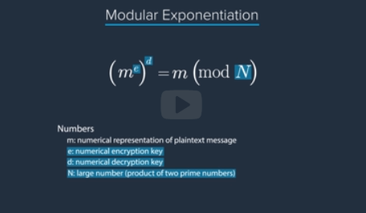

$$\left(m^{e}\right)^{d} = m \pmod{N}$$

# Modular Exponentiation

$$\left(m^{e}\right)^{d} = m \pmod{N}$$

**Numbers**
- $m$: numerical representation of plaintext message
- $e$: numerical encryption key *(highlighted)*
- $d$: numerical decryption key *(highlighted)*
- $N$: large number (product of two prime numbers) *(highlighted)*

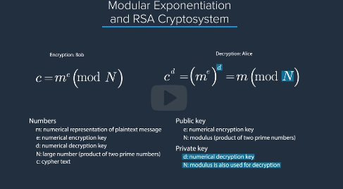

$$c = m^{e} \pmod{N}$$
$$c^{d} = \left(m^{e}\right)^{d} = m \pmod{N}$$

# Modular Exponentiation and RSA Cryptosystem

**Encryption: Bob**

$$c = m^{e} \pmod{N}$$

**Decryption: Alice**

$$c^{d} = \left(m^{e}\right)^{d} = m \pmod{N}$$

In the decryption equation, the outer exponent $d$ and the modulus $N$ are highlighted.

**Numbers**
- $m$: numerical representation of plaintext message
- $e$: numerical encryption key
- $d$: numerical decryption key
- $N$: large number (product of two prime numbers)
- $c$: cypher text

**Public key**
- $e$: numerical encryption key
- $N$: modulus (product of two prime numbers)

**Private key** (highlighted)
- $d$: numerical decryption key
- $N$: modulus is also used for decryption

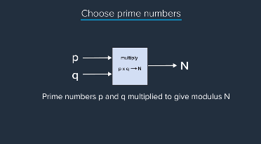

$$p \times q \rightarrow N$$

# Choose prime numbers

Flow diagram: inputs $p$ and $q$ enter a box labeled **multiply**, $p \times q \rightarrow N$, and the output is $N$.

Caption: Prime numbers $p$ and $q$ multiplied to give modulus $N$.

$$3^{i}\pmod{N}$$
$$3^{1}=3\pmod{10}=3$$
$$3^{2}=9\pmod{10}=9$$
$$3^{3}=27\pmod{10}=7$$
$$3^{4}=81$$
$$3^{5}=243$$
$$3^{6}=729$$
$$3^{7}=2187$$
$$3^{8}=6561$$

# Exponentiation and modular arithmetic

Left label: $3^{i}\pmod{N}$

$$
\begin{align*}
3^{1} &= 3 \pmod{10} = 3 \\
3^{2} &= 9 \pmod{10} = 9 \\
3^{3} &= 27 \pmod{10} = 7 \\
3^{4} &= 81 \\
3^{5} &= 243 \\
3^{6} &= 729 \\
3^{7} &= 2187 \\
3^{8} &= 6561
\end{align*}
$$

The remainder $7$ on the $3^{3}$ line is highlighted in blue.

Callout: "$k$ modulo $10$ is the remainder when dividing $k$ by $10$."

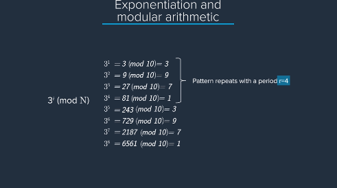

$$3^{j} \pmod{N}$$
$$3^{1} = 3 \pmod{10} = 3$$
$$3^{2} = 9 \pmod{10} = 9$$
$$3^{3} = 27 \pmod{10} = 7$$
$$3^{4} = 81 \pmod{10} = 1$$
$$3^{5} = 243 \pmod{10} = 3$$
$$3^{6} = 729 \pmod{10} = 9$$
$$3^{7} = 2187 \pmod{10} = 7$$
$$3^{8} = 6561 \pmod{10} = 1$$

# Exponentiation and modular arithmetic

Left label: $3^{j} \pmod{N}$.

$$
\begin{align}
3^{1} &= 3 \pmod{10} = 3 \\
3^{2} &= 9 \pmod{10} = 9 \\
3^{3} &= 27 \pmod{10} = 7 \\
3^{4} &= 81 \pmod{10} = 1
\end{align}
$$

A brace groups those first four lines: **Pattern repeats with a period $r=4$** ($r=4$ highlighted). The pattern continues:

$$
\begin{align}
3^{5} &= 243 \pmod{10} = 3 \\
3^{6} &= 729 \pmod{10} = 9 \\
3^{7} &= 2187 \pmod{10} = 7 \\
3^{8} &= 6561 \pmod{10} = 1
\end{align}
$$

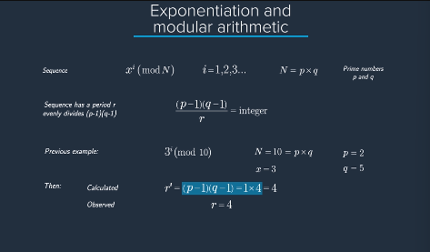

$$x^{i} \pmod{N},\quad i=1,2,3,\ldots,\quad N=p\times q$$
$$\frac{(p-1)(q-1)}{r}=\text{integer}$$
$$3^{i}\pmod{10},\quad N=10=p\times q,\quad x=3,\quad p=2,\quad q=5$$
$$r'=(p-1)(q-1)=1\times 4=4$$
$$r=4$$

# Exponentiation and modular arithmetic

- **Sequence:** $x^{i} \pmod{N}$, $i = 1,2,3,\ldots$, $N = p \times q$. Prime numbers $p$ and $q$.
- **Sequence has a period $r$ evenly divides $(p-1)(q-1)$:**

$$\frac{(p-1)(q-1)}{r} = \text{integer}$$

**Previous example:** $3^{i} \pmod{10}$. $N = 10 = p \times q$, $x = 3$, $p = 2$, $q = 5$.

**Then:**
- Calculated (highlighted): $r' = (p-1)(q-1) = 1 \times 4 = 4$
- Observed: $r = 4$

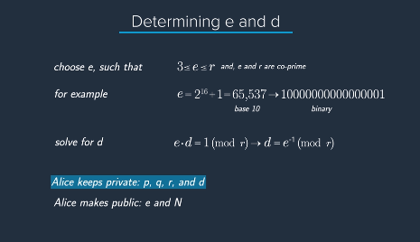

$$3 \le e \le r$$
$$e = 2^{16} + 1 = 65{,}537 \rightarrow 10000000000000001$$
$$e \cdot d = 1 \pmod{r} \rightarrow d = e^{-1} \pmod{r}$$

# Determining e and d

- choose $e$, such that $3 \le e \le r$ and, $e$ and $r$ are co-prime
- for example $e = 2^{16} + 1 = 65{,}537 \rightarrow 10000000000000001$
  - $65{,}537$ labeled base 10
  - $10000000000000001$ labeled binary
- solve for $d$: $e \cdot d = 1 \pmod{r} \rightarrow d = e^{-1} \pmod{r}$

**Alice keeps private: $p$, $q$, $r$, and $d$** *(highlighted)*

*Alice makes public: $e$ and $N$*

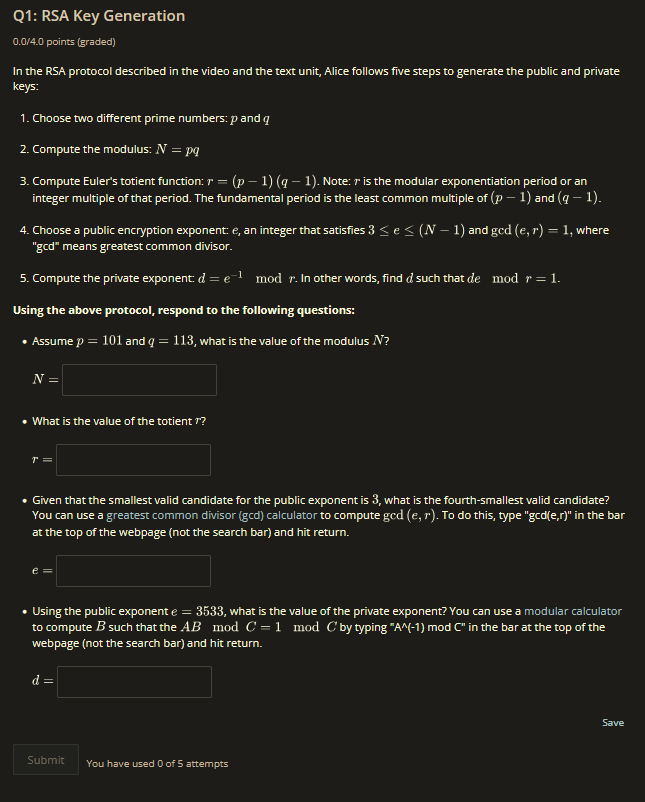

$$N = pq$$
$$r = (p-1)(q-1)$$
$$3 \le e \le (N-1),\quad \gcd(e,r)=1$$
$$d = e^{-1} \bmod r$$
$$de \bmod r = 1$$
$$p = 101,\quad q = 113$$
$$e = 3533$$
$$AB \bmod C = 1$$

# Q1: RSA Key Generation
0.0/4.0 points (graded)

In the RSA protocol described in the video and the text unit, Alice follows five steps to generate the public and private keys:

1. Choose two different prime numbers: $p$ and $q$
2. Compute the modulus: $N = pq$
3. Compute Euler's totient function: $r = (p-1)(q-1)$. Note: $r$ is the modular exponentiation period or an integer multiple of that period. The fundamental period is the least common multiple of $(p-1)$ and $(q-1)$.
4. Choose a public encryption exponent: $e$, an integer that satisfies $3 \le e \le (N-1)$ and $\gcd(e,r) = 1$, where "gcd" means greatest common divisor.
5. Compute the private exponent: $d = e^{-1} \bmod r$. In other words, find $d$ such that $de \bmod r = 1$.

**Using the above protocol, respond to the following questions:**

- Assume $p = 101$ and $q = 113$, what is the value of the modulus $N$?
  - $N =$ (blank input)
- What is the value of the totient $r$?
  - $r =$ (blank input)
- Given that the smallest valid candidate for the public exponent is 3, what is the fourth-smallest valid candidate? You can use a greatest common divisor (gcd) calculator to compute $\gcd(e,r)$. To do this, type "gcd(e,r)" in the bar at the top of the webpage (not the search bar) and hit return.
  - $e =$ (blank input)
- Using the public exponent $e = 3533$, what is the value of the private exponent? You can use a modular calculator to compute $B$ such that $AB \bmod C = 1 \bmod C$ by typing "A^(-1) mod C" in the bar at the top of the webpage (not the search bar) and hit return.
  - $d =$ (blank input)

Save / Submit. You have used 0 of 5 attempts.

## 

## **Transcripts** 

0

00:00:00,000 \--\> 00:00:01,530

PROFESSOR: In the last section, we

1

00:00:01,530 \--\> 00:00:03,360

introduced modern cryptography schemes

2

00:00:03,360 \--\> 00:00:04,860

and discussed the difference between

3

00:00:04,860 \--\> 00:00:07,170

symmetric and asymmetric keys.

4

00:00:07,170 \--\> 00:00:09,270

We saw that cryptographic algorithms based

5

00:00:09,270 \--\> 00:00:11,280

on symmetric keys have a conundrum when

6

00:00:11,280 \--\> 00:00:13,650

it comes to key distribution namely,

7

00:00:13,650 \--\> 00:00:16,530

how can we securely exchange the keys if we don\'t yet

8

00:00:16,530 \--\> 00:00:18,150

have them in our possession to encrypt

9

00:00:18,150 \--\> 00:00:20,070

the initial transmission?

10

00:00:20,070 \--\> 00:00:23,310

The answer as we saw, is to use public-key cryptography based

11

00:00:23,310 \--\> 00:00:25,860

on asymmetric keys, that is, using

12

00:00:25,860 \--\> 00:00:28,530

a public key for encryption and a different private key

13

00:00:28,530 \--\> 00:00:29,910

for decryption.

14

00:00:29,910 \--\> 00:00:32,310

The keys are related to one another mathematically

15

00:00:32,310 \--\> 00:00:34,650

and their associated information security

16

00:00:34,650 \--\> 00:00:36,240

relies on it being computationally

17

00:00:36,240 \--\> 00:00:38,340

impractical to determine the private key

18

00:00:38,340 \--\> 00:00:40,720

even when you know the public key.

19

00:00:40,720 \--\> 00:00:43,080

This is achieved through the use of mathematical one-way

20

00:00:43,080 \--\> 00:00:46,140

functions, where the ease of use of the cryptosystem

21

00:00:46,140 \--\> 00:00:48,810

is based on the mathematical simplicity of implementing

22

00:00:48,810 \--\> 00:00:50,550

the function in the forward direction

23

00:00:50,550 \--\> 00:00:53,880

and its security is based on the mathematical complexity

24

00:00:53,880 \--\> 00:00:57,460

of implementing it in the reverse or inverse direction.

25

00:00:57,460 \--\> 00:00:59,370

And so now in this section, we\'ll

26

00:00:59,370 \--\> 00:01:01,980

take a look at a specific quintessential example

27

00:01:01,980 \--\> 00:01:05,099

of public-key cryptography, the RSA cryptosystem,

28

00:01:05,099 \--\> 00:01:07,780

and discuss the fundamentals of how it works.

29

00:01:07,780 \--\> 00:01:09,660

And again, we\'ll discuss communication

30

00:01:09,660 \--\> 00:01:11,910

in the context of Alice and Bob in the presence

31

00:01:11,910 \--\> 00:01:14,100

of an eavesdropper, Eve.

32

00:01:14,100 \--\> 00:01:16,380

Bob would like to send a secure message to Alice

33

00:01:16,380 \--\> 00:01:19,890

and so he requests her public key which we\'ll represent here

34

00:01:19,890 \--\> 00:01:23,490

with the letter E, and he uses it to encrypt his plain text

35

00:01:23,490 \--\> 00:01:26,970

message, which we\'ll call m and generate an unreadable

36

00:01:26,970 \--\> 00:01:31,230

ciphertext called C. Alice retains her private key

37

00:01:31,230 \--\> 00:01:34,740

D, which she uses to decrypt the ciphertext she receives

38

00:01:34,740 \--\> 00:01:36,510

from Bob, and thereby reconstruct

39

00:01:36,510 \--\> 00:01:38,670

the original plain text message.

40

00:01:38,670 \--\> 00:01:42,300

Although Eve has access to the public key and the ciphertext,

41

00:01:42,300 \--\> 00:01:44,790

she can\'t decrypt it to reconstruct the plain text

42

00:01:44,790 \--\> 00:01:46,890

message because she doesn\'t have access

43

00:01:46,890 \--\> 00:01:48,790

to the private decryption key.

44

00:01:48,790 \--\> 00:01:50,940

And because the two keys are mathematically

45

00:01:50,940 \--\> 00:01:53,580

related to one another through a one-way function,

46

00:01:53,580 \--\> 00:01:56,520

computing the private key from what Eve has in hand

47

00:01:56,520 \--\> 00:01:59,250

is by design a very hard problem to solve

48

00:01:59,250 \--\> 00:02:01,440

on a classical computer.

49

00:02:01,440 \--\> 00:02:05,040

The RSA cryptosystem is based on a mathematical concept called

50

00:02:05,040 \--\> 00:02:07,200

modular exponentiation.

51

00:02:07,200 \--\> 00:02:09,449

The basic idea is that one can efficiently

52

00:02:09,449 \--\> 00:02:14,160

define three large positive integers, e, d, and N, such

53

00:02:14,160 \--\> 00:02:17,280

that the following expression is true for all integers m

54

00:02:17,280 \--\> 00:02:21,780

between 0 and N. Namely, n raised to the power e

55

00:02:21,780 \--\> 00:02:25,290

and then raised again to the power d is equal to itself

56

00:02:25,290 \--\> 00:02:28,170

modulo N. And it\'s very hard for a computer

57

00:02:28,170 \--\> 00:02:32,670

to calculate the number d even when given the numbers e and N.

58

00:02:32,670 \--\> 00:02:35,190

Now, this is a fantastic result because it

59

00:02:35,190 \--\> 00:02:37,680

says that Bob can generate ciphertext

60

00:02:37,680 \--\> 00:02:41,100

by taking a plain text message, converting it to an integer

61

00:02:41,100 \--\> 00:02:44,460

m using an agreed-upon protocol, and then raising m

62

00:02:44,460 \--\> 00:02:47,670

to the power e using the public encryption key.

63

00:02:47,670 \--\> 00:02:50,310

Then Alice can decrypt the ciphertext

64

00:02:50,310 \--\> 00:02:54,480

by raising it to the power d to obtain back the number m modulo

65

00:02:54,480 \--\> 00:02:58,270

N from which she can reconstruct the plain text message.

66

00:02:58,270 \--\> 00:03:01,530

So the public key comprises the numbers e and N

67

00:03:01,530 \--\> 00:03:03,690

and the private key comprises the numbers

68

00:03:03,690 \--\> 00:03:08,460

d and N. Now, strictly speaking, only d needs to be kept private

69

00:03:08,460 \--\> 00:03:12,510

but Alice will need both d and N to do the decryption.

70

00:03:12,510 \--\> 00:03:14,760

With this background, the RSA cryptosystem

71

00:03:14,760 \--\> 00:03:17,700

can be broken into four steps, key generation,

72

00:03:17,700 \--\> 00:03:20,820

key distribution, encryption, and decryption.

73

00:03:20,820 \--\> 00:03:24,150

Let\'s take them one at a time, key generation starts

74

00:03:24,150 \--\> 00:03:28,050

with finding two distinct prime numbers p and q, a task which

75

00:03:28,050 \--\> 00:03:30,570

can be performed efficiently on a classical computer

76

00:03:30,570 \--\> 00:03:34,380

using mathematical protocols called primality tests.

77

00:03:34,380 \--\> 00:03:37,140

Prime numbers are those that are divisible by only themselves

78

00:03:37,140 \--\> 00:03:39,780

and unity, and importantly, these numbers

79

00:03:39,780 \--\> 00:03:41,250

must be chosen at random.

80

00:03:41,250 \--\> 00:03:42,930

And we\'ll learn later in the course more

81

00:03:42,930 \--\> 00:03:45,300

about how quantum mechanics can, in principle generate

82

00:03:45,300 \--\> 00:03:46,500

true randomness.

83

00:03:46,500 \--\> 00:03:47,970

For now, though, let\'s just assume

84

00:03:47,970 \--\> 00:03:49,950

that we use a pseudo-random number generator

85

00:03:49,950 \--\> 00:03:52,290

on a classical computer.

86

00:03:52,290 \--\> 00:03:55,530

Next, the prime numbers p and q are multiplied together

87

00:03:55,530 \--\> 00:03:59,110

to generate the number N. Multiplication, of course,

88

00:03:59,110 \--\> 00:04:01,530

is also efficient on a classical computer.

89

00:04:01,530 \--\> 00:04:03,750

The number N is used as the modulus

90

00:04:03,750 \--\> 00:04:05,700

for both the public and private keys

91

00:04:05,700 \--\> 00:04:08,580

in the performance of modular exponentiation.

92

00:04:08,580 \--\> 00:04:11,130

The next step is to determine the encryption and decryption

93

00:04:11,130 \--\> 00:04:13,620

keys themselves, e and d.

94

00:04:13,620 \--\> 00:04:15,780

This is done using the periodicity property

95

00:04:15,780 \--\> 00:04:17,850

of modular exponentiation.

96

00:04:17,850 \--\> 00:04:20,640

To see this, let\'s consider a simple example,

97

00:04:20,640 \--\> 00:04:25,170

we\'ll take the number 3 and its exponents modulo 10, so 3

98

00:04:25,170 \--\> 00:04:29,610

to the i-th power modulo 10, where i is an integer, 1, 2, 3,

99

00:04:29,610 \--\> 00:04:30,840

et cetera.

100

00:04:30,840 \--\> 00:04:34,950

We see that 3 to the first power modulo 10 is 3,

101

00:04:34,950 \--\> 00:04:40,200

3 squared modulo 10 is 9, 3 cubed is 27 and so 3

102

00:04:40,200 \--\> 00:04:42,930

cubed modulo 10 is 7.

103

00:04:42,930 \--\> 00:04:47,220

The modulo 10 is the remainder when dividing 27 by 10.

104

00:04:47,220 \--\> 00:04:51,960

So 27 divided by 10 is 2 with a remainder 7.

105

00:04:51,960 \--\> 00:04:56,700

Next, 3 to the fourth power is 81, which modulo 10 is 1.

106

00:04:56,700 \--\> 00:05:01,915

And continuing on, we see that the numbers repeat 3, 9, 7, 1,

107

00:05:01,915 \--\> 00:05:06,310

3, 9, 7, 1, and so the periodicity here is 4.

108

00:05:06,310 \--\> 00:05:10,520

We\'ll call this periodicity r, so r equals 4 in this case.

109

00:05:10,520 \--\> 00:05:13,330

Now, there\'s a relationship between the periodicity r

110

00:05:13,330 \--\> 00:05:15,580

and the prime numbers p and q.

111

00:05:15,580 \--\> 00:05:18,130

Consider a general sequence, x modulo N,

112

00:05:18,130 \--\> 00:05:21,760

x squared modulo N, x cubed modulo N, et cetera.

113

00:05:21,760 \--\> 00:05:25,390

Where N equals p times q and x is a number that

114

00:05:25,390 \--\> 00:05:27,610

is not divisible by p or q.

115

00:05:27,610 \--\> 00:05:32,440

Then the sequence has a period r that evenly divides p minus 1,

116

00:05:32,440 \--\> 00:05:34,120

times q minus 1.

117

00:05:34,120 \--\> 00:05:36,730

Let\'s see how this plays out in our above example.

118

00:05:36,730 \--\> 00:05:39,160

There the modulus is N equal 10, which

119

00:05:39,160 \--\> 00:05:43,750

has prime factors p equal 2 and q equals 5, 2 times 5 equals

120

00:05:43,750 \--\> 00:05:44,860

10\.

121

00:05:44,860 \--\> 00:05:48,550

Then p minus 1 is 1, and q minus 1 is 4,

122

00:05:48,550 \--\> 00:05:53,140

thus the quantity p minus 1, times q minus 1 is 1 times 4,

123

00:05:53,140 \--\> 00:05:54,280

and that equals 4.

124

00:05:54,280 \--\> 00:05:57,250

And this evenly divides the period r equals 4.

125

00:05:57,250 \--\> 00:05:58,600

So that checks.

126

00:05:58,600 \--\> 00:06:00,820

What\'s important here is that this is essentially

127

00:06:00,820 \--\> 00:06:02,290

our one-way function.

128

00:06:02,290 \--\> 00:06:04,450

If we\'re given prime numbers p and q,

129

00:06:04,450 \--\> 00:06:07,030

then we can calculate the periodicity r.

130

00:06:07,030 \--\> 00:06:08,740

We won\'t go into how this is done here,

131

00:06:08,740 \--\> 00:06:10,600

we just note that it can be done efficiently

132

00:06:10,600 \--\> 00:06:11,950

on a classical computer.

133

00:06:11,950 \--\> 00:06:15,310

Again, if we know the prime numbers p and q.

134

00:06:15,310 \--\> 00:06:19,000

However, if we\'re just given N but we don\'t know p and q,

135

00:06:19,000 \--\> 00:06:21,820

it\'s a hard problem to find the periodicity r.

136

00:06:21,820 \--\> 00:06:24,880

And typically the periodicity is a very large number,

137

00:06:24,880 \--\> 00:06:26,720

not like the simple example given here.

138

00:06:26,720 \--\> 00:06:30,100

So a brute force search is not efficient either.

139

00:06:30,100 \--\> 00:06:32,650

So returning to key generation, Alice

140

00:06:32,650 \--\> 00:06:35,020

has prime numbers p and q, she used

141

00:06:35,020 \--\> 00:06:37,570

them to determine the period r and she keeps

142

00:06:37,570 \--\> 00:06:39,220

all of these numbers private.

143

00:06:39,220 \--\> 00:06:42,580

She now uses r to determine the keys e and d.

144

00:06:42,580 \--\> 00:06:45,730

First, she chooses an integer e in the range 3

145

00:06:45,730 \--\> 00:06:49,420

to r that is also co-prime with r, that is, e and r have

146

00:06:49,420 \--\> 00:06:52,060

no common divisor other than 1.

147

00:06:52,060 \--\> 00:06:55,540

Now, often this number is simply chosen so that it\'s not too big

148

00:06:55,540 \--\> 00:06:58,450

and has mostly 0s to enable efficient encryption.

149

00:06:58,450 \--\> 00:07:01,120

For example, 2 to the 16th power plus 1

150

00:07:01,120 \--\> 00:07:06,040

equals 65,537, which in binary is 1 followed

151

00:07:06,040 \--\> 00:07:08,480

by 15 zeros and another 1.

152

00:07:08,480 \--\> 00:07:11,140

This is the public encryption key e.

153

00:07:11,140 \--\> 00:07:14,230

Then the private decryption key is directly calculated

154

00:07:14,230 \--\> 00:07:18,700

from the expression d times e, equals 1 modulo r.

155

00:07:18,700 \--\> 00:07:21,280

In summary, Alice generated the public encryption

156

00:07:21,280 \--\> 00:07:25,480

key e and the private decryption key d from the periodicity r

157

00:07:25,480 \--\> 00:07:28,690

based on randomly chosen prime numbers p and q

158

00:07:28,690 \--\> 00:07:32,080

which multiply together to yield N. Alice keeps

159

00:07:32,080 \--\> 00:07:36,310

private the integers p, q, and r, which she used to calculate

160

00:07:36,310 \--\> 00:07:38,710

her private decryption key d.

161

00:07:38,710 \--\> 00:07:41,680

In contrast, the encryption key e and the number

162

00:07:41,680 \--\> 00:07:43,930

N can be made public.

163

00:07:43,930 \--\> 00:07:45,970

In the next step, key distribution,

164

00:07:45,970 \--\> 00:07:48,610

Alice sends Bob the public encryption key e

165

00:07:48,610 \--\> 00:07:51,400

and the number N. Bob has a plain text

166

00:07:51,400 \--\> 00:07:54,250

message that he wants to securely transmit to Alice.

167

00:07:54,250 \--\> 00:07:56,920

He first turns his message into an integer N

168

00:07:56,920 \--\> 00:08:01,060

using an agreed-upon reversible protocol called padding scheme.

169

00:08:01,060 \--\> 00:08:05,290

He then computes the ciphertext c using modular exponentiation

170

00:08:05,290 \--\> 00:08:10,570

and the public key, c equals m to the e-th power modulo N.

171

00:08:10,570 \--\> 00:08:13,180

Bob then sends the ciphertext to Alice,

172

00:08:13,180 \--\> 00:08:15,340

Alice then applies for decryption key d

173

00:08:15,340 \--\> 00:08:16,690

to the ciphertext.

174

00:08:16,690 \--\> 00:08:20,620

Using modular exponentiation once more, c to the d-th power,

175

00:08:20,620 \--\> 00:08:23,560

Alice calculates the result, m modulo N.

176

00:08:23,560 \--\> 00:08:25,270

And by reversing the padding scheme

177

00:08:25,270 \--\> 00:08:28,300

Alice recovers the original plain text message.

178

00:08:28,300 \--\> 00:08:31,030

Again, the security of the RSA cryptosystem

179

00:08:31,030 \--\> 00:08:33,710

is based on the use of a one-way function.

180

00:08:33,710 \--\> 00:08:36,610

In this case, the challenge of period finding and modular

181

00:08:36,610 \--\> 00:08:38,020

exponentiation.

182

00:08:38,020 \--\> 00:08:42,070

As we just saw, if one knows the prime factors p and q,

183

00:08:42,070 \--\> 00:08:44,830

then one can efficiently find the modular exponentiation

184

00:08:44,830 \--\> 00:08:48,550

period r and thus generate encryption keys e and d.

185

00:08:48,550 \--\> 00:08:51,340

However, if we\'re just given the modulus N,

186

00:08:51,340 \--\> 00:08:53,500

there\'s no known efficient classical algorithm

187

00:08:53,500 \--\> 00:08:56,320

that lets us find its prime factors p and q,

188

00:08:56,320 \--\> 00:08:58,930

and so there\'s no efficient means to determine the period

189

00:08:58,930 \--\> 00:09:00,700

r under these conditions.

190

00:09:00,700 \--\> 00:09:02,740

Thus, even if we reveal the modulus

191

00:09:02,740 \--\> 00:09:05,380

N and the public encryption key e,

192

00:09:05,380 \--\> 00:09:07,270

there\'s no known efficient means for Eve

193

00:09:07,270 \--\> 00:09:09,670

to calculate the private key d, that

194

00:09:09,670 \--\> 00:09:11,830

is on a classical computer.

195

00:09:11,830 \--\> 00:09:14,350

In the next section, we\'ll look at Shor\'s algorithm

196

00:09:14,350 \--\> 00:09:17,230

and discuss how period finding can be efficiently performed

197

00:09:17,230 \--\> 00:09:19,450

on a quantum computer, thus enabling

198

00:09:19,450 \--\> 00:09:22,480

in principle, an efficient pathway to breaking the RSA

199

00:09:22,480 \--\> 00:09:24,630

cryptosystem.

200

00:09:24,630 \--\> 00:09:28,299

*Erratum: in the video above at time index \~6:40 the condition should
be 3 \< e \< r as in the text below.*

## **PRACTICE** 
RSA Cryptosystem factoring and shor\'s algorithm

# Factoring with a quantum computer: shor\'s algorithm 

## **Learn**

The security of the RSA cryptosystem is premised on a one-way function
that is difficult to invert using a classical computer. However, using
Shor\'s algorithm, a quantum computer can perform this task much more
efficiently. In this video, you will learn how Shor\'s algorithm works.

### Classical and Quantum Fourier Transforms

The Quantum Fourier Transform (QFT) is an important operation that is
used to do period finding in Shor\'s Algorithm, as well as in the phase
estimation algorithm. In this text unit we will learn how the QFT works.
We will start off learning about the classical Fourier Transform and the
Discrete Time Fourier Transform to build some intuition about how
operations like this work.

#### The (continuous) Classical Fourier Transform 

Imagine we have a periodic function of time with period . A field of
study called Fourier Analysis says that a function can be written as

for given by

So we can re-write in terms of a series of sines and cosines with
coefficients . (If you\'re familiar with a Taylor series, this is quite
similar. In a Taylor series we rewrite a function as a sum of
polynomials. Here we are rewriting a function as a sum of sines and
cosines.) This equation for comes from the Fourier Transform.

The Fourier Transform allows us to translate a function back and forth
between the time domain (where it is written as a function of time) and
the frequency domain (where it is written as a function of frequency).
The Fourier Transform of a function of time is a function of frequency
given by

Compare this to the equation for above and you\'ll see that if you
restrict the integral to the period

If you have a sine function with a frequency , like , then using the
Fourier Transform to move to the frequency domain will give you a
function that is simply a spike (a [[delta
function]{.underline}](https://en.wikipedia.org/wiki/Dirac_delta_function))
at .

Similarly, a Fourier Transform of a weighted sum of sine functions will
give you a set of spikes in frequency space. The Fourier Transform of
will give spikes at , and .

The Classical Fourier Transform is a fascinating mathematical operation
that is at the core of quantum mechanics as well as signal processing.
We did not even get close to doing it justice here, but the main
takeaway is that the Fourier Transform can take a function and break it
up into its different frequency components.

#### The Classical Discrete Time Fourier Transform

The classical Discrete Time Fourier Transform (DTFT) is like the
continuous [[Fourier
Transform]{.underline}](https://en.wikipedia.org/wiki/Fourier_transform)
except it acts on vectors instead of continuous functions. The DTFT
takes a vector of numbers as an input -- typically a digital sampling of
a time-domain signal being analyzed -- and outputs a vector of numbers
that is its frequency-domain representation:

where is the total number of points in the vector . This transform is
used ubiquitously in the analysis of signals, because periodic behavior
in the time domain is more easily identified in the transformed
frequency domain. For example, a sinusoidal signal in time with a
frequency will transform to spikes at in the frequency domain; find the
spikes, and you know the frequency of the input signal (or,
equivalently, the inverse of its period).

Naively, implementing the DTFT takes time (where is the length of the
input vector), which can be impractical for large vectors. So in most
applications the DTFT is implemented using the Fast Fourier Transform
(FFT) which can calculate the DTFT in time.

#### The Quantum Fourier Transform

The Quantum Fourier Transform (QFT) -- is essentially the same
transformation as the Discrete Time Fourier Transform. It takes a single
quantum state and transforms it to a superposition of states, each with
specific phase factors:

where is the total number of states ; for qubits, . If we start with a
superposition of states with coefficients , then the QFT yields an
output superposition of states with coefficients ,

where the output amplitudes are the DTFT of the input coefficients .
And, due to quantum parallelism and quantum interference, the QFT can be
implemented using only gates. This is exponentially faster than the Fast
Fourier Transform (FFT) algorithm used to calculate the classical DTFT,
which requires gates.

This sounds terrific -- and it is -- but there is an important caveat.
In general, the QFT cannot be used as a straightforward replacement for
the DTFT for real-world data processing applications, and the reason is
related to quantum measurement. In the case of the classical DTFT, even
for a real input vector , the transformed output vector is in general
complex. And, furthermore, we can classically access all of the complex
elements of .

In contrast, in the case of the QFT, a measurement of the output
superposition state will project the system into only one of those
states with a probability that is the magnitude squared of the
corresponding coefficient. We generally have no access to the complex
probability amplitudes . Even if we identically prepare the system and
measure it many times, we can only reconstruct the magnitude squared of
those coefficients (the magnitude squared of the Fourier spectrum); we
have no access to the phase information, and it will take an
exponentially large number of measurements to reconstruct the
probability for all states.

Nonetheless, the QFT is a critical element in quantum computing
protocols, including phase estimation and period finding. For these
types of applications, the desired output from the QFT is highly
localized into a few states with high probability, and these states
encode the desired information, for example, the period of modular
exponentiation used in Shor\'s algorithm.

One feature of the QFT to be aware of: If you apply the QFT to a state
were all qubits are 0. , you get an equal superposition state. So . In
some papers when preparing an initial equal superposition state, authors
will write rather than as we have been doing in this course.

## **Text with Formulas**

## **Images**

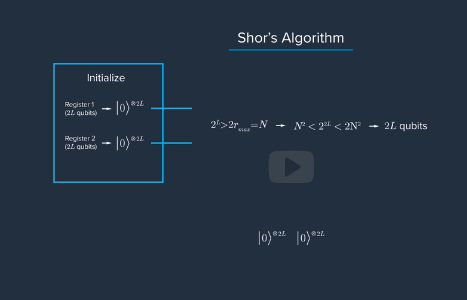

$$|0\rangle^{\otimes 2L}$$
$$2^{L} > 2r_{\text{total}} = N \rightarrow N^{2} < 2^{2L} < 2N^{2} \rightarrow 2L \text{ qubits}$$

# Shor's Algorithm

Same **Initialize** box as the previous frame:
- Register 1 (2L qubits) $\rightarrow$ $|0\rangle^{\otimes 2L}$
- Register 2 (2L qubits) $\rightarrow$ $|0\rangle^{\otimes 2L}$

Condition written to the right of the wires:

$$2^{L} > 2r_{\text{total}} = N \rightarrow N^{2} < 2^{2L} < 2N^{2} \rightarrow 2L \text{ qubits}$$

A play-button overlay sits in the middle of the frame. Below: $|0\rangle^{\otimes 2L}$ and $|0\rangle^{\otimes 2L}$.

The subscript on $r$ is small; it reads as "total".

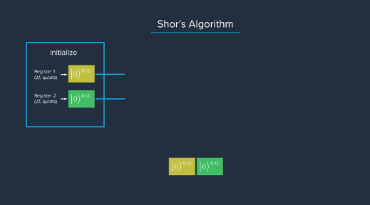

$$|0\rangle^{\otimes 2L}$$

# Shor's Algorithm

Blue box labeled **Initialize**:
- Register 1 (2L qubits) $\rightarrow$ yellow $|0\rangle^{\otimes 2L}$, wire continuing to the right.
- Register 2 (2L qubits) $\rightarrow$ green $|0\rangle^{\otimes 2L}$, wire continuing to the right.

Below the box, the same two kets sit side by side: yellow $|0\rangle^{\otimes 2L}$ and green $|0\rangle^{\otimes 2L}$.

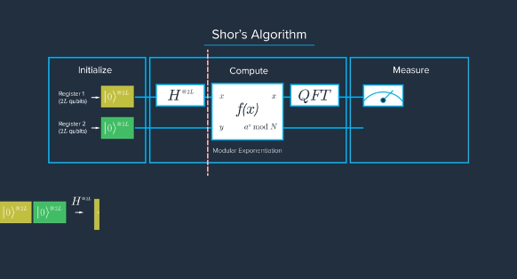

$$|0\rangle^{\otimes 2L}$$
$$H^{\otimes 2L}$$
$$y = a^{x} \bmod N$$

# Shor's Algorithm

Three-stage circuit, left to right: **Initialize**, **Compute**, **Measure**. A vertical dotted line separates Initialize from Compute.

**Initialize**
- Register 1 (2L qubits), yellow: $|0\rangle^{\otimes 2L}$
- Register 2 (2L qubits), green: $|0\rangle^{\otimes 2L}$

**Compute**
- $H^{\otimes 2L}$ on register 1
- Box $f(x)$ implementing modular exponentiation: upper rail labeled $x$, lower rail labeled $y$, with $a^{x} \bmod N$
- Caption under the box: Modular Exponentiation
- $QFT$ on the upper rail

**Measure**
- Meter symbol on the upper rail

Inset along the bottom: $|0\rangle^{\otimes 2L}$ (yellow) and $|0\rangle^{\otimes 2L}$ (green), then $H^{\otimes 2L}$ into a yellow segment.

## **Transcript**

0

00:00:00,000 \--\> 00:00:00,500

1

00:00:00,500 \--\> 00:00:03,510

In the last section, we looked at a specific implementation

2

00:00:03,510 \--\> 00:00:07,140

of public key cryptography\-- the RSA cryptosystem.

3

00:00:07,140 \--\> 00:00:10,500

The security of RSA is based on the use of a one-way function\--

4

00:00:10,500 \--\> 00:00:12,120

prime factorization\--

5

00:00:12,120 \--\> 00:00:14,550

which is related to the problem of period finding

6

00:00:14,550 \--\> 00:00:16,830

in modular exponentiation.

7

00:00:16,830 \--\> 00:00:20,640

As we saw, if one picks two prime numbers, p and q,

8

00:00:20,640 \--\> 00:00:23,670

which multiply together to give a modulus N,

9

00:00:23,670 \--\> 00:00:26,370

then one can efficiently find the modular exponentiation

10

00:00:26,370 \--\> 00:00:30,240

period r, and thus generate a public encryption key e

11

00:00:30,240 \--\> 00:00:32,670

and a private decryption key d.

12

00:00:32,670 \--\> 00:00:35,310

However, if we\'re just given the modulus N,

13

00:00:35,310 \--\> 00:00:36,780

then we\'re stuck, because there\'s

14

00:00:36,780 \--\> 00:00:39,360

no known efficient classical algorithm that

15

00:00:39,360 \--\> 00:00:42,000

lets us find the prime factors p and q,

16

00:00:42,000 \--\> 00:00:43,920

and so there\'s no efficient means to determine

17

00:00:43,920 \--\> 00:00:45,360

the period r.

18

00:00:45,360 \--\> 00:00:47,400

Thus, even if we reveal the modulus

19

00:00:47,400 \--\> 00:00:50,160

N and the public encryption key e,

20

00:00:50,160 \--\> 00:00:52,470

there is no known efficient way for an eavesdropper

21

00:00:52,470 \--\> 00:00:56,170

to calculate the private key d on a classical computer.

22

00:00:56,170 \--\> 00:00:58,710

However, if Eve has access to a quantum computer

23

00:00:58,710 \--\> 00:01:00,780

that can run Shor\'s Algorithm, then she

24

00:01:00,780 \--\> 00:01:04,830

can efficiently find the modular exponentiation period r.

25

00:01:04,830 \--\> 00:01:07,260

This is called order finding, and Shor\'s Algorithm

26

00:01:07,260 \--\> 00:01:10,440

finds the order r of a number a with respect

27

00:01:10,440 \--\> 00:01:13,080

to the modulus N, where a is the number that

28

00:01:13,080 \--\> 00:01:17,070

is raised to integer powers under modular exponentiation.

29

00:01:17,070 \--\> 00:01:19,290

With a means to efficiently determine r,

30

00:01:19,290 \--\> 00:01:21,480

Eve can calculate the prime numbers p

31

00:01:21,480 \--\> 00:01:24,570

and q and then derive the decryption key d,

32

00:01:24,570 \--\> 00:01:26,610

thus compromising RSA.

33

00:01:26,610 \--\> 00:01:29,280

In this section, we\'ll walk through Shor\'s Algorithm

34

00:01:29,280 \--\> 00:01:32,480

using the quantum circuit model presented in Course 1.

35

00:01:32,480 \--\> 00:01:34,440

We\'ll then continue with our simple example

36

00:01:34,440 \--\> 00:01:37,800

of modular exponentiation to see the connection between order

37

00:01:37,800 \--\> 00:01:39,930

finding and factorization.

38

00:01:39,930 \--\> 00:01:42,420

Let\'s begin with the initialization stage.

39

00:01:42,420 \--\> 00:01:45,240

We need two registers of qubits for Shor\'s Algorithm.

40

00:01:45,240 \--\> 00:01:47,280

Roughly speaking, Register 1 is used

41

00:01:47,280 \--\> 00:01:49,140

to store the results of a period finding

42

00:01:49,140 \--\> 00:01:51,690

protocol, which is implemented using the Quantum

43

00:01:51,690 \--\> 00:01:52,860

Fourier Transform.

44

00:01:52,860 \--\> 00:01:54,960

We\'ll discuss that one in a moment.

45

00:01:54,960 \--\> 00:01:57,180

Register 2 is used to store the values

46

00:01:57,180 \--\> 00:01:59,160

of the modular exponentiation.

47

00:01:59,160 \--\> 00:02:02,730

This is the function that will apply in the compute section.

48

00:02:02,730 \--\> 00:02:04,550

The number of qubits in the first register

49

00:02:04,550 \--\> 00:02:07,710

should generate a state space that is at least large enough

50

00:02:07,710 \--\> 00:02:10,139

to capture the maximum possible period,

51

00:02:10,139 \--\> 00:02:13,230

and do so at least twice to see it repeat.

52

00:02:13,230 \--\> 00:02:16,410

Let\'s define N as twice the maximum period.

53

00:02:16,410 \--\> 00:02:19,800

So we need at least L qubits, such that 2 to the L power

54

00:02:19,800 \--\> 00:02:21,406

is greater than N.

55

00:02:21,406 \--\> 00:02:24,450

Now, in fact, the more qubits we have, the more densely

56

00:02:24,450 \--\> 00:02:26,190

we can sample the solution space,

57

00:02:26,190 \--\> 00:02:29,340

and thereby reduce the error in determining the period.

58

00:02:29,340 \--\> 00:02:32,520

Here, we\'ll take 2L qubits for the first register.

59

00:02:32,520 \--\> 00:02:34,860

And for simplicity, we\'ll use the same number of qubits

60

00:02:34,860 \--\> 00:02:36,690

in the second register.

61

00:02:36,690 \--\> 00:02:39,400

By choosing 2L qubits, the number of states\--

62

00:02:39,400 \--\> 00:02:40,950

2 to the 2L power\--

63

00:02:40,950 \--\> 00:02:43,170

is greater than N squared.

64

00:02:43,170 \--\> 00:02:46,110

This guarantees that there are at least N terms contributing

65

00:02:46,110 \--\> 00:02:49,170

to the probability amplitude when estimating the period,

66

00:02:49,170 \--\> 00:02:51,480

even as the period r gets exponentially large,

67

00:02:51,480 \--\> 00:02:53,680

approaching N over 2.

68

00:02:53,680 \--\> 00:02:55,630

We prepare the qubits in state 0,

69

00:02:55,630 \--\> 00:02:57,700

which we denote with a superscripted tensor

70

00:02:57,700 \--\> 00:02:59,290

product, 2L.

71

00:02:59,290 \--\> 00:03:02,070

As we did in Course 1 for the Deutsch-Jozsa algorithm,

72

00:03:02,070 \--\> 00:03:04,630

we\'ll track the register states by color\--

73

00:03:04,630 \--\> 00:03:08,170

yellow for Register 1, and green for Register 2.

74

00:03:08,170 \--\> 00:03:09,670

And we\'ll track our current position

75

00:03:09,670 \--\> 00:03:12,400

within the algorithm using the vertical line.

76

00:03:12,400 \--\> 00:03:15,250

Next, at the compute stage, we use Hadamard gates

77

00:03:15,250 \--\> 00:03:18,280

to place the Register 1 qubits into an equal superposition

78

00:03:18,280 \--\> 00:03:19,300

state.

79

00:03:19,300 \--\> 00:03:22,150

We again use the superscripted tensor product notation

80

00:03:22,150 \--\> 00:03:24,040

to indicate that we apply a Hadamard

81

00:03:24,040 \--\> 00:03:26,770

gate to each of the 2L qubits.

82

00:03:26,770 \--\> 00:03:30,980

This puts each qubit into a superposition state, 0 plus 1.

83

00:03:30,980 \--\> 00:03:34,000

Multiplying out all 2L of these single qubit superposition

84

00:03:34,000 \--\> 00:03:38,290

states results in a single large equal superposition state

85

00:03:38,290 \--\> 00:03:40,360

with 2 to the 2L components.

86

00:03:40,360 \--\> 00:03:42,520

From a component with 2L qubits in state

87

00:03:42,520 \--\> 00:03:45,610

0 to a component with all qubits in state 1,

88

00:03:45,610 \--\> 00:03:48,140

and with all combinations in between.

89

00:03:48,140 \--\> 00:03:50,710

If we now number these components from 0 to 2

90

00:03:50,710 \--\> 00:03:54,520

to the 2L minus 1, we can rewrite the superposition state

91

00:03:54,520 \--\> 00:03:56,170

as a sum over x.

92

<!-- frame 3:56 · diagram · week2/media/media/image38.png -->

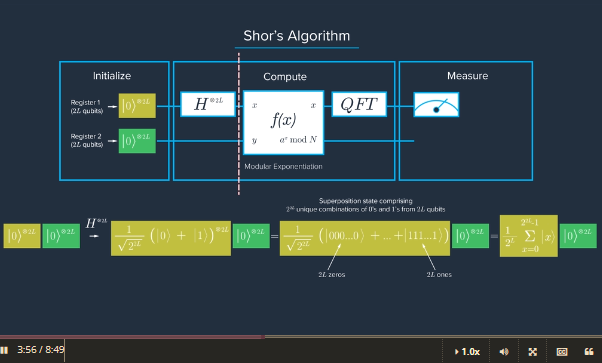

$$|0\rangle^{\otimes 2L} \xrightarrow{H^{\otimes 2L}} \frac{1}{\sqrt{2^{2L}}}\left(|0\rangle + |1\rangle\right)^{\otimes 2L}|0\rangle^{\otimes 2L}$$
$$= \frac{1}{\sqrt{2^{2L}}}\left(|000\ldots 0\rangle + \ldots + |111\ldots 1\rangle\right)|0\rangle^{\otimes 2L}$$
$$= \frac{1}{2^{L}} \sum_{x=0}^{2^{2L}-1} |x\rangle |0\rangle^{\otimes 2L}$$
$$y = a^{x} \bmod N$$

# Shor's Algorithm

Same three-stage circuit as the overview diagram.

**Initialize:** register 1 (2L qubits) $|0\rangle^{\otimes 2L}$ (yellow); register 2 (2L qubits) $|0\rangle^{\otimes 2L}$ (green).

**Compute:** $H^{\otimes 2L}$ on register 1; modular-exponentiation box $f(x)$ with upper rail $x$, lower rail $y$, and $a^{x} \bmod N$; then $QFT$ on the upper rail.

**Measure:** meter on the upper rail.

Bottom strip, captioned "Superposition state comprising $2^{2L}$ unique combinations of 0's and 1's from 2L qubits":

$$|0\rangle^{\otimes 2L}\,|0\rangle^{\otimes 2L} \xrightarrow{H^{\otimes 2L}} \frac{1}{\sqrt{2^{2L}}}\left(|0\rangle + |1\rangle\right)^{\otimes 2L}|0\rangle^{\otimes 2L}$$

$$= \frac{1}{\sqrt{2^{2L}}}\big(|000\ldots 0\rangle + \ldots + |111\ldots 1\rangle\big)|0\rangle^{\otimes 2L}$$

with "$2L$ zeros" under $|000\ldots 0\rangle$ and "$2L$ ones" under $|111\ldots 1\rangle$,

$$= \frac{1}{2^{L}} \sum_{x=0}^{2^{2L}-1} |x\rangle \, |0\rangle^{\otimes 2L}.$$

The second register stays $|0\rangle^{\otimes 2L}$ (green) through this expansion.

00:03:56,170 \--\> 00:03:58,930

In fact, each decimal number x corresponds

93

00:03:58,930 \--\> 00:04:03,970

to one of the binary numbers represented by the 2L qubits.

94

00:04:03,970 \--\> 00:04:06,310

Next, the function f is performed.

95

00:04:06,310 \--\> 00:04:09,160

f of x implements modular exponentiation, which

96

00:04:09,160 \--\> 00:04:12,880

outputs a number a to the x power modulo N.

97

<!-- frame 4:11 · diagram · week2/media/media/image45.png -->

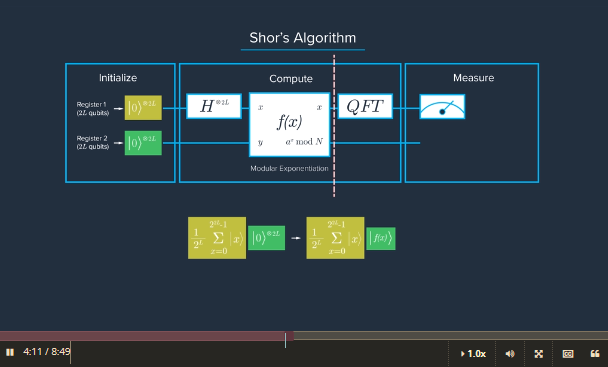

$$|0\rangle^{\otimes 2L}$$
$$H^{\otimes 2L}$$
$$a^{x}\bmod N$$
$$\frac{1}{2^{L}}\sum_{x=0}^{2^{2L}-1}|x\rangle\,|0\rangle^{\otimes 2L}\rightarrow\frac{1}{2^{L}}\sum_{x=0}^{2^{2L}-1}|x\rangle\,|f(x)\rangle$$

# Shor's Algorithm

Same three-stage circuit as the later frame (Initialize / Compute / Measure). The vertical dashed marker is between $f(x)$ and the QFT, i.e. just after modular exponentiation.

**Initialize**
- Register 1 (2L qubits) $\rightarrow |0\rangle^{\otimes 2L}$ (yellow)
- Register 2 (2L qubits) $\rightarrow |0\rangle^{\otimes 2L}$ (green)

**Compute**
- $H^{\otimes 2L}$ on register 1
- $f(x)$ with $x$ on top and $y$ on the bottom; $a^{x}\bmod N$ inside the box. Caption: Modular Exponentiation
- $QFT$ is to the right of the dashed line (not yet applied at this marker)

**Measure**
- Meter symbol, not yet reached

State under the circuit. Yellow is register 1, green is register 2:

$$\frac{1}{2^{L}}\sum_{x=0}^{2^{2L}-1}|x\rangle\,|0\rangle^{\otimes 2L}\;\rightarrow\;\frac{1}{2^{L}}\sum_{x=0}^{2^{2L}-1}|x\rangle\,|f(x)\rangle$$

00:04:12,880 \--\> 00:04:15,640

We won\'t present in detail how the modular exponentiation is

98

00:04:15,640 \--\> 00:04:17,477

implemented in a real circuit.

99

00:04:17,477 \--\> 00:04:19,060

In fact, there are multiple approaches

100

00:04:19,060 \--\> 00:04:22,240

to doing it based on reversible computing and multiplication

101

00:04:22,240 \--\> 00:04:23,230

algorithms.

102

00:04:23,230 \--\> 00:04:24,940

For our purposes here, we just note

103

00:04:24,940 \--\> 00:04:26,590

that this function can be implemented

104

00:04:26,590 \--\> 00:04:28,990

using ancilla qubits and that it\'s efficient,

105

00:04:28,990 \--\> 00:04:31,930

requiring a number of gates that scales only polynomially

106

00:04:31,930 \--\> 00:04:34,030

with the number of qubits.

107

00:04:34,030 \--\> 00:04:36,280

Now, the number a is chosen at random,

108

00:04:36,280 \--\> 00:04:38,170

and it must be co-prime with N. That

109

00:04:38,170 \--\> 00:04:41,800

is, it must have no common factors with N. The resulting

110

00:04:41,800 \--\> 00:04:43,570

output values from the function f

111

00:04:43,570 \--\> 00:04:46,240

are then stored in the Register 2 qubits.

112

00:04:46,240 \--\> 00:04:49,210

Since the values of the power x are taken from the qubits

113

00:04:49,210 \--\> 00:04:51,220

in the first register, implementing

114

00:04:51,220 \--\> 00:04:53,470

f of x makes a conditional connection

115

00:04:53,470 \--\> 00:04:57,190

between the qubits in Register 1 and those in Register 2.

116

00:04:57,190 \--\> 00:04:58,570

Although we ultimately won\'t need

117

00:04:58,570 \--\> 00:05:00,730

to measure the qubits in Register 2,

118

00:05:00,730 \--\> 00:05:03,460

this step sets the stage for quantum interference

119

00:05:03,460 \--\> 00:05:06,250

and quantum parallelism to occur in Register 1

120

00:05:06,250 \--\> 00:05:10,690

at the next step, which is the Quantum Fourier Transform.

121

00:05:10,690 \--\> 00:05:13,150

The Quantum Fourier Transform is a quantum version

122

00:05:13,150 \--\> 00:05:16,320

of the classical discrete time Fourier Transform.

123

00:05:16,320 \--\> 00:05:19,710

The classical Fourier Transform takes a vector of numbers, x\--

124

00:05:19,710 \--\> 00:05:22,960

often a digital sampling of a signal to be analyzed\--

125

00:05:22,960 \--\> 00:05:25,810

and transforms it to a vector of numbers, y, in the frequency

126

00:05:25,810 \--\> 00:05:26,890

domain.

127

00:05:26,890 \--\> 00:05:28,810

Periodic behavior in the time domain

128

00:05:28,810 \--\> 00:05:32,150

is more easily identified in the transformed frequency domain,

129

00:05:32,150 \--\> 00:05:33,760

which is why we do this.

130

00:05:33,760 \--\> 00:05:36,400

For example, a sine wave that oscillates in time

131

00:05:36,400 \--\> 00:05:40,120

with a specific frequency will transform to a large amplitude

132

00:05:40,120 \--\> 00:05:42,160

spike at plus or minus that frequency

133

<!-- frame 5:41 · slide · week2/media/media/image22.png -->

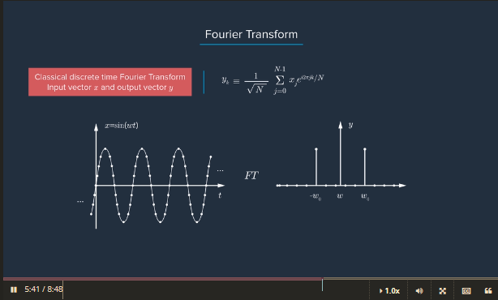

$$y_k \equiv \frac{1}{\sqrt{N}} \sum_{j=0}^{N-1} x_j e^{i 2\pi j k / N}$$

# Fourier Transform

Callout: Classical discrete time Fourier Transform. Input vector $x$ and output vector $y$.

$$y_k \equiv \frac{1}{\sqrt{N}} \sum_{j=0}^{N-1} x_j e^{i 2\pi j k / N}$$

Diagram: a sampled sinusoid labeled $x=\sin(\omega t)$ versus $t$, mapped by $FT$ to a line spectrum of $y$. Three impulses are labeled $-w_0$, $w$, and $w_0$; the central impulse sits on the vertical axis.

00:05:42,160 \--\> 00:05:44,020

in the transform domain.

134

00:05:44,020 \--\> 00:05:46,870

Thus, it\'s easy to identify the location of the spikes

135

00:05:46,870 \--\> 00:05:49,370

and then read off the frequency directly.

136

00:05:49,370 \--\> 00:05:51,520

And if we know a signal\'s frequency,

137

00:05:51,520 \--\> 00:05:53,830

then we also know its period, since the frequency

138

00:05:53,830 \--\> 00:05:55,790

is 1 over the period.

139

00:05:55,790 \--\> 00:05:57,520

Now, the Quantum Fourier Transform

140

00:05:57,520 \--\> 00:05:59,690

is essentially the same transformation,

141

00:05:59,690 \--\> 00:06:02,440

which is why we\'ll use it here for period finding.

142

00:06:02,440 \--\> 00:06:04,690

It takes a state j and transforms it

143

00:06:04,690 \--\> 00:06:08,260

to a superposition state with specific phase factors.

144

00:06:08,260 \--\> 00:06:11,860

If we start with a superposition state with coefficients xj,

145

00:06:11,860 \--\> 00:06:14,770

the transformed result is also a superposition state

146

00:06:14,770 \--\> 00:06:18,130

with coefficients yk, where the probability amplitudes

147

00:06:18,130 \--\> 00:06:21,130

yk are the classical discrete time Fourier

148

00:06:21,130 \--\> 00:06:24,610

Transform of the probability amplitudes xj.

149

<!-- frame 6:25 · slide · week2/media/media/image11.png -->

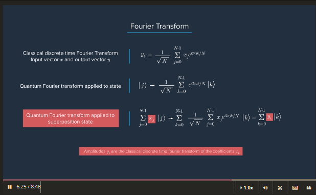

$$y_k = \frac{1}{\sqrt{N}}\sum_{j=0}^{N-1} x_j e^{i 2\pi jk/N}$$
$$|j\rangle \rightarrow \frac{1}{\sqrt{N}}\sum_{k=0}^{N-1} e^{i 2\pi jk/N}|k\rangle$$
$$\sum_{j=0}^{N-1} x_j |j\rangle \rightarrow \sum_{k=0}^{N-1}\frac{1}{\sqrt{N}}\sum_{j=0}^{N-1} x_j e^{i 2\pi jk/N}|k\rangle = \sum_{k=0}^{N-1} y_k |k\rangle$$

# Fourier Transform

**Classical discrete time Fourier Transform.** Input vector $x$ and output vector $y$.

$$y_k = \frac{1}{\sqrt{N}}\sum_{j=0}^{N-1} x_j e^{i 2\pi jk/N}$$

**Quantum Fourier transform applied to state**

$$|j\rangle \rightarrow \frac{1}{\sqrt{N}}\sum_{k=0}^{N-1} e^{i 2\pi jk/N}|k\rangle$$

**Quantum Fourier transform applied to superposition state** (highlighted)

$$\sum_{j=0}^{N-1} x_j |j\rangle \rightarrow \sum_{k=0}^{N-1}\frac{1}{\sqrt{N}}\sum_{j=0}^{N-1} x_j e^{i 2\pi jk/N}|k\rangle = \sum_{k=0}^{N-1} y_k |k\rangle$$

$x_j$ and $y_k$ are highlighted.

Banner: Amplitudes $y_k$ are the classical discrete time fourier transform of the coefficients $x_k$.

00:06:24,610 \--\> 00:06:27,370

And due to quantum parallelism and quantum interference,

150

00:06:27,370 \--\> 00:06:29,470

implementing the Quantum Fourier Transform

151

00:06:29,470 \--\> 00:06:31,960

is exponentially faster than implementing

152

00:06:31,960 \--\> 00:06:35,380

the classical fast Fourier Transform algorithm.

153

00:06:35,380 \--\> 00:06:38,020

Now, that sounds great, but there\'s an important catch

154

00:06:38,020 \--\> 00:06:40,060

related to quantum measurement.

155

00:06:40,060 \--\> 00:06:42,130

As you know, the measurement of a quantum state

156

00:06:42,130 \--\> 00:06:43,360

is probabilistic.

157

00:06:43,360 \--\> 00:06:45,820

Although the output of the Quantum Fourier Transform

158

00:06:45,820 \--\> 00:06:48,760

is a large superposition state with transformed probability

159

00:06:48,760 \--\> 00:06:52,600

amplitudes, we generally can\'t access those amplitudes.

160

00:06:52,600 \--\> 00:06:55,390

Our measurement projects out only a single state,

161

00:06:55,390 \--\> 00:06:57,550

and even if we identically prepare the system

162

00:06:57,550 \--\> 00:06:59,590

and measure it many times, we only

163

00:06:59,590 \--\> 00:07:01,090

learn about the magnitude squared

164

00:07:01,090 \--\> 00:07:02,770

of the corresponding coefficients.

165

00:07:02,770 \--\> 00:07:04,660

We lose the phase information.

166

00:07:04,660 \--\> 00:07:07,300

So we don\'t have access to the probability amplitudes

167

00:07:07,300 \--\> 00:07:08,920

in the quantum computer, and this

168

00:07:08,920 \--\> 00:07:10,870

is quite different from the classical Fourier

169

00:07:10,870 \--\> 00:07:12,850

Transform where the entire output

170

00:07:12,850 \--\> 00:07:16,270

vector of complex numbers can be directly read.

171

00:07:16,270 \--\> 00:07:18,040

Thus, the Quantum Fourier Transform

172

00:07:18,040 \--\> 00:07:20,050

is most useful in problems where there\'s

173

00:07:20,050 \--\> 00:07:22,120

a unique period or phase that can

174

00:07:22,120 \--\> 00:07:24,070

be found with high probability.

175

00:07:24,070 \--\> 00:07:26,560

For now, let\'s return to Shor\'s Algorithm.

176

00:07:26,560 \--\> 00:07:28,900

The Quantum Fourier Transform is applied here

177

00:07:28,900 \--\> 00:07:31,270

to the qubits in Register 1, and it

178

00:07:31,270 \--\> 00:07:33,400

imparts specific phase factors that

179

00:07:33,400 \--\> 00:07:35,860

are related to both x and z.

180

00:07:35,860 \--\> 00:07:38,320

That is, they\'re related to both the coefficients

181

00:07:38,320 \--\> 00:07:42,010

of the qubits on Register 1 and the modular exponentiation

182

00:07:42,010 \--\> 00:07:44,200

stored on Register 2.

183

00:07:44,200 \--\> 00:07:47,470

The phase sampling increment is represented here by omega,

184

00:07:47,470 \--\> 00:07:50,870

and it\'s the phase 2 pi divided by the total number of states\--

185

00:07:50,870 \--\> 00:07:52,720

2 to the 2L power.

186

00:07:52,720 \--\> 00:07:55,360

Here we can see that increasing the number of qubits

187

00:07:55,360 \--\> 00:07:57,820

will reduce the step size, and thus the error

188

00:07:57,820 \--\> 00:07:59,770

in estimating the actual period.

189

00:07:59,770 \--\> 00:08:01,690

Essentially, more qubits will more

190

00:08:01,690 \--\> 00:08:05,480

densely sample the phases that represent the period.

191

00:08:05,480 \--\> 00:08:08,110

Lastly, we measure the qubits in Register 1.

192

00:08:08,110 \--\> 00:08:11,410

The projected state that results is a binary value of z,

193

00:08:11,410 \--\> 00:08:15,660

and its decimal value is equal to or an integer multiple of 2

194

00:08:15,660 \--\> 00:08:18,400

to the 2Lth power divided by r.

195

00:08:18,400 \--\> 00:08:20,290

Thus, it can be used to find the period

196

<!-- frame 8:19 · diagram · week2/media/media/image41.png -->

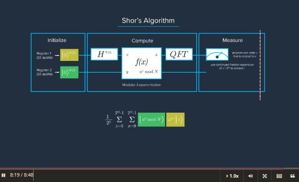

$$|0\rangle^{\otimes 2L}$$
$$H^{\otimes 2L}$$
$$a^{x}\bmod N$$
$$\frac{1}{2^{L}}\sum_{z=0}^{2^{2L}-1}\sum_{x=0}^{2^{2L}-1}\left|a^{x}\bmod N\right\rangle\,\omega^{xz}|z\rangle$$

# Shor's Algorithm

Three-stage circuit. A vertical dashed line sits to the right of Measure. Register 1 is yellow; register 2 is green.

**Initialize**
- Register 1 (2L qubits) $\rightarrow |0\rangle^{\otimes 2L}$ (yellow)
- Register 2 (2L qubits) $\rightarrow |0\rangle^{\otimes 2L}$ (green)

**Compute**
- $H^{\otimes 2L}$ on register 1
- Box $f(x)$: input $x$ on the top wire and $y$ on the bottom wire; inside the box, $a^{x}\bmod N$. Caption: Modular Exponentiation
- Then $QFT$ on the top wire

**Measure**
- Meter symbol
- "projects one state $z$ that is related to $r$"
- "use continued fraction expansion of $z/2^{2L}$ to extract $r$"

State written under the circuit (green ket, then yellow ket):

$$\frac{1}{2^{L}}\sum_{z=0}^{2^{2L}-1}\sum_{x=0}^{2^{2L}-1}\left|a^{x}\bmod N\right\rangle\,\omega^{xz}|z\rangle$$

00:08:20,290 \--\> 00:08:24,130

r using a continued fraction expansion of z divided

197

00:08:24,130 \--\> 00:08:25,867

by 2 to the 2L.

198

00:08:25,867 \--\> 00:08:27,700

You can learn more about the Quantum Fourier

199

00:08:27,700 \--\> 00:08:29,920

Transform and related topics in the text

200

00:08:29,920 \--\> 00:08:31,780

units following this video.

201

00:08:31,780 \--\> 00:08:34,510

And in the next video, we\'ll take a closer look

202

00:08:34,510 \--\> 00:08:36,730

at how the Quantum Fourier Transform mediates

203

00:08:36,730 \--\> 00:08:39,640

the quantum interference terms that constructively converge

204

00:08:39,640 \--\> 00:08:42,420

to estimates for the period r.

205

00:08:42,420 \--\> 00:08:46,443

Section

# Factoring with a quantum computer: How Shor\'s algorithm works 

## **Learn**

In the last video, you saw how Shor\'s Algorithm is implemented within
the circuit model for quantum computing. In this video, you will learn
more about one critical step in the algorithm \-- the application of the
quantum fourier transform.

## **Images**

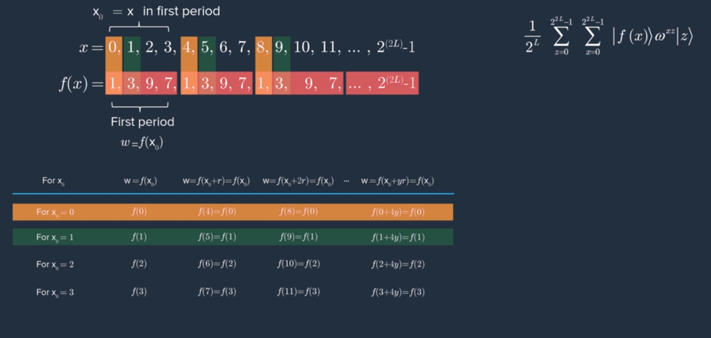

$$x = 0,1,2,3,4,5,6,7,8,9,10,11,\ldots,2^{(2L)}-1$$
$$f(x) = 1,3,9,7,1,3,9,7,1,3,9,7,\ldots,2^{(2L)}-1$$
$$w = f(x_0)$$
$$\frac{1}{2^{L}}\sum_{z=0}^{2^{2L}-1}\sum_{x=0}^{2^{2L}-1}|f(x)\rangle\,\omega^{xz}|z\rangle$$
$$w = f(x_0+yr)=f(x_0)$$

Period example for a modular function, with color highlighting.

Brace labeled **$x_0 = x$ in first period** over the first block of $x$ values.

$x = 0, 1, 2, 3, 4, 5, 6, 7, 8, 9, 10, 11, \ldots, 2^{(2L)}-1$

Highlighted $x$ cells: 0 and 4 and 8 orange; 1 and 5 and 9 green.

$f(x) = 1, 3, 9, 7, 1, 3, 9, 7, 1, 3, 9, 7, \ldots, 2^{(2L)}-1$

The $f(x)$ values are shaded in repeating red/orange groups of four. Brace under the first four values labeled **First period**, with $w = f(x_0)$ underneath.

Right-hand state:

$$\frac{1}{2^{L}}\sum_{z=0}^{2^{2L}-1}\sum_{x=0}^{2^{2L}-1}|f(x)\rangle\,\omega^{xz}|z\rangle$$

Table. Header: For $x_0$ | $w=f(x_0)$ | $w=f(x_0+r)=f(x_0)$ | $w=f(x_0+2r)=f(x_0)$ | $\ldots$ | $w=f(x_0+yr)=f(x_0)$

- Orange, For $x_0=0$: $f(0)$, $f(4)=f(0)$, $f(8)=f(0)$, $f(0+4y)=f(0)$
- Green, For $x_0=1$: $f(1)$, $f(5)=f(1)$, $f(9)=f(1)$, $f(1+4y)=f(1)$
- For $x_0=2$: $f(2)$, $f(6)=f(2)$, $f(10)=f(2)$, $f(2+4y)=f(2)$
- For $x_0=3$: $f(3)$, $f(7)=f(3)$, $f(11)=f(3)$, $f(3+4y)=f(3)$

## **Transcript**

0

00:00:00,000 \--\> 00:00:00,500

1

00:00:00,500 \--\> 00:00:02,670

In the last video, we presented Shor\'s Algorithm

2

00:00:02,670 \--\> 00:00:05,310

in the context of the quantum circuit model.

3

00:00:05,310 \--\> 00:00:07,290

We used two registers of qubits.

4

00:00:07,290 \--\> 00:00:10,710

Register 1 was used to store the results of period finding,

5

00:00:10,710 \--\> 00:00:12,900

and Register 2 was used to store the values

6

00:00:12,900 \--\> 00:00:15,660

of the modular exponentiation function.

7

00:00:15,660 \--\> 00:00:18,570

We then applied the Quantum Fourier Transform to Register 1

8

00:00:18,570 \--\> 00:00:20,460

and measured the output.

9

00:00:20,460 \--\> 00:00:21,960

The projected state that resulted

10

00:00:21,960 \--\> 00:00:25,020

was a binary value of z, and its decimal value

11

00:00:25,020 \--\> 00:00:29,520

was an integer multiple of 2 to the 2L divided by r.

12

00:00:29,520 \--\> 00:00:32,159

This, in turn, can be used to find the period r using

13

00:00:32,159 \--\> 00:00:34,530

a continued fraction expansion.

14

00:00:34,530 \--\> 00:00:36,330

In this video, we\'ll take a closer

15

00:00:36,330 \--\> 00:00:38,430

look at how the Quantum Fourier Transform

16

00:00:38,430 \--\> 00:00:40,290

and the resulting quantum interference

17

00:00:40,290 \--\> 00:00:43,080

lead us to this result. To see how this works,

18

00:00:43,080 \--\> 00:00:47,520

we need to rewrite the sum over x as a combination of two sums.

19

00:00:47,520 \--\> 00:00:50,070

We can use our example of a equal 3 and N

20

00:00:50,070 \--\> 00:00:54,030

equal 10, which we saw has a period r equal 4.

21

00:00:54,030 \--\> 00:00:59,020

We want to sum over all x from 0 to 2 to the 2L power minus 1.

22

00:00:59,020 \--\> 00:01:00,780

The corresponding function f of x\--

23

00:01:00,780 \--\> 00:01:02,610

the modular exponentiation\--

24

00:01:02,610 \--\> 00:01:05,400

is calculated for several values of x, and the period

25

00:01:05,400 \--\> 00:01:07,000

is, indeed, 4.

26

00:01:07,000 \--\> 00:01:10,260

Let\'s call the values of x in the first period x0,

27

00:01:10,260 \--\> 00:01:14,040

and the resulting values of the function f we\'ll call w.

28

00:01:14,040 \--\> 00:01:16,530

We see that w has only four unique values

29

00:01:16,530 \--\> 00:01:20,520

and that it repeats for values of x equal to x0 plus integer

30

00:01:20,520 \--\> 00:01:22,560

multiples of the period r.

31

00:01:22,560 \--\> 00:01:27,480

That is, x0 plus y times r, where we use y as the integer.

32

00:01:27,480 \--\> 00:01:31,710

And for a given x0, the function f of x0 plus y r

33

00:01:31,710 \--\> 00:01:36,090

is the same value, as indicated in orange for x0 equals 0.

34

00:01:36,090 \--\> 00:01:39,240

We can see the same behavior for x0 equals 1 in green,

35

00:01:39,240 \--\> 00:01:43,410

x0 equals 2 in blue, and x0 equals 3 in gray.

36

00:01:43,410 \--\> 00:01:47,130

And we see that in doing this for the four values of x0,

37

00:01:47,130 \--\> 00:01:49,710

we\'ve covered all values of x.

38

00:01:49,710 \--\> 00:01:51,900

Thus, we can rewrite the sum over x

39

00:01:51,900 \--\> 00:01:54,390

as a sum over the four values of x0

40

00:01:54,390 \--\> 00:01:57,840

and a sum over the integer y, which runs from 0 to 2

41

00:01:57,840 \--\> 00:02:00,270

to the Lth power divided by r.

42

00:02:00,270 \--\> 00:02:04,260

Together, these two sums run over all x values from 0 to 2

43

00:02:04,260 \--\> 00:02:06,240

to the L minus 1.

44

00:02:06,240 \--\> 00:02:08,250

Writing in this way enables us to see

45

00:02:08,250 \--\> 00:02:10,539

how the quantum interference occurs with these phase

46

00:02:10,539 \--\> 00:02:12,830

vectors.

47

00:02:12,830 \--\> 00:02:15,440

We first replace omega with its explicit value,

48

00:02:15,440 \--\> 00:02:19,430

e to the power i times 2 pi over 2 to the 2L.

49

00:02:19,430 \--\> 00:02:21,600

And there are two phase factors here.

50

00:02:21,600 \--\> 00:02:24,140

The first is a fixed phase offset independent

51

00:02:24,140 \--\> 00:02:25,370

of the sum over y.

52

00:02:25,370 \--\> 00:02:27,650

It will rotate the phase of any net result that

53

00:02:27,650 \--\> 00:02:29,450

survives the sum.

54

00:02:29,450 \--\> 00:02:32,030

The second is the quantum interference phase related

55

00:02:32,030 \--\> 00:02:34,400

to the sum over y itself.

56

00:02:34,400 \--\> 00:02:38,120

This sum is performed for every value of x0 and z,

57

00:02:38,120 \--\> 00:02:41,150

and it\'s essentially a test to see if the value of z

58

00:02:41,150 \--\> 00:02:45,620

is related to the period r when starting from a value x0.

59

00:02:45,620 \--\> 00:02:47,690

The sum over y adds together vectors

60

00:02:47,690 \--\> 00:02:53,100

with specific phases related to x0, z, r, and y.

61

00:02:53,100 \--\> 00:02:57,370

Now, in most cases, these phases are not multiples of 2 pi,

62

00:02:57,370 \--\> 00:02:59,090

and so the corresponding vectors,

63

00:02:59,090 \--\> 00:03:01,160

according to their individual phases,

64

00:03:01,160 \--\> 00:03:03,650

end up pointing in various directions, more or less

65

00:03:03,650 \--\> 00:03:06,450

uniformly distributed around the unit circle.

66

00:03:06,450 \--\> 00:03:08,120

Since they point in all directions,

67

00:03:08,120 \--\> 00:03:11,330

adding these vectors together gives a net result of 0,

68

00:03:11,330 \--\> 00:03:13,670

and this is another example of destructive quantum

69

00:03:13,670 \--\> 00:03:15,080

interference.

70

00:03:15,080 \--\> 00:03:17,600

Now, for a few specific cases where

71

00:03:17,600 \--\> 00:03:20,570

z is related to r through x0, the phases

72

00:03:20,570 \--\> 00:03:22,610

are a multiple of 2 pi.

73

00:03:22,610 \--\> 00:03:24,950

When this is true, the corresponding vectors will

74

00:03:24,950 \--\> 00:03:27,710

always point in the same direction\-- to the right\--

75

00:03:27,710 \--\> 00:03:30,200

and thus add together constructively.

76

00:03:30,200 \--\> 00:03:33,450

There are 2 to the 2L divided by r unit vectors,

77

00:03:33,450 \--\> 00:03:37,190

and so the sum is 2 to the 2L divided by r.

78

00:03:37,190 \--\> 00:03:40,790

Mathematically, the sum over y is a geometric sum.

79

00:03:40,790 \--\> 00:03:42,950

I encourage you to calculate this for yourself

80

00:03:42,950 \--\> 00:03:46,430

and find the condition which yields non-0 values.

81

00:03:46,430 \--\> 00:03:47,930

You\'ll find the resulting condition

82

00:03:47,930 \--\> 00:03:52,480

is that 2 pi over 2 to the 2L times z times r

83

00:03:52,480 \--\> 00:03:55,250

is 2 pi times an integer, d.

84

00:03:55,250 \--\> 00:03:58,190

Thus, it occurs when z equals d times 2

85

00:03:58,190 \--\> 00:04:00,650

to the 2 L divided by r.

86

00:04:00,650 \--\> 00:04:03,050

If we plot the probability at the output of the Quantum

87

00:04:03,050 \--\> 00:04:05,360

Fourier Transform, we find a series

88

00:04:05,360 \--\> 00:04:08,440

of spikes that occur when z equals d times 2

89

00:04:08,440 \--\> 00:04:10,280

to the 2L over r.

90

00:04:10,280 \--\> 00:04:12,710

The probability of measuring any one of these spikes

91

00:04:12,710 \--\> 00:04:16,279

is 1 over r, since there are r spikes between 0 and 2

92

00:04:16,279 \--\> 00:04:17,899

to the 2L over r.

93

00:04:17,899 \--\> 00:04:21,019

This is for a specific value of x0.

94

00:04:21,019 \--\> 00:04:23,900

Whichever one of these spikes we measure, the projected state

95

00:04:23,900 \--\> 00:04:27,410

z with value d times 2 to the 2L over r

96

00:04:27,410 \--\> 00:04:30,680

can be used to find the period r using a continued fraction

97

00:04:30,680 \--\> 00:04:32,450

expansion procedure.

98

00:04:32,450 \--\> 00:04:34,670

We won\'t discuss here in detail how that\'s done.

99

<!-- frame 4:35 · slide · week2/media/media/image49.png -->

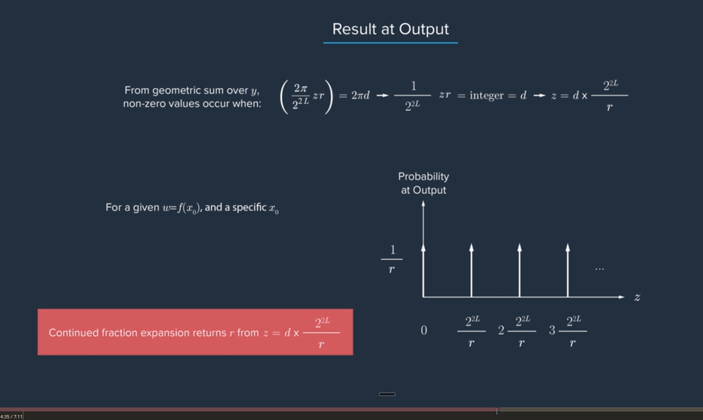

$$\left(\frac{2\pi}{2^{2L}}zr\right)=2\pi d \longrightarrow \frac{1}{2^{2L}}zr=\mathrm{integer}=d \longrightarrow z=d\times\frac{2^{2L}}{r}$$
$$w=f(x_0)$$
$$z=d\times\frac{2^{2L}}{r}$$

# Result at Output

From geometric sum over $y$, non-zero values occur when:

$$\left(\frac{2\pi}{2^{2L}}zr\right)=2\pi d \longrightarrow \frac{1}{2^{2L}}zr=\mathrm{integer}=d \longrightarrow z=d\times\frac{2^{2L}}{r}$$

For a given $w=f(x_0)$, and a specific $x_0$.

**Probability at Output** (plot): vertical axis unlabeled except the spike height $1/r$; horizontal axis $z$. Equal-height spikes at

$$0,\quad \frac{2^{2L}}{r},\quad 2\frac{2^{2L}}{r},\quad 3\frac{2^{2L}}{r},\quad \ldots$$

Pink box: Continued fraction expansion returns $r$ from $z=d\times\dfrac{2^{2L}}{r}$.

00:04:34,670 \--\> 00:04:36,680

We just note that it\'s a known algorithm and it

100

00:04:36,680 \--\> 00:04:39,920

can be effectively performed on a classical computer.

101

00:04:39,920 \--\> 00:04:42,980

Now, we just saw how Shor\'s Algorithm can find the period

102

00:04:42,980 \--\> 00:04:47,120

r, but how is this connected to the factoring problem in RSA?

103

00:04:47,120 \--\> 00:04:50,210

Again, we\'ll take our example with N equal 10.

104

00:04:50,210 \--\> 00:04:52,160

We want to find the prime factors p

105

00:04:52,160 \--\> 00:04:55,550

and q that, multiplied together, equal 10.

106

00:04:55,550 \--\> 00:04:57,970

To do this, we randomly pick a number, a,

107

00:04:57,970 \--\> 00:05:00,620

that\'s smaller than N and relatively prime.

108

00:05:00,620 \--\> 00:05:02,630

That is, their Greatest Common Divisor\--

109

00:05:02,630 \--\> 00:05:04,640

GCD\-- is unity.

110

00:05:04,640 \--\> 00:05:06,930

We\'ll again choose a equal 3.

111

00:05:06,930 \--\> 00:05:09,200

We then use Shor\'s Algorithm to find the period

112

00:05:09,200 \--\> 00:05:11,410

of a to the x modulo N.

113

00:05:11,410 \--\> 00:05:14,090

Shor\'s Algorithm, with classical post-processing,

114

00:05:14,090 \--\> 00:05:17,060

will efficiently give us the period r equal 4.

115

00:05:17,060 \--\> 00:05:19,820

Before proceeding, we need to do a couple checks.

116

00:05:19,820 \--\> 00:05:22,280

First, r must be an even number.

117

00:05:22,280 \--\> 00:05:24,680

And second, we need to ensure that a

118

00:05:24,680 \--\> 00:05:29,150

to the r over 2 power plus 1 does not equal 0 modulo N.

119

00:05:29,150 \--\> 00:05:30,980

If we fail either of these tests,

120

00:05:30,980 \--\> 00:05:34,370

we need to go back to step 1 and pick another value of a.

121

00:05:34,370 \--\> 00:05:36,020

But in our case here, we\'re OK.

122

<!-- frame 5:36 · slide · week2/media/media/image25.png -->

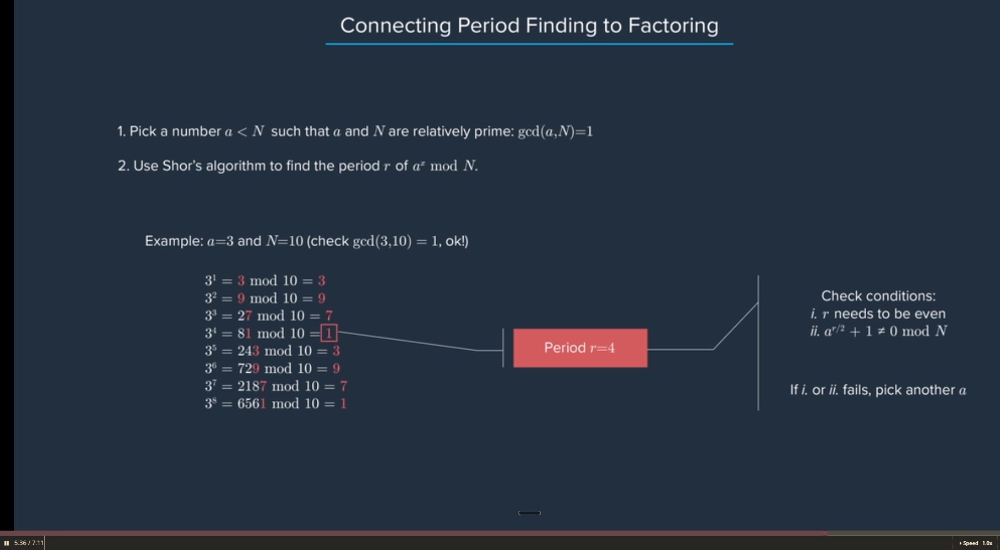

$$\gcd(a,N)=1$$
$$a^{x} \bmod N$$
$$\gcd(3,10)=1$$
$$3^{1} = 3 \bmod 10 = 3$$
$$3^{2} = 9 \bmod 10 = 9$$
$$3^{3} = 27 \bmod 10 = 7$$
$$3^{4} = 81 \bmod 10 = 1$$
$$3^{5} = 243 \bmod 10 = 3$$
$$3^{6} = 729 \bmod 10 = 9$$
$$3^{7} = 2187 \bmod 10 = 7$$
$$3^{8} = 6561 \bmod 10 = 1$$
$$a^{r/2} + 1 \neq 0 \bmod N$$

# Connecting Period Finding to Factoring

1. Pick a number $a < N$ such that $a$ and $N$ are relatively prime: $\gcd(a,N)=1$
2. Use Shor's algorithm to find the period $r$ of $a^{x} \bmod N$.

Example: $a=3$ and $N=10$ (check $\gcd(3,10) = 1$, ok!)

The units digit of each power is highlighted, matching the residue mod 10:

$$
\begin{align}
3^{1} &= 3 \bmod 10 = 3 \\
3^{2} &= 9 \bmod 10 = 9 \\
3^{3} &= 27 \bmod 10 = 7 \\
3^{4} &= 81 \bmod 10 = 1 \\
3^{5} &= 243 \bmod 10 = 3 \\
3^{6} &= 729 \bmod 10 = 9 \\
3^{7} &= 2187 \bmod 10 = 7 \\
3^{8} &= 6561 \bmod 10 = 1
\end{align}
$$

The result $1$ of $3^{4}$ is boxed and linked to a callout **Period $r=4$**.

Check conditions:
- $i.$ $r$ needs to be even
- $ii.$ $a^{r/2} + 1 \neq 0 \bmod N$

If $i.$ or $ii.$ fails, pick another $a$.

00:05:36,020 \--\> 00:05:39,350

For a equal 3 and r equal 4, both conditions check,

123

00:05:39,350 \--\> 00:05:41,270

and we can proceed.

124

00:05:41,270 \--\> 00:05:43,880

We know that a to the r equals 1 modulo N,

125

00:05:43,880 \--\> 00:05:46,940

as this is a property of modular exponentiation.

126

00:05:46,940 \--\> 00:05:50,720

We can rewrite this expression as a to the r-th power minus 1

127

00:05:50,720 \--\> 00:05:53,600

equals k times N for an integer, k.

128

00:05:53,600 \--\> 00:05:57,410

We then replace N with the unknown prime factors p and q,

129

00:05:57,410 \--\> 00:06:01,070

and we factor the left-hand side to yield a to the r over 2

130

00:06:01,070 \--\> 00:06:04,880

minus 1 times a to the r over 2 plus 1.

131

00:06:04,880 \--\> 00:06:06,500

It follows, then, that p and q can

132

00:06:06,500 \--\> 00:06:08,810

be found from the greatest common divisor

133

00:06:08,810 \--\> 00:06:13,220

of a to the power r over 2 plus or minus 1 and N.

134

00:06:13,220 \--\> 00:06:15,170

Let\'s take them one at a time.

135

00:06:15,170 \--\> 00:06:17,420

a to the power r over 2 minus 1 is 8.

136

00:06:17,420 \--\> 00:06:21,290

And so the greatest common divisor of 8 and 10 is 2,

137

00:06:21,290 \--\> 00:06:23,610

so p equals 2.

138

00:06:23,610 \--\> 00:06:26,980

Then a to the r over 2 plus 1 is 10,

139

00:06:26,980 \--\> 00:06:29,630

and so the greatest common divisor of 10 and 10

140

00:06:29,630 \--\> 00:06:33,390

that\'s not trivial is 5, so q will equal 5.

141

00:06:33,390 \--\> 00:06:36,390

Therefore, p equals 2, q equals 5\--

142

<!-- frame 6:35 · slide · week2/media/media/image48.png -->

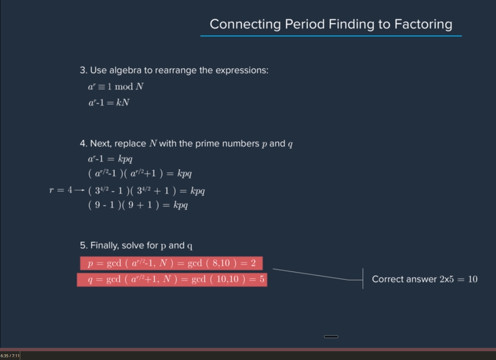

$$a^{r}\equiv 1\bmod N$$
$$a^{r}-1=kN$$
$$a^{r}-1=kpq$$
$$(a^{r/2}-1)(a^{r/2}+1)=kpq$$
$$r=4\rightarrow(3^{4/2}-1)(3^{4/2}+1)=kpq$$
$$(9-1)(9+1)=kpq$$
$$p=\gcd(a^{r/2}-1,N)=\gcd(8,10)=2$$
$$q=\gcd(a^{r/2}+1,N)=\gcd(10,10)=5$$

# Connecting Period Finding to Factoring

3. Use algebra to rearrange the expressions:

$$a^{r}\equiv 1 \bmod N$$
$$a^{r}-1=kN$$

4. Next, replace $N$ with the prime numbers $p$ and $q$

$$a^{r}-1=kpq$$
$$(a^{r/2}-1)(a^{r/2}+1)=kpq$$
$$r=4\rightarrow(3^{4/2}-1)(3^{4/2}+1)=kpq$$
$$(9-1)(9+1)=kpq$$

5. Finally, solve for $p$ and $q$ (both lines highlighted in red)

$$p=\gcd(a^{r/2}-1,N)=\gcd(8,10)=2$$
$$q=\gcd(a^{r/2}+1,N)=\gcd(10,10)=5$$

Callout, with a leader line to the red box: Correct answer $2\times 5=10$.

00:06:36,390 \--\> 00:06:40,140

both are prime numbers, and p times q equals 10.

143

00:06:40,140 \--\> 00:06:43,080

Now, this is, of course, a very simple example,

144

00:06:43,080 \--\> 00:06:45,380

but it illustrates how Shor\'s Algorithm and period

145

00:06:45,380 \--\> 00:06:49,010

finding can be used to calculate prime numbers p and q,

146

00:06:49,010 \--\> 00:06:51,590

and thus calculate the private decryption key

147

00:06:51,590 \--\> 00:06:54,530

and compromise the RSA cryptosystem.

148

00:06:54,530 \--\> 00:06:56,360

More details and background information

149

00:06:56,360 \--\> 00:06:59,210

related to these topics can be found in the following text

150

00:06:59,210 \--\> 00:07:02,260

units and also in the Deep Dive on Shor\'s Algorithm

151

00:07:02,260 \--\> 00:07:04,850

from Professor Peter Shor.

152

00:07:04,850 \--\> 00:07:10,368

*Erratum: An example of period finding is given in the video with a=3,
N=10 and r=4. At 5:30 in the video two checks are presented, and **a=3
and r=4** are said to satisfy both checks. **These values however do not
satisfy the second condition that a\^{r/2} + 1 ≠ 0 mod 10.** If instead
we use **a=7, N=15, and r=4**, we do **satisfy the two conditions** and
find the correct factorization.*

## **Practice (no practice in this page)**

Section

# Quantum Fourier Transform

## **Learn**

**The following reading is optional for learners who want to learn a bit
more about the Quantum Fourier Transform (QFT).**

The Quantum Fourier Transform (QFT) is a critical operation used in
quantum computing protocols including period finding and phase
estimation. For example, in the period finding protocol, the input state
encodes a sequence with an underlying periodic structure, and, following
the application of the QFT, the output encodes the period of the
sequence.

The QFT is a unitary linear transformation implemented with a series of
quantum gates. It maps an -qubit quantum state as

$$|j\rangle \rightarrow \frac{1}{\sqrt{N}}\sum_{k=0}^{N-1}\exp\left(i\frac{2\pi}{N}jk\right)|k\rangle,$$

Quantum Fourier transform of a basis state:

$$|j\rangle \rightarrow \frac{1}{\sqrt{N}}\sum_{k=0}^{N-1}\exp\left(i\frac{2\pi}{N}jk\right)|k\rangle,$$

where is a constant defined by the number of qubits , and and go from 0
to .

Note that the input quantum state can be written as where is a decimal
number spanning to (as above), or, equivalently, it can be written as a
binary number , where each take the value 0 or 1. As short-hand
notation, this is sometimes written as the decimal value, e.g. or .

In addition to knowing the mapping of the Quantum Fourier Transform, you
also need to know how to implement it. For a single-qubit, the mapping
of the QFT is:

$$|0\rangle \rightarrow \frac{1}{\sqrt{2^{1}}}\sum_{k=0}^{2^{1}-1}\exp\left(i\frac{2\pi}{2^{1}}0\times k\right)|k\rangle = \frac{|0\rangle+|1\rangle}{\sqrt{2}},$$
$$|1\rangle \rightarrow \frac{1}{\sqrt{2^{1}}}\sum_{k=0}^{2^{1}-1}\exp\left(i\frac{2\pi}{2^{1}}1\times k\right)|k\rangle = \frac{|0\rangle-|1\rangle}{\sqrt{2}},$$
$$H = \frac{1}{\sqrt{2}}\begin{pmatrix}1&1\\1&-1\end{pmatrix}.$$
$$\frac{|0\rangle+\exp(2\pi i\,0.j_{1})|1\rangle}{\sqrt{2}}$$

$$|0\rangle \rightarrow \frac{1}{\sqrt{2^{1}}}\sum_{k=0}^{2^{1}-1}\exp\left(i\frac{2\pi}{2^{1}}0\times k\right)|k\rangle = \frac{|0\rangle+|1\rangle}{\sqrt{2}},$$

$$|1\rangle \rightarrow \frac{1}{\sqrt{2^{1}}}\sum_{k=0}^{2^{1}-1}\exp\left(i\frac{2\pi}{2^{1}}1\times k\right)|k\rangle = \frac{|0\rangle-|1\rangle}{\sqrt{2}},$$

As you learned on Course 1, this transformation corresponds to a Hadamard gate,

$$H = \frac{1}{\sqrt{2}}\begin{pmatrix}1&1\\1&-1\end{pmatrix}.$$

The figure below shows a graphical representation of the Quantum Fourier Transform for a single-qubit system (the notation $0.j_1$ in the exponent is a binary representation that will be introduced below).

Diagram: single-qubit INPUT state $|j_1\rangle$ enters a $QFT$ box. Single-qubit OUTPUT state:

$$\frac{|0\rangle+\exp(2\pi i\,0.j_{1})|1\rangle}{\sqrt{2}}$$

To understand how the Quantum Fourier Transformation works, let's analyze the two-qubit case, $n = 2$. The state $|j\rangle$ transforms to:

$$|j\rangle \rightarrow \frac{1}{\sqrt{2^{2}}}\sum_{k=0}^{2^{2}-1}\exp\left(i\frac{2\pi}{2^{2}}jk\right)|k\rangle,$$
$$= \frac{1}{\sqrt{2^{2}}}\left(\exp\left(i\frac{2\pi}{2^{2}}j\times 0\right)|0\rangle+\exp\left(i\frac{2\pi}{2^{2}}j\times 1\right)|1\rangle+\exp\left(i\frac{2\pi}{2^{2}}j\times 2\right)|2\rangle+\exp\left(i\frac{2\pi}{2^{2}}j\times 3\right)|3\rangle\right),$$
$$\frac{|0\rangle+|1\rangle}{\sqrt{2}}.$$
$$|00\ldots 0\rangle \rightarrow \frac{|0\rangle+|1\rangle}{\sqrt{2}}\otimes\frac{|0\rangle+|1\rangle}{\sqrt{2}}\otimes\cdots\otimes\frac{|0\rangle+|1\rangle}{\sqrt{2}}.$$
$$\frac{1}{\sqrt{2^{2}}}(|0\rangle+|1\rangle+|2\rangle+|3\rangle)$$
$$\frac{1}{\sqrt{2^{2}}}\left(|0\rangle+\exp\left(\frac{1}{2}i\pi\right)|1\rangle+\exp\left(i\pi\right)|2\rangle+\exp\left(\frac{3}{2}i\pi\right)|3\rangle\right)$$
$$\frac{1}{\sqrt{2^{2}}}\left(|0\rangle+\exp\left(i\pi\right)|1\rangle+|2\rangle+\exp\left(i\pi\right)|3\rangle\right)$$
$$\frac{1}{\sqrt{2^{2}}}\left(|0\rangle+\exp\left(\frac{3}{2}i\pi\right)|1\rangle+\exp\left(i\pi\right)|2\rangle+\exp\left(\frac{9}{2}i\pi\right)|3\rangle\right)$$

$$|j\rangle \rightarrow \frac{1}{\sqrt{2^{2}}}\sum_{k=0}^{2^{2}-1}\exp\left(i\frac{2\pi}{2^{2}}jk\right)|k\rangle,$$

$$= \frac{1}{\sqrt{2^{2}}}\left(\exp\left(i\frac{2\pi}{2^{2}}j\times 0\right)|0\rangle+\exp\left(i\frac{2\pi}{2^{2}}j\times 1\right)|1\rangle+\exp\left(i\frac{2\pi}{2^{2}}j\times 2\right)|2\rangle+\exp\left(i\frac{2\pi}{2^{2}}j\times 3\right)|3\rangle\right),$$

When the system is initialized in the ground state, $j = 0$, the QFT leaves each qubit in the equal superposition state

$$\frac{|0\rangle+|1\rangle}{\sqrt{2}}.$$

This is true for any number of qubits $n$. The QFT maps the ground state of $n$ qubits into $n$ equal superposition single-qubit states,

$$|00\ldots 0\rangle \rightarrow \frac{|0\rangle+|1\rangle}{\sqrt{2}}\otimes\frac{|0\rangle+|1\rangle}{\sqrt{2}}\otimes\cdots\otimes\frac{|0\rangle+|1\rangle}{\sqrt{2}}.$$

The table below shows the output state corresponding to each of the values of $j$.

| $j$ | input | output |
| --- | --- | --- |
| $j=0$ | $|0\rangle$ | $\frac{1}{\sqrt{2^{2}}}(|0\rangle+|1\rangle+|2\rangle+|3\rangle)$ |
| $j=1$ | $|1\rangle$ | $\frac{1}{\sqrt{2^{2}}}\left(|0\rangle+\exp\left(\frac{1}{2}i\pi\right)|1\rangle+\exp(i\pi)|2\rangle+\exp\left(\frac{3}{2}i\pi\right)|3\rangle\right)$ |
| $j=2$ | $|2\rangle$ | $\frac{1}{\sqrt{2^{2}}}\left(|0\rangle+\exp(i\pi)|1\rangle+|2\rangle+\exp(i\pi)|3\rangle\right)$ |
| $j=3$ | $|3\rangle$ | $\frac{1}{\sqrt{2^{2}}}\left(|0\rangle+\exp\left(\frac{3}{2}i\pi\right)|1\rangle+\exp(i\pi)|2\rangle+\exp\left(\frac{9}{2}i\pi\right)|3\rangle\right)$ |

When the system consists of more than one qubit and is not initialized in its ground state, the implementation of the QFT is not as simple as implementing Hadamards. To gain insight, let's write the input and output states as the product of single-qubit states. The input state for an $n$ qubit system is

The figure below shows a graphical representation of the Quantum Fourier
Transform for an n-qubit system.

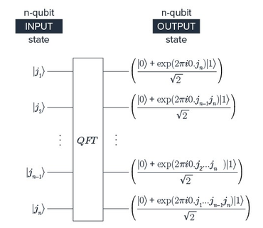

$$\frac{|0\rangle+\exp(2\pi i\,0.j_n)|1\rangle}{\sqrt{2}}$$
$$\frac{|0\rangle+\exp(2\pi i\,0.j_{n-1}j_n)|1\rangle}{\sqrt{2}}$$
$$\frac{|0\rangle+\exp(2\pi i\,0.j_2\ldots j_n)|1\rangle}{\sqrt{2}}$$
$$\frac{|0\rangle+\exp(2\pi i\,0.j_1\ldots j_{n-1}j_n)|1\rangle}{\sqrt{2}}$$

QFT block diagram.

**n-qubit INPUT state** (left, top to bottom): $|j_1\rangle$, $|j_2\rangle$, $\ldots$, $|j_{n-1}\rangle$, $|j_n\rangle$, each wire entering a box labeled $QFT$.

**n-qubit OUTPUT state** (right, top to bottom):

$$\frac{|0\rangle+\exp(2\pi i\,0.j_n)|1\rangle}{\sqrt{2}}$$

$$\frac{|0\rangle+\exp(2\pi i\,0.j_{n-1}j_n)|1\rangle}{\sqrt{2}}$$

$$\vdots$$

$$\frac{|0\rangle+\exp(2\pi i\,0.j_2\ldots j_n)|1\rangle}{\sqrt{2}}$$

$$\frac{|0\rangle+\exp(2\pi i\,0.j_1\ldots j_{n-1}j_n)|1\rangle}{\sqrt{2}}$$

To understand how this new representation works, let\'s go back to the
example. The table below shows the output state corresponding to each of
the values of and . Note, that these states are all written in the
single-qubit basis {\|00\>\|01\>\|10\>\|11\>}

$$\frac{|0\rangle+|1\rangle}{\sqrt{2}}\otimes\frac{|0\rangle+|1\rangle}{\sqrt{2}}$$
$$\frac{|0\rangle+\exp(\pi i)|1\rangle}{\sqrt{2}}\otimes\frac{|0\rangle+\exp\left(\pi i\,\frac{1}{2}\right)|1\rangle}{\sqrt{2}}$$
$$\frac{|0\rangle+|1\rangle}{\sqrt{2}}\otimes\frac{|0\rangle+\exp(\pi i)|1\rangle}{\sqrt{2}}$$
$$\frac{|0\rangle+\exp(\pi i)|1\rangle}{\sqrt{2}}\otimes\frac{|0\rangle+\exp\left(\pi i\,\frac{3}{2}\right)|1\rangle}{\sqrt{2}}$$
$$|0\rangle\rightarrow\frac{|0\rangle+|1\rangle}{\sqrt{2}},\qquad |1\rangle\rightarrow\frac{|0\rangle+\exp(i\phi_m)|1\rangle}{\sqrt{2}}$$
$$\phi_1=2\pi\,0.j_n,\quad \phi_2=2\pi\,0.j_{n-1}j_n,\quad \phi_3=2\pi\,0.j_{n-2}j_{n-1}j_n,\quad \phi_n=2\pi\,0.j_1\ldots j_n$$

Table of the two-qubit QFT, columns: $(j_1,j_2)$, binary to decimal, quantum states, factored output.

- $j_1=0, j_2=0$: $00\equiv|0\rangle$, $|00\rangle=|0\rangle\otimes|0\rangle$, $\frac{|0\rangle+|1\rangle}{\sqrt{2}}\otimes\frac{|0\rangle+|1\rangle}{\sqrt{2}}$
- $j_1=0, j_2=1$: $01\equiv|1\rangle$, $|01\rangle=|0\rangle\otimes|1\rangle$, $\frac{|0\rangle+\exp(\pi i)|1\rangle}{\sqrt{2}}\otimes\frac{|0\rangle+\exp\left(\pi i\frac{1}{2}\right)|1\rangle}{\sqrt{2}}$
- $j_1=1, j_2=0$: $10\equiv|2\rangle$, $|10\rangle=|1\rangle\otimes|0\rangle$, $\frac{|0\rangle+|1\rangle}{\sqrt{2}}\otimes\frac{|0\rangle+\exp(\pi i)|1\rangle}{\sqrt{2}}$
- $j_1=1, j_2=1$: $11\equiv|3\rangle$, $|11\rangle=|1\rangle\otimes|1\rangle$, $\frac{|0\rangle+\exp(\pi i)|1\rangle}{\sqrt{2}}\otimes\frac{|0\rangle+\exp\left(\pi i\frac{3}{2}\right)|1\rangle}{\sqrt{2}}$

(The binary to decimal column illustrates the connection to the table above, where the decimal short-hand notation was used.)

The single-qubit output states are transformed as:

$$|0\rangle \rightarrow \frac{|0\rangle+|1\rangle}{\sqrt{2}},$$

$$|1\rangle \rightarrow \frac{|0\rangle+\exp(i\phi_m)|1\rangle}{\sqrt{2}}$$

where $\phi_m$ is a phase between $0$ and $2\pi$. If the input state is $|0\rangle$, then the output state is always an equal superposition state with zero relative phase. If the input state is $|1\rangle$, then the output is an equal superposition state, but with a phase shift $\exp(i\phi_m)$ on state $|1\rangle$. Specifically, for $n$ qubits, the phase of the first output qubit is $\phi_1 = 2\pi\,0.j_n$, the second is $\phi_2 = 2\pi\,0.j_{n-1}j_n$, the third is $\phi_3 = 2\pi\,0.j_{n-2}j_{n-1}j_n$, and so on until the last qubit which phase is $\phi_n = 2\pi\,0.j_1\ldots j_n$.

**There are two takeaways:**

1. When the input state is $|0\rangle$, the output state is an equal superposition state with zero relative phase.
2. When the input state is $|1\rangle$, the output state is an equal superposition state that undergoes a relative phase rotation.

$$\frac{|0\rangle + |1\rangle}{\sqrt{2}}$$
$$\frac{|0\rangle + R_k|1\rangle}{\sqrt{2}}$$
$$R_k|0\rangle = |0\rangle,$$
$$R_k|1\rangle = \exp\left(i \frac{2\pi}{2^{k}}\right)|1\rangle.$$

From these two points, it's clear that the implementation of the QFT is related to a controlled operation that modifies a qubit state as shown in the table below.

**Controlled Operation**

| Input state | Output state |
| --- | --- |
| $|0\rangle$ | $\dfrac{|0\rangle + |1\rangle}{\sqrt{2}}$ |
| $|1\rangle$ | $\dfrac{|0\rangle + R_k|1\rangle}{\sqrt{2}}$ |

The figure below shows the circuit implementation of the Quantum Fourier Transform in terms of multiple Hadamard gates and controlled $R_k$ gates. The phase rotation $R_k$ is defined as

$$R_k|0\rangle = |0\rangle,$$

$$R_k|1\rangle = \exp\left(i \frac{2\pi}{2^{k}}\right)|1\rangle.$$

The circuit figure itself is not in this frame.

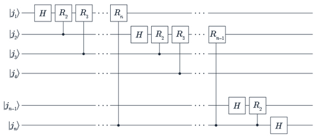

$$|j_1\rangle,\ |j_2\rangle,\ |j_3\rangle,\ |j_4\rangle,\ |j_{n-1}\rangle,\ |j_n\rangle$$

Quantum Fourier transform circuit (no final swaps shown). Six wires, with a gap of omitted wires between $|j_4\rangle$ and $|j_{n-1}\rangle$.

- $|j_1\rangle$: $H$, $R_2$, $R_3$, $\cdots$, $R_n$, then a wire continuing with $\cdots$
- $|j_2\rangle$: control dot under $R_2$, then $H$, $R_2$, $R_3$, $\cdots$, $R_{n-1}$
- $|j_3\rangle$: control dot under $R_3$ of the first wire, and a control dot under $R_2$ of the second wire, then $\cdots$
- $|j_4\rangle$: control dot under $R_3$ of the second wire, then $\cdots$
- $|j_{n-1}\rangle$: $\cdots$, then $H$, $R_2$
- $|j_n\rangle$: control dots (including under $R_n$ on the first wire and under $R_{n-1}$ / $R_2$), then $H$ at the far right

Vertical lines with dots are the controls for the controlled-$R_k$ gates.

$$|j_1\rangle \to \frac{|0\rangle + \exp(2\pi i 0.j_1)|1\rangle}{\sqrt{2}},$$
$$\frac{|0\rangle + \exp(2\pi i 0.j_1)|1\rangle}{\sqrt{2}} \otimes |j_2\rangle \otimes |j_3\rangle \otimes \ldots \otimes |j_n\rangle.$$
$$\frac{|0\rangle + \exp(2\pi i 0.j_1 j_2)|1\rangle}{\sqrt{2}} \otimes |j_2\rangle \otimes |j_3\rangle \otimes \ldots \otimes |j_n\rangle.$$
$$\frac{|0\rangle + \exp(2\pi i 0.j_1 j_2 j_3)|1\rangle}{\sqrt{2}} \otimes |j_2\rangle \otimes |j_3\rangle \otimes \ldots \otimes |j_n\rangle.$$
$$\frac{|0\rangle + \exp(2\pi i 0.j_1 j_2 j_3 \ldots j_n)|1\rangle}{\sqrt{2}} \otimes |j_2\rangle \otimes |j_3\rangle \otimes \ldots \otimes |j_n\rangle.$$
$$\left( \frac{|0\rangle + \exp(2\pi i 0.j_1 j_2 j_3 \ldots j_n)|1\rangle}{\sqrt{2}} \right) \otimes \left( \frac{|0\rangle + \exp(2\pi i 0.j_2)|1\rangle}{\sqrt{2}} \right) \otimes |j_3\rangle \otimes \ldots \otimes |j_n\rangle.$$
$$\left( \frac{|0\rangle + \exp(2\pi i 0.j_1 j_2 j_3 \ldots j_n)|1\rangle}{\sqrt{2}} \right) \otimes \left( \frac{|0\rangle + \exp(2\pi i 0.j_2 j_3)|1\rangle}{\sqrt{2}} \right) \otimes |j_3\rangle \otimes \ldots \otimes |j_n\rangle.$$
$$\frac{|0\rangle + \exp(2\pi i 0.j_1 j_2 j_3 \ldots j_n)|1\rangle}{\sqrt{2}} \otimes \frac{|0\rangle + \exp(2\pi i 0.j_2 j_3 \ldots j_n)|1\rangle}{\sqrt{2}} \otimes |j_3\rangle \otimes \ldots \otimes |j_n\rangle.$$

Let's analyze how the system evolves under this implementation.

1. A Hadamard gate is applied on the first qubit

$$|j_1\rangle \to \frac{|0\rangle + \exp(2\pi i 0.j_1)|1\rangle}{\sqrt{2}},$$

and this puts the system in state

$$\frac{|0\rangle + \exp(2\pi i 0.j_1)|1\rangle}{\sqrt{2}} \otimes |j_2\rangle \otimes |j_3\rangle \otimes \ldots \otimes |j_n\rangle.$$

2. A controlled phase $R_2$-gate is applied with the second qubit as control and the first as target,

$$\frac{|0\rangle + \exp(2\pi i 0.j_1 j_2)|1\rangle}{\sqrt{2}} \otimes |j_2\rangle \otimes |j_3\rangle \otimes \ldots \otimes |j_n\rangle.$$

3. A controlled phase $R_3$-gate is applied with the third qubit as control and the first as target,

$$\frac{|0\rangle + \exp(2\pi i 0.j_1 j_2 j_3)|1\rangle}{\sqrt{2}} \otimes |j_2\rangle \otimes |j_3\rangle \otimes \ldots \otimes |j_n\rangle.$$

4. This continues until a controlled phase $R_n$-gate is applied with the last qubit as control and the first as target, leaving the system in the state

$$\frac{|0\rangle + \exp(2\pi i 0.j_1 j_2 j_3 \ldots j_n)|1\rangle}{\sqrt{2}} \otimes |j_2\rangle \otimes |j_3\rangle \otimes \ldots \otimes |j_n\rangle.$$

5. A Hadamard gate is applied on the second qubit,

$$\left( \frac{|0\rangle + \exp(2\pi i 0.j_1 j_2 j_3 \ldots j_n)|1\rangle}{\sqrt{2}} \right) \otimes \left( \frac{|0\rangle + \exp(2\pi i 0.j_2)|1\rangle}{\sqrt{2}} \right) \otimes |j_3\rangle \otimes \ldots \otimes |j_n\rangle.$$

6. A controlled phase $R_2$-gate is applied with the third qubit as control and the second as target,

$$\left( \frac{|0\rangle + \exp(2\pi i 0.j_1 j_2 j_3 \ldots j_n)|1\rangle}{\sqrt{2}} \right) \otimes \left( \frac{|0\rangle + \exp(2\pi i 0.j_2 j_3)|1\rangle}{\sqrt{2}} \right) \otimes |j_3\rangle \otimes \ldots \otimes |j_n\rangle.$$

7. This continues until a controlled phase $R_{n-1}$-gate is applied with the last qubit as control and the second as target, leaving the system in the state

$$\frac{|0\rangle + \exp(2\pi i 0.j_1 j_2 j_3 \ldots j_n)|1\rangle}{\sqrt{2}} \otimes \frac{|0\rangle + \exp(2\pi i 0.j_2 j_3 \ldots j_n)|1\rangle}{\sqrt{2}} \otimes |j_3\rangle \otimes \ldots \otimes |j_n\rangle.$$

$$|j_1\rangle \otimes |j_2\rangle \otimes \ldots \otimes |j_{n-1}\rangle \otimes |j_n\rangle$$
$$\rightarrow \left( \frac{|0\rangle + \exp(2\pi i 0.j_1 \ldots j_n)|1\rangle}{\sqrt{2}} \right) \otimes \left( \frac{|0\rangle + \exp(2\pi i 0.j_2 \ldots j_n)|1\rangle}{\sqrt{2}} \right)$$
$$\otimes \ldots \otimes \left( \frac{|0\rangle + \exp(2\pi i 0.j_{n-1} j_n)|1\rangle}{\sqrt{2}} \right) \otimes \left( \frac{|0\rangle + \exp(2\pi i 0.j_n)|1\rangle}{\sqrt{2}} \right). \qquad (3)$$

8. This same process is done on each qubit until the last qubit, on which you can only apply a Hadamard gate. This implementation transforms as

$$|j_1\rangle \otimes |j_2\rangle \otimes \ldots \otimes |j_{n-1}\rangle \otimes |j_n\rangle$$

$$\rightarrow \left( \frac{|0\rangle + \exp(2\pi i 0.j_1 \ldots j_n)|1\rangle}{\sqrt{2}} \right) \otimes \left( \frac{|0\rangle + \exp(2\pi i 0.j_2 \ldots j_n)|1\rangle}{\sqrt{2}} \right)$$

$$\otimes \ldots \otimes \left( \frac{|0\rangle + \exp(2\pi i 0.j_{n-1} j_n)|1\rangle}{\sqrt{2}} \right) \otimes \left( \frac{|0\rangle + \exp(2\pi i 0.j_n)|1\rangle}{\sqrt{2}} \right). \qquad (3)$$

However, the output states in equations (2) and (3) are not equal. The
output state of the first qubit in (2) is equivalent to the output state
of the last qubit in (3). The output state of the second qubit in (2) is
equivalent to the output state of the penultimate qubit in (3). The
state of qubit in (3) should be the state of the first qubit in (2), the
state of qubit in (3) should be the state of the second qubit (2), and
so on. To return the qubit states to their original ordering, we need to
apply swap-gates, which are generally used to exchange qubit states.
Thus, the difference between the output states in equations (2) and (3)
can be straightforwardly undone by applying a swap gate between qubits
\"1\" and \"n\", a swap gate between qubits \"2\" and \"n-1\", a swap
gate between qubits \"3\" and \"n-2\", and so on.

## 

## **Transcript (no video , only text in this page)**

## **Practice (no practice in this page)**
