# Page Title:Quantum Cryptography - Making Codes

# **Learn**

## **Images**
## **Transcript**

## 

0

0

00:00:00,000 \--\> 00:00:00,500

1

00:00:00,500 \--\> 00:00:03,380

Last week, we introduced the basics of modern cryptography

2

00:00:03,380 \--\> 00:00:06,140

schemes with a focus on public key encryption based

3

00:00:06,140 \--\> 00:00:08,570

on one-way mathematical functions.

4

00:00:08,570 \--\> 00:00:10,880

We discussed the RSA cryptosystem in detail

5

00:00:10,880 \--\> 00:00:12,590

and showed that its security is based

6

00:00:12,590 \--\> 00:00:14,930

on prime number factorization and the related

7

00:00:14,930 \--\> 00:00:16,940

problem of period finding.

8

00:00:16,940 \--\> 00:00:19,582

Period finding is a hard problem for a classical computer.

9

00:00:19,582 \--\> 00:00:21,290

And we showed how it could be efficiently

10

00:00:21,290 \--\> 00:00:23,600

performed on a universal quantum computer running

11

00:00:23,600 \--\> 00:00:25,220

Shor\'s algorithm.

12

00:00:25,220 \--\> 00:00:27,870

We also discussed the topic of key distribution,

13

00:00:27,870 \--\> 00:00:30,860

namely the conundrum that arises when using symmetric keys

14

00:00:30,860 \--\> 00:00:32,659

for encryption and decryption.

15

00:00:32,659 \--\> 00:00:35,109

How can we securely exchange symmetric keys

16

00:00:35,109 \--\> 00:00:36,650

when we don\'t yet have the encryption

17

00:00:36,650 \--\> 00:00:39,620

keys in our possession for the first transmission?

18

00:00:39,620 \--\> 00:00:41,690

The answer was to use public key encryption

19

00:00:41,690 \--\> 00:00:45,080

based on asymmetric keys, like the RSA cryptosystem.

20

00:00:45,080 \--\> 00:00:47,090

However, as we just noted, RSA is

21

00:00:47,090 \--\> 00:00:49,340

vulnerable to attack by a quantum computer running

22

00:00:49,340 \--\> 00:00:50,300

Shor\'s algorithm.

23

00:00:50,300 \--\> 00:00:52,890

But where quantum figuratively closes one door,

24

00:00:52,890 \--\> 00:00:54,470

it can also open another.

25

00:00:54,470 \--\> 00:00:56,720

This week, we\'ll show that quantum mechanics not only

26

00:00:56,720 \--\> 00:01:00,260

gives us the tools to compromise secure communication protocols,

27

00:01:00,260 \--\> 00:01:03,770

it also provides the resources to enhance secure communication

28

00:01:03,770 \--\> 00:01:07,390

through the use of quantum key distribution or QKD.

29

00:01:07,390 \--\> 00:01:10,460

In course one, we briefly discussed QKD in the context

30

00:01:10,460 \--\> 00:01:12,110

of a one-time pad\--

31

00:01:12,110 \--\> 00:01:15,050

that is, distributing symmetric keys continuously

32

00:01:15,050 \--\> 00:01:17,600

to provide fresh secure keys that can then be used

33

00:01:17,600 \--\> 00:01:19,780

continually to encrypt data.

34

00:01:19,780 \--\> 00:01:23,730

Here, we\'ll introduce two general classes of QKD.

35

00:01:23,730 \--\> 00:01:26,930

One is based on single photon sources and detectors.

36

00:01:26,930 \--\> 00:01:29,300

And the other is based on entangled photons and Bell

37

00:01:29,300 \--\> 00:01:30,770

state measurements.

38

00:01:30,770 \--\> 00:01:32,670

Both rely on many of the quantum concepts

39

00:01:32,670 \--\> 00:01:34,940

you learned in course one, such as entanglement,

40

00:01:34,940 \--\> 00:01:37,490

projective measurement, and the no-cloning theorem.

41

00:01:37,490 \--\> 00:01:39,890

This week, we\'ll expand on those concepts.

42

00:01:39,890 \--\> 00:01:42,020

We\'ll also discuss the importance of randomness

43


<!-- frame 1:41 · slide · week3/media/media/image65.png -->

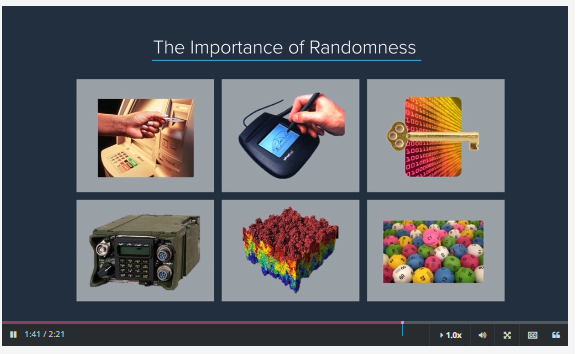

# The Importance of Randomness

Six-panel photo grid on a lecture slide (a teaching collage).

1. Hand entering a PIN at an ATM keypad.
2. Hand holding a black handheld device and a stylus; the screen shows a mark or signature.
3. A gold key in front of red binary digits.
4. Olive-green military radio / transceiver with a keypad.
5. Colorful 3D lattice or molecular model.
6. Pile of multicolored numbered balls.

00:01:42,020 \--\> 00:01:44,120

in implementing QKD.

44

00:01:44,120 \--\> 00:01:47,360

Pseudo random number generators output sequences of numbers

45

00:01:47,360 \--\> 00:01:49,709

with properties that are approximately random.

46

00:01:49,709 \--\> 00:01:51,500

But because it\'s based on an algorithm that

47

00:01:51,500 \--\> 00:01:53,870

uses an initial value, called a seed,

48

00:01:53,870 \--\> 00:01:56,180

the sequences are never truly random.

49

00:01:56,180 \--\> 00:01:58,520

This has implication for cryptography schemes,

50

00:01:58,520 \--\> 00:02:01,940

since ideally a current bitstream should not in any way

51

00:02:01,940 \--\> 00:02:04,100

be predictable from the previous bitstream.

52

00:02:04,100 \--\> 00:02:05,810

On the other hand, the randomness

53

00:02:05,810 \--\> 00:02:08,870

of projective measurement is believed to be truly random.

54

00:02:08,870 \--\> 00:02:11,990

And this concept, in conjunction with distributed entanglement,

55

00:02:11,990 \--\> 00:02:16,000

is a foundation for quantum random number generators.

56

00:02:16,000 \--\> 00:02:21,440

## **PRACTICE** 

## **(there is no practice for this introduction page )** 

Section:

# Page Title:

# **Learn**

Post-Quantum Cryptography

The long-term security of modern cryptographic systems has been brought
into question by developments in quantum computing. The existence of
Shor\'s factoring algorithm shows that the inversion of the one-way
functions needed for asymmetric cryptography is an instance where
quantum computers have quantum advantage over classical algorithms. It
is worth noting that the development of quantum computers is not thought
to be catastrophic for symmetric-key cryptography schemes.

Based on the pace of quantum computing research, and the effort required
to update cryptographic standards, it has been argued by researchers
that the process of finding and implementing algorithms which are
suitably robust to quantum computers should begin immediately. Professor
Michele Mosca, a leading expert in quantum computing research, has
estimated the odds of a quantum computer capable of breaking RSA-2048 --
an RSA cryptosystem using 2048-bit private and public keys -- being
constructed by and at and respectively. These probabilities are informed
estimates based on of several parameters such as when a fault-tolerant
and scalable qubit will be designed, how many qubits are needed to break
RSA-2048, and how long it will take to scale quantum computers to this
size.

Professor Mosca argues that based on these projections, quantum
computers capable of breaking RSA-2048 are reasonably likely to be
available before the shelf-life of information encrypted with RSA-2048
has expired. Both NIST and NSA have advocated that action should begin
now to safeguard cryptographic standards from quantum computers. In
2016, NIST began requesting nominations for post-quantum public-key
cryptography algorithms, with the eventual goal of standardizing one or
more quantum-resistant algorithms. Additionally, in 2015 the Information
Assurance Directorate of the NSA announced it will begin transitioning
to quantum-resistant algorithms.

The search for cryptographic algorithms and hardware which are secure
against both classical and quantum computers is called post-quantum, or
quantum-resistant, cryptography. At present, all post-quantum
cryptography algorithms come from either quantum cryptography or by
exploiting math problems, similar to prime factorization, which have no
known efficient solution on either classical or quantum computers.

Quantum key distribution (QKD) uses fundamental quantum-mechanical
properties of systems, usually implemented with light, to securely
exchange keys over an unsecure public channel. Unlike other solutions,
the security of QKD does not rely on assumptions about the computational
resources of an adversary and can be considered provably secure.
Realistically, many QKD implementations are open to attacks on the
hardware or software which perform the protocol. At present, QKD is a
mature and active area of research with commercial systems available.

Alternatively, two of the most promising post-quantum cryptographic
schemes are lattice-based cryptography and code-based cryptography.
Lattice based cryptography makes use of problems on a set of points in
-dimensional space which have a periodic structure; these sets are
called lattices. An example of a lattice problem used in cryptography is
the "shortest vector problem,\" which is based on the shortest non-zero
vector for a given lattice. Code-based cryptography uses the properties
of error correcting codes to secure information. Intuitively, these
systems consist of a public key -- which adds random noise to a signal
-- and a private key -- which is an error correcting code capable of
removing the noise. While it is still unclear which, if any, of these
methods will become a post-quantum cryptographic standard, it is
unlikely that the new approach will be compatible with existing systems.
Rather, new hardware will likely be required, at significant expense,
and therefore careful planning will be required before the current
standards are updated.

## **Images**

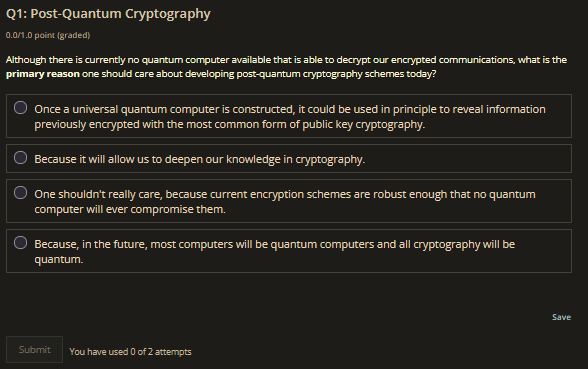

Q1: Post-Quantum Cryptography

0.0/1.0 point (graded)

Although there is currently no quantum computer available that is able to decrypt our encrypted communications, what is the primary reason one should care about developing post-quantum cryptography schemes today?

Unselected radio options:

- Once a universal quantum computer is constructed, it could be used in principle to reveal information previously encrypted with the most common form of public key cryptography.
- Because it will allow us to deepen our knowledge in cryptography.
- One shouldn't really care, because current encryption schemes are robust enough that no quantum computer will ever compromise them.
- Because, in the future, most computers will be quantum computers and all cryptography will be quantum.

Save (right). Submit is disabled. "You have used 0 of 2 attempts".

## **Transcript**

## 

0

0

00:00:00,000 \--\> 00:00:01,610

MICHELE MOSCA: Cryptography is the art

1

00:00:01,610 \--\> 00:00:04,880

of using mathematical tools to achieve information security

2

00:00:04,880 \--\> 00:00:08,300

while using untrusted channels, like the internet or wireless

3

00:00:08,300 \--\> 00:00:09,480

communication.

4

00:00:09,480 \--\> 00:00:12,200

It\'s what we use to confirm that the software we download

5

00:00:12,200 \--\> 00:00:15,410

every day by auto-updates came from a legitimate source

6

00:00:15,410 \--\> 00:00:17,150

and wasn\'t tampered with.

7

00:00:17,150 \--\> 00:00:19,670

It\'s what we use to know an online shopping or banking

8

00:00:19,670 \--\> 00:00:21,210

page is authentic.

9

00:00:21,210 \--\> 00:00:24,260

Public key signatures are one of the most commonly used methods

10

00:00:24,260 \--\> 00:00:28,110

to provide authentication and data integrity guarantees.

11

00:00:28,110 \--\> 00:00:30,110

Most of the encryption we use today

12

00:00:30,110 \--\> 00:00:32,479

to protect the confidentiality of information

13

00:00:32,479 \--\> 00:00:34,380

is symmetric key encryption.

14

00:00:34,380 \--\> 00:00:37,530

However, how are these symmetric keys established?

15

00:00:37,530 \--\> 00:00:40,610

In a typical transaction, you might use a public key signature

16

00:00:40,610 \--\> 00:00:43,490

to authenticate your bank, then public key encryption

17

00:00:43,490 \--\> 00:00:46,760

to establish a symmetric key, and then AES

18


<!-- frame 0:46 · slide · week3/media/media/image36.png -->

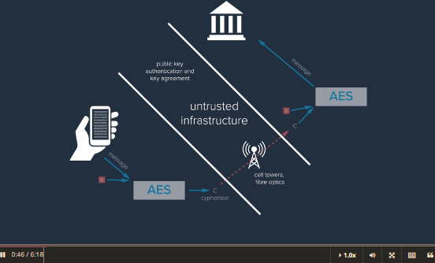

Diagram of encrypting a message across an untrusted network.

A white diagonal band is labeled "untrusted infrastructure" and, along the band, "public key authentication and key agreement".

- Left: a hand holding a phone. A blue arrow labeled message points down to a red key box K, which feeds a gray AES box. A red dashed arrow labeled C and "cyphertext" leaves AES toward the center.
- Center, on the band: a radio-tower icon labeled "cell towers, fibre optics".
- Right: a columned building. A blue arrow labeled message points down to a second gray AES box, which also receives a red key K. A red dashed arrow labeled C runs from the tower side into that AES box.

Player: paused, speed 1.0x.

00:00:46,760 \--\> 00:00:49,140

to encrypt your confidential information.

19

00:00:49,140 \--\> 00:00:52,730

However, quantum computers will break the mathematical problems

20

00:00:52,730 \--\> 00:00:55,850

at the core of virtually all public key cryptographic schemes

21

00:00:55,850 \--\> 00:00:59,460

in use today, namely integer factorization

22

00:00:59,460 \--\> 00:01:01,440

and the discrete logarithm problem.

23

00:01:01,440 \--\> 00:01:03,430

This means RSA and Diffie-Hellman

24

00:01:03,430 \--\> 00:01:05,080

schemes are decimated.

25

00:01:05,080 \--\> 00:01:08,380

Going to larger keys adds very little extra security

26

00:01:08,380 \--\> 00:01:09,980

against quantum attacks.

27

00:01:09,980 \--\> 00:01:13,120

Quantum computers also wicking symmetric cryptography

28

00:01:13,120 \--\> 00:01:16,730

because they can brute force search quadratically faster.

29

00:01:16,730 \--\> 00:01:19,060

That is, a quantum computer can effectively

30

00:01:19,060 \--\> 00:01:23,260

search a space of N keys with only square root n quantum

31

00:01:23,260 \--\> 00:01:24,140

steps.

32

00:01:24,140 \--\> 00:01:25,840

Doubling key lengths can effectively

33

00:01:25,840 \--\> 00:01:27,700

mitigate the known quantum attacks

34

00:01:27,700 \--\> 00:01:29,480

against symmetric cryptography.

35

00:01:29,480 \--\> 00:01:31,930

Now while acronyms like RSA and ECC

36

00:01:31,930 \--\> 00:01:34,550

might not mean much to most users of technology,

37

00:01:34,550 \--\> 00:01:36,610

these tools underpin the security

38

00:01:36,610 \--\> 00:01:40,360

of tools such as secure web browsing, VPNs, secure email,

39

00:01:40,360 \--\> 00:01:42,830

auto-updates, blockchains, and so on,

40

00:01:42,830 \--\> 00:01:45,140

which are the basis of technological infrastructure,

41

00:01:45,140 \--\> 00:01:49,510

including the internet, cloud computing, IoT, and so on.

42

00:01:49,510 \--\> 00:01:52,130

So to reap the benefits of quantum computing,

43

00:01:52,130 \--\> 00:01:54,430

it is imperative that we first deploy

44

00:01:54,430 \--\> 00:01:56,440

the new cryptographic tools designed to be

45

00:01:56,440 \--\> 00:01:58,480

safe against quantum attacks.

46

00:01:58,480 \--\> 00:02:01,540

This is sometimes called quantum-safe cryptography

47

00:02:01,540 \--\> 00:02:03,620

or post-quantum cryptography.

48

00:02:03,620 \--\> 00:02:05,500

Now we don\'t believe that quantum computers

49

00:02:05,500 \--\> 00:02:08,430

capable of breaking RSA and Diffie-Hellman schemes in use

50

00:02:08,430 \--\> 00:02:10,830

today exist, but this doesn\'t mean

51

00:02:10,830 \--\> 00:02:14,100

we can just wait and see before doing something about it.

52

00:02:14,100 \--\> 00:02:17,410

Whether we need to take action now depends on three parameters.

53

00:02:17,410 \--\> 00:02:20,490

Firstly, what is the security shelf life of the information

54

00:02:20,490 \--\> 00:02:22,240

your system is supposed to protect?

55

00:02:22,240 \--\> 00:02:23,890

Call this x years.

56

00:02:23,890 \--\> 00:02:27,120

Secondly, how long will it take to migrate your systems

57

00:02:27,120 \--\> 00:02:29,980

to ones designed to be secure against quantum attacks?

58

00:02:29,980 \--\> 00:02:32,050

Let y be the migration time.

59

00:02:32,050 \--\> 00:02:34,450

And lastly, what is the collapse time?

60

00:02:34,450 \--\> 00:02:36,600

The time until your threat actors

61

00:02:36,600 \--\> 00:02:39,330

are able to use quantum computers to attack your systems

62

00:02:39,330 \--\> 00:02:41,470

and compromise your information.

63

00:02:41,470 \--\> 00:02:43,930

Now note that for the next y years,

64

00:02:43,930 \--\> 00:02:46,390

you\'re stuck with the quantum-vulnerable tools,

65

00:02:46,390 \--\> 00:02:48,660

so information being recorded during this period

66

00:02:48,660 \--\> 00:02:51,430

may be exploited by quantum computers in the future.

67

00:02:51,430 \--\> 00:02:53,370

This information is supposed to be protected

68

00:02:53,370 \--\> 00:02:58,170

for another x years; however, if x plus y is bigger than z,

69

00:02:58,170 \--\> 00:03:00,330

or z, then you won\'t be providing

70

00:03:00,330 \--\> 00:03:03,130

the x years of confidentiality that you\'re supposed to.

71


<!-- frame 3:03 · diagram · week3/media/media/image55.png -->

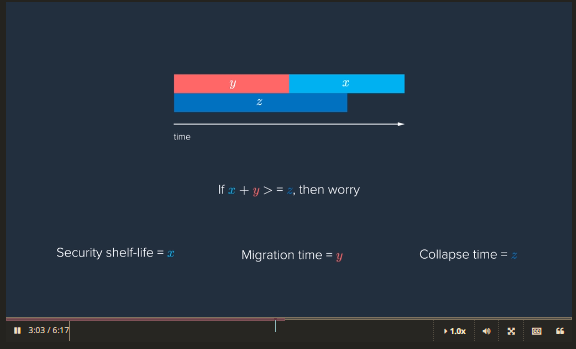

$$
\text{If } x + y \ge z, \text{ then worry}
$$

Timeline diagram. A rightward arrow is labeled **time**.

- Upper bar: a red segment labeled \(y\), followed by a blue segment labeled \(x\).
- Lower bar: a blue segment labeled \(z\), starting at the same left edge and ending before the upper bar.

If \(x + y \ge z\), then worry.

- Security shelf-life \(= x\)
- Migration time \(= y\)
- Collapse time \(= z\)

00:03:03,130 \--\> 00:03:06,540

For example, information may be for sale on the dark web

72

00:03:06,540 \--\> 00:03:08,980

while it is still supposed to be confidential.

73

00:03:08,980 \--\> 00:03:10,520

Suppose your information is supposed

74

00:03:10,520 \--\> 00:03:13,320

to remain secure for 10 years after transmission,

75

00:03:13,320 \--\> 00:03:15,290

and it takes 10 years before the systems

76

00:03:15,290 \--\> 00:03:17,970

protect those transmissions against quantum attacks.

77

00:03:17,970 \--\> 00:03:20,750

If quantum computers capable of decrypting that information are

78

00:03:20,750 \--\> 00:03:23,990

available in 15 years, then there will be a five-year period

79

00:03:23,990 \--\> 00:03:26,570

where those transmissions will be vulnerable to compromise

80

00:03:26,570 \--\> 00:03:29,510

before their 10-year shelf life is up.

81

00:03:29,510 \--\> 00:03:32,780

Further, if y is bigger than z, then systems

82

00:03:32,780 \--\> 00:03:35,540

collapse with no reliable way to rebuild them.

83

00:03:35,540 \--\> 00:03:38,030

That is, there is no effective remediation

84

00:03:38,030 \--\> 00:03:40,310

because the tools to protect against new attacks

85

00:03:40,310 \--\> 00:03:41,850

are simply not available.

86

00:03:41,850 \--\> 00:03:44,960

Also, it\'s important to note that rushing y

87

00:03:44,960 \--\> 00:03:47,490

will not only be disruptive and expensive,

88

00:03:47,490 \--\> 00:03:50,310

but will lead to flawed and vulnerable implementations.

89

00:03:50,310 \--\> 00:03:52,310

While viable candidates exist, there\'s

90

00:03:52,310 \--\> 00:03:55,980

a long road to wide-scale, practical, robust deployment,

91

00:03:55,980 \--\> 00:03:57,510

including many challenges.

92

00:03:57,510 \--\> 00:03:59,190

We need to identify candidates.

93

00:03:59,190 \--\> 00:04:01,460

We need to scrutinize them against quantum

94

00:04:01,460 \--\> 00:04:03,150

and classical attacks.

95

00:04:03,150 \--\> 00:04:06,150

Protocols using the tools must also be secure.

96

00:04:06,150 \--\> 00:04:08,180

Software and hardware implementations

97

00:04:08,180 \--\> 00:04:09,480

need to be secure.

98

00:04:09,480 \--\> 00:04:11,680

We need to analyze the side channels and design

99

00:04:11,680 \--\> 00:04:12,920

countermeasures.

100

00:04:12,920 \--\> 00:04:15,080

We need to look at the performance requirements.

101

00:04:15,080 \--\> 00:04:17,870

We have to integrate them into tools and applications.

102

00:04:17,870 \--\> 00:04:20,529

We have to worry about migration and compatibility.

103

00:04:20,529 \--\> 00:04:23,930

Standardization so systems will interoperate.

104

00:04:23,930 \--\> 00:04:25,730

And validation and certification.

105

00:04:25,730 \--\> 00:04:28,090

It can easily take 10 to 20 years

106

00:04:28,090 \--\> 00:04:30,680

to properly migrate existing systems.

107

00:04:30,680 \--\> 00:04:33,497

In August 2015, the National Security Agency

108

00:04:33,497 \--\> 00:04:35,080

of the United States announced that it

109

00:04:35,080 \--\> 00:04:38,410

will initiate a transition to quantum-resistant algorithms

110

00:04:38,410 \--\> 00:04:40,660

in the not-too-distant future.

111

00:04:40,660 \--\> 00:04:42,980

This sent a very clear signal to the world

112

00:04:42,980 \--\> 00:04:44,980

that quantum computing was something that needed

113

00:04:44,980 \--\> 00:04:47,000

to be taken seriously now.

114

00:04:47,000 \--\> 00:04:49,210

Shortly after, the National Institute

115

00:04:49,210 \--\> 00:04:51,220

of Standards and Technology, NIST,

116

00:04:51,220 \--\> 00:04:53,890

started outlining its plans to move forward and produce

117

00:04:53,890 \--\> 00:04:55,970

standardized post-quantum algorithms.

118

00:04:55,970 \--\> 00:04:58,820

It launched its post-quantum cryptography project,

119

00:04:58,820 \--\> 00:05:01,900

which is a process to solicit, evaluate, and standardize

120

00:05:01,900 \--\> 00:05:04,480

one or more quantum-resistant public key cryptographic

121

00:05:04,480 \--\> 00:05:05,890

algorithms.

122

00:05:05,890 \--\> 00:05:08,710

The submission deadline for proposed post-quantum algorithms

123

00:05:08,710 \--\> 00:05:12,100

was November 30, 2017, and the first workshop

124

00:05:12,100 \--\> 00:05:15,130

to review the submissions was held in April 2018.

125

00:05:15,130 \--\> 00:05:17,520

Most submissions are based on the hardness-of-lattice

126

00:05:17,520 \--\> 00:05:19,710

problems, or for signatures, there

127

00:05:19,710 \--\> 00:05:22,927

is also schemes based on the security of hash functions.

128

00:05:22,927 \--\> 00:05:24,510

Other standard bodies around the world

129

00:05:24,510 \--\> 00:05:26,670

are also studying this challenge taking steps

130

00:05:26,670 \--\> 00:05:29,130

to prepare the wide range of standards needed

131

00:05:29,130 \--\> 00:05:31,800

to protect our information technologies from quantum

132

00:05:31,800 \--\> 00:05:32,680

attacks.

133

00:05:32,680 \--\> 00:05:35,100

For example, standards for how the financial industry

134

00:05:35,100 \--\> 00:05:36,850

will use the new algorithms.

135

00:05:36,850 \--\> 00:05:39,870

This need to upgrade our cryptographic systems might

136

00:05:39,870 \--\> 00:05:41,290

seem like a nuisance.

137

00:05:41,290 \--\> 00:05:44,760

However, there may be an additional positive impact.

138

00:05:44,760 \--\> 00:05:48,270

This very advanced warning of the systemic threat to our cyber

139

00:05:48,270 \--\> 00:05:50,370

systems not only gives us a chance

140

00:05:50,370 \--\> 00:05:52,840

to prepare our defenses against this threat,

141

00:05:52,840 \--\> 00:05:56,940

but, if done properly, as part of lifecycle management

142

00:05:56,940 \--\> 00:05:59,220

and not as crisis management, we can

143

00:05:59,220 \--\> 00:06:01,320

rebuild the foundations of cybersecurity

144

00:06:01,320 \--\> 00:06:03,220

to be stronger than ever before.

145

00:06:03,220 \--\> 00:06:05,190

We can have a stronger and more agile

146

00:06:05,190 \--\> 00:06:08,290

cyber-immune system capable of protecting, detecting,

147

00:06:08,290 \--\> 00:06:11,690

and responding to new unexpected threats.

148

00:06:11,690 \--\> 00:06:18,000

## **PRACTICE (1 question)**

## 
 Section: quantum makes no cryptography. single-photon schemes 

## Page Title:single-photon sources and detectors 

# **Learn**

### **Single Photon Generation**

The concept of a photon -- a quanta of light -- was first introduced by
Albert Einstein in 1905. A photon embodies a discrete amount of energy
proportional to its frequency. Depending on the characteristics and
statistical properties of the photons source, the light may be
adequately represented classically -- called \"classical light\" -- or
it may necessitate a quantum description -- called \"non-classical
light.\"

The conventional light sources we encounter on a daily basis, for
example, from a light bulb, are generally classical sources that emit
so-called \"chaotic light.\" Chaotic light originates from a large
ensemble of independent and incoherent photon emitters. The incoherent
and uncorrelated behavior of the ensemble can be perceived as being
chaotic, having large intensity fluctuations, and thus the term
\"chaotic light.\" A special case -- the laser -- is an ensemble of
photon emitters acting in concert to create a coherent light source that
essentially behaves as a classical, coherent sinusoidal wave.

In contrast, a typical example of non-classical light is a single-photon
source -- a system that emits one (and only one) photon at a time. There
are two general approaches to realizing single photons, but only one of
them is non-classical. The classical approach is to attenuate a
classical multi-photon field -- such as a laser field -- to ensure that
when a photon arrives, it is likely to be only a single photon. This is
just attenuated classical light, and, the attenuation must be large
enough to reduce the probability of multi-photon arrivals. While large
attenuation ensures that most arrival events are single photons, it
comes with the trade-off that those single-photon arrival events are
relatively rare, and, most of the time, there are no photons at all.

The second approach is truly a non-classical light source based on the
spontaneous emission of a single photon from a two-level quantum system.
A two-level system in its excited state will spontaneously relax to the
ground state and, in doing so, emit a single photon with energy (the
energy separation between the two levels). The frequency of this photon
is , where is Planck\'s constant. The precise time at which the
two-level system emits the photon is generally a random variable
described by an exponential probability distribution , where is the
characteristic excited-state lifetime. In this case, the single-photon
emission time is on average the excited state lifetime . Examples of
single-photon emitters include quantum dots, quantum-well
heterostructures, and certain atoms or molecules with energy-level
transitions at the desired emission frequency.

### **Single-Photon Detection**

Single-photon detectors are devices that respond (or figuratively
\"click\") when a photon is absorbed. Importantly, the detector should
ideally distinguish between photon absorption events and background
noise. This becomes particularly challenging when detecting low-energy
photons, such as microwaves.

A detector\'s \"internal quantum efficiency\" is a measure of how well a
detector works, and it is essentially the probability that a photon is
accurately detected given that it enters the detector. Increasing the
photon absorption probability and the detector sensitivity will increase
the likelihood of detecting a single photon and generally improve
quantum efficiency. However, doing so may also make the detector more
sensitive to background noise, generating responses even when no signal
photons are present. Such errant photon detection events are referred to
as \"dark counts\" and reduce the signal to noise ratio (SNR),
negatively affecting the overall detection efficiency.

Avalanche photodiodes (APDs) are one type of a single-photon detector.
These detectors are generally semiconductor *p-i-n* diodes, where *p, i,
n* refer to a hole-doped region, an intrinsic region (no doping), and an
electron-doped region of the semiconductor. The diode is operated under
a strong voltage bias, which imparts a large electric field across the
intrinsic region of the device. When a photon is absorbed, it knocks out
an electron. This electron is then accelerated by the electric field and
proceeds to knock free other electrons. This process cascades, creating
an \"avalanche\" effect that results in a large, measurable electrical
current pulse. The presence of an electrical pulse thus indicates that a
photon was absorbed.

### **Beamsplitters**

A beamsplitter is an optical device that partitions an incoming stream
of photons and either transmits or reflects those photons to the output
ports. The figure below shows a four-port beamsplitter with input ports
(1 and 2) and output ports (3 and 4). As shown, photons impinge on the
beamsplitter at port 1 and are transmitted to port 3, and reflected to
port 4. Photons that arrive at port 2 would similarly be transmitted to
port 4 and reflected to port 3. There are two basic categories of
beamsplitters of interest here: spatial beamsplitters and polarizing
beamsplitters.
*Polarizing Beamsplitter*

A polarizing beamsplitter is a device that selectively reflects or
transmits photons depending on their [[polarization (the orientation of
its electric
field)]{.underline}](http://hyperphysics.phy-astr.gsu.edu/hbase/phyopt/polclas.html).
For example, light with polarization being reflected and being
transmitted. This type of beamsplitter is generally constructed from
anisotropic crystals. Light passing through anisotropic (non-uniform)
crystals will refract at different angles and spatially separate
depending on the light polarization. By choosing the appropriate
crystals and angle of incidence, light with one polarization (e.g.,
vertical) can be completely reflected, while it\'s opposing polarization
(e.g., horizontal) is completely transmitted. Polarizing beamsplitters
are thus a key component in performing a photon polarization
measurement. With a photon detector positioned at each output, one can
infer the photon polarization by measuring a detection event in either
the transmission arm or the reflection arm.

## **Images**

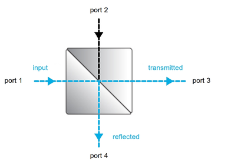

Four-port beamsplitter.

A cube with a diagonal mirror face. Labels:

- port 1, left: cyan dashed arrow marked input, entering the cube
- port 3, right: cyan dashed arrow marked transmitted, leaving the cube
- port 2, top: black dashed arrow pointing down into the cube
- port 4, bottom: cyan dashed arrow marked reflected, leaving downward

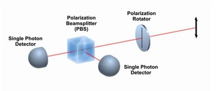

Optical layout for a polarization measurement.

- Left: a gray sphere labeled Single Photon Detector, linked by a red path to a blue cube labeled Polarization Beamsplitter (PBS).
- A second red path leaves the PBS downward to another gray sphere labeled Single Photon Detector.
- A horizontal red beam continues right from the PBS through a disk labeled Polarization Rotator and ends at a vertical black line.

$$
\begin{pmatrix} a_3 \\ a_4 \end{pmatrix}
= U_{\mathrm{BS}}
\begin{pmatrix} a_1 \\ a_2 \end{pmatrix}
=
\begin{pmatrix} t & r \\ r & t \end{pmatrix}
\begin{pmatrix} a_1 \\ a_2 \end{pmatrix}
$$

$$
a_3 = t a_1 + r a_2, \quad a_4 = r a_1 + t a_2
$$

$$
|a_i|^2 = a_i^{*} a_i
$$

$$
\langle a_i^{\dagger} a_i \rangle
$$

$$
U_{\mathrm{BS}}^{\dagger} U_{\mathrm{BS}} = I
$$

$$
|r|^2 + |t|^2 = 1, \quad r^{*} t + t^{*} r = 0
$$

$$
T + R = 1, \quad T = |t|^2, \quad R = |r|^2
$$

$$
r = \frac{i}{\sqrt{2}}, \quad t = \frac{1}{\sqrt{2}}
$$

## Spatial Beamsplitter

A spatial beamsplitter takes an incoming photon field and transmits it to the output port with a probability \(T\), and reflects it with a probability \(R\). When \(T = R = 50\%\), we call this a "50:50 beamsplitter." A spatial beamsplitter is generally described by a 2×2 matrix \(U_{\mathrm{BS}}\) that takes incoming photon-field amplitudes (we'll call them \(a_1\) and \(a_2\) for short) and outputs transmitted and reflected fields (\(a_3\) and \(a_4\)).

\[
\begin{pmatrix} a_3 \\ a_4 \end{pmatrix}
= U_{\mathrm{BS}}
\begin{pmatrix} a_1 \\ a_2 \end{pmatrix}
=
\begin{pmatrix} t & r \\ r & t \end{pmatrix}
\begin{pmatrix} a_1 \\ a_2 \end{pmatrix}
\]

\[
a_3 = t a_1 + r a_2 \quad \& \quad a_4 = r a_1 + t a_2
\]

Since the fields \(a_i\) are amplitudes, it follows that obtaining the photon field energy or photon number requires taking the magnitude squared \(|a_i|^2 = a_i^{*} a_i\). In cases where these are quantum-mechanical photon-field operators, one similarly calculates an ensemble average \(\langle a_i^{\dagger} a_i \rangle\). The matrix unitarity condition \(U_{\mathrm{BS}}^{\dagger} U_{\mathrm{BS}} = I\) requires that \(|r|^2 + |t|^2 = 1\) and \(r^{*} t + t^{*} r = 0\), and this ensures that photons are neither lost nor gained in the beamsplitting process. In other words, it conserves probability \(T + R = 1\) where \(T = |t|^2\) is the transmission probability and \(R = |r|^2\) is the reflection probability. For a 50:50 beamsplitter, one can take \(r = i/\sqrt{2}\) and \(t = 1/\sqrt{2}\). With this matrix relation in hand, one can calculate the average output field intensity and the intensity fluctuations induced due to the beamsplitter partitioning process.

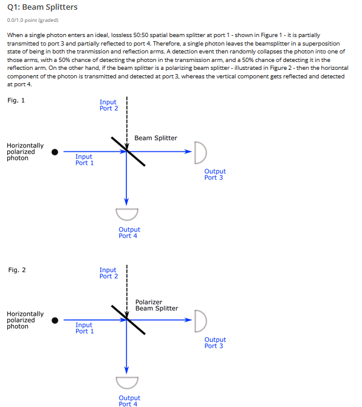

**Q1: Beam Splitters**

0.0/1.0 point (graded)

When a single photon enters an ideal, lossless 50:50 spatial beam splitter at port 1 - shown in Figure 1 - it is partially transmitted to port 3 and partially reflected to port 4. Therefore, a single photon leaves the beamsplitter in a superposition state of being in both the tranmission and reflection arms. A detection event then randomly collapses the photon into one of those arms, with a 50% chance of detecting the photon in the transmission arm, and a 50% chance of detecting it in the reflection arm. On the other hand, if the beam splitter is a polarizing beam splitter - illustrated in Figure 2 - then the horizontal component of the photon is transmitted and detected at port 3, whereas the vertical component gets reflected and detected at port 4.

**Fig. 1** — Horizontally polarized photon enters **Input Port 1** from the left. **Input Port 2** is the dashed vertical input from above. A diagonal **Beam Splitter** sends light right to a detector at **Output Port 3** and down to a detector at **Output Port 4**.

**Fig. 2** — Same layout, but the element is a **Polarizer Beam Splitter**. Horizontal polarization from Input Port 1 goes to Output Port 3; the vertical path goes to Output Port 4.

The question prompt's answer choices are not in this frame.

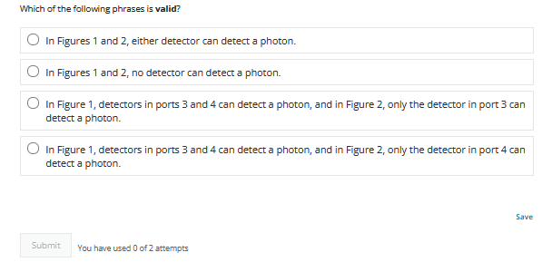

Which of the following phrases is valid?

Unselected radio options:

- In Figures 1 and 2, either detector can detect a photon.
- In Figures 1 and 2, no detector can detect a photon.
- In Figure 1, detectors in ports 3 and 4 can detect a photon, and in Figure 2, only the detector in port 3 can detect a photon.
- In Figure 1, detectors in ports 3 and 4 can detect a photon, and in Figure 2, only the detector in port 4 can detect a photon.

Save (right). Submit is disabled. "You have used 0 of 2 attempts".


## **Transcript**

0

00:00:00,160 \--\> 00:00:01,790

\- Quantum mechanics provides a means

1

00:00:01,790 \--\> 00:00:03,255

to enhance information security

2

00:00:03,255 \--\> 00:00:06,380

by encoding information in quantum mechanical systems,

3

00:00:06,380 \--\> 00:00:07,680

for example qubits.

4

00:00:07,680 \--\> 00:00:09,440

And then distributing those qubits

5

00:00:09,440 \--\> 00:00:11,440

from point A to point B.

6

00:00:11,440 \--\> 00:00:13,487

But how is this done in practice?

7

00:00:13,487 \--\> 00:00:16,910

This week we\'ll introduce quantum communication protocols

8

00:00:16,910 \--\> 00:00:18,538

and how they\'re implemented using single

9

00:00:18,538 \--\> 00:00:20,690

and entangled photons.

10

00:00:20,690 \--\> 00:00:23,120

To get started, before talking about photons,

11

00:00:23,120 \--\> 00:00:25,527

let\'s first talk about light in general.

12

00:00:25,527 \--\> 00:00:28,670

Light is an example of an electromagnetic field

13

00:00:28,670 \--\> 00:00:31,330

and electromagnetic fields are responsible

14

00:00:31,330 \--\> 00:00:33,630

for the many phenomena we commonly associate

15

00:00:33,630 \--\> 00:00:35,700

with electricity and magnetism.

16

00:00:35,700 \--\> 00:00:37,780

For example, it\'s what causes electricity

17

00:00:37,780 \--\> 00:00:39,210

to flow through a wire,

18

00:00:39,210 \--\> 00:00:40,900

and it\'s what makes bar magnets

19

00:00:40,900 \--\> 00:00:42,604

attract or repel one another.

20

00:00:42,604 \--\> 00:00:45,370

And when whether propagating in a material

21

00:00:45,370 \--\> 00:00:46,820

or in an empty space,

22

00:00:46,820 \--\> 00:00:49,360

the electromagnetic field is a wave that oscillates

23

00:00:49,360 \--\> 00:00:50,640

at a given frequency.

24

00:00:50,640 \--\> 00:00:53,370

And these oscillations are what we call light.

25

00:00:53,370 \--\> 00:00:55,700

Now fundamentally the electromagnetic field

26

00:00:55,700 \--\> 00:00:56,780

is quantum mechanical

27

00:00:56,780 \--\> 00:00:59,706

and so light, as with all quantum mechanical systems,

28

00:00:59,706 \--\> 00:01:03,469

is quantized into discrete quanta called photons.

29

00:01:03,469 \--\> 00:01:05,243

The fact that light could be described

30

00:01:05,243 \--\> 00:01:07,310

as both a particle and a wave

31

00:01:07,310 \--\> 00:01:08,950

is what\'s known in quantum mechanics

32

00:01:08,950 \--\> 00:01:10,960

as wave particle duality.

33

00:01:10,960 \--\> 00:01:12,900

And this is why we can talk about

34

00:01:12,900 \--\> 00:01:15,030

discrete particle-like photons

35

00:01:15,030 \--\> 00:01:17,650

having a particular frequency or a wavelength

36

00:01:17,650 \--\> 00:01:20,620

which are both wave-like properties.

37

00:01:20,620 \--\> 00:01:23,320

Now like any wave a photon will oscillate

38

00:01:23,320 \--\> 00:01:26,350

with a given frequency and in a particular direction.

39

00:01:26,350 \--\> 00:01:28,173

So let\'s take those one at a time.

40

00:01:29,460 \--\> 00:01:31,050

In the vernacular use of the word,

41

00:01:31,050 \--\> 00:01:32,410

light is generally part

42

00:01:32,410 \--\> 00:01:34,510

of the visible electromagnetic spectrum,

43

00:01:34,510 \--\> 00:01:35,760

the part which we can see,

44

00:01:35,760 \--\> 00:01:39,330

with different colors being different frequencies of light.

45

00:01:39,330 \--\> 00:01:42,710

But more generally, light as we\'re using the term here,

46

00:01:42,710 \--\> 00:01:45,910

and its associated photons, can exist at any frequency.

47

00:01:45,910 \--\> 00:01:49,239

From the radio frequencies used in radio communication bands

48

00:01:49,239 \--\> 00:01:53,280

to microwaves and terahertz, infrared, visible,

49

00:01:53,280 \--\> 00:01:55,840

ultraviolet light, and on up through x-rays

50

00:01:55,840 \--\> 00:01:57,320

and even gamma rays.

51

00:01:57,320 \--\> 00:01:59,010

Photons are the quanta of light

52

00:01:59,010 \--\> 00:02:01,253

across this entire electromagnetic spectrum.

53

00:02:02,410 \--\> 00:02:04,020

Now in addition to frequency,

54

00:02:04,020 \--\> 00:02:05,930

an electromagnetic wave oscillates

55

00:02:05,930 \--\> 00:02:07,300

in a particular direction.

56

00:02:07,300 \--\> 00:02:09,500

This is called polarization

57

00:02:09,500 \--\> 00:02:11,490

and it generally refers to the direction

58

00:02:11,490 \--\> 00:02:13,680

that the electric field is oscillating.

59

00:02:13,680 \--\> 00:02:15,900

Once that\'s established, Maxwell\'s equations

60

00:02:15,900 \--\> 00:02:18,920

determine the direction of the magnetic field as well.

61

00:02:18,920 \--\> 00:02:21,950

So the direction a photon\'s electric field oscillates

62

00:02:21,950 \--\> 00:02:23,570

is called its polarization.

63

00:02:23,570 \--\> 00:02:25,900

And when a photon travels through space

64

00:02:25,900 \--\> 00:02:28,410

its electric field can oscillate up and down,

65

00:02:28,410 \--\> 00:02:30,410

it can oscillate side to side,

66

00:02:30,410 \--\> 00:02:31,930

and it can even oscillate

67

00:02:31,930 \--\> 00:02:34,010

in an arbitrary, complex super-position

68

00:02:34,010 \--\> 00:02:35,640

of these two directions.

69

00:02:35,640 \--\> 00:02:38,279

And I\'m saying super-position here deliberately.

70

00:02:38,279 \--\> 00:02:41,360

Horizontal and vertical photon polarizations

71

00:02:41,360 \--\> 00:02:43,380

are orthogonal quantum states.

72

00:02:43,380 \--\> 00:02:46,500

So we can put these polarization states, H and V,

73

00:02:46,500 \--\> 00:02:47,729

on the poles of a block sphere

74

00:02:47,729 \--\> 00:02:51,103

and treat them as qubit states, zero and one.

75

00:02:51,103 \--\> 00:02:53,950

Similarly, on the equator of the block sphere,

76

00:02:53,950 \--\> 00:02:56,070

the X axis corresponds to diagonal

77

00:02:56,070 \--\> 00:03:00,250

and anti-diagonal linear polarized light, H plus or minus V.

78

00:03:00,250 \--\> 00:03:03,360

And as one goes from the north to the south pole

79

00:03:03,360 \--\> 00:03:04,850

along the X-Z plane,

80

00:03:04,850 \--\> 00:03:06,820

the polarization remains linear

81

00:03:06,820 \--\> 00:03:09,600

and rotates from horizontal at the north pole

82


<!-- frame 3:08 · diagram · week3/media/media/image2.png -->

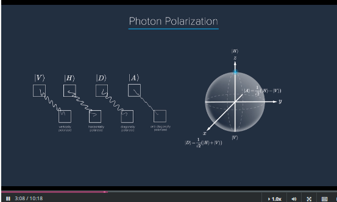

$$|V\rangle,\quad |H\rangle,\quad |D\rangle,\quad |A\rangle$$
$$|A\rangle=\frac{1}{\sqrt{2}}(|H\rangle-|V\rangle)$$
$$|D\rangle=\frac{1}{\sqrt{2}}(|H\rangle+|V\rangle)$$

# Photon Polarization

Four polarization sketches, each a wave through a small square, with a caption:

- $|V\rangle$ — vertically polarized
- $|H\rangle$ — horizontally polarized
- $|D\rangle$ — diagonally polarized
- $|A\rangle$ — anti-diagonally polarized

Poincaré / Bloch sphere on the right, axes $x$, $y$, $z$:

- $|H\rangle$ at the north pole ($+z$)
- $|V\rangle$ at the south pole ($-z$)
- $|A\rangle=\dfrac{1}{\sqrt{2}}(|H\rangle-|V\rangle)$ along $+y$
- $|D\rangle=\dfrac{1}{\sqrt{2}}(|H\rangle+|V\rangle)$ along $+x$

00:03:09,600 \--\> 00:03:11,790

to diagonal at plus X,

83

00:03:11,790 \--\> 00:03:13,217

to vertical at the south pole,

84

00:03:13,217 \--\> 00:03:15,349

anti-diagonal at minus X,

85

00:03:15,349 \--\> 00:03:18,265

and back to horizontal again at the north pole.

86

00:03:18,265 \--\> 00:03:20,810

Now, the Y axis corresponds

87

00:03:20,810 \--\> 00:03:23,700

to right and left circularly polarized light.

88

00:03:23,700 \--\> 00:03:25,470

Circular polarization results

89

00:03:25,470 \--\> 00:03:27,170

from having a complex coefficient,

90

00:03:27,170 \--\> 00:03:29,850

such as H plus or minus I times V.

91

00:03:29,850 \--\> 00:03:32,210

And so, the polarization rotates in time

92

00:03:32,210 \--\> 00:03:33,575

as the photon propagates.

93

00:03:33,575 \--\> 00:03:36,290

Elsewhere on the surface of the block sphere,

94

00:03:36,290 \--\> 00:03:38,298

the polarization is neither purely linear

95

00:03:38,298 \--\> 00:03:39,910

nor purely circular,

96

00:03:39,910 \--\> 00:03:42,140

but instead is generally elliptical.

97

00:03:42,140 \--\> 00:03:44,750

And one can think of the linearly and circularly

98

00:03:44,750 \--\> 00:03:46,940

polarized light as just special cases

99


<!-- frame 3:47 · slide · week3/media/media/image46.png -->

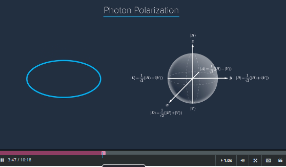

$$
|D\rangle = \frac{1}{\sqrt{2}}(|H\rangle + |V\rangle)
$$

$$
|A\rangle = \frac{1}{\sqrt{2}}(|H\rangle - |V\rangle)
$$

$$
|R\rangle = \frac{1}{\sqrt{2}}(|H\rangle + i|V\rangle)
$$

$$
|L\rangle = \frac{1}{\sqrt{2}}(|H\rangle - i|V\rangle)
$$

# Photon Polarization

Poincaré sphere for photon polarization (a blue empty ellipse is drawn to the left of the sphere).

- \(+z\) (top): \(|H\rangle\)
- \(-z\) (bottom): \(|V\rangle\)
- \(+x\) (toward the viewer): \(|D\rangle = \frac{1}{\sqrt{2}}(|H\rangle + |V\rangle)\)
- \(|A\rangle = \frac{1}{\sqrt{2}}(|H\rangle - |V\rangle)\) (labeled on the front/upper part of the sphere)
- \(+y\) (right): \(|R\rangle = \frac{1}{\sqrt{2}}(|H\rangle + i|V\rangle)\)
- \(-y\) (left): \(|L\rangle = \frac{1}{\sqrt{2}}(|H\rangle - i|V\rangle)\)

00:03:46,940 \--\> 00:03:48,317

of a distorted ellipse.

100

00:03:48,317 \--\> 00:03:50,260

And, note that in optics,

101

00:03:50,260 \--\> 00:03:51,830

they give the sphere a different name.

102

00:03:51,830 \--\> 00:03:53,620

They call this a Poincare Sphere.

103

00:03:53,620 \--\> 00:03:56,119

And their convention is to swap the Y and Z axes

104

00:03:56,119 \--\> 00:03:59,470

so that circularly polarized light is at the poles

105

00:03:59,470 \--\> 00:04:02,167

and linearly polarized light is on the equator.

106

00:04:02,167 \--\> 00:04:05,150

In any case, we\'ll use the block convention here.

107

00:04:05,150 \--\> 00:04:07,487

The electromagnetic field is quantized into photons

108

00:04:07,487 \--\> 00:04:09,670

and the polarization of a single photon

109

00:04:09,670 \--\> 00:04:11,159

can be used as a qubit

110

00:04:11,159 \--\> 00:04:13,197

with horizontal and vertical polarization

111

00:04:13,197 \--\> 00:04:15,263

at the north and south poles.

112

00:04:15,263 \--\> 00:04:17,330

Now, we generally don\'t encounter

113

00:04:17,330 \--\> 00:04:20,200

pure, single photon states in everyday life.

114

00:04:20,200 \--\> 00:04:22,010

First, there are typically on average

115

00:04:22,010 \--\> 00:04:24,580

many more than a single photon from a given source.

116

00:04:24,580 \--\> 00:04:26,050

For example, the light coming from

117

00:04:26,050 \--\> 00:04:27,330

your computer screen right now

118

00:04:27,330 \--\> 00:04:29,480

contains many many billions of photons,

119

00:04:29,480 \--\> 00:04:31,710

each with some arbitrary polarization.

120

00:04:31,710 \--\> 00:04:34,370

And second, such classical light sources

121

00:04:34,370 \--\> 00:04:37,310

are generally statistical combinations or mixtures

122

00:04:37,310 \--\> 00:04:39,649

of many different photon number states.

123

00:04:39,649 \--\> 00:04:41,840

To implement QKD protocols

124

00:04:41,840 \--\> 00:04:44,030

based on single photon polarization,

125

00:04:44,030 \--\> 00:04:46,820

we need to find a way to generate single photons

126

00:04:46,820 \--\> 00:04:49,004

with a specific polarization state.

127

00:04:49,004 \--\> 00:04:52,400

To begin with, a pure quantum state of n photons

128

00:04:52,400 \--\> 00:04:53,740

is called a Fock State.

129

00:04:53,740 \--\> 00:04:56,620

And it\'s state with exactly n photons.

130

00:04:56,620 \--\> 00:04:58,049

And what we would like to do here

131

00:04:58,049 \--\> 00:05:00,954

is generate a one photon Fock State.

132

00:05:00,954 \--\> 00:05:03,895

Fock States are called non-classical states of light

133

00:05:03,895 \--\> 00:05:05,750

because they generally don\'t exist

134

00:05:05,750 \--\> 00:05:07,260

in the classical world around us.

135

00:05:07,260 \--\> 00:05:08,728

At least, not on their own.

136

00:05:08,728 \--\> 00:05:11,380

However, there is a form of classical light

137

00:05:11,380 \--\> 00:05:12,730

called a Coherent State,

138

00:05:12,730 \--\> 00:05:15,910

which comprises an infinite superposition of Fock States.

139

00:05:15,910 \--\> 00:05:17,590

Lasers and microwave oscillators,

140

00:05:17,590 \--\> 00:05:19,783

for example, create this type of light.

141

00:05:19,783 \--\> 00:05:22,990

While a photon Fock State contains a specific

142

00:05:22,990 \--\> 00:05:24,240

number of photons,

143

00:05:24,240 \--\> 00:05:26,060

a coherent state has a probabilistic

144

00:05:26,060 \--\> 00:05:28,000

distribution of photon numbers.

145

00:05:28,000 \--\> 00:05:29,870

For a given coherent state alpha,

146

00:05:29,870 \--\> 00:05:31,593

the probability of measuring n photons

147

00:05:31,593 \--\> 00:05:34,160

is given by a Poisson Distribution

148


<!-- frame 5:34 · slide · week3/media/media/image19.png -->

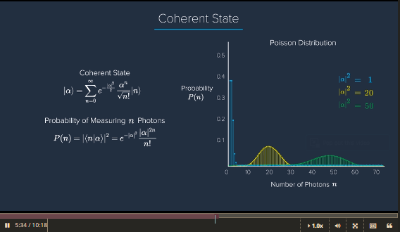

$$|\alpha\rangle = \sum_{n=0}^{\infty} e^{-\frac{|\alpha|^2}{2}} \frac{\alpha^n}{\sqrt{n!}} |n\rangle$$
$$P(n) = |\langle n|\alpha\rangle|^2 = e^{-|\alpha|^2} \frac{|\alpha|^{2n}}{n!}$$

Title: Coherent State

Left:

Coherent State

$$|\alpha\rangle = \sum_{n=0}^{\infty} e^{-|\alpha|^2/2} \frac{\alpha^n}{\sqrt{n!}} |n\rangle$$

Probability of Measuring $n$ Photons

$$P(n) = |\langle n|\alpha\rangle|^2 = e^{-|\alpha|^2} \frac{|\alpha|^{2n}}{n!}$$

Right: Poisson Distribution. Vertical axis Probability $P(n)$ from 0 to 0.5. Horizontal axis Number of Photons $n$ from 0 to 70. Three curves:

- $|\alpha|^2 = 1$ (green), peaked near $n = 0$
- $|\alpha|^2 = 20$ (yellow), peaked near $n = 20$
- $|\alpha|^2 = 50$ (cyan), peaked near $n = 50$

00:05:34,160 \--\> 00:05:36,390

centered around some average number of photons,

149

00:05:36,390 \--\> 00:05:38,640

the magnitude of alpha squared.

150

00:05:38,640 \--\> 00:05:40,560

This means that a Coherent State will always

151

00:05:40,560 \--\> 00:05:43,860

have some probability of being in a one photon Fock State.

152

00:05:43,860 \--\> 00:05:45,710

But its presence is stochastic

153

00:05:45,710 \--\> 00:05:48,160

and very unlikely when the average photon number

154

00:05:48,160 \--\> 00:05:50,170

is much larger than one.

155

00:05:50,170 \--\> 00:05:52,452

Now, a quick and dirty way to produce a single photon

156

00:05:52,452 \--\> 00:05:55,181

is to simply attenuate a coherent source.

157

00:05:55,181 \--\> 00:05:56,840

If we pass laser light

158

00:05:56,840 \--\> 00:05:58,650

through an extremely opaque filter,

159

00:05:58,650 \--\> 00:06:00,202

the average photon number decreases

160

00:06:00,202 \--\> 00:06:02,350

and the beam gets dimmer.

161

00:06:02,350 \--\> 00:06:04,520

As the average photon number decreases,

162

00:06:04,520 \--\> 00:06:06,460

our Poisson Distribution shifts

163

00:06:06,460 \--\> 00:06:07,477

and the probability of measuring

164

00:06:07,477 \--\> 00:06:10,560

a low photon number Fock State increases.

165

00:06:10,560 \--\> 00:06:11,760

To make this concrete,

166

00:06:11,760 \--\> 00:06:13,339

imagine we attenuate a laser light

167

00:06:13,339 \--\> 00:06:16,874

until the average photon number is only 0.1.

168

00:06:16,874 \--\> 00:06:18,560

Plugging this into our formula

169

00:06:18,560 \--\> 00:06:20,669

for the probability of measuring n photons,

170

00:06:20,669 \--\> 00:06:23,200

we find that 90% of the time

171

00:06:23,200 \--\> 00:06:24,780

we\'ll measure zero photons.

172

00:06:24,780 \--\> 00:06:27,590

Nine percent of the time, we\'ll measure one photon.

173

00:06:27,590 \--\> 00:06:28,700

And only one percent of the time

174

00:06:28,700 \--\> 00:06:31,290

will we measure more than one photon.

175


<!-- frame 6:30 · slide · week3/media/media/image60.png -->

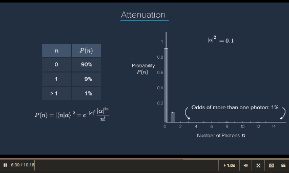

$$
P(n) = |\langle n|\alpha\rangle|^{2} = e^{-|\alpha|^{2}}\frac{|\alpha|^{2n}}{n!}
$$

$$
|\alpha|^{2} = 0.1
$$

# Attenuation

| \(n\) | \(P(n)\) |
| --- | --- |
| 0 | 90% |
| 1 | 9% |
| > 1 | 1% |

\[
P(n) = |\langle n|\alpha\rangle|^{2} = e^{-|\alpha|^{2}}\frac{|\alpha|^{2n}}{n!}
\]

Bar chart of probability \(P(n)\) versus number of photons \(n\), for \(|\alpha|^{2} = 0.1\).

- Vertical axis: Probability \(P(n)\), ticks at 0, 0.2, 0.4, 0.6, 0.8, 1.
- Horizontal axis: Number of Photons \(n\), ticks at 0, 2, 4, 6, 8, 10, 12, 14.
- A bar at \(n = 0\) reaches just under 1; a short bar at \(n = 1\) is near 0.1.
- Callout: "Odds of more than one photon: 1%".

00:06:31,290 \--\> 00:06:33,670

So, with light attenuated to this degree,

176

00:06:33,670 \--\> 00:06:35,770

we can say with reasonably high confidence

177

00:06:35,770 \--\> 00:06:37,099

that if we have a photon,

178

00:06:37,099 \--\> 00:06:38,620

it\'s very likely to be in

179

00:06:38,620 \--\> 00:06:40,290

a single photon state that we need.

180

00:06:40,290 \--\> 00:06:41,700

And there\'s only a one percent chance

181

00:06:41,700 \--\> 00:06:43,853

that it\'s a multi-photon Fock State.

182

00:06:44,770 \--\> 00:06:46,770

However, while attenuation is by far

183

00:06:46,770 \--\> 00:06:48,841

the simplest way to produce a single photon,

184

00:06:48,841 \--\> 00:06:51,071

this procedure is far from ideal.

185

00:06:51,071 \--\> 00:06:54,480

After attenuation, our light is still in a Coherent State,

186

00:06:54,480 \--\> 00:06:57,880

not the pure single photon Fock State that we really want.

187

00:06:57,880 \--\> 00:07:01,230

And moreover, while we exceededed increasing the probability

188

00:07:01,230 \--\> 00:07:02,780

of measuring only one photon,

189

00:07:02,780 \--\> 00:07:05,600

this came at the expense of lowering the probability

190

00:07:05,600 \--\> 00:07:07,454

of measuring any photons at all.

191

00:07:07,454 \--\> 00:07:08,680

In the above example,

192

00:07:08,680 \--\> 00:07:11,396

nine out of ten times there was no photon.

193

00:07:11,396 \--\> 00:07:13,919

And as we further lower the average photon number,

194

00:07:13,919 \--\> 00:07:15,860

we\'ll certainly decrease the chance

195

00:07:15,860 \--\> 00:07:17,498

of getting any multi-photon states

196

00:07:17,498 \--\> 00:07:19,260

but at the same time,

197

00:07:19,260 \--\> 00:07:21,490

we dramatically increase the likelihood

198

00:07:21,490 \--\> 00:07:23,730

that we obtained no photons at all.

199

00:07:23,730 \--\> 00:07:26,780

Thus, the rate at which we obtain single photons goes down

200

00:07:26,780 \--\> 00:07:29,471

and this translates to a lower communication rate.

201

00:07:29,471 \--\> 00:07:32,480

A far better scheme for single photon generation

202

00:07:32,480 \--\> 00:07:34,720

relies on an intermediary quantum system,

203

00:07:34,720 \--\> 00:07:37,114

such as an optically active quantum dot.

204

00:07:37,114 \--\> 00:07:38,840

As we saw in course one,

205

00:07:38,840 \--\> 00:07:41,770

a quantum dot has a ladder of quantized energy levels.

206

00:07:41,770 \--\> 00:07:44,520

Each pair is separated by a unique energy splitting.

207

00:07:44,520 \--\> 00:07:46,294

And transitions between energy levels

208

00:07:46,294 \--\> 00:07:48,960

is generally associated with the absorption or emission

209

00:07:48,960 \--\> 00:07:50,348

of a single photon.

210

00:07:50,348 \--\> 00:07:52,740

The idea is to drive the quantum dot

211

00:07:52,740 \--\> 00:07:54,130

to a higher excited state

212

00:07:54,130 \--\> 00:07:57,340

and then let natural spontaneous emission occur.

213

00:07:57,340 \--\> 00:07:59,750

The quantum dot relaxes back into its ground state,

214

00:07:59,750 \--\> 00:08:01,420

emitting photons at frequencies

215

00:08:01,420 \--\> 00:08:03,390

corresponding to the energy level spacings

216

00:08:03,390 \--\> 00:08:04,546

of its transitions.

217

00:08:04,546 \--\> 00:08:06,547

Importantly, the final transition

218

00:08:06,547 \--\> 00:08:09,210

from the first excited state to the ground state

219

00:08:09,210 \--\> 00:08:10,957

is generally unique and emits a photon

220

00:08:10,957 \--\> 00:08:13,064

at a specific frequency.

221

00:08:13,064 \--\> 00:08:15,150

If we filter the photon emission

222

00:08:15,150 \--\> 00:08:16,250

from the quantum dot,

223

00:08:16,250 \--\> 00:08:18,280

we can block all frequencies of light

224

00:08:18,280 \--\> 00:08:20,946

except the frequency of this final single photon.

225

00:08:20,946 \--\> 00:08:23,565

This final single photon passes through our filter

226

00:08:23,565 \--\> 00:08:26,363

creating exactly the single photon source we need.

227

00:08:27,360 \--\> 00:08:29,040

Although the relaxation process

228

00:08:29,040 \--\> 00:08:30,920

is also stochastic in time,

229

00:08:30,920 \--\> 00:08:33,070

the timing jitter of the single photon emission

230

00:08:33,070 \--\> 00:08:36,450

can be minimized to the extent to the dot relaxes quickly.

231

00:08:36,450 \--\> 00:08:38,361

And in more sophisticated sources,

232

00:08:38,361 \--\> 00:08:40,402

the emission process may even be mediated

233

00:08:40,402 \--\> 00:08:41,960

by a clocked pulse

234

00:08:41,960 \--\> 00:08:44,134

to obtain a heralded stream of single photons.

235

00:08:44,134 \--\> 00:08:47,660

We can then pass these photons through a polarizing filter

236

00:08:47,660 \--\> 00:08:49,318

and prepare the polarization corresponding

237

00:08:49,318 \--\> 00:08:52,612

to the qubit state we need for our QKD protocol.

238


<!-- frame 8:50 · diagram · week3/media/media/image3.png -->

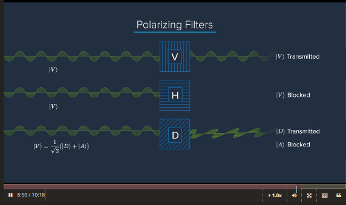

$$|V\rangle=\frac{1}{\sqrt{2}}(|D\rangle+|A\rangle)$$

# Polarizing Filters

Three rows, each a green wave incident on a blue hatched polarizer:

1. $|V\rangle$ wave $\rightarrow$ filter **V** $\rightarrow$ transmitted wave. Label: $|V\rangle$ Transmitted.
2. $|V\rangle$ wave $\rightarrow$ filter **H** $\rightarrow$ no transmitted wave. Label: $|V\rangle$ Blocked.
3. $|V\rangle=\dfrac{1}{\sqrt{2}}(|D\rangle+|A\rangle)$ wave $\rightarrow$ filter **D** $\rightarrow$ a shorter transmitted wave. Labels: $|D\rangle$ Transmitted and $|A\rangle$ Blocked.

00:08:52,612 \--\> 00:08:55,550

Now, in addition to a source of single photons,

239

00:08:55,550 \--\> 00:08:58,210

we also need a device that can detect single photons

240

00:08:58,210 \--\> 00:09:00,200

at the other end of the communication channel.

241

00:09:00,200 \--\> 00:09:02,740

The challenge here is to convert the small amount

242

00:09:02,740 \--\> 00:09:04,640

of energy stored in a single photon

243

00:09:04,640 \--\> 00:09:07,380

into a measurable electrical signal.

244

00:09:07,380 \--\> 00:09:09,730

A common example of a single photon detector

245

00:09:09,730 \--\> 00:09:12,130

is a geiger mode avalanche photodiode.

246

00:09:12,130 \--\> 00:09:14,190

Essentially, a semi-conducting material

247

00:09:14,190 \--\> 00:09:16,760

such as silicon with a large external voltage

248

00:09:16,760 \--\> 00:09:17,776

applied across it.

249

00:09:17,776 \--\> 00:09:20,020

When a photon hits the detector,

250

00:09:20,020 \--\> 00:09:22,460

its energy is sufficient to dislodge an electron

251

00:09:22,460 \--\> 00:09:24,014

from the semi-conducting material.

252

00:09:24,014 \--\> 00:09:26,632

The external voltage then accelerates this electron

253

00:09:26,632 \--\> 00:09:28,131

through the bulk semi-conductor

254

00:09:28,131 \--\> 00:09:30,920

colliding and dislodging more and more electrons,

255

00:09:30,920 \--\> 00:09:32,370

creating an avalanche effect.

256

00:09:32,370 \--\> 00:09:35,700

This cascade of dislodged charges generates a large

257

00:09:35,700 \--\> 00:09:37,230

measurable electrical current,

258


<!-- frame 9:37 · diagram · week3/media/media/image43.png -->

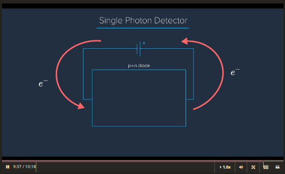

# Single Photon Detector

Circuit of a p-i-n diode biased by a battery. Electrons circulate: one arrow into the diode loop and one out the other side.

00:09:37,230 \--\> 00:09:40,200

which indicates that a photon was absorbed.

259

00:09:40,200 \--\> 00:09:42,290

Other examples of single photon detectors

260

00:09:42,290 \--\> 00:09:44,120

include photo multiplier tubes,

261

00:09:44,120 \--\> 00:09:45,660

superconducting nanowires,

262

00:09:45,660 \--\> 00:09:47,923

and superconducting transition edge sensors.

263

00:09:48,770 \--\> 00:09:51,220

In generating or detecting single photons,

264

00:09:51,220 \--\> 00:09:52,634

it\'s desirable that these processes

265

00:09:52,634 \--\> 00:09:55,940

be performed with high quantum efficiency.

266

00:09:55,940 \--\> 00:09:59,110

For example, a photon is generated on each clock cycle,

267

00:09:59,110 \--\> 00:10:02,910

or every photon that\'s generated is detected without loss.

268

00:10:02,910 \--\> 00:10:04,710

And in the coming week, we\'ll see how

269

00:10:04,710 \--\> 00:10:06,700

the source and detector quantum efficiencies

270

00:10:06,700 \--\> 00:10:08,500

come into play when implementing

271

00:10:08,500 \--\> 00:10:10,353

quantum key distribution protocols.

## **PRACTICE (1 question)**

## 
## 
Section: quantum makes no cryptography single-photon schemes

# Page Title: quantum key distribution bb84 

# **Learn**

Quantum key distribution (QKD) is a protocol used to distribute shared
secret keys with security guarantees that are ideally based on the
properties of quantum mechanics, rather than on the presumed
computational resources of an eavesdropper. This may be contrasted with
classical methods of key exchange, such as the RSA cryptosystem, where
security is based on the presumed classical computing complexity of the
order-finding problem.

The first QKD protocol, now commonly referred to as BB84, was introduced
in 1984 by Charles H. Bennett from IBM and Gilles Brassard from the
University of Montreal. Since then, there have been several proposed QKD
protocols, many of which have been demonstrated, including long-range
experimental demonstrations via satellite and even commercially
available QKD systems.

The BB84 protocol can be used by a sender (Alice) and a receiver (Bob)
who wish to create a shared secret key. It requires that Alice and Bob
have access to a quantum channel -- over which Alice will send polarized
photons to Bob -- and a classical, broadcast channel for coordination
purposes. By a broadcast channel, we mean that an eavesdropper (Eve) can
listen to and record all information sent over this channel, but she
cannot alter it.

To begin the protocol, Alice produces, records, and sends Bob single
photons with polarization encodings -- each chosen at random -- from one
of the four polarization states:
The first pair and the second pair of states are orthogonal -- and --
and, therefore, each pair forms a *polarization measurement basis*. As
such, we can think of photon polarization states as qubit states, with
the photon polarization being either in states and , or in states and .
Importantly, note that while the states within a basis are orthogonal,
states between the two bases are *not* orthogonal with one another, for
example, .

Next, Bob measures each photon in one of the two bases -- either or --
which he chooses at random for each photon, and records the measurement
results. Once complete, Bob then announces the basis he used for each
measurement, but not the result, over the broadcast channel. Because
Alice and Bob independently chose the polarization basis at random for
each photon, there is a 50-50 chance that they chose the same one for
any given photon. And, for each photon where they did choose the same
basis, Alice and Bob will have recorded same polarizaton value, because
the states within each basis are orthogonal, and we assume an ideal
measurement.

For example, if Alice sends and Bob measures in the basis, then Bob will
also measure and record an , assuming perfect measurement, since and .
This is considered a successful trial, because both Alice and Bob
recorded an for this photon. However, for the other half of the photons,
where Alice and Bob did not select the same basis, the results are
uncorrelated, because the two bases are *maximally conjugate*. This
means that a measurement in the wrong basis is equally likely to result
in either of the two incorrect outcomes, for example, . This would be
considered an unsuccessful trial.

The security of BB84 starts with the fact that Eve gains no information
from listening to the broadcast channel, since only information about
bases is available and not the measurement results. Thus, she must try
to gain information from the photons in the quantum channel. However,
any attempt by Eve to extract information reveals her presence through
the introduction of abnormalities in the statistics of Bob\'s measured
results. As a result, Eve is unable to extract information encoded by
Alice without alerting Alice and Bob that she is trying to do so.

One simple strategy Eve could use is to intercept each photon and
measure it in some basis, record the result, and then send a photon to
Bob based on her measurement outcome. In doing this, Eve destroys
Alice\'s original photon, and due to the no-cloning theorem, Eve cannot
exactly reproduce each of Alice\'s photons. If Eve got lucky and
selected the same polarization basis as Alice did, then she *by chance*
will send Bob a photon with the same polarization. But, when Eve does
not choose the same basis as Alice, Eve obtains the *wrong* measurement
result, infers a different polarization (without knowing it), and thus
sends Bob a photon with a polarization different than Alice\'s original
photon. Consequently, the statistics of Alice and Bob\'s measured
results -- successful trials versus unsuccessful trials and their
statistics -- will be altered by Eve\'s activities and reveal her
presence.

Realistically Alice and Bob do not want to throw out the entire key
every time an anomaly occurs, since even without an eavesdropper, noise
and imperfect measurement will always lead to some level of errors and
statistical variation. To deal with this problem, Alice and Bob adopt a
strategy called *privacy amplification*, which produces a new, shorter,
shared key from the original one, and which can in principle reduce
Eve\'s inferred information to zero.

Before implementing privacy amplification, Alice and Bob must first
ensure their keys match. They can do this using classical error
correction methods: for example, having Alice randomly choose two bits
from her key, adding them together modulo 2, and announcing the result
to Bob who, in turn, tries the same and replies with his result. If they
match, the two bits are kept. If they differ, the two bits are
discarded. Just sending the result of modular addition over the
classical channel does not reveal any information to Eve, since it only
indicates the *parity* of the bits -- that is, whether the two bits have
the same or different values, but not their specific values. Using this
technique, Alice and Bob will arrive at two matching keys. However, Eve
may still have knowledge of a few of these bits (but, certainly not all
of them).

Next, the privacy amplification protocol is applied. Privacy
amplification comprises a series of transformations on Alice and Bob\'s
matching key to create a shorter key, one which Eve cannot replicate
without knowing the entire initial key. For example, Alice and Bob
jointly choose pairs of bits at random from their keys and replace the
bits with their binary addition. Intuitively, this works because of
parity; Eve cannot know the value of the binary addition without knowing
the value of both initial bits. Based on the error rates found in Alice
and Bob\'s initial keys, they can estimate how much information Eve has
and then reduce it to a desired level (approaching zero) using the
privacy amplification protocol.

So far we have only dealt with eavesdropping in the ideal case; however,
real world implementations of BB84 and other QKD protocols are
potentially open to a much wider range of system-level vulnerabilities.
For example, if attenuated classical light is used to generate single
photons rather than a true single photon source, *photon number
splitting attacks* become possible on residual states with more than one
photon. In this case, Eve can split off and measure one of the photons
in the multi-photon state without impacting the polarization that
reaches Bob. In addition, access to the hardware at Alice and Bob\'s
locations must be restricted to trusted personnel only. Otherwise, an
Eavesdropper can gain access to the random number generator used to
select bases, or even the encoded keys themselves by other means. There
are just a few examples of the types of attacks -- many of which are
independent of the quantum nature of QKD -- that may compromise the
quantum-enhanced security afforded by an ideally implemented QKD system.

## **Images**

$$|\psi_H\rangle = |H\rangle,$$
$$|\psi_V\rangle = |V\rangle,$$
$$|\psi_+\rangle = \frac{1}{\sqrt{2}}(|H\rangle+|V\rangle),$$
$$|\psi_-\rangle = \frac{1}{\sqrt{2}}(|H\rangle-|V\rangle).$$

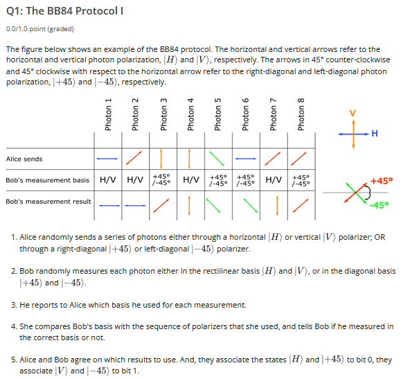

$$|H\rangle,\ |V\rangle,\ |+45\rangle,\ |-45\rangle$$

Q1: The BB84 Protocol I

0.0/1.0 point (graded)

The figure below shows an example of the BB84 protocol. The horizontal and vertical arrows refer to the horizontal and vertical photon polarization, $|H\rangle$ and $|V\rangle$, respectively. The arrows in 45° counter-clockwise and 45° clockwise with respect to the horizontal arrow refer to the right-diagonal and left-diagonal photon polarization, $|+45\rangle$ and $|-45\rangle$, respectively.

Legend: orange arrow up = V; blue arrow horizontal = H; red diagonal = +45°; green diagonal = −45°.

| | Photon 1 | Photon 2 | Photon 3 | Photon 4 | Photon 5 | Photon 6 | Photon 7 | Photon 8 |
| --- | --- | --- | --- | --- | --- | --- | --- | --- |
| Alice sends | blue H | red +45° | orange V | orange V | green −45° | blue H | red +45° | red +45° |
| Bob's measurement basis | H/V | H/V | +45°/−45° | H/V | +45°/−45° | +45°/−45° | H/V | +45°/−45° |
| Bob's measurement result | blue H | blue H | red +45° | orange V | green −45° | green −45° | orange V | red +45° |

1. Alice randomly sends a series of photons either through a horizontal $|H\rangle$ or vertical $|V\rangle$ polarizer, OR through a right-diagonal $|+45\rangle$ or left-diagonal $|-45\rangle$ polarizer.
2. Bob randomly measures each photon either in the rectilinear basis $|H\rangle$ and $|V\rangle$, or in the diagonal basis $|+45\rangle$ and $|-45\rangle$.
3. He reports to Alice which basis he used for each measurement.
4. She compares Bob's basis with the sequence of polarizers that she used, and tells Bob if he measured in the correct basis or not.
5. Alice and Bob agree on which results to use. And, they associate the states $|H\rangle$ and $|+45\rangle$ to bit 0, they associate $|V\rangle$ and $|-45\rangle$ to bit 1.

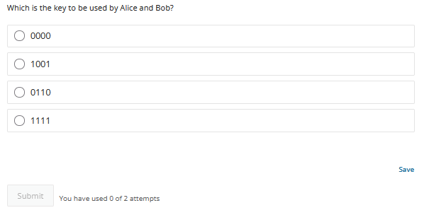

Which is the key to be used by Alice and Bob?

Unselected radio options:

- 0000
- 1001
- 0110
- 1111

Save (right). Submit is disabled. "You have used 0 of 2 attempts".


## **Transcript**

## 

00

00:00:00,000 \--\> 00:00:00,870

1

00:00:00,870 \--\> 00:00:02,850

Ordinary classical information\-- everybody

2

00:00:02,850 \--\> 00:00:04,710

understands that because it surrounds us.

3

00:00:04,710 \--\> 00:00:06,720

It\'s like the information in a book.

4

00:00:06,720 \--\> 00:00:09,000

You can copy it at will, and it\'s not

5

00:00:09,000 \--\> 00:00:10,080

disturbed by reading it.

6

00:00:10,080 \--\> 00:00:11,790

But what is quantum information?

7

00:00:11,790 \--\> 00:00:14,430

Rather than give a mathematical description,

8

00:00:14,430 \--\> 00:00:16,170

I try to find a metaphor for it.

9

00:00:16,170 \--\> 00:00:18,840

It\'s rather like the information in a dream.

10

00:00:18,840 \--\> 00:00:21,210

If you try to describe your dream to someone,

11

00:00:21,210 \--\> 00:00:24,000

your memory of it changes, and eventually you forget the dream

12

00:00:24,000 \--\> 00:00:26,190

and you only remember what you said about it.

13

00:00:26,190 \--\> 00:00:29,790

You can\'t prove to someone else what you dreamed,

14

00:00:29,790 \--\> 00:00:32,549

and you can lie about your dream without getting caught.

15

00:00:32,549 \--\> 00:00:35,970

But there is no really hard science of dreams,

16

00:00:35,970 \--\> 00:00:38,700

despite the effort of Sigmund Freud.

17

00:00:38,700 \--\> 00:00:42,570

And unlike dreams, there is a good mathematical theory

18

00:00:42,570 \--\> 00:00:44,010

of quantum information.

19

00:00:44,010 \--\> 00:00:45,570

Indeed, when you develop it, you\'ll

20

00:00:45,570 \--\> 00:00:48,170

see where classical information comes from,

21

00:00:48,170 \--\> 00:00:51,420

that we used to think was just simply information.

22

00:00:51,420 \--\> 00:00:55,800

Well, here are some examples of elementary quantum behavior.

23

00:00:55,800 \--\> 00:00:58,590

We can use single photons of light

24

00:00:58,590 \--\> 00:01:01,230

to carry one bit of information each

25

00:01:01,230 \--\> 00:01:05,760

because a horizontal photon, as at the top of the figure,

26

00:01:05,760 \--\> 00:01:08,670

can be reliably distinguished from vertical photon,

27

00:01:08,670 \--\> 00:01:10,000

as in the middle.

28

00:01:10,000 \--\> 00:01:12,390

And if you pass them through a calcite crystal like that,

29

00:01:12,390 \--\> 00:01:15,330

or crystal of any other sufficiently un-symmetric

30

00:01:15,330 \--\> 00:01:18,690

material, the horizontal photons will get passed straight

31

00:01:18,690 \--\> 00:01:21,570

through and the vertical ones will get deviated

32

00:01:21,570 \--\> 00:01:22,440

by some amount.

33


<!-- frame 1:22 · slide · week3/media/media/image61.png -->

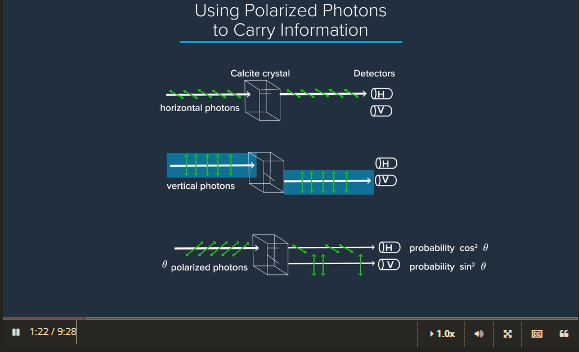

$$
\text{probability }\cos^{2}\theta
$$

$$
\text{probability }\sin^{2}\theta
$$

# Using Polarized Photons to Carry Information

Three calcite-crystal setups, with detectors labeled \(|H\rangle\) and \(|V\rangle\).

1. **Horizontal photons** pass straight through the calcite crystal into the \(|H\rangle\) detector. The \(|V\rangle\) detector is drawn but not illuminated.
2. **Vertical photons** (highlighted) pass through the crystal into the \(|V\rangle\) detector. The \(|H\rangle\) detector is not on that path.
3. **\(\theta\) polarized photons** are split by the calcite crystal: the upper path goes to \(|H\rangle\) with probability \(\cos^{2}\theta\), and the lower path goes to \(|V\rangle\) with probability \(\sin^{2}\theta\).

00:01:22,440 \--\> 00:01:25,920

And therefore, you can count them in two separate detectors.

34

00:01:25,920 \--\> 00:01:27,780

And that means each photon can carry

35

00:01:27,780 \--\> 00:01:31,900

one reliable bit of classical information,

36

00:01:31,900 \--\> 00:01:35,040

but if you put in photons at some other angle,

37

00:01:35,040 \--\> 00:01:37,740

instead of being deviated by an intermediate amount,

38

00:01:37,740 \--\> 00:01:40,860

as you might expect, they behave probabilistically.

39

00:01:40,860 \--\> 00:01:44,670

Some of them go into the upper beam and become horizontal,

40

00:01:44,670 \--\> 00:01:48,690

and the others go into the lower beam and become vertical.

41

00:01:48,690 \--\> 00:01:51,120

This is, you might say, one of the central mysteries

42

00:01:51,120 \--\> 00:01:55,080

of quantum mechanics, the random behavior of things

43

00:01:55,080 \--\> 00:01:58,890

that are individually identically prepared.

44

00:01:58,890 \--\> 00:02:02,790

This means that I can use vertical and horizontal photons

45

00:02:02,790 \--\> 00:02:05,970

to send one bit per photon of message,

46

00:02:05,970 \--\> 00:02:08,880

but if I put in diagonal photons,

47

00:02:08,880 \--\> 00:02:11,470

well, simply by rotating the apparatus,

48

00:02:11,470 \--\> 00:02:15,060

I can distinguish a left diagonal from a right diagonal,

49

00:02:15,060 \--\> 00:02:17,280

like a slash from a backslash.

50

00:02:17,280 \--\> 00:02:20,460

But once that rotated apparatus is used,

51

00:02:20,460 \--\> 00:02:22,980

that thing cannot distinguish the vertical from

52

00:02:22,980 \--\> 00:02:24,030

the horizontal.

53

00:02:24,030 \--\> 00:02:27,240

So we have four separate states of the photons

54

00:02:27,240 \--\> 00:02:30,990

that are, pairwise, perfectly distinguishable.

55


<!-- frame 2:31 · diagram · week3/media/media/image4.png -->

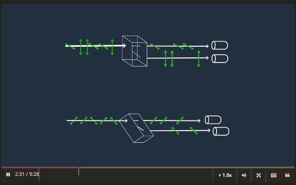

Two unlabeled schematics of photon pairs passing through a crystal into a pair of detectors (no on-screen text).

**Top:** a horizontal beam carrying vertical green polarization arrows enters an upright rectangular crystal (drawn in perspective). Two output beams, also vertically polarized, each enter a cylindrical detector.

**Bottom:** a beam carrying diagonal green polarization arrows enters a tilted crystal. Two output beams, diagonally polarized, each enter a cylindrical detector.

00:02:30,990 \--\> 00:02:33,180

But you can\'t distinguish all four kinds.

56

00:02:33,180 \--\> 00:02:35,640

Now I want to get you to worry a little bit

57

00:02:35,640 \--\> 00:02:37,050

about this strange behavior.

58

00:02:37,050 \--\> 00:02:40,620

And my colleague, Bill Wootters, who\'s

59

00:02:40,620 \--\> 00:02:44,340

a physics professor at Williams College,

60

00:02:44,340 \--\> 00:02:48,570

has a pedagogic analog for the behavior of quantum systems

61

00:02:48,570 \--\> 00:02:49,710

when they\'re measured.

62

00:02:49,710 \--\> 00:02:52,740

He says it\'s really like one of those old fashioned 19th

63

00:02:52,740 \--\> 00:02:55,950

century British schools where the students, who are not

64

00:02:55,950 \--\> 00:02:58,920

supposed to ask any questions\-- they were just supposed

65

00:02:58,920 \--\> 00:03:01,920

to respond to the questions the teacher posed,

66

00:03:01,920 \--\> 00:03:05,310

and here the student is the photon and the teacher

67

00:03:05,310 \--\> 00:03:06,790

is the measuring apparatus.

68

00:03:06,790 \--\> 00:03:09,110

So the strict teacher is asking the student

69

00:03:09,110 \--\> 00:03:12,000

a question, saying, is your polarization

70

00:03:12,000 \--\> 00:03:13,980

vertical or horizontal?

71

00:03:13,980 \--\> 00:03:15,950

And the students start saying, I\'m

72

00:03:15,950 \--\> 00:03:20,370

polarized about 56, 55 degrees.

73

00:03:20,370 \--\> 00:03:22,290

I believe I asked you a question.

74

00:03:22,290 \--\> 00:03:23,930

Are you vertical or horizontal?

75

00:03:23,930 \--\> 00:03:25,680

Oh, horizontal, sir.

76

00:03:25,680 \--\> 00:03:27,990

Did you ever have any other polarization?

77

00:03:27,990 \--\> 00:03:29,850

No, sir, I was always horizontal.

78

00:03:29,850 \--\> 00:03:33,310

So that is the way quantum systems behave when measured,

79

00:03:33,310 \--\> 00:03:36,330

and that\'s what lies behind many of the interesting things you

80

00:03:36,330 \--\> 00:03:37,060

can do with it.

81

00:03:37,060 \--\> 00:03:40,150

And ultimately, when we come to entanglement,

82

00:03:40,150 \--\> 00:03:42,900

we can understand where that behavior comes from.

83

00:03:42,900 \--\> 00:03:45,450

Well, now, we\'ll talk about how we put it to use.

84

00:03:45,450 \--\> 00:03:47,820

This is the quantum money that was

85

00:03:47,820 \--\> 00:03:51,120

proposed by Wiesner in 1968.

86

00:03:51,120 \--\> 00:03:52,680

He says, a piece of quantum money

87

00:03:52,680 \--\> 00:03:55,420

will have a serial number on it like ordinary money,

88

00:03:55,420 \--\> 00:03:59,310

but it also will have 20 perfectly reflective boxes,

89

00:03:59,310 \--\> 00:04:03,120

each containing a single photon of one of those four states.

90


<!-- frame 4:00 · diagram · week3/media/media/image6.png -->

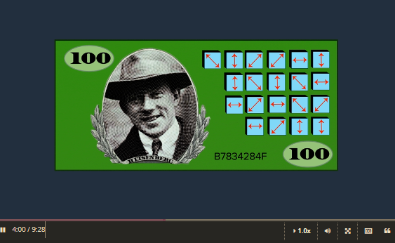

Stylized green banknote used as a teaching graphic.

- Oval **100** at the upper left and another **100** at the lower right
- Oval portrait of a man in a hat, captioned **HEISENBERG**, with a laurel wreath
- Serial number **B7834284F**
- Cluster of light-blue squares with red double-headed arrows (polarization axes). The rows are staggered and right-aligned:

| Row | Arrow directions, left to right |
| --- | --- |
| 1 (6 squares) | backslash, vertical, slash, slash, horizontal, vertical |
| 2 (5 squares) | vertical, backslash, vertical, backslash, horizontal |
| 3 (5 squares) | horizontal, slash, horizontal, backslash, slash |
| 4 (4 squares) | horizontal, slash, vertical, vertical |

Backslash = diagonal axis from upper-left to lower-right. Slash = diagonal axis from lower-left to upper-right.

00:04:03,120 \--\> 00:04:05,430

And the bank will have a record based

91

00:04:05,430 \--\> 00:04:08,250

on the serial number of which photon is in which box,

92

00:04:08,250 \--\> 00:04:11,010

which kind of photon, and when you bring the money back

93

00:04:11,010 \--\> 00:04:13,500

to the bank, the bank will open the boxes, one by one,

94

00:04:13,500 \--\> 00:04:15,720

and measure each photon in the way

95

00:04:15,720 \--\> 00:04:18,600

that it would behave reliably, and therefore

96

00:04:18,600 \--\> 00:04:21,750

check that they all agree with what was supposed

97

00:04:21,750 \--\> 00:04:23,140

to be stored there.

98

00:04:23,140 \--\> 00:04:25,200

But if you don\'t know what\'s stored there,

99

00:04:25,200 \--\> 00:04:28,340

you will disturb some of them by measuring them the wrong way,

100

00:04:28,340 \--\> 00:04:31,620

and the chance of passing a fake bill

101

00:04:31,620 \--\> 00:04:36,720

or making a copy that passes is 3/4 to the 20th power, which

102

00:04:36,720 \--\> 00:04:37,980

is small.

103

00:04:37,980 \--\> 00:04:41,850

Now, this is the idea that Gilles Brassard and I used

104

00:04:41,850 \--\> 00:04:45,180

in our building the quantum cryptography apparatus where

105

00:04:45,180 \--\> 00:04:46,650

we don\'t try to store the photons,

106

00:04:46,650 \--\> 00:04:49,140

but we send them over a short distance, which in this case

107

00:04:49,140 \--\> 00:04:51,750

was only about 30 centimeters.

108

00:04:51,750 \--\> 00:04:53,730

And the idea is that any eavesdropper

109

00:04:53,730 \--\> 00:04:58,320

in that middle empty section of the apparatus

110

00:04:58,320 \--\> 00:05:00,730

would spoil the sum of the transmitted photons

111

00:05:00,730 \--\> 00:05:02,580

by measuring the wrong way, and therefore,

112

00:05:02,580 \--\> 00:05:05,470

would betray their presence.

113

00:05:05,470 \--\> 00:05:07,480

So in more detail, the way quantum

114

00:05:07,480 \--\> 00:05:11,260

key distribution works is that you have two parties.

115

00:05:11,260 \--\> 00:05:13,240

We call them Alice and Bob.

116

00:05:13,240 \--\> 00:05:17,410

Alice sends a stream of polar ice photons of those four kinds

117

00:05:17,410 \--\> 00:05:18,580

to Bob.

118

00:05:18,580 \--\> 00:05:21,850

The Eve is the nickname for the eavesdropper.

119

00:05:21,850 \--\> 00:05:24,580

She can try to measure those photons if she wants,

120

00:05:24,580 \--\> 00:05:26,860

but if she does, she will introduce errors

121

00:05:26,860 \--\> 00:05:27,940

with high probability.

122

00:05:27,940 \--\> 00:05:29,680

And the other thing we allow her to do

123

00:05:29,680 \--\> 00:05:32,860

is to listen to the entire classical discussion

124

00:05:32,860 \--\> 00:05:34,780

between Alice and Bob.

125

00:05:34,780 \--\> 00:05:36,520

And that takes place through a series

126

00:05:36,520 \--\> 00:05:39,370

of ordinary classical messages exchanged

127

00:05:39,370 \--\> 00:05:40,820

over a public channel.

128

00:05:40,820 \--\> 00:05:42,340

And when they\'re done with all this,

129

00:05:42,340 \--\> 00:05:46,990

they end up each with a shared secret key,

130

00:05:46,990 \--\> 00:05:50,580

in other words, a random string that they both know

131

00:05:50,580 \--\> 00:05:54,060

and they have high confidence that no one else knows.

132

00:05:54,060 \--\> 00:05:56,650

Well, that is the case if there isn\'t too much eavesdropping,

133

00:05:56,650 \--\> 00:05:58,600

or there\'s no eavesdropping, but if there\'s

134

00:05:58,600 \--\> 00:06:01,210

a lot of eavesdropping, they will detect a lot of errors

135

00:06:01,210 \--\> 00:06:04,030

and their effort to distill this key will have failed.

136

00:06:04,030 \--\> 00:06:06,850

But they will know that it has failed with high probability.

137

00:06:06,850 \--\> 00:06:08,990

And they just try again tomorrow.

138

00:06:08,990 \--\> 00:06:11,380

So in more detail, here\'s how the protocol works,

139

00:06:11,380 \--\> 00:06:14,380

which is called BB84 after the names of the author

140

00:06:14,380 \--\> 00:06:16,420

and the year that it came out.

141

00:06:16,420 \--\> 00:06:19,750

Alice, in the first line, sends a random sequence

142

00:06:19,750 \--\> 00:06:21,960

of these four kinds of photons.

143

00:06:21,960 \--\> 00:06:25,217

Bob, at the other side, makes random measurements, uncorrelated.

144

00:06:25,217 \--\> 00:06:26,800

He doesn\'t know what Alice would send,

145

00:06:26,800 \--\> 00:06:28,750

and he just chooses randomly whether to make

146

00:06:28,750 \--\> 00:06:32,500

a rectilinear measurement that is vertical versus horizontal,

147


<!-- frame 6:31 · slide · week3/media/media/image38.png -->

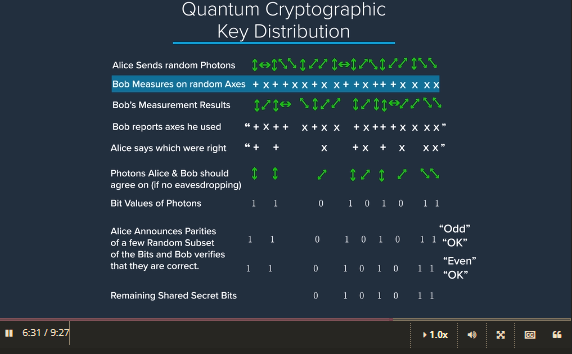

# Quantum Cryptographic Key Distribution

BB84-style sifting table. The row "Bob Measures on random Axes" is highlighted. Photon rows are green polarization arrows; individual glyphs are small.

| Step | Symbols |
| --- | --- |
| Alice Sends random Photons | a long row of green polarization arrows (horizontal, vertical, and diagonal) |
| Bob Measures on random Axes | `+ X + + X X + X X + + X + + X X X` |
| Bob's Measurement Results | green polarization arrows in clusters |
| Bob reports axes he used | `"+ X + +"` · `"X + X X"` · `"+ X + + + X X X X"` |
| Alice says which were right | `"+ +"` · `"X"` · `"+ X + X"` · `"X X"` |
| Photons Alice & Bob should agree on (if no eavesdropping) | green arrows in those four groups |
| Bit Values of Photons | `1 1` · `0` · `1 0 1 0` · `1 1` |
| Alice Announces Parities of a few Random Subset of the Bits and Bob verifies that they are correct. | same bits `1 1` · `0` · `1 0 1 0` · `1 1` twice, with `"Odd"` / `"OK"` on the first check and `"Even"` / `"OK"` on the second |
| Remaining Shared Secret Bits | `0` · `1 0 1 0` · `1 1` (the leading `1 1` pair is not kept) |

Player: paused, speed 1.0x.

00:06:32,500 \--\> 00:06:33,610

or a diagonal measurement.

148

00:06:33,610 \--\> 00:06:35,890

So he does, and then in the third line,

149

00:06:35,890 \--\> 00:06:37,500

we get his measurement results.

150

00:06:37,500 \--\> 00:06:41,140

And I\'m including the realistic effect that some of the photons

151

00:06:41,140 \--\> 00:06:44,920

may get lost, or his detectors may not be perfectly efficient.

152

00:06:44,920 \--\> 00:06:47,320

So in some cases, he doesn\'t get anything.

153

00:06:47,320 \--\> 00:06:50,830

For example, in the first case Alice sent a vertical photon.

154

00:06:50,830 \--\> 00:06:54,220

He chose to make a rectilinear measurement

155

00:06:54,220 \--\> 00:06:58,600

and he gets a result which is vertical, which is correct.

156

00:06:58,600 \--\> 00:07:02,230

In the second case, Alice sent a horizontal photon,

157

00:07:02,230 \--\> 00:07:04,690

but he decided to make a diagonal measurement

158

00:07:04,690 \--\> 00:07:07,864

and he gets a random one of the two diagonal results.

159

00:07:07,864 \--\> 00:07:09,280

But he doesn\'t know that it\'s bad.

160

00:07:09,280 \--\> 00:07:12,880

It\'s a 45-degree photon, and so on for the others.

161

00:07:12,880 \--\> 00:07:14,710

The next stage of the protocol now

162

00:07:14,710 \--\> 00:07:16,300

is, after he\'s received them, Bob

163

00:07:16,300 \--\> 00:07:19,270

tells Alice which kind of measurement he did.

164

00:07:19,270 \--\> 00:07:21,880

He said, I measured the first one rectilinearly,

165

00:07:21,880 \--\> 00:07:24,100

the second one diagonally, the third and fourth one

166

00:07:24,100 \--\> 00:07:28,210

rectilinearly, the fifth one I didn\'t get, and so on.

167

00:07:28,210 \--\> 00:07:30,340

That\'s indicated by the classical message

168

00:07:30,340 \--\> 00:07:31,900

in quotation marks.

169

00:07:31,900 \--\> 00:07:33,340

And then Alice tells him in which

170

00:07:33,340 \--\> 00:07:35,575

cases he did the right thing, that is, he

171

00:07:35,575 \--\> 00:07:39,610

made a measurement that didn\'t spoil the polarization that she

172

00:07:39,610 \--\> 00:07:40,290

sent.

173

00:07:40,290 \--\> 00:07:42,040

She very carefully doesn\'t say whether she

174

00:07:42,040 \--\> 00:07:45,010

said vertical or horizontal, but she says in the first case

175

00:07:45,010 \--\> 00:07:47,920

you made a rectilinear measurement and that was good.

176

00:07:47,920 \--\> 00:07:49,241

Keep that photon.

177

00:07:49,241 \--\> 00:07:51,490

Don\'t tell me what it was, of course, because somebody

178

00:07:51,490 \--\> 00:07:52,690

might be listening.

179

00:07:52,690 \--\> 00:07:56,020

In the second case, too bad, you made a diagonal measurement.

180

00:07:56,020 \--\> 00:07:58,730

I sent a rectilinear photon, and so on.

181

00:07:58,730 \--\> 00:08:02,050

So they cull from the photons that Bob received,

182

00:08:02,050 \--\> 00:08:03,940

the ones that he spoiled.

183

00:08:03,940 \--\> 00:08:07,900

And you can identify, say, a vertical photon is a 1,

184

00:08:07,900 \--\> 00:08:10,600

a horizontal is 0, or for the diagonal photons,

185


<!-- frame 8:09 · slide · week3/media/media/image62.png -->

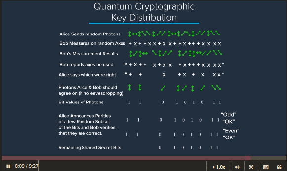

# Quantum Cryptographic Key Distribution

Video slide, BB84-style sifting table. Photon rows are green polarization arrows; the individual arrow glyphs are too small to transcribe reliably. Readable rows:

| Step | Symbols |
|---|---|
| Alice Sends random Photons | a long row of green polarization arrows |
| Bob Measures on random Axes | `+ x + + x x + x x + + x + + x x x` |
| Bob's Measurement Results | green polarization arrows in clusters |
| Bob reports axes he used | `"+ x + +"` · `"x + x x"` · `"+ x + + x x x x"` |
| Alice says which were right | `"+ +"` · `"x"` · `"+ x + x"` · `"x x"` |
| Photons Alice & Bob should agree on (if no eavesdropping) | green arrows aligned with those four columns |
| Bit Values of Photons | `1 1` · `0` · `1 0 1 0` · `1 1` |
| Alice Announces Parities of a few Random Subset of the Bits and Bob verifies that they are correct. | same bits `1 1` · `0` · `1 0 1 0` · `1 1`, with `"Odd"` `"OK"` on the first check and `"Even"` `"OK"` on the second |
| Remaining Shared Secret Bits | `0` · `1 0 1 0` · `1 1` (the leading `1 1` pair is not kept) |

00:08:10,600 \--\> 00:08:14,740

they choose to identify the 45 degree as a 0,

186

00:08:14,740 \--\> 00:08:17,020

and the 135 is a 1.

187

00:08:17,020 \--\> 00:08:20,110

So what they have, essentially, at this stage

188

00:08:20,110 \--\> 00:08:22,390

is a bunch of bit values that they

189

00:08:22,390 \--\> 00:08:26,350

ought to agree about if there has been no eavesdropping.

190

00:08:26,350 \--\> 00:08:28,090

So the next question is to find out

191

00:08:28,090 \--\> 00:08:30,160

whether there\'s been eavesdropping,

192

00:08:30,160 \--\> 00:08:31,720

and you can do that various ways,

193

00:08:31,720 \--\> 00:08:34,840

but the most economical way that doesn\'t involve giving away

194

00:08:34,840 \--\> 00:08:38,320

a lot of the data is for Alice to choose

195

00:08:38,320 \--\> 00:08:40,360

a random subset of the bit positions,

196

00:08:40,360 \--\> 00:08:43,120

and announce the parity of that random subset.

197

00:08:43,120 \--\> 00:08:46,570

And in the first case, she chose this collection outlined

198

00:08:46,570 \--\> 00:08:49,660

in red, and it has odd parity.

199

00:08:49,660 \--\> 00:08:51,610

She says that it\'s odd.

200

00:08:51,610 \--\> 00:08:53,170

And then the second one, she chooses

201

00:08:53,170 \--\> 00:08:55,420

a different random subset and says that\'s even,

202

00:08:55,420 \--\> 00:08:59,411

and they go on for maybe 20 of these random subsets.

203

00:08:59,411 \--\> 00:09:00,910

And if they agree about all of them,

204

00:09:00,910 \--\> 00:09:02,470

then the chance that there\'s even one

205

00:09:02,470 \--\> 00:09:06,460

mistake in their sequence is about one in a million.

206

00:09:06,460 \--\> 00:09:08,064

So they\'re pretty happy with that.

207

00:09:08,064 \--\> 00:09:10,480

And of course, they have to throw away some of the photons

208

00:09:10,480 \--\> 00:09:12,104

to compensate for the fact that they\'ve

209

00:09:12,104 \--\> 00:09:15,840

leaked 20 bits of information to the eavesdropper.

210

00:09:15,840 \--\> 00:09:20,730

So that\'s the elementary version of the BB84 protocol.

211

00:09:20,730 \--\> 00:09:26,998

## **PRACTICE (1 question)**

Section: quantum makes, new cryptography, entangled proton schemes

# Page Title: entangled proton sources and detectors 

# **Learn**


### **Generating Four Bell States**

In general, it is possible to create all four Bell states given just one
of them. For a polarization-entangled Bell state with horizontal and
vertical polarization, this can be accomplished using optical elements
called \"waveplates.\" Waveplates rotate the polarization axis around
the direction of propagation by a specific angle chosen by the design of
the waveplate. The waveplate material -- a birefringent crystal such as
quartz -- has polarization-dependent refractive indices which enable a
particular polarization to propagate faster through the material -- the
\"fast axis\" -- than the polarization orthogonal to it -- the \"slow
axis.\" These two axes form a two-dimensional coordinate system.

Suppose a linearly polarized photon is incident on a waveplate. The
overall phase accumulated while the photon travels through the waveplate
depends on the waveplate thickness -- corresponding to the distance the
photon has to propagate to pass through the optical element. However, in
addition, the photon polarization is projected on to the waveplate\'s
coordinate system, and the portion along the slow axis accumulates an
additional phase with respect to the component along the fast axis.

If the \"extra\" phase is equivalent to one-half the incident photon
wavelength, the waveplate is referred to as a \"half-wave plate.\" And,
the angle between the half-wave plate coordinate system relative to the
polarization axis of the photon determines the projections onto the fast
and slow axes and, thus, the rotation of the polarization.


**Detection of Bell States**

To determine the success of the generation of a particular type of Bell
state, detection schemes able to distinguish all four Bell states are
necessary. A deterministic measurement of Bell states generally requires
non-linear elements and two-particle interactions capable of performing
conditional two-qubit rotations, two-particle interferometry (e.g.,
[[Hong-Ou-Mandel
experiment]{.underline}](https://en.wikipedia.org/wiki/Hong%E2%80%93Ou%E2%80%93Mandel_effect)
sensitive to quantum statistics), number-resolving photodetectors, and
the like. The details and trade-space of the various types of Bell state
analyzers is beyond the scope of this text unit. For our purposes here,
we will consider one example of a Bell-state analysis -- which uses the
CNOT gate as the conditional, two-qubit gate -- and apply it to our
photon polarization-entangled Bell-state example.

Since photons interact only weakly (if at all), it is challenging to
make reliable, non-linear optical elements that implement deterministic,
non-linear operations with high efficiency. Linear optical elements are
reliable, but they cannot be used to deterministically distinguish all
four polarization-entangled Bell states. However, there are
*probabilistic* schemes that can distinguish the Bell states using
linear optics. In this case, one must identically prepare the same Bell
state many times and run protocols using linear optical elements
followed by measurement. Through these schemes, effective non-linear
interactions can be realized probabilistically and then detected through
an appropriate measurement scheme. When a spectator measurement
indicates that an effective interaction has occurred, the results from
that specific experimental trial are kept and aggregated to perform the
Bell-state analysis; this is called *post-selection*. For example,
although there is no deterministic CNOT gate with solely linear optics,
there is a scheme for implementing a probabilistic CNOT , gate with
linear optics that can be leveraged with measurement post-selection.
## **Images**

$$|\Psi\rangle_{12} = \frac{1}{\sqrt{2}}(|0\rangle_1|1\rangle_2 + |1\rangle_1|0\rangle_2)$$
$$|\phi\rangle_1 \otimes |\psi\rangle_2$$
$$\omega_p = \omega_s + \omega_i$$
$$\vec{k}_p = \vec{k}_s + \vec{k}_i$$

Generation and Detection of Bell States

Entanglement is a manifestly quantum mechanical state of two or more quantum systems whereby the state as a whole cannot be reduced to a representation of independent, single-system states. For example, the two-qubit state $|\Psi\rangle_{12} = \frac{1}{\sqrt{2}}(|0\rangle_1|1\rangle_2 + |1\rangle_1|0\rangle_2)$, cannot be written as a tensor product of two single-qubit states $|\phi\rangle_1 \otimes |\psi\rangle_2$. (Try this for yourself and you will find that you always get terms that do not appear in $|\Psi\rangle$). The entanglement of two quantum mechanical two-level systems results in what are referred to as Bell states, and there are various means to generate and detect the kinds of quantum states. However, they all share certain features, as we describe below, including the need for some type of two-body "nonlinearity" to generate and detect these states, whether a nonlinear crystal, controlled-NOT gate, photon-number resolving detectors that distinguish 0, 1, and 2 photons, etc.

In the case of photons, a common approach to generated Bell states is spontaneous parametric downconversion (SPDC), as described in the video. In this case, a nonlinear crystal, such as one made from beta-barium borate (BBO), converts incident "pump" photons at frequency $\omega_p$ into two photons: a signal photon at frequency $\omega_s$ and an idler photon at frequency $\omega_i$. The process is energy conserving, and hence the frequencies of the two newly created photons will sum to that of the original pump photon: $\omega_p = \omega_s + \omega_i$ (see Planck-Einstein relation). Similarly, the process is momentum conserving, and the vector momenta similar sum together as $\vec{k}_p = \vec{k}_s + \vec{k}_i$. Since the momenta $\vec{k}_s$ and $\vec{k}_i$ are vector quantities, momentum conservation correlates both the magnitude of the momentum and the directionality of the emitted photons.

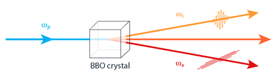

$$\omega_p$$
$$\omega_i$$
$$\omega_s$$

Spontaneous parametric down-conversion schematic.

A blue arrow labeled $\omega_p$ enters a cube labeled BBO crystal from the left. Three beams leave to the right:

- upper orange wavy arrow labeled $\omega_i$
- middle straight orange arrow (unlabeled)
- lower red arrow with a hatched shaft labeled $\omega_s$

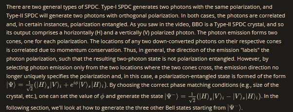

$$|\Psi\rangle=\frac{1}{\sqrt{2}}\left(|H\rangle_s|V\rangle_i+e^{i\phi}|V\rangle_s|H\rangle_i\right)$$
$$|\Psi^{-}\rangle=\frac{1}{\sqrt{2}}\left(|H\rangle_s|V\rangle_i-|V\rangle_s|H\rangle_i\right)$$

There are two general types of SPDC. Type-I SPDC generates two photons with the same polarization, and Type-II SPDC will generate two photons with orthogonal polarization. In both cases, the photons are correlated and, in certain instances, polarization entangled. As you saw in the video, BBO is a Type-II SPDC crystal, and so its output comprises a horizontally (H) and a vertically (V) polarized photon. The photon emission forms two cones, one for each polarization. The locations of any two down-converted photons on their respective cones is correlated due to momentum conservation. Thus, in general, the direction of the emission "labels" the photon polarization, such that the resulting two-photon state is not polarization entangled. However, by selecting photon emission only from the two locations where the two cones cross, the emission direction no longer uniquely specifies the polarization and, in this case, a polarization-entangled state is formed of the form

$$|\Psi\rangle=\frac{1}{\sqrt{2}}\left(|H\rangle_s|V\rangle_i+e^{i\phi}|V\rangle_s|H\rangle_i\right).$$

By choosing the correct phase matching conditions (e.g., size of the crystal, etc.), one can set the value of $\phi$ and generate the state

$$|\Psi^{-}\rangle=\frac{1}{\sqrt{2}}\left(|H\rangle_s|V\rangle_i-|V\rangle_s|H\rangle_i\right).$$

In the following section, we'll look at how to generate the three other Bell states starting from $|\Psi^{-}\rangle$.

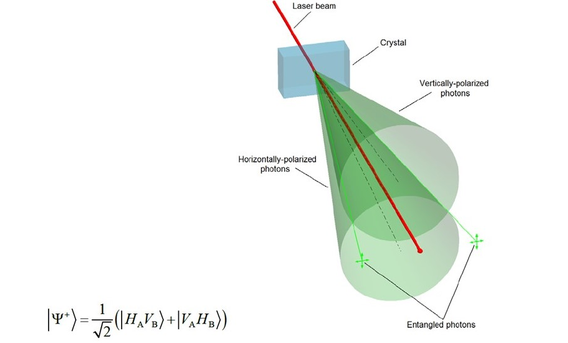

$$|\Psi^+\rangle = \frac{1}{\sqrt{2}}(|H_A V_B\rangle + |V_A H_B\rangle)$$

Entangled-photon source.

A red laser beam enters a blue rectangular crystal from the upper left. Two overlapping green cones leave the crystal: one labeled Horizontally-polarized photons and one labeled Vertically-polarized photons. Green stars at the cone intersections are bracketed and labeled Entangled photons.

$$|\Psi^+\rangle = \frac{1}{\sqrt{2}}(|H_A V_B\rangle + |V_A H_B\rangle)$$

$$
\phi = \pi
$$

$$
|\Psi^{+}\rangle = \frac{1}{\sqrt{2}}\left(|H\rangle_1|V\rangle_2 + |V\rangle_1|H\rangle_2\right) = \frac{1}{\sqrt{2}}\left(|0\rangle_1|1\rangle_2 + |1\rangle_1|0\rangle_2\right)
$$

With two half-wave plates, it is possible to generate all Bell states starting from one of them. Basically, there are two transformations that need to occur: 1) a polarization change that swaps \(|H\rangle\) and \(|V\rangle\), and 2) a phase shift \(\phi = \pi\) that swaps \(+\) and \(-\). To swap polarization, the half-wave plate's coordinate system is oriented \(45^\circ\) with respect to the photon polarization axis. To impart a phase shift, another half-wave plate's fast axis can be oriented \(-45^\circ\) with respect to the horizontal axis to induce a phase inversion.

The following table summarizes the required optical elements – a polarization swapping half-wave plate, HWP \(45^\circ\), and a phase inversion half-wave plate, HWP\(_{0^\circ}\) – to alter the polarization of the first photon \(p_1\) or the second photon \(p_2\) and what general quantum gate that corresponds to to generate all four Bell states starting with

\[
|\Psi^{+}\rangle = \frac{1}{\sqrt{2}}\left(|H\rangle_1|V\rangle_2 + |V\rangle_1|H\rangle_2\right) = \frac{1}{\sqrt{2}}\left(|0\rangle_1|1\rangle_2 + |1\rangle_1|0\rangle_2\right).
\]

The table itself is not in this frame.

$$|\Psi^+\rangle:\ I\otimes I,\ \frac{1}{\sqrt{2}}(|H\rangle_1|V\rangle_2+|V\rangle_1|H\rangle_2),\ \frac{1}{\sqrt{2}}(|0\rangle_1|1\rangle_2+|1\rangle_1|0\rangle_2)$$
$$|\Psi^-\rangle:\ I\otimes Z,\ \frac{1}{\sqrt{2}}(|H\rangle_1|V\rangle_2-|V\rangle_1|H\rangle_2),\ \frac{1}{\sqrt{2}}(|0\rangle_1|1\rangle_2-|1\rangle_1|0\rangle_2)$$
$$|\Phi^+\rangle:\ I\otimes X,\ \frac{1}{\sqrt{2}}(|H\rangle_1|H\rangle_2+|V\rangle_1|V\rangle_2),\ \frac{1}{\sqrt{2}}(|0\rangle_1|0\rangle_2+|1\rangle_1|1\rangle_2)$$
$$|\Phi^-\rangle:\ I\otimes ZX,\ \frac{1}{\sqrt{2}}(|H\rangle_1|H\rangle_2-|V\rangle_1|V\rangle_2),\ \frac{1}{\sqrt{2}}(|0\rangle_1|0\rangle_2-|1\rangle_1|1\rangle_2)$$

Table. Columns: Target, $p_2$: Optical Element, Gate ($p_1 \otimes p_2$), Polarization, General.

| Target | $p_2$: Optical Element | Gate ($p_1 \otimes p_2$) | Polarization | General |
| --- | --- | --- | --- | --- |
| $|\Psi^+\rangle$ | No elements | $I \otimes I$ | $\frac{1}{\sqrt{2}}(|H\rangle_1|V\rangle_2+|V\rangle_1|H\rangle_2)$ | $\frac{1}{\sqrt{2}}(|0\rangle_1|1\rangle_2+|1\rangle_1|0\rangle_2)$ |
| $|\Psi^-\rangle$ | HWP$_{0^\circ}$ | $I \otimes Z$ | $\frac{1}{\sqrt{2}}(|H\rangle_1|V\rangle_2-|V\rangle_1|H\rangle_2)$ | $\frac{1}{\sqrt{2}}(|0\rangle_1|1\rangle_2-|1\rangle_1|0\rangle_2)$ |
| $|\Phi^+\rangle$ | HWP$_{45^\circ}$ | $I \otimes X$ | $\frac{1}{\sqrt{2}}(|H\rangle_1|H\rangle_2+|V\rangle_1|V\rangle_2)$ | $\frac{1}{\sqrt{2}}(|0\rangle_1|0\rangle_2+|1\rangle_1|1\rangle_2)$ |
| $|\Phi^-\rangle$ | HWP$_{0^\circ}$, HWP$_{45^\circ}$ | $I \otimes ZX$ | $\frac{1}{\sqrt{2}}(|H\rangle_1|H\rangle_2-|V\rangle_1|V\rangle_2)$ | $\frac{1}{\sqrt{2}}(|0\rangle_1|0\rangle_2-|1\rangle_1|1\rangle_2)$ |

$$
\frac{1}{\sqrt{2}}\big(-|H\rangle_1|V\rangle_2+|V\rangle_1|H\rangle_2\big)
=-\frac{1}{\sqrt{2}}\big(|H\rangle_1|V\rangle_2-|V\rangle_1|H\rangle_2\big)
$$

# Global phase on a Bell-state transformation

Note that the transformations above can include a (non-observable) global phase factor, e.g. to get from $|\Psi^+\rangle$ to $|\Psi^-\rangle$ the gate yields

$$\frac{1}{\sqrt{2}}\big(-|H\rangle_1|V\rangle_2+|V\rangle_1|H\rangle_2\big)=-\frac{1}{\sqrt{2}}\big(|H\rangle_1|V\rangle_2-|V\rangle_1|H\rangle_2\big),$$

where the $-1$ is simply dropped as it is not observable.

$$|\Psi^+\rangle = \frac{1}{\sqrt{2}}(|0\rangle_1|1\rangle_2 + |1\rangle_1|0\rangle_2) \xrightarrow{\mathrm{CNOT}} \frac{1}{\sqrt{2}}(|0\rangle_1|1\rangle_2 + |1\rangle_1|1\rangle_2) \xrightarrow{H\otimes I} |0\rangle_1|1\rangle_2$$
$$|\Psi^-\rangle = \frac{1}{\sqrt{2}}(|0\rangle_1|1\rangle_2 - |1\rangle_1|0\rangle_2) \xrightarrow{\mathrm{CNOT}} \frac{1}{\sqrt{2}}(|0\rangle_1|1\rangle_2 - |1\rangle_1|1\rangle_2) \xrightarrow{H\otimes I} |1\rangle_1|1\rangle_2$$
$$|\Phi^+\rangle = \frac{1}{\sqrt{2}}(|0\rangle_1|0\rangle_2 + |1\rangle_1|1\rangle_2) \xrightarrow{\mathrm{CNOT}} \frac{1}{\sqrt{2}}(|0\rangle_1|0\rangle_2 + |1\rangle_1|0\rangle_2) \xrightarrow{H\otimes I} |0\rangle_1|0\rangle_2$$
$$|\Phi^-\rangle = \frac{1}{\sqrt{2}}(|0\rangle_1|0\rangle_2 - |1\rangle_1|1\rangle_2) \xrightarrow{\mathrm{CNOT}} \frac{1}{\sqrt{2}}(|0\rangle_1|0\rangle_2 - |1\rangle_1|0\rangle_2) \xrightarrow{H\otimes I} |1\rangle_1|0\rangle_2$$

The following general protocol is able to distinguish all four Bell states. It can be implemented in a probabilistic manner with a probabilistic CNOT gate following Emanuel Knill's, Raymond Laflamme's, and Gerard Milburn's proposal and a beamsplitter as a Hadamard gate. Note that in the notation below, we use $|0\rangle$ and $|1\rangle$ to represent the polarization states $|H\rangle$ and $|V\rangle$, so as not to confound the polarization state $|H\rangle$ with the Hadamard gate $H$.

$$|\Psi^+\rangle = \frac{1}{\sqrt{2}}(|0\rangle_1|1\rangle_2 + |1\rangle_1|0\rangle_2) \xrightarrow{\mathrm{CNOT}} \frac{1}{\sqrt{2}}(|0\rangle_1|1\rangle_2 + |1\rangle_1|1\rangle_2) \xrightarrow{H\otimes I} |0\rangle_1|1\rangle_2$$

$$|\Psi^-\rangle = \frac{1}{\sqrt{2}}(|0\rangle_1|1\rangle_2 - |1\rangle_1|0\rangle_2) \xrightarrow{\mathrm{CNOT}} \frac{1}{\sqrt{2}}(|0\rangle_1|1\rangle_2 - |1\rangle_1|1\rangle_2) \xrightarrow{H\otimes I} |1\rangle_1|1\rangle_2$$

$$|\Phi^+\rangle = \frac{1}{\sqrt{2}}(|0\rangle_1|0\rangle_2 + |1\rangle_1|1\rangle_2) \xrightarrow{\mathrm{CNOT}} \frac{1}{\sqrt{2}}(|0\rangle_1|0\rangle_2 + |1\rangle_1|0\rangle_2) \xrightarrow{H\otimes I} |0\rangle_1|0\rangle_2$$

$$|\Phi^-\rangle = \frac{1}{\sqrt{2}}(|0\rangle_1|0\rangle_2 - |1\rangle_1|1\rangle_2) \xrightarrow{\mathrm{CNOT}} \frac{1}{\sqrt{2}}(|0\rangle_1|0\rangle_2 - |1\rangle_1|0\rangle_2) \xrightarrow{H\otimes I} |1\rangle_1|0\rangle_2$$

The two-qubit states are measured after a CNOT gate and Hadamard gate on the first qubit is applied. The measurement reveals the underlying type of Bell state.

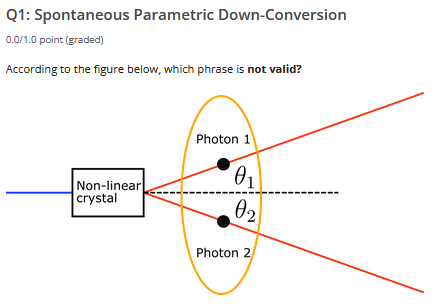

$$
\theta_1,\quad \theta_2
$$

**Q1: Spontaneous Parametric Down-Conversion**

0.0/1.0 point (graded)

According to the figure below, which phrase is **not valid**?

Figure: a blue beam enters a box labeled **Non-linear crystal** from the left. Two red rays leave to the right, one above and one below a dashed horizontal axis, at angles \(\theta_1\) and \(\theta_2\). Black dots on the rays are labeled **Photon 1** (upper) and **Photon 2** (lower), inside a yellow ellipse. The red rays continue past the ellipse. Answer choices are not in this frame.

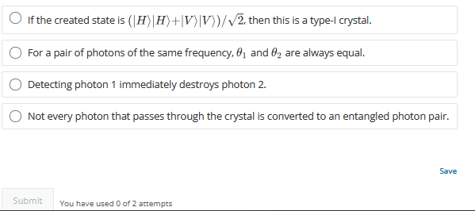

$$
\frac{(|H\rangle|H\rangle+|V\rangle|V\rangle)}{\sqrt{2}}
$$
$$
\theta_1,\ \theta_2
$$

# Practice (single choice; stem not in this frame)

Radio options, none selected. **Save**. **Submit**. You have used 0 of 2 attempts.

- If the created state is $(|H\rangle|H\rangle+|V\rangle|V\rangle)/\sqrt{2}$, then this is a type-I crystal.
- For a pair of photons of the same frequency, $\theta_1$ and $\theta_2$ are always equal.
- Detecting photon 1 immediately destroys photon 2.
- Not every photon that passes through the crystal is converted to an entangled photon pair.

## **Transcript**

## 

00

00:00:00,000 \--\> 00:00:00,500

1

00:00:00,500 \--\> 00:00:02,860

So far this week we\'ve introduced single photon

2

00:00:02,860 \--\> 00:00:05,650

sources and detectors and seen how single photons can

3

00:00:05,650 \--\> 00:00:08,140

be used to encode and transfer quantum information

4

00:00:08,140 \--\> 00:00:11,070

across a communication channel, for example, to distribute

5

00:00:11,070 \--\> 00:00:12,490

a cryptographic key.

6

00:00:12,490 \--\> 00:00:14,890

In this section, we\'ll discuss the generation

7

00:00:14,890 \--\> 00:00:17,320

in detection of entangled pairs of photons.

8

00:00:17,320 \--\> 00:00:20,440

And later this week, we\'ll learn how entangled photons may also

9

00:00:20,440 \--\> 00:00:22,360

be used for quantum key distribution,

10

00:00:22,360 \--\> 00:00:24,880

as well as for quantum teleportation and random number

11

00:00:24,880 \--\> 00:00:26,440

generation.

12

00:00:26,440 \--\> 00:00:29,650

As we saw in Course 1, an entangled state is a manifestly

13

00:00:29,650 \--\> 00:00:32,560

quantum mechanical multi-qubit state that cannot be written

14

00:00:32,560 \--\> 00:00:35,710

as a product of single qubit states in any basis.

15

00:00:35,710 \--\> 00:00:37,810

Let\'s start with a counter-example.

16

00:00:37,810 \--\> 00:00:39,610

We\'ve seen through of Course 1 and Course 2

17

00:00:39,610 \--\> 00:00:42,370

that if we apply Hadamard gates to 2 qubits,

18

00:00:42,370 \--\> 00:00:44,440

each prepared in state zero, then

19

00:00:44,440 \--\> 00:00:47,480

we obtain the 2 qubit equal superposition state, 0, 0

20

00:00:47,480 \--\> 00:00:50,490

plus 0, 1 plus 1, 0, plus 1, 1.

21

00:00:50,490 \--\> 00:00:52,990

Now, while it might appear that this state can\'t be factored

22

00:00:52,990 \--\> 00:00:54,760

into single qubit states, we know

23

00:00:54,760 \--\> 00:00:57,490

that it must be possible because we generated it by applying

24

00:00:57,490 \--\> 00:00:59,530

Hadamards to single qubits.

25

00:00:59,530 \--\> 00:01:02,290

And as we\'ve seen, this state is the tensor product

26

00:01:02,290 \--\> 00:01:05,590

of the single qubit superposition state 0 plus 1.

27

00:01:05,590 \--\> 00:01:07,390

Thus, it\'s not an entangled state,

28

00:01:07,390 \--\> 00:01:10,300

because we can write it in terms of the single qubit states; 0

29

00:01:10,300 \--\> 00:01:14,770

plus 1 for qubit A, tensor product 0 plus 1 for qubit B.

30

00:01:14,770 \--\> 00:01:18,190

In fact, 0 plus or minus 1 are the excited and ground states

31

00:01:18,190 \--\> 00:01:20,590

along the x-axis of the block sphere.

32

00:01:20,590 \--\> 00:01:23,290

Thus, we can write this as the plus and minus state

33

00:01:23,290 \--\> 00:01:25,880

in the x spaces.

34

00:01:25,880 \--\> 00:01:29,210

In contrast, we can see that the state 0, 0 plus 1,

35

00:01:29,210 \--\> 00:01:32,720

1 cannot be written as a tensor product of single qubit states.

36

00:01:32,720 \--\> 00:01:36,020

And it\'s an entangled state of 2 qubits called a Bell state.

37

00:01:36,020 \--\> 00:01:39,410

And even when we perform a transformation to the x basis,

38

00:01:39,410 \--\> 00:01:42,020

we still get a state that can\'t be factored into single qubit

39

00:01:42,020 \--\> 00:01:45,050

states A, tensor product B.

40

00:01:45,050 \--\> 00:01:46,820

This is a property of entangled states.

41

00:01:46,820 \--\> 00:01:49,430

They remain untangled even in different bases.

42

00:01:49,430 \--\> 00:01:51,230

And looking at the circuit model,

43

00:01:51,230 \--\> 00:01:53,570

we see that we needed a conditional 2 qubit gate

44

00:01:53,570 \--\> 00:01:55,130

to generate the entanglement.

45

00:01:55,130 \--\> 00:01:57,620

Single qubit gates alone were not enough.

46

00:01:57,620 \--\> 00:01:59,730

We\'ll return to Bell states in a moment.

47

00:01:59,730 \--\> 00:02:01,460

Now, recall from earlier this week

48

00:02:01,460 \--\> 00:02:04,400

that single photons have a polarization, for example,

49

00:02:04,400 \--\> 00:02:06,200

horizontal and vertical.

50

00:02:06,200 \--\> 00:02:08,570

And since vertical and horizontal polarizations

51

00:02:08,570 \--\> 00:02:10,585

are orthogonal quantum states, we

52

00:02:10,585 \--\> 00:02:12,710

choose to put them at the poles of the block sphere

53

00:02:12,710 \--\> 00:02:14,570

and call this our qubit.

54

00:02:14,570 \--\> 00:02:19,100

For single photon QKD protocols, like BB84, this is sufficient.

55

00:02:19,100 \--\> 00:02:22,370

Bob preparers a single photon in a particular qubit state, that

56

00:02:22,370 \--\> 00:02:24,410

is a particular polarization state,

57

00:02:24,410 \--\> 00:02:27,770

and then sends it along the communication channel to Alice.

58

00:02:27,770 \--\> 00:02:30,470

However, as we\'ll see in the next couple of videos, using

59

00:02:30,470 \--\> 00:02:33,260

entangled photons enables certain alternative types

60

00:02:33,260 \--\> 00:02:35,570

of QKD protocols, as well as a means

61

00:02:35,570 \--\> 00:02:39,130

to generate random numbers in teleport quantum information.

62

00:02:39,130 \--\> 00:02:41,900

And so the question is, how do we generate and detect

63

00:02:41,900 \--\> 00:02:43,220

entangled photons?

64

00:02:43,220 \--\> 00:02:45,800

The most common method for producing entangled photons

65

00:02:45,800 \--\> 00:02:48,170

is through a process called spontaneous parametric

66

00:02:48,170 \--\> 00:02:49,820

downconversion.

67

00:02:49,820 \--\> 00:02:52,400

Parametric downconversion is essentially a frequency

68

00:02:52,400 \--\> 00:02:55,940

conversion process, where a photon at frequency 2f

69

00:02:55,940 \--\> 00:02:59,510

is converted into two individual photons whose frequencies

70

00:02:59,510 \--\> 00:03:02,600

together add to 2f and conserve energy,

71

00:03:02,600 \--\> 00:03:06,140

for example, each photon having a frequency, f.

72

00:03:06,140 \--\> 00:03:09,440

Now, linear time invariant systems, by definition,

73

00:03:09,440 \--\> 00:03:11,360

do not convert frequencies.

74

00:03:11,360 \--\> 00:03:13,700

That is if we take a sine wave and pass it

75

00:03:13,700 \--\> 00:03:16,940

through a linear system, its amplitude and phase may change,

76

00:03:16,940 \--\> 00:03:19,440

but its frequency remains the same.

77

00:03:19,440 \--\> 00:03:21,610

This is essentially a statement that a plane wave

78

00:03:21,610 \--\> 00:03:24,020

e to the i omega t is an eigenfunction

79

00:03:24,020 \--\> 00:03:26,000

of a linear system.

80

00:03:26,000 \--\> 00:03:28,430

Thus, to take a photon at one frequency

81

00:03:28,430 \--\> 00:03:31,820

and convert into two photons at a different frequency,

82

00:03:31,820 \--\> 00:03:35,360

we need a material with strong non-linear optical properties.

83

00:03:35,360 \--\> 00:03:37,220

And a common example of such a crystal

84

00:03:37,220 \--\> 00:03:40,240

is beta barium borate, or BBO.

85

00:03:40,240 \--\> 00:03:43,520

When a strong pump beam passes through a BBO crystal,

86

00:03:43,520 \--\> 00:03:45,860

there\'s a small probability that one of its photons

87

00:03:45,860 \--\> 00:03:48,080

will convert into two photons, one

88

00:03:48,080 \--\> 00:03:50,570

called a signal and the other called an idler.

89

00:03:50,570 \--\> 00:03:52,400

This is just convention.

90

00:03:52,400 \--\> 00:03:55,070

Now, due to energy conservation, the signal and idler

91

00:03:55,070 \--\> 00:03:58,130

frequencies are each half of the pump frequency.

92

00:03:58,130 \--\> 00:03:59,870

And due to momentum conservation,

93

00:03:59,870 \--\> 00:04:01,340

the signal and idler photons will

94

00:04:01,340 \--\> 00:04:04,190

leave the crystal in correlated spatial directions.

95

00:04:04,190 \--\> 00:04:06,380

Additionally, these two photons will also

96

00:04:06,380 \--\> 00:04:08,552

have correlated polarizations.

97

00:04:08,552 \--\> 00:04:10,010

Depending on the type of crystal we

98

00:04:10,010 \--\> 00:04:12,590

use, the two downconverted photons will either

99

00:04:12,590 \--\> 00:04:16,250

have the same polarization, which we call a Type 1 Crystal,

100

00:04:16,250 \--\> 00:04:18,410

or they have opposite polarizations

101

00:04:18,410 \--\> 00:04:20,550

from a type 2 Crystal.

102

00:04:20,550 \--\> 00:04:22,890

BBO is a Type 2 Crystal, and we see

103

00:04:22,890 \--\> 00:04:25,080

that the two downconverted photons exit

104

00:04:25,080 \--\> 00:04:28,080

the crystal in directions that form a cone, one having

105

00:04:28,080 \--\> 00:04:32,040

horizontal polarization and one having vertical polarization.

106

00:04:32,040 \--\> 00:04:34,110

The locations of the photons on the cones

107

00:04:34,110 \--\> 00:04:36,600

are correlated, equidistant from the original beam

108

00:04:36,600 \--\> 00:04:39,690

trajectory, again, due to momentum conservation.

109

00:04:39,690 \--\> 00:04:42,810

For example, the colored dots on the polarization cones

110

00:04:42,810 \--\> 00:04:44,850

indicate the correlated spatial positions

111

00:04:44,850 \--\> 00:04:46,450

of the emitted photons.

112

00:04:46,450 \--\> 00:04:49,080

Now, crucially for the two photons to be polarization

113

00:04:49,080 \--\> 00:04:52,080

entangled, their direction of emission cannot indicate which

114

00:04:52,080 \--\> 00:04:54,570

photon is vertically polarized and which is horizontally

115

00:04:54,570 \--\> 00:04:55,800

polarized.

116

00:04:55,800 \--\> 00:04:58,380

Therefore, we use an iris to selectively keep

117

00:04:58,380 \--\> 00:05:01,170

only photons that arise from positions where the two

118

00:05:01,170 \--\> 00:05:03,380

polarization cones cross.

119

00:05:03,380 \--\> 00:05:05,580

Thus, whether the signal and idler photons

120

00:05:05,580 \--\> 00:05:08,460

travel left or right once they exit the crystal,

121

00:05:08,460 \--\> 00:05:12,630

one will have polarization h and the other polarization v. But

122

00:05:12,630 \--\> 00:05:14,190

which is which is not known.

123

00:05:14,190 \--\> 00:05:16,350

In other words, the direction of propagation

124

00:05:16,350 \--\> 00:05:18,720

does not label the polarization.

125

00:05:18,720 \--\> 00:05:20,610

Under these conditions, the state of the two

126

00:05:20,610 \--\> 00:05:23,780

downconverted photons is polarization entangled

127

00:05:23,780 \--\> 00:05:28,370

and it\'s all of the form H, V plus e to i phi V, H.

128

00:05:28,370 \--\> 00:05:30,187

The phase phi can be made 0 degrees

129

00:05:30,187 \--\> 00:05:31,770

by choosing the correct phase matching

130

00:05:31,770 \--\> 00:05:34,110

conditions, crystal thickness, et cetera,

131

00:05:34,110 \--\> 00:05:35,910

or using a phase shifter.

132

00:05:35,910 \--\> 00:05:38,940

Thus, one has the state H, V plus V,

133

00:05:38,940 \--\> 00:05:41,490

H. This is one of the four Bell states.

134

00:05:41,490 \--\> 00:05:43,410

And from this, the other Bell states

135

00:05:43,410 \--\> 00:05:46,020

can be generated by changing the phase phi

136

00:05:46,020 \--\> 00:05:50,480

and swapping the polarizations H and V, using a half wave plate.

137

00:05:50,480 \--\> 00:05:53,360

Now that we\'re able to generate all four entangled Bell states,

138

00:05:53,360 \--\> 00:05:55,550

let\'s see how to detect these states.

139

00:05:55,550 \--\> 00:05:57,710

We first need to introduce an optical device called

140

00:05:57,710 \--\> 00:05:59,430

a polarization beam splitter.

141

00:05:59,430 \--\> 00:06:02,070

A polarization beam splitter will transmit or reflect

142

00:06:02,070 \--\> 00:06:05,660

a photon depending on its polarization, H or V.

143

00:06:05,660 \--\> 00:06:07,310

And at each output of the beam splitter

144

00:06:07,310 \--\> 00:06:09,260

is a single photon detector.

145

00:06:09,260 \--\> 00:06:11,210

By seeing which detector clicks, we

146

00:06:11,210 \--\> 00:06:13,520

can determine whether the photon had horizontal

147

00:06:13,520 \--\> 00:06:15,870

or vertical polarization.

148

00:06:15,870 \--\> 00:06:18,910

To see how this works, let\'s try a test case.

149

00:06:18,910 \--\> 00:06:22,180

We begin with a photon polarized in the vertical direction.

150

00:06:22,180 \--\> 00:06:24,570

We also show here for completeness a polarization

151

00:06:24,570 \--\> 00:06:27,450

rotator, a device that changes the polarization

152

00:06:27,450 \--\> 00:06:29,130

of incoming photons.

153

00:06:29,130 \--\> 00:06:31,920

For now, however, we just set it so that it passes photons

154

00:06:31,920 \--\> 00:06:34,690

without making any changes.

155

00:06:34,690 \--\> 00:06:37,440

Now, if we send in a vertically polarized photon,

156

00:06:37,440 \--\> 00:06:39,660

it reflects off the polarization beam splitter,

157

00:06:39,660 \--\> 00:06:41,280

and it\'s detected by the single photon

158

00:06:41,280 \--\> 00:06:43,320

detector in the reflection arm.

159

00:06:43,320 \--\> 00:06:46,050

On the other hand, if we send in a horizontally polarized

160

00:06:46,050 \--\> 00:06:49,330

photon, it\'s transmitted by the polarization beam splitter

161

00:06:49,330 \--\> 00:06:51,540

and detected using the single photon detector

162

00:06:51,540 \--\> 00:06:53,520

in the transmission arm.

163

00:06:53,520 \--\> 00:06:55,950

Thus, we can determine the photon polarization

164

00:06:55,950 \--\> 00:06:58,830

by seeing which detector clicks.

165

00:06:58,830 \--\> 00:07:01,890

So, what happens if we have entangled photons?

166

00:07:01,890 \--\> 00:07:05,010

Let\'s take the H, V plus V, H entangled state.

167

00:07:05,010 \--\> 00:07:07,890

Photon A travels to the left polarization beam splitter

168

00:07:07,890 \--\> 00:07:10,080

and Photon B travels to the right polarization

169

00:07:10,080 \--\> 00:07:11,100

being splitter.

170

00:07:11,100 \--\> 00:07:14,700

And what we\'ll observe are correlated detection events.

171

00:07:14,700 \--\> 00:07:17,790

That is if Photon A\'s polarization analyzer indicates

172

00:07:17,790 \--\> 00:07:21,570

horizontal polarization, then the Photon B analyzer indicates

173

00:07:21,570 \--\> 00:07:23,280

vertical polarization.

174

00:07:23,280 \--\> 00:07:25,290

Similarly, if Photon A is measured

175

00:07:25,290 \--\> 00:07:27,870

to have a vertical polarization, then Photon B

176

00:07:27,870 \--\> 00:07:30,120

must have horizontal polarization.

177

00:07:30,120 \--\> 00:07:32,640

These are correlated detection events.

178

00:07:32,640 \--\> 00:07:34,680

Now, the presence of correlation suggests

179

00:07:34,680 \--\> 00:07:38,040

polarization entanglement, but it\'s not proof of entanglement.

180

00:07:38,040 \--\> 00:07:40,380

After all, our source may just randomly send out

181

00:07:40,380 \--\> 00:07:42,800

classical states of either H, V or V,

182

00:07:42,800 \--\> 00:07:44,640

H, which would give the same results,

183

00:07:44,640 \--\> 00:07:48,100

but it\'s not an entangled quantum state H, V plus V, H.

184

00:07:48,100 \--\> 00:07:50,010

To test for entanglement, one needs

185

00:07:50,010 \--\> 00:07:53,400

to measure the entanglement in different polarization bases.

186

00:07:53,400 \--\> 00:07:55,500

As we saw earlier, changing the bases

187

00:07:55,500 \--\> 00:07:57,360

does not change the entanglement.

188

00:07:57,360 \--\> 00:07:59,550

And so the measured correlations will be retained

189

00:07:59,550 \--\> 00:08:01,230

in any measurement basis.

190

00:08:01,230 \--\> 00:08:03,480

In practice, rather than changing the measurement

191

00:08:03,480 \--\> 00:08:06,480

hardware, one may instead rotate the polarization

192

00:08:06,480 \--\> 00:08:07,787

of the input state.

193

00:08:07,787 \--\> 00:08:09,620

This is experimentally more straightforward,

194

00:08:09,620 \--\> 00:08:12,441

and this is the role of the polarization rotator.

195

00:08:12,441 \--\> 00:08:14,940

With correlation measurements made in different polarization

196

00:08:14,940 \--\> 00:08:17,490

bases, one can compare the measured results

197

00:08:17,490 \--\> 00:08:19,500

with the classical probability model assuming

198

00:08:19,500 \--\> 00:08:21,120

there\'s no entanglement.

199

00:08:21,120 \--\> 00:08:23,772

This type of test is called a Bell\'s inequality test.

200

00:08:23,772 \--\> 00:08:25,980

And it\'s used to determine the degree of entanglement

201

00:08:25,980 \--\> 00:08:28,440

of a quantum state within certain assumptions, called

202

00:08:28,440 \--\> 00:08:29,990

loopholes.

203

00:08:29,990 \--\> 00:08:31,990

You\'ll learn more about Bell state measurements,

204

00:08:31,990 \--\> 00:08:33,750

test the Bell\'s inequality and loopholes

205

00:08:33,750 \--\> 00:08:36,419

later in the week, as well as the application of Bell state

206

00:08:36,419 \--\> 00:08:40,370

measurements to the problem of random number generation.

207

00:08:40,370 \--\> 00:08:44,822

## **PRACTICE (1 question)**

## 

##  Section: quantum makes new cryptography: entangled proton schemes 

# Page Title:Quantum Key Distribution - Ekert91 and BBM92

# **Learn**

The first quantum key distribution (QKD) protocol -- BB84 -- encoded
information in the polarization of single photons. BB84 uses a quantum
channel to communicate the photons, and a classical channel to broadcast
the chosen polarization bases used for preparation and measurement.

In this section, we will present an alternative method proposed by Artur
Ekert in 1991 -- known as Ekert91 -- which encodes information using
polarization-entangled Bell states. Ekert91 also uses a quantum and
classical channel. However, the advantage of the Ekert91 protocol is
that its security can be traced directly to fundamental properties of
quantum mechanics -- entanglement and measurement -- through a test
called *Bell\'s inequality.* In this section, you\'ll learn about
Bell\'s inequality and how it\'s used in Ekert91 to communicate
information securely and detect the presence of an eavesdropper.

### **Entanglement and Bell\'s Inequality**

In 1935, Albert Einstein, Boris Podolsky, and Nathan Rosen (EPR) argued
that quantum mechanics is an incomplete theory in a scientific article
titled \"Can Quantum-Mechanical Description of Physical Reality Be
Considered Complete?.\" Their argument was a thought experiment that can
be related to two-particle entanglement. Essentially, imagine that we
take a polarization entangled state of two photons, and we then send one
photon each to Alice and Bob, who are separated by a very large
distance. As we have seen earlier in the course, if Bob and Alice make a
measurement in the same basis, then their results should be correlated,
for example, if Bob measures then Alice measures , etc. And, if they
measure in different bases, then their measurements are uncorrelated.

But, what happens if Alice and Bob are separated by a distance so large
that they can make their independent measurements faster than it would
take light (and thus information) to travel between their locations?
Then, we are left with the conundrum called the *EPR paradox*.
Essentially, due to entanglement, there is a quantum-mechanical
correlation in the measurements made by Alice and Bob. And, it is more
than simply "if Alice measures then Bob measures .\" Bob\'s results --
correlated or uncorrelated -- depend on Alice\'s choice of basis; but,
Bob makes his measurement long before any knowledge of Alice\'s choice
could possibly have reached him or his measurement apparatus. Einstein
did not like such "spooky action at a distance,\" and thus hypothesized
that quantum mechanics theory must be incomplete, that there must be
"hidden variables\" that quantum theory does not account for to connect
these measurements, and so the perceived randomness of quantum
mechanical measurement is a mirage.

Niels Bohr -- a contemporary of Einstien -- responded the same year in a
scientific article with the same title and argued that the theory of
quantum mechanics only captures the interaction of a quantum system with
a measurement apparatus, and not the intrinsic character of it.
Therefore, any conclusion based on the assumption that a measurement
does not disturb the measured system in question -- such as the EPR
conjecture that quantum theory is incomplete without hidden variables --
must be invalid.

The debate continued for decades, and in 1964, John Bell proposed a
theorem -- later referred to as Bell\'s inequality -- that can be used
to experimentally test if hidden variables do in fact exist or not.
Essentially, Bell\'s inequality is a statement based on purely classical
arguments. Then, if the inequality is violated in experimental
measurements, quantum mechanics must be complete and there are no hidden
variables. In 1969, John Clauser, Michael Horne, Abner Shimony, and
Richard Holt presented a method to quantify Bell\'s inequality theorem,
abbreviated as the CHSH inequality. If the measurement results of a
probed quantum system are not exceeding a certain threshold, the CHSH
inequality is true and hidden variables do indeed exist. In contrast, if
the theorem is violated, thus a value exceeding this particular
threshold results, true randomness exists.


## **Images**

$$
|\Psi^{-}\rangle=\frac{1}{\sqrt{2}}\big(|0\rangle_A|1\rangle_B-|1\rangle_A|0\rangle_B\big)
$$
$$
\mathbf{E}(x),\quad x\in\{-1,1\}
$$
$$
\big|\mathbf{E}(QS)+\mathbf{E}(RS)+\mathbf{E}(RT)-\mathbf{E}(QT)\big|\le 2
$$

# Bell's inequality (spin singlet)

Suppose Alice and Bob have each a photon from the spin singlet state

$$|\Psi^-\rangle=\frac{1}{\sqrt{2}}\big(|0\rangle_A|1\rangle_B-|1\rangle_A|0\rangle_B\big).$$

Alice randomly chooses between two different options to measure her photon, $Q$ or $R$, once her photon arrives at her laboratory. Similarly, Bob randomly decides between two other measurements, $S$ or $T$, upon arrival of his photon. Since Alice and Bob decide on and execute the type of measurement of their photon at the same time, any disturbance of each others process can be ruled out — information can not propagate faster than light. Their measurements yield either $1$ or $-1$. Considering all different measurement outcomes and some potential noise in the process the following *Bell's inequality* — with the expectation value $\mathbf{E}(x)$ being the probability-weighted average of all possible measurement outcomes $x\in\{-1,1\}$ — is always true if there exist a set of hidden variables.

$$\big|\mathbf{E}(QS)+\mathbf{E}(RS)+\mathbf{E}(RT)-\mathbf{E}(QT)\big|\le 2$$

$$\langle\Psi^-|\hat{Q}\hat{S}|\Psi^-\rangle = \frac{\langle 0|_A\langle 1|_B - \langle 1|_A\langle 0|_B}{\sqrt{2}}\left(Z_1 \otimes \frac{-Z_2 - X_2}{\sqrt{2}}\right)\frac{|0\rangle_A|1\rangle_B - |1\rangle_A|0\rangle_B}{\sqrt{2}}$$
$$= \frac{\langle 0|_A\langle 1|_B - \langle 1|_A\langle 0|_B}{\sqrt{2}}\,\frac{-|1\rangle_A|0\rangle_B - |1\rangle_A|1\rangle_B + |0\rangle_A|1\rangle_B - |0\rangle_A|0\rangle_B}{2}$$
$$= \frac{1}{\sqrt{2}}\frac{1+1}{2} = \frac{1}{\sqrt{2}} = \langle\hat{Q}\hat{S}\rangle$$
$$\langle\hat{R}\hat{S}\rangle = \frac{1}{\sqrt{2}},\quad \langle\hat{R}\hat{T}\rangle = \frac{1}{\sqrt{2}},\quad \langle\hat{Q}\hat{T}\rangle = -\frac{1}{\sqrt{2}}$$
$$\langle\hat{Q}\hat{S}\rangle + \langle\hat{R}\hat{S}\rangle + \langle\hat{R}\hat{T}\rangle - \langle\hat{Q}\hat{T}\rangle = 2\sqrt{2} > 2$$

The expectation value for $\langle\hat{Q}\hat{S}\rangle$ results to be:

$$\langle\Psi^-|\hat{Q}\hat{S}|\Psi^-\rangle = \frac{\langle 0|_A\langle 1|_B - \langle 1|_A\langle 0|_B}{\sqrt{2}}\left(Z_1 \otimes \frac{-Z_2-X_2}{\sqrt{2}}\right)\frac{|0\rangle_A|1\rangle_B - |1\rangle_A|0\rangle_B}{\sqrt{2}}$$

$$= \frac{\langle 0|_A\langle 1|_B - \langle 1|_A\langle 0|_B}{\sqrt{2}}\,\frac{-|1\rangle_A|0\rangle_B - |1\rangle_A|1\rangle_B + |0\rangle_A|1\rangle_B - |0\rangle_A|0\rangle_B}{2}$$

$$= \frac{1}{\sqrt{2}}\frac{1+1}{2} = \frac{1}{\sqrt{2}} = \langle\hat{Q}\hat{S}\rangle$$

Similarly, $\langle\hat{R}\hat{S}\rangle = \frac{1}{\sqrt{2}}$, $\langle\hat{R}\hat{T}\rangle = \frac{1}{\sqrt{2}}$, and $\langle\hat{Q}\hat{T}\rangle = -\frac{1}{\sqrt{2}}$ can be derived. The resulting expectation values following the rules of quantum mechanics violate Bell's inequality.

$$\langle\hat{Q}\hat{S}\rangle + \langle\hat{R}\hat{S}\rangle + \langle\hat{R}\hat{T}\rangle - \langle\hat{Q}\hat{T}\rangle = 2\sqrt{2} > 2$$

The violation of Bell's inequality is experimentally confirmed ruling out the existence of hidden variables and thus quantum mechanics is complete.

$$|\Psi^-\rangle = \frac{1}{\sqrt{2}}(|H\rangle_1|V\rangle_2 - |V\rangle_1|H\rangle_2) = \frac{1}{\sqrt{2}}(|0\rangle_1|1\rangle_2 - |1\rangle_1|0\rangle_2)$$
$$S = \mathrm{E}(\vec{a}_1,\vec{b}_1) - \mathrm{E}(\vec{a}_1,\vec{b}_3) + \mathrm{E}(\vec{a}_3,\vec{b}_1) + \mathrm{E}(\vec{a}_3,\vec{b}_3) = -2\sqrt{2}$$
$$|S| \leq 2$$

Ekert91 and BBM92

The entangled states can be generated by a trusted source such as Alice or Bob. The required entangled state is the spin singlet state $|\Psi^-\rangle = \frac{1}{\sqrt{2}}(|H\rangle_1|V\rangle_2 - |V\rangle_1|H\rangle_2) = \frac{1}{\sqrt{2}}(|0\rangle_1|1\rangle_2 - |1\rangle_1|0\rangle_2)$. The particles are spatially separated, one is sent to Alice and one to Bob. Both perform measurements on their photon's polarization along three different unit vectors $\vec{a}_i$ and $\vec{b}_j$ respectively. Alice measures randomly relative to the horizontal axis along a unit vector $\vec{a}$ with angle $\phi^A_1 = 0^\circ$, $\phi^A_2 = 45^\circ$, or $\phi^A_3 = 90^\circ$. In contrast, Bob measures randomly along a unit vector $\vec{b}$ with angle $\phi^B_1 = 45^\circ$, $\phi^B_2 = 90^\circ$, or $\phi^B_3 = 135^\circ$.

Similarly to BB84, upon completion of all measurements, Alice and Bob publicly share along which orientation each photon was measured. The group for which they picked the same measurement procedure — $(\vec{a}_2,\vec{b}_1)$ and $(\vec{a}_3,\vec{b}_2)$ — serve as the group which the key can be generated from. The group of measurements with differing measurement orientations — $(\vec{a}_1,\vec{b}_1)$, $(\vec{a}_1,\vec{b}_2)$, $(\vec{a}_1,\vec{b}_3)$, $(\vec{a}_2,\vec{b}_2)$, $(\vec{a}_2,\vec{b}_3)$, $(\vec{a}_3,\vec{b}_1)$, and $(\vec{a}_3,\vec{b}_3)$ — are used to evaluate the existence of potential eavesdroppers. The measurement results of the second group can be revealed publicly to evaluate via the CHSH inequality if the channel is corrupted or not. The CHSH inequality requires the subset $(\vec{a}_1,\vec{b}_1)$, $(\vec{a}_1,\vec{b}_3)$, $(\vec{a}_3,\vec{b}_1)$, and $(\vec{a}_3,\vec{b}_3)$ to work and yields $-2\sqrt{2}$ if the quantum channel is not corrupted and hence secure.

$$S = \mathrm{E}(\vec{a}_1,\vec{b}_1) - \mathrm{E}(\vec{a}_1,\vec{b}_3) + \mathrm{E}(\vec{a}_3,\vec{b}_1) + \mathrm{E}(\vec{a}_3,\vec{b}_3) = -2\sqrt{2}$$

The CHSH inequality is true, meaning the absolute value of the result is $|S| \leq 2$, if the quantum channel is intercepted and one or both photons are disturbed and hence lost some aspects of their "quantumness." Unless the CHSH inequality is true, Alice and Bob can proceed and define an arbitrary subset of the group with the same measurement procedure to serve as a secret key. Ekert91 utilizes the completeness of quantum mechanics to generate a secret key and distinguishes itself from BB84 by the information carrier of choice, entangled spin singlet states instead of single photons.

Shortly after, Charles Bennett, Gilles Brassard, and N. David Mermin generalized BB84 and Ekert91 — referred to as BBM92. The BBM92 protocol is equivalent to BB84 and a simplified version of Ekert91 that does not require a measurement of Bell's inequality to ensure its security. Furthermore, it is able to withstand all known attacks allowed by the properties of quantum mechanics.

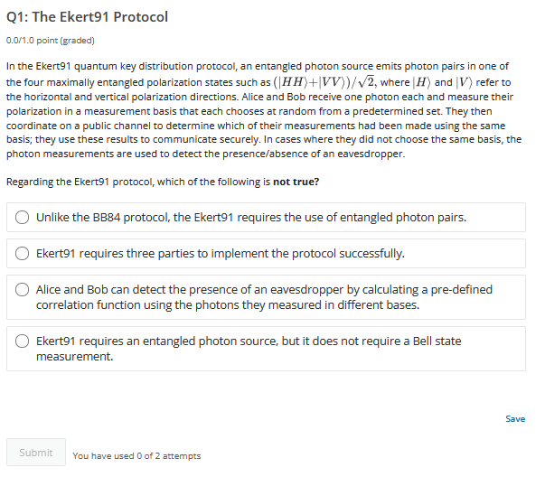

$$
\frac{|HH\rangle + |VV\rangle}{\sqrt{2}}
$$

**Q1: The Ekert91 Protocol**

0.0/1.0 point (graded)

In the Ekert91 quantum key distribution protocol, an entangled photon source emits photon pairs in one of the four maximally entangled polarization states such as \((|HH\rangle + |VV\rangle)/\sqrt{2}\), where \(|H\rangle\) and \(|V\rangle\) refer to the horizontal and vertical polarization directions. Alice and Bob receive one photon each and measure their polarization in a measurement basis that each chooses at random from a predetermined set. They then coordinate on a public channel to determine which of their measurements had been made using the same basis; they use these results to communicate securely. In cases where they did not choose the same basis, the photon measurements are used to detect the presence/absence of an eavesdropper.

Regarding the Ekert91 protocol, which of the following is **not true**?

- Unlike the BB84 protocol, the Ekert91 requires the use of entangled photon pairs.
- Ekert91 requires three parties to implement the protocol successfully.
- Alice and Bob can detect the presence of an eavesdropper by calculating a pre-defined correlation function using the photons they measured in different bases.
- Ekert91 requires an entangled photon source, but it does not require a Bell state measurement.

No option is selected. Save. Submit. You have used 0 of 2 attempts.


## **Transcript**

## 

0

0

00:00:00,000 \--\> 00:00:00,570

1

00:00:00,570 \--\> 00:00:03,720

There are various forms of quantum key distribution or QKD

2

00:00:03,720 \--\> 00:00:06,030

described by different protocols.

3

00:00:06,030 \--\> 00:00:08,189

They all make use of quantum mechanical properties

4

00:00:08,189 \--\> 00:00:11,250

to establish shared lists of random numbers

5

00:00:11,250 \--\> 00:00:13,320

that can be used for encryption.

6

00:00:13,320 \--\> 00:00:16,650

You have heard about the BB84 QKD protocol

7

00:00:16,650 \--\> 00:00:19,950

where one user, Alice, prepares a specific state that she

8


<!-- frame 0:19 · diagram · week3/media/media/image42.png -->

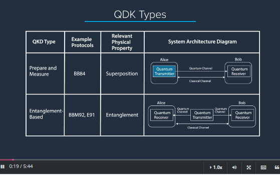

# QDK Types

| QKD type | Example protocols | Relevant physical property | Architecture |
|---|---|---|---|
| Prepare and measure | BB84 | Superposition | Alice has a quantum transmitter. A quantum channel and a classical channel go to Bob's quantum receiver. |
| Entanglement-based | BBM92, E91 | Entanglement | A quantum transmitter in the middle sends one qubit to Alice's receiver and one to Bob's receiver over quantum channels. A classical channel links Alice and Bob. |

00:00:19,950 \--\> 00:00:22,410

sends to another user, Bob.

9

00:00:22,410 \--\> 00:00:25,170

Bob then measures the state, and Alice and Bob

10

00:00:25,170 \--\> 00:00:27,900

then perform sifting by comparing the preparation

11

00:00:27,900 \--\> 00:00:30,240

basis and the measurement basis, and then

12

00:00:30,240 \--\> 00:00:33,240

follow several classical postprocessing steps

13

00:00:33,240 \--\> 00:00:36,430

to establish secure encryption keys.

14

00:00:36,430 \--\> 00:00:37,900

Protocols of this sort, which make

15

00:00:37,900 \--\> 00:00:41,050

use of quantum superposition where one party prepares

16

00:00:41,050 \--\> 00:00:43,600

a state and the other party measures it,

17

00:00:43,600 \--\> 00:00:47,250

are called prepare and measure QKD protocols.

18

00:00:47,250 \--\> 00:00:48,820

An alternative set of protocols are

19

00:00:48,820 \--\> 00:00:51,130

called entanglement-based protocols,

20

00:00:51,130 \--\> 00:00:53,460

and they make use of entanglement.

21

00:00:53,460 \--\> 00:00:56,780

Two common and related entanglement-based protocols

22

00:00:56,780 \--\> 00:01:00,050

are the BBM92 protocol, named for its inventors

23

00:01:00,050 \--\> 00:01:06,040

Bennett, Brassard, and Merman, and for its invention year of 1992,

24

00:01:06,040 \--\> 00:01:09,730

and E91 or Ekert protocol, invented by Artur Ekert

25

00:01:09,730 \--\> 00:01:11,800

in 1991.

26

00:01:11,800 \--\> 00:01:14,410

In both of these protocols, a transmitter

27

00:01:14,410 \--\> 00:01:16,750

consisting of an entanglement source

28

00:01:16,750 \--\> 00:01:18,970

generates a two-photon entangled state

29

00:01:18,970 \--\> 00:01:20,800

known as a maximally entangled Bell

30

00:01:20,800 \--\> 00:01:23,800

state, with one photon being sent to Alice

31

00:01:23,800 \--\> 00:01:26,380

and the other photon being sent to Bob.

32

00:01:26,380 \--\> 00:01:29,680

The photons are sent across quantum communication channels

33

00:01:29,680 \--\> 00:01:33,210

that can reliably transmit the single-photon states

34

00:01:33,210 \--\> 00:01:35,320

and preserve their entanglement.

35

00:01:35,320 \--\> 00:01:37,530

The relevant property of Bell states

36

00:01:37,530 \--\> 00:01:39,100

is that the photons are correlated

37

00:01:39,100 \--\> 00:01:42,580

in multiple measurement bases, including the basis consisting

38

00:01:42,580 \--\> 00:01:45,760

of the horizontal and vertical photon polarizations

39

00:01:45,760 \--\> 00:01:47,950

and the 45-degree rotated basis consisting

40

00:01:47,950 \--\> 00:01:51,840

of the diagonal and the antidiagonal polarizations.

41

00:01:51,840 \--\> 00:01:54,440

For an ideal transmission across the channel,

42

00:01:54,440 \--\> 00:01:57,710

if Alice and Bob choose the same measurement basis,

43

00:01:57,710 \--\> 00:01:59,720

their measurement results will be perfectly

44

00:01:59,720 \--\> 00:02:02,390

correlated between the measurement devices,

45

00:02:02,390 \--\> 00:02:06,980

but individual measurements at each side will look random.

46

00:02:06,980 \--\> 00:02:10,820

Alternately, if Alice chooses the horizontal-vertical basis

47

00:02:10,820 \--\> 00:02:13,370

and Bob chooses the diagonal-antidiagonal

48

00:02:13,370 \--\> 00:02:15,230

measurement basis, the measurements

49

00:02:15,230 \--\> 00:02:17,720

will not be correlated at all.

50

00:02:17,720 \--\> 00:02:20,030

And for intermediate basis choices,

51

00:02:20,030 \--\> 00:02:22,460

their measurements will be partly correlated.

52

00:02:22,460 \--\> 00:02:25,280

In the BBM92 protocol, Alice and Bob

53

00:02:25,280 \--\> 00:02:27,650

received their entangled photon, and both

54

00:02:27,650 \--\> 00:02:30,030

choose either the horizontal-vertical

55

00:02:30,030 \--\> 00:02:33,410

or the diagonal-antidiagonal measurement basis.

56

00:02:33,410 \--\> 00:02:35,270

They both record their basis choice

57

00:02:35,270 \--\> 00:02:37,912

and what the actual measurement result is.

58

00:02:37,912 \--\> 00:02:39,620

They repeat this many times, and they now

59

00:02:39,620 \--\> 00:02:42,680

have long lists of chosen measurement bases

60

00:02:42,680 \--\> 00:02:44,540

and measurement results.

61


<!-- frame 2:44 · slide · week3/media/media/image41.png -->

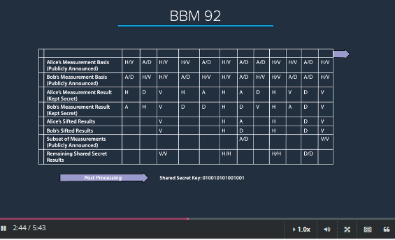

Title: BBM 92

A 12-column sifting table. A purple arrow at the upper right points off the table. Columns below are listed left to right.

| Row | Values |
| --- | --- |
| Alice's Measurement Basis (Publicly Announced) | H/V, A/D, H/V, H/V, A/D, H/V, A/D, A/D, H/V, H/V, A/D, H/V |
| Bob's Measurement Basis (Publicly Announced) | A/D, H/V, H/V, A/D, H/V, H/V, A/D, H/V, H/V, A/D, A/D, H/V |
| Alice's Measurement Result (Kept Secret) | H, D, V, H, A, H, A, D, H, V, D, V |
| Bob's Measurement Result (Kept Secret) | A, H, V, D, D, H, D, V, H, A, D, V |
| Alice's Sifted Results | blank, blank, V, blank, blank, H, A, blank, H, blank, D, V |
| Bob's Sifted Results | blank, blank, V, blank, blank, H, D, blank, H, blank, D, V |
| Subset of Measurements (Publicly Announced) | blanks, then A/D in column 7 and V/V in column 12 |
| Remaining Shared Secret Results | blank, blank, V/V, blank, blank, H/H, blank, blank, H/H, blank, D/D, blank |

A purple arrow labeled Post Processing points to: Shared Secret Key: 010010101001001

Player: paused, speed 1.0x.

00:02:44,540 \--\> 00:02:47,480

The remaining protocol steps are identical to the previously

62

00:02:47,480 \--\> 00:02:51,250

described BB84 protocol, namely Alice and Bob

63

00:02:51,250 \--\> 00:02:53,210

use a classical communication channel

64

00:02:53,210 \--\> 00:02:54,710

to announce their chosen measurement

65

00:02:54,710 \--\> 00:02:58,340

bases to sift out only the instances of them choosing

66

00:02:58,340 \--\> 00:03:00,410

the same basis.

67

00:03:00,410 \--\> 00:03:03,410

They then compare a random subset of measurement results

68

00:03:03,410 \--\> 00:03:07,010

to determine how well the quantum channel performed.

69

00:03:07,010 \--\> 00:03:10,610

And if the determined error rate is below 20%,

70

00:03:10,610 \--\> 00:03:12,740

they perform classical postprocessing

71

00:03:12,740 \--\> 00:03:15,500

to erase any information that a potential eavesdropper could

72

00:03:15,500 \--\> 00:03:17,720

have discovered and to correct for remaining

73

00:03:17,720 \--\> 00:03:20,000

errors between Alice and Bob.

74

00:03:20,000 \--\> 00:03:22,400

The benefit of the BBM92 protocol

75

00:03:22,400 \--\> 00:03:24,320

is that the protocol does not require

76

00:03:24,320 \--\> 00:03:27,950

that we trust the source that prepares and sends the state.

77

00:03:27,950 \--\> 00:03:31,340

The protocol ensures that there is no way for a malicious actor

78

00:03:31,340 \--\> 00:03:34,050

to take control of the source and spoof Alice

79

00:03:34,050 \--\> 00:03:36,290

and Bob without them detecting it

80

00:03:36,290 \--\> 00:03:40,250

by observing lower correlation strengths and thus higher error

81

00:03:40,250 \--\> 00:03:44,400

rates than are required to form a secure key.

82

00:03:44,400 \--\> 00:03:47,270

The other entanglement-based protocol, the Ekert protocol,

83

00:03:47,270 \--\> 00:03:50,710

is similar but adds an interesting twist.

84

00:03:50,710 \--\> 00:03:52,670

In this protocol, the same sort of state

85

00:03:52,670 \--\> 00:03:55,820

is generated and distributed between Alice and Bob.

86


<!-- frame 3:55 · slide · week3/media/media/image5.png -->

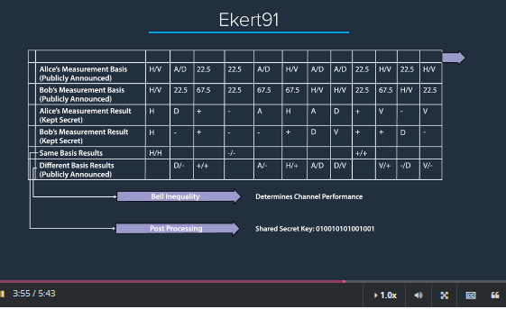

# Ekert91

A rightward arrow marks the sequence of rounds across the table. Twelve example rounds:

| | 1 | 2 | 3 | 4 | 5 | 6 | 7 | 8 | 9 | 10 | 11 | 12 |
| --- | --- | --- | --- | --- | --- | --- | --- | --- | --- | --- | --- | --- |
| Alice's Measurement Basis (Publicly Announced) | H/V | A/D | 22.5 | 22.5 | A/D | H/V | A/D | A/D | 22.5 | H/V | 22.5 | H/V |
| Bob's Measurement Basis (Publicly Announced) | H/V | 22.5 | 67.5 | 22.5 | 67.5 | 67.5 | H/V | H/V | 22.5 | 67.5 | H/V | 22.5 |
| Alice's Measurement Result (Kept Secret) | H | D | + | − | A | H | A | D | + | V | − | V |
| Bob's Measurement Result (Kept Secret) | H | − | + | − | − | + | D | V | + | + | D | − |
| Same Basis Results | H/H | | | −/− | | | | | +/+ | | | |
| Different Basis Results (Publicly Announced) | | D/− | +/+ | | A/− | H/+ | A/D | D/V | | V/+ | −/D | V/− |

- Bracket from **Different Basis Results** to a purple arrow **Bell Inequality** → Determines Channel Performance
- Bracket from **Same Basis Results** to a purple arrow **Post Processing** → Shared Secret Key: 010010101001001

00:03:55,820 \--\> 00:03:58,040

Now, Alice randomly chooses between one

87

00:03:58,040 \--\> 00:03:59,960

of three measurement bases\--

88

00:03:59,960 \--\> 00:04:03,410

the horizontal-vertical basis, the 45-degree rotated

89

00:04:03,410 \--\> 00:04:07,220

diagonal-antidiagonal basis, and an intermediate basis

90

00:04:07,220 \--\> 00:04:09,620

rotated by 22 and 1/2 degrees.

91

00:04:09,620 \--\> 00:04:13,020

Bob also randomly chooses between three bases\--

92

00:04:13,020 \--\> 00:04:15,810

the horizontal-vertical basis, the intermediate 22

93

00:04:15,810 \--\> 00:04:19,700

and 1/2-degree rotated basis, and a final basis rotated by 67

94

00:04:19,700 \--\> 00:04:22,070

and 1/2 degrees.

95

00:04:22,070 \--\> 00:04:24,530

The measurement bases and the measurement results

96

00:04:24,530 \--\> 00:04:25,890

are recorded.

97

00:04:25,890 \--\> 00:04:28,070

Alice and Bob repeat this many times

98

00:04:28,070 \--\> 00:04:30,680

and again announce their chosen measurement bases

99

00:04:30,680 \--\> 00:04:34,070

over a public classical communication channel.

100

00:04:34,070 \--\> 00:04:37,010

The instances where they have chosen the same basis

101

00:04:37,010 \--\> 00:04:39,800

are used for the key-generation process.

102

00:04:39,800 \--\> 00:04:42,470

The instances where they have chosen different bases

103

00:04:42,470 \--\> 00:04:45,930

are used to determine the performance of the channel.

104

00:04:45,930 \--\> 00:04:47,820

For these instances, the measurement results

105

00:04:47,820 \--\> 00:04:50,100

are, in fact, announced publicly and are

106

00:04:50,100 \--\> 00:04:52,470

used in a Bell inequality to determine

107

00:04:52,470 \--\> 00:04:55,080

how well the channel transmission has preserved

108

00:04:55,080 \--\> 00:04:56,280

entanglement.

109

00:04:56,280 \--\> 00:04:58,020

This allows Alice and Bob to have

110

00:04:58,020 \--\> 00:04:59,880

an entanglement-based measurement

111

00:04:59,880 \--\> 00:05:02,350

of the maximum amount of information

112

00:05:02,350 \--\> 00:05:05,290

a potential eavesdropper could have obtained.

113

00:05:05,290 \--\> 00:05:07,506

Alice and Bob then perform classical postprocessing

114

00:05:07,506 \--\> 00:05:09,630

to erase any information an eavesdropper could have

115

00:05:09,630 \--\> 00:05:12,960

discovered and to correct for remaining errors between Alice

116

00:05:12,960 \--\> 00:05:13,921

and Bob.

117

00:05:13,921 \--\> 00:05:15,420

That is how entanglement can be used

118

00:05:15,420 \--\> 00:05:18,060

to establish encryption keys, to eliminate the need

119

00:05:18,060 \--\> 00:05:21,510

to trust the system transmitter, and to check the security

120

00:05:21,510 \--\> 00:05:23,070

of the encryption keys.

121

00:05:23,070 \--\> 00:05:25,110

There are various other QKD protocols

122

00:05:25,110 \--\> 00:05:26,910

with differing benefits and tradeoffs

123

00:05:26,910 \--\> 00:05:29,980

that may be of interest in specific scenarios.

124

00:05:29,980 \--\> 00:05:32,130

However, the important point is that they all

125

00:05:32,130 \--\> 00:05:35,250

make use of the same basic ideas and concepts

126

00:05:35,250 \--\> 00:05:37,460

that I have described here.

127

00:05:37,460 \--\> 00:05:41,462

## **PRACTICE (1 question)**
##  

Section: quantum makes no cryptographic random number generators

# Page Title:random numbers: an introduction 

# **Learn**

### **Random Number Generation**

Random numbers are needed in several applications and areas of research
including cryptography, tests of fundamental physical principles, and
simulations based on Monte Carlo methods. True randomness is difficult
to realize. Most realistic applications use pseudo-random number
generation (PRNG) algorithms, which produce a string of numbers mimics
randomness, but is based on an algorithm using a private \"seed\" and
therefore is ultimately deterministic. Thus, the use of numbers produced
by PRNG in principle limits cryptographic security, introduces loopholes
in fundamental physical tests, and may lead to unexpected errors in
Monte Carlo simulations.

The necessity of random numbers in cryptography is exemplified by
one-time pad encryption, where each user shares an identical secret key
at least as long as the plaintext. To perform encryption, the sender
will add each character of the plaintext to the corresponding character
of the key using modular arithmetic. It is important to note that for
every plaintext and ciphertext pair of equal length, there exists a key
of the same length which will translate between them. Therefore, if a
key is chosen at random, every ciphertext is equally likely given any
plaintext, and an eavesdropper gains no information by intercepting the
ciphertext. This level of security is referred to as
\"information-theoretic\" security, and is, in principle, unbreakable by
an eavesdropper with infinite resources, as long as she does not possess
the key.

To gain intuition for the types of problems associated with using PRNG
numbers (rather than truly random numbers), consider a PRNG algorithm
called the middle-square method. In this method, a pseudo-random number
of length n is calculated by starting with a seed of the same length,
squaring it, and taking the middle n digits of the resulting number.

## **Images**

$$
|\psi\rangle = \frac{1}{\sqrt{2}}(|0\rangle + |1\rangle)
$$

$$
\{|0\rangle, |1\rangle\}
$$

$$
2^{4}, \quad 2^{16}
$$

n digits of the resulting number. For example, if you want a four-digit pseudo-random number, we could start with the seed 3452, which when squared is 11916304, and our new number is the middle four digits given by 9163. This process can then be repeated as many times as needed. One obvious problem with this procedure is that, if at any point this key is compromised, then an eavesdropper could determine all past and future keys; this property is known as state compromise extension. Another issue with this technique is that it will eventually repeat, which reveals information to an eavesdropper. For example, when starting with the seed 0540, it cycles back to itself after the sequence \(0540 \rightarrow 2916 \rightarrow 5030 \rightarrow 3009 \rightarrow 0540\). Lastly, some pseudo-random number generation algorithms will use a seed which is shorter in length than the message being encrypted, which reduces the number of keys that an adversary needs to search over. Explicitly, a 16 bit plaintext could be encrypted using a 4 bit seed, where the first four rounds of the middle-square method are concatenated to create a 16 bit key. The problem with this is that, even if the eavesdropper does not know the seed, they only need to search over \(2^{4}\) bits to cover every possible key, rather than the \(2^{16}\) when each bit of the key is random.

The inherent weaknesses of using PRNG algorithms has motivated significant research towards the creation of robust sources of truly random numbers. One of the most promising areas of research in this area is in quantum random number generators (QRNGs), which rely on either superpositions of quantum states or quantum entanglement to create randomness. A simple example of how this works on a single system is to prepare a single qubit in the superposition state given by \(|\psi\rangle = \frac{1}{\sqrt{2}}(|0\rangle + |1\rangle)\) and then making a measurement in the \(\{|0\rangle, |1\rangle\}\) basis. Since \(|\psi\rangle\) is an even superposition of both basis states, the outcome of the measurement cannot be predicted, even in principle, and is therefore a source of random numbers.

Unfortunately, it can be difficult to verify that a QRNG based on a single system is properly functioning, without intimate knowledge of the system construction. For example, a QRNG could be manipulated to output states which are statistically random, but are actually supplied by a third party, or less maliciously, the superposition of \(|\psi\rangle\) could have collapsed before measurement, meaning that the measurement outcomes are actually classical noise and hence predictable in principle given enough knowledge about the system.

(The frame begins mid-sentence; the character before "n digits" is cut off.)

$$|\Phi\rangle = \frac{1}{\sqrt{2}}(|00\rangle + |11\rangle)$$

To contend with these problems and to guarantee the randomness of numbers, techniques known as "self checking" QRNGs have been developed. Using a Bell state such as $|\Phi\rangle = \frac{1}{\sqrt{2}}(|00\rangle+|11\rangle)$ as a resource, these QRNGs perform what is called a Bell test on $|\Phi\rangle$. A Bell test is a series of repeated measurements on each qubit of an ensemble of identical entangled pairs, such as $|\Phi\rangle$, where in an instance of the process each qubit can be measured in two different ways, and each of these choices has two different outcomes. Once enough statistics are assembled, it can be determined whether the state being tested violates a Bell inequality. All states which satisfy a Bell inequality can in principle be described by a deterministic local hidden variable model (DLHVM), which means that all measurement outcomes on particles described by that state are determined ahead of time, even if they are not available to the experimenter. Alternatively, if a state violates this inequality, it then cannot be described by a DLHVM, and joint measurement outcomes on these states are determined at the time of measurement, regardless of the physical distance between them. While there are many ways to interpret the meaning of a Bell violation, it suffices to say that the extent of a violation is quantitatively related to the amount of randomness present in the measurement results.


## **Transcript**

## 

00

00:00:00,000 \--\> 00:00:00,500

1

00:00:00,500 \--\> 00:00:02,220

I\'m going to talk about random numbers.

2

00:00:02,220 \--\> 00:00:05,310

This is a fascinating topic because random numbers are not

3

00:00:05,310 \--\> 00:00:07,650

only really useful in everyday life,

4

00:00:07,650 \--\> 00:00:09,540

but thinking about random number generators

5

00:00:09,540 \--\> 00:00:12,390

also brings up some interesting questions about reality

6

00:00:12,390 \--\> 00:00:13,650

and free will.

7

00:00:13,650 \--\> 00:00:16,110

Let\'s start out talking about why random numbers are

8

00:00:16,110 \--\> 00:00:17,760

so important.

9

00:00:17,760 \--\> 00:00:19,320

If you were a kid in the 80s, you

10

00:00:19,320 \--\> 00:00:22,260

might remember a game show called Press Your Luck.

11

00:00:22,260 \--\> 00:00:25,530

Part of the game show had a box moving around different squares

12

00:00:25,530 \--\> 00:00:27,912

on a board that were also changing,

13

00:00:27,912 \--\> 00:00:29,370

and the player would press a button

14

00:00:29,370 \--\> 00:00:31,440

to stop the motion of the box.

15

00:00:31,440 \--\> 00:00:33,030

Whatever square the box was on would

16

00:00:33,030 \--\> 00:00:36,240

be what the player would win, or they could land on a whammy

17

00:00:36,240 \--\> 00:00:38,160

and lose everything.

18

00:00:38,160 \--\> 00:00:41,370

In 1984, this guy named Michael Larson went on the show,

19

00:00:41,370 \--\> 00:00:43,320

and he did really well.

20

00:00:43,320 \--\> 00:00:46,590

What you can notice is that he really pays a lot of attention,

21

00:00:46,590 \--\> 00:00:50,670

almost like he knows when to press the button.

22

00:00:50,670 \--\> 00:00:52,680

And in fact, he did because the people

23

00:00:52,680 \--\> 00:00:55,980

that made this game did a really bad job randomizing the motion

24

00:00:55,980 \--\> 00:00:57,750

of the box and the squares.

25

00:00:57,750 \--\> 00:00:59,730

In fact, they weren\'t random at all,

26

00:00:59,730 \--\> 00:01:01,800

but just randomly picked from a small number

27

00:01:01,800 \--\> 00:01:05,190

of possible sequences.

28

00:01:05,190 \--\> 00:01:07,320

So Michael Larson spent a lot of time

29

00:01:07,320 \--\> 00:01:09,450

with a VCR watching and memorizing

30

00:01:09,450 \--\> 00:01:12,030

the various, quote unquote, random sequences that

31

00:01:12,030 \--\> 00:01:13,200

would come up.

32

00:01:13,200 \--\> 00:01:16,890

He ended up setting a record by winning over \$100,000, which

33

00:01:16,890 \--\> 00:01:19,320

I\'m sure had consequences for the people who ran the game

34

00:01:19,320 \--\> 00:01:21,660

show.

35

00:01:21,660 \--\> 00:01:25,440

So that\'s one way random numbers can influence someone\'s life.

36

00:01:25,440 \--\> 00:01:28,020

Here\'s another more serious one.

37

00:01:28,020 \--\> 00:01:30,630

As you know, the security of many forms of encryption

38

00:01:30,630 \--\> 00:01:32,520

rely on the computational difficulty

39

00:01:32,520 \--\> 00:01:34,380

of solving certain problems.

40

00:01:34,380 \--\> 00:01:36,180

For example, factoring is difficult

41

00:01:36,180 \--\> 00:01:39,150

with a classical computer, so some types of encryption

42

00:01:39,150 \--\> 00:01:41,520

are based on the difficulty of factoring,

43

00:01:41,520 \--\> 00:01:43,200

and you can have an encryption key

44

00:01:43,200 \--\> 00:01:46,080

that\'s the product of two large prime numbers.

45

00:01:46,080 \--\> 00:01:48,960

If one of the prime numbers is reused in another encryption

46

00:01:48,960 \--\> 00:01:52,200

key, that breaks the security of the algorithm.

47

00:01:52,200 \--\> 00:01:54,870

Now, this shouldn\'t be a problem because if prime numbers are

48

00:01:54,870 \--\> 00:01:57,060

selected randomly, the probability

49

00:01:57,060 \--\> 00:02:01,050

of two keys using the same prime should basically be zero.

50

00:02:01,050 \--\> 00:02:04,560

But in 2012, researchers found that, in fact,

51

00:02:04,560 \--\> 00:02:06,900

if they looked at all the publicly accessible keys

52

00:02:06,900 \--\> 00:02:10,710

for RSA, a commonly used public key cryptosystem,

53

00:02:10,710 \--\> 00:02:14,400

about a quarter of a percent of the time, two unrelated keys

54

00:02:14,400 \--\> 00:02:16,290

shared a prime factor.

55

00:02:16,290 \--\> 00:02:19,830

The authors speculate that lack of entropy or randomness in one

56

00:02:19,830 \--\> 00:02:22,050

of the inputs to the algorithm resulted

57

00:02:22,050 \--\> 00:02:24,840

in this repeat of factors, which essentially made those systems

58

00:02:24,840 \--\> 00:02:27,050

completely insecure.

59

00:02:27,050 \--\> 00:02:28,770

Beyond public key encryption, there

60

00:02:28,770 \--\> 00:02:30,420

are many other cryptographic tasks

61

00:02:30,420 \--\> 00:02:34,440

that require randomness, such as challenge response protocols,

62

00:02:34,440 \--\> 00:02:38,040

like what you use at an ATM or digital signatures.

63

00:02:38,040 \--\> 00:02:41,130

Modern day cryptography relies on random numbers,

64

00:02:41,130 \--\> 00:02:44,070

and they\'re also important for scientific applications,

65

00:02:44,070 \--\> 00:02:48,150

like for Monte Carlo simulations and for lotteries.

66

00:02:48,150 \--\> 00:02:51,270

Now let\'s look more closely at what a Random Number Generator

67

00:02:51,270 \--\> 00:02:53,700

or RNG actually is.

68

00:02:53,700 \--\> 00:02:56,100

For now, we\'re going to keep the discussion abstract

69

00:02:56,100 \--\> 00:02:59,220

and just imagine that an RNG is a black box.

70

00:02:59,220 \--\> 00:03:02,820

And when we press a button, a one or a zero comes out.

71

00:03:02,820 \--\> 00:03:04,450

And to keep the discussion simple,

72

00:03:04,450 \--\> 00:03:06,870

we\'ll assume that they are identically distributed.

73

00:03:06,870 \--\> 00:03:10,470

So half the time it\'s a zero, half the time it\'s a one.

74

00:03:10,470 \--\> 00:03:13,047

If the black box is truly an RNG,

75

00:03:13,047 \--\> 00:03:14,880

there\'s no way of knowing what will come out

76

00:03:14,880 \--\> 00:03:16,380

when you press the button, and we

77

00:03:16,380 \--\> 00:03:19,770

can say that each bit coming out has one bit of entropy, which

78

00:03:19,770 \--\> 00:03:21,870

is a measure of randomness.

79

00:03:21,870 \--\> 00:03:25,590

Now it\'s not just that you or I with our limited knowledge

80

00:03:25,590 \--\> 00:03:27,760

have no way of knowing what comes out.

81

00:03:27,760 \--\> 00:03:30,900

It\'s that nobody, not even somebody with knowledge

82

00:03:30,900 \--\> 00:03:33,930

of everything in the universe, an infinite computational

83

00:03:33,930 \--\> 00:03:36,240

power, can predict it.

84

00:03:36,240 \--\> 00:03:37,920

One problem is that it\'s really hard

85

00:03:37,920 \--\> 00:03:40,680

to tell when something is actually random

86

00:03:40,680 \--\> 00:03:43,140

or when it\'s just that you can\'t predict it.

87

00:03:43,140 \--\> 00:03:45,960

For example, pseudorandom number generators

88

00:03:45,960 \--\> 00:03:48,120

are often used in practice.

89

00:03:48,120 \--\> 00:03:50,310

With a pseudorandom number generator,

90

00:03:50,310 \--\> 00:03:52,890

you put in a random seed, and what you get out

91

00:03:52,890 \--\> 00:03:55,800

is a lot of numbers that look random.

92

00:03:55,800 \--\> 00:03:57,810

But a pseudorandom number generator

93

00:03:57,810 \--\> 00:04:00,510

is a classical deterministic algorithm,

94

00:04:00,510 \--\> 00:04:02,640

so of course, it\'s not random at all.

95

00:04:02,640 \--\> 00:04:06,150

This quote by John Von Neumann puts it nicely.

96

00:04:06,150 \--\> 00:04:08,820

\"Anyone who considers arithmetical methods

97

00:04:08,820 \--\> 00:04:13,230

of producing random digits is, of course, in a state of sin.\"

98

00:04:13,230 \--\> 00:04:14,880

Because they\'re not really random,

99

00:04:14,880 \--\> 00:04:16,560

pseudorandom number generators are

100

00:04:16,560 \--\> 00:04:20,070

susceptible to algorithmic and computational advances,

101

00:04:20,070 \--\> 00:04:24,630

and they require that the input seed is random and secret.

102

00:04:24,630 \--\> 00:04:27,390

OK, so if we can\'t use a classical computer

103

00:04:27,390 \--\> 00:04:29,220

to make random numbers, how about

104

00:04:29,220 \--\> 00:04:31,410

if we take a physical process that we know

105

00:04:31,410 \--\> 00:04:34,780

is random and use that to make our random numbers.

106

00:04:34,780 \--\> 00:04:39,180

So flip a coin and say heads is zero and tails is one.

107

00:04:39,180 \--\> 00:04:41,640

That\'s kind of a slow random number generator,

108

00:04:41,640 \--\> 00:04:44,940

but people have built much faster generators using

109

00:04:44,940 \--\> 00:04:48,360

ring oscillators, a single photon hitting a beam splitter,

110

00:04:48,360 \--\> 00:04:50,970

and even images of a lava lamp.

111

00:04:50,970 \--\> 00:04:53,280

Many of these things should be random.

112

00:04:53,280 \--\> 00:04:56,610

For example with a single photon hitting a perfect 50/50 beam

113

00:04:56,610 \--\> 00:05:00,970

splitter, which arm you detect the photon in should be random,

114

00:05:00,970 \--\> 00:05:03,150

but it\'s hard to verify that everything is working

115

00:05:03,150 \--\> 00:05:04,710

the way you think it is.

116

00:05:04,710 \--\> 00:05:08,100

People have demonstrated the ability to blind detectors

117

00:05:08,100 \--\> 00:05:10,350

or force them to click for example.

118

00:05:10,350 \--\> 00:05:14,730

Here\'s an example of adversarial control of an RNG demonstrated

119

00:05:14,730 \--\> 00:05:17,760

by two researchers in 2009.

120

00:05:17,760 \--\> 00:05:21,960

They showed that by injecting noise onto a power supply,

121

00:05:21,960 \--\> 00:05:24,390

they could compromise the randomness of a ring

122


<!-- frame 5:24 · slide · week3/media/media/image9.png -->

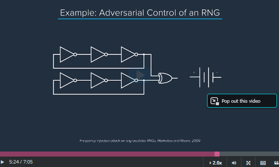

Title: Example: Adversarial Control of an RNG

White-on-navy schematic of two ring oscillators. Each oscillator is a loop of three inverters. The two oscillator outputs enter an XOR gate. To the right of the XOR is a sampling symbol: a short lead into parallel vertical strokes marked + and −, with a ground-style stack beside it.

A play button sits over the lower oscillator, and a "Pop out this video" button is at the lower right. Playback speed shown: 2.0x.

Caption: Frequency injection attack on ring oscillator RNGs, Markettos and Moore, 2009.

00:05:24,390 \--\> 00:05:28,860

oscillator based RNG of the same type used in challenge response

123

00:05:28,860 \--\> 00:05:32,490

protocols for chip and pin credit card authorization.

124

00:05:32,490 \--\> 00:05:35,100

Here\'s a visual representation of the RNG

125

00:05:35,100 \--\> 00:05:37,020

output from their paper.

126

00:05:37,020 \--\> 00:05:40,020

Before they launched their attack, it looks random,

127

00:05:40,020 \--\> 00:05:42,990

and after, there are patterns.

128

00:05:42,990 \--\> 00:05:45,720

Looking at this, you might say, OK,

129


<!-- frame 5:44 · slide · week3/media/media/image35.png -->

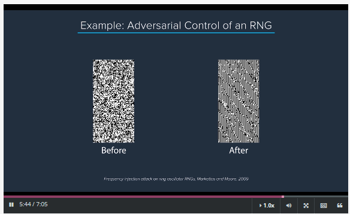

Title: Example: Adversarial Control of an RNG

Two rectangular bitmaps:

- Before: a dense, unstructured black-and-white speckle.
- After: a strongly striped pattern of nearly vertical black and white bands.

Caption: Frequency injection attack on ring oscillator RNGs, Markettos and Moore, 2009.

Player: paused, speed 1.0x.

00:05:45,720 \--\> 00:05:48,060

that just means that we should look for patterns.

130

00:05:48,060 \--\> 00:05:50,580

Indeed, there are many statistical tests

131

00:05:50,580 \--\> 00:05:53,550

that will look for patterns and quantify the likelihood

132

00:05:53,550 \--\> 00:05:56,370

that a sequence of long numbers is consistent with being

133

00:05:56,370 \--\> 00:05:59,050

generated by a random process.

134

00:05:59,050 \--\> 00:06:02,280

The problem is that it only looks for specific patterns,

135

00:06:02,280 \--\> 00:06:05,130

and there are plenty of things that don\'t have any patterns

136

00:06:05,130 \--\> 00:06:07,120

but are not random\--

137

00:06:07,120 \--\> 00:06:09,690

the digits of pi, for instance.

138


<!-- frame 6:08 · slide · week3/media/media/image50.png -->

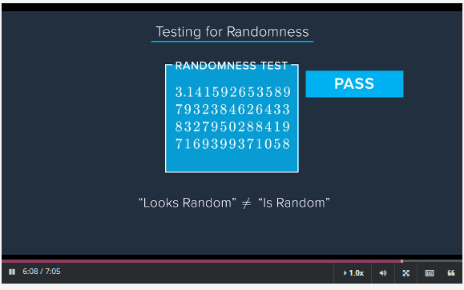

$$
\text{“Looks Random”} \neq \text{“Is Random”}
$$

# Testing for Randomness

A box titled **RANDOMNESS TEST** shows these digits and a **PASS** badge:

```
3.141592653589
7932384626433
8327950288419
7169399371058
```

“Looks Random” ≠ “Is Random”

00:06:09,690 \--\> 00:06:12,360

So we can\'t just take the output of the RNG

139

00:06:12,360 \--\> 00:06:15,360

and run statistical tests on it to say whether or not

140

00:06:15,360 \--\> 00:06:17,460

it\'s really an RNG.

141

00:06:17,460 \--\> 00:06:21,060

Another thing we can try instead is to open up the box,

142

00:06:21,060 \--\> 00:06:23,460

look what\'s inside, characterize it, and make

143

00:06:23,460 \--\> 00:06:25,380

sure everything\'s working OK.

144

00:06:25,380 \--\> 00:06:27,270

The problem with that is that systems

145

00:06:27,270 \--\> 00:06:29,400

can be complicated and messy, there

146

00:06:29,400 \--\> 00:06:32,620

are lots of ways that components can fail or be compromised,

147

00:06:32,620 \--\> 00:06:34,860

so there\'s no way of knowing whether or not you\'re

148

00:06:34,860 \--\> 00:06:36,870

testing for the right things.

149

00:06:36,870 \--\> 00:06:39,600

In 2010, some researchers realized

150

00:06:39,600 \--\> 00:06:42,450

that you can build something really close to a black box

151

00:06:42,450 \--\> 00:06:44,310

random number generator.

152

00:06:44,310 \--\> 00:06:47,700

It turns out that you can make an RNG based on a loophole

153

00:06:47,700 \--\> 00:06:49,800

free test of Bell\'s inequality and

154

00:06:49,800 \--\> 00:06:51,780

under some general assumptions, you

155

00:06:51,780 \--\> 00:06:54,690

can quantify the entropy of your RNG

156

00:06:54,690 \--\> 00:06:57,720

without knowing the details of how everything inside the box

157

00:06:57,720 \--\> 00:06:59,450

is working.

158

00:06:59,450 \--\> 00:07:04,278

## **PRACTICE** 

## **(there is no practice for this page )**

##  

Section: quantum makes new cryptography, entangled proton schemes

# Page Title:bell's inequality 

# **Learn**

## **Images**

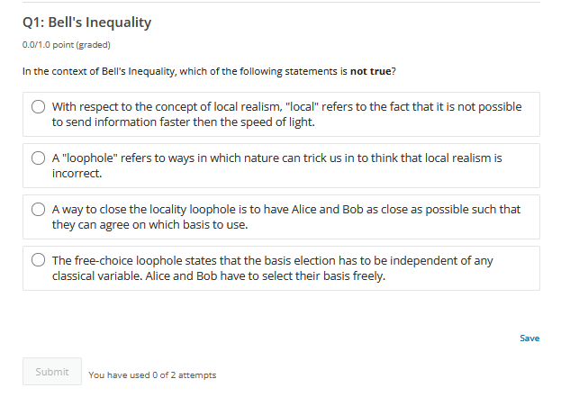

**Q1: Bell's Inequality**

0.0/1.0 point (graded)

In the context of Bell's Inequality, which of the following statements is **not true**?

- With respect to the concept of local realism, "local" refers to the fact that it is not possible to send information faster then the speed of light.
- A "loophole" refers to ways in which nature can trick us in to think that local realism is incorrect.
- A way to close the locality loophole is to have Alice and Bob as close as possible such that they can agree on which basis to use.
- The free-choice loophole states that the basis election has to be independent of any classical variable. Alice and Bob have to select their basis freely.

No option is selected. Save. Submit. You have used 0 of 2 attempts.

## **Transcript**

## 

0

0

00:00:00,000 \--\> 00:00:00,499

1

00:00:00,499 \--\> 00:00:02,710

Let\'s now talk about entanglement,

2

00:00:02,710 \--\> 00:00:05,000

Bell\'s inequality, and experiments

3

00:00:05,000 \--\> 00:00:08,080

that can tell us something about the nature of reality.

4

00:00:08,080 \--\> 00:00:10,460

In the particular example we use here,

5

00:00:10,460 \--\> 00:00:13,510

we\'ll be talking about polarization entangled photons.

6

00:00:13,510 \--\> 00:00:15,280

But these concepts have been demonstrated

7

00:00:15,280 \--\> 00:00:17,710

in many different types of systems.

8

00:00:17,710 \--\> 00:00:21,200

We\'ll start by talking about polarized single photons.

9

00:00:21,200 \--\> 00:00:23,440

Say you have a vertically polarized photon, which

10

00:00:23,440 \--\> 00:00:25,540

just means that the photons electric field is

11

00:00:25,540 \--\> 00:00:27,910

oriented vertically, you can send it

12

00:00:27,910 \--\> 00:00:30,550

through some polarization rotating element,

13

00:00:30,550 \--\> 00:00:32,920

and then to a polarizing beam splitter, which

14

00:00:32,920 \--\> 00:00:35,860

has single photon detectors on each output.

15

00:00:35,860 \--\> 00:00:38,530

Right now we\'re not rotating the polarization.

16

00:00:38,530 \--\> 00:00:40,960

And the way this polarizing beam splitter works

17

00:00:40,960 \--\> 00:00:43,420

is if the photon is vertically polarized it will always

18

00:00:43,420 \--\> 00:00:47,210

reflect off the beam splitter and be detected in this port.

19

00:00:47,210 \--\> 00:00:49,330

But if the photon is horizontally polarized,

20

00:00:49,330 \--\> 00:00:51,160

it will pass through the beam splitter

21

00:00:51,160 \--\> 00:00:53,140

and be detected in that port.

22

00:00:53,140 \--\> 00:00:56,320

So this idealized system makes a perfect measurement

23

00:00:56,320 \--\> 00:00:59,770

of the photon polarization as long as it\'s polarized either

24

00:00:59,770 \--\> 00:01:01,960

horizontally or vertically.

25

00:01:01,960 \--\> 00:01:05,680

We call this making a measurement in the HV basis.

26

00:01:05,680 \--\> 00:01:08,620

The photons can be polarized in other directions too.

27

00:01:08,620 \--\> 00:01:10,570

For example, diagonally.

28

00:01:10,570 \--\> 00:01:12,370

To measure in the diagonal basis,

29

00:01:12,370 \--\> 00:01:14,740

we can rotate the polarization before it

30

00:01:14,740 \--\> 00:01:16,600

gets to the beam splitter.

31

00:01:16,600 \--\> 00:01:18,580

Then this detector will be associated

32

00:01:18,580 \--\> 00:01:20,980

with the diagonally polarized photons.

33

00:01:20,980 \--\> 00:01:24,250

And this one is associated with the anti-diagonally polarized

34

00:01:24,250 \--\> 00:01:25,510

photons.

35

00:01:25,510 \--\> 00:01:29,530

This is a measurement in the diagonal, or AD basis.

36

00:01:29,530 \--\> 00:01:32,830

What happens if we take a photon that is vertically polarized

37

00:01:32,830 \--\> 00:01:35,170

and measure it in the AD basis?

38

00:01:35,170 \--\> 00:01:38,410

In that case, quantum mechanics predicts that it will randomly

39

00:01:38,410 \--\> 00:01:41,080

go to one detector or the other and you can\'t know

40

00:01:41,080 \--\> 00:01:43,610

in advance which will happen.

41

00:01:43,610 \--\> 00:01:45,640

We\'ve been talking about single photons,

42

00:01:45,640 \--\> 00:01:49,000

but quantum theory predicts the existence of entanglement.

43

00:01:49,000 \--\> 00:01:51,940

Here\'s a cartoon of an entangled photon source.

44

00:01:51,940 \--\> 00:01:53,410

It puts out two photons.

45

00:01:53,410 \--\> 00:01:55,510

We\'ll call them A and B, and each

46

00:01:55,510 \--\> 00:01:58,030

goes in a different direction two researchers

47

00:01:58,030 \--\> 00:02:00,130

named Alice and Bob.

48

00:02:00,130 \--\> 00:02:02,090

The quantum state is shown here.

49

00:02:02,090 \--\> 00:02:04,210

And what it means is that the source puts out

50

00:02:04,210 \--\> 00:02:07,870

a state that is an equal superposition a photon A being

51

00:02:07,870 \--\> 00:02:11,770

horizontally polarized and B being vertically polarized,

52

00:02:11,770 \--\> 00:02:14,140

and photon A being vertically polarized

53

00:02:14,140 \--\> 00:02:17,140

and B horizontally polarized.

54

00:02:17,140 \--\> 00:02:19,930

When we make a measurement in the HV basis,

55

00:02:19,930 \--\> 00:02:23,290

we find that if Alice measured an H Bob will always

56

00:02:23,290 \--\> 00:02:26,260

measure a V, and vise versa.

57

00:02:26,260 \--\> 00:02:28,480

So far this doesn\'t seem too weird.

58

00:02:28,480 \--\> 00:02:30,610

And if Alice and Bob both make their measurements

59

00:02:30,610 \--\> 00:02:32,680

in the same basis, what they measure

60

00:02:32,680 \--\> 00:02:34,840

is consistent with a source just putting out

61

00:02:34,840 \--\> 00:02:37,750

a classical correlated state, where half the time it

62

00:02:37,750 \--\> 00:02:40,150

sends an H photon to Alice and a V photon

63

00:02:40,150 \--\> 00:02:44,110

to Bob and half the time a V photon to Alice and a H photon

64

00:02:44,110 \--\> 00:02:45,160

to Bob.

65

00:02:45,160 \--\> 00:02:47,560

Now, let\'s rotate the measurement basis

66

00:02:47,560 \--\> 00:02:51,160

so that both Alice and Bob measure in the AD basis.

67

00:02:51,160 \--\> 00:02:53,050

Remember, if you have an H photon

68

00:02:53,050 \--\> 00:02:55,000

and measure it in the AD basis, it

69

00:02:55,000 \--\> 00:02:58,360

will randomly go to one detector or the other with 50%

70

00:02:58,360 \--\> 00:02:59,440

probability.

71

00:02:59,440 \--\> 00:03:01,480

Same with a V photon.

72

00:03:01,480 \--\> 00:03:04,600

If we really did start out with a classical state,

73

00:03:04,600 \--\> 00:03:08,350

then we\'d expect that Alice and Bob\'s detector clicks

74

00:03:08,350 \--\> 00:03:10,210

would be totally uncorrelated when they

75

00:03:10,210 \--\> 00:03:12,610

measure in the diagonal basis.

76

00:03:12,610 \--\> 00:03:14,890

On the contrary, countless experiments

77

00:03:14,890 \--\> 00:03:17,560

have verified that the detector clicks are always

78

00:03:17,560 \--\> 00:03:22,330

anti-correlated if Alice and Bob measure in the same basis.

79

00:03:22,330 \--\> 00:03:24,700

These are the stronger than classical correlations

80

00:03:24,700 \--\> 00:03:28,250

that Einstein called spooky action at a distance.

81

00:03:28,250 \--\> 00:03:30,970

But there\'s another interpretation that\'s possible.

82

00:03:30,970 \--\> 00:03:33,820

It could be that the photons have some hidden variable

83

00:03:33,820 \--\> 00:03:36,880

that\'s telling them to go to one or the other detector

84

00:03:36,880 \--\> 00:03:39,590

when they\'re measured in this or that basis.

85

00:03:39,590 \--\> 00:03:41,230

You can loosely phrase the question

86

00:03:41,230 \--\> 00:03:43,450

of which of these alternatives is correct.

87

00:03:43,450 \--\> 00:03:47,870

Is the world quantum or is it classical and deterministic?

88

00:03:47,870 \--\> 00:03:50,320

It\'s kind of amazing that there\'s actually an experiment

89

00:03:50,320 \--\> 00:03:53,740

that you can do to rule out one of these possibilities.

90

00:03:53,740 \--\> 00:03:57,970

More precisely, we can rule out something called local realism.

91

00:03:57,970 \--\> 00:04:00,820

The local part just says that you can\'t send out information

92

00:04:00,820 \--\> 00:04:02,560

faster than the speed of light.

93

00:04:02,560 \--\> 00:04:06,280

And realism means that things have definite properties that

94

00:04:06,280 \--\> 00:04:08,530

exist independently of whether or not

95

00:04:08,530 \--\> 00:04:10,180

we choose to measure them.

96

00:04:10,180 \--\> 00:04:12,790

This is, I think, how most of us see the world.

97

00:04:12,790 \--\> 00:04:16,740

Hidden variables is an example of a local realistic theory.

98

00:04:16,740 \--\> 00:04:19,180

The experiment involves doing the same measurements

99

00:04:19,180 \--\> 00:04:22,120

of polarization, but changing the measurement basis

100

00:04:22,120 \--\> 00:04:24,220

that Alice and Bob use.

101

00:04:24,220 \--\> 00:04:26,680

In the simplest form of the experiment,

102

00:04:26,680 \--\> 00:04:29,890

Alice and Bob each measure in two basis.

103

00:04:29,890 \--\> 00:04:32,680

It turns out that for some selection of their measurement

104

00:04:32,680 \--\> 00:04:35,740

basis, there\'s a correlation function you can define

105

00:04:35,740 \--\> 00:04:39,310

over the inputs, or basis selection, and the outputs,

106

00:04:39,310 \--\> 00:04:42,550

or which detector clicks, where the value of the correlation

107

00:04:42,550 \--\> 00:04:45,070

function is different if the photons have

108

00:04:45,070 \--\> 00:04:47,170

these hidden variables versus what

109

00:04:47,170 \--\> 00:04:49,870

quantum mechanics predicts.

110

00:04:49,870 \--\> 00:04:52,780

Now, there are some loopholes associated with these tests

111

00:04:52,780 \--\> 00:04:54,490

of local realism.

112

00:04:54,490 \--\> 00:04:57,130

The loopholes are ways in which nature could trick us

113

00:04:57,130 \--\> 00:05:00,600

into thinking local realism is incorrect when in fact, it\'s

114

00:05:00,600 \--\> 00:05:01,830

not.

115

00:05:01,830 \--\> 00:05:04,170

First, we need to make sure that Alice doesn\'t

116

00:05:04,170 \--\> 00:05:07,500

know in advance what measurement basis Bob will pick and vice

117

00:05:07,500 \--\> 00:05:08,370

versa.

118

00:05:08,370 \--\> 00:05:11,250

If one of them knew the basis that the other chose,

119

00:05:11,250 \--\> 00:05:14,520

they could trivially reproduce the statistics.

120

00:05:14,520 \--\> 00:05:16,200

The only way to guarantee this is

121

00:05:16,200 \--\> 00:05:18,930

to make sure that their basis selections are space-like

122

00:05:18,930 \--\> 00:05:22,170

separated, so there\'s no time for the information about which

123

00:05:22,170 \--\> 00:05:25,320

basis Alice chose to make it over to Bob before he

124

00:05:25,320 \--\> 00:05:27,730

needs to choose a basis.

125

00:05:27,730 \--\> 00:05:29,680

There\'s also the free choice loophole,

126

00:05:29,680 \--\> 00:05:32,430

which says the basis selections on either side

127

00:05:32,430 \--\> 00:05:35,890

need to be uncorrelated with any classical variable.

128

00:05:35,890 \--\> 00:05:38,910

In other words, Alice and Bob\'s basis selections

129

00:05:38,910 \--\> 00:05:40,920

need to be made of their own free will

130

00:05:40,920 \--\> 00:05:43,330

without being affected by anything else.

131

00:05:43,330 \--\> 00:05:45,550

Finally, there\'s the detection loophole,

132

00:05:45,550 \--\> 00:05:48,390

which says we need to measure enough of the photon pairs

133

00:05:48,390 \--\> 00:05:51,090

to make sure we\'re not only observing a subset, which

134

00:05:51,090 \--\> 00:05:53,610

appears to violate Bell\'s inequality.

135

00:05:53,610 \--\> 00:05:56,610

The first experimental test of Bell\'s inequality

136

00:05:56,610 \--\> 00:05:58,110

was done in the \'80s.

137

00:05:58,110 \--\> 00:05:59,760

And for a long time after that people

138

00:05:59,760 \--\> 00:06:01,620

tried to close these loopholes.

139

00:06:01,620 \--\> 00:06:04,260

People managed to close all the loopholes separately,

140

00:06:04,260 \--\> 00:06:07,200

but it wasn\'t until 2015 that experimentalists

141

00:06:07,200 \--\> 00:06:09,420

were able to conclusively close the loopholes

142

00:06:09,420 \--\> 00:06:11,290

in a single experiment.

143

00:06:11,290 \--\> 00:06:13,480

This was a tremendous accomplishment.

144


<!-- frame 6:13 · slide · week3/media/media/image48.png -->

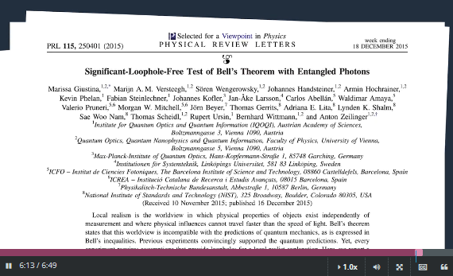

Journal page shown in the lecture player.

**PRL 115, 250401 (2015)** — *Physical Review Letters* — Selected for a Viewpoint in Physics — week ending 18 December 2015.

# Significant-Loophole-Free Test of Bell's Theorem with Entangled Photons

Marissa Giustina, Marijn A. M. Versteegh, Sören Wengerowsky, Johannes Handsteiner, Armin Hochrainer, Kevin Phelan, Fabian Steinlechner, Johannes Kofler, Jan-Åke Larsson, Carlos Abellán, Waldemar Amaya, Valerio Pruneri, Morgan W. Mitchell, Jörn Beyer, Thomas Gerrits, Adriana E. Lita, Lynden K. Shalm, Sae Woo Nam, Thomas Scheidl, Rupert Ursin, Bernhard Wittmann, and Anton Zeilinger.

Affiliations shown include IQOQI (Austrian Academy of Sciences, Boltzmanngasse 3, Vienna), University of Vienna (Boltzmanngasse 5), Max-Planck-Institute of Quantum Optics (Garching), Linköpings Universitet, ICFO (Castelldefels), ICREA (Barcelona), Physikalisch-Technische Bundesanstalt (Berlin), and NIST (Boulder, Colorado).

(Received 10 November 2015; published 16 December 2015)

> Local realism is the worldview in which physical properties of objects exist independently of measurement and where physical influences cannot travel faster than the speed of light. Bell's theorem states that this worldview is incompatible with the predictions of quantum mechanics, as is expressed in Bell's inequalities. Previous experiments convincingly supported the quantum predictions. Yet, every

The rest of the abstract is covered by the video control bar.

00:06:13,480 \--\> 00:06:17,370

And it implies that the world we live in is inherently random.

145

00:06:17,370 \--\> 00:06:19,230

By the way, if you\'re the type of person

146

00:06:19,230 \--\> 00:06:22,020

who doesn\'t like the idea of the world being random,

147

00:06:22,020 \--\> 00:06:24,780

I should note that no experiment can ever rule out

148

00:06:24,780 \--\> 00:06:27,180

the concept of super determinism, which

149

00:06:27,180 \--\> 00:06:29,290

is the idea that everything in the universe,

150

00:06:29,290 \--\> 00:06:33,630

including Alice and Bob\'s basis selection, is predetermined.

151

00:06:33,630 \--\> 00:06:35,820

So you can say that these experiments are still

152

00:06:35,820 \--\> 00:06:37,926

consistent with super determinism,

153

00:06:37,926 \--\> 00:06:39,300

but you might also have to accept

154

00:06:39,300 \--\> 00:06:43,040

the fact that you don\'t have any free will in that case.

155

00:06:43,040 \--\> 00:06:53,846

## **PRACTICE (one question )**
##  

Section: Quantum makes new cryptography

# Page Title:Bell\'s Inequality and Certifiable Random Number Generation

# **Learn**

In the next several videos,

## **Images**


## **Transcript**

## 

0

0

00:00:00,000 \--\> 00:00:00,500

1

00:00:00,500 \--\> 00:00:03,590

Bell\'s inequality may seem just like an interesting experiment

2

00:00:03,590 \--\> 00:00:05,240

you can do and something to learn about

3

00:00:05,240 \--\> 00:00:08,180

in your first quantum course, but not something that has

4

00:00:08,180 \--\> 00:00:10,520

any real world applications.

5

00:00:10,520 \--\> 00:00:13,130

However in 2010, researchers show

6

00:00:13,130 \--\> 00:00:15,950

that you can take the base machinery for demonstrating

7

00:00:15,950 \--\> 00:00:18,080

Bell\'s inequality and use it to make

8

00:00:18,080 \--\> 00:00:21,380

a remarkable type of quantum random number generator\--

9

00:00:21,380 \--\> 00:00:25,010

one that is certified by the violation of Bell\'s inequality

10

00:00:25,010 \--\> 00:00:26,990

under some basic assumptions.

11

00:00:26,990 \--\> 00:00:29,120

They showed that they could use the violation

12

00:00:29,120 \--\> 00:00:31,550

of Bell\'s inequality to bound the entropy

13

00:00:31,550 \--\> 00:00:33,650

of the outputs of their RNG.

14

00:00:33,650 \--\> 00:00:35,120

Here\'s how it works.

15

00:00:35,120 \--\> 00:00:38,240

Alice and Bob start out with a string of zeros and ones

16

00:00:38,240 \--\> 00:00:41,930

that is used to select one measurement basis or the other.

17

00:00:41,930 \--\> 00:00:43,850

Each time they run the experiment choosing

18

00:00:43,850 \--\> 00:00:47,790

one basis or the other, each gets out a 0 or 1,

19


<!-- frame 0:48 · slide · week3/media/media/image51.png -->

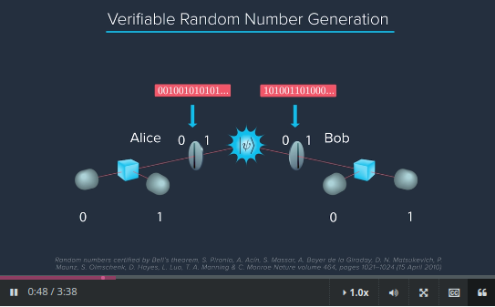

$$
|\psi\rangle
$$

# Verifiable Random Number Generation

Alice and Bob measure an entangled source \(|\psi\rangle\).

- Alice's setting string (pink): `001001010101...` chooses between measurement settings 0 and 1.
- Bob's setting string (pink): `101001101000...` chooses between measurement settings 0 and 1.
- Each side has a polarizer, then a detector (blue cube) with two outcome ports labeled 0 and 1 (gray spheres).

Caption: Random numbers certified by Bell's theorem. S. Pironio, A. Acín, S. Massar, A. Boyer de la Giroday, D. N. Matsukevich, P. Maunz, S. Olmschenk, D. Hayes, L. Luo, T. A. Manning & C. Monroe. *Nature* volume 464, pages 1021–1024 (15 April 2010).

00:00:47,790 \--\> 00:00:50,210

depending on which detector clicked.

20

00:00:50,210 \--\> 00:00:52,460

They repeat the experiment many times

21

00:00:52,460 \--\> 00:00:54,560

and use the input and output strings

22

00:00:54,560 \--\> 00:00:57,710

to compute the Bell inequality function.

23

00:00:57,710 \--\> 00:01:01,010

This tells them how much entropy is in the output string,

24

00:01:01,010 \--\> 00:01:03,050

and they can then use classical techniques

25

00:01:03,050 \--\> 00:01:05,360

to extract the randomness.

26

00:01:05,360 \--\> 00:01:07,250

The amazing thing here is that all

27

00:01:07,250 \--\> 00:01:10,730

you need to know to know how much entropy is in the system

28


<!-- frame 1:11 · slide · week3/media/media/image13.png -->

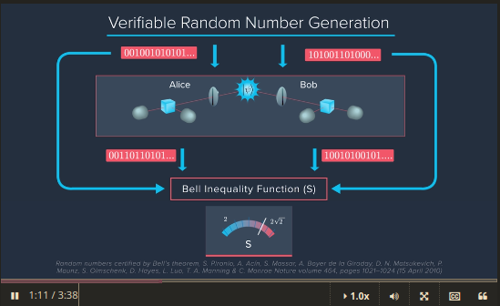

$$|\psi\rangle$$
$$2\sqrt{2}$$

Title: Verifiable Random Number Generation

Flow diagram. A pink-outlined box contains Alice (left) and Bob (right). Each side has two gray detector spheres, a blue cube, and a gray oval polarizer on a red photon path. Between them is a blue starburst source labeled $|\psi\rangle$.

Pink bit-string labels with blue arrows:

- into the top of Alice's side: 001001010101...
- into the top of Bob's side: 101001101000...
- out the bottom left: 00110110101...
- out the bottom right: 10010100101...

Cyan arrows loop from both sides down into a pink box labeled Bell Inequality Function (S). Below it is a gauge labeled S, marked 2 on the left and $2\sqrt{2}$ on the right; the needle sits toward the $2\sqrt{2}$ end.

Footer: Random numbers certified by Bell's theorem. S. Pironio, A. Acín, S. Massar, A. Boyer de la Giroday, D. N. Matsukevich, P. Maunz, S. Olmschenk, D. Hayes, L. Luo, T. A. Manning & C. Monroe Nature volume 464, pages 1021–1024 (15 April 2010).

00:01:10,730 \--\> 00:01:13,370

is the violation of Bell\'s inequality.

29

00:01:13,370 \--\> 00:01:15,740

So there\'s no need to continuously characterize

30

00:01:15,740 \--\> 00:01:17,690

each and every component in your system

31

00:01:17,690 \--\> 00:01:19,860

to make sure it\'s working properly.

32

00:01:19,860 \--\> 00:01:21,590

You have one number that you get out

33

00:01:21,590 \--\> 00:01:25,070

of your system that tells you if it\'s working properly.

34

00:01:25,070 \--\> 00:01:27,182

Again, something can always break,

35

00:01:27,182 \--\> 00:01:29,390

and this doesn\'t guarantee that nothing will go wrong

36

00:01:29,390 \--\> 00:01:30,950

in your black box.

37

00:01:30,950 \--\> 00:01:33,920

But if something goes wrong, either because something broke

38

00:01:33,920 \--\> 00:01:36,710

or because an adversary is hacking the system,

39

00:01:36,710 \--\> 00:01:40,310

you see it reflected in the violation of Bell\'s inequality.

40

00:01:40,310 \--\> 00:01:43,580

This concept is called device independence or black box

41


<!-- frame 1:42 · slide · week3/media/media/image28.png -->

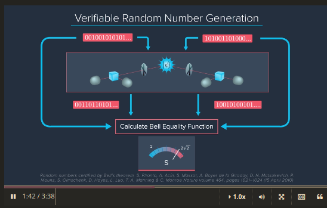

$$|\psi\rangle$$
$$2\sqrt{2}$$

Title: Verifiable Random Number Generation

Flow diagram. A pink-outlined box contains Alice (left) and Bob (right). Each side has two gray detector spheres, a blue cube, and a gray oval polarizer on a red photon path. Between them is a blue starburst source labeled $|\psi\rangle$.

Pink bit-string labels with blue arrows:

- into the top of Alice's side: 001001010101...
- into the top of Bob's side: 101001101000...
- out the bottom left: 00110110101...
- out the bottom right: 10010100101...

Cyan arrows from both output strings point into a pink box labeled "Calculate Bell Equality Function". Below it is a gauge labeled S, marked 2 on the left and $2\sqrt{2}$ on the right; the needle sits toward the $2\sqrt{2}$ end.

Footer: Random numbers certified by Bell's theorem. S. Pironio, A. Acín, S. Massar, A. Boyer de la Giroday, D. N. Matsukevich, P. Maunz, S. Olmschenk, D. Hayes, L. Luo, T. A. Manning & C. Monroe. Nature volume 464, pages 1021–1024 (15 April 2010).

Player: paused, speed 1.0x.

00:01:43,580 \--\> 00:01:44,840

security.

42

00:01:44,840 \--\> 00:01:47,180

We\'ve talked here about using this for random number

43

00:01:47,180 \--\> 00:01:50,330

generation, but people have demonstrated black box security

44

00:01:50,330 \--\> 00:01:52,460

proofs for other applications, such as

45

00:01:52,460 \--\> 00:01:54,140

quantum key distribution.

46

00:01:54,140 \--\> 00:01:56,510

In these protocols, it\'s important to close

47

00:01:56,510 \--\> 00:01:58,400

the loopholes in Bell\'s inequality,

48

00:01:58,400 \--\> 00:02:01,040

because those could provide a way for an adversary

49

00:02:01,040 \--\> 00:02:05,300

to compromise the system, for example, by blinding detectors.

50

00:02:05,300 \--\> 00:02:08,780

The verifiable or certifiable random number generator

51

00:02:08,780 \--\> 00:02:12,530

was first demonstrated using trapped ions in 2010.

52

00:02:12,530 \--\> 00:02:14,570

The locality loophole wasn\'t closed,

53

00:02:14,570 \--\> 00:02:16,070

but the two halves of the experiment

54

00:02:16,070 \--\> 00:02:19,400

were spatially separated and thought to be not interacting.

55

00:02:19,400 \--\> 00:02:21,710

Of course, the only way to know for sure

56

00:02:21,710 \--\> 00:02:24,230

is to close the locality loophole,

57

00:02:24,230 \--\> 00:02:27,440

and in 2018, some of the same people that

58

00:02:27,440 \--\> 00:02:30,170

showed they could close the loopholes in Bell\'s inequality

59

00:02:30,170 \--\> 00:02:33,050

tests then used their system to make

60

00:02:33,050 \--\> 00:02:36,080

a certifiable random number generator.

61

00:02:36,080 \--\> 00:02:38,960

I\'d like to close by pointing out the timeline for device

62

00:02:38,960 \--\> 00:02:41,000

independent applications.

63

00:02:41,000 \--\> 00:02:44,360

It all started back in the \'30s when Einstein, Podolsky,

64

00:02:44,360 \--\> 00:02:47,120

and Rosen wrote a paper on what they viewed

65

00:02:47,120 \--\> 00:02:50,270

as a paradox and a reason that quantum mechanics was

66

00:02:50,270 \--\> 00:02:53,000

incomplete\-- this concept that they rejected

67

00:02:53,000 \--\> 00:02:55,850

called spooky action at a distance.

68

00:02:55,850 \--\> 00:02:58,220

Then nearly 30 years later, John Bell

69

00:02:58,220 \--\> 00:03:00,620

realized that there\'s an experiment you could do

70

00:03:00,620 \--\> 00:03:03,020

to shed light on this paradox.

71

00:03:03,020 \--\> 00:03:05,750

People did the first experiments demonstrating the violation

72

00:03:05,750 \--\> 00:03:08,180

of Bell\'s inequality in the \'80s,

73

00:03:08,180 \--\> 00:03:10,130

and more than 20 years later, they

74

00:03:10,130 \--\> 00:03:12,700

came up with an idea of device independence

75

00:03:12,700 \--\> 00:03:15,470

and demonstrated it in a real system.

76

00:03:15,470 \--\> 00:03:18,110

Perhaps, someday we\'ll have black box applications

77

00:03:18,110 \--\> 00:03:19,460

on a chip.

78

00:03:19,460 \--\> 00:03:21,830

If so, this would be an amazing story

79

00:03:21,830 \--\> 00:03:23,330

about how something that started out

80

00:03:23,330 \--\> 00:03:26,260

as a scientific curiosity, something that addressed

81

00:03:26,260 \--\> 00:03:28,970

a question mainly of philosophical interest

82

00:03:28,970 \--\> 00:03:32,650

ended up having profound effects on security.

83

00:03:32,650 \--\> 00:03:38,731

## **PRACTICE** 

## **(there is no practice for this page )**

##  

Section: Quantum makes new cryptography. Quantum repeateers

# Page Title:Quantum Teleportation

# **Learn**

Quantum teleportation is a method to transfer the state of a local
quantum system from one location to another location through the use of
a pre-shared Bell state and the transmission of two bits of classical
information. This protocol, first discovered in 1993, represents a
fundamental building block for communicating quantum information. For
this reason, it has been studied intensely and has been demonstrated
numerous times experimentally. Despite the colloquial definition of the
word teleportation as popularized by science fiction, *no physical
object is transferred* by the process; instead, *just the quantum
information describing* state of a qubit is transferred between two
local quantum systems.


## **Images**

$$|\psi_0\rangle_C = a|0\rangle_C + b|1\rangle_C$$
$$|\Psi^{\pm}\rangle = \frac{1}{\sqrt{2}}(|0\rangle_A|1\rangle_B \pm |1\rangle_A|0\rangle_B) \quad \& \quad |\Phi^{\pm}\rangle = \frac{1}{\sqrt{2}}(|0\rangle_A|0\rangle_B \pm |1\rangle_A|1\rangle_B)$$
$$|\psi_0\rangle_C \otimes |\Psi^-\rangle_{AB} = \frac{1}{\sqrt{2}}(a|0\rangle_C + b|1\rangle_C)(|0\rangle_A|1\rangle_B - |1\rangle_A|0\rangle_B).$$

To be precise, you can assume that a user Alice is in possession of a qubit in the state $|\psi_0\rangle_C = a|0\rangle_C + b|1\rangle_C$ and wishes to transfer this state to another user, Bob. Alice and Bob have pre-shared one of the four Bell states with subscripts $A$ and $B$ which are given by:

$$|\Psi^{\pm}\rangle = \frac{1}{\sqrt{2}}(|0\rangle_A|1\rangle_B \pm |1\rangle_A|0\rangle_B) \quad \& \quad |\Phi^{\pm}\rangle = \frac{1}{\sqrt{2}}(|0\rangle_A|0\rangle_B \pm |1\rangle_A|1\rangle_B)$$

(The $|\Phi^{\pm}\rangle$ ket is split across the line break in the figure: the opening bar sits at the end of the first line.)

Suppose Alice and Bob have chosen to pre-share the $|\Psi^-\rangle$ state (similar results would be found for the other choices). The initial state of the system can now be written as

$$|\psi_0\rangle_C \otimes |\Psi^-\rangle_{AB} = \frac{1}{\sqrt{2}}(a|0\rangle_C + b|1\rangle_C)(|0\rangle_A|1\rangle_B - |1\rangle_A|0\rangle_B).$$

$$|\psi_0\rangle_C \otimes |\Psi^-\rangle_{AB} = \frac{1}{\sqrt{2}}\big[a|0\rangle_C|0\rangle_A|1\rangle_B + b|1\rangle_C|0\rangle_A|1\rangle_B - a|0\rangle_C|1\rangle_A|0\rangle_B - b|1\rangle_C|1\rangle_A|0\rangle_B\big]$$
$$= \frac{1}{2}\Big[a\big(|\Phi^+\rangle_{CA}+|\Phi^-\rangle_{CA}\big)|1\rangle_B + b\big(|\Psi^+\rangle_{CA}-|\Psi^-\rangle_{CA}\big)|1\rangle_B - a\big(|\Psi^+\rangle_{CA}+|\Psi^-\rangle_{CA}\big)|0\rangle_B - b\big(|\Phi^+\rangle_{CA}-|\Phi^-\rangle_{CA}\big)|0\rangle_B\Big]$$
$$= \frac{1}{2}\Big[|\Psi^-\rangle_{CA}(-a|0\rangle_B-b|1\rangle_B) + |\Psi^+\rangle_{CA}(-a|0\rangle_B+b|1\rangle_B) + |\Phi^-\rangle_{CA}(a|1\rangle_B+b|0\rangle_B) + |\Phi^+\rangle_{CA}(a|1\rangle_B-b|0\rangle_B)\Big]$$
$$|0\rangle|0\rangle = \frac{1}{\sqrt{2}}(|\Phi^+\rangle+|\Phi^-\rangle)$$
$$|0\rangle|1\rangle = \frac{1}{\sqrt{2}}(|\Psi^+\rangle+|\Psi^-\rangle)$$
$$|1\rangle|0\rangle = \frac{1}{\sqrt{2}}(|\Psi^+\rangle-|\Psi^-\rangle)$$
$$|1\rangle|1\rangle = \frac{1}{\sqrt{2}}(|\Phi^+\rangle-|\Phi^-\rangle).$$

By expanding this equation and grouping Alice's qubits together, the same state can be equivalently expressed as

$$|\psi_0\rangle_C \otimes |\Psi^-\rangle_{AB} = \frac{1}{\sqrt{2}}\big[a|0\rangle_C|0\rangle_A|1\rangle_B + b|1\rangle_C|0\rangle_A|1\rangle_B - a|0\rangle_C|1\rangle_A|0\rangle_B - b|1\rangle_C|1\rangle_A|0\rangle_B\big]$$

$$= \frac{1}{2}\Big[a(|\Phi^+\rangle_{CA}+|\Phi^-\rangle_{CA})|1\rangle_B + b(|\Psi^+\rangle_{CA}-|\Psi^-\rangle_{CA})|1\rangle_B - a(|\Psi^+\rangle_{CA}+|\Psi^-\rangle_{CA})|0\rangle_B - b(|\Phi^+\rangle_{CA}-|\Phi^-\rangle_{CA})|0\rangle_B\Big]$$

$$= \frac{1}{2}\Big[|\Psi^-\rangle_{CA}(-a|0\rangle_B - b|1\rangle_B) + |\Psi^+\rangle_{CA}(-a|0\rangle_B + b|1\rangle_B) + |\Phi^-\rangle_{CA}(a|1\rangle_B + b|0\rangle_B) + |\Phi^+\rangle_{CA}(a|1\rangle_B - b|0\rangle_B)\Big]$$

where we have used the following identities

$$|0\rangle|0\rangle = \frac{1}{\sqrt{2}}(|\Phi^+\rangle+|\Phi^-\rangle)$$

$$|0\rangle|1\rangle = \frac{1}{\sqrt{2}}(|\Psi^+\rangle+|\Psi^-\rangle)$$

$$|1\rangle|0\rangle = \frac{1}{\sqrt{2}}(|\Psi^+\rangle-|\Psi^-\rangle)$$

$$|1\rangle|1\rangle = \frac{1}{\sqrt{2}}(|\Phi^+\rangle-|\Phi^-\rangle).$$

$$|\Psi^-\rangle_{CA}$$
$$|\psi_0\rangle$$
$$|\Phi^-\rangle_{CA}$$
$$a|1\rangle_B + b|0\rangle_B$$
$$|0\rangle$$
$$|1\rangle$$

The protocol then begins with Alice projecting the state of her two qubits onto one of the four Bell states in a process known as Bell state measurement (BSM). This leaves Bob with one of four qubit states, which for the case of $|\Psi^-\rangle_{CA}$ is already equal to $|\psi_0\rangle$ — up to a meaningless global phase — and for the other states can be transformed into $|\psi_0\rangle$ using either X, Y, or a Z-gate. However, it should be noted that if Alice does not send Bob the results of her BSM, then Bob does not know which transformation to apply and is unable to recover $|\psi_0\rangle$.

As an example, if the result of Alice's BSM is $|\Phi^-\rangle_{CA}$, then Bob would be left with the state $a|1\rangle_B + b|0\rangle_B$, which can be rotated into the desired state with an application of the $X$-gate.

Intuitively, you can think of teleportation as first comparing the states of Alice's two qubits through a BSM, and then exploiting the fact that the qubits in the pre-shared Bell state are correlated and your knowledge of the BSM outcome to recover the state of the original qubit.

For example, if the BSM between Alice's two qubits results in $|\Psi^-\rangle$, you know that Alice's qubits are anti-correlated. Then, since Alice and Bob's initial qubits are also anti-correlated, the two anti-correlations cancel, and Bob is left with the same qubit — up to a meaningless global phase — as the one Alice wanted to send.

Quantum teleportation is consistent with the physical principles that information cannot be sent faster than light and that quantum information cannot be cloned. The first is apparent because Bob is unable to recover $|\psi_0\rangle$ until he is told the result of Alice's BSM, which must be sent to Bob using some sort of classical method, and therefore cannot be transferred faster than light. The principle of no-cloning is satisfied, because Alice's BSM leaves her two qubits in a Bell state, which is now completely independent of the state $|\psi_0\rangle$. Explicitly, if you were to look at the state of either of Alice's qubits individually after the BSM, you would find an even statistical mixture of the states $|0\rangle$ and $|1\rangle$, which clearly contains no information related to $|\psi_0\rangle$.

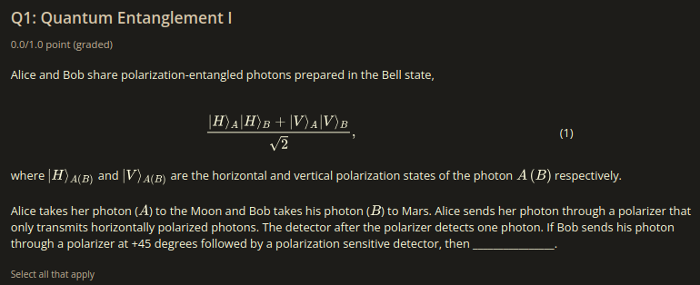

$$
\frac{|H\rangle_A|H\rangle_B + |V\rangle_A|V\rangle_B}{\sqrt{2}}, \qquad (1)
$$

**Q1: Quantum Entanglement I**

0.0/1.0 point (graded)

Alice and Bob share polarization-entangled photons prepared in the Bell state,

\[
\frac{|H\rangle_A|H\rangle_B + |V\rangle_A|V\rangle_B}{\sqrt{2}}, \qquad (1)
\]

where \(|H\rangle_{A(B)}\) and \(|V\rangle_{A(B)}\) are the horizontal and vertical polarization states of the photon \(A\) (\(B\)) respectively.

Alice takes her photon (\(A\)) to the Moon and Bob takes his photon (\(B\)) to Mars. Alice sends her photon through a polarizer that only transmits horizontally polarized photons. The detector after the polarizer detects one photon. If Bob sends his photon through a polarizer at +45 degrees followed by a polarization sensitive detector, then _____________.

Select all that apply

The answer choices are not in this frame.

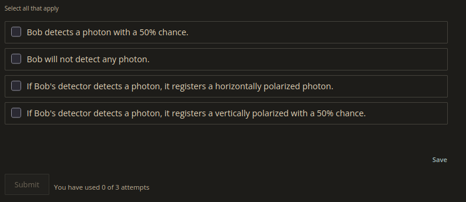

Select all that apply (the question stem is not in this frame).

Unchecked options:

- Bob detects a photon with a 50% chance.
- Bob will not detect any photon.
- If Bob's detector detects a photon, it registers a horizontally polarized photon.
- If Bob's detector detects a photon, it registers a vertically polarized with a 50% chance.

Save (right). Submit is disabled. "You have used 0 of 3 attempts".
## **Transcript**

## 

0

0

00:00:00,000 \--\> 00:00:00,500

1

00:00:00,500 \--\> 00:00:04,680

If somebody gives you a single photon of unknown polarization

2

00:00:04,680 \--\> 00:00:07,560

and wants you to transmit it to somewhere else.

3

00:00:07,560 \--\> 00:00:09,150

Of course, it\'s a photon.

4

00:00:09,150 \--\> 00:00:10,911

It naturally likes to travel.

5

00:00:10,911 \--\> 00:00:11,910

You can send it to them.

6

00:00:11,910 \--\> 00:00:13,370

But suppose it\'s daytime.

7

00:00:13,370 \--\> 00:00:15,120

And you want to send it to somewhere else.

8

00:00:15,120 \--\> 00:00:17,760

And there\'s too many photons around.

9

00:00:17,760 \--\> 00:00:23,250

How can you get this photon to another destination intact?

10

00:00:23,250 \--\> 00:00:26,100

Well, you could try to measure its polarization.

11

00:00:26,100 \--\> 00:00:28,740

But if you did, you might measure along a wrong axis.

12

00:00:28,740 \--\> 00:00:30,540

And you might spoil it.

13

00:00:30,540 \--\> 00:00:32,040

If you measured it, then, of course,

14

00:00:32,040 \--\> 00:00:34,000

you could tell the receiver your result.

15

00:00:34,000 \--\> 00:00:36,120

But it would be a bad copy.

16

00:00:36,120 \--\> 00:00:39,150

It seems like the uncertainty principle prevents you

17


<!-- frame 0:39 · slide · week3/media/media/image33.png -->

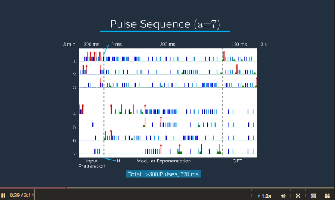

Title: Pulse Sequence (a=7)

Seven horizontal pulse traces, labeled 1 through 7. Time-span labels along the top: 3 min, 200 ms, 10 ms, 300 ms, 120 ms, 2 s. Vertical dashed lines divide the sequence into regions labeled underneath: Input Preparation, H, Modular Exponentiation, QFT. Pulses are mostly short blue ticks, with taller red markers and a few green ticks clustered near the boundaries.

Blue callout: Total: >300 Pulses, 720 ms.

Player: paused, speed 1.0x.

00:00:39,150 \--\> 00:00:41,130

from getting all the information out

18

00:00:41,130 \--\> 00:00:42,900

about the state of the photon.

19

00:00:42,900 \--\> 00:00:45,030

And if you can\'t get the information out of it, how

20

00:00:45,030 \--\> 00:00:48,000

can you get a copy of this photon

21

00:00:48,000 \--\> 00:00:51,810

or get it to another destination intact?

22

00:00:51,810 \--\> 00:00:54,570

Well, quantum teleportation is a way

23

00:00:54,570 \--\> 00:00:57,870

to make it end run around this logic.

24

00:00:57,870 \--\> 00:00:59,340

And it uses entanglement.

25

00:00:59,340 \--\> 00:01:00,970

And here\'s how you do it.

26

00:01:00,970 \--\> 00:01:04,709

First, I\'ll say why it doesn\'t work if you don\'t use entangle.

27

00:01:04,709 \--\> 00:01:07,260

So I\'ve got this photon of an unknown polarization.

28

00:01:07,260 \--\> 00:01:09,240

The best I can do is to measure it.

29

00:01:09,240 \--\> 00:01:11,370

And that uses the photon up and gives me

30

00:01:11,370 \--\> 00:01:12,760

incomplete information.

31

00:01:12,760 \--\> 00:01:15,820

So I would then send this partial information.

32

00:01:15,820 \--\> 00:01:17,700

And I would make an approximate copy\--

33

00:01:17,700 \--\> 00:01:21,060

a copy that might be right or might be wrong

34

00:01:21,060 \--\> 00:01:23,694

or might have a polarization that isn\'t quite right.

35

00:01:23,694 \--\> 00:01:24,610

So that\'s the trouble.

36

00:01:24,610 \--\> 00:01:26,820

And it would seem the uncertainty principle prevents

37

00:01:26,820 \--\> 00:01:28,530

this job from being done.

38

00:01:28,530 \--\> 00:01:31,770

Well now here\'s what we can do to get around that problem.

39

00:01:31,770 \--\> 00:01:32,940

We use more photons.

40

00:01:32,940 \--\> 00:01:35,550

We have our original photon A, and we

41

00:01:35,550 \--\> 00:01:38,050

want to get it to another destination.

42

00:01:38,050 \--\> 00:01:41,910

So we now take two entangled particles, which

43

00:01:41,910 \--\> 00:01:44,510

I\'ll called B and C. They\'ve never been near photon A.

44

00:01:44,510 \--\> 00:01:47,570

And they don\'t know anything about the state of A.

45

00:01:47,570 \--\> 00:01:52,230

And what we do is we make a measurement, not on A alone,

46

00:01:52,230 \--\> 00:01:54,960

but on A and B together.

47

00:01:54,960 \--\> 00:01:56,520

And since those are two photons, we

48

00:01:56,520 \--\> 00:01:58,980

can get four possible outcomes of that measurement,

49

00:01:58,980 \--\> 00:02:00,660

so we do that.

50

00:02:00,660 \--\> 00:02:03,240

Essentially we\'re measuring the relation

51

00:02:03,240 \--\> 00:02:05,280

between their polarizations without measuring

52

00:02:05,280 \--\> 00:02:06,990

the polarization of either one.

53

00:02:06,990 \--\> 00:02:08,710

And, of course, that spoils both of them.

54

00:02:08,710 \--\> 00:02:10,699

So this looks like we we\'re worse off than.

55

00:02:10,699 \--\> 00:02:13,380

And we don\'t even have one copy of the information

56

00:02:13,380 \--\> 00:02:15,720

that we wanted to get to the receiver

57

00:02:15,720 \--\> 00:02:18,040

over on the right side of the figure.

58

00:02:18,040 \--\> 00:02:20,460

But we take this information that we got\-- the relation.

59

00:02:20,460 \--\> 00:02:22,390

And that\'s a two-bit message.

60

00:02:22,390 \--\> 00:02:24,990

And we send it to the receiving location.

61

00:02:24,990 \--\> 00:02:26,490

And then at the receiving location,

62

00:02:26,490 \--\> 00:02:28,770

the receiver takes the other entangled particle

63

00:02:28,770 \--\> 00:02:30,730

C, who\'s never been anywhere near A

64

00:02:30,730 \--\> 00:02:33,930

and does one of four different rotations on it.

65

00:02:33,930 \--\> 00:02:36,460

You might say applies a corrective treatment.

66

00:02:36,460 \--\> 00:02:41,130

And when you do that, it puts it into an exact copy

67

00:02:41,130 \--\> 00:02:43,770

of the state of photon A that you

68

00:02:43,770 \--\> 00:02:46,750

spoiled by measuring it in the first part of the protocol.

69

00:02:46,750 \--\> 00:02:52,260

So at no point do you exactly learn the state of this photon.

70

00:02:52,260 \--\> 00:02:54,195

But you protected it from being damaged.

71

00:02:54,195 \--\> 00:02:57,120

And then you\'ve destroyed one copy on the left

72

00:02:57,120 \--\> 00:02:59,550

and produced a perfect replica on the right.

73

00:02:59,550 \--\> 00:03:01,800

And that\'s what we call quantum teleportation.

74

00:03:01,800 \--\> 00:03:05,220

I could draw some equations for this showing how this works.

75

00:03:05,220 \--\> 00:03:07,920

But can we do it in a metaphoric way?

76

00:03:07,920 \--\> 00:03:11,370

And the metaphor I have is to say, suppose Alice\--

77

00:03:11,370 \--\> 00:03:13,770

suppose she\'s witnessed a complicated crime

78

00:03:13,770 \--\> 00:03:17,100

with possible terrorist implications here in Boston?

79

00:03:17,100 \--\> 00:03:20,280

Now, the FBI in Washington knows that her memory

80

00:03:20,280 \--\> 00:03:23,040

is this fragile dreamlike form.

81

00:03:23,040 \--\> 00:03:25,414

And they want to ask her just the right questions

82

00:03:25,414 \--\> 00:03:26,205

in the right order.

83

00:03:26,205 \--\> 00:03:29,767

And not to spoil her memory by asking her wrong questions.

84

00:03:29,767 \--\> 00:03:32,100

And they certainly don\'t want to leave the investigation

85

00:03:32,100 \--\> 00:03:35,100

to the Boston Police who will ask her stupid questions

86

00:03:35,100 \--\> 00:03:36,542

and confuse her.

87

00:03:36,542 \--\> 00:03:38,250

And so they ask her to come to Washington

88

00:03:38,250 \--\> 00:03:40,320

and be interviewed by a panel of experts

89

00:03:40,320 \--\> 00:03:42,390

who will ask her just the right questions in just

90

00:03:42,390 \--\> 00:03:43,080

the right order.

91

00:03:43,080 \--\> 00:03:45,030

And probably these questions even

92

00:03:45,030 \--\> 00:03:47,210

depend on confidential information

93

00:03:47,210 \--\> 00:03:49,800

they wouldn\'t want to share with the Boston Police.

94

00:03:49,800 \--\> 00:03:52,620

But Alice doesn\'t like travel, and she refuses to go.

95

00:03:52,620 \--\> 00:03:55,500

So they decide to send one of their agents to Boston.

96

00:03:55,500 \--\> 00:03:58,170

Unfortunately, their agents are all

97

00:03:58,170 \--\> 00:04:00,000

very opinionated about the case.

98

00:04:00,000 \--\> 00:04:02,460

And they don\'t trust each other to ask the right questions.

99

00:04:02,460 \--\> 00:04:04,751

Well, there\'s two agents who seem to be pretty useless.

100

00:04:04,751 \--\> 00:04:06,840

They\'re around the FBI, but they don\'t

101

00:04:06,840 \--\> 00:04:08,590

seem to understand anything.

102

00:04:08,590 \--\> 00:04:11,580

They\'re twin brothers, Remus and Romulus.

103

00:04:11,580 \--\> 00:04:14,250

And they don\'t have an opinion about anything.

104

00:04:14,250 \--\> 00:04:16,019

If you ask either one of them a question

105

00:04:16,019 \--\> 00:04:18,690

about any subject at all, they give a completely random

106

00:04:18,690 \--\> 00:04:19,450

answer.

107

00:04:19,450 \--\> 00:04:21,990

But for some reason, they would always give the same answer

108

00:04:21,990 \--\> 00:04:23,460

as each other.

109

00:04:23,460 \--\> 00:04:27,720

So hearing about this problem of who\'s going to go to Boston

110

00:04:27,720 \--\> 00:04:30,335

and talk to Alice, Remus says, well, I don\'t know anything

111

00:04:30,335 \--\> 00:04:30,960

about the case.

112

00:04:30,960 \--\> 00:04:33,810

So I\'m less likely to influence her than any of you.

113

00:04:33,810 \--\> 00:04:35,400

Besides, I like to travel.

114

00:04:35,400 \--\> 00:04:38,040

Just ask my brother, and Romulus agrees.

115

00:04:38,040 \--\> 00:04:41,040

So they send Remus to go to Boston to meet Alice.

116

00:04:41,040 \--\> 00:04:44,190

And they explain that this is really a speed date.

117

00:04:44,190 \--\> 00:04:47,580

They\'re not supposed to discuss anything substantive.

118

00:04:47,580 \--\> 00:04:49,380

They just have to figure out whether they

119

00:04:49,380 \--\> 00:04:51,010

click in their relationship.

120

00:04:51,010 \--\> 00:04:52,170

Well, it goes really badly.

121

00:04:52,170 \--\> 00:04:53,850

And Alice leaves in a few minutes,

122

00:04:53,850 \--\> 00:04:55,260

saying I can\'t stand this guy.

123

00:04:55,260 \--\> 00:04:57,550

And for some reason, it\'s been so stressful

124

00:04:57,550 \--\> 00:04:59,790

that I forget everything about this crime.

125

00:04:59,790 \--\> 00:05:03,370

And the Boston Police thank her and say she can go home.

126

00:05:03,370 \--\> 00:05:05,130

Then they get on the phone to Washington

127

00:05:05,130 \--\> 00:05:07,120

and say, well, it looks like Alice and Remus

128

00:05:07,120 \--\> 00:05:08,380

don\'t get along.

129

00:05:08,380 \--\> 00:05:11,720

So the FBI, the x, then go to Romulus and say,

130

00:05:11,720 \--\> 00:05:14,360

well it looks like Alice and your brother don\'t get on.

131

00:05:14,360 \--\> 00:05:16,670

So any question that we would have asked Alice,

132

00:05:16,670 \--\> 00:05:18,180

we can ask you.

133

00:05:18,180 \--\> 00:05:20,650

And we know that whenever you say yes,

134

00:05:20,650 \--\> 00:05:22,130

she would have said no.

135

00:05:22,130 \--\> 00:05:23,650

So they proceed with their careful

136

00:05:23,650 \--\> 00:05:26,620

questioning, reversing every one of Romulus\'s answers

137

00:05:26,620 \--\> 00:05:28,840

to get what Alice would have answered.

138

00:05:28,840 \--\> 00:05:32,860

In other words, the metaphor is that by the speed date,

139

00:05:32,860 \--\> 00:05:35,440

Alice has transplanted her state, not

140

00:05:35,440 \--\> 00:05:38,260

into Remus, but into his twin brother

141

00:05:38,260 \--\> 00:05:39,520

but with a random rotation.

142

00:05:39,520 \--\> 00:05:41,740

In this case, a reversal of all the answers.

143

00:05:41,740 \--\> 00:05:44,050

So when you work for the math of teleportation,

144

00:05:44,050 \--\> 00:05:46,560

essentially that\'s what it does.

145

00:05:46,560 \--\> 00:05:52,363

## **PRACTICE** 

## 
## 
##  

## 

Section: Quantum makes new Cryptography - Quantum repeaters

# Page Title:

# **Learn**

Long-distance quantum communication is problematic due to photon loss
inherent in realistic optical channels. This problem is dealt with
classically using amplifiers, known as \"repeater stations,\" which are
interspersed along a transmission channel to compensate for the
reduction in signal power due to loss. Unfortunately, the no-cloning
theorem prohibits the amplification of an unknown quantum state, as it
would allow for a single photon to be copied into more than one photon
carrying the same quantum information. Therefore, classical
amplification techniques *cannot* be used to extend the range over which
quantum information can be transmitted.

$$
10 \cdot \log_{10}\left(\frac{\text{output}}{\text{input}}\right)
$$

Optical fibers are made of silica (SiO\(_2\)) which has two leading loss mechanisms, each of which becomes dominant at different wavelengths. At short wavelengths, the primary loss mechanism is elastic scattering, in the form of Rayleigh scattering, which can change the propagation direction of the light enough to allow it to escape the fiber. Alternatively, at long wavelengths, the dominant loss mechanism becomes absorption by the material itself. At approximately \(1550\,nm\) the combined loss due to both of these effects is at minimum of about 0.2 dB/km, a value which is referred to as the attenuation coefficient. Here, the decibel (db) scale quantifies the ratio of output to input power as

\[
10 \cdot \log_{10}\left(\frac{\text{output}}{\text{input}}\right).
\]

Outside of this optimal wavelength the attenuation coefficient increases which defines a relatively small range of wavelengths useful for telecommunications in optical fiber, limiting the prospect of multiplexing signals to overcome loss. It should be noted that the optimal attenuation coefficient for silica of 0.2 dB/km should be thought of as the lower bound for attenuation coefficients found in real fibers where other loss mechanisms such as absorption due to material impurities or fiber bending also contribute to the overall attenuation.

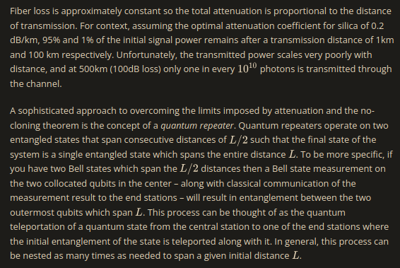

$$10^{10}$$
$$L/2$$
$$L$$

Fiber loss is approximately constant so the total attenuation is proportional to the distance of transmission. For context, assuming the optimal attenuation coefficient for silica of 0.2 dB/km, 95% and 1% of the initial signal power remains after a transmission distance of 1 km and 100 km respectively. Unfortunately, the transmitted power scales very poorly with distance, and at 500 km (100 dB loss) only one in every $10^{10}$ photons is transmitted through the channel.

A sophisticated approach to overcoming the limits imposed by attenuation and the no-cloning theorem is the concept of a *quantum repeater*. Quantum repeaters operate on two entangled states that span consecutive distances of $L/2$ such that the final state of the system is a single entangled state which spans the entire distance $L$. To be more specific, if you have two Bell states which span the $L/2$ distances then a Bell state measurement on the two collocated qubits in the center — along with classical communication of the measurement result to the end stations — will result in entanglement between the two outermost qubits which span $L$. This process can be thought of as the quantum teleportation of a quantum state from the central station to one of the end stations where the initial entanglement of the state is teleported along with it. In general, this process can be nested as many times as needed to span a given initial distance $L$.

The final entangled state distributed by quantum repeaters can be used
as a resource for any quantum communication protocol. For example, this
state can now be used to teleport an unknown quantum state over the
total distance L in a deterministic fashion as opposed to direct
transmission which would have only been successful with very low
probability due to the attenuation. It is important to note that in this
example the quantum repeaters have not only allowed for the transmission
of a quantum system over a large distance, the original aim, but have
also shifted the problem of probabilistic losses to a part of the
protocol which can be repeated until successful without risking the loss
of the unknown state.

## **Images (no video i this page.**

## **Transcript (no video in this page)**

## **PRACTICE (1 question)** 

## 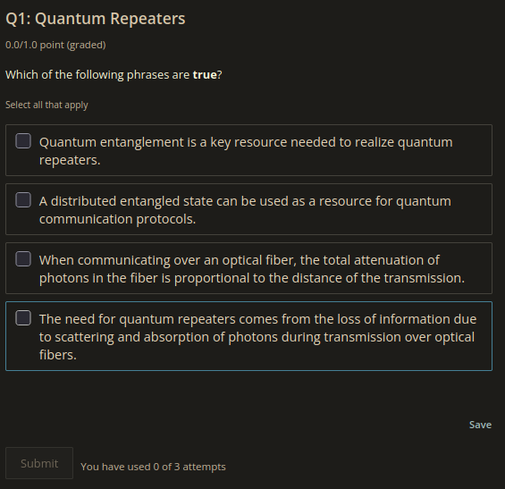

**Q1: Quantum Repeaters**

0.0/1.0 point (graded)

Which of the following phrases are **true**?

Select all that apply

- Quantum entanglement is a key resource needed to realize quantum repeaters.
- A distributed entangled state can be used as a resource for quantum communication protocols.
- When communicating over an optical fiber, the total attenuation of photons in the fiber is proportional to the distance of the transmission.
- The need for quantum repeaters comes from the loss of information due to scattering and absorption of photons during transmission over optical fibers.

Checkboxes are empty (the last option has a blue outline). Save. Submit. You have used 0 of 3 attempts. 

## 

Section: Qiz

# Page Title: Quantum Cryptography Quiz (4 questions)

## **PRACTICE** 

## 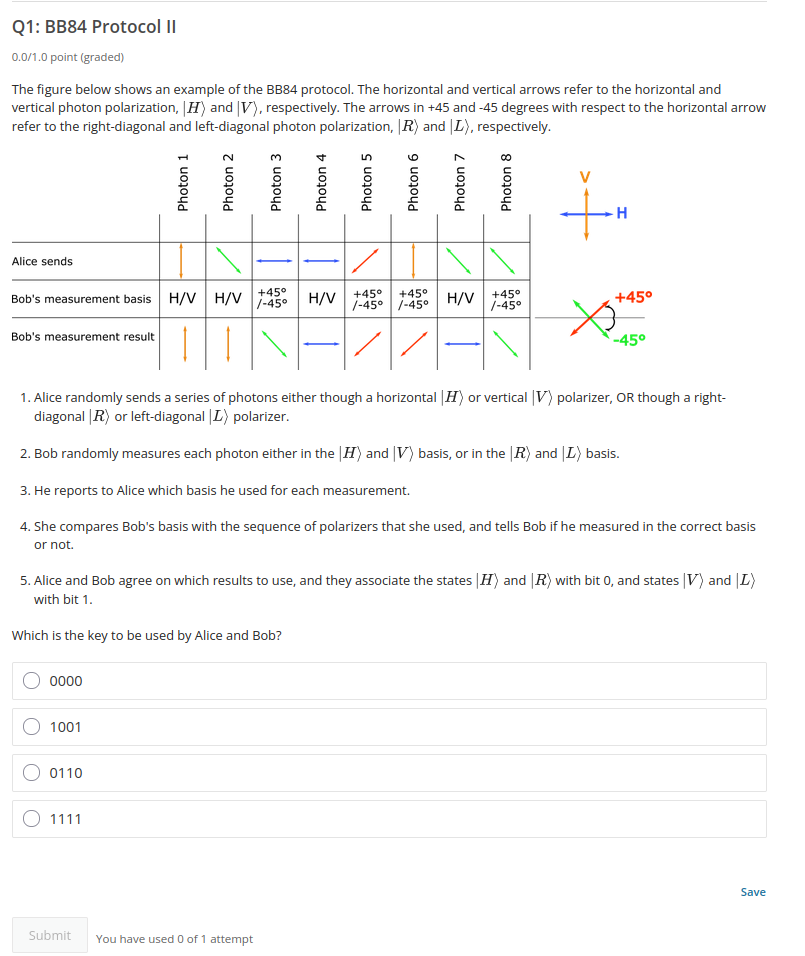

$$|H\rangle,\ |V\rangle,\ |R\rangle,\ |L\rangle$$

Q1: BB84 Protocol II

0.0/1.0 point (graded)

The figure below shows an example of the BB84 protocol. The horizontal and vertical arrows refer to the horizontal and vertical photon polarization, $|H\rangle$ and $|V\rangle$, respectively. The arrows in +45 and -45 degrees with respect to the horizontal arrow refer to the right-diagonal and left-diagonal photon polarization, $|R\rangle$ and $|L\rangle$, respectively.

Legend: orange double arrow vertical = V; blue double arrow horizontal = H; red diagonal = +45°; green diagonal = −45°.

| | Photon 1 | Photon 2 | Photon 3 | Photon 4 | Photon 5 | Photon 6 | Photon 7 | Photon 8 |
| --- | --- | --- | --- | --- | --- | --- | --- | --- |
| Alice sends | orange V (up) | green −45° | blue H (right) | blue H (right) | red +45° | orange V (up) | green −45° | green −45° |
| Bob's measurement basis | H/V | H/V | +45°/−45° | H/V | +45°/−45° | +45°/−45° | H/V | +45°/−45° |
| Bob's measurement result | orange V (up) | orange V (up) | green −45° | blue H (right) | red +45° | red +45° | blue H (right) | green −45° |

1. Alice randomly sends a series of photons either though a horizontal $|H\rangle$ or vertical $|V\rangle$ polarizer, OR though a right-diagonal $|R\rangle$ or left-diagonal $|L\rangle$ polarizer.
2. Bob randomly measures each photon either in the $|H\rangle$ and $|V\rangle$ basis, or in the $|R\rangle$ and $|L\rangle$ basis.
3. He reports to Alice which basis he used for each measurement.
4. She compares Bob's basis with the sequence of polarizers that she used, and tells Bob if he measured in the correct basis or not.
5. Alice and Bob agree on which results to use, and they associate the states $|H\rangle$ and $|R\rangle$ with bit 0, and states $|V\rangle$ and $|L\rangle$ with bit 1.

Which is the key to be used by Alice and Bob?

Unselected radio options:

- 0000
- 1001
- 0110
- 1111

Save (right). Submit is disabled. "You have used 0 of 1 attempt".**  **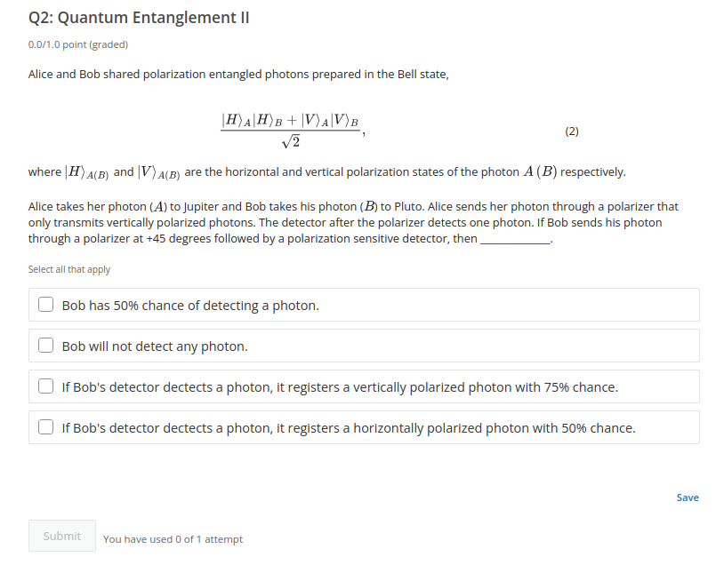

$$\frac{|H\rangle_A|H\rangle_B + |V\rangle_A|V\rangle_B}{\sqrt{2}}, \qquad (2)$$

Q2: Quantum Entanglement II

0.0/1.0 point (graded)

Alice and Bob shared polarization entangled photons prepared in the Bell state,

$$\frac{|H\rangle_A|H\rangle_B + |V\rangle_A|V\rangle_B}{\sqrt{2}}, \qquad (2)$$

where $|H\rangle_{A(B)}$ and $|V\rangle_{A(B)}$ are the horizontal and vertical polarization states of the photon $A$ ($B$) respectively.

Alice takes her photon ($A$) to Jupiter and Bob takes his photon ($B$) to Pluto. Alice sends her photon through a polarizer that only transmits vertically polarized photons. The detector after the polarizer detects one photon. If Bob sends his photon through a polarizer at +45 degrees followed by a polarization sensitive detector, then __________.

Select all that apply. Unchecked options:

- Bob has 50% chance of detecting a photon.
- Bob will not detect any photon.
- If Bob's detector dectects a photon, it registers a vertically polarized photon with 75% chance.
- If Bob's detector dectects a photon, it registers a horizontally polarized photon with 50% chance.

Save (right). Submit is disabled. "You have used 0 of 1 attempt".

## 

## 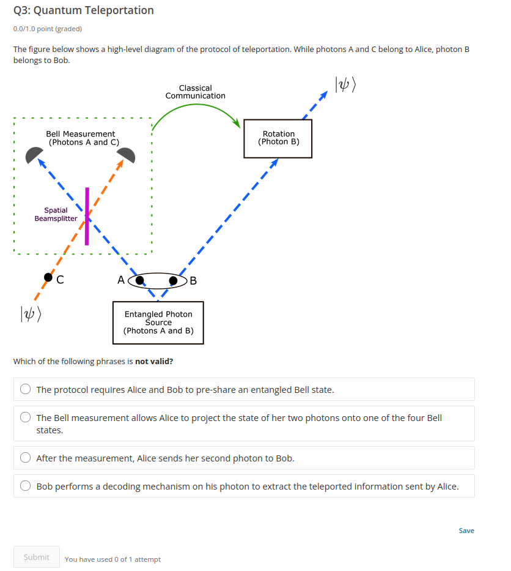

$$|\psi\rangle$$

Q3: Quantum Teleportation

0.0/1.0 point (graded)

The figure below shows a high-level diagram of the protocol of teleportation. While photons A and C belong to Alice, photon B belongs to Bob.

Diagram:

- Bottom center: an oval holding black dots A (left) and B (right), above a box "Entangled Photon Source (Photons A and B)".
- A green dashed box at upper left is labeled "Bell Measurement (Photons A and C)". Inside it, a purple vertical bar is labeled "Spatial Beamsplitter". Two dark semicircle detectors sit at the top of the box. A blue dashed path runs from photon A up through the beamsplitter into the left detector. An orange dashed path runs from photon C (black dot, lower left), past an input state $|\psi\rangle$, up through the beamsplitter into the right detector.
- A green curved arrow labeled "Classical Communication" leaves the Bell-measurement box and points to a box "Rotation (Photon B)".
- A blue dashed path runs from photon B up into that rotation box and continues up-right to an output state $|\psi\rangle$.

Which of the following phrases is **not valid**?

Unselected radio options:

- The protocol requires Alice and Bob to pre-share an entangled Bell state.
- The Bell measurement allows Alice to project the state of her two photons onto one of the four Bell states.
- After the measurement, Alice sends her second photon to Bob.
- Bob performs a decoding mechanism on his photon to extract the teleported information sent by Alice.

Save (right). Submit is disabled. "You have used 0 of 1 attempt".

## 

## 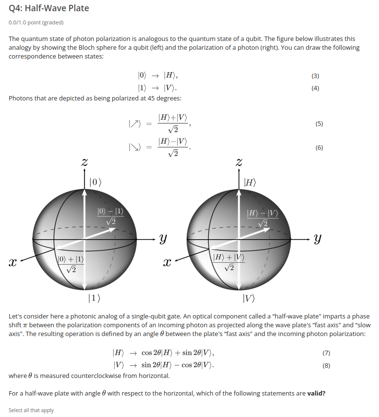

$$|0\rangle \rightarrow |H\rangle, \qquad (3)$$
$$|1\rangle \rightarrow |V\rangle. \qquad (4)$$
$$|\nearrow\rangle = \frac{|H\rangle+|V\rangle}{\sqrt{2}}, \qquad (5)$$
$$|\searrow\rangle = \frac{|H\rangle-|V\rangle}{\sqrt{2}}. \qquad (6)$$
$$|H\rangle \rightarrow \cos 2\theta |H\rangle + \sin 2\theta |V\rangle, \qquad (7)$$
$$|V\rangle \rightarrow \sin 2\theta |H\rangle - \cos 2\theta |V\rangle. \qquad (8)$$

Q4: Half-Wave Plate

0.0/1.0 point (graded)

The quantum state of photon polarization is analogous to the quantum state of a qubit. The figure below illustrates this analogy by showing the Bloch sphere for a qubit (left) and the polarization of a photon (right). You can draw the following correspondence between states:

$$|0\rangle \rightarrow |H\rangle, \qquad (3)$$
$$|1\rangle \rightarrow |V\rangle. \qquad (4)$$

Photons that are depicted as being polarized at 45 degrees:

$$|\nearrow\rangle = \frac{|H\rangle+|V\rangle}{\sqrt{2}}, \qquad (5)$$
$$|\searrow\rangle = \frac{|H\rangle-|V\rangle}{\sqrt{2}}. \qquad (6)$$

Two Bloch spheres, each with axes $Z$ (up), $y$ (right), and $x$ (toward the front-left), and a white arrow lying in the equatorial plane.

- Left (qubit): north pole $|0\rangle$, south pole $|1\rangle$. Equatorial labels $\frac{|0\rangle-|1\rangle}{\sqrt{2}}$ (toward the back/side) and $\frac{|0\rangle+|1\rangle}{\sqrt{2}}$ (toward the front).
- Right (photon): north pole $|H\rangle$, south pole $|V\rangle$. Equatorial labels $\frac{|H\rangle-|V\rangle}{\sqrt{2}}$ and $\frac{|H\rangle+|V\rangle}{\sqrt{2}}$.

Let's consider here a photonic analog of a single-qubit gate. An optical component called a "half-wave plate" imparts a phase shift $\pi$ between the polarization components of an incoming photon as projected along the wave plate's "fast axis" and "slow axis". The resulting operation is defined by an angle $\theta$ between the plate's "fast axis" and the incoming photon polarization:

$$|H\rangle \rightarrow \cos 2\theta |H\rangle + \sin 2\theta |V\rangle, \qquad (7)$$
$$|V\rangle \rightarrow \sin 2\theta |H\rangle - \cos 2\theta |V\rangle. \qquad (8)$$

where $\theta$ is measured counterclockwise from horizontal.

For a half-wave plate with angle $\theta$ with respect to the horizontal, which of the following statements are **valid**?

Select all that apply. (The choice list is not in this frame.)

## 

## 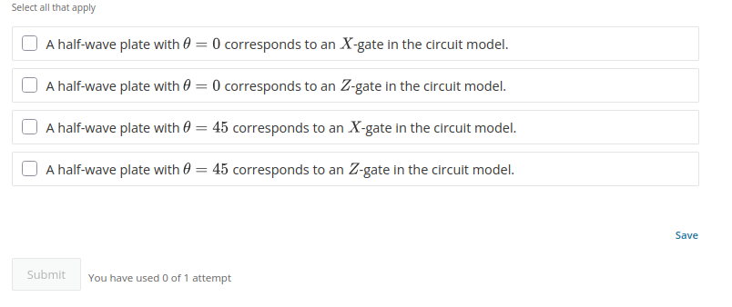

$$\theta = 0$$
$$\theta = 45$$
$$X$$
$$Z$$

Select all that apply.

Unchecked options:

- A half-wave plate with $\theta = 0$ corresponds to an $X$-gate in the circuit model.
- A half-wave plate with $\theta = 0$ corresponds to an $Z$-gate in the circuit model.
- A half-wave plate with $\theta = 45$ corresponds to an $X$-gate in the circuit model.
- A half-wave plate with $\theta = 45$ corresponds to an $Z$-gate in the circuit model.

Save (right). Submit is disabled. "You have used 0 of 1 attempt".
