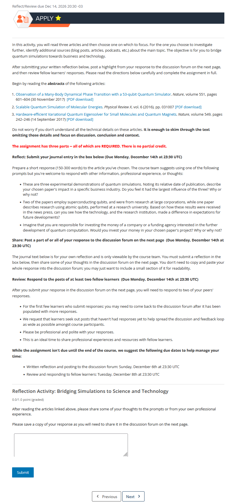

# Page Title: Reflect and Review Activity (Bridging Simulations to Science and Technology)

<!-- Added 2026-11-22 from Albert's eDX screenshot (official Week 3 = raw week4). Missing from the original capture. Stored as the screenshot plus a summary description, not a verbatim retyping. -->

<!-- Description (summary): APPLY activity, Reflect/Review bucket (10% of the grade), due Dec 14, 2026, 20:30 GMT-3 (23:30 UTC). Read the abstracts of three articles and pick one to investigate further, finding additional sources: (1) Zhang et al., "Observation of a Many-Body Dynamical Phase Transition with a 53-qubit Quantum Simulator", Nature 551, 601-604 (2017); (2) O'Malley et al., "Scalable Quantum Simulation of Molecular Energies", Phys. Rev. X 6, 031007 (2016); (3) Kandala et al., "Hardware-efficient Variational Quantum Eigensolver for Small Molecules and Quantum Magnets", Nature 549, 242-246 (2017). Three REQUIRED parts, no partial credit: Reflect (150-300-word journal entry in the box, visible only to the course team), Share (post part or all of it to the discussion forum on the next page), Review (respond to at least two fellow learners, preferably posts with no replies yet). Suggested prompts: the chosen paper's impact on a specific business industry, and whether it had the largest influence of the three; how the technology (two superconducting papers from large corporations vs one trapped-ion paper from a university) and the institution shaped expectations in the press; whether you would invest a company's or funding agency's money in the chosen project. Suggested pacing: reflection + forum post by Dec 6, peer replies by Dec 8 (23:30 UTC). -->
