# Page Title:

# **Learn**

In 1980 [[Yuri
Manin]{.underline}](https://en.wikipedia.org/wiki/Yuri_Manin) and in
1982 [[Richard
Feynman]{.underline}](https://en.wikipedia.org/wiki/Richard_Feynman)
noticed that calculating the evolution of a quantum system using
classical computational devices is inefficient and quickly becomes
impossible, as the computational time scales exponentially with the
number of particles involved. Their solution to this problem: use a
quantum device for the calculation as it will scale much more favorably.
Today, only a hand full of quantum systems can be efficiently simulated
on classical computers and exact solutions can only be determined for
low-dimensional [*[Hilbert
spaces]{.underline}*](https://en.wikipedia.org/wiki/Hilbert_space) \--
roughly speaking the space of solutions that corresponds to the degrees
of freedom involved in a problem. Larger scale simulations of materials,
which a large part of the world-wide supercomputing time is devoted to,
require approximations that unavoidably lead to errors and make, say
industrially-relevant, predictions impractical. In contrast, a
large-scale quantum computational device can naturally simulate
higher-dimensional Hilbert spaces and hence more complex quantum
problems with many particles and degrees of freedom.

Quantum simulation has applications in several fields in physics and
chemistry. In physics, the dynamics of solid-state systems involving
many atoms is a vast field of study investigating, e.g. , magnetic
materials used in hard drives or the electrons in a superconducting
material, where collective quantum effects allow for the loss-less
transmission of electricity. Similarly, in chemistry it is a challenge
to describe the complicated energy level structure of atoms and
molecules and the processes involved in a chemical reaction. This was
famously stated by [[Paul
Dirac]{.underline}](https://en.wikipedia.org/wiki/Paul_Dirac) in 1929,
when he remarked that \"*The underlying physical laws necessary for the
mathematical theory of a large part of physics and the whole of
[chemistry](https://en.wikiquote.org/wiki/Chemistry) are thus completely
known, and the difficulty is only that the exact application of these
laws leads to equations much too complicated to be soluble.\"* For
example, nitrogen fixation \-- a process in which nitrogen from air is
bound in the form of ammonia (NH~3~), which makes it accessible to
plants \-- is common in a range of bacteria, yet has been elusive to
reproduce efficiently on an industrial scale. Today, much of the
fertilizer production still relies on the very energy intensive
[[Haber-Bosch
process]{.underline}](https://en.wikipedia.org/wiki/Haber_process),
which requires a pressure of around 200 atmospheres and temperatures of
around 400 °C (842 °F). Quantum simulation is a promising tool to
describe and understand this problem already with a medium scale quantum
computer, which was worked out as an example in 2017 ([[open access
paper]{.underline}](https://www.pnas.org/content/early/2017/06/30/1619152114)).

Many challenges remain, both in the size of the calculable problem
(related to the number of qubits) and length of simulation (related to
the coherence time and accumulation of errors). Hence, various
approaches to quantum simulation are being pursued, divided coarsely
along the lines of *digital simulations*, operating a quantum computer
as a universal, gate-based machine, and *analog simulations* in which
the available Hamiltonian on a quantum device is mapped and/or deformed
to mimic the behavior of another quantum system. A fairly recent step is
the introduction of hybrid simulations, which combines analog elements
with digital gates and generally run in the form of optimization
algorithms, where a classical computer guides the computation and the
quantum devices sequentially scans the parameter space to find, e.g., an
energy minimum. The *Variational Quantum Eigensolver,* discussed later
during this week, is an example of one such algorithm.

## **Images**

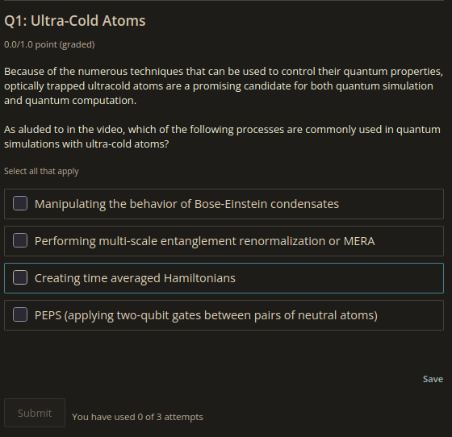

# Q1: Ultra-Cold Atoms

0.0/1.0 point (graded)

Because of the numerous techniques that can be used to control their quantum properties, optically trapped ultracold atoms are a promising candidate for both quantum simulation and quantum computation.

As alluded to in the video, which of the following processes are commonly used in quantum simulations with ultra-cold atoms?

Select all that apply

- [ ] Manipulating the behavior of Bose-Einstein condensates
- [ ] Performing multi-scale entanglement renormalization or MERA
- [ ] Creating time averaged Hamiltonians *(outlined)*
- [ ] PEPS (applying two-qubit gates between pairs of neutral atoms)

Save. Submit. You have used 0 of 3 attempts.

## **Transcript**

## 

00

00:00:00,000 \--\> 00:00:00,499

1

00:00:00,499 \--\> 00:00:02,370

Over the past two weeks, we looked

2

00:00:02,370 \--\> 00:00:04,830

at how quantum computers running Shor\'s algorithm

3

00:00:04,830 \--\> 00:00:07,020

enable us to compromise conventional encryption

4

00:00:07,020 \--\> 00:00:09,930

schemes, such as the RSA cryptosystem.

5

00:00:09,930 \--\> 00:00:11,880

And we also saw how quantum mechanics provides

6

00:00:11,880 \--\> 00:00:14,310

a workaround, via quantum cryptography and quantum

7

00:00:14,310 \--\> 00:00:16,320

key distribution.

8

00:00:16,320 \--\> 00:00:17,970

This week, we\'ll turn our attention

9

00:00:17,970 \--\> 00:00:20,610

to the subject of quantum simulation.

10

00:00:20,610 \--\> 00:00:22,290

It was Feynman\'s original insight

11

00:00:22,290 \--\> 00:00:24,930

that, if we want to simulate a quantum system,

12

00:00:24,930 \--\> 00:00:26,724

we\'d better use a quantum system to do it,

13

00:00:26,724 \--\> 00:00:28,140

because it\'s a really hard problem

14

00:00:28,140 \--\> 00:00:30,570

for a classical computer to solve.

15

00:00:30,570 \--\> 00:00:33,300

This is due to the exponentially large number of quantum states

16

00:00:33,300 \--\> 00:00:35,290

that we need to keep track of.

17

00:00:35,290 \--\> 00:00:38,070

But what does it mean to simulate a quantum system,

18

00:00:38,070 \--\> 00:00:40,350

and how do we represent the quantum system that we

19

00:00:40,350 \--\> 00:00:41,970

want to simulate?

20

00:00:41,970 \--\> 00:00:43,800

And what does quantum mechanics do

21

00:00:43,800 \--\> 00:00:45,840

to make these simulations tractable?

22

00:00:45,840 \--\> 00:00:47,650

Further, what can go wrong?

23

00:00:47,650 \--\> 00:00:49,650

We\'ll address these questions this week,

24

00:00:49,650 \--\> 00:00:53,160

and review several applications based on quantum simulation.

25

00:00:53,160 \--\> 00:00:56,390

But to get started, let\'s first hear from Professor Isaac

26

00:00:56,390 \--\> 00:00:58,410

Chuang about ideas and issues associated

27

00:00:58,410 \--\> 00:00:59,790

with quantum simulation.

28

00:00:59,790 \--\> 00:01:02,130

Some of the issues and the challenges when

29

00:01:02,130 \--\> 00:01:04,680

working through quantum simulation,

30

00:01:04,680 \--\> 00:01:07,620

first, you would like to have, in principle, the knowledge

31

00:01:07,620 \--\> 00:01:10,200

that you can do the simulation.

32

00:01:10,200 \--\> 00:01:13,680

And the way one approaches this is to define the problem

33

00:01:13,680 \--\> 00:01:19,470

by saying the goal is to simulate Hamiltonian\--

34

00:01:19,470 \--\> 00:01:21,090

we\'ll call the Hsys\--

35

00:01:21,090 \--\> 00:01:28,710

but you\'re given a different set of Hamiltonians,

36

00:01:28,710 \--\> 00:01:30,900

not just one Hamiltonian, but a whole family

37

00:01:30,900 \--\> 00:01:33,570

of them, which will be the Hamiltonian

38

00:01:33,570 \--\> 00:01:35,520

of the quantum computing units.

39

00:01:35,520 \--\> 00:01:38,790

Like each of the gates or each of the subsystems.

40

00:01:38,790 \--\> 00:01:42,600

And you can turn them on and off at will.

41

00:01:42,600 \--\> 00:01:45,420

Then the question is, in a mathematical way,

42

00:01:45,420 \--\> 00:01:53,880

whether or not HkQC can generate Hsys.

43

00:01:53,880 \--\> 00:01:57,570

Mathematically, this is a beautiful group theory question

44

00:01:57,570 \--\> 00:02:01,110

about whether the algebra of Hsys

45

00:02:01,110 \--\> 00:02:05,760

is spanned by the algebra of H quantum computer.

46

00:02:05,760 \--\> 00:02:08,520

But this is the starting point for quantum computation

47

00:02:08,520 \--\> 00:02:11,100

or quantum simulation.

48

00:02:11,100 \--\> 00:02:14,970

A second idea and issue is how does one

49

<!-- frame 2:13 · slide · week4/media/media/image43.png -->

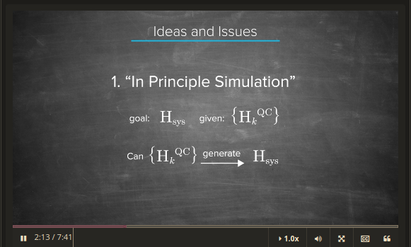

$$\text{goal: } H_{\mathrm{sys}} \quad \text{given: } \{H_{k}^{\mathrm{QC}}\}$$
$$\{H_{k}^{\mathrm{QC}}\} \xrightarrow{\text{generate}} H_{\mathrm{sys}}$$

# Ideas and Issues

1. “In Principle Simulation”

goal: \(H_{\mathrm{sys}}\) &nbsp;&nbsp; given: \(\{H_{k}^{\mathrm{QC}}\}\)

Can \(\{H_{k}^{\mathrm{QC}}\}\) generate \(\longrightarrow\) \(H_{\mathrm{sys}}\)?

The word “generate” sits above the arrow.

00:02:14,970 \--\> 00:02:20,010

transform this kind of a set of Hamiltonians into the system

50

00:02:20,010 \--\> 00:02:21,570

that you would like to simulate.

51

00:02:21,570 \--\> 00:02:24,330

And one of the earliest approaches of this

52

00:02:24,330 \--\> 00:02:29,190

is to use analog techniques, which

53

00:02:29,190 \--\> 00:02:33,140

go under the name, for example, of analog deformation.

54

00:02:33,140 \--\> 00:02:36,450

And that is that you might have a Hamiltonian which

55

00:02:36,450 \--\> 00:02:41,910

has a number of terms, and your strategy

56

00:02:41,910 \--\> 00:02:45,150

would be then to manipulate these, deform

57

00:02:45,150 \--\> 00:02:50,060

them to make this Hamiltonian look like this one,

58

00:02:50,060 \--\> 00:02:53,910

for example, in a time-averaged way or in a strobostopic way.

59

00:02:53,910 \--\> 00:02:59,930

So for example, at every time capital T, 2T, 3T, 4T,

60

00:02:59,930 \--\> 00:03:02,330

and so forth, you would like this Hamiltonian

61

00:03:02,330 \--\> 00:03:06,540

to equal that Hamiltonian, not at all times.

62

00:03:06,540 \--\> 00:03:08,840

And this is the strategy and approach, for example,

63

00:03:08,840 \--\> 00:03:12,440

employed by ultracold atom gases,

64

00:03:12,440 \--\> 00:03:14,900

Bose-Einstein condensates, when they\'re

65

00:03:14,900 \--\> 00:03:17,780

being utilized to simulate, for example, a superconducting

66

00:03:17,780 \--\> 00:03:19,280

system.

67

00:03:19,280 \--\> 00:03:21,890

And that naturally works out, in many ways,

68

00:03:21,890 \--\> 00:03:27,230

because they can be controlled to have similar Hamiltonians.

69

00:03:27,230 \--\> 00:03:30,500

And the Bose-Einstein condensate is very controllable,

70

00:03:30,500 \--\> 00:03:33,680

and you can get an equivalent lattice spacing that\'s

71

00:03:33,680 \--\> 00:03:36,500

much larger than the physical lattice spacing of atoms

72

00:03:36,500 \--\> 00:03:38,900

inside a superconducting solid.

73

00:03:38,900 \--\> 00:03:41,900

And so you can engineer the kind of Hamiltonian

74

00:03:41,900 \--\> 00:03:44,030

you would like your quantum computer

75

00:03:44,030 \--\> 00:03:47,330

to simulate in many rich ways.

76

00:03:47,330 \--\> 00:03:52,350

So this has been a very effective and useful approach.

77

00:03:52,350 \--\> 00:03:55,100

Here\'s another idea and challenge, though.

78

00:03:55,100 \--\> 00:03:58,070

Even if you can simulate\-- so this is in principle,

79

00:03:58,070 \--\> 00:04:01,010

this is one method by which you can simulate\--

80

00:04:01,010 \--\> 00:04:04,610

you\'re still faced by a rather annoying and pressing challenge

81

00:04:04,610 \--\> 00:04:09,980

and question, which is what to measure.

82

00:04:09,980 \--\> 00:04:13,190

Even if I just tell you, you can simulate.

83

00:04:13,190 \--\> 00:04:17,180

So if I say, you\'re given some state which

84

00:04:17,180 \--\> 00:04:22,100

is e to the minus iht times some initial state,

85

00:04:22,100 \--\> 00:04:25,130

if you measure this, it collapses.

86

00:04:25,130 \--\> 00:04:27,980

And then you get only one statistical sample

87

00:04:27,980 \--\> 00:04:29,870

of that wave function.

88

00:04:29,870 \--\> 00:04:32,120

Does that tell you what you want?

89

00:04:32,120 \--\> 00:04:34,230

Does that give you an actual output?

90

00:04:34,230 \--\> 00:04:36,830

And what are its statistical errors?

91

00:04:36,830 \--\> 00:04:40,580

Because after all, nothing is real unless it\'s reproducible.

92

00:04:40,580 \--\> 00:04:44,030

And in Junior Physics Lab here, those of you

93

00:04:44,030 \--\> 00:04:45,950

who\'ve taken Junior Lab know nothing

94

00:04:45,950 \--\> 00:04:48,680

is real unless it has an error bar.

95

00:04:48,680 \--\> 00:04:52,280

You don\'t get an error bar from a single instance of something.

96

00:04:52,280 \--\> 00:04:56,990

But if you have to repeat this many times, your errors now,

97

00:04:56,990 \--\> 00:05:00,500

normally, if there\'s just a lot of large numbers

98

00:05:00,500 \--\> 00:05:03,260

distributed, going to decrease as the square root

99

00:05:03,260 \--\> 00:05:04,925

of the number of tries.

100

00:05:04,925 \--\> 00:05:06,960

And that often isn\'t good enough,

101

00:05:06,960 \--\> 00:05:10,010

because you don\'t want to try an exponentially large number

102

00:05:10,010 \--\> 00:05:11,450

of times.

103

00:05:11,450 \--\> 00:05:14,900

But naively, this is what you would have to do here.

104

00:05:14,900 \--\> 00:05:20,450

So maybe what you want to do is not to measure the state.

105

00:05:20,450 \--\> 00:05:25,280

Maybe what you would like to get is some expectation value

106

00:05:25,280 \--\> 00:05:26,720

of some operator.

107

00:05:26,720 \--\> 00:05:29,750

And maybe it\'s going to be easier to measure that operator

108

00:05:29,750 \--\> 00:05:33,170

than it is to, say, get all the coefficients of a wave

109

00:05:33,170 \--\> 00:05:34,980

function.

110

00:05:34,980 \--\> 00:05:37,640

But even this is fraught with difficulty

111

00:05:37,640 \--\> 00:05:40,310

because it still has the statistical randomness

112

00:05:40,310 \--\> 00:05:42,420

that we just described.

113

00:05:42,420 \--\> 00:05:44,390

This is an issue of precision.

114

<!-- frame 5:44 · slide · week4/media/media/image60.png -->

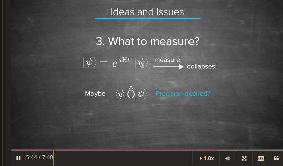

$$|\psi\rangle=e^{-iHt}|\psi\rangle\xrightarrow{\mathrm{measure}}\mathrm{collapses!}$$
$$\langle\psi|\hat{O}|\psi\rangle$$

Chalkboard video frame.

Title: Ideas and Issues

3. What to measure?

$$|\psi\rangle=e^{-iHt}|\psi\rangle\xrightarrow{\text{measure}}\text{collapses!}$$

Maybe $\langle\psi|\hat{O}|\psi\rangle$ — "Precision desired?" is written in blue.

Player: 5:44 / 7:40, speed 1.0x.

00:05:44,390 \--\> 00:05:46,960

115

00:05:46,960 \--\> 00:05:49,680

And I will try to illustrate this issue with the Grover

116

00:05:49,680 \--\> 00:05:55,190

algorithm simulation topic that we\'ll come to in two steps.

117

00:05:55,190 \--\> 00:05:59,480

And then let me leave you with one more issue and idea,

118

00:05:59,480 \--\> 00:06:01,900

which is\--

119

00:06:01,900 \--\> 00:06:05,240

and this is kind of outside of the scope of quantum simulation

120

00:06:05,240 \--\> 00:06:07,610

of quantum, but it is a very real one

121

00:06:07,610 \--\> 00:06:09,920

for quantum simulations.

122

00:06:09,920 \--\> 00:06:13,850

Instead of building a quantum simulator, why not just improve

123

00:06:13,850 \--\> 00:06:16,670

your classical simulation of the quantum system

124

00:06:16,670 \--\> 00:06:18,350

by using a better approximation?

125

00:06:18,350 \--\> 00:06:22,500

126

00:06:22,500 \--\> 00:06:25,280

And this approximation might be a quantum-inspired

127

00:06:25,280 \--\> 00:06:26,150

approximation.

128

00:06:26,150 \--\> 00:06:28,880

129

00:06:28,880 \--\> 00:06:32,390

And this actually has happened over the last decade or so.

130

00:06:32,390 \--\> 00:06:34,760

A whole variety of new approximations

131

00:06:34,760 \--\> 00:06:39,830

have come because of quantum computation that allow you more

132

00:06:39,830 \--\> 00:06:41,780

efficient classical algorithms.

133

00:06:41,780 \--\> 00:06:45,170

And these have swept through condensed matter theory,

134

00:06:45,170 \--\> 00:06:48,500

and are now entering into the realm of quantum chemistry.

135

00:06:48,500 \--\> 00:06:51,140

And they go by a variety of names.

136

00:06:51,140 \--\> 00:06:54,470

The technique that started all of this in physics

137

00:06:54,470 \--\> 00:06:57,260

was the density matrix renormalization group

138

00:06:57,260 \--\> 00:06:59,570

idea, which was awarded the Nobel

139

00:06:59,570 \--\> 00:07:02,090

Prize, Ken Wilson and company.

140

00:07:02,090 \--\> 00:07:04,820

But now, we have many more advanced techniques.

141

00:07:04,820 \--\> 00:07:07,300

So not just DMRG\--

142

00:07:07,300 \--\> 00:07:09,290

and I\'ll toss out a bunch of acronyms here,

143

00:07:09,290 \--\> 00:07:11,510

for those of you interested in this\--

144

00:07:11,510 \--\> 00:07:18,085

but also things like PEPS, MERA, and all sorts of things.

145

00:07:18,085 \--\> 00:07:20,210

You know you\'re entering chemistry when all you see

146

<!-- frame 7:19 · slide · week4/media/media/image23.png -->

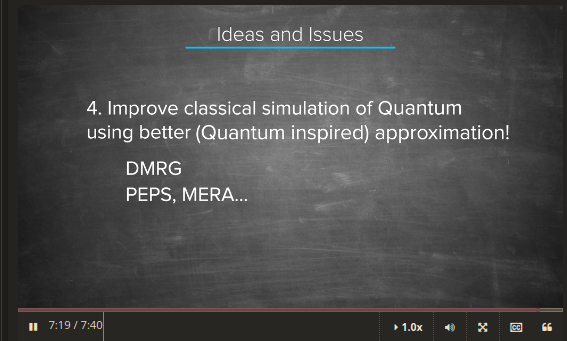

# Ideas and Issues

4. Improve classical simulation of Quantum using better (Quantum inspired) approximation!

- DMRG
- PEPS, MERA...

00:07:20,210 \--\> 00:07:21,350

are acronyms.

147

00:07:21,350 \--\> 00:07:26,720

These are real ways of getting very useful, highly

148

00:07:26,720 \--\> 00:07:30,470

accurate approximations to answers that you want

149

00:07:30,470 \--\> 00:07:33,160

to find in quantum chemistry.

150

00:07:33,160 \--\> 00:07:34,507

## **PRACTICE (1 question)**

## 
## 

Section: hamiltonian simulation

# Page Title:What s a Hamiltonian?

# **Learn**
## **Images**

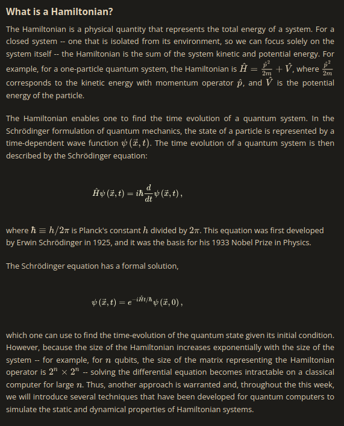

$$\hat{H} = \frac{\hat{p}^2}{2m} + \hat{V}$$
$$\hat{H}\psi(\vec{x}, t) = i\hbar \frac{d}{dt}\psi(\vec{x}, t),$$
$$\psi(\vec{x}, t) = e^{-i\hat{H}t/\hbar}\psi(\vec{x}, 0),$$

# What is a Hamiltonian?

The Hamiltonian is a physical quantity that represents the total energy of a system. For a closed system -- one that is isolated from its environment, so we can focus solely on the system itself -- the Hamiltonian is the sum of the system kinetic and potential energy. For example, for a one-particle quantum system, the Hamiltonian is \(\hat{H} = \frac{\hat{p}^2}{2m} + \hat{V}\), where \(\frac{\hat{p}^2}{2m}\) corresponds to the kinetic energy with momentum operator \(\hat{p}\), and \(\hat{V}\) is the potential energy of the particle.

The Hamiltonian enables one to find the time evolution of a quantum system. In the Schrödinger formulation of quantum mechanics, the state of a particle is represented by a time-dependent wave function \(\psi(\vec{x}, t)\). The time evolution of a quantum system is then described by the Schrödinger equation:

$$\hat{H}\psi(\vec{x}, t) = i\hbar \frac{d}{dt}\psi(\vec{x}, t),$$

where \(\hbar \equiv h/2\pi\) is Planck's constant \(h\) divided by \(2\pi\). This equation was first developed by Erwin Schrödinger in 1925, and it was the basis for his 1933 Nobel Prize in Physics.

The Schrödinger equation has a formal solution,

$$\psi(\vec{x}, t) = e^{-i\hat{H}t/\hbar}\psi(\vec{x}, 0),$$

which one can use to find the time-evolution of the quantum state given its initial condition. However, because the size of the Hamiltonian increases exponentially with the size of the system -- for example, for \(n\) qubits, the size of the matrix representing the Hamiltonian operator is \(2^n \times 2^n\) -- solving the differential equation becomes intractable on a classical computer for large \(n\). Thus, another approach is warranted and, throughout the this week, we will introduce several techniques that have been developed for quantum computers to simulate the static and dynamical properties of Hamiltonian systems.

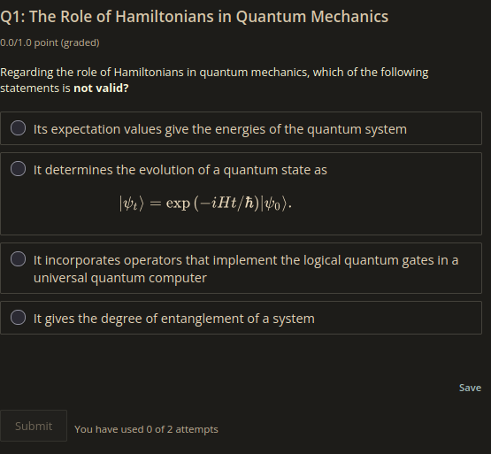

$$|\psi_t\rangle = \exp\left(-i H t / \hbar\right) |\psi_0\rangle.$$

# Q1: The Role of Hamiltonians in Quantum Mechanics

0.0/1.0 point (graded)

Regarding the role of Hamiltonians in quantum mechanics, which of the following statements is **not valid**?

- ( ) Its expectation values give the energies of the quantum system
- ( ) It determines the evolution of a quantum state as

$$|\psi_t\rangle = \exp\left(-i H t / \hbar\right) |\psi_0\rangle.$$

- ( ) It incorporates operators that implement the logical quantum gates in a universal quantum computer
- ( ) It gives the degree of entanglement of a system

Save

**Submit** — You have used 0 of 2 attempts

## **Transcript**

## 

00

00:00:00,000 \--\> 00:00:00,780

1

00:00:00,780 \--\> 00:00:03,320

In the previous video, we introduced several ideas

2

00:00:03,320 \--\> 00:00:05,420

and issues at play when implementing

3

00:00:05,420 \--\> 00:00:08,330

quantum simulations on a quantum computer.

4

00:00:08,330 \--\> 00:00:10,580

Simulation begins with a representation

5

00:00:10,580 \--\> 00:00:12,860

of the system being simulated, and once we

6

00:00:12,860 \--\> 00:00:16,280

have this representation we can then choose how to simulate it.

7

00:00:16,280 \--\> 00:00:18,020

Quantum systems are generally defined

8

00:00:18,020 \--\> 00:00:20,420

in terms of a mathematical representation called

9

00:00:20,420 \--\> 00:00:21,530

a Hamiltonian.

10

00:00:21,530 \--\> 00:00:25,080

And with a Hamiltonian in hand, as you learned in course one,

11

00:00:25,080 \--\> 00:00:29,060

one can simulate the Hamiltonian dynamics using universal gates.

12

00:00:29,060 \--\> 00:00:31,460

This is called a digital simulator.

13

00:00:31,460 \--\> 00:00:34,220

Alternatively, one can use the qubits and the couplings

14

00:00:34,220 \--\> 00:00:37,160

to mimic the system and its Hamiltonian directly.

15

00:00:37,160 \--\> 00:00:40,310

This is called an analog simulator or an emulator.

16

00:00:40,310 \--\> 00:00:43,010

In either case, we need to define the simulation problem

17

00:00:43,010 \--\> 00:00:45,440

in terms of a Hamiltonian, which characterizes

18

00:00:45,440 \--\> 00:00:47,400

our system of interest.

19

00:00:47,400 \--\> 00:00:50,810

And so that leads us to the subject of this video, what

20

00:00:50,810 \--\> 00:00:52,135

is a Hamiltonian?

21

00:00:52,135 \--\> 00:00:55,280

A Hamiltonian is a mathematical construct

22

00:00:55,280 \--\> 00:00:58,790

that can be used to describe the time evolution of a system.

23

00:00:58,790 \--\> 00:01:00,980

Now these systems can be classical,

24

00:01:00,980 \--\> 00:01:03,230

like a ball rolling off a table, or they

25

00:01:03,230 \--\> 00:01:06,020

can be quantum mechanical, like the qubits We\'ve been looked

26

00:01:06,020 \--\> 00:01:07,800

at throughout the course.

27

00:01:07,800 \--\> 00:01:09,950

This sounds pretty abstract, so let\'s take a look

28

00:01:09,950 \--\> 00:01:12,797

at how to use a Hamiltonian more concretely.

29

00:01:12,797 \--\> 00:01:14,630

If you\'ve taken a high school physics class,

30

00:01:14,630 \--\> 00:01:16,340

you might remember how to predict

31

00:01:16,340 \--\> 00:01:19,590

the motion of an object using Newton\'s laws.

32

00:01:19,590 \--\> 00:01:22,520

First you write down all the forces acting on your system,

33

00:01:22,520 \--\> 00:01:25,940

taking note both the strength and direction of each force.

34

00:01:25,940 \--\> 00:01:28,310

We can keep track of all these forces using a free body

35

00:01:28,310 \--\> 00:01:30,695

diagram, like the one shown here.

36

<!-- frame 1:29 · diagram · week4/media/media/image9.png -->

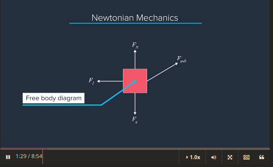

$$
F_N,\quad F_f,\quad F_g,\quad F_{\mathrm{pull}}
$$

# Newtonian Mechanics

Free-body diagram: a pink square block. A callout labeled **Free body diagram** points at the block along a cyan leader.

Forces on the block:

- $F_N$ upward
- $F_g$ downward
- $F_f$ to the left
- $F_{\mathrm{pull}}$ up and to the right

00:01:30,695 \--\> 00:01:32,320

Once we\'ve written down all the forces,

37

00:01:32,320 \--\> 00:01:35,210

we can invoke one of the fundamental laws of physics.

38

00:01:35,210 \--\> 00:01:37,160

Newton\'s second law of motion tells us

39

00:01:37,160 \--\> 00:01:40,100

that the sum of all the forces acting on a system

40

00:01:40,100 \--\> 00:01:42,290

is equal to the mass of the system multiplied

41

00:01:42,290 \--\> 00:01:44,100

by its acceleration.

42

00:01:44,100 \--\> 00:01:46,850

Now this equation is extremely powerful.

43

00:01:46,850 \--\> 00:01:50,150

Recall that acceleration is the rate of change of velocity

44

00:01:50,150 \--\> 00:01:53,630

with respect to time, like your car going from 0 to 60 miles

45

00:01:53,630 \--\> 00:01:55,250

an hour on the highway.

46

00:01:55,250 \--\> 00:01:57,410

Meanwhile, velocity is simply the rate

47

00:01:57,410 \--\> 00:02:00,780

of change in an object\'s position with respect to time.

48

00:02:00,780 \--\> 00:02:02,360

So we can rewrite our acceleration

49

00:02:02,360 \--\> 00:02:05,570

as the second derivative of the system\'s position with respect

50

00:02:05,570 \--\> 00:02:06,980

to time.

51

00:02:06,980 \--\> 00:02:09,690

When we make the substitution to Newton\'s second law,

52

00:02:09,690 \--\> 00:02:11,960

we see that we now have a differential equation, which

53

00:02:11,960 \--\> 00:02:14,630

relates the second time derivative of position

54

00:02:14,630 \--\> 00:02:17,270

to the sum of the forces acting on our system.

55

00:02:17,270 \--\> 00:02:19,280

These forces can be constant or they

56

00:02:19,280 \--\> 00:02:22,550

can be some function of the position of our system.

57

00:02:22,550 \--\> 00:02:24,560

When we solve this differential equation,

58

00:02:24,560 \--\> 00:02:27,260

we get an equation x of t, which tells us

59

<!-- frame 2:26 · slide · week4/media/media/image17.png -->

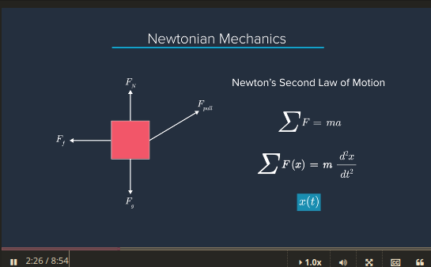

$$\sum F = ma$$
$$\sum F(x) = m \frac{d^2 x}{dt^2}$$

# Newtonian Mechanics

Free-body diagram: pink square mass with
- \(F_N\) upward (normal)
- \(F_g\) downward
- \(F_f\) to the left
- \(F_{\mathrm{pull}}\) up and to the right

## Newton's Second Law of Motion

$$\sum F = ma$$

$$\sum F(x) = m \frac{d^2 x}{dt^2}$$

Highlighted: \(x(t)\)

00:02:27,260 \--\> 00:02:30,810

the position of our system at any arbitrary time.

60

00:02:30,810 \--\> 00:02:31,340

OK.

61

00:02:31,340 \--\> 00:02:33,980

So we\'ve used the forces acting on our system to figure out

62

00:02:33,980 \--\> 00:02:35,720

how it moves in time.

63

00:02:35,720 \--\> 00:02:37,910

As it turns out, this isn\'t the only method

64

00:02:37,910 \--\> 00:02:41,080

we can use to arrive at the exact same result.

65

00:02:41,080 \--\> 00:02:43,560

Now instead of thinking of the forces acting on our system,

66

00:02:43,560 \--\> 00:02:46,310

let\'s focus on the energy of our system.

67

00:02:46,310 \--\> 00:02:48,170

Generally, a system has two types

68

00:02:48,170 \--\> 00:02:50,660

of energy, kinetic energy, the energy that

69

00:02:50,660 \--\> 00:02:53,870

comes from a system\'s motion, and potential energy,

70

00:02:53,870 \--\> 00:02:56,210

the latent energy stored in the system waiting

71

00:02:56,210 \--\> 00:02:58,500

to be converted into motion.

72

00:02:58,500 \--\> 00:03:01,300

Let\'s write down each of these energies as equations.

73

00:03:01,300 \--\> 00:03:04,310

A systems kinetic energy is equal to its momentum

74

<!-- frame 3:03 · formula · week4/media/media/image27.png -->

$$T = \frac{p^2}{2m} \qquad U(x)$$

# Hamiltonian Mechanics

Kinetic Energy \(T\) \qquad Potential Energy \(U\)

$$T = \frac{p^2}{2m} \qquad U(x)$$

The \(p^2\) in the kinetic-energy term is highlighted.

00:03:04,310 \--\> 00:03:07,160

squared divided by 2 times its mass.

75

00:03:07,160 \--\> 00:03:10,460

Momentum, you might remember, is related to an object\'s speed.

76

00:03:10,460 \--\> 00:03:14,240

So the faster an object moves, the more kinetic energy it has.

77

00:03:14,240 \--\> 00:03:16,580

A systems potential energy depends on the forces

78

00:03:16,580 \--\> 00:03:17,900

that it is experiencing.

79

00:03:17,900 \--\> 00:03:20,520

So we need to know exactly what forces we\'re dealing with

80

00:03:20,520 \--\> 00:03:22,920

and order to write down an exact equation.

81

00:03:22,920 \--\> 00:03:25,910

However, in general, we can say that our potential energy

82

00:03:25,910 \--\> 00:03:28,100

is some function of our systems position,

83

00:03:28,100 \--\> 00:03:29,960

just like our forces were.

84

00:03:29,960 \--\> 00:03:30,590

OK.

85

00:03:30,590 \--\> 00:03:32,360

So we have two types of energy, one

86

00:03:32,360 \--\> 00:03:34,400

which depends on the system\'s momentum,

87

00:03:34,400 \--\> 00:03:36,840

and one which depends on its position.

88

00:03:36,840 \--\> 00:03:38,390

Let\'s add these two energies together

89

00:03:38,390 \--\> 00:03:40,400

to get an expression for the total energy stored

90

00:03:40,400 \--\> 00:03:41,870

in our system.

91

00:03:41,870 \--\> 00:03:44,450

This expression for the total energy in our system

92

00:03:44,450 \--\> 00:03:46,202

is called its Hamiltonian.

93

00:03:46,202 \--\> 00:03:47,660

And as you can see, the Hamiltonian

94

00:03:47,660 \--\> 00:03:51,085

depends on two parameters, position and momentum.

95

00:03:51,085 \--\> 00:03:53,210

These two parameters have a special role in physics

96

00:03:53,210 \--\> 00:03:56,820

and we call them the canonical coordinates of our system.

97

00:03:56,820 \--\> 00:03:59,300

So why is the Hamiltonian important?

98

00:03:59,300 \--\> 00:04:02,480

As it turns out, just as we previously used Newton\'s laws

99

00:04:02,480 \--\> 00:04:05,930

to find the motion of our system in time from a set of forces,

100

00:04:05,930 \--\> 00:04:07,700

we can use our Hamiltonian to arrive

101

00:04:07,700 \--\> 00:04:09,590

at the exact same result.

102

00:04:09,590 \--\> 00:04:12,770

To do this, we invoke two extremely elegant equations

103

00:04:12,770 \--\> 00:04:15,120

known as Hamilton\'s equations.

104

00:04:15,120 \--\> 00:04:16,940

The first equation tells us that the rate

105

00:04:16,940 \--\> 00:04:19,640

of change of our systems\' position in time

106

00:04:19,640 \--\> 00:04:22,280

will be equal to the derivative of its Hamiltonian

107

00:04:22,280 \--\> 00:04:24,080

with respect to momentum.

108

00:04:24,080 \--\> 00:04:26,114

Symmetrically, the second equation

109

00:04:26,114 \--\> 00:04:28,280

then tells us that the rate of change of our systems

110

00:04:28,280 \--\> 00:04:32,240

momentum in time is equal to the derivative of its Hamiltonian

111

00:04:32,240 \--\> 00:04:34,160

with respect to position.

112

<!-- frame 4:33 · formula · week4/media/media/image22.png -->

$$\frac{dx}{dt} = +\frac{\partial H}{\partial p} \qquad \frac{dp}{dt} = -\frac{\partial H}{\partial x}$$

# Hamilton's Equations

$$\frac{dx}{dt} = +\frac{\partial H}{\partial p} \qquad \frac{dp}{dt} = -\frac{\partial H}{\partial x}$$

The right-hand side \(-\partial H/\partial x\) is highlighted in a blue box.

00:04:34,160 \--\> 00:04:37,340

Just like Newton\'s laws, these are differential equations,

113

00:04:37,340 \--\> 00:04:39,050

and if we solve these equations, we

114

00:04:39,050 \--\> 00:04:42,230

arrive at expressions which tell us how our systems position

115

00:04:42,230 \--\> 00:04:44,550

and momentum change in time.

116

00:04:44,550 \--\> 00:04:47,900

With these expressions in hand, we can see where our system is

117

00:04:47,900 \--\> 00:04:51,440

and how fast it\'s moving at any arbitrary time.

118

00:04:51,440 \--\> 00:04:54,560

To summarize, as long as we have the Hamiltonian of our system

119

00:04:54,560 \--\> 00:04:56,720

and an initial set of conditions,

120

00:04:56,720 \--\> 00:05:00,700

we can calculate exactly how the system will evolve in time.

121

00:05:00,700 \--\> 00:05:01,200

OK.

122

00:05:01,200 \--\> 00:05:03,060

So far everything we just discussed

123

00:05:03,060 \--\> 00:05:05,320

has referred to classical systems.

124

00:05:05,320 \--\> 00:05:07,500

What about quantum systems?

125

00:05:07,500 \--\> 00:05:09,420

The formalism of Hamiltonian physics

126

00:05:09,420 \--\> 00:05:12,540

is the architecture of quantum mechanics.

127

00:05:12,540 \--\> 00:05:14,470

Just like in classical mechanics,

128

00:05:14,470 \--\> 00:05:16,980

we can write down the total energy of our quantum system

129

00:05:16,980 \--\> 00:05:18,410

as a Hamiltonian.

130

00:05:18,410 \--\> 00:05:20,220

This Hamiltonian is simply the sum

131

00:05:20,220 \--\> 00:05:23,040

of our systems kinetic and potential energies as

132

00:05:23,040 \--\> 00:05:24,710

in the classical case.

133

00:05:24,710 \--\> 00:05:26,880

However, note one minor difference.

134

00:05:26,880 \--\> 00:05:28,920

Whereas in the classical case, our Hamiltonian

135

<!-- frame 5:29 · formula · week4/media/media/image40.png -->

$$\hat{H}=\hat{T}+\hat{U}$$
$$H=T(p)+U(x)$$

# Quantum vs classical energy

Quantum

$$\hat{H}=\hat{T}+\hat{U}$$

Classical

$$H=T(p)+U(x)$$

00:05:28,920 \--\> 00:05:32,580

was a scalar function of our systems momentum and position,

136

00:05:32,580 \--\> 00:05:34,470

in quantum mechanics, our Hamiltonian

137

00:05:34,470 \--\> 00:05:37,020

takes on the form of a quantum operator, which

138

00:05:37,020 \--\> 00:05:39,570

acts on a given quantum state.

139

00:05:39,570 \--\> 00:05:41,790

We now invoke a fundamental relationship

140

00:05:41,790 \--\> 00:05:43,290

of quantum mechanics.

141

00:05:43,290 \--\> 00:05:46,920

The operation of a Hamiltonian on a given quantum state

142

00:05:46,920 \--\> 00:05:50,370

is equal to the rate of change of that state in time.

143

00:05:50,370 \--\> 00:05:52,930

This relationship is called Schrodinger\'s equation,

144

00:05:52,930 \--\> 00:05:55,170

and it tells us that if we know the operator

145

<!-- frame 5:55 · formula · week4/media/media/image13.png -->

$$
\frac{d|\psi\rangle}{dt}=-i\hat{H}|\psi\rangle
$$

# Schrödinger's Equation

$$\frac{d|\psi\rangle}{dt}=-i\hat{H}|\psi\rangle$$

No $\hbar$ is written on this slide.

00:05:55,170 \--\> 00:05:57,540

responsible for the energy of our system, that

146

00:05:57,540 \--\> 00:06:00,420

is our Hamiltonian, we can solve for the evolution

147

00:06:00,420 \--\> 00:06:02,780

of that state in time.

148

00:06:02,780 \--\> 00:06:05,410

For this reason, we often say that the Hamiltonian

149

00:06:05,410 \--\> 00:06:08,545

generates the dynamics of a quantum system.

150

00:06:08,545 \--\> 00:06:10,420

Let\'s look at how to use our Hamiltonian more

151

00:06:10,420 \--\> 00:06:12,640

concretely in quantum mechanics.

152

00:06:12,640 \--\> 00:06:15,940

Imagine that our quantum system is a single qubit.

153

00:06:15,940 \--\> 00:06:18,550

We can write the state of our qubit as a vector with two

154

00:06:18,550 \--\> 00:06:21,160

entries, A and B, which correspond

155

00:06:21,160 \--\> 00:06:24,340

to the probability of measuring the system, either at a 0 or 1

156

00:06:24,340 \--\> 00:06:26,380

state at a given time.

157

00:06:26,380 \--\> 00:06:27,940

Just like in our classical example,

158

00:06:27,940 \--\> 00:06:29,770

the exact form of our Hamiltonian

159

00:06:29,770 \--\> 00:06:32,950

depends entirely on what forces that are acting on our qubit.

160

00:06:32,950 \--\> 00:06:34,750

However, in general, we can always

161

00:06:34,750 \--\> 00:06:37,000

write the Hamiltonian of a qubit as a two

162

00:06:37,000 \--\> 00:06:39,160

by two Hermitian matrix.

163

00:06:39,160 \--\> 00:06:41,080

A Hermitian matrix is a special type

164

00:06:41,080 \--\> 00:06:45,670

of square matrix, which is equal to its own conjugate transpose.

165

00:06:45,670 \--\> 00:06:47,965

When we plug our state vector and Hamiltonian matrix

166

00:06:47,965 \--\> 00:06:50,140

into Schrodinger\'s equation, we get

167

00:06:50,140 \--\> 00:06:53,030

two linearly independent differential equations,

168

<!-- frame 6:52 · formula · week4/media/media/image47.png -->

$$\hat{H}|\psi\rangle=\begin{pmatrix} z & x-iy \\ x+iy & -z \end{pmatrix}\begin{pmatrix} a \\ b \end{pmatrix}$$
$$\frac{d|\psi\rangle}{dt}=-i\hat{H}|\psi\rangle$$
$$|\psi(t)\rangle=e^{-i\hat{H}t}|\psi_{0}\rangle$$

00:06:53,030 \--\> 00:06:55,690

which can be solved to find the values of A and B

169

00:06:55,690 \--\> 00:06:58,240

at any arbitrary time.

170

00:06:58,240 \--\> 00:07:00,580

Now when we solve these differential equations,

171

00:07:00,580 \--\> 00:07:02,550

we find that for an arbitrary Hamiltonian,

172

00:07:02,550 \--\> 00:07:06,160

an initial state, psi 0, the quantum state at time,

173

00:07:06,160 \--\> 00:07:11,500

t, will be equal to the complex exponential, e to the iHt time

174

00:07:11,500 \--\> 00:07:14,260

our initial state, psi 0.

175

00:07:14,260 \--\> 00:07:16,510

Recall that I just said our Hamiltonian is a Hermitian

176

00:07:16,510 \--\> 00:07:17,830

matrix.

177

00:07:17,830 \--\> 00:07:21,520

When you work out the math, you can show that e to the iHt

178

00:07:21,520 \--\> 00:07:23,974

is a new matrix, which is unitary.

179

00:07:23,974 \--\> 00:07:25,390

By this point in the course, we\'re

180

00:07:25,390 \--\> 00:07:28,360

already intimately familiar with unitary operators,

181

00:07:28,360 \--\> 00:07:32,170

like x, y, and z rotations or Hadamard gates.

182

00:07:32,170 \--\> 00:07:35,440

We can now see where these gates physically come from.

183

00:07:35,440 \--\> 00:07:37,510

To implement a particular qubit gate,

184

00:07:37,510 \--\> 00:07:40,570

we must engineer a qubit with the correct Hamiltonian,

185

00:07:40,570 \--\> 00:07:42,760

and apply it for the right amount of time, such

186

00:07:42,760 \--\> 00:07:46,180

that the evolution of our state produces the unitary operator

187

00:07:46,180 \--\> 00:07:47,770

that we need.

188

00:07:47,770 \--\> 00:07:49,810

So we just showed how to solve for the dynamics

189

00:07:49,810 \--\> 00:07:51,160

of a single qubit.

190

00:07:51,160 \--\> 00:07:52,930

Let\'s see how this problem scales

191

00:07:52,930 \--\> 00:07:56,500

when we try solving for the dynamics of many qubits.

192

00:07:56,500 \--\> 00:07:58,930

To represent a system of n qubits,

193

00:07:58,930 \--\> 00:08:01,720

we need a state vector with 2 to the n entries,

194

00:08:01,720 \--\> 00:08:04,000

corresponding to each of the possible states

195

00:08:04,000 \--\> 00:08:05,880

we might measure the system in.

196

00:08:05,880 \--\> 00:08:08,110

To generate the dynamics of this quantum state,

197

00:08:08,110 \--\> 00:08:11,590

we need a Hamiltonian matrix with 2 to the n by 2

198

00:08:11,590 \--\> 00:08:13,510

to the n entries.

199

00:08:13,510 \--\> 00:08:16,077

Indeed, as we add more qubits to our system,

200

00:08:16,077 \--\> 00:08:18,160

the number of matrix elements that we need to keep

201

00:08:18,160 \--\> 00:08:21,400

track of in our Hamiltonian scales exponentially.

202

00:08:21,400 \--\> 00:08:23,230

To make matters worse, if we actually

203

00:08:23,230 \--\> 00:08:25,600

want to solve for the dynamics of our system,

204

00:08:25,600 \--\> 00:08:28,240

we then need to exponentiate this massive matrix, which

205

00:08:28,240 \--\> 00:08:31,570

is an extremely computationally demanding operation.

206

00:08:31,570 \--\> 00:08:34,450

As we can see, solving for the dynamics of an arbitrary

207

00:08:34,450 \--\> 00:08:38,470

quantum state is an exponential hard problem classically.

208

00:08:38,470 \--\> 00:08:40,809

This observation has profound consequences,

209

00:08:40,809 \--\> 00:08:43,030

and as we\'ll see throughout this week,

210

00:08:43,030 \--\> 00:08:45,670

provides the primary motivation for quantum simulation

211

00:08:45,670 \--\> 00:08:48,120

on a quantum computer.

212

00:08:48,120 \--\> 00:08:54,123

## **PRACTICE (1 question)**
##  

Section: Hamiltonian Simulation

# Page Title: Simulation example: Particle in a box

# **Learn**

## **Images**

$$
\hat{V}(x)=\infty\ (x<0\ \mathrm{or}\ x>a),\qquad \hat{V}(x)=0\ \text{inside}
$$
$$
\hat{H}\psi(x)=\left(\frac{\hat{p}^{2}}{2m}+\hat{V}(x)\right)\psi(x)=-\frac{\hbar^{2}}{2m}\frac{\partial^{2}}{\partial x^{2}}\psi(x)\quad (0\le x\le a)
$$
$$
\hat{p}=-i\hbar\partial/\partial x
$$
$$
\psi(x)=A\sin(kx)+B\cos(kx)
$$
$$
k^{2}=2mE/\hbar^{2}
$$
$$
\psi(0)=\psi(a_x)=0
$$

# Particle in a Box

The system of a particle in a box is a useful example to study, as it is one of the few systems that can be solved analytically.

A particle with mass $m$ in one dimension that can move freely over a length $a_x$ between $x=0$ and $x=a$, but is restricted from entering positions at $x<0$ or $x>a$, is referred to as a particle in a *one-dimensional box* or a *one-dimensional rectangular potential well*. The particle is subject to a potential energy $\hat{V}(x)=\infty$ outside the box ($x<0$ and $x>a$) and $\hat{V}(x)=0$ inside the box.

The time-independent Schrödinger equation for a particle in such a one-dimensional rectangular potential well is:

$$\hat{H}\psi(x)=\left(\frac{\hat{p}^{2}}{2m}+\hat{V}(x)\right)\psi(x)=-\frac{\hbar^{2}}{2m}\frac{\partial^{2}}{\partial x^{2}}\psi(x)\quad\text{for }0\le x\le a.$$

where $\hat{p}=-i\hbar\partial/\partial x$ is the momentum operator. In contrast, outside of the potential well ($x<0$ and $x>a$) the potential energy is $\hat{V}(x)=\infty$, and the wavefunction $\psi(x)$ does not enter this region.

The most general solution is

$$\psi(x)=A\sin(kx)+B\cos(kx),$$

with $k^{2}=2mE/\hbar^{2}$. The constant coefficients $A$ and $B$ are determined by the boundary conditions

$$\psi(0)=\psi(a_x)=0,$$

$$E_{n}=h^{2}n^{2}/(8ma_{x}^{2}).$$
$$\psi_{n}(x)=A\sin(n\pi x/a_{x}).$$
$$A=\sqrt{2/a}.$$
$$\left[-\frac{\hbar^{2}}{2m}\frac{\partial^{2}}{\partial x^{2}}-\frac{\hbar^{2}}{2m}\frac{\partial^{2}}{\partial y^{2}}\right]\psi(x,y)=E\psi(x,y).$$
$$\psi(x,y)=\Psi_{x}(x)\,\Psi_{y}(y).$$

# Particle in a rectangular potential well (reading)

due to the fact that the particle is not able to enter the infinitely high potential well. The first condition at \(x=0\) yields \(B=0\), and the second condition at \(x=a_{x}\) requires \(A\sin(kx)=0\). Therefore, \(ka_{x}=n\pi\), with \(n=1,2,\cdots\). With this solution, the Schrödinger equation gives energy eigenvalues

$$E_{n}=h^{2}n^{2}/(8ma_{x}^{2}).$$

The integer \(n\) is called a *quantum number*, and it labels the energy levels of the system.

In conclusion, the wave function of a one-dimensional rectangular potential well can be written as

$$\psi_{n}(x)=A\sin(n\pi x/a_{x}).$$

The parameter \(A\) normalizes the wave function to ensure \(\int_{-\infty}^{\infty}|\psi_{n}(x)|^{2}dx=1\), that is, the integral of the probability density function over the entire space is unity — or, in other words, the particle is somewhere in the box with absolute certainty. Since the wave function \(\psi_{n}(x)\) is only non-zero inside the potential well, \(\int_{0}^{a}|\psi_{n}(x)|^{2}dx=1\) yields normalization parameter \(A=\sqrt{2/a}\).

The problem of a particle in a one-dimensional rectangular potential well can be generalized to two and three dimensions. For a particle in a two-dimensional box of length \(a_{x}\) and \(a_{y}\) the Schrödinger equation inside the potential well is given as follows:

$$\left[-\frac{\hbar^{2}}{2m}\frac{\partial^{2}}{\partial x^{2}}-\frac{\hbar^{2}}{2m}\frac{\partial^{2}}{\partial y^{2}}\right]\psi(x,y)=E\psi(x,y).$$

The potential \(V(x,y)\) is again zero inside the potential well, and infinite elsewhere. The solutions can be derived using the method of separation of variables. Separation of variables expresses the total wave function as a multiplication of two different functions, one for each dimension:

$$\psi(x,y)=\Psi_{x}(x)\,\Psi_{y}(y).$$

$$-\Psi_y(y)\frac{\hbar^2}{2m}\frac{\partial^2}{\partial x^2}\Psi_x(x) - \Psi_x(x)\frac{\hbar^2}{2m}\frac{\partial^2}{\partial y^2}\Psi_y(y) = E\Psi_x(x)\Psi_y(y),$$
$$-\frac{1}{\Psi_x(x)}\frac{\hbar^2}{2m}\frac{\partial^2}{\partial x^2}\Psi_x(x) - \frac{1}{\Psi_y(y)}\frac{\hbar^2}{2m}\frac{\partial^2}{\partial y^2}\Psi_y(y) = E.$$
$$-\frac{1}{\psi_x(x)}\frac{\hbar^2}{2m}\frac{\partial^2}{\partial x^2}\psi_x(x) = E_x, \qquad -\frac{1}{\psi_y(y)}\frac{\hbar^2}{2m}\frac{\partial^2}{\partial y^2}\psi_y(y) = E_y, \qquad E_x + E_y = E.$$
$$E_x = h^2 n_x^2 / (8 m a_x^2),$$
$$E_y = h^2 n_y^2 / (8 m a_y^2),$$

The two-dimensional Schrödinger equation subsequently results as:

$$-\Psi_y(y)\frac{\hbar^2}{2m}\frac{\partial^2}{\partial x^2}\Psi_x(x) - \Psi_x(x)\frac{\hbar^2}{2m}\frac{\partial^2}{\partial y^2}\Psi_y(y) = E\Psi_x(x)\Psi_y(y),$$

wich can be rewritten as

$$-\frac{1}{\Psi_x(x)}\frac{\hbar^2}{2m}\frac{\partial^2}{\partial x^2}\Psi_x(x) - \frac{1}{\Psi_y(y)}\frac{\hbar^2}{2m}\frac{\partial^2}{\partial y^2}\Psi_y(y) = E.$$

If the sum of two independent functions is constant, both functions have to be constant as well:

$$-\frac{1}{\psi_x(x)}\frac{\hbar^2}{2m}\frac{\partial^2}{\partial x^2}\psi_x(x) = E_x, \qquad -\frac{1}{\psi_y(y)}\frac{\hbar^2}{2m}\frac{\partial^2}{\partial y^2}\psi_y(y) = E_y, \qquad E_x + E_y = E.$$

These two equations are two, independent one-dimensional problems, one in the \(x\)- and one in the \(y\)-direction. Thus, the solutions for the energies in each dimension are

$$E_x = h^2 n_x^2 / (8 m a_x^2),$$

and

$$E_y = h^2 n_y^2 / (8 m a_y^2),$$

with quantum numbers \(n_x\) and \(n_y\). The wave functions \(\psi_x(x)\) and \(\psi_y(y)\) are normalized by \(A_x\) and \(A_y\) respectively. Finally, the total normalized wave function can be expressed as

$$\psi(x,y)=\sqrt{4/(a_{x}a_{y})}\,\sin(n_{x}\pi x/a_{x})\,\sin(n_{y}\pi y/a_{y}).$$
$$\psi(x,y,z)=\sqrt{8/(a_{x}a_{y}a_{z})}\,\sin(n_{x}\pi x/a_{x})\,\sin(n_{y}\pi y/a_{y})\,\sin(n_{z}\pi z/a_{z}).$$

# Particle in a box: two and three dimensions (reading)

$$\psi(x,y)=\sqrt{4/(a_{x}a_{y})}\,\sin(n_{x}\pi x/a_{x})\,\sin(n_{y}\pi y/a_{y}).$$

The generalization to three dimensions follows the same mathematical procedure with a separation of variables and three dimensional boundary conditions. The normalized wave function results as

$$\psi(x,y,z)=\sqrt{8/(a_{x}a_{y}a_{z})}\,\sin(n_{x}\pi x/a_{x})\,\sin(n_{y}\pi y/a_{y})\,\sin(n_{z}\pi z/a_{z}).$$

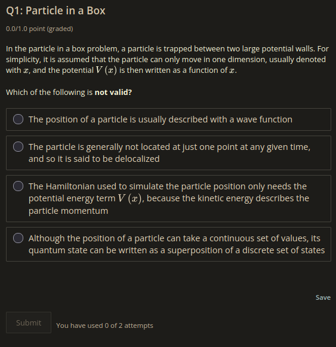

$$V(x)$$

# Q1: Particle in a Box

0.0/1.0 point (graded)

In the particle in a box problem, a particle is trapped between two large potential walls. For simplicity, it is assumed that the particle can only move in one dimension, usually denoted with $x$, and the potential $V(x)$ is then written as a function of $x$.

Which of the following is **not valid**?

- ( ) The position of a particle is usually described with a wave function
- ( ) The particle is generally not located at just one point at any given time, and so it is said to be delocalized
- ( ) The Hamiltonian used to simulate the particle position only needs the potential energy term $V(x)$, because the kinetic energy describes the particle momentum
- ( ) Although the position of a particle can take a continuous set of values, its quantum state can be written as a superposition of a discrete set of states

Save

Submit. You have used 0 of 2 attempts.

## **Transcript**

## 

00

00:00:00,000 \--\> 00:00:00,740

1

00:00:00,740 \--\> 00:00:02,480

Let\'s work through something concrete.

2

00:00:02,480 \--\> 00:00:06,560

First, I would like to show you the example of a particle

3

00:00:06,560 \--\> 00:00:08,810

in a one-dimensional well.

4

00:00:08,810 \--\> 00:00:11,310

This is entry-level quantum mechanics.

5

00:00:11,310 \--\> 00:00:13,160

And I start at this point because you\'re

6

00:00:13,160 \--\> 00:00:14,750

very familiar with it, and it will

7

00:00:14,750 \--\> 00:00:18,230

let me illustrate the first two steps in a quantum simulation

8

00:00:18,230 \--\> 00:00:20,020

process.

9

00:00:20,020 \--\> 00:00:23,780

Imagine that you have a particle located

10

00:00:23,780 \--\> 00:00:27,750

on a one-dimensional axis, and there

11

00:00:27,750 \--\> 00:00:30,290

is some potential, V of x.

12

00:00:30,290 \--\> 00:00:34,690

The somewhere delocalized in here.

13

00:00:34,690 \--\> 00:00:40,820

Let the scale of this heat from minus d to plus d or so.

14

00:00:40,820 \--\> 00:00:45,410

And the particle is governed by a Hamiltonian,

15

00:00:45,410 \--\> 00:00:49,250

which is of the form p squared over 2m plus V of x.

16

00:00:49,250 \--\> 00:00:52,280

So this is the energy of a free particle, the kinetic energy.

17

00:00:52,280 \--\> 00:00:56,110

This is he potential energy.

18

00:00:56,110 \--\> 00:01:01,550

This is the set of T terms, and this is the set of V terms

19

00:01:01,550 \--\> 00:01:05,250

that are canonical in a molecule as well.

20

<!-- frame 1:02 · diagram · week4/media/media/image32.png -->

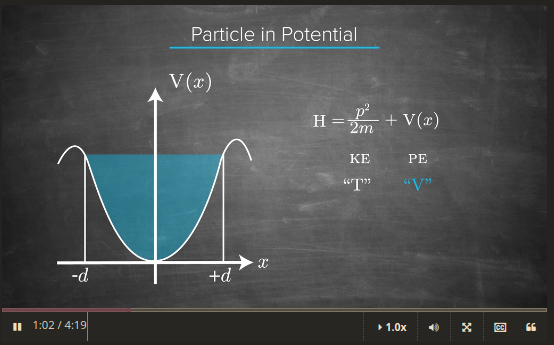

$$\mathrm{H}=\frac{p^{2}}{2m}+\mathrm{V}(x)$$

# Particle in Potential

Chalkboard diagram of a potential \(V(x)\) versus \(x\).

- Vertical axis labeled \(V(x)\); horizontal axis labeled \(x\), with marks \(-d\) and \(+d\).
- Between \(-d\) and \(+d\) the potential dips to the origin and is filled teal; outside the walls the potential rises into barriers.

$$\mathrm{H}=\frac{p^{2}}{2m}+\mathrm{V}(x)$$

- Kinetic term labeled KE, “T”.
- Potential term labeled PE, “V”.

00:01:05,250 \--\> 00:01:06,770

This is a very simplistic scenario,

21

00:01:06,770 \--\> 00:01:09,560

but it\'s not all that far away from the more complicated

22

00:01:09,560 \--\> 00:01:11,630

molecular Hamiltonian.

23

00:01:11,630 \--\> 00:01:13,940

And the first step that one employs

24

00:01:13,940 \--\> 00:01:17,840

in simulating the dynamics of this physical system

25

00:01:17,840 \--\> 00:01:20,180

is to discretize.

26

00:01:20,180 \--\> 00:01:24,810

So normally, we\'ll have some continuous set

27

00:01:24,810 \--\> 00:01:28,770

over the infinite one-dimensional axis.

28

00:01:28,770 \--\> 00:01:32,040

So you can imagine that these are some coefficients

29

00:01:32,040 \--\> 00:01:34,040

that you have.

30

00:01:34,040 \--\> 00:01:40,490

So this has now expanded into eigen basis of position x.

31

00:01:40,490 \--\> 00:01:42,170

And the natural thing for us to do

32

00:01:42,170 \--\> 00:01:47,750

is to replace this with something discrete, like k

33

00:01:47,750 \--\> 00:01:51,710

delta x, so that this is in some way now going

34

00:01:51,710 \--\> 00:01:54,440

to be a sum over some coefficients,

35

00:01:54,440 \--\> 00:02:00,320

C sub k of k delta x where we choose the delta x

36

<!-- frame 2:00 · formula · week4/media/media/image26.png -->

$$|\psi\rangle = \int_{-\infty}^{\infty} \underbrace{\langle\psi|x\rangle}_{\text{coefficient}} \underbrace{|x\rangle}_{|k\Delta x\rangle}\, dx$$
$$\sum C_k |k\Delta x\rangle$$

00:02:00,320 \--\> 00:02:02,570

to be sufficiently small and defined over

37

00:02:02,570 \--\> 00:02:06,110

this discrete interval from minus d to d.

38

00:02:06,110 \--\> 00:02:08,330

So many of you have done this, especially

39

00:02:08,330 \--\> 00:02:11,450

if you\'re doing a computer simulation of such

40

00:02:11,450 \--\> 00:02:13,070

a particle in a potential.

41

00:02:13,070 \--\> 00:02:15,270

It should be very comfortable.

42

00:02:15,270 \--\> 00:02:17,570

The second thing that you do is to be

43

00:02:17,570 \--\> 00:02:19,460

able to simulate the Hamiltonian.

44

00:02:19,460 \--\> 00:02:22,580

So you evolve the system.

45

00:02:22,580 \--\> 00:02:26,780

Now, how does one evolve a system under a Hamiltonian?

46

00:02:26,780 \--\> 00:02:29,300

The problem is that this Hamiltonian here

47

00:02:29,300 \--\> 00:02:37,520

is comprised of two parts, H1 and H2, and they don\'t commute.

48

00:02:37,520 \--\> 00:02:43,340

Just let my evolution, e to the minus i h t\--

49

00:02:43,340 \--\> 00:02:49,170

I cannot simply let this be e to the minus i h1 t e to the minus

50

00:02:49,170 \--\> 00:02:51,880

i h2 t.

51

00:02:51,880 \--\> 00:02:55,670

I cannot evolve with one Hamiltonian then evolve with

52

00:02:55,670 \--\> 00:02:59,210

a second Hamiltonian, even though they\'re added here,

53

00:02:59,210 \--\> 00:03:01,420

because they do not commute with each other.

54

00:03:01,420 \--\> 00:03:04,880

And this should be something you\'re very familiar with.

55

00:03:04,880 \--\> 00:03:07,570

And therefore, we have to apply an approximation.

56

00:03:07,570 \--\> 00:03:09,350

The approximation we apply in order

57

00:03:09,350 \--\> 00:03:12,260

to simulate this some of the Hamiltonians

58

00:03:12,260 \--\> 00:03:18,440

is the Lie Product formula, which says that in the limit

59

00:03:18,440 \--\> 00:03:21,305

as I take an infinite number of partitions of e

60

00:03:21,305 \--\> 00:03:26,780

to the i h1 t divided by n, e to the minus i

61

00:03:26,780 \--\> 00:03:31,100

h2 t divided by n, where I evolve

62

00:03:31,100 \--\> 00:03:34,350

by the first Hamiltonian for a small sliver of time,

63

00:03:34,350 \--\> 00:03:38,390

t divided by n, then the second one for another small sliver

64

00:03:38,390 \--\> 00:03:39,800

of time.

65

00:03:39,800 \--\> 00:03:42,540

Repeat this many times, taking the slivers

66

00:03:42,540 \--\> 00:03:44,600

to become smaller and smaller.

67

00:03:44,600 \--\> 00:03:50,900

This gives us an equality, which is the sum of the two

68

<!-- frame 3:48 · formula · week4/media/media/image44.png -->

$$\lim_{n\to\infty}\left(e^{-i H_{1} t/n}\, e^{-i H_{2} t/n}\right)^{n}=e^{i(H_{1}+H_{2})t}$$

# Apply an approximation

Lie Product formula

$$\lim_{n\to\infty}\left(e^{-i H_{1} t/n}\, e^{-i H_{2} t/n}\right)^{n}=e^{i(H_{1}+H_{2})t}$$

The right-hand side is written in cyan as \(e^{i(H_{1}+H_{2})t}\) (positive \(i\) in the exponent).

00:03:50,900 \--\> 00:03:52,400

Hamiltonians.

69

00:03:52,400 \--\> 00:03:56,120

Now, this is a beautiful mathematical fact.

70

00:03:56,120 \--\> 00:03:59,420

Unfortunately, when we do our actual simulation,

71

00:03:59,420 \--\> 00:04:01,670

we have to truncate it at some point,

72

00:04:01,670 \--\> 00:04:03,620

and errors start to pop in.

73

00:04:03,620 \--\> 00:04:05,870

And when we truncate it at a certain point

74

00:04:05,870 \--\> 00:04:09,870

this method is called Trotterization.

75

00:04:09,870 \--\> 00:04:19,733

## **PRACTICE (1 Question)**
Section: Hamiltonian Simulation

# Page Title:Hamiltonian simulation : Trotterization

# **Learn**
## 

## **Images**

$$|\psi(t)\rangle=e^{-i\hat{H}t/\hbar}|\psi(0)\rangle$$
$$\hat{U}(t)=e^{-i\hat{H}t/\hbar}$$
$$\hat{H}=\sum_n\hat{H}_n$$
$$\hat{U}(t)\neq\prod_n e^{-i\hat{H}_n t/\hbar}$$
$$[\hat{A},\hat{B}]=\hat{A}\hat{B}-\hat{B}\hat{A}\equiv c$$
$$e^{\hat{A}+\hat{B}}\neq e^{\hat{A}}e^{\hat{B}}$$
$$e^{\hat{A}+\hat{B}}=e^{\hat{A}}e^{\hat{B}}e^{\frac{1}{2}[\hat{A},\hat{B}]}$$
$$\hat{U}(t)=e^{-i\hat{H}t/\hbar}=\lim_{\tau\to\infty}\left(\prod_n e^{-i\hat{H}_n t/\tau\hbar}\right)^{\tau}$$

# Hamiltonian Simulation: Trotterization

The time evolution of a quantum system with a time-independent Hamiltonian $\hat{H}$ is described by $|\psi(t)\rangle=e^{-i\hat{H}t/\hbar}|\psi(0)\rangle$. In this expression, the operator $\hat{U}(t)=e^{-i\hat{H}t/\hbar}$ is a unitary operator that describes the evolution of the state.

In cases where determining or implementing a single Hamiltonian $\hat{H}$ is challenging, it can often be expressed as $\hat{H}=\sum_n\hat{H}_n$, a sum of simpler Hamiltonians $\hat{H}_i$ that are more straightforward to implement. However, the sum of Hamiltonians is generally not the same as the unitary $\hat{U}(t)\neq\prod_n e^{-i\hat{H}_n t/\hbar}$, because Hamiltonians do not commute with each other in general.

If two operators $\hat{A}$ and $\hat{B}$ do not commute – that is, $[\hat{A},\hat{B}]=\hat{A}\hat{B}-\hat{B}\hat{A}\equiv c$, where $c$ is a scalar number not equal to zero – then the exponentiation of a sum of $\hat{A}$ and $\hat{B}$ differs from the multiplication of each exponentiated operator:

$$e^{\hat{A}+\hat{B}}\neq e^{\hat{A}}e^{\hat{B}}.$$

Rather, the correct expression is given by the Baker-Campbell-Hausdorff formula:

$$e^{\hat{A}+\hat{B}}=e^{\hat{A}}e^{\hat{B}}e^{\frac{1}{2}[\hat{A},\hat{B}]}.$$

The Lie product formula provides a means to simplify the simulation of a sum of Hamiltonians.

$$\hat{U}(t)=e^{-i\hat{H}t/\hbar}=\lim_{\tau\to\infty}\left(\prod_n e^{-i\hat{H}_n t/\tau\hbar}\right)^{\tau}$$

Essentially, the Lie product formula divides the system time evolution in small time-steps $t/\tau$, each of which implements one factor in the product form of the full Hamiltonian, and then repeats it $\tau$ times. In practice, if the time steps are small enough, this approach – often called "Trotterization" in the context of Hamiltonians and quantum simulation – is a good approximation to the original time evolution. And, in the limit $\tau\to\infty$, corresponding to infinitesimal time slices repeated an infinite number of times, this relation is exact.

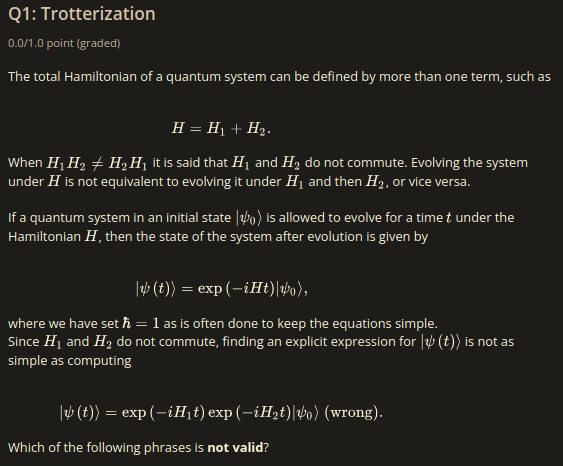

$$H=H_1+H_2$$
$$|\psi(t)\rangle=\exp(-iHt)|\psi_0\rangle$$
$$|\psi(t)\rangle=\exp(-iH_1 t)\exp(-iH_2 t)|\psi_0\rangle\quad(\mathrm{wrong})$$

# Q1: Trotterization

0.0/1.0 point (graded)

The total Hamiltonian of a quantum system can be defined by more than one term, such as

$$H=H_1+H_2.$$

When $H_1H_2\neq H_2H_1$ it is said that $H_1$ and $H_2$ do not commute. Evolving the system under $H$ is not equivalent to evolving it under $H_1$ and then $H_2$, or vice versa.

If a quantum system in an initial state $|\psi_0\rangle$ is allowed to evolve for a time $t$ under the Hamiltonian $H$, then the state of the system after evolution is given by

$$|\psi(t)\rangle=\exp(-iHt)|\psi_0\rangle,$$

where we have set $\hbar=1$ as is often done to keep the equations simple. Since $H_1$ and $H_2$ do not commute, finding an explicit expression for $|\psi(t)\rangle$ is not as simple as computing

$$|\psi(t)\rangle=\exp(-iH_1 t)\exp(-iH_2 t)|\psi_0\rangle\quad(\mathrm{wrong}).$$

Which of the following phrases is **not valid**?

(Answer choices are not in this screenshot.)

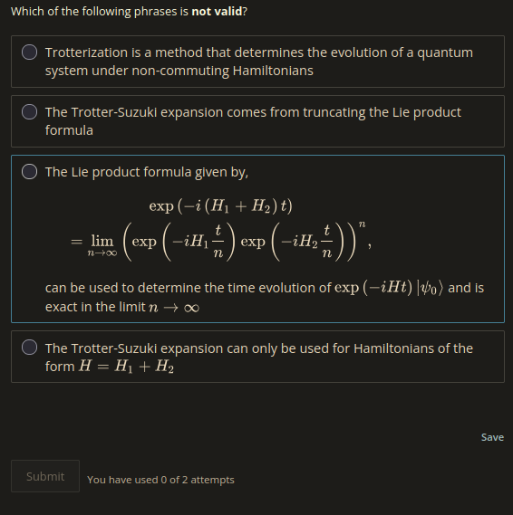

$$
\exp\big(-i(H_1+H_2)t\big)=\lim_{n\to\infty}\left(\exp\left(-iH_1\frac{t}{n}\right)\exp\left(-iH_2\frac{t}{n}\right)\right)^{n}
$$
$$
\exp(-iHt)\,|\psi_0\rangle
$$
$$
H=H_1+H_2
$$

# Practice: which phrase is not valid?

Which of the following phrases is **not valid**? Single choice. The third option is outlined in blue. **Save**. **Submit**. You have used 0 of 2 attempts.

- Trotterization is a method that determines the evolution of a quantum system under non-commuting Hamiltonians
- The Trotter-Suzuki expansion comes from truncating the Lie product formula
- The Lie product formula given by,

$$\exp\big(-i(H_1+H_2)t\big)=\lim_{n\to\infty}\left(\exp\left(-iH_1\frac{t}{n}\right)\exp\left(-iH_2\frac{t}{n}\right)\right)^{n},$$

can be used to determine the time evolution of $\exp(-iHt)\,|\psi_0\rangle$ and is exact in the limit $n\to\infty$

- The Trotter-Suzuki expansion can only be used for Hamiltonians of the form $H=H_1+H_2$

## **Transcript**

## 

0

## **PRACTICE (1 question)**

0

00:00:00,000 \--\> 00:00:00,500

1

00:00:00,500 \--\> 00:00:02,680

In the previous video, we discussed the quantum

2

00:00:02,680 \--\> 00:00:05,080

simulation of a particle in a box,

3

00:00:05,080 \--\> 00:00:06,790

and towards the end of the video,

4

00:00:06,790 \--\> 00:00:08,320

we previewed an important technique

5

00:00:08,320 \--\> 00:00:11,590

for quantum simulation called Trotterization.

6

00:00:11,590 \--\> 00:00:13,720

In this video, we\'re going to take a closer

7

00:00:13,720 \--\> 00:00:15,520

look at Trotterization and see why

8

00:00:15,520 \--\> 00:00:18,980

it\'s such an important tool for quantum simulations.

9

00:00:18,980 \--\> 00:00:20,770

Now, as we\'ve already seen, the first step

10

00:00:20,770 \--\> 00:00:22,600

in quantum simulation is to write down

11

00:00:22,600 \--\> 00:00:25,300

the Hamiltonian, which governs the dynamics of the system we

12

00:00:25,300 \--\> 00:00:26,840

want to simulate.

13

00:00:26,840 \--\> 00:00:29,890

And the Hamiltonian\'s generally separated into different terms

14

00:00:29,890 \--\> 00:00:32,990

corresponding to the different types of energy in the system\--

15

<!-- frame 0:31 · formula · week4/media/media/image8.png -->

$$
H=T+U
$$
$$
H=\sum_{i} H_{i}^{\mathrm{qubit}}+\sum_{i,j} H_{ij}^{\mathrm{int}}
$$

# Separating a Hamiltonian

$$H=T+U$$

Kinetic and Potential Energy

$$H=\sum_{i} H_{i}^{\mathrm{qubit}}+\sum_{i,j} H_{ij}^{\mathrm{int}}$$

Single Qubit Terms plus Interaction Terms

00:00:32,990 \--\> 00:00:35,530

for example, the kinetic and potential energies.

16

00:00:35,530 \--\> 00:00:37,570

Or for systems of many qubits, we

17

00:00:37,570 \--\> 00:00:40,270

might instead use a sum of single qubit energies

18

00:00:40,270 \--\> 00:00:44,000

plus terms which correspond to qubit-qubit interactions.

19

00:00:44,000 \--\> 00:00:45,730

However we define the Hamiltonian,

20

00:00:45,730 \--\> 00:00:47,470

the goal of our quantum simulation

21

00:00:47,470 \--\> 00:00:50,950

is to take an initial quantum state psi at time t0

22

00:00:50,950 \--\> 00:00:54,460

and find out where it ends up at a later time t.

23

00:00:54,460 \--\> 00:00:56,770

And as we introduced in the \"What is a Hamiltonian?\"

24

00:00:56,770 \--\> 00:01:00,730

video, the state psi at time t results from the initial state

25

00:01:00,730 \--\> 00:01:04,510

psi 0 acted upon by the operator e to the iHt

26

00:01:04,510 \--\> 00:01:06,760

where H is the Hamiltonian.

27

00:01:06,760 \--\> 00:01:09,520

Now, e to the iHt is a unitary operator

28

00:01:09,520 \--\> 00:01:11,560

and, in principle, it can be decomposed

29

00:01:11,560 \--\> 00:01:13,630

into a series of qubit gates and placed

30

00:01:13,630 \--\> 00:01:16,100

into a block in the circuit diagram.

31

<!-- frame 1:15 · slide · week4/media/media/image48.png -->

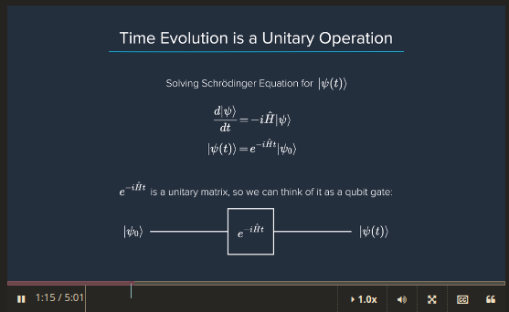

$$\frac{d|\psi\rangle}{dt}=-i\hat{H}|\psi\rangle$$
$$|\psi(t)\rangle=e^{-i\hat{H}t}|\psi_{0}\rangle$$

# Time Evolution is a Unitary Operation

Solving Schrodinger Equation for \(|\psi(t)\rangle\)

$$\frac{d|\psi\rangle}{dt}=-i\hat{H}|\psi\rangle$$

$$|\psi(t)\rangle=e^{-i\hat{H}t}|\psi_{0}\rangle$$

\(e^{-i\hat{H}t}\) is a unitary matrix, so we can think of it as a qubit gate.

$$|\psi_{0}\rangle \;\text{—}\; \boxed{e^{-i\hat{H}t}} \;\text{—}\; |\psi(t)\rangle$$

00:01:16,100 \--\> 00:01:19,720

However, these operations may be hard to realize in practice.

32

00:01:19,720 \--\> 00:01:22,030

Alternatively, we can break our Hamiltonian

33

00:01:22,030 \--\> 00:01:24,460

into pieces that are more tractable to implement,

34

00:01:24,460 \--\> 00:01:28,210

such as single-qubit rotations and elementary two-qubit gates.

35

00:01:28,210 \--\> 00:01:29,700

To get started, let\'s say we have

36

00:01:29,700 \--\> 00:01:33,340

a Hamiltonian H that can be broken into two terms, H0

37

00:01:33,340 \--\> 00:01:34,660

and H1.

38

00:01:34,660 \--\> 00:01:37,300

And while H is very difficult to implement,

39

00:01:37,300 \--\> 00:01:40,040

H0 and H1 are much easier.

40

<!-- frame 1:40 · slide · week4/media/media/image34.png -->

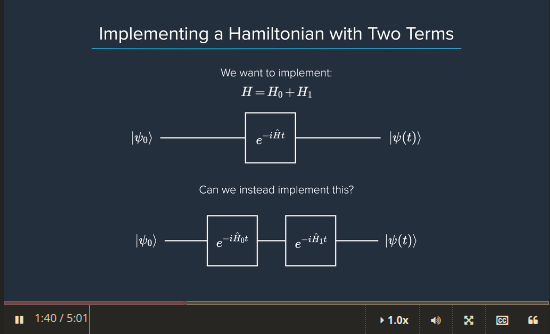

$$H=H_{0}+H_{1}$$
$$|\psi_{0}\rangle \xrightarrow{e^{-i\hat{H}t}} |\psi(t)\rangle$$
$$|\psi_{0}\rangle \xrightarrow{e^{-i\hat{H}_{0}t}} \xrightarrow{e^{-i\hat{H}_{1}t}} |\psi(t)\rangle$$

# Implementing a Hamiltonian with Two Terms

We want to implement:

$$H=H_{0}+H_{1}$$

$$|\psi_{0}\rangle \;\text{—}\; \boxed{e^{-i\hat{H}t}} \;\text{—}\; |\psi(t)\rangle$$

Can we instead implement this?

$$|\psi_{0}\rangle \;\text{—}\; \boxed{e^{-i\hat{H}_{0}t}} \;\text{—}\; \boxed{e^{-i\hat{H}_{1}t}} \;\text{—}\; |\psi(t)\rangle$$

00:01:40,040 \--\> 00:01:42,760

So how can we use these simpler terms to implement

41

00:01:42,760 \--\> 00:01:44,950

the total Hamiltonian H?

42

00:01:44,950 \--\> 00:01:48,040

Now, you might think that we can simply implement these two

43

00:01:48,040 \--\> 00:01:50,740

terms as two sequential time evolutions,

44

00:01:50,740 \--\> 00:01:53,290

each acting on the system for the total time t,

45

00:01:53,290 \--\> 00:01:54,610

and then we\'re done.

46

00:01:54,610 \--\> 00:01:57,100

However, unfortunately, this doesn\'t work.

47

00:01:57,100 \--\> 00:02:01,060

While it\'s certainly true that H equals H0 plus H1,

48

00:02:01,060 \--\> 00:02:04,970

it\'s not necessarily true that e to the iHt equals

49

00:02:04,970 \--\> 00:02:09,400

e to the iH0t times e to the iH1t.

50

00:02:09,400 \--\> 00:02:13,030

This is because, in general, the operators H0 and H1 do not

51

00:02:13,030 \--\> 00:02:14,820

commute with one another.

52

00:02:14,820 \--\> 00:02:16,840

Commutation is a mathematical concept

53

00:02:16,840 \--\> 00:02:19,690

that we take for granted in basic arithmetic.

54

00:02:19,690 \--\> 00:02:22,330

Basically, we can multiply numbers in any order

55

00:02:22,330 \--\> 00:02:23,830

and still get the same answer.

56

00:02:23,830 \--\> 00:02:27,130

For example, 3 times 6 is equal to 6 times 3.

57

00:02:27,130 \--\> 00:02:29,710

The order in which we multiply doesn\'t matter.

58

00:02:29,710 \--\> 00:02:31,360

Because we can rearrange the numbers

59

00:02:31,360 \--\> 00:02:33,400

on either side of the multiplication sign,

60

00:02:33,400 \--\> 00:02:36,820

we say that multiplication of scalar numbers is commutative

61

00:02:36,820 \--\> 00:02:39,190

and that these numbers commute.

62

00:02:39,190 \--\> 00:02:41,410

Now, it turns out, this statement is not always true

63

00:02:41,410 \--\> 00:02:43,330

for quantum operators.

64

00:02:43,330 \--\> 00:02:46,600

As we saw in course 1, we can represent quantum operators

65

00:02:46,600 \--\> 00:02:48,640

as unitary matrices.

66

00:02:48,640 \--\> 00:02:50,950

To check if multiplication still commutes,

67

00:02:50,950 \--\> 00:02:54,610

let\'s consider two elementary quantum operators, the z and x

68

00:02:54,610 \--\> 00:02:56,320

operators.

69

00:02:56,320 \--\> 00:02:58,180

When we multiply these matrices, it\'s

70

00:02:58,180 \--\> 00:03:01,990

clear that z times x does not equal x times z.

71

00:03:01,990 \--\> 00:03:05,140

Therefore, in general, operator matrix multiplication

72

00:03:05,140 \--\> 00:03:07,420

does not obey the commutative property,

73

00:03:07,420 \--\> 00:03:10,420

and we say that the operators z and x do not

74

<!-- frame 3:09 · formula · week4/media/media/image29.png -->

$$Z\cdot X = \begin{pmatrix} 1 & 0 \\ 0 & -1 \end{pmatrix}\begin{pmatrix} 0 & 1 \\ 1 & 0 \end{pmatrix} = \begin{pmatrix} 0 & 1 \\ -1 & 0 \end{pmatrix}$$
$$X\cdot Z = \begin{pmatrix} 0 & 1 \\ 1 & 0 \end{pmatrix}\begin{pmatrix} 1 & 0 \\ 0 & -1 \end{pmatrix} = \begin{pmatrix} 0 & -1 \\ 1 & 0 \end{pmatrix}$$
$$e^{i(A+B)t} \neq e^{iAt} e^{iBt}$$

# Commutation

For quantum operators, multiplication **does not** generally obey the commutative property.

$$Z\cdot X = \begin{pmatrix} 1 & 0 \\ 0 & -1 \end{pmatrix}\begin{pmatrix} 0 & 1 \\ 1 & 0 \end{pmatrix} = \begin{pmatrix} 0 & 1 \\ -1 & 0 \end{pmatrix}$$

$$X\cdot Z = \begin{pmatrix} 0 & 1 \\ 1 & 0 \end{pmatrix}\begin{pmatrix} 1 & 0 \\ 0 & -1 \end{pmatrix} = \begin{pmatrix} 0 & -1 \\ 1 & 0 \end{pmatrix}$$

When operators don't commute

$$e^{i(A+B)t} \neq e^{iAt} e^{iBt}$$

00:03:10,420 \--\> 00:03:12,080

commute with one another.

75

00:03:12,080 \--\> 00:03:13,990

This means that order matters when we apply

76

00:03:13,990 \--\> 00:03:15,670

these operators to qubits.

77

00:03:15,670 \--\> 00:03:18,650

Change the order, and you get a different outcome.

78

00:03:18,650 \--\> 00:03:20,500

Now, returning to our Hamiltonian problem,

79

00:03:20,500 \--\> 00:03:23,980

we see that implementing H0 first and then H1

80

00:03:23,980 \--\> 00:03:26,170

will give us a different result than if we first

81

00:03:26,170 \--\> 00:03:29,020

implemented H1 and then H0.

82

00:03:29,020 \--\> 00:03:32,790

So how can we take advantage of the simpler terms, H0 and H1,

83

00:03:32,790 \--\> 00:03:35,050

and simulate the full Hamiltonian?

84

00:03:35,050 \--\> 00:03:38,830

This is where the concept called Trotterization comes in.

85

00:03:38,830 \--\> 00:03:42,200

The Suzuki-Trotter method, or Trotterization for short,

86

00:03:42,200 \--\> 00:03:45,310

takes advantage of a clever decomposition of matrices which

87

00:03:45,310 \--\> 00:03:48,040

allows us to simulate the action of a Hamiltonian

88

00:03:48,040 \--\> 00:03:50,770

using only its constituent pieces.

89

00:03:50,770 \--\> 00:03:53,620

Instead of just breaking our Hamiltonian into two terms

90

00:03:53,620 \--\> 00:03:56,200

and evolving each for the full time t,

91

00:03:56,200 \--\> 00:03:59,890

we\'ll also break the time evolution into n small pieces

92

00:03:59,890 \--\> 00:04:02,800

and run each evolution for a small fraction t

93

00:04:02,800 \--\> 00:04:05,500

over n of the total time t.

94

00:04:05,500 \--\> 00:04:07,840

We\'ll then repeatedly implement this smaller

95

00:04:07,840 \--\> 00:04:10,690

interleaved evolution a total of n times

96

00:04:10,690 \--\> 00:04:12,340

such that, by the end of the protocol,

97

00:04:12,340 \--\> 00:04:15,340

the system is evolved for the full time t.

98

00:04:15,340 \--\> 00:04:17,920

And as we make n larger and larger\--

99

<!-- frame 4:16 · formula · week4/media/media/image4.png -->

$$
\lim_{n\to\infty}\left(e^{-iA\frac{t}{n}}e^{-iB\frac{t}{n}}\right)^{n}=e^{-i(A+B)t}
$$

# The Suzuki-Trotter Method (aka Trotterization)

A circuit runs from $|\psi_0\rangle$ to $|\psi(t)\rangle$ through six boxes. The labels inside the boxes are small; they alternate the two factors in the product below ($e^{-iAt/n}$ then $e^{-iBt/n}$).

$$\lim_{n\to\infty}\left(e^{-iA\frac{t}{n}}e^{-iB\frac{t}{n}}\right)^{n}=e^{-i(A+B)t}$$

00:04:17,920 \--\> 00:04:21,490

that is, as we make the stepwise evolution smaller and smaller,

100

00:04:21,490 \--\> 00:04:23,290

the Trotterization procedure becomes

101

00:04:23,290 \--\> 00:04:25,600

equivalent to evolving the original Hamiltonian

102

00:04:25,600 \--\> 00:04:27,940

H for the full time t.

103

00:04:27,940 \--\> 00:04:31,600

This remarkable relationship is known as the Trotter equation.

104

00:04:31,600 \--\> 00:04:34,870

By breaking the Hamiltonian time evolution into small pieces

105

00:04:34,870 \--\> 00:04:37,570

and toggling between each term of the Hamiltonian,

106

00:04:37,570 \--\> 00:04:40,580

Trotterization enables us to simulate the full Hamiltonian

107

00:04:40,580 \--\> 00:04:42,670

evolution using only its constituent

108

00:04:42,670 \--\> 00:04:46,040

terms, even if those terms don\'t commute with one another.

109

00:04:46,040 \--\> 00:04:50,200

And as a result, this concept is a powerful, almost universally

110

00:04:50,200 \--\> 00:04:53,120

applicable, approach to the simulation of quantum systems

111

00:04:53,120 \--\> 00:04:55,620

and their dynamical evolution.

112

00:04:55,620 \--\> 00:04:59,606

## **PRACTICE (1 question)**

## 

Section:

# Page Title: Simulation of chemistry problems

# **Learn**

**Erratum Note:** At 3:08 in the video above, Professor Chuang discusses
that the [[Haber Bosch
Process]{.underline}](https://en.wikipedia.org/wiki/Haber_process)
requires a very high temperature and pressure to efficiently convert
nitrogen and hydrogen into ammonia. Here, the pressure should read 200
atm (atmospheres) which converts to about 20 MPa (around 202 bar or 2939
psi). You can read more about the history of this transformational
discovery in this [[article from the Royal Society of
Chemistry]{.underline}](https://edu.rsc.org/feature/who-really-discovered-the-haber-process/2020277.article).

## **Images**

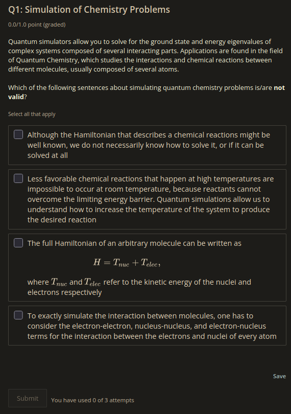

$$
H=T_{\mathrm{nuc}}+T_{\mathrm{elec}}
$$

# Q1: Simulation of Chemistry Problems

0.0/1.0 point (graded). **Select all that apply.** Checkboxes unchecked. **Save**. **Submit**. You have used 0 of 3 attempts.

Quantum simulators allow you to solve for the ground state and energy eigenvalues of complex systems composed of several interacting parts. Applications are found in the field of Quantum Chemistry, which studies the interactions and chemical reactions between different molecules, usually composed of several atoms.

Which of the following sentences about simulating quantum chemistry problems is/are **not valid**?

- Although the Hamiltonian that describes a chemical reactions might be well known, we do not necessarily know how to solve it, or if it can be solved at all
- Less favorable chemical reactions that happen at high temperatures are impossible to occur at room temperature, because reactants cannot overcome the limiting energy barrier. Quantum simulations allow us to understand how to increase the temperature of the system to produce the desired reaction
- The full Hamiltonian of an arbitrary molecule can be written as $H=T_{\mathrm{nuc}}+T_{\mathrm{elec}}$, where $T_{\mathrm{nuc}}$ and $T_{\mathrm{elec}}$ refer to the kinetic energy of the nuclei and electrons respectively
- To exactly simulate the interaction between molecules, one has to consider the electron-electron, nucleus-nucleus, and electron-nucleus terms for the interaction between the electrons and nuclei of every atom

## **Transcript**

## 

00

00:00:00,000 \--\> 00:00:01,540

1

00:00:01,540 \--\> 00:00:04,300

I want to illustrate the simulation challenge to you

2

00:00:04,300 \--\> 00:00:07,660

today with one very specific thing,

3

00:00:07,660 \--\> 00:00:12,160

and this specific thing has to do with a well-known task known

4

00:00:12,160 \--\> 00:00:15,350

as nitrogen fixation.

5

00:00:15,350 \--\> 00:00:17,200

And nitrogen fixation is a process

6

00:00:17,200 \--\> 00:00:19,240

that happens in nature that involves

7

00:00:19,240 \--\> 00:00:22,750

taking gaseous nitrogen from the atmosphere

8

00:00:22,750 \--\> 00:00:25,660

and then combining that with protons,

9

00:00:25,660 \--\> 00:00:27,610

typically from water, and then producing

10

00:00:27,610 \--\> 00:00:33,100

as a result of this two molecules of ammonia.

11

00:00:33,100 \--\> 00:00:37,000

Of course, in natural systems, in biological systems,

12

00:00:37,000 \--\> 00:00:40,030

this is not usually ammonia but probably ammonium.

13

00:00:40,030 \--\> 00:00:43,030

And yet, this is one of the most important processes

14

00:00:43,030 \--\> 00:00:47,800

to biological systems, including your life and my life

15

00:00:47,800 \--\> 00:00:52,330

because it is the rate of this nitrogen fixation process

16

00:00:52,330 \--\> 00:00:56,230

that limits the production, for example, of food.

17

00:00:56,230 \--\> 00:01:00,910

The reason this is such an important and interesting

18

00:01:00,910 \--\> 00:01:05,590

reaction can be illustrated by looking at the reaction

19

00:01:05,590 \--\> 00:01:08,005

diagram of the process.

20

00:01:08,005 \--\> 00:01:10,330

So let this be a reaction coordinate\--

21

00:01:10,330 \--\> 00:01:13,630

so progress as the reaction proceeds from the left hand

22

00:01:13,630 \--\> 00:01:16,510

side to the right hand side of this equation.

23

00:01:16,510 \--\> 00:01:19,440

And the fact is that the reactants coming in

24

00:01:19,440 \--\> 00:01:21,880

have a certain kind of energy, and let me not be

25

00:01:21,880 \--\> 00:01:24,010

too specific about that, but they

26

00:01:24,010 \--\> 00:01:27,370

have to overcome an enormous activation energy

27

00:01:27,370 \--\> 00:01:33,680

barrier before being able to exit the reaction as a product,

28

00:01:33,680 \--\> 00:01:35,410

the ammonia that we have here.

29

00:01:35,410 \--\> 00:01:41,500

This energy difference here is on the order of 50 kilojoules

30

00:01:41,500 \--\> 00:01:46,060

per mole of the reactants.

31

00:01:46,060 \--\> 00:01:49,060

This energy activation barrier here

32

00:01:49,060 \--\> 00:01:55,060

is much higher, on the order of 400 kilojoules per mole.

33

00:01:55,060 \--\> 00:01:57,460

And so although it\'s desirable to be

34

00:01:57,460 \--\> 00:02:01,690

able to fixate the nitrogen and produce ammonia,

35

00:02:01,690 \--\> 00:02:05,590

you have to at least, if you have no other recourse,

36

00:02:05,590 \--\> 00:02:07,780

supply a great deal of energy before you

37

<!-- frame 2:06 · diagram · week4/media/media/image54.png -->

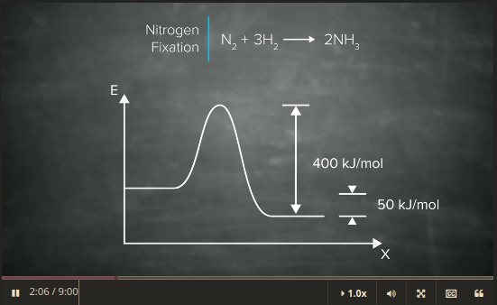

$$\mathrm{N_2}+3\mathrm{H_2}\rightarrow 2\mathrm{NH_3}$$

Chalkboard video frame.

Title: Nitrogen Fixation, next to the reaction $\mathrm{N_2}+3\mathrm{H_2}\rightarrow 2\mathrm{NH_3}$.

Energy diagram, vertical axis $E$, horizontal axis $X$. Reactants sit on a plateau, then a single barrier, then products on a lower plateau. A tall vertical double arrow beside the barrier is labeled 400 kJ/mol. A shorter double arrow to the right, between the reactant level and the lower product level, is labeled 50 kJ/mol.

Player: 2:06 / 9:00, speed 1.0x.

00:02:07,780 \--\> 00:02:10,840

can get this recovery of energy since this

38

00:02:10,840 \--\> 00:02:12,105

is an endothermic reaction.

39

00:02:12,105 \--\> 00:02:16,040

40

00:02:16,040 \--\> 00:02:21,290

Many of you may not know, but we have a lot of nitrogens

41

00:02:21,290 \--\> 00:02:23,180

in our body\--

42

00:02:23,180 \--\> 00:02:25,460

50% of the nitrogens in your body,

43

00:02:25,460 \--\> 00:02:29,630

according to an article in Nature in the early 2000s,

44

00:02:29,630 \--\> 00:02:32,500

comes from a single chemical process.

45

00:02:32,500 \--\> 00:02:37,790

And it\'s remarkable for me to realize and appreciate

46

00:02:37,790 \--\> 00:02:41,360

that so much of ourselves, our bodies, our nitrogen,

47

00:02:41,360 \--\> 00:02:43,190

is dependent on this process known

48

00:02:43,190 \--\> 00:02:46,880

as the Haber-Bosch process circa 1911.

49

00:02:46,880 \--\> 00:02:51,260

And Fritz Haber and Bosch won Nobel prizes for their work

50

00:02:51,260 \--\> 00:02:52,770

in this area.

51

00:02:52,770 \--\> 00:02:59,150

This is a process, which creates high ammonia from nitrogen

52

00:02:59,150 \--\> 00:03:03,630

and steam by cracking it.

53

00:03:03,630 \--\> 00:03:06,830

And so it utilizes metal catalyst

54

00:03:06,830 \--\> 00:03:11,990

at a very high temperature and pressure, 200 megapascals,

55

00:03:11,990 \--\> 00:03:18,050

and something like 450 degrees Celsius in a very large scale

56

00:03:18,050 \--\> 00:03:21,740

industrial process to be able to generate ammonia.

57

00:03:21,740 \--\> 00:03:24,350

And what is the ammonia then used for?

58

00:03:24,350 \--\> 00:03:29,600

It turns out that it is used for fertilizer, and that fertilizer

59

00:03:29,600 \--\> 00:03:32,700

that goes into you, the human body,

60

00:03:32,700 \--\> 00:03:35,120

and we can estimate that it probably

61

00:03:35,120 \--\> 00:03:37,820

is responsible for something on the order

62

00:03:37,820 \--\> 00:03:43,220

of the sustenance of maybe 40% of the world\'s population.

63

00:03:43,220 \--\> 00:03:46,100

Enormous industrial scale production.

64

00:03:46,100 \--\> 00:03:51,620

And at the same time, the cost is between 1% and 2%

65

00:03:51,620 \--\> 00:03:53,610

of the world\'s energy.

66

00:03:53,610 \--\> 00:03:55,050

Now this is fascinating.

67

00:03:55,050 \--\> 00:03:56,990

It\'s a strange place perhaps to be

68

00:03:56,990 \--\> 00:04:01,500

talking about starting a lecture on quantum computation.

69

00:04:01,500 \--\> 00:04:03,770

But here\'s the idea\--

70

00:04:03,770 \--\> 00:04:06,950

nitrogen fixation is not done by nature

71

00:04:06,950 \--\> 00:04:09,320

using the Haber-Bosch process, using

72

00:04:09,320 \--\> 00:04:12,350

this very high temperature, very high pressure

73

00:04:12,350 \--\> 00:04:14,000

industrial process.

74

00:04:14,000 \--\> 00:04:18,890

Instead, nature does it with catalysts, not metal catalysts,

75

00:04:18,890 \--\> 00:04:21,500

but biological catalysts, which are enzymes,

76

00:04:21,500 \--\> 00:04:24,380

for example in bacteria, at room temperature

77

00:04:24,380 \--\> 00:04:26,450

and at room pressure.

78

00:04:26,450 \--\> 00:04:30,020

And it does it remarkably different way, which

79

00:04:30,020 \--\> 00:04:31,970

we do not understand today.

80

00:04:31,970 \--\> 00:04:34,280

And the example of how this is done

81

00:04:34,280 \--\> 00:04:42,830

is with a special enzyme known as nitrogenease.

82

00:04:42,830 \--\> 00:04:46,520

And this is a bacteria enzyme, one of many different kinds

83

00:04:46,520 \--\> 00:04:50,300

of enzymes, which are able to fixate nitrogen

84

00:04:50,300 \--\> 00:04:54,320

from the atmosphere and turn it into ammonium and ammonia.

85

00:04:54,320 \--\> 00:04:57,770

But what is remarkable about this enzyme

86

00:04:57,770 \--\> 00:05:01,970

is that we do not understand today how and why it works.

87

00:05:01,970 \--\> 00:05:04,550

Maybe on the order of a dozen other kinds

88

00:05:04,550 \--\> 00:05:07,670

of varieties of biological enzymes

89

00:05:07,670 \--\> 00:05:10,490

have been manufactured or extracted

90

00:05:10,490 \--\> 00:05:14,870

to accomplish the same task that the Haber-Bosch process does,

91

00:05:14,870 \--\> 00:05:17,780

but none of them are quite stable and efficient

92

00:05:17,780 \--\> 00:05:21,960

and long running as what happens in biology today.

93

00:05:21,960 \--\> 00:05:24,800

Now, the reason we don\'t understand this

94

00:05:24,800 \--\> 00:05:28,670

is because this is all happening in a complex molecule.

95

00:05:28,670 \--\> 00:05:30,650

The actual reaction, which I wrote over there,

96

00:05:30,650 \--\> 00:05:36,530

involves much more than just nitrogen and two molecules

97

00:05:36,530 \--\> 00:05:40,880

of water or hydrogen coming in.

98

00:05:40,880 \--\> 00:05:43,190

Let\'s balance our reaction over here.

99

00:05:43,190 \--\> 00:05:45,110

There are many other things that are happening

100

00:05:45,110 \--\> 00:05:46,800

inside these processes.

101

00:05:46,800 \--\> 00:05:51,620

For example, there are 8 protons and 8 electrons that

102

00:05:51,620 \--\> 00:05:56,810

come in typically, and this may also involve a proton pump

103

00:05:56,810 \--\> 00:06:00,980

with adenosine triphosphate, losing phosphorus

104

00:06:00,980 \--\> 00:06:09,740

to become on the other side, 16 ADP and 16 phosphorus

105

00:06:09,740 \--\> 00:06:10,490

like this.

106

00:06:10,490 \--\> 00:06:14,510

So nature uses a very small amount of energy

107

00:06:14,510 \--\> 00:06:19,610

to be able to catalyze this and take this nitrogen fixation

108

00:06:19,610 \--\> 00:06:23,360

reaction over the activation energy barrier.

109

00:06:23,360 \--\> 00:06:25,230

Now why is this possible?

110

00:06:25,230 \--\> 00:06:29,990

It turns out there is this amazing center

111

00:06:29,990 \--\> 00:06:42,440

inside this nitrogenease called the iron molyhydenum complex,

112

00:06:42,440 \--\> 00:06:49,250

and it has on the order of a 100 kilodaltons of atoms

113

<!-- frame 6:46 · slide · week4/media/media/image15.png -->

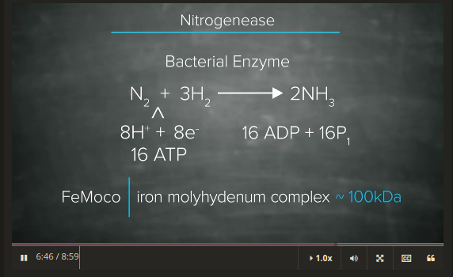

$$\mathrm{N_2 + 3H_2 \longrightarrow 2NH_3}$$
$$8\mathrm{H}^+ + 8e^- \quad 16\,\mathrm{ATP}$$
$$16\,\mathrm{ADP} + 16\mathrm{P}_i$$

# Nitrogenase

Bacterial Enzyme

$$\mathrm{N_2 + 3H_2 \longrightarrow 2NH_3}$$

Under \(\mathrm{N_2}\) (caret pointing up into the reactants):

- \(8\mathrm{H}^+ + 8e^-\)
- \(16\,\mathrm{ATP}\)

To the right of those inputs: \(16\,\mathrm{ADP} + 16\mathrm{P}_i\)

**FeMoco** | iron molybdenum complex ~ **100kDa**

00:06:49,250 \--\> 00:06:53,810

inside this, so we\'re talking on the order of maybe 1,000 carbon

114

00:06:53,810 \--\> 00:06:55,280

atoms.

115

00:06:55,280 \--\> 00:06:57,620

And they\'re all shaped in various ways

116

00:06:57,620 \--\> 00:07:00,900

with alpha helices and beta sheets.

117

00:07:00,900 \--\> 00:07:05,330

And these shapes then allow of the nitrogen and the hydrogen

118

00:07:05,330 \--\> 00:07:08,510

coming in to dock in a certain way,

119

00:07:08,510 \--\> 00:07:10,910

and then because of where they are docked,

120

00:07:10,910 \--\> 00:07:13,730

they can react and do so much more efficiently than they

121

00:07:13,730 \--\> 00:07:17,270

are able to do in this heterogeneous type

122

00:07:17,270 \--\> 00:07:21,110

of catalytic reaction that\'s industrially done.

123

00:07:21,110 \--\> 00:07:23,870

So we would love to, in quantum chemistry,

124

00:07:23,870 \--\> 00:07:27,470

synthesize molecules which have such functionality

125

00:07:27,470 \--\> 00:07:31,370

because you could catalyze all sorts of other reactions.

126

00:07:31,370 \--\> 00:07:34,850

We cannot understand why this is happening from a fundamental

127

00:07:34,850 \--\> 00:07:39,980

standpoint today because we do not know what is happening

128

00:07:39,980 \--\> 00:07:42,770

in a quantum mechanical way with this molecule.

129

00:07:42,770 \--\> 00:07:46,190

Only very recently was even the structure

130

00:07:46,190 \--\> 00:07:49,670

of the molecule understood like with X-ray crystallography

131

00:07:49,670 \--\> 00:07:51,090

and the like.

132

00:07:51,090 \--\> 00:07:53,630

So we, in principle, could do so.

133

00:07:53,630 \--\> 00:07:57,080

In fact, in principle, we can write down\--

134

00:07:57,080 \--\> 00:07:59,180

in principle, we can write down all

135

00:07:59,180 \--\> 00:08:00,860

we need in order to figure out what\'s

136

00:08:00,860 \--\> 00:08:05,570

happening in this because the system is actually

137

00:08:05,570 \--\> 00:08:08,920

a very simple Hamiltonian in principle.

138

00:08:08,920 \--\> 00:08:12,350

There is a kinetic energy of a nucleons,

139

00:08:12,350 \--\> 00:08:16,730

there\'s a kinetic energy of the electrons,

140

00:08:16,730 \--\> 00:08:20,720

and then there are interaction terms between the nucleons

141

00:08:20,720 \--\> 00:08:25,650

and nucleons, between the nucleons and the electrons,

142

00:08:25,650 \--\> 00:08:27,890

and electrons and electrons.

143

<!-- frame 8:27 · formula · week4/media/media/image3.png -->

$$
\mathrm{H}=\mathrm{T}_{\mathrm{nuc}}+\mathrm{T}_{\mathrm{elec}}+\mathrm{V}_{\mathrm{nn}}+\mathrm{V}_{\mathrm{ne}}+\mathrm{V}_{\mathrm{ee}}
$$

# Molecular Hamiltonian (chalkboard)

$$\mathrm{H}=\mathrm{T}_{\mathrm{nuc}}+\mathrm{T}_{\mathrm{elec}}+\mathrm{V}_{\mathrm{nn}}+\mathrm{V}_{\mathrm{ne}}+\mathrm{V}_{\mathrm{ee}}$$

$\mathrm{V}_{\mathrm{ee}}$ is highlighted in light blue.

00:08:27,890 \--\> 00:08:31,580

And I\'ll expand into this Hamiltonian in a little bit

144

00:08:31,580 \--\> 00:08:34,740

to show you concretely what this means.

145

00:08:34,740 \--\> 00:08:36,740

But suffice to say that we can write down

146

00:08:36,740 \--\> 00:08:40,460

a very accurate description of the system.

147

00:08:40,460 \--\> 00:08:43,750

What we cannot do, what we do not know how to do,

148

00:08:43,750 \--\> 00:08:50,800

is to solve for things like the reaction rate and even more

149

00:08:50,800 \--\> 00:08:54,360

simply, just the ground state of the system.

150

00:08:54,360 \--\> 00:08:58,283

## **PRACTICE ( 1 question )**

## 
 Section: Quantum simulation: Chemistry

# Page Title: Phase estimation

# **Learn**

## **Images**

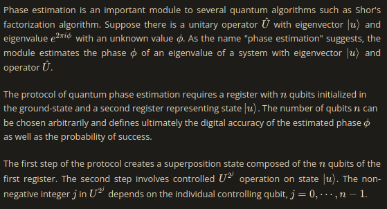

$$\hat{U}|u\rangle=e^{2\pi i\phi}|u\rangle$$
$$\hat{U}^{2^{j}},\quad j=0,\ldots,n-1$$

Phase estimation is an important module to several quantum algorithms such as Shor's factorization algorithm. Suppose there is a unitary operator $\hat{U}$ with eigenvector $|u\rangle$ and eigenvalue $e^{2\pi i\phi}$ with an unknown value $\phi$. As the name "phase estimation" suggests, the module estimates the phase $\phi$ of an eigenvalue of a system with eigenvector $|u\rangle$ and operator $\hat{U}$.

The protocol of quantum phase estimation requires a register with $n$ qubits initialized in the ground-state and a second register representing state $|u\rangle$. The number of qubits $n$ can be chosen arbitrarily and defines ultimately the digital accuracy of the estimated phase $\phi$ as well as the probability of success.

The first step of the protocol creates a superposition state composed of the $n$ qubits of the first register. The second step involves controlled $\hat{U}^{2^{j}}$ operation on state $|u\rangle$. The non-negative integer $j$ in $\hat{U}^{2^{j}}$ depends on the individual controlling qubit, $j=0,\cdots,n-1$.

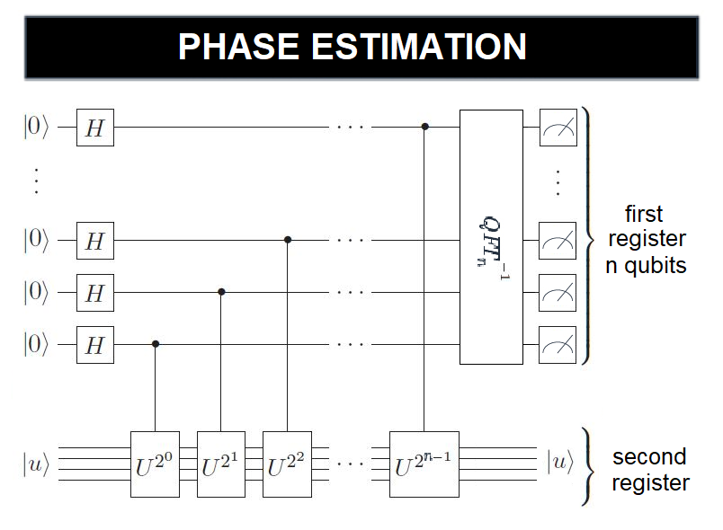

$$
U^{2^{0}},\ U^{2^{1}},\ U^{2^{2}},\ \ldots,\ U^{2^{n-1}}
$$
$$
\mathrm{QFT}^{-1}
$$

# PHASE ESTIMATION

**First register, n qubits** (bracket on the right):

- Top wire: $|0\rangle$ — $H$ — $\cdots$ — control into $U^{2^{n-1}}$ — tall gate labeled $\mathrm{QFT}^{-1}$ (text rotated) — meter.
- Vertical ellipsis.
- Next drawn wire: $|0\rangle$ — $H$ — control into $U^{2^{2}}$ — $\cdots$ — $\mathrm{QFT}^{-1}$ — meter.
- Next: $|0\rangle$ — $H$ — control into $U^{2^{1}}$ — $\cdots$ — $\mathrm{QFT}^{-1}$ — meter.
- Bottom wire of this register: $|0\rangle$ — $H$ — control into $U^{2^{0}}$ — $\cdots$ — $\mathrm{QFT}^{-1}$ — meter.

**Second register:** $|u\rangle$ on several wires through $U^{2^{0}}$, $U^{2^{1}}$, $U^{2^{2}}$, $\cdots$, $U^{2^{n-1}}$, ending at $|u\rangle$.

$$\frac{1}{2^{n/2}}\left(|0\rangle+e^{2\pi i 2^{n-1}\phi}|1\rangle\right)\left(|0\rangle+e^{2\pi i 2^{n-2}\phi}|1\rangle\right)\cdots\left(|0\rangle+e^{2\pi i 2^{0}\phi}|1\rangle\right)=\frac{1}{2^{n/2}}\sum_{k=0}^{2^{n}-1}e^{2\pi i k\phi}|k\rangle$$
$$\frac{1}{2^{n}}\sum_{l=0}^{2^{n}-1}\left[\sum_{k=0}^{2^{n}-1}\left(e^{-\frac{2\pi i l}{2^{n}}}e^{2\pi i\phi}\right)^{k}\right]|l\rangle$$
$$\frac{1}{2^{n}}\sum_{l=0}^{2^{n}-1}\frac{1-e^{2\pi i(2^{n}\phi-l)}}{1-e^{2\pi i(\phi-l/2^{n})}}|l\rangle$$

The first register prior to implementing the inverse quantum Fourier transformation can be expressed as:

$$\frac{1}{2^{n/2}}\left(|0\rangle+e^{2\pi i 2^{n-1}\phi}|1\rangle\right)\left(|0\rangle+e^{2\pi i 2^{n-2}\phi}|1\rangle\right)\cdots\left(|0\rangle+e^{2\pi i 2^{0}\phi}|1\rangle\right)=\frac{1}{2^{n/2}}\sum_{k=0}^{2^{n}-1}e^{2\pi i k\phi}|k\rangle$$

Subsequently, an inverse quantum Fourier transformation is applied on the first register, yielding:

The left-hand side of this next display is a broken narrow-column overlap (symbols of the pre-QFT state and another sum are stacked on top of each other and are not cleanly readable). A readable arrow in that region is labeled $QFT_n^{-1}$ and points toward a factor $1/2^n$, after which the legible right-hand side is

$$\frac{1}{2^{n}}\sum_{l=0}^{2^{n}-1}\left[\sum_{k=0}^{2^{n}-1}\left(e^{-\frac{2\pi i l}{2^{n}}}e^{2\pi i\phi}\right)^{k}\right]|l\rangle$$

$$=\frac{1}{2^{n}}\sum_{l=0}^{2^{n}-1}\frac{1-e^{2\pi i(2^{n}\phi-l)}}{1-e^{2\pi i(\phi-l/2^{n})}}|l\rangle$$

$$\phi=0.\phi_{1}\ldots\phi_{n}$$
$$(2^{n}\phi-l)$$
$$e^{2\pi i\,1.\phi_{n}}=e^{2\pi i(1+0.\phi_{n})}=e^{2\pi i\,0.\phi_{n}}$$
$$l=2^{n}-1$$
$$\hat{U}|u\rangle$$

# Phase estimation (reading)

The sum in the square brackets is a geometric sum and can be simplified. The resultant state contains the estimation of the phase \(\phi\). Suppose \(\phi\) can be expressed with \(n\) bits as \(\phi=0.\phi_{1}\ldots\phi_{n}\). Then, the exponential term \((2^{n}\phi-l)\) can be expressed as \((\phi_{1}\ldots\phi_{n}-l)\) with \(l\) being an integer between \(0\) and \(2^{n}-1\). Note that exponential terms are periodic in \(2\pi i\) thus

$$e^{2\pi i\,1.\phi_{n}}=e^{2\pi i(1+0.\phi_{n})}=e^{2\pi i\,0.\phi_{n}}.$$

The last term \(l=2^{n}-1\) contains all digits of \(\phi\) up to the \(n^{th}\) digit, which determines the precision of the phase estimation protocol.

The phase estimation protocol enables the estimation of the eigenvalue's phase \(\phi\) of a quantum system with an operator \(\hat{U}\) and eigenvector \(|u\rangle\). The output of the measurement of \(n\) qubits estimates the phase \(\phi\) up to a precision \(\propto n\).

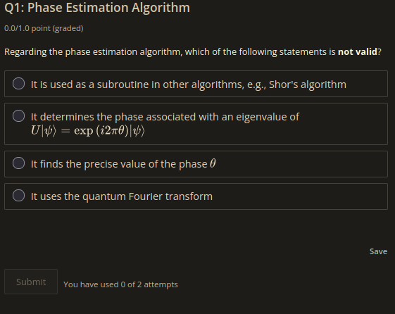

$$U|\psi\rangle=\exp(i 2\pi\theta)|\psi\rangle$$

# Q1: Phase Estimation Algorithm

0.0/1.0 point (graded)

Regarding the phase estimation algorithm, which of the following statements is **not valid**?

- ( ) It is used as a subroutine in other algorithms, e.g., Shor's algorithm
- ( ) It determines the phase associated with an eigenvalue of \(U|\psi\rangle=\exp(i 2\pi\theta)|\psi\rangle\)
- ( ) It finds the precise value of the phase \(\theta\)
- ( ) It uses the quantum Fourier transform

Save. Submit. You have used 0 of 2 attempts.

## **Transcript**

## 

00

00:00:00,000 \--\> 00:00:00,910

1

00:00:00,910 \--\> 00:00:03,310

We have taken H.

2

00:00:03,310 \--\> 00:00:10,630

We have modeled it with some simplified h prime.

3

00:00:10,630 \--\> 00:00:14,170

Then the two pathways the community has taken,

4

00:00:14,170 \--\> 00:00:18,250

which are rather distinct, is first to utilize

5

00:00:18,250 \--\> 00:00:21,730

what you\'ve already learned in this class, which is the phase

6

00:00:21,730 \--\> 00:00:25,220

estimation algorithm.

7

00:00:25,220 \--\> 00:00:29,170

And this will give you the ground state

8

00:00:29,170 \--\> 00:00:32,560

and the energy of the ground state approximately.

9

00:00:32,560 \--\> 00:00:38,170

The second approach does something different

10

00:00:38,170 \--\> 00:00:42,340

and is known as a variational quantum eigensolver.

11

00:00:42,340 \--\> 00:00:45,490

And you will now find the literature replete with people

12

00:00:45,490 \--\> 00:00:48,710

talking about the VQE algorithm.

13

00:00:48,710 \--\> 00:00:50,950

And I want you to know what it is because there\'s

14

00:00:50,950 \--\> 00:00:53,020

a lot of talk about that.

15

00:00:53,020 \--\> 00:00:58,330

And this will give you a state psi,

16

00:00:58,330 \--\> 00:01:01,330

which might be if you\'re lucky close

17

00:01:01,330 \--\> 00:01:05,330

to the ground state, and an energy,

18

<!-- frame 1:02 · diagram · week4/media/media/image37.png -->

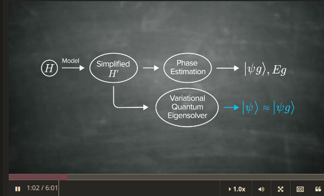

$$H \xrightarrow{\text{Model}} H'$$
$$|\psi g\rangle,\; E_{g}$$
$$|\psi\rangle \approx |\psi g\rangle$$

# Two routes from a simplified Hamiltonian

Flow on the chalkboard:

$$(H) \xrightarrow{\text{Model}} \text{Simplified } H'$$

From simplified \(H'\):

- arrow to Phase Estimation, output \(|\psi g\rangle,\; E_g\)
- arrow to Variational Quantum Eigensolver, output in cyan \(|\psi\rangle \approx |\psi g\rangle\)

00:01:05,330 \--\> 00:01:08,900

which might be if you\'re lucky, the ground state

19

00:01:08,900 \--\> 00:01:12,040

but has a certain guarantee that this energy will

20

00:01:12,040 \--\> 00:01:16,300

be no smaller than the ground state energy

21

00:01:16,300 \--\> 00:01:19,490

that you\'re looking for.

22

00:01:19,490 \--\> 00:01:22,580

So let\'s look at these two different routes one at a time.

23

00:01:22,580 \--\> 00:01:25,710

24

00:01:25,710 \--\> 00:01:30,000

The first approach, phase estimation,

25

00:01:30,000 \--\> 00:01:32,670

is very simple to understand as I described

26

00:01:32,670 \--\> 00:01:37,170

because it is no more than the application of phase

27

00:01:37,170 \--\> 00:01:37,980

estimation.

28

00:01:37,980 \--\> 00:01:41,670

29

00:01:41,670 \--\> 00:01:44,630

We start with registered qubits, where

30

00:01:44,630 \--\> 00:01:47,920

you\'re going to store the eigen energy.

31

00:01:47,920 \--\> 00:01:50,610

So this is determined by the imprecision

32

00:01:50,610 \--\> 00:01:53,040

that you want the number of qubits.

33

00:01:53,040 \--\> 00:01:57,330

You start out also with a state psi, which

34

00:01:57,330 \--\> 00:01:59,890

is some approximation of the ground state,

35

00:01:59,890 \--\> 00:02:01,440

but you don\'t know how good.

36

00:02:01,440 \--\> 00:02:04,560

So it\'s the ground state plus epsilon

37

00:02:04,560 \--\> 00:02:08,280

times some other component, which is

38

00:02:08,280 \--\> 00:02:10,380

orthogonal to the ground state.

39

00:02:10,380 \--\> 00:02:14,020

And allow me that you have prepare this somehow.

40

00:02:14,020 \--\> 00:02:15,300

And you may prepare it badly.

41

00:02:15,300 \--\> 00:02:17,040

That\'s still OK.

42

00:02:17,040 \--\> 00:02:19,590

What you do is you perform\--

43

00:02:19,590 \--\> 00:02:25,690

remember this is going to be some sum over all values k.

44

00:02:25,690 \--\> 00:02:32,250

You perform a controlled h to the k operation over here.

45

00:02:32,250 \--\> 00:02:36,270

This is feasible because I\'ve shown you how to trotterize.

46

00:02:36,270 \--\> 00:02:38,340

But this is really, really painful

47

00:02:38,340 \--\> 00:02:40,050

because you now have to trod right

48

00:02:40,050 \--\> 00:02:43,570

and also trod right to the kth power.

49

00:02:43,570 \--\> 00:02:46,290

So now you have to rerun that \[? troderization ?\]

50

00:02:46,290 \--\> 00:02:53,550

an exponentially large number of a span of energy, for example.

51

00:02:53,550 \--\> 00:02:55,650

But allow me this.

52

00:02:55,650 \--\> 00:03:00,210

And we know from the phase estimation algorithm

53

00:03:00,210 \--\> 00:03:03,120

that what you get as the output of this

54

00:03:03,120 \--\> 00:03:10,810

is going to be a sum over energy eigenstates and then phases,

55

00:03:10,810 \--\> 00:03:18,000

which are on the order of some constant over e sub k.

56

00:03:18,000 \--\> 00:03:22,450

So these are going to give you the energies of the system.

57

00:03:22,450 \--\> 00:03:27,330

This is the top register, and this is the bottom register.

58

00:03:27,330 \--\> 00:03:30,810

And there are some coefficients.

59

00:03:30,810 \--\> 00:03:34,170

And when you measure this top register after the quantum

60

00:03:34,170 \--\> 00:03:38,320

Fourier transform, you collapse into an eigenstate down here.

61

00:03:38,320 \--\> 00:03:41,990

And if your initial overlap is sufficiently large,

62

00:03:41,990 \--\> 00:03:44,580

so epsilon is small, then you get the ground state

63

00:03:44,580 \--\> 00:03:46,060

that you desire.

64

00:03:46,060 \--\> 00:03:50,690

And you will have a measure, which is the energy eigenstate.

65

00:03:50,690 \--\> 00:03:54,500

But by the way, this is exactly Shor\'s algorithm.

66

00:03:54,500 \--\> 00:03:57,410

This is a quantum factoring algorithm also being

67

00:03:57,410 \--\> 00:04:00,820

used for quantum simulation.

68

00:04:00,820 \--\> 00:04:04,630

It\'s actually not accidental that all known exponentially

69

00:04:04,630 \--\> 00:04:07,990

fast algorithms today, quantum algorithms

70

00:04:07,990 \--\> 00:04:11,710

are essentially the structure of Shore\'s factoring algorithm.

71

00:04:11,710 \--\> 00:04:13,390

You put something in superposition.

72

00:04:13,390 \--\> 00:04:15,970

You do control something to a higher power

73

00:04:15,970 \--\> 00:04:17,529

based on the superposition.

74

00:04:17,529 \--\> 00:04:21,209

You do the inverse quantum Fourier transform.

75

00:04:21,209 \--\> 00:04:24,030

So if you know Shore\'s factoring algorithm,

76

00:04:24,030 \--\> 00:04:28,950

you essentially know this whole route to quantum simulation.

77

00:04:28,950 \--\> 00:04:33,480

Why is this challenging?

78

00:04:33,480 \--\> 00:04:35,310

Well, first it\'s good because you

79

<!-- frame 4:34 · diagram · week4/media/media/image33.png -->

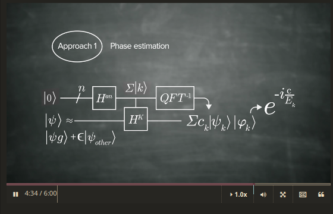

$$|\psi\rangle \approx |\psi g\rangle+\epsilon|\psi_{\mathrm{other}}\rangle$$
$$H^{\otimes n},\quad H^{K},\quad \mathrm{QFT}^{-1}$$
$$\sum_{k} c_{k}|\psi_{k}\rangle|\varphi_{k}\rangle$$
$$e^{-i c/E_{k}}$$

# Approach 1 — Phase estimation

“Approach 1” is circled, next to the label Phase estimation.

Circuit:

- Top register: \(|0\rangle\) with a slash \(n\), then a box \(H^{\otimes n}\), state label \(\sum |k\rangle\), then a box \(\mathrm{QFT}^{-1}\). A vertical line ties this register to the box below.
- Lower register: \(|\psi\rangle \approx |\psi g\rangle + \epsilon |\psi_{\mathrm{other}}\rangle\) enters a box \(H^{K}\) and leaves as \(\sum c_{k}|\psi_{k}\rangle|\varphi_{k}\rangle\).
- A curved arrow from that output points to

$$e^{-i c/E_{k}}$$

00:04:35,310 \--\> 00:04:39,090

get the eigenstate and eigen energy, the ground state,

80

00:04:39,090 \--\> 00:04:40,450

right away.

81

00:04:40,450 \--\> 00:04:47,820

But the challenge is that you need a perfect quantum computer

82

00:04:47,820 \--\> 00:04:50,610

with long coherence times.

83

00:04:50,610 \--\> 00:04:54,420

There\'s a beautiful analysis of the requirements by Matthias

84

00:04:54,420 \--\> 00:04:58,330

Troyer and company from \[INAUDIBLE\] now at Microsoft,

85

00:04:58,330 \--\> 00:05:03,690

where he shows that if one uses this phase estimation approach,

86

00:05:03,690 \--\> 00:05:07,350

one has a chance of simulating nitrogenase exactly what I

87

00:05:07,350 \--\> 00:05:09,960

started today\'s lecture on.

88

00:05:09,960 \--\> 00:05:12,120

If you can run the quantum computer

89

00:05:12,120 \--\> 00:05:17,370

for about a day with a relatively fast clock cycle

90

00:05:17,370 \--\> 00:05:19,920

as well, the longest coherence time

91

00:05:19,920 \--\> 00:05:25,380

we have for many of our quantum bits like in superconductors

92

00:05:25,380 \--\> 00:05:27,440

is on the order of a millisecond.

93

00:05:27,440 \--\> 00:05:31,540

And for ions, it\'s perhaps tens of seconds.

94

00:05:31,540 \--\> 00:05:34,440

So a day\'s a bit of a stretch right now.

95

00:05:34,440 \--\> 00:05:37,590

And this might need something on the order of a million qubits

96

00:05:37,590 \--\> 00:05:42,000

as well, whereas in our actual deliverable common computers,

97

00:05:42,000 \--\> 00:05:45,630

companies are talking about maybe 50 qubits today.

98

00:05:45,630 \--\> 00:05:47,640

So that gives you an idea of the gap

99

00:05:47,640 \--\> 00:05:52,170

between the ideal system needed and that

100

00:05:52,170 \--\> 00:05:54,950

which is actually available.

101

00:05:54,950 \--\> 00:05:59,403

## **PRACTICE (1 QUESTION)**

## 
  

Section: Quantum simulation: Chemistry

# Page Title: Variational Quantum Eigensolver

# **Learn**

Phase estimation determines the eigenenergies of a quantum system up to
a specified accuracy. However, stringent requirements on the quantum
processor\'s performance, such as the available coherence time, limits
the current applicability of this method as high accuracy requires long
quantum circuits with many gates (=high gate depth). In contrast,
quantum optimizers such as the variational quantum eigensolver (VQE)
have more relaxed requirements on the quantum processor performance and
work with shorter quantum circuits (= \"shallow depth\") that contain
parameterized, analog elements.

A VQE uses an iterative hybrid approach to calculate the ground-state
energy of a problem-specific Hamiltonian by creating a trial wave
function on a quantum processor and measuring its energy with respect to
the desired Hamiltonian. The trial wave function is made using a quantum
circuit based on multi-qubit and single-qubit gates that contains
tunable parameters and which are optimized using a classical computer
working in tandem with the quantum processor. An optimization loop
repeatedly alters between quantum and classical processing until the
optimal parameter set has been found, which generates the minimum energy
corresponding to the ground state wave function.
## **Images**

$$
\Psi(\alpha)
$$
$$
\langle\Psi(\alpha)|H|\Psi(\alpha)\rangle
$$
$$
\langle H\rangle
$$
$$
E\to E_0
$$
$$
\mathrm{H}_2,\ \mathrm{LiH},\ \mathrm{BeH}_2,\ \mathrm{He}\text{-}\mathrm{H}^{+}
$$

# VQE protocol

As explained in the video, the VQE protocol is initiated with a trial wave function $\Psi(\alpha)$ on a quantum computer. Here, $\alpha$ is the tuning parameter that will successively get optimized to yield the minimum energy. The quantum processor evaluates the expectation value of the trial wave function, $\langle\Psi(\alpha)|H|\Psi(\alpha)\rangle$, where $H$ represents the problem-specific Hamiltonian and $\langle H\rangle$ corresponds to the energy of the prepared wave function with respect to the Hamiltonian. Generally, this requires repeated runs for the same parameter set, not just to obtain enough statistics but also to measure in all the different measurement bases specified in the Hamiltonian (a process often referred to as Hamiltonian averaging). A classical optimizer is then used to minimize the expectation value (energy) by varying the trial wave function through the parameter $\alpha$ and the process repeats until $E$ converges to a steady state close or equal to the ground state energy $E_0$.

Early demonstrations of VQEs using superconducting qubits simulated the ground-state energies for a hydrogen molecule H$_2$, lithium hydride LiH and beryllium hydride BeH$_2$ molecule. A demonstration using trapped ion qubits also used VQE to simulate a hydrogen molecule H$_2$ and lithium hydride LiH. And, photonic qubits have been used to find the ground-state energy of a He-H$^+$ molecule.

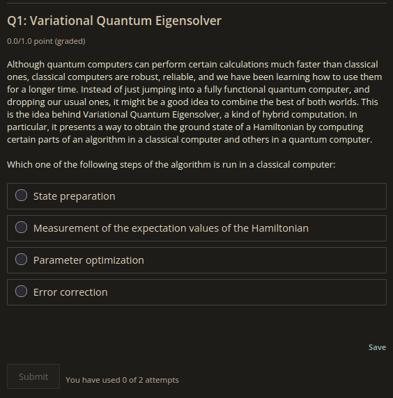

# Q1: Variational Quantum Eigensolver

0.0/1.0 point (graded)

Although quantum computers can perform certain calculations much faster than classical ones, classical computers are robust, reliable, and we have been learning how to use them for a longer time. Instead of just jumping into a fully functional quantum computer, and dropping our usual ones, it might be a good idea to combine the best of both worlds. This is the idea behind Variational Quantum Eigensolver, a kind of hybrid computation. In particular, it presents a way to obtain the ground state of a Hamiltonian by computing certain parts of an algorithm in a classical computer and others in a quantum computer.

Which one of the following steps of the algorithm is run in a classical computer:

- ( ) State preparation
- ( ) Measurement of the expectation values of the Hamiltonian
- ( ) Parameter optimization
- ( ) Error correction

Save

Submit. You have used 0 of 2 attempts.

## **Transcript**

## 

00

00:00:00,000 \--\> 00:00:00,860

1

00:00:00,860 \--\> 00:00:03,260

So now we come to the second approach.

2

00:00:03,260 \--\> 00:00:07,220

The point of this second approach, VQE,

3

00:00:07,220 \--\> 00:00:12,530

is to get by with a much poorer, worse quantum computer

4

00:00:12,530 \--\> 00:00:16,280

by not asking for quite as much, and you\'ll

5

00:00:16,280 \--\> 00:00:22,570

see how that works by my describing the algorithm.

6

00:00:22,570 \--\> 00:00:24,400

The point of this argument is to rely

7

00:00:24,400 \--\> 00:00:29,780

upon the variational principle, which in this context

8

00:00:29,780 \--\> 00:00:33,220

says that if I\'m given some state, psi, which is not

9

00:00:33,220 \--\> 00:00:36,310

the ground state, and I measure the expectation

10

00:00:36,310 \--\> 00:00:39,940

value of the Hamiltonian, this full total Hamiltonian

11

00:00:39,940 \--\> 00:00:44,590

with respect to that state, I will get some expectation value

12

00:00:44,590 \--\> 00:00:50,260

average energy, which is no smaller than the energy

13

00:00:50,260 \--\> 00:00:53,540

of the ground state.

14

00:00:53,540 \--\> 00:00:56,290

So therefore, I might do something like introduce

15

00:00:56,290 \--\> 00:00:59,340

a bunch of parameters here.

16

00:00:59,340 \--\> 00:01:01,120

Let\'s call these theta.

17

00:01:01,120 \--\> 00:01:04,599

So theta 1, theta 2, theta 3, and say

18

00:01:04,599 \--\> 00:01:08,380

I use the thetas to manipulate the degrees of freedom I

19

00:01:08,380 \--\> 00:01:11,860

have in the input state to this expectation value.

20

00:01:11,860 \--\> 00:01:14,990

21

00:01:14,990 \--\> 00:01:19,700

Then again, it will also be no smaller than that.

22

00:01:19,700 \--\> 00:01:25,420

So I might define this thing as an expectation value of H

23

<!-- frame 1:23 · formula · week4/media/media/image42.png -->

$$\langle\psi|H|\psi\rangle \ge \langle\psi_{g}|H|\psi_{g}\rangle$$
$$\langle\psi(\vec{\theta})|H|(\vec{\theta})\psi\rangle \ge ''$$
$$\equiv \langle H\rangle(\vec{\theta})$$

# Variational Quantum Eigensolver

Variational Principle. An arrow labels the right-hand side “ground state”.

$$\langle\psi|H|\psi\rangle \ge \langle\psi_{g}|H|\psi_{g}\rangle$$

$$\langle\psi(\vec{\theta})|H|(\vec{\theta})\psi\rangle \ge \;''$$

in cyan:

$$\equiv \langle H\rangle(\vec{\theta})$$

00:01:25,420 \--\> 00:01:28,310

parameterized by some thetas.

24

00:01:28,310 \--\> 00:01:31,260

You can do this on a classical computer,

25

00:01:31,260 \--\> 00:01:33,920

but the hardest part about the classical computation

26

00:01:33,920 \--\> 00:01:38,240

is preparing this state and then computing this matrix element

27

00:01:38,240 \--\> 00:01:40,520

of H with that state.

28

00:01:40,520 \--\> 00:01:44,450

And the VQE algorithm proposes to do those two

29

00:01:44,450 \--\> 00:01:47,220

steps on a quantum computer.

30

00:01:47,220 \--\> 00:01:50,900

And the rest, it does with a classical computer.

31

00:01:50,900 \--\> 00:01:53,245

So here are the steps.

32

00:01:53,245 \--\> 00:01:59,010

Prepare psi of theta, where theta

33

00:01:59,010 \--\> 00:02:02,900

it is controlled by a classical algorithm,

34

00:02:02,900 \--\> 00:02:06,150

and this is done on a quantum computer.

35

00:02:06,150 \--\> 00:02:11,170

easure this H of theta, and there are many ways

36

00:02:11,170 \--\> 00:02:12,760

of doing this measurement.

37

00:02:12,760 \--\> 00:02:14,750

One of which I will describe in a moment,

38

00:02:14,750 \--\> 00:02:20,680

if we have time on a quantum computer.

39

00:02:20,680 \--\> 00:02:23,770

And then third, take this classical measurement result

40

00:02:23,770 \--\> 00:02:29,504

that you now have, and run a optimization algorithm.

41

00:02:29,504 \--\> 00:02:32,230

42

00:02:32,230 \--\> 00:02:37,200

For example, the Nelder-Mead simplex algorithm,

43

00:02:37,200 \--\> 00:02:39,930

or stochastic gradient descent, or you

44

00:02:39,930 \--\> 00:02:43,740

choose your favorite optimization algorithm,

45

00:02:43,740 \--\> 00:02:53,670

changing theta to minimize each of theta.

46

00:02:53,670 \--\> 00:02:58,180

47

00:02:58,180 \--\> 00:03:00,900

And go back to the beginning, and this is

48

<!-- frame 3:00 · slide · week4/media/media/image28.png -->

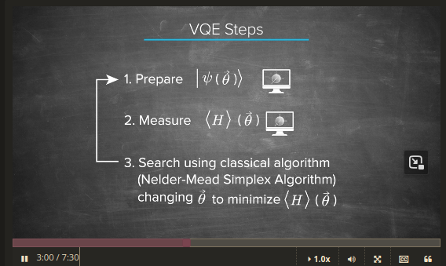

$$|\psi(\vec{\theta})\rangle$$
$$\langle H \rangle(\vec{\theta})$$

# VQE Steps

A bracket on the left loops step 3 back to step 1.

1. Prepare \(|\psi(\vec{\theta})\rangle\) (computer icon)
2. Measure \(\langle H \rangle(\vec{\theta})\) (computer icon)
3. Search using classical algorithm (Nelder-Mead Simplex Algorithm) changing \(\vec{\theta}\) to minimize \(\langle H \rangle(\vec{\theta})\)

00:03:00,900 \--\> 00:03:05,520

done on a classical computer.

49

00:03:05,520 \--\> 00:03:07,290

So now we have a hybrid, where we

50

00:03:07,290 \--\> 00:03:10,170

have a quantum computer executing some steps,

51

00:03:10,170 \--\> 00:03:14,050

and a classical computer executing some other steps.

52

00:03:14,050 \--\> 00:03:16,950

And in fact, you can show that this kind

53

00:03:16,950 \--\> 00:03:18,840

of a variational expectation value

54

00:03:18,840 \--\> 00:03:23,040

is true even if you have a natty density matrix here, instead

55

00:03:23,040 \--\> 00:03:24,880

of a pure state.

56

00:03:24,880 \--\> 00:03:29,490

So if your quantum computer starts to devolve and go not

57

00:03:29,490 \--\> 00:03:32,130

so quantum on you half way through,

58

00:03:32,130 \--\> 00:03:35,070

it still cannot give you an expectation value that\'s better

59

00:03:35,070 \--\> 00:03:37,130

than the ground state.

60

00:03:37,130 \--\> 00:03:40,250

And there are various versions of these sets of theorems,

61

00:03:40,250 \--\> 00:03:43,730

which apply to variances in other quantities

62

00:03:43,730 \--\> 00:03:45,550

that you might want to measure.

63

00:03:45,550 \--\> 00:03:49,100

And so, one can try to assert, although it\'s largely

64

00:03:49,100 \--\> 00:03:52,790

done without proof today, that this argument will still

65

00:03:52,790 \--\> 00:03:58,310

work reasonably OK on a noisy quantum computer with not so

66

00:03:58,310 \--\> 00:03:59,750

good quantum bits.

67

00:03:59,750 \--\> 00:04:03,110

And therefore, companies can deliver to you a product which

68

00:04:03,110 \--\> 00:04:08,030

is a quantum computer with poor quantum bits,

69

00:04:08,030 \--\> 00:04:10,610

and still expect you to pay a lot of money

70

00:04:10,610 \--\> 00:04:12,500

for it because it could run this algorithm

71

00:04:12,500 \--\> 00:04:15,590

and give you some result. There are not many proofs

72

00:04:15,590 \--\> 00:04:19,010

that it will do so, but it is a very compelling argument

73

00:04:19,010 \--\> 00:04:21,060

and a very interesting direction.

74

00:04:21,060 \--\> 00:04:22,700

And there are now experimental results

75

00:04:22,700 \--\> 00:04:26,210

showing small one and two gigabit quantum computers

76

00:04:26,210 \--\> 00:04:29,660

doing exactly these steps, the variational quantum

77

00:04:29,660 \--\> 00:04:31,190

eigensolver.

78

00:04:31,190 \--\> 00:04:35,650

So the challenge of this, there are two,

79

00:04:35,650 \--\> 00:04:37,820

I would point out most.

80

00:04:37,820 \--\> 00:04:42,815

First, does this expectation value converge?

81

00:04:42,815 \--\> 00:04:45,530

82

00:04:45,530 \--\> 00:04:48,680

You have to rely upon this classical optimization

83

00:04:48,680 \--\> 00:04:51,530

algorithm to get you better and better values.

84

00:04:51,530 \--\> 00:04:53,390

But you don\'t have a proof that you actually

85

00:04:53,390 \--\> 00:04:57,440

got the lowest possible value, or the desired ground state.

86

00:04:57,440 \--\> 00:05:01,280

Second, this state preparation.

87

00:05:01,280 \--\> 00:05:04,620

It\'s unclear how this state is actually prepared.

88

00:05:04,620 \--\> 00:05:06,980

There are some ideas of how to prepare this.

89

00:05:06,980 \--\> 00:05:09,600

90

00:05:09,600 \--\> 00:05:14,280

For example, with adiabatic quantum computation.

91

00:05:14,280 \--\> 00:05:16,460

You start with a beginning Hamiltonian,

92

00:05:16,460 \--\> 00:05:20,420

which you can create, and try to construct an end

93

00:05:20,420 \--\> 00:05:23,045

Hamiltonian whose ground state is this state that you

94

00:05:23,045 \--\> 00:05:24,890

want to create.

95

00:05:24,890 \--\> 00:05:28,940

And since you have this parametrized in principle,

96

00:05:28,940 \--\> 00:05:31,850

you have some means by which you can do that.

97

00:05:31,850 \--\> 00:05:34,950

This parameter, by the way, could be things, for example,

98

00:05:34,950 \--\> 00:05:39,350

like the adiabatic path that you use in the quantum computer.

99

00:05:39,350 \--\> 00:05:40,060

OK.

100

00:05:40,060 \--\> 00:05:49,420

And related to this first challenge is how you measure H.

101

00:05:49,420 \--\> 00:05:52,660

And one way people have done this

102

00:05:52,660 \--\> 00:05:54,700

is to measure the terms of H.

103

00:05:54,700 \--\> 00:05:57,370

So you can say this is actually equal

104

<!-- frame 5:57 · slide · week4/media/media/image14.png -->

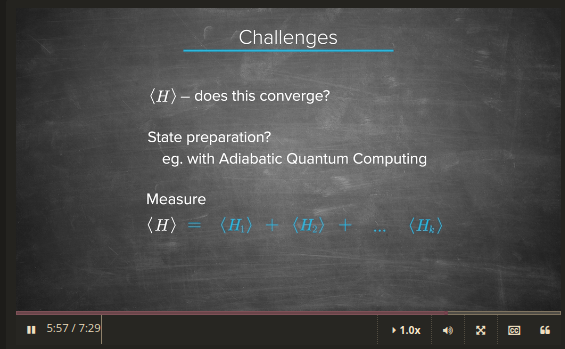

$$\langle H \rangle = \langle H_1 \rangle + \langle H_2 \rangle + \cdots \langle H_k \rangle$$

# Challenges

\(\langle H \rangle\) – does this converge?

State preparation?
eg. with Adiabatic Quantum Computing

**Measure**

$$\langle H \rangle = \langle H_1 \rangle + \langle H_2 \rangle + \cdots \langle H_k \rangle$$

00:05:57,370 \--\> 00:06:03,316

to the average expectation value of H1 plus plus H2,

105

00:06:03,316 \--\> 00:06:08,360

plus all the way up to however many terms there are in here.

106

00:06:08,360 \--\> 00:06:11,080

So you can measure, in principle, the expectation

107

00:06:11,080 \--\> 00:06:13,570

value turn by turn in the Hamiltonian.

108

00:06:13,570 \--\> 00:06:16,810

And if the Hamiltonian terms are simple, like polymatrices,

109

00:06:16,810 \--\> 00:06:19,090

then you have a feasible way of doing it.

110

00:06:19,090 \--\> 00:06:22,330

Unfortunately, that means that you also now added the error

111

00:06:22,330 \--\> 00:06:24,640

from each one of these expectation values,

112

00:06:24,640 \--\> 00:06:27,280

and so the error can grow very, very rapidly as you\'re

113

00:06:27,280 \--\> 00:06:31,630

trying to estimate the expectation value this way.

114

00:06:31,630 \--\> 00:06:35,840

Still, the variational quantum eigensolver is different.

115

00:06:35,840 \--\> 00:06:38,140

We haven\'t looked at any kind of algoritm

116

00:06:38,140 \--\> 00:06:41,080

like that in class in this semester.

117

00:06:41,080 \--\> 00:06:43,240

How do you utilize a system which

118

00:06:43,240 \--\> 00:06:45,850

has a quantum computer and a classical computer

119

00:06:45,850 \--\> 00:06:49,960

together, so that you can get something of the best of both

120

00:06:49,960 \--\> 00:06:51,410

of the systems?

121

00:06:51,410 \--\> 00:06:55,480

How can you make them work in concert, so that one hands off

122

00:06:55,480 \--\> 00:06:57,610

information to the other one so that now you

123

00:06:57,610 \--\> 00:07:01,510

can feedback, and try to speed up,

124

00:07:01,510 \--\> 00:07:06,430

while only have a limited amount of quantum coherence

125

00:07:06,430 \--\> 00:07:10,250

and a limited number of qubits at your disposal?

126

00:07:10,250 \--\> 00:07:12,310

I think this is a fascinating topic.

127

00:07:12,310 \--\> 00:07:15,702

I want to leave you with that challenge,

128

00:07:15,702 \--\> 00:07:18,160

and I want to also leave you with the challenge of thinking

129

00:07:18,160 \--\> 00:07:21,590

about how you can relate Hamiltonians and quantum

130

00:07:21,590 \--\> 00:07:23,740

algorithms.

131

00:07:23,740 \--\> 00:07:29,672

## **PRACTICE (1 question)**

## 
 

Section: Case Study: VQE i in practice

# Page Title: VQE in practice

# **Learn**

## **Images**

## **Transcript**

## 

00

00:00:00,000 \--\> 00:00:00,500

1

00:00:00,500 \--\> 00:00:01,970

Let\'s start with the energy graph

2

00:00:01,970 \--\> 00:00:04,000

of a simple diatomic molecule.

3

00:00:04,000 \--\> 00:00:06,280

When the atoms are close too each other,

4

00:00:06,280 \--\> 00:00:08,230

the repulsion between the individual nuclei

5

00:00:08,230 \--\> 00:00:10,240

dominates the energy of the system

6

00:00:10,240 \--\> 00:00:12,520

and leads to an unstable configuration.

7

00:00:12,520 \--\> 00:00:14,680

At the other extreme is the case when

8

00:00:14,680 \--\> 00:00:17,470

the two atoms are dissociated.

9

00:00:17,470 \--\> 00:00:19,630

The point of minimum energy, though,

10

<!-- frame 0:20 · diagram · week4/media/media/image21.png -->

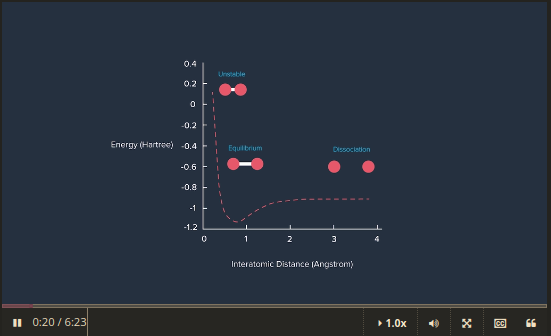

# Diatomic potential-energy curve

**Energy (Hartree)** vs **Interatomic Distance (Angstrom)**.

- Vertical ticks from 0.4 down to −1.2
- Horizontal ticks 0, 1, 2, 3, 4
- Dashed curve: high at very small separation, a well near roughly 0.7 Å (about −1.15 Hartree), then a flat dissociation limit near −0.95 Hartree

Three labeled configurations of a pair of pink atoms:
- **Unstable** — atoms close together, high on the curve (near +0.2)
- **Equilibrium** — atoms at a short bond, near the well
- **Dissociation** — atoms far apart, on the flat part of the curve

00:00:19,630 \--\> 00:00:21,250

is the equilibrium configuration,

11

00:00:21,250 \--\> 00:00:24,070

when the atoms are separated by the bond distance.

12

00:00:24,070 \--\> 00:00:26,230

Evaluating these energies to high accuracy

13

00:00:26,230 \--\> 00:00:29,500

is extremely crucial for accurately predicting

14

00:00:29,500 \--\> 00:00:31,300

chemical reaction rates and pathways

15

00:00:31,300 \--\> 00:00:33,757

and developing insights into molecular structure.

16

00:00:33,757 \--\> 00:00:35,590

The evaluation of these energies essentially

17

00:00:35,590 \--\> 00:00:38,530

comes down to solving the Schrodinger equation,

18

00:00:38,530 \--\> 00:00:40,720

with the following electronic Hamiltonian, which

19

00:00:40,720 \--\> 00:00:43,300

captures the electronic kinetic energies and the Coulomb

20

00:00:43,300 \--\> 00:00:45,970

interaction between pairs of electrons and nuclei,

21

<!-- frame 0:44 · formula · week4/media/media/image12.png -->

$$
H_e=-\sum_{i=1}^{N}\frac{1}{2}\nabla_i^{2}-\sum_{i=1}^{N}\sum_{A=1}^{M}\frac{Z_A}{r_{iA}}+\sum_{j>i}\frac{1}{r_{ij}}
$$
$$
H|\psi_G\rangle=E_G|\psi_G\rangle
$$

# Electronic Structure Problem

$$H_e=-\sum_{i=1}^{N}\frac{1}{2}\nabla_i^{2}-\sum_{i=1}^{N}\sum_{A=1}^{M}\frac{Z_A}{r_{iA}}+\sum_{j>i}\frac{1}{r_{ij}}$$

The electron–nucleus double sum (middle term) is highlighted in a blue box. The kinetic sum and the $j>i$ repulsion sum are outside that box.

$$H|\psi_G\rangle=E_G|\psi_G\rangle$$

A small copy/expand icon sits at the lower right of the slide.

00:00:45,970 \--\> 00:00:48,170

as well as pairs of electrons.

22

00:00:48,170 \--\> 00:00:52,360

However, this eigenvalue problem is one with exponential cost

23

00:00:52,360 \--\> 00:00:54,790

when addressed by classical computation.

24

00:00:54,790 \--\> 00:00:56,980

And this was indeed one of the initial motivations

25

00:00:56,980 \--\> 00:00:59,410

for quantum computers, the idea that one

26

00:00:59,410 \--\> 00:01:02,380

could use a highly controllable programmable quantum

27

00:01:02,380 \--\> 00:01:05,770

processor to efficiently study and predict the properties

28

00:01:05,770 \--\> 00:01:07,600

of quantum systems of interest.

29

00:01:07,600 \--\> 00:01:09,370

The first step of such simulations,

30

00:01:09,370 \--\> 00:01:12,100

then, involves encoding the problem to the quantum

31

00:01:12,100 \--\> 00:01:15,850

processor, in our specific case, mapping the electronic orbitals

32

00:01:15,850 \--\> 00:01:17,560

onto qubits.

33

00:01:17,560 \--\> 00:01:20,380

One then needs an algorithm that solves the eigenvalue problem

34

00:01:20,380 \--\> 00:01:22,870

to evaluate the ground state energy.

35

00:01:22,870 \--\> 00:01:26,330

In this context, hybrid quantum classical algorithms with

36

00:01:26,330 \--\> 00:01:28,930

\[? shocked-up ?\] circuits, such as the variational quantum

37

00:01:28,930 \--\> 00:01:32,170

eigensolver, are well-suited to the capabilities of existing

38

00:01:32,170 \--\> 00:01:33,860

hardware.

39

00:01:33,860 \--\> 00:01:36,010

Here, the trials, or guesses, to the ground state

40

00:01:36,010 \--\> 00:01:39,070

are prepared on the quantum processor, parametrized

41

00:01:39,070 \--\> 00:01:41,920

by some experimental controls \[INAUDIBLE\]..

42

00:01:41,920 \--\> 00:01:44,540

The energy of these states is then measured and fed

43

00:01:44,540 \--\> 00:01:48,040

to an optimization routine run on a classical computer that

44

00:01:48,040 \--\> 00:01:51,310

updates these parameters to attempt a new trial state.

45

00:01:51,310 \--\> 00:01:52,840

And this is now run its iteratively,

46

00:01:52,840 \--\> 00:01:56,990

till the energy converges towards its minimum value.

47

00:01:56,990 \--\> 00:01:58,810

This raises three important questions

48

00:01:58,810 \--\> 00:02:00,940

for implementing this algorithm.

49

00:02:00,940 \--\> 00:02:02,650

Are there encoding schemes that are

50

00:02:02,650 \--\> 00:02:05,688

efficient towards the number of qubits required?

51

00:02:05,688 \--\> 00:02:08,229

Are there trials states that are efficient towards the number

52

00:02:08,229 \--\> 00:02:11,200

of gates required while faithfully representing

53

00:02:11,200 \--\> 00:02:13,220

the ground state of the molecule?

54

00:02:13,220 \--\> 00:02:14,890

This is important since this can help

55

00:02:14,890 \--\> 00:02:18,790

reduce the effect of decoherence during the state preparation.

56

00:02:18,790 \--\> 00:02:21,850

Finally, are there classical optimization routines

57

00:02:21,850 \--\> 00:02:23,830

that can effectively deal with the large number

58

00:02:23,830 \--\> 00:02:27,020

of \[? variational ?\] parameters and experimental lines?

59

00:02:27,020 \--\> 00:02:28,570

These were all important components

60

00:02:28,570 \--\> 00:02:30,490

of a recent experiment at IBM.

61

00:02:30,490 \--\> 00:02:32,470

Taking advantage of natural symmetries

62

00:02:32,470 \--\> 00:02:34,420

in the molecular Hamiltonian, we were

63

00:02:34,420 \--\> 00:02:37,210

able to encode eight orbitals of beryllium hydride

64

00:02:37,210 \--\> 00:02:39,530

onto a reduced number of 6 qubits

65

<!-- frame 2:39 · diagram · week4/media/media/image18.png -->

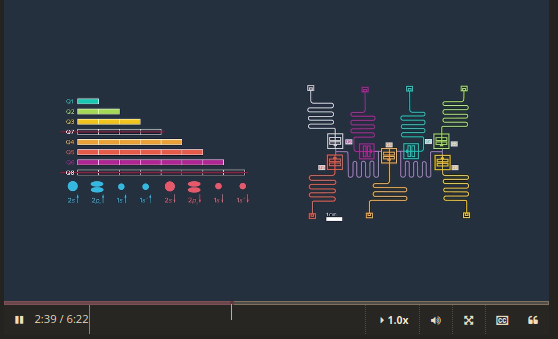

# Qubit bars, orbitals, and a colored pulse/circuit diagram

Left: horizontal segmented bars, longest at the bottom, labeled top to bottom **Q1** (cyan), **Q2** (green), **Q3** (yellow), **Q7** (hollow/white, red mark at the left end), **Q4** (orange), **Q5** (red), **Q6** (magenta), **Q8** (long hollow/white bar, red mark at the left end).

Under the bars, eight orbital cartoons, spin up in cyan then spin down in pink:

| | | | | | | | |
| --- | --- | --- | --- | --- | --- | --- | --- |
| 2s↑ | 2p↑ | 1s↑ | 1s↑ | 2s↓ | 2p↓ | 1s↓ | 1s↓ |

(spheres for s orbitals; dumbbells for 2p)

Right: matching colored wires (white/gray, magenta, cyan, green, red, orange, yellow) with coiled single-qubit drives and boxed two-qubit interactions. A small scale bar is labeled **1 ns**.

00:02:39,530 \--\> 00:02:41,230

at no loss of information.

66

00:02:41,230 \--\> 00:02:43,540

Also, we constructed trial states

67

00:02:43,540 \--\> 00:02:46,630

that used layers of untangling gates that are naturally

68

00:02:46,630 \--\> 00:02:49,270

accessible to the experimental hardware, which are then

69

00:02:49,270 \--\> 00:02:52,180

interleaved with arbitrary Euler rotations.

70

00:02:52,180 \--\> 00:02:54,700

The circuit dept or the number of entangling layers

71

00:02:54,700 \--\> 00:02:56,890

is then set based on the available quantum

72

00:02:56,890 \--\> 00:02:58,490

coherence of the hardware.

73

00:02:58,490 \--\> 00:03:00,780

Making efficient use of coherence time and qubit

74

<!-- frame 3:00 · diagram · week4/media/media/image24.png -->

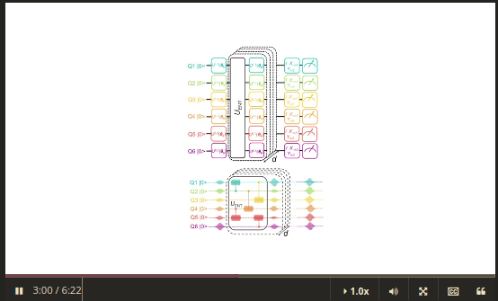

# Hardware-efficient ansatz circuits (6 qubits)

Both diagrams use qubits **Q1–Q6**, each starting in \(|0\rangle\), colored cyan, green, yellow, orange, red, magenta. A dashed repeat bracket is marked \(d\).

### Top
On each qubit: a single-qubit box that reads as \(U^{Y}(\theta)\), then a tall block labeled **\(U_{\mathrm{ENT}}\)** , then another \(U^{Y}(\theta)\), then a measurement box listing the Pauli bases **X, Y, Z**, then a small sketch of an expectation-value curve.

### Bottom
Same six qubits and a dashed depth-\(d\) bracket. Inside **\(U_{\mathrm{ENT}}\)** the entangler is drawn as colored two-qubit blocks with vertical links; diamond-shaped single-qubit pulses sit on the wires before and after the block.

00:03:00,780 \--\> 00:03:03,970

resources, these states are dubbed hardware-efficient trial

75

00:03:03,970 \--\> 00:03:05,080

states.

76

00:03:05,080 \--\> 00:03:07,300

Using such trial states, we were able to perform

77

00:03:07,300 \--\> 00:03:10,870

energy minimizations of up to 6-qubit Hamiltonians.

78

00:03:10,870 \--\> 00:03:12,790

Here is one such example.

79

<!-- frame 3:13 · diagram · week4/media/media/image30.png -->

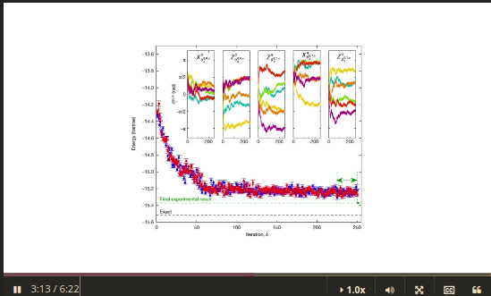

# VQE energy vs iteration, with parameter insets

**Energy (Hartree)** vs **Iteration, \(k\)** (about 0 to 250).

- Red and blue points with error bars start near −14.2 Hartree and fall toward about −15.25 by the right edge.
- Visible energy ticks run from about −14.2 down through −15.6.
- A green dashed horizontal line is labeled **Final experimental result** (near −15.4).
- A gray dashed horizontal line below it is labeled **Exact**.
- A green double-headed arrow on the right marks a small vertical gap around the converged points (near −15.2).

Five inset panels along the top show several colored traces versus iteration. Their vertical axes are marked in units of \(\pi\) (about \(\pi\) down to \(-\pi\)). The inset titles are small; they appear to be Pauli-like labels with superscripts 1 or 2 (reading approximately \(X^2\), \(Z^2\), \(Z^1\), \(X^2\), \(Z^2\)) and qubit subscripts that are not fully legible.

00:03:12,790 \--\> 00:03:14,710

In the classical optimization routine,

80

00:03:14,710 \--\> 00:03:18,040

13 Euler angles, which serve as the variation of parameters,

81

00:03:18,040 \--\> 00:03:21,120

are simultaneously updated as the local reading

82

00:03:21,120 \--\> 00:03:24,190

is approximated using solely two energy measurements

83

00:03:24,190 \--\> 00:03:26,580

by iteration, shown here in red and blue.

84

00:03:26,580 \--\> 00:03:29,570

The iterations are stopped once the energy flattens out

85

00:03:29,570 \--\> 00:03:31,030

towards its minimum.

86

00:03:31,030 \--\> 00:03:33,670

Using these techniques, we were able to address

87

00:03:33,670 \--\> 00:03:35,830

different electronic structure problems of fairly

88

00:03:35,830 \--\> 00:03:39,560

elementary molecules using 2 qubits for hydrogen,

89

00:03:39,560 \--\> 00:03:42,460

4 qubits for lithium hydride, and 6 qubits for beryllium

90

00:03:42,460 \--\> 00:03:43,554

hydride.

91

00:03:43,554 \--\> 00:03:45,220

These are problems that are small enough

92

00:03:45,220 \--\> 00:03:47,180

to solve even on a laptop.

93

00:03:47,180 \--\> 00:03:49,690

However, a big motivation for this work

94

00:03:49,690 \--\> 00:03:52,420

is to be able to understand the sources of error

95

00:03:52,420 \--\> 00:03:54,220

and when addresses these problems using

96

00:03:54,220 \--\> 00:03:56,470

the normal paradigm of computing,

97

00:03:56,470 \--\> 00:03:58,370

using real quantum hardware.

98

00:03:58,370 \--\> 00:04:00,850

And by comparing the experimental results, shown

99

00:04:00,850 \--\> 00:04:03,190

in these black dots with numerical simulations

100

00:04:03,190 \--\> 00:04:05,690

of the noisy device, we see the decoherence

101

00:04:05,690 \--\> 00:04:07,570

at insufficient circuit depth are

102

00:04:07,570 \--\> 00:04:09,850

some of the important sources of error.

103

<!-- frame 4:10 · diagram · week4/media/media/image16.png -->

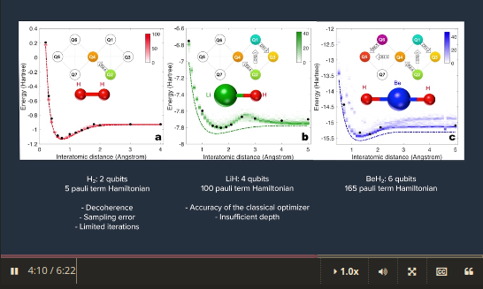

# Molecular energy curves (H₂, LiH, BeH₂)

Three side-by-side plots of **Energy (Hartree)** vs **Interatomic distance (Angstrom)**, each with an inset qubit-connectivity diagram (colored nodes labeled Q0, Q1, …) and a color scale. Black points and a dashed fit are overlaid on colored experimental/sampled points. Video frame.

### a — H₂
Red curve and points. Vertical axis roughly 0.4 to −1.2 Hartree; the curve falls to a minimum near −1.15 then rises toward about −0.95. Color scale about 100 to 0. Ball-and-stick **H–H**.

Caption:
- H₂: 2 qubits
- 5 pauli term Hamiltonian
- Decoherence
- Sampling error
- Limited iterations

### b — LiH
Green curve and points. Vertical axis roughly −6.6 to −7.8 Hartree. Color scale about 40 to 0. Ball-and-stick **Li–H** (large green Li, red H).

Caption:
- LiH: 4 qubits
- 100 pauli term Hamiltonian
- Accuracy of the classical optimizer
- Insufficient depth

### c — BeH₂
Blue curve and dense scatter. Vertical axis roughly −12 to −15.5 Hartree; the curve drops and flattens near −15.4. Color scale about 40 to 0. Ball-and-stick **H–Be–H** (red H, blue Be, red H).

Caption:
- BeH₂: 6 qubits
- 165 pauli term Hamiltonian

00:04:09,850 \--\> 00:04:12,820

So now this raises the question, in the absence of quantum error

104

00:04:12,820 \--\> 00:04:15,700

correction, is there a way to do something meaningful with

105

00:04:15,700 \--\> 00:04:17,079

\[? near-term ?\] hardware?

106

00:04:17,079 \--\> 00:04:18,640

Is it possible to obtain estimates

107

00:04:18,640 \--\> 00:04:22,420

for, say, these energies in the absence of incoherent noise,

108

00:04:22,420 \--\> 00:04:24,820

despite using a noisy quantum processor?

109

00:04:24,820 \--\> 00:04:25,920

Turns out there is\--

110

00:04:25,920 \--\> 00:04:28,270

with metals that we call error mitigation.

111

00:04:28,270 \--\> 00:04:29,764

If there is an easy way to amplify

112

<!-- frame 4:29 · diagram · week4/media/media/image10.png -->

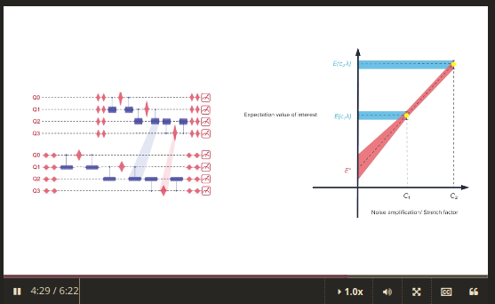

$$
E(c_2,\lambda),\quad E(c_1,\lambda),\quad E^{*}
$$

# Noise amplification / stretch factor

**Left:** two 4-qubit sketches, each with wires Q0, Q1, Q2, Q3. Red diamonds and blue square gates sit on the wires; small red crossed markers sit at the right ends. A translucent blue wedge and a pink wedge highlight part of each sketch. The lower sketch is a shifted copy of the upper one.

**Right:** plot. Vertical axis: “Expectation value of interest.” Horizontal axis: “Noise amplification/ Stretch factor,” ticks $C_1$ and $C_2$. Two horizontal blue bands are labeled $E(c_2,\lambda)$ (upper) and $E(c_1,\lambda)$ (lower). A red wedge opens from near $E^{*}$ along a dashed trend line. Yellow points mark where that line meets the bands, above $C_1$ and $C_2$, with dashed vertical guides.

00:04:29,764 \--\> 00:04:31,180

the strength of the noise and then

113

00:04:31,180 \--\> 00:04:33,560

we measure the expectation values of interest,

114

00:04:33,560 \--\> 00:04:36,150

we can then use a powerful numerical technique \[INAUDIBLE\]

115

00:04:36,150 \--\> 00:04:39,740

an extrapolation to obtain a zero-noise estimate.

116

00:04:39,740 \--\> 00:04:42,430

Here is a case of two wrongs making a right.

117

00:04:42,430 \--\> 00:04:44,920

In contrast to quantum error correction that has a resource

118

00:04:44,920 \--\> 00:04:47,800

requirement that\'s perhaps beyond near-term hardware,

119

00:04:47,800 \--\> 00:04:50,230

this error mitigation technique is fairly accessible

120

00:04:50,230 \--\> 00:04:54,100

since it doesn\'t require any additional quantum resources.

121

00:04:54,100 \--\> 00:04:57,160

Now, is there a way for us to controllability amplify

122

00:04:57,160 \--\> 00:04:58,870

the strength of the noise?

123

00:04:58,870 \--\> 00:05:02,020

For instance warming up our dilution refrigerator, which

124

00:05:02,020 \--\> 00:05:04,090

houses the superconducting processor,

125

00:05:04,090 \--\> 00:05:06,430

certainly increases decoherence.

126

00:05:06,430 \--\> 00:05:07,990

But there isn\'t really a precise way

127

00:05:07,990 \--\> 00:05:10,160

of scaling the noise strength?

128

00:05:10,160 \--\> 00:05:12,950

However, an alternate more accessible approach

129

00:05:12,950 \--\> 00:05:16,460

involves rescaling the dynamics of the state preparation.

130

<!-- frame 5:14 · diagram · week4/media/media/image45.png -->

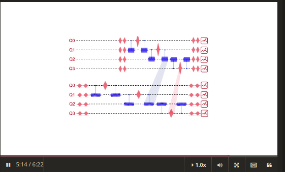

# Two 4-qubit circuits

Two stacked circuits, each with wires Q0, Q1, Q2, Q3. No equations are printed.

Each wire ends in a red square icon with a pointer (measurement-style). Along the wires:

- red diamond markers
- red pulse-shaped symbols
- blue rectangular gates, some joined by short vertical lines between neighboring qubits

Upper circuit: diamonds near the left of every wire; blue gates mainly on Q1 and Q2; red pulses on Q0–Q3.

Lower circuit: a rearranged placement of the same symbols (diamonds, blue rectangles, red pulses).

Translucent blue and pink wedges connect a central region of the upper circuit down to the lower circuit.

00:05:16,460 \--\> 00:05:19,010

This can be shown to be equivalent to amplifying

131

00:05:19,010 \--\> 00:05:21,020

the strength of the noise if the noise is

132

00:05:21,020 \--\> 00:05:24,620

constant over the duration of the \[? rescale ?\] measurements.

133

00:05:24,620 \--\> 00:05:27,500

Let\'s now revisit the molecular simulation of lithium hydride

134

00:05:27,500 \--\> 00:05:29,000

with 4 qubits.

135

00:05:29,000 \--\> 00:05:32,180

The original experiments used just \[? depth-one ?\] circuits

136

00:05:32,180 \--\> 00:05:34,190

to reduce the effect of decoherence.

137

00:05:34,190 \--\> 00:05:37,010

More recently, the mitigation of errors from decoherence

138

00:05:37,010 \--\> 00:05:39,380

enables the benefit of longer computations

139

<!-- frame 5:38 · diagram · week4/media/media/image36.png -->

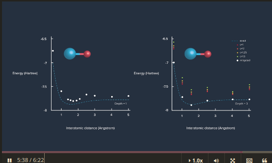

# Energy vs interatomic distance

Two side-by-side plots of a diatomic molecule (larger blue atom bonded to a smaller red atom).

- Vertical axis: Energy (Hartree), ticks at \(-6.5\), \(-7\), \(-7.5\), \(-8\).
- Horizontal axis: Interatomic distance (Angstrom), ticks at \(1,2,3,4,5\).
- Both panels show a blue dashed curve falling from short distance, with a minimum near \(1.5\) Å, then flattening.

Left panel, labeled Depth = 1: white points lying somewhat above the dashed curve.

Right panel, labeled Depth = 3: colored points stacked above the curve, and white points tracking the dashed curve.

Legend on the right panel:

- blue dashed: exact
- red: c=1
- orange: c=0
- yellow: c=1.25
- green: c=1.5
- white: mitigated

00:05:39,380 \--\> 00:05:41,805

with increased circuit depth, to achieve accuracies

140

00:05:41,805 \--\> 00:05:43,520

that were otherwise believed to be

141

00:05:43,520 \--\> 00:05:46,910

beyond the scope of the noisy superconducting processor.

142

00:05:46,910 \--\> 00:05:50,360

Although discussed with specific examples of quantum chemistry,

143

00:05:50,360 \--\> 00:05:52,970

the variational algorithms and error mitigation techniques

144

00:05:52,970 \--\> 00:05:56,240

discussed here can be extended to a host of different problems

145

00:05:56,240 \--\> 00:05:59,390

that rely on computations with expectation values\--

146

00:05:59,390 \--\> 00:06:02,270

problems in quantum simulation addressing fundamental particle

147

00:06:02,270 \--\> 00:06:04,280

physics and condensed matter physics,

148

00:06:04,280 \--\> 00:06:06,470

and even problems in optimization and machine

149

00:06:06,470 \--\> 00:06:07,520

learning.

150

00:06:07,520 \--\> 00:06:09,800

These techniques will likely be crucial to enhance

151

00:06:09,800 \--\> 00:06:12,980

the quality of quantum computation and simulation

152

00:06:12,980 \--\> 00:06:15,230

in this era of noisy intermediate-scale quantum

153

00:06:15,230 \--\> 00:06:17,080

computers.

154

00:06:17,080 \--\> 00:06:21,206

## **PRACTICE (there is no practice for this page )**

##  

## 

Section: QIZ

# Practice: 4 questions

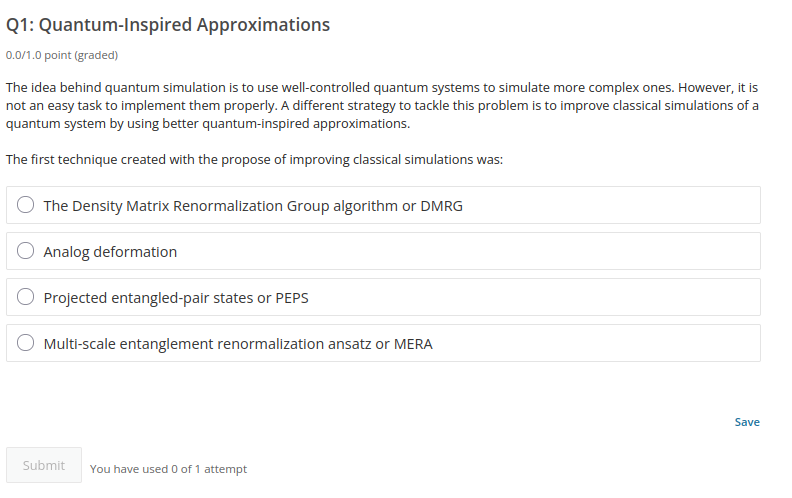

# Q1: Quantum-Inspired Approximations

0.0/1.0 point (graded)

The idea behind quantum simulation is to use well-controlled quantum systems to simulate more complex ones. However, it is not an easy task to implement them properly. A different strategy to tackle this problem is to improve classical simulations of a quantum system by using better quantum-inspired approximations.

The first technique created with the propose of improving classical simulations was:

- ( ) The Density Matrix Renormalization Group algorithm or DMRG
- ( ) Analog deformation
- ( ) Projected entangled-pair states or PEPS
- ( ) Multi-scale entanglement renormalization ansatz or MERA

Save

Submit. You have used 0 of 1 attempt.

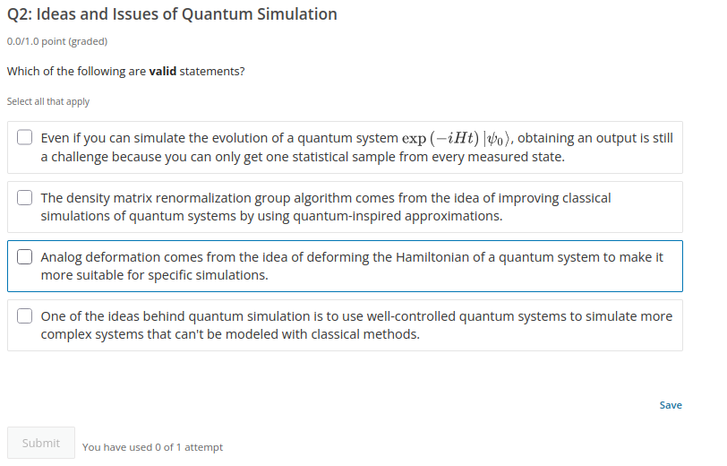

$$\exp(-iHt)|\psi_{0}\rangle$$

# Q2: Ideas and Issues of Quantum Simulation

0.0/1.0 point (graded)

Which of the following are **valid** statements?

Select all that apply

- [ ] Even if you can simulate the evolution of a quantum system \(\exp(-iHt)|\psi_{0}\rangle\), obtaining an output is still a challenge because you can only get one statistical sample from every measured state.
- [ ] The density matrix renormalization group algorithm comes from the idea of improving classical simulations of quantum systems by using quantum-inspired approximations.
- [ ] Analog deformation comes from the idea of deforming the Hamiltonian of a quantum system to make it more suitable for specific simulations. *(outlined)*
- [ ] One of the ideas behind quantum simulation is to use well-controlled quantum systems to simulate more complex systems that can't be modeled with classical methods.

Save. Submit. You have used 0 of 1 attempt.

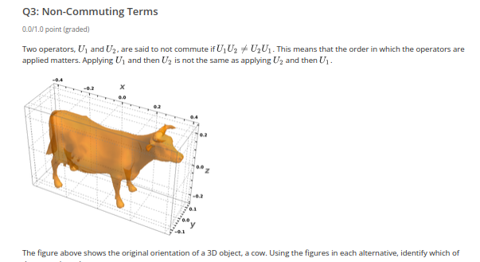

$$U_1U_2\neq U_2U_1$$

# Q3: Non-Commuting Terms

0.0/1.0 point (graded)

Two operators, $U_1$ and $U_2$, are said to not commute if $U_1U_2\neq U_2U_1$. This means that the order in which the operators are applied matters. Applying $U_1$ and then $U_2$ is not the same as applying $U_2$ and then $U_1$.

Figure: original orientation of an orange 3D cow inside a boxed plot. Axes are labeled $x$, $y$, and $z$, with tick labels on the order of $-0.4$ to $0.4$.

The figure above shows the original orientation of a 3D object, a cow. Using the figures in each alternative, identify which of

(The question stem is cut off at the bottom of the screenshot.)

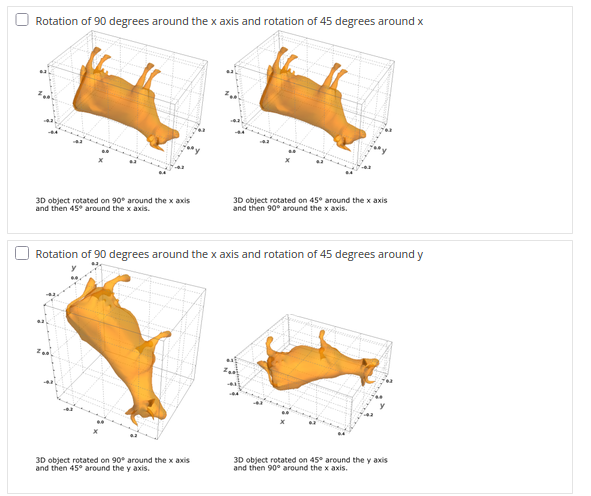

# Rotations of a 3D cow (non-commuting axes)

Two unchecked options. Each shows the same yellow-orange 3D cow in a labeled \(x,y,z\) box, before/after two rotation orders.

## Rotation of 90 degrees around the x axis and rotation of 45 degrees around x

- Left: 3D object rotated on 90° around the x axis and then 45° around the x axis.
- Right: 3D object rotated on 45° around the x axis and then 90° around the x axis.

(The two results look the same: cow lying on its side.)

## Rotation of 90 degrees around the x axis and rotation of 45 degrees around y

- Left: 3D object rotated on 90° around the x axis and then 45° around the y axis. (cow tipped steeply)
- Right: 3D object rotated on 45° around the y axis and then 90° around the x axis. (cow in a different orientation)

(The two results do not match.)

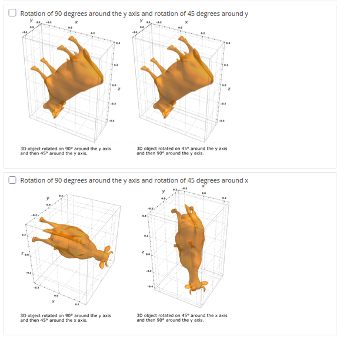

Quiz alternatives (checkboxes), each with a pair of orange 3D cow plots in axis boxes labeled $x$, $y$, $z$.

- [ ] Rotation of 90 degrees around the y axis and rotation of 45 degrees around y
  - Left: "3D object rotated on 90° around the y axis and then 45° around the y axis."
  - Right: "3D object rotated on 45° around the y axis and then 90° around the y axis."
- [ ] Rotation of 90 degrees around the y axis and rotation of 45 degrees around x
  - Left: "3D object rotated on 90° around the y axis and then 45° around the x axis." The cow is inverted relative to the top pair.
  - Right: "3D object rotated on 45° around the x axis and then 90° around the y axis." The cow is also strongly reoriented, head toward the lower part of the box.

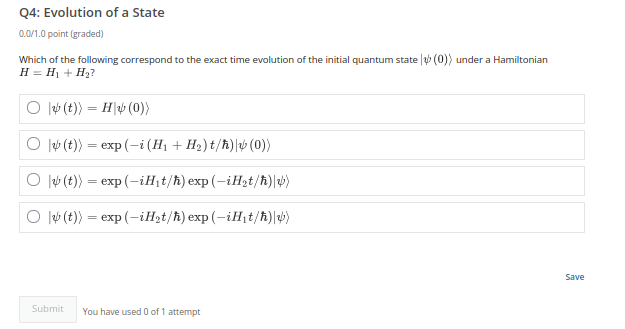

$$
H=H_1+H_2
$$
$$
|\psi(t)\rangle=H|\psi(0)\rangle
$$
$$
|\psi(t)\rangle=\exp\big(-i(H_1+H_2)\,t/\hbar\big)|\psi(0)\rangle
$$
$$
|\psi(t)\rangle=\exp(-iH_1 t/\hbar)\exp(-iH_2 t/\hbar)|\psi\rangle
$$
$$
|\psi(t)\rangle=\exp(-iH_2 t/\hbar)\exp(-iH_1 t/\hbar)|\psi\rangle
$$

# Q4: Evolution of a State

0.0/1.0 point (graded). Single choice. None selected. **Save**. **Submit**. You have used 0 of 1 attempt.

Which of the following correspond to the exact time evolution of the initial quantum state $|\psi(0)\rangle$ under a Hamiltonian $H=H_1+H_2$?

- $|\psi(t)\rangle=H|\psi(0)\rangle$
- $|\psi(t)\rangle=\exp\big(-i(H_1+H_2)\,t/\hbar\big)|\psi(0)\rangle$
- $|\psi(t)\rangle=\exp(-iH_1 t/\hbar)\exp(-iH_2 t/\hbar)|\psi\rangle$
- $|\psi(t)\rangle=\exp(-iH_2 t/\hbar)\exp(-iH_1 t/\hbar)|\psi\rangle$

The last two choices are written with $|\psi\rangle$, not $|\psi(0)\rangle$.
