# Page Title: Introduction to Quantum optimization

# **Learn**

This week, we turn our attention to optimization problems and their
implementation on a quantum computer. Optimization problems are
ubiquitous in industry and government, for example, routing signals in
electronics to minimize cross-talk; distributing financial portfolios to
maximize profit while minimizing risk; or identifying the most likely
nexus within a dense network of telephone calls. Such optimization
problems with large numbers of variables and constraints are challenging
to implement on classical computers, and there are significant research
efforts aimed at developing quantum optimization algorithms that may
yield quantum enhancement.

There are several approaches to quantum optimization. The first is
*adiabatic quantum computing* and its related, restricted cousin,
*quantum annealing*. In this case, a cost function is encoded into a
Hamiltonian using a prescribed approach, and the quantum device then
seeks to minimize the cost function by finding the ground state of this
Hamiltonian. A second approach is to use a universal, digital quantum
computer to find a solution that satisfies (to the extent possible) a
set of boolean clauses. You\'ll learn more this week about the
advantages and challenges of these differing approaches.

We don\'t always need exact solutions to optimization problems;
approximate solutions are often "good enough.\" For example, in
establishing an optimal route that minimizes the distance one needs to
travel between several cities separated by 100\'s of kilometers, one
probably would not distinguish between several high-quality solutions
that differ by only a few meters or even a few-hundred meters. Thus,
there is intense interest in identifying *quantum approximate
optimization algorithms (QAOA)* that feature quantum advantage in
providing high-quality solutions, without necessarily obtaining *the*
optimal answer. Such algorithms may be realizable on nearer-term,
smaller-scale quantum computers, whether acting alone, or as the
co-processor working in tandem with a classical computer.

## **Transcript (no video in this page)**

## **PRACTICE** 

## **(there is no practice for this introduction page )**

##  

Section: Adiabatic quantum computing

# Page Title: Adiabatic quantum computing: concept

# **Learn**

Optimization problems are ubiquitous in business, government, and our
daily lives. They also tend to be hard problems to solve, because of the
large number of variables and connectivity within the problem. In this
section, you\'ll learn about adiabatic quantum computing, which is one
approach to addressing optimization problems. You will also learn how
adiabatic quantum computers are different than gate-model quantum
computers.

**Introduction to Adiabatic Quantum Computing**

*Adiabatic quantum computing* (AQC) is a model of quantum computing that
casts the problem of finding the solution of a computational problem
into the problem of obtaining the lowest energy eigenstate of a
specified Hamiltonian. It was theoretically proposed by Edward Farhi,
Jeffrey Goldstone, Sam Gutmann, and Michael Sipser in 2000 ([[paper
link]{.underline}](https://arxiv.org/abs/quant-ph/0001106)) as a general
computational model, and it was later shown to be polynomially
equivalent to universal, circuit-model quantum computation by Dorit
Aharonov and colleagues in 2004 ([[paper
link]{.underline}](https://arxiv.org/abs/quant-ph/0405098)).

The physical principle governing AQC is the *adiabatic theorem*.
Essentially, this theorem states that a physical system will remain in
its lowest-energy eigenstate under sufficiently slow changes to the
parameters of its Hamiltonian. This fact can be put to computational use
by initializing a computer in the ground state of a known Hamiltonian,
called the "initial Hamiltonian\", and then adiabatically evolving its
parameters into the "problem Hamiltonian\" with a ground state that
encodes the solution to the computational problem. The slow evolution of
the system is intended to guarantee that the system remains in the
ground-state throughout this process. However, as indicated below, this
is generally not achievable for problems of practical size due to the
"minimum gap\" problem.
The choice of initial Hamiltonian, evolution path, and problem
Hamiltonian together determine how rapidly the system can be evolved
and, thus, determine the run-time complexity of the adiabatic algorithm.
In principle, the shorter the run-time, the more efficient the
algorithm. However, running the algorithm faster than is allowed by the
adiabatic theorem decreases the chances of obtaining a correct solution
at the end of the evolution process.

In fact, for larger problems of practical significance, adiabatic
quantum algorithms generally cannot be implemented without the system
leaving the ground state. This is because of the "minimum gap\" problem.
As the system evolves from initial to problem Hamiltonian, the energy
levels eventually come close and form an avoided crossing, i.e. come
close but don\'t quite touch. One can intuitively think of this as a
"crossing point\" at which the system leaves its
initial-Hamiltonian-like nature behind, and starts adopting
problem-Hamiltonian-like characteristics. In physics jargon, this is
essentially a phase transition.

The problem is that the gap becomes smaller and smaller as the problem
size increases. This results in two key issues. First of all, even in
the absence of noise, the system must evolve more slowly through the gap
region as the gap gets smaller in order to maintain adiabaticity. If the
system evolves too quickly, the system will effectively "jump\" to the
excited state via a nonadiabatic process called a *Landau-Zener*
transition. Avoiding Landau-Zener transitions requires longer evolution
times, thus increasing the time-to-solution and slowing the computation.

Second, and more insidious, is that there is always some level of noise.
As the gap size decreases, noise from the thermal environment and noise
from the control fields implementing the evolution will drive
transitions from the ground state to the excited state. For example,
once the gap energy becomes smaller than the thermal energy k~B~T at
temperature T, the environment will drive transitions. Thus, for large
enough problems, it will be practically prohibitive to evolve the system
while remaining in the ground state.

Given that an adiabatic quantum computer will leave the ground state at
some point during its evolution (for a sufficiently large problem), one
may then wonder if that destroys any potential for quantum enhancement.
After all, what if the computer could return to the ground state after
passing through the minimum gap region?

In 1998, Tadashi Kadowaki and Hidetoshi Nishimori proposed such a
*quantum annealer* to solve classical optimization problems. A quantum
annealer leverages quantum tunneling and dissipation (relaxation
processes) to return a system to its ground state (or a lower-energy
state) after passing a small avoided crossing. While such quantum
annealers seemingly bypass many of the constraints imposed by an
adiabatic quantum computer, to date, there is no evidence that quantum
annealing computers feature quantum enhancement.

## **Images**

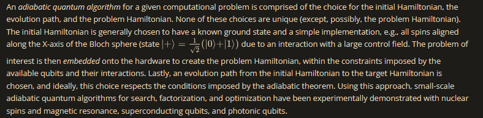

$$|+\rangle=\frac{1}{\sqrt{2}}(|0\rangle+|1\rangle)$$

An adiabatic quantum algorithm for a given computational problem is comprised of the choice for the initial Hamiltonian, the evolution path, and the problem Hamiltonian. None of these choices are unique (except, possibly, the problem Hamiltonian). The initial Hamiltonian is generally chosen to have a known ground state and a simple implementation, e.g., all spins aligned along the X-axis of the Bloch sphere (state $|+\rangle=\frac{1}{\sqrt{2}}(|0\rangle+|1\rangle)$) due to an interaction with a large control field. The problem of interest is then *embedded* onto the hardware to create the problem Hamiltonian, within the constraints imposed by the available qubits and their interactions. Lastly, an evolution path from the initial Hamiltonian to the target Hamiltonian is chosen, and ideally, this choice respects the conditions imposed by the adiabatic theorem. Using this approach, small-scale adiabatic quantum algorithms for search, factorization, and optimization have been experimentally demonstrated with nuclear spins and magnetic resonance, superconducting qubits, and photonic qubits.

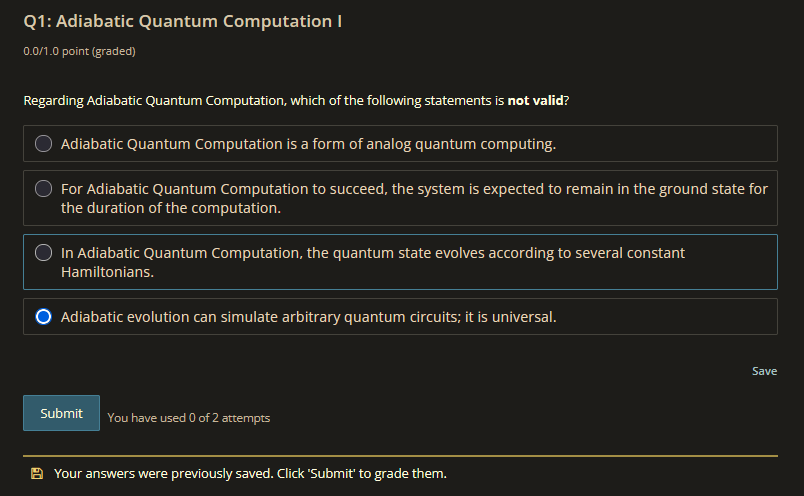

## Q1: Adiabatic Quantum Computation I

0.0/1.0 point (graded)

Regarding Adiabatic Quantum Computation, which of the following statements is **not valid**?

- Adiabatic Quantum Computation is a form of analog quantum computing.
- For Adiabatic Quantum Computation to succeed, the system is expected to remain in the ground state for the duration of the computation.
- In Adiabatic Quantum Computation, the quantum state evolves according to several constant Hamiltonians. *(choice outlined in blue)*
- Adiabatic evolution can simulate arbitrary quantum circuits; it is universal. *(selected)*

Save

**Submit** — You have used 0 of 2 attempts

Your answers were previously saved. Click 'Submit' to grade them.


## **Transcript**

## 

00

00:00:00,000 \--\> 00:00:00,570

1

00:00:00,570 \--\> 00:00:02,580

Last week, we discussed several topics

2

00:00:02,580 \--\> 00:00:04,860

related to quantum Hamiltonians simulation,

3

00:00:04,860 \--\> 00:00:06,960

including methods like Trotterization,

4

00:00:06,960 \--\> 00:00:09,150

phase estimation, and variational quantum

5

00:00:09,150 \--\> 00:00:10,590

eigensolvers.

6

00:00:10,590 \--\> 00:00:12,120

This week, we\'ll turn our attention

7

00:00:12,120 \--\> 00:00:14,810

to quantum optimization algorithms.

8

00:00:14,810 \--\> 00:00:17,160

Optimization problems are ubiquitous,

9

00:00:17,160 \--\> 00:00:19,260

from supply transport optimization

10

00:00:19,260 \--\> 00:00:23,370

to sensor and satellite tasking, pattern recognition, et cetera.

11

00:00:23,370 \--\> 00:00:25,830

Many, many important practical problems

12

00:00:25,830 \--\> 00:00:28,710

can be reduced to satisfying, in an optimal manner,

13

00:00:28,710 \--\> 00:00:31,090

as many constraints as possible.

14

00:00:31,090 \--\> 00:00:33,100

We\'ll first discuss optimization problems

15

00:00:33,100 \--\> 00:00:36,481

and their implementation on an adiabatic quantum computer.

16

00:00:36,481 \--\> 00:00:38,980

We\'ll then turn our attention to quantum annealers, machines

17

00:00:38,980 \--\> 00:00:41,990

that target classical optimization problems.

18

00:00:41,990 \--\> 00:00:43,990

And lastly, we\'ll look at Grover\'s algorithm

19

00:00:43,990 \--\> 00:00:44,884

and how it works.

20

00:00:44,884 \--\> 00:00:46,300

And at the end of the week, you\'ll

21

00:00:46,300 \--\> 00:00:48,430

implement Grover\'s algorithm for yourself

22

00:00:48,430 \--\> 00:00:50,620

on the IBM Quantum Experience.

23

00:00:50,620 \--\> 00:00:54,370

To get started, let\'s first hear from MIT professor Eddie Farhi

24

00:00:54,370 \--\> 00:00:56,650

about adiabatic quantum computers and quantum

25

00:00:56,650 \--\> 00:00:58,910

optimization algorithms.

26

00:00:58,910 \--\> 00:01:04,370

Adiabatic quantum computing is a all-purpose approach

27

00:01:04,370 \--\> 00:01:08,360

to solving combinatorial optimization problems,

28

00:01:08,360 \--\> 00:01:11,450

or generally for finding the minimum

29

00:01:11,450 \--\> 00:01:15,890

of an objective function, using a quantum computer.

30

00:01:15,890 \--\> 00:01:19,670

And we know that all systems in nature

31

00:01:19,670 \--\> 00:01:21,980

obey the Schrodinger equation.

32

00:01:21,980 \--\> 00:01:24,800

It\'s a first-order differential equation,

33

00:01:24,800 \--\> 00:01:29,390

which says that the rate of change of the wave function

34

00:01:29,390 \--\> 00:01:33,170

is proportional to the Hamiltonian operator

35

00:01:33,170 \--\> 00:01:35,180

times the wave function.

36

00:01:35,180 \--\> 00:01:39,920

So adiabatic quantum computing uses the Schrodinger equation

37

00:01:39,920 \--\> 00:01:42,470

as the basis of the algorithm.

38

00:01:42,470 \--\> 00:01:45,650

It\'s distinct from the gate model in that sense,

39

00:01:45,650 \--\> 00:01:49,430

because we\'re going to have continuous time evolution.

40

00:01:49,430 \--\> 00:01:53,540

The quantum state is going to change continuously, as opposed

41

00:01:53,540 \--\> 00:01:56,660

to the gate model, where we have sequences

42

00:01:56,660 \--\> 00:02:01,490

of discrete transformations, which update the state.

43

00:02:01,490 \--\> 00:02:04,640

Of course, they\'re really very closely related.

44

00:02:04,640 \--\> 00:02:07,250

But in this case, I think it\'s a lot easier

45

00:02:07,250 \--\> 00:02:10,130

to think about how the algorithm works

46

00:02:10,130 \--\> 00:02:15,800

if we think in the context of the continuous time evolution.

47

00:02:15,800 \--\> 00:02:17,810

Let me try to give you a feel for how

48

00:02:17,810 \--\> 00:02:19,670

the adiabatic algorithm works.

49

00:02:19,670 \--\> 00:02:25,250

We want to find the minimum of a complicated cost function.

50

00:02:25,250 \--\> 00:02:27,140

And in general, of course, there\'s

51

00:02:27,140 \--\> 00:02:30,650

no all-purpose algorithm that will guarantee

52

00:02:30,650 \--\> 00:02:35,730

finding the minimum of any cost function in all circumstances.

53

00:02:35,730 \--\> 00:02:38,360

Though we\'re really trying to find something which

54

00:02:38,360 \--\> 00:02:41,390

we hope will work well in practice in situations

55

00:02:41,390 \--\> 00:02:43,740

we care about.

56

00:02:43,740 \--\> 00:02:45,890

So the idea is this.

57

00:02:45,890 \--\> 00:02:47,960

The minimum of the cost function,

58

00:02:47,960 \--\> 00:02:53,780

we\'re going to attempt to find by encoding the cost function

59

00:02:53,780 \--\> 00:02:56,180

in a quantum Hamiltonian.

60

00:02:56,180 \--\> 00:02:59,150

We\'re going to take a quantum Hamiltonian,

61

00:02:59,150 \--\> 00:03:03,410

whose ground state\-- that\'s its lowest energy state we know\--

62

00:03:03,410 \--\> 00:03:05,840

and we\'re going to prepare the quantum

63


<!-- frame 3:05 · formula · week5/media/media/image26.png -->

$$H_p|z\rangle = E(z)|z\rangle$$

$$H(t)=\left(1-\frac{t}{T}\right)B+\frac{t}{T}H_p$$

$$B=-\sum_j\sigma_x^j$$

$$0\le t\le T$$

00:03:05,840 \--\> 00:03:10,490

system in the ground state of this known Hamiltonian.

64

00:03:10,490 \--\> 00:03:13,550

Sometimes we call that the beginning Hamiltonian.

65

00:03:13,550 \--\> 00:03:15,860

If you look at this equation here,

66

00:03:15,860 \--\> 00:03:17,570

you see that our Hamiltonian that

67

00:03:17,570 \--\> 00:03:19,670

controls the evolution of the system

68

00:03:19,670 \--\> 00:03:23,540

has two parts, the beginning Hamiltonian and the problem

69

00:03:23,540 \--\> 00:03:25,490

Hamiltonian.

70

00:03:25,490 \--\> 00:03:28,360

Now, we\'re going to start the system off

71

00:03:28,360 \--\> 00:03:31,430

in the ground state of the beginning Hamiltonian,

72

00:03:31,430 \--\> 00:03:33,260

because the beginning Hamiltonian is

73

00:03:33,260 \--\> 00:03:35,480

something we know how to construct,

74

00:03:35,480 \--\> 00:03:37,820

and we know its ground state.

75

00:03:37,820 \--\> 00:03:41,270

And then what we\'re going to do is slowly turn off

76

00:03:41,270 \--\> 00:03:44,480

the beginning Hamiltonian and slowly

77

00:03:44,480 \--\> 00:03:47,450

turn on the problem Hamiltonian.

78

00:03:47,450 \--\> 00:03:51,140

So we\'re going to go from one to the other slowly.

79

00:03:51,140 \--\> 00:03:55,470

But the problem Hamiltonian has been constructed

80

00:03:55,470 \--\> 00:04:00,650

so that its ground state encodes the solution

81


<!-- frame 4:01 · formula · week5/media/media/image18.png -->

$$H_p|z\rangle=E(z)|z\rangle$$

00:04:00,650 \--\> 00:04:05,362

to the minimization problem, which is our goal.

82

00:04:05,362 \--\> 00:04:06,820

And we\'re going to take the system,

83

00:04:06,820 \--\> 00:04:11,600

and we\'re going to slowly change the Hamiltonian as the state

84

00:04:11,600 \--\> 00:04:13,820

evolves, according to the Schrodinger

85

00:04:13,820 \--\> 00:04:17,089

equation, the first equation I showed you.

86

00:04:17,089 \--\> 00:04:20,339

Let me give you a little example of how this might work.

87

00:04:20,339 \--\> 00:04:24,064

Suppose that I put a little ball in my hand.

88

00:04:24,064 \--\> 00:04:25,230

And it\'s just sitting there.

89

00:04:25,230 \--\> 00:04:27,680

Imagine it in your mind\'s eye.

90

00:04:27,680 \--\> 00:04:30,650

And it\'s sitting in a\-- it\'s in the minimum of a potential

91

00:04:30,650 \--\> 00:04:33,020

well formed by my hand.

92

00:04:33,020 \--\> 00:04:36,260

Now I slowly move my hand.

93

00:04:36,260 \--\> 00:04:39,740

And the little ball, as you can see in your mind\'s eye,

94

00:04:39,740 \--\> 00:04:43,220

stays right there in my hand.

95

00:04:43,220 \--\> 00:04:45,590

And what\'s happened in that case is

96

00:04:45,590 \--\> 00:04:49,520

that I am changing the physical system,

97

00:04:49,520 \--\> 00:04:54,200

and I\'m dragging along the minimum energy configuration.

98

00:04:54,200 \--\> 00:04:56,450

Now, suppose that I put that little ball there,

99

00:04:56,450 \--\> 00:04:58,340

and I jerked my hand.

100

00:04:58,340 \--\> 00:05:00,320

The ball would fall away.

101

00:05:00,320 \--\> 00:05:04,730

So if I let my hand go slowly enough,

102

00:05:04,730 \--\> 00:05:07,370

I\'ll drag along the little ball.

103

00:05:07,370 \--\> 00:05:11,210

And the quantum system works in a very similar fashion.

104

00:05:11,210 \--\> 00:05:13,910

If you put a quantum state in the ground

105

00:05:13,910 \--\> 00:05:17,840

state of Hamiltonian, and then you slowly change

106


<!-- frame 5:17 · formula · week5/media/media/image29.png -->

$$|\psi, t=0\rangle = |+\rangle\ldots|+\rangle$$

$$|+\rangle = \frac{1}{\sqrt{2}}\left(|0\rangle+|1\rangle\right)$$

00:05:17,840 \--\> 00:05:22,070

the Hamiltonian, if you go slowly enough,

107

00:05:22,070 \--\> 00:05:26,630

the ground state of the Hamiltonian that is changing

108

00:05:26,630 \--\> 00:05:31,200

will correspond to the evolving quantum state.

109

00:05:31,200 \--\> 00:05:34,220

In other words, we can shlep the ground state

110

00:05:34,220 \--\> 00:05:36,530

from the ground state of the beginning Hamiltonian

111

00:05:36,530 \--\> 00:05:39,260

to the ground state of the problem Hamiltonian,

112

00:05:39,260 \--\> 00:05:41,510

if we go slowly enough.

113

00:05:41,510 \--\> 00:05:43,580

And that means that we have a way

114

00:05:43,580 \--\> 00:05:47,270

of finding the ground state, which corresponds

115

00:05:47,270 \--\> 00:05:49,610

to the minimum energy configuration,

116

00:05:49,610 \--\> 00:05:53,990

or the lowest value or the cost function that we sought.

117

00:05:53,990 \--\> 00:05:59,850

This will work, for sure, if you go infinitely slowly.

118

00:05:59,850 \--\> 00:06:05,080

Now, infinitely slowly requires an infinite amount of time.

119

00:06:05,080 \--\> 00:06:07,830

And so that\'s not a practical algorithm.

120

00:06:07,830 \--\> 00:06:10,470

So the real question becomes, can we

121

00:06:10,470 \--\> 00:06:16,470

go slowly enough but not so slowly that it\'s impractical,

122

00:06:16,470 \--\> 00:06:21,770

that we can actually bring our system to the place we want?

123

00:06:21,770 \--\> 00:06:26,774

## **PRACTICE ( 1 question)**

## 
 

Section: Adiabatic Quantum Computing

# Page Title:Adiabatic Quantum Computing: Expert View

# **Learn**

How do adiabatic algorithms solve optimization problems? In this
section, you\'ll hear MIT Professor Eddie Farhi continue his discussion
of the adiabatic algorithm, how it is used to minimize \"cost
functions,\" and how it is implemented using spin Hamiltonians.

## **Images**

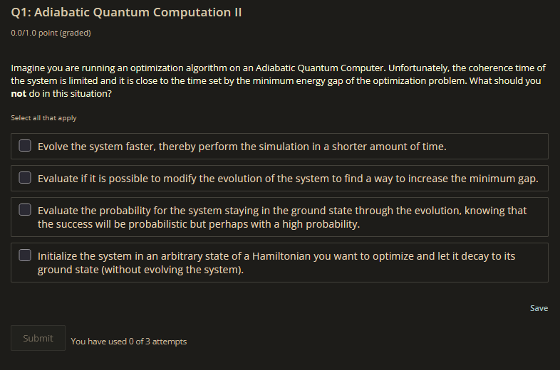

## Q1: Adiabatic Quantum Computation II

0.0/1.0 point (graded)

Imagine you are running an optimization algorithm on an Adiabatic Quantum Computer. Unfortunately, the coherence time of the system is limited and it is close to the time set by the minimum energy gap of the optimization problem. What should you **not** do in this situation?

Select all that apply

- [ ] Evolve the system faster, thereby perform the simulation in a shorter amount of time.
- [ ] Evaluate if it is possible to modify the evolution of the system to find a way to increase the minimum gap.
- [ ] Evaluate the probability for the system staying in the ground state through the evolution, knowing that the success will be probabilistic but perhaps with a high probability.
- [ ] Initialize the system in an arbitrary state of a Hamiltonian you want to optimize and let it decay to its ground state (without evolving the system).

Save

Submit (inactive) — You have used 0 of 3 attempts


## **Transcript**

## 

00

00:00:00,000 \--\> 00:00:00,660

1

00:00:00,660 \--\> 00:00:06,210

Let\'s go back to the concept of adiabatic evolution,

2

00:00:06,210 \--\> 00:00:09,030

but let\'s be a little bit more specific now.

3

00:00:09,030 \--\> 00:00:11,970

So I want to imagine that we want

4

00:00:11,970 \--\> 00:00:16,470

to find the minimum of a cost function, which

5

00:00:16,470 \--\> 00:00:20,010

is defined over bit strings.

6

00:00:20,010 \--\> 00:00:24,450

And that cost function is the sum of terms, each of which

7

00:00:24,450 \--\> 00:00:30,180

depends on a subset of the bits and has a value of 1,

8

00:00:30,180 \--\> 00:00:33,390

let\'s say, on certain assignments of those bits

9

00:00:33,390 \--\> 00:00:38,200

in the subset and has the value 0 on other assignments.

10


<!-- frame 0:38 · formula · week5/media/media/image12.png -->

$$E(z)=\sum_{\alpha}E_{\alpha}(z)$$ $$z=z_1\ldots z_n$$ $$E_{\alpha}(z)=\begin{cases}1&z\text{ does not satisfy,}\\0&z\text{ satisfies.}\end{cases}$$

Video slide. The value $0$ in the second case is highlighted blue.

$$E(z)=\sum_{\alpha}E_{\alpha}(z)$$

$z=z_1\ldots z_n$ $n$-bit string

$$E_{\alpha}(z)=\begin{cases}1&z\text{ does not satisfy,}\\0&z\text{ satisfies.}\end{cases}$$

$\alpha$ is the clause index

$E_{\alpha}$ depends on a subset of the bits

00:00:38,200 \--\> 00:00:42,270

For example, if an individual term might look at 2 bits

11

00:00:42,270 \--\> 00:00:46,170

and it\'ll say, if the 2 bits agree in their value,

12

00:00:46,170 \--\> 00:00:50,580

we\'re going to give it the value 1, but if they disagree,

13

00:00:50,580 \--\> 00:00:53,100

the function has the value of 0.

14


<!-- frame 0:52 · formula · week5/media/media/image13.png -->

$$E_{12}=\frac{1}{2}(1+z_1 z_2)$$ $$z_1=\pm 1\qquad z_2=\pm 1$$

Video slide, title underlined: **Example of a two bit clause on bits 1 and 2**

$$E_{12}=\frac{1}{2}(1+z_1 z_2)$$

$$z_1=\pm 1\qquad z_2=\pm 1$$

$E_{12}=0$ only if bits disagree

(The $0$ is highlighted blue.)

00:00:53,100 \--\> 00:00:57,300

So now, I want to imagine that my optimization problem is

15

00:00:57,300 \--\> 00:01:00,000

to find the minimum of a function, which

16

00:01:00,000 \--\> 00:01:05,280

is a sum of terms, each of which acts on a few bits.

17

00:01:05,280 \--\> 00:01:08,310

And finding the minimum of such a function in general,

18

00:01:08,310 \--\> 00:01:10,080

is what we call NP hard.

19

00:01:10,080 \--\> 00:01:13,260

It\'s not believed that there\'s any kind of classical time

20

00:01:13,260 \--\> 00:01:15,870

algorithm that can in polynomial time

21

00:01:15,870 \--\> 00:01:18,600

solve that problem in general.

22

00:01:18,600 \--\> 00:01:21,660

But nonetheless, we\'re going to attempt our quantum approach

23

00:01:21,660 \--\> 00:01:22,561

to it.

24

00:01:22,561 \--\> 00:01:24,060

So the first thing we\'re going to do

25

00:01:24,060 \--\> 00:01:25,990

is to find what I told you before

26

00:01:25,990 \--\> 00:01:28,440

was the problem Hamiltonian.

27

00:01:28,440 \--\> 00:01:30,030

And the problem Hamiltonian we\'re

28

00:01:30,030 \--\> 00:01:34,540

going to take to be diagonal in the computational basis,

29

00:01:34,540 \--\> 00:01:39,950

so when the problem Hamiltonian acts on a ket with the string

30

00:01:39,950 \--\> 00:01:43,620

z in it, it will give the value of the cost

31

00:01:43,620 \--\> 00:01:46,530

function times the ket.

32

00:01:46,530 \--\> 00:01:49,175

So it\'s diagonal in the computational basis.

33


<!-- frame 1:47 · formula · week5/media/media/image7.png -->

$$H_p|z\rangle=E(z)|z\rangle$$
$$z=z_1\ldots z_n$$

Dark blue video slide. Centered equations:

$$H_p|z\rangle=E(z)|z\rangle$$

with $E(z)$ highlighted in a blue box, and

$$z=z_1\ldots z_n$$

Player: 1:47 / 7:05, speed 1.0x.

00:01:49,175 \--\> 00:01:55,200

And note that the minimum of the string that

34

00:01:55,200 \--\> 00:01:57,690

achieves the minimum value of the cost

35

00:01:57,690 \--\> 00:02:00,990

function we can view as the ground

36

00:02:00,990 \--\> 00:02:04,320

state of this particular quantum Hamiltonian,

37

00:02:04,320 \--\> 00:02:08,340

because it\'s diagonal in the computational basis.

38

00:02:08,340 \--\> 00:02:11,910

Now, we need to take a beginning Hamiltonian too.

39

00:02:11,910 \--\> 00:02:16,140

And from that we typically use is a magnetic field

40

00:02:16,140 \--\> 00:02:18,130

in the x direction.

41

00:02:18,130 \--\> 00:02:22,950

If you have a magnetic field on a single spin a half particle

42

00:02:22,950 \--\> 00:02:24,990

and it\'s pointing in the x direction,

43

00:02:24,990 \--\> 00:02:27,750

it\'s represented by the operator.

44

00:02:27,750 \--\> 00:02:30,960

I\'ll take it to be minus sigma x,

45

00:02:30,960 \--\> 00:02:34,710

so that the state that\'s in the x direction

46

00:02:34,710 \--\> 00:02:39,187

is the minimum with the value minus 1.

47

00:02:39,187 \--\> 00:02:41,520

So the Hamiltonian we\'re going to take for the beginning

48

00:02:41,520 \--\> 00:02:45,690

Hamiltonian is the sum, a minus in front,

49

00:02:45,690 \--\> 00:02:50,610

the sum of the sigma x is one for each qubit.

50


<!-- frame 2:47 · formula · week5/media/media/image8.png -->

$$B=-\sum_{j}\sigma_{x}^{j}$$ $$\sigma_{x}=\begin{pmatrix}0&1\\1&0\end{pmatrix}$$ $$|+\rangle=\frac{|0\rangle+|1\rangle}{\sqrt{2}}$$

Video slide. The sum is highlighted in a blue box.

$$B=-\sum_{j}\sigma_{x}^{j}$$

$$\sigma_{x}=\begin{pmatrix}0&1\\1&0\end{pmatrix}$$ for each qubit

Ground state of $B$ is all spins pointing in the $+x$ direction

$$|+\rangle=\frac{|0\rangle+|1\rangle}{\sqrt{2}}$$

00:02:50,610 \--\> 00:02:53,040

That\'s a very simple Hamiltonian.

51

00:02:53,040 \--\> 00:02:57,990

And it\'s very easy to initialize a quantum state as the ground

52

00:02:57,990 \--\> 00:03:00,660

state of that Hamiltonian, because all we have to do

53

00:03:00,660 \--\> 00:03:04,770

is take our spins and line them up in the x direction.

54

00:03:04,770 \--\> 00:03:07,650

Then we\'re automatically in the ground state of the beginning

55

00:03:07,650 \--\> 00:03:09,030

Hamiltonian.

56

00:03:09,030 \--\> 00:03:11,730

So now for all full evolution, we\'re

57

00:03:11,730 \--\> 00:03:15,180

going to take a Hamiltonian that it interpolates

58


<!-- frame 3:15 · formula · week5/media/media/image25.png -->

$$H(t)=\left(1-\frac{t}{T}\right)B+\frac{t}{T}H_p$$ $$0\le t\le T$$

Video slide. A control tooltip reads “Pop out this video”.

$$H(t)=\left(1-\frac{t}{T}\right)B+\frac{t}{T}H_p$$

$$0\le t\le T$$

$T$ is total runtime

00:03:15,180 \--\> 00:03:19,110

between the beginning Hamiltonian I prescribed

59

00:03:19,110 \--\> 00:03:21,000

and the problem Hamiltonian.

60

00:03:21,000 \--\> 00:03:24,240

So that\'s all very simple to write down.

61

00:03:24,240 \--\> 00:03:26,440

And not only is it simple to write down,

62

00:03:26,440 \--\> 00:03:30,780

it\'s easy to imagine even implementing such a thing

63

00:03:30,780 \--\> 00:03:33,600

in the lab or on a quantum computer,

64

00:03:33,600 \--\> 00:03:36,615

because the terms in the problem Hamiltonian

65

00:03:36,615 \--\> 00:03:39,210

are a sum of local terms diagonal

66

00:03:39,210 \--\> 00:03:41,010

in the computational basis.

67

00:03:41,010 \--\> 00:03:44,190

And the beginning Hamiltonian is just a magnetic field

68

00:03:44,190 \--\> 00:03:45,960

in the x direction.

69

00:03:45,960 \--\> 00:03:48,720

So we can imagine actually building this thing.

70

00:03:48,720 \--\> 00:03:52,110

And of course, that\'s what the D Wave company did do,

71

00:03:52,110 \--\> 00:03:55,090

is build a machine that runs this algorithm.

72

00:03:55,090 \--\> 00:03:57,300

And they actually chose to implement

73

00:03:57,300 \--\> 00:03:59,490

the quantum adiabatic algorithm, because it

74

00:03:59,490 \--\> 00:04:02,730

was simple to imagine building a device that could do that.

75

00:04:02,730 \--\> 00:04:05,010

And of course, the way I\'ve discussed it,

76

00:04:05,010 \--\> 00:04:07,620

it\'s kind of an all purpose minimizer.

77

00:04:07,620 \--\> 00:04:10,860

So we now have gone as far as to see

78

00:04:10,860 \--\> 00:04:13,710

that we can have a specific implementation

79

00:04:13,710 \--\> 00:04:15,870

of the adiabatic algorithm.

80

00:04:15,870 \--\> 00:04:17,399

So what\'s the killer here?

81

00:04:17,399 \--\> 00:04:18,660

What slows it down?

82

00:04:18,660 \--\> 00:04:22,050

What\'s the thing that makes it hard to implement this

83

00:04:22,050 \--\> 00:04:27,420

in reality and maybe means that it\'s hard to show the algorithm

84

00:04:27,420 \--\> 00:04:28,800

works all the time?

85

00:04:28,800 \--\> 00:04:31,080

And that has to do with how slowly you

86

00:04:31,080 \--\> 00:04:34,740

have to go in order to be guaranteed

87

00:04:34,740 \--\> 00:04:38,310

that you\'re going to go to the place you want to end up at.

88

00:04:38,310 \--\> 00:04:44,040

And that slowness is actually determined by something

89

00:04:44,040 \--\> 00:04:46,380

we call the minimum gap.

90

00:04:46,380 \--\> 00:04:49,470

In the beginning Hamiltonian, we have a magnetic field

91

00:04:49,470 \--\> 00:04:51,060

in the x direction.

92

00:04:51,060 \--\> 00:04:53,730

If I flip a single spin, the energy

93

00:04:53,730 \--\> 00:04:58,630

of that single spin goes from let\'s say minus 1 to plus 1.

94

00:04:58,630 \--\> 00:05:01,020

So the energy difference is 2.

95

00:05:01,020 \--\> 00:05:04,080

That\'s a big energy difference between the ground state

96

00:05:04,080 \--\> 00:05:06,320

and the first excited state.

97

00:05:06,320 \--\> 00:05:08,940

In the problem Hamiltonian, I told you

98

00:05:08,940 \--\> 00:05:12,480

that all my terms were zeros and ones,

99

00:05:12,480 \--\> 00:05:15,790

because the cost function, the way I happened to define it,

100


<!-- frame 5:15 · diagram · week5/media/media/image39.png -->

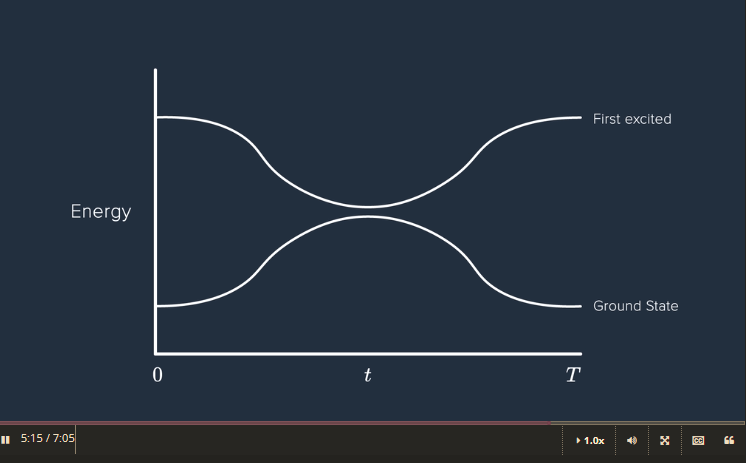

**Energy vs. time** (no title on the slide)

- Vertical axis: **Energy** (no tick labels)
- Horizontal axis: $0$, then $t$, then $T$

Two curves:

- **First excited** (upper): starts high at $t=0$, dips through a minimum near the middle, then rises again toward $t=T$.
- **Ground State** (lower): starts lower at $t=0$, rises toward the upper curve in the middle (smallest gap), then falls and ends lower at $t=T$ than it started.

The two curves approach each other at mid-evolution and separate again. Labels “First excited” and “Ground State” sit at the right-hand ends of the upper and lower curves.

00:05:15,790 \--\> 00:05:18,880

was a sum of terms, which were all 0 or 1.

101

00:05:18,880 \--\> 00:05:22,020

So that means that the energy difference between the ground

102

00:05:22,020 \--\> 00:05:24,780

state and the first excited state is let\'s

103

00:05:24,780 \--\> 00:05:30,600

say, 1 or 2 maybe, but it\'s going to be an integer.

104

00:05:30,600 \--\> 00:05:33,960

But as the system evolves, we can

105

00:05:33,960 \--\> 00:05:38,220

track the ground state energy and the energy of the first

106

00:05:38,220 \--\> 00:05:39,360

excited state.

107

00:05:39,360 \--\> 00:05:43,710

And what we find in these situations is that as you

108

00:05:43,710 \--\> 00:05:46,560

move along, the two approach each other,

109

00:05:46,560 \--\> 00:05:49,090

coming very, very close.

110

00:05:49,090 \--\> 00:05:52,080

And then they\'re going to spread out back to that integer

111

00:05:52,080 \--\> 00:05:53,670

at the end.

112

00:05:53,670 \--\> 00:05:56,970

And the question is, what\'s that value which

113

00:05:56,970 \--\> 00:05:59,460

is the smallest energy difference

114

00:05:59,460 \--\> 00:06:03,420

between the first excited state and the ground state?

115

00:06:03,420 \--\> 00:06:05,820

We call that the gap.

116

00:06:05,820 \--\> 00:06:13,240

And the runtime of the algorithm is determined by the gap.

117

00:06:13,240 \--\> 00:06:17,580

In fact, the minimum runtime of the algorithm scales like 1

118

00:06:17,580 \--\> 00:06:19,710

over the minimum gap squared.

119

00:06:19,710 \--\> 00:06:23,010

That\'s just a little math fact, which we could establish.

120

00:06:23,010 \--\> 00:06:26,700

So the whole issue from a physics point

121

00:06:26,700 \--\> 00:06:32,400

of view in the adiabatic algorithm is, does the system,

122

00:06:32,400 \--\> 00:06:35,724

as it evolve, does the energy difference

123

00:06:35,724 \--\> 00:06:37,890

between the ground state and the first excited state

124

00:06:37,890 \--\> 00:06:39,060

get too small?

125

00:06:39,060 \--\> 00:06:41,850

Because if it\'s too small, the run time

126

00:06:41,850 \--\> 00:06:45,720

required to stay in the ground state is too big.

127

00:06:45,720 \--\> 00:06:48,660

So one of the things we have to study

128

00:06:48,660 \--\> 00:06:51,180

when we think about adiabatic algorithms

129

00:06:51,180 \--\> 00:06:55,050

is the gap between the first excited state and the ground

130

00:06:55,050 \--\> 00:06:58,460

state as the system evolves.

131

00:06:58,460 \--\> 00:07:03,595

## **PRACTICE : one question on this page** 
Section: Digital simulation : Grover's algorithm

# Page Title:Grover's Algorithm: Quantum Search

# **Learn**

In this section, you will learn about Grover\'s algorithm and how it
works. At the end of this week, you will implement Grover\'s algorithm
for yourself on the IBM quantum computer.

## **Images**

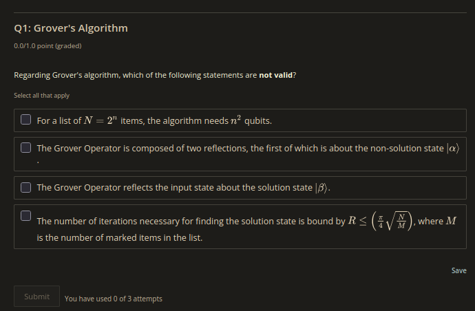

$$N=2^n$$
$$R\le\left(\frac{\pi}{4}\sqrt{\frac{N}{M}}\right)$$

# Q1: Grover's Algorithm

0.0/1.0 point (graded)

Regarding Grover's algorithm, which of the following statements are **not valid**?

Select all that apply

- [ ] For a list of $N=2^n$ items, the algorithm needs $n^2$ qubits.
- [ ] The Grover Operator is composed of two reflections, the first of which is about the non-solution state $|\alpha\rangle$.
- [ ] The Grover Operator reflects the input state about the solution state $|\beta\rangle$.
- [ ] The number of iterations necessary for finding the solution state is bound by $R\le\left(\frac{\pi}{4}\sqrt{\frac{N}{M}}\right)$, where $M$ is the number of marked items in the list.

Save

Submit. You have used 0 of 3 attempts.


## **Transcript**

## 

00

00:00:00,000 \--\> 00:00:00,500

1

00:00:00,500 \--\> 00:00:03,240

In this section, we\'ll take a look at Grover\'s algorithm.

2

00:00:03,240 \--\> 00:00:05,860

And as we\'ve done previously with Deutsch-Jozsa and Shor\'s

3

00:00:05,860 \--\> 00:00:08,640

algorithm, we\'ll do it in the context of the quantum circuit

4

00:00:08,640 \--\> 00:00:09,450

model.

5

00:00:09,450 \--\> 00:00:10,890

And by the end of the week, you\'ll

6

00:00:10,890 \--\> 00:00:13,500

implement it for yourselves on a real cloud-based quantum

7

00:00:13,500 \--\> 00:00:14,930

computer.

8

00:00:14,930 \--\> 00:00:16,680

Grover\'s algorithm is often described

9

00:00:16,680 \--\> 00:00:19,740

in the context of searching an unstructured database.

10

00:00:19,740 \--\> 00:00:22,200

Here though, let\'s generalize the search problem

11

00:00:22,200 \--\> 00:00:24,990

to the related problem of function inversion.

12

00:00:24,990 \--\> 00:00:26,940

Consider a function, f of x, which

13

00:00:26,940 \--\> 00:00:30,480

can take on the value 0 or 1, depending on the argument x.

14

00:00:30,480 \--\> 00:00:34,470

For example, for x equals 10, the function f of 10 equals 1,

15

00:00:34,470 \--\> 00:00:37,030

and it\'s 0 for all other x values.

16

00:00:37,030 \--\> 00:00:39,810

Now, the function inversion problem is the following.

17

00:00:39,810 \--\> 00:00:42,180

Given f of x equals 1, can we find

18

00:00:42,180 \--\> 00:00:44,490

the value of x or a value of x if there

19

00:00:44,490 \--\> 00:00:46,620

is more than one solution.

20

00:00:46,620 \--\> 00:00:48,480

Classically, one has little choice

21

00:00:48,480 \--\> 00:00:51,370

but to try different x-values and test the function.

22

00:00:51,370 \--\> 00:00:55,980

So for n total x-values of which M satisfy f of x equals 1,

23

00:00:55,980 \--\> 00:00:58,980

it will take on the order of N divided by M tries

24

00:00:58,980 \--\> 00:01:01,240

to succeed with high probability.

25

00:01:01,240 \--\> 00:01:03,540

However, on a quantum computer, the same task

26

00:01:03,540 \--\> 00:01:06,570

succeeds with high probability in only square root of N

27

00:01:06,570 \--\> 00:01:08,520

over M tries, a quadratic improvement

28

00:01:08,520 \--\> 00:01:10,262

over classical computing.

29

00:01:10,262 \--\> 00:01:11,970

And while a quadratic improvement may not

30

00:01:11,970 \--\> 00:01:15,000

seem like a lot, it does become practically significant

31

00:01:15,000 \--\> 00:01:17,160

for problems with large N.

32


<!-- frame 1:16 · slide · week5/media/media/image20.png -->

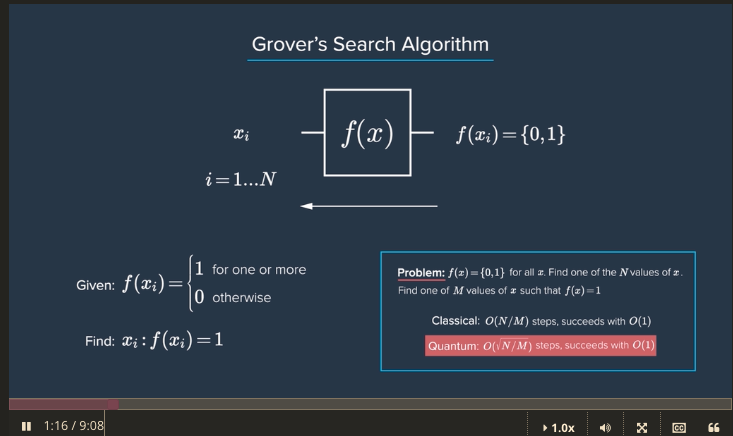

$$f(x_i)=\begin{cases}1&\text{for one or more}\\0&\text{otherwise}\end{cases}$$ $$x_i:f(x_i)=1$$ $$O(N/M)$$ $$O(\sqrt{N/M})$$

**Grover's Search Algorithm**

Diagram: inputs $x_i$ for $i=1\ldots N$ enter a box $f(x)$, which outputs $f(x_i)=\{0,1\}$. A leftward arrow sits under the box.

Given:

$$f(x_i)=\begin{cases}1&\text{for one or more}\\0&\text{otherwise}\end{cases}$$

Find: $x_i:f(x_i)=1$

Boxed problem statement:

- **Problem:** $f(x)=\{0,1\}$ for all $x$. Find one of the $N$ values of $x$.
- Find one of $M$ values of $x$ such that $f(x)=1$
- Classical: $O(N/M)$ steps, succeeds with $O(1)$
- Quantum: $O(\sqrt{N/M})$ steps, succeeds with $O(1)$ (this line is highlighted pink)

00:01:17,160 \--\> 00:01:18,900

To implement Grover\'s algorithm, we

33

00:01:18,900 \--\> 00:01:20,640

need an operational block that can

34

00:01:20,640 \--\> 00:01:25,140

recognize if a test value of x satisfies our function or not.

35

00:01:25,140 \--\> 00:01:27,020

This operation is called an oracle.

36

00:01:27,020 \--\> 00:01:28,920

And it\'s a key part of each trial, which

37

00:01:28,920 \--\> 00:01:30,730

we\'ll call a Grover iteration.

38

00:01:30,730 \--\> 00:01:33,150

Now, it may seem challenging or even

39

00:01:33,150 \--\> 00:01:36,460

cheating to define an oracle that represents, for example,

40

00:01:36,460 \--\> 00:01:37,350

our database.

41

00:01:37,350 \--\> 00:01:40,080

After all, in loading such a database into our quantum

42

00:01:40,080 \--\> 00:01:42,430

computer, haven\'t we already searched it?

43

00:01:42,430 \--\> 00:01:46,020

Now, that\'s certainly true, but this isn\'t how an oracle works.

44

00:01:46,020 \--\> 00:01:48,060

Again, it\'s worthwhile to think in terms

45

00:01:48,060 \--\> 00:01:50,070

of a mathematical function.

46

00:01:50,070 \--\> 00:01:52,650

The oracle doesn\'t need to know in advance every answer

47

00:01:52,650 \--\> 00:01:54,540

to every function call, nor does it

48

00:01:54,540 \--\> 00:01:57,900

need to have a ledger of all the input and output values.

49

00:01:57,900 \--\> 00:02:00,780

Rather, it just needs to be able to calculate the function

50

00:02:00,780 \--\> 00:02:03,850

and recognize when a particular condition is satisfied.

51

00:02:03,850 \--\> 00:02:06,690

And conceptually, we can program different functions

52

00:02:06,690 \--\> 00:02:08,729

into our oracle while keeping the underlying

53

00:02:08,729 \--\> 00:02:10,470

machinery in place.

54

00:02:10,470 \--\> 00:02:12,720

We won\'t discuss in detail how this is done,

55

00:02:12,720 \--\> 00:02:14,820

as it\'s obviously problem-dependent.

56

00:02:14,820 \--\> 00:02:16,710

But we just note that this type of oracle

57

00:02:16,710 \--\> 00:02:20,580

can be designed using reversible logic approaches.

58

00:02:20,580 \--\> 00:02:23,440

The idea behind Grover\'s algorithm is the following.

59

00:02:23,440 \--\> 00:02:26,670

We start with an index register of values x running from 0

60

00:02:26,670 \--\> 00:02:28,560

to n minus 1.

61

00:02:28,560 \--\> 00:02:31,860

The oracle takes a test value x, calculates the function

62

00:02:31,860 \--\> 00:02:34,890

f of x, and performs modulo-2 addition

63

00:02:34,890 \--\> 00:02:37,020

of f of x with a helper qubit, which

64

00:02:37,020 \--\> 00:02:39,420

we\'ll call the oracle qubit.

65

00:02:39,420 \--\> 00:02:41,940

The oracle qubit is prepared in a superposition state

66

00:02:41,940 \--\> 00:02:44,790

0 minus 1, and it plays a similar role

67

00:02:44,790 \--\> 00:02:48,060

as the helper qubit did in the Deutsch-Jozsa algorithm studied

68

00:02:48,060 \--\> 00:02:49,692

in course 1.

69

00:02:49,692 \--\> 00:02:52,740

If f of x equals 0, then the modulo-2 addition

70

00:02:52,740 \--\> 00:02:55,180

leaves the superposition state unchanged.

71

00:02:55,180 \--\> 00:02:57,520

However, if f of x equals 1, then there

72

00:02:57,520 \--\> 00:02:59,520

is a sign change on the oracle qubit.

73

00:02:59,520 \--\> 00:03:02,310

0 minus 1 becomes 1 minus 0.

74

00:03:02,310 \--\> 00:03:03,970

And by pulling out this minus sign,

75

00:03:03,970 \--\> 00:03:07,350

we get back to the original superposition state, 0 minus 1

76

00:03:07,350 \--\> 00:03:09,270

but with a minus sign in front.

77

00:03:09,270 \--\> 00:03:11,370

And as we saw with the Deutsch-Jozsa algorithm,

78

00:03:11,370 \--\> 00:03:15,210

this minus sign can be written as minus 1 to the f of x power.

79

00:03:15,210 \--\> 00:03:18,870

And so the minus 1 is realized when f of x equals 1, that is,

80

00:03:18,870 \--\> 00:03:21,600

when a particular value of x is a solution to the search

81

00:03:21,600 \--\> 00:03:22,930

problem.

82

00:03:22,930 \--\> 00:03:24,540

This is how the oracle marks a quantum

83

00:03:24,540 \--\> 00:03:28,160

state when it recognizes a satisfied condition.

84


<!-- frame 3:26 · formula · week5/media/media/image38.png -->

$$|x\rangle|q\rangle\to|x\rangle|q\oplus f(x)\rangle$$

$$\frac{1}{\sqrt{2}}(|0\rangle-|1\rangle)\xrightarrow{O:f(x)=0}\frac{1}{\sqrt{2}}\big((|0\rangle\oplus|0\rangle)-(|1\rangle\oplus|0\rangle)\big)=\frac{1}{\sqrt{2}}(|0\rangle-|1\rangle)$$

$$\frac{1}{\sqrt{2}}(|0\rangle-|1\rangle)\xrightarrow{O:f(x)=1}\frac{1}{\sqrt{2}}\big((|0\rangle\oplus|1\rangle)-(|1\rangle\oplus|1\rangle)\big)=\frac{1}{\sqrt{2}}(|1\rangle-|0\rangle)=-\frac{1}{\sqrt{2}}(|0\rangle-|1\rangle)$$

$$(-1)^{f(x)}\frac{(|0\rangle-|1\rangle)}{\sqrt{2}}$$

## Oracle

$$|x\rangle|q\rangle\to|x\rangle|q\oplus f(x)\rangle$$

- Arrow under $|x\rangle$: **Index register**
- Arrow under $|q\rangle$: **Oracle Qubit**
- Arrow under the output register: Oracle implements modular addition of oracle qubit and $f(x)$, and stores results on oracle qubit.

**If $f(x)=0$: no change** ($f(x)$ underlined)

$$\frac{1}{\sqrt{2}}(|0\rangle-|1\rangle)\xrightarrow{O:f(x)=0}\frac{1}{\sqrt{2}}\big((|0\rangle\oplus|0\rangle)-(|1\rangle\oplus|0\rangle)\big)=\frac{1}{\sqrt{2}}(|0\rangle-|1\rangle)$$

**If $f(x)=1$: pick up -1** (highlighted)

$$\frac{1}{\sqrt{2}}(|0\rangle-|1\rangle)\xrightarrow{O:f(x)=1}\frac{1}{\sqrt{2}}\big((|0\rangle\oplus|1\rangle)-(|1\rangle\oplus|1\rangle)\big)=\frac{1}{\sqrt{2}}(|1\rangle-|0\rangle)=-\frac{1}{\sqrt{2}}(|0\rangle-|1\rangle)$$

Both lines are braced to

$$(-1)^{f(x)}\frac{(|0\rangle-|1\rangle)}{\sqrt{2}}$$

with $(-1)^{f(x)}$ in a highlighted box.

00:03:28,160 \--\> 00:03:29,840

To implement Grover\'s algorithm, we

85

00:03:29,840 \--\> 00:03:32,300

start with the initialization stage of the quantum circuit

86

00:03:32,300 \--\> 00:03:33,290

model.

87

00:03:33,290 \--\> 00:03:35,420

Since there are n possible values of x,

88

00:03:35,420 \--\> 00:03:37,880

we\'ll choose q qubits for register 1.

89

00:03:37,880 \--\> 00:03:39,980

And register 2 will hold a single qubit,

90

00:03:39,980 \--\> 00:03:42,050

which is the oracle qubit.

91

00:03:42,050 \--\> 00:03:45,180

Register 1 qubits are prepared in state 0 and the oracle qubit

92

00:03:45,180 \--\> 00:03:46,280

in state 1.

93

00:03:46,280 \--\> 00:03:49,550

And as before, we\'ll associate register one with yellow

94

00:03:49,550 \--\> 00:03:51,680

and register 2 with green to help keep track

95

00:03:51,680 \--\> 00:03:54,140

as the algorithm unfolds.

96

00:03:54,140 \--\> 00:03:56,000

In the compute stage, the first step

97

00:03:56,000 \--\> 00:03:57,980

is to create a large equal superposition

98

00:03:57,980 \--\> 00:04:01,790

state of register 1 qubits using q Hadamard gates.

99

00:04:01,790 \--\> 00:04:05,340

This state has n equals 2 the qth power components.

100

00:04:05,340 \--\> 00:04:08,210

And as we did before, we\'ll replace the 2 to the qth power

101

00:04:08,210 \--\> 00:04:11,810

binary combinations of q qubits with their decimal equivalence

102

00:04:11,810 \--\> 00:04:14,630

x equals 0 to n minus 1.

103

00:04:14,630 \--\> 00:04:17,240

The oracle qubit is placed into the superposition state

104

00:04:17,240 \--\> 00:04:20,149

0 minus 1 using a single Hadamard gate.

105

00:04:20,149 \--\> 00:04:22,730

The next step is to implement a Grover iteration, which we\'ll

106

00:04:22,730 \--\> 00:04:26,330

call G, and we\'ll do this on the order of square root of n times

107

00:04:26,330 \--\> 00:04:29,950

to obtain a solution with order unit probability.

108

00:04:29,950 \--\> 00:04:32,770

Each G contains the oracle operator O,

109

00:04:32,770 \--\> 00:04:34,960

which with the help of the oracle qubit,

110

00:04:34,960 \--\> 00:04:37,360

will leave a minus 1 on the register 1 states

111

00:04:37,360 \--\> 00:04:40,990

for values x which satisfy f of x equals 1.

112

00:04:40,990 \--\> 00:04:43,390

And as we\'ll see in a moment, the oracle operation

113

00:04:43,390 \--\> 00:04:45,400

has a geometric interpretation.

114

00:04:45,400 \--\> 00:04:46,950

It\'s a reflection operation.

115

00:04:46,950 \--\> 00:04:49,370

We\'ll come back to that in a moment.

116

00:04:49,370 \--\> 00:04:51,340

Now, the remainder of the Grover iteration

117

00:04:51,340 \--\> 00:04:55,030

is a conditional phase shift nestled between Hadamard gates.

118

00:04:55,030 \--\> 00:04:57,450

The conditional phase shift leaves state 0 alone

119

00:04:57,450 \--\> 00:04:59,890

and, otherwise, places a minus 1 phase shift

120

00:04:59,890 \--\> 00:05:02,140

in front of all other states x.

121

00:05:02,140 \--\> 00:05:04,804

This can be written in terms of an equal superposition state,

122

00:05:04,804 \--\> 00:05:06,220

just like the one we started with.

123


<!-- frame 5:06 · diagram · week5/media/media/image40.png -->

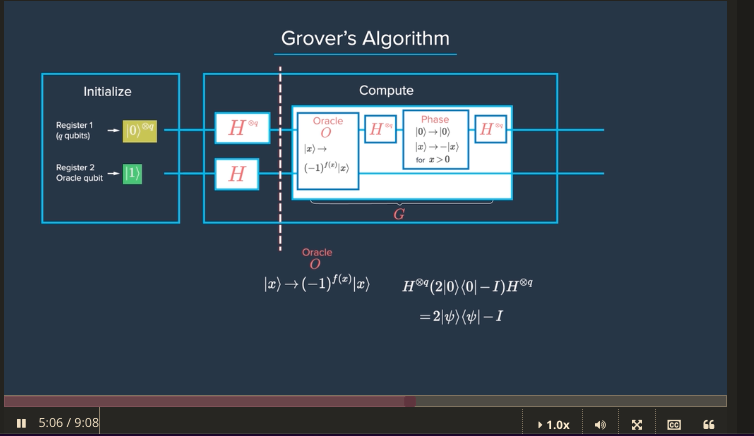

$$|x\rangle\to(-1)^{f(x)}|x\rangle$$

$$|0\rangle\to|0\rangle,\qquad |x\rangle\to -|x\rangle\ \text{for } x>0$$

$$|x\rangle\to(-1)^{f(x)}|x\rangle$$

$$H^{\otimes q}(2|0\rangle\langle 0|-I)H^{\otimes q}=2|\psi\rangle\langle\psi|-I$$

## Grover's Algorithm

**Initialize**

- Register 1 ($q$ qubits) $\to |0\rangle^{\otimes q}$
- Register 2, Oracle qubit $\to |1\rangle$

A dashed vertical line separates initialization from **Compute**.

**Compute**

1. $H^{\otimes q}$ on register 1 and $H$ on the oracle qubit
2. Grouped operator $G$:
   - **Oracle** $O$: $|x\rangle\to(-1)^{f(x)}|x\rangle$
   - $H^{\otimes q}$
   - **Phase**: $|0\rangle\to|0\rangle$, and $|x\rangle\to -|x\rangle$ for $x>0$
   - $H^{\otimes q}$

Below the circuit, labeled **Oracle** $O$:

$$|x\rangle\to(-1)^{f(x)}|x\rangle$$

$$H^{\otimes q}(2|0\rangle\langle 0|-I)H^{\otimes q}$$

$$=2|\psi\rangle\langle\psi|-I$$

00:05:06,220 \--\> 00:05:08,260

And we\'ll call this state CI.

124

00:05:08,260 \--\> 00:05:10,630

I encourage you to work this out for yourselves.

125

00:05:10,630 \--\> 00:05:12,790

And again, as we\'ll see in a moment,

126

00:05:12,790 \--\> 00:05:14,800

this set of three operations can also

127

00:05:14,800 \--\> 00:05:18,790

be viewed as a reflection, this time, across the vector psi.

128

00:05:18,790 \--\> 00:05:21,250

Together with the oracle, these two reflections

129

00:05:21,250 \--\> 00:05:24,430

in the Grover iteration serve to rotate the quantum state

130

00:05:24,430 \--\> 00:05:25,930

by an angle theta.

131

00:05:25,930 \--\> 00:05:28,160

We\'ll look at the geometric picture in a moment.

132

00:05:28,160 \--\> 00:05:31,240

But for now, let\'s continue with the circuit model.

133

00:05:31,240 \--\> 00:05:33,700

To see how the Grover iteration acts on register 1,

134

00:05:33,700 \--\> 00:05:36,950

let\'s rewrite the sum over x as two terms.

135

00:05:36,950 \--\> 00:05:39,220

One term will be the sum over all x-values that

136

00:05:39,220 \--\> 00:05:42,310

are not solutions, that is, give f of x equals 0.

137

00:05:42,310 \--\> 00:05:44,260

And the second term will be the remaining

138

00:05:44,260 \--\> 00:05:48,241

x-values that are a solution and give f of x equal 1.

139

00:05:48,241 \--\> 00:05:50,740

This, in turn, can be written in terms of normalized states,

140

00:05:50,740 \--\> 00:05:52,750

alpha and beta.

141

00:05:52,750 \--\> 00:05:54,640

We then run the Grover iteration on the order

142

00:05:54,640 \--\> 00:05:56,440

of square root of n times.

143

00:05:56,440 \--\> 00:05:59,230

Let\'s assume there are k iterations, with each iteration

144

00:05:59,230 \--\> 00:06:01,420

imparting a phase shift theta.

145

00:06:01,420 \--\> 00:06:04,630

The net result is cosine of 2k plus 1 over 2

146

00:06:04,630 \--\> 00:06:07,690

in front of state alpha, which are not solutions,

147

00:06:07,690 \--\> 00:06:11,170

and sine 2k plus 1 over 2 in front of state beta, which

148

00:06:11,170 \--\> 00:06:12,580

are the solutions.

149

00:06:12,580 \--\> 00:06:15,850

And the oracle qubit remains unchanged throughout.

150

00:06:15,850 \--\> 00:06:18,240

Starting from a small angle theta, much less than pi

151

00:06:18,240 \--\> 00:06:20,860

over 2, we see that as k increases,

152

00:06:20,860 \--\> 00:06:23,140

the cosine term goes to 0 suppressing

153

00:06:23,140 \--\> 00:06:25,030

the amplitude of the wrong answers

154

00:06:25,030 \--\> 00:06:27,670

and the sine term towards 1, enhancing the amplitude

155

00:06:27,670 \--\> 00:06:29,560

of the correct answers.

156

00:06:29,560 \--\> 00:06:31,360

Then a measurement is made, and one

157

00:06:31,360 \--\> 00:06:33,280

of the x-value solutions in the state beta

158

00:06:33,280 \--\> 00:06:35,560

is measured with high probability.

159

00:06:35,560 \--\> 00:06:37,570

Let\'s now look at the geometric interpretation

160

00:06:37,570 \--\> 00:06:39,790

to see how repeated Grover iterations lead

161

00:06:39,790 \--\> 00:06:41,710

to the correct solution.

162

00:06:41,710 \--\> 00:06:43,600

The state CI is in the register 1

163

00:06:43,600 \--\> 00:06:46,480

equals superposition state with end components.

164

00:06:46,480 \--\> 00:06:49,450

And we write it in terms of the states alpha and beta, where

165

00:06:49,450 \--\> 00:06:52,230

alpha are all the x-values that are not solutions,

166

00:06:52,230 \--\> 00:06:56,170

and beta represent the single x-value or multiple end values

167

00:06:56,170 \--\> 00:06:59,930

that are solutions yielding f of x equals 1.

168

00:06:59,930 \--\> 00:07:02,220

The state\'s alpha and beta are orthogonal,

169

00:07:02,220 \--\> 00:07:05,100

and we can represent them as orthogonal vectors.

170

00:07:05,100 \--\> 00:07:07,470

Since the state CI is normalized to 1,

171

00:07:07,470 \--\> 00:07:09,360

we can also write state CI in terms

172

00:07:09,360 \--\> 00:07:11,950

of the cosine and sine theta over 2.

173

00:07:11,950 \--\> 00:07:14,460

And the state CI makes an angle theta over 2

174

00:07:14,460 \--\> 00:07:15,810

with the alpha axis.

175

00:07:15,810 \--\> 00:07:19,030

, Now since we start with all x-values equally likely,

176

00:07:19,030 \--\> 00:07:21,840

and we assume there\'s only one or a few solutions,

177


<!-- frame 7:21 · diagram · week5/media/media/image30.png -->

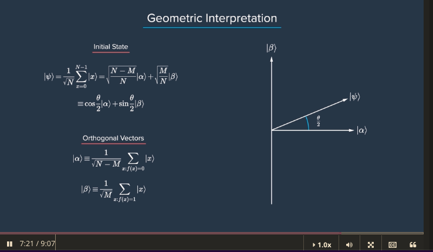

$$|\psi\rangle=\frac{1}{\sqrt{N}}\sum_{x=0}^{N-1}|x\rangle=\sqrt{\frac{N-M}{N}}|\alpha\rangle+\sqrt{\frac{M}{N}}|\beta\rangle$$

$$\equiv \cos\frac{\theta}{2}|\alpha\rangle+\sin\frac{\theta}{2}|\beta\rangle$$

$$|\alpha\rangle\equiv\frac{1}{\sqrt{N-M}}\sum_{x:f(x)=0}|x\rangle$$

$$|\beta\rangle\equiv\frac{1}{\sqrt{M}}\sum_{x:f(x)=1}|x\rangle$$

## Geometric Interpretation

### Initial State

$$|\psi\rangle=\frac{1}{\sqrt{N}}\sum_{x=0}^{N-1}|x\rangle=\sqrt{\frac{N-M}{N}}|\alpha\rangle+\sqrt{\frac{M}{N}}|\beta\rangle$$

$$\equiv \cos\frac{\theta}{2}|\alpha\rangle+\sin\frac{\theta}{2}|\beta\rangle$$

### Orthogonal Vectors

$$|\alpha\rangle\equiv\frac{1}{\sqrt{N-M}}\sum_{x:f(x)=0}|x\rangle$$

$$|\beta\rangle\equiv\frac{1}{\sqrt{M}}\sum_{x:f(x)=1}|x\rangle$$

**Diagram:** horizontal axis $|\alpha\rangle$ (arrow to the right), vertical axis $|\beta\rangle$ (arrow up). State vector $|\psi\rangle$ lies in the first quadrant. The angle from the $|\alpha\rangle$ axis up to $|\psi\rangle$ is marked $\theta/2$ (blue arc).

00:07:21,840 \--\> 00:07:25,550

the vector CI is close to the alpha axis.

178

00:07:25,550 \--\> 00:07:27,890

The oracle acts first, and it places a minus sign

179

00:07:27,890 \--\> 00:07:29,510

in front of the state beta, which

180

00:07:29,510 \--\> 00:07:31,850

represents the valid solutions.

181

00:07:31,850 \--\> 00:07:35,060

This is a reflection over the alpha axis.

182

00:07:35,060 \--\> 00:07:37,160

Next, the remainder of the Grover iteration,

183

00:07:37,160 \--\> 00:07:40,400

the conditional phase shifts nestled between Hadamard gates,

184

00:07:40,400 \--\> 00:07:43,250

is a reflection over the state CI.

185

00:07:43,250 \--\> 00:07:45,260

The result from a single Grover iteration

186

00:07:45,260 \--\> 00:07:47,480

is then to move the state CI and angle

187

00:07:47,480 \--\> 00:07:49,550

theta towards the beta axis.

188

00:07:49,550 \--\> 00:07:51,860

Essentially, the amplitudes of the solutions

189

00:07:51,860 \--\> 00:07:54,350

are being enhanced, while the amplitudes of the remaining

190

00:07:54,350 \--\> 00:07:56,760

states are being suppressed.

191

00:07:56,760 \--\> 00:07:59,140

The Grover iteration is then repeated k times,

192

00:07:59,140 \--\> 00:08:01,600

where k is on the order of square root of N.

193

00:08:01,600 \--\> 00:08:03,160

The iterative reflections continue

194


<!-- frame 8:03 · slide · week5/media/media/image19.png -->

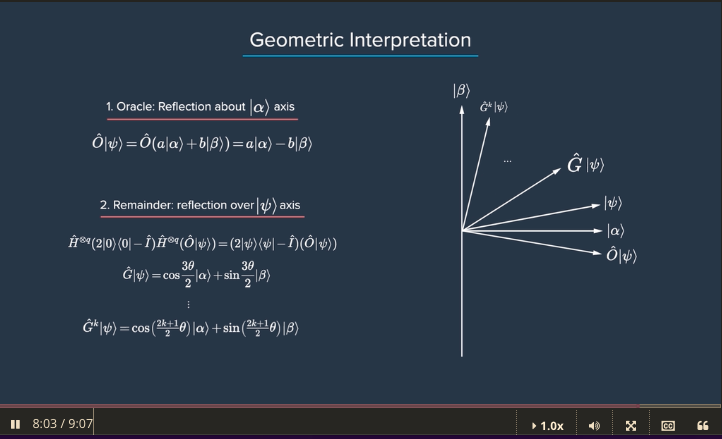

$$\hat{O}|\psi\rangle=\hat{O}(a|\alpha\rangle+b|\beta\rangle)=a|\alpha\rangle-b|\beta\rangle$$ $$\hat{H}^{\otimes q}(2|0\rangle\langle 0|-\hat{I})\hat{H}^{\otimes q}(\hat{O}|\psi\rangle)=(2|\psi\rangle\langle\psi|-\hat{I})(\hat{O}|\psi\rangle)$$ $$\hat{G}|\psi\rangle=\cos\frac{3\theta}{2}|\alpha\rangle+\sin\frac{3\theta}{2}|\beta\rangle$$ $$\hat{G}^{k}|\psi\rangle=\cos\left(\frac{2k+1}{2}\theta\right)|\alpha\rangle+\sin\left(\frac{2k+1}{2}\theta\right)|\beta\rangle$$

**Geometric Interpretation**

1. Oracle: Reflection about $|\alpha\rangle$ axis

$$\hat{O}|\psi\rangle=\hat{O}(a|\alpha\rangle+b|\beta\rangle)=a|\alpha\rangle-b|\beta\rangle$$

2. Remainder: reflection over $|\psi\rangle$ axis

$$\hat{H}^{\otimes q}(2|0\rangle\langle 0|-\hat{I})\hat{H}^{\otimes q}(\hat{O}|\psi\rangle)=(2|\psi\rangle\langle\psi|-\hat{I})(\hat{O}|\psi\rangle)$$

$$\hat{G}|\psi\rangle=\cos\frac{3\theta}{2}|\alpha\rangle+\sin\frac{3\theta}{2}|\beta\rangle$$

$$\vdots$$

$$\hat{G}^{k}|\psi\rangle=\cos\left(\frac{2k+1}{2}\theta\right)|\alpha\rangle+\sin\left(\frac{2k+1}{2}\theta\right)|\beta\rangle$$

Right-hand diagram: rays from the origin in the plane spanned by horizontal $|\alpha\rangle$ and vertical $|\beta\rangle$. From below the horizontal axis up toward $|\beta\rangle$ the labeled rays are $\hat{O}|\psi\rangle$, $|\alpha\rangle$ (horizontal), $|\psi\rangle$, $\hat{G}|\psi\rangle$, $\ldots$, $\hat{G}^{k}|\psi\rangle$.

00:08:03,160 \--\> 00:08:05,440

to push the vector toward the beta axis,

195

00:08:05,440 \--\> 00:08:08,020

increasing the likelihood that when a measurement is made,

196

00:08:08,020 \--\> 00:08:10,210

the state will be projected into a value of x

197

00:08:10,210 \--\> 00:08:13,130

that satisfies f of x equal 1.

198

00:08:13,130 \--\> 00:08:15,860

Lastly, we can show that the number of iterations R

199

00:08:15,860 \--\> 00:08:17,960

is of the order square root of n.

200

00:08:17,960 \--\> 00:08:21,080

The state CI is an angle gamma away from the beta axis,

201

00:08:21,080 \--\> 00:08:25,250

where gamma equals arccosine square root of M over N.

202

00:08:25,250 \--\> 00:08:27,830

and we know that each iteration pushes us an angle

203

00:08:27,830 \--\> 00:08:29,850

theta toward the beta axis.

204

00:08:29,850 \--\> 00:08:31,700

So the number of repetitions we need

205

00:08:31,700 \--\> 00:08:35,700

is the closest integer to the ratio of gamma over theta.

206

00:08:35,700 \--\> 00:08:38,690

We want to rotate the state CI at least pass pi over 4

207

00:08:38,690 \--\> 00:08:41,450

from the alpha axis so that the probability of measuring

208

00:08:41,450 \--\> 00:08:44,010

a beta solution is greater than a 1/2,

209

00:08:44,010 \--\> 00:08:46,640

In fact, we can place an upper bound on the number R,

210


<!-- frame 8:45 · diagram · week5/media/media/image37.png -->

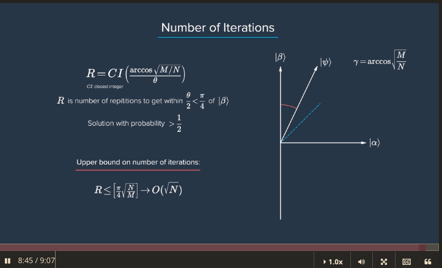

$$R=CI\left(\frac{\arccos\sqrt{M/N}}{\theta}\right)$$

$$\gamma=\arccos\sqrt{\frac{M}{N}}$$

$$\frac{\theta}{2}<\frac{\pi}{4}$$

$$R\le\left\lceil\frac{\pi}{4}\sqrt{\frac{N}{M}}\right\rceil\to O(\sqrt{N})$$

## Number of Iterations

$$R=CI\left(\frac{\arccos\sqrt{M/N}}{\theta}\right)$$

*CI: closest integer*

$R$ is number of repetitions to get within $\dfrac{\theta}{2}<\dfrac{\pi}{4}$ of $|\beta\rangle$

Solution with probability $>\dfrac{1}{2}$

### Upper bound on number of iterations:

$$R\le\left\lceil\frac{\pi}{4}\sqrt{\frac{N}{M}}\right\rceil\to O(\sqrt{N})$$

**Diagram:** horizontal axis $|\alpha\rangle$ (arrow right), vertical axis $|\beta\rangle$ (arrow up). A solid vector $|\psi\rangle$ lies close to $|\beta\rangle$. A dashed vector lies at a smaller angle, nearer $|\alpha\rangle$. A red arc marks the angle between $|\psi\rangle$ and the $|\beta\rangle$ axis. At the upper right:

$$\gamma=\arccos\sqrt{\frac{M}{N}}$$

00:08:46,640 \--\> 00:08:50,660

and it\'s pi/4 times the square root of M divided by N. This

211

00:08:50,660 \--\> 00:08:52,160

shows that Grover\'s algorithm will

212

00:08:52,160 \--\> 00:08:54,260

find a solution with high probability

213

00:08:54,260 \--\> 00:08:56,720

for only order square root of n iterations,

214

00:08:56,720 \--\> 00:08:59,710

whereas, it\'ll take a classical computer on the order of n

215

00:08:59,710 \--\> 00:09:01,260

queries.

216

00:09:01,260 \--\> 00:09:05,728

## **PRACTICE (1 question)**

## 
##  

Section: Digital simulation: Grover's Algorithm

# Page Title: Introduction to Grover's Algorithm on the Quantum Experience

# **Learn**

In this section, you will continue your exploration of the Grover search
algorithm, and learn how it is applied to a specific problem called the
\"exactly-1 3SAT\" problem.

## **Images**

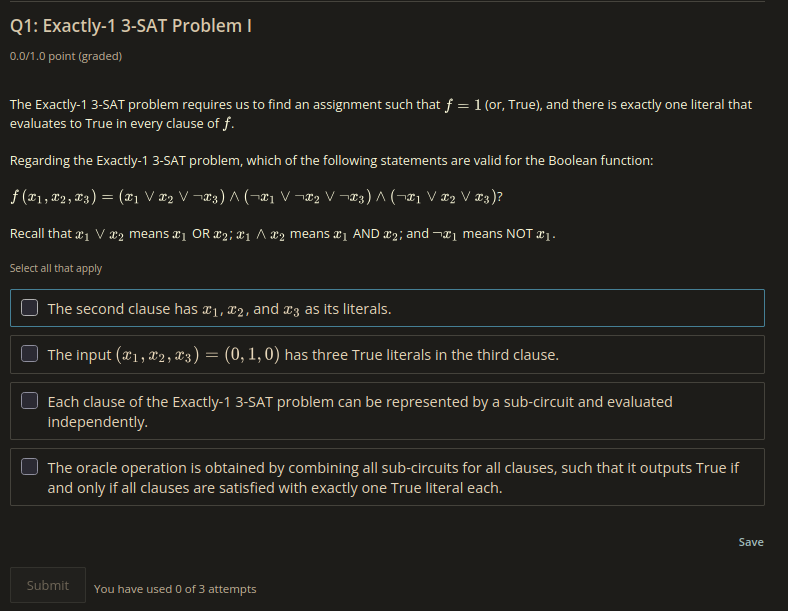

$$f(x_1,x_2,x_3)=(x_1\lor x_2\lor\neg x_3)\land(\neg x_1\lor\neg x_2\lor\neg x_3)\land(\neg x_1\lor x_2\lor x_3)$$

**Q1: Exactly-1 3-SAT Problem I**

0.0/1.0 point (graded)

The Exactly-1 3-SAT problem requires us to find an assignment such that $f=1$ (or, True), and there is exactly one literal that evaluates to True in every clause of $f$.

Regarding the Exactly-1 3-SAT problem, which of the following statements are valid for the Boolean function:

$$f(x_1,x_2,x_3)=(x_1\lor x_2\lor\neg x_3)\land(\neg x_1\lor\neg x_2\lor\neg x_3)\land(\neg x_1\lor x_2\lor x_3)?$$

Recall that $x_1\lor x_2$ means $x_1$ OR $x_2$; $x_1\land x_2$ means $x_1$ AND $x_2$; and $\neg x_1$ means NOT $x_1$.

Select all that apply

- [ ] The second clause has $x_1$, $x_2$, and $x_3$ as its literals.
- [ ] The input $(x_1,x_2,x_3)=(0,1,0)$ has three True literals in the third clause.
- [ ] Each clause of the Exactly-1 3-SAT problem can be represented by a sub-circuit and evaluated independently.
- [ ] The oracle operation is obtained by combining all sub-circuits for all clauses, such that it outputs True if and only if all clauses are satisfied with exactly one True literal each.

Save

Submit — You have used 0 of 3 attempts


## **Transcript**

## 

00

00:00:00,000 \--\> 00:00:00,110

1

00:00:00,110 \--\> 00:00:02,610

In this video, we will learn how to implement and run

2

00:00:02,610 \--\> 00:00:04,019

Grover\'s algorithm.

3

00:00:04,019 \--\> 00:00:06,030

First, let\'s briefly recall what\'s

4

00:00:06,030 \--\> 00:00:07,974

the problem solved by this algorithm,

5

00:00:07,974 \--\> 00:00:09,390

and what are its benefits compared

6

00:00:09,390 \--\> 00:00:11,140

to classical algorithms.

7

00:00:11,140 \--\> 00:00:13,920

Grover\'s algorithm is designed to solve a search problem that

8

00:00:13,920 \--\> 00:00:16,020

is completely unstructured.

9

00:00:16,020 \--\> 00:00:18,660

Imagine that we have a list of two to the n numbers,

10

00:00:18,660 \--\> 00:00:21,210

and we want to find the position of a given number that

11

00:00:21,210 \--\> 00:00:23,850

appears once in this list.

12

00:00:23,850 \--\> 00:00:25,870

If we know that the list is sorted,

13

00:00:25,870 \--\> 00:00:27,870

we can use binary search, and find the position

14

00:00:27,870 \--\> 00:00:31,230

of the desired number looking at just an element out of the two

15

00:00:31,230 \--\> 00:00:33,060

to the n in the list.

16

00:00:33,060 \--\> 00:00:36,420

But if we do not have any information whatsoever

17

00:00:36,420 \--\> 00:00:40,380

on the list, then we may have to look at all of its elements

18

00:00:40,380 \--\> 00:00:43,080

to find the position of the desired number.

19

00:00:43,080 \--\> 00:00:45,930

In fact, given any deterministic classical algorithm

20

00:00:45,930 \--\> 00:00:47,880

to solve this search problem, we can

21

00:00:47,880 \--\> 00:00:49,890

construct a list on which the algorithm has

22

00:00:49,890 \--\> 00:00:52,830

to look at all of the two to the n elements

23

00:00:52,830 \--\> 00:00:55,350

before it finds the correct answer.

24

00:00:55,350 \--\> 00:00:57,520

Even a randomized classical algorithm

25

00:00:57,520 \--\> 00:00:59,430

would have to look at approximately two

26

00:00:59,430 \--\> 00:01:01,530

to the n elements on average.

27

00:01:01,530 \--\> 00:01:04,900

Using a quantum algorithm, we can do better than this.

28

00:01:04,900 \--\> 00:01:07,200

Let\'s properly state your assumptions first.

29

00:01:07,200 \--\> 00:01:10,680

We have a function, f, that maps any n digit binary

30

00:01:10,680 \--\> 00:01:14,070

string into zero or one, with the property

31

00:01:14,070 \--\> 00:01:16,680

that there exists a unique binary string for which

32

00:01:16,680 \--\> 00:01:18,570

the function has value one.

33

00:01:18,570 \--\> 00:01:21,510

This is the magic binary string that we want to find.

34

00:01:21,510 \--\> 00:01:24,960

And let\'s call l the integer that corresponds to it.

35

00:01:24,960 \--\> 00:01:27,620

So that f of l is equal to one.

36


<!-- frame 1:28 · formula · week5/media/media/image10.png -->

$$f:\{0,\ldots,2^{n}-1\}\to\{0,1\}$$ $$f(l)=1$$ $$f(j)=0\quad j\neq l$$

00:01:27,620 \--\> 00:01:30,980

We want to determine l while evaluating f as few times

37

00:01:30,980 \--\> 00:01:32,540

as possible.

38

00:01:32,540 \--\> 00:01:35,300

Since there is no property of f that can be exploited,

39

00:01:35,300 \--\> 00:01:37,920

we know that we can do it in two to the n evaluations of f

40

00:01:37,920 \--\> 00:01:41,570

classically, simply by applying f to all binary strings.

41

00:01:41,570 \--\> 00:01:43,290

But can we do better?

42

00:01:43,290 \--\> 00:01:45,920

Grover\'s algorithm can do this with only the square root

43

00:01:45,920 \--\> 00:01:49,580

of two to the n evaluations of f, a quadratic improvement.

44

00:01:49,580 \--\> 00:01:51,260

It is assumed that the function f

45


<!-- frame 1:50 · diagram · week5/media/media/image11.png -->

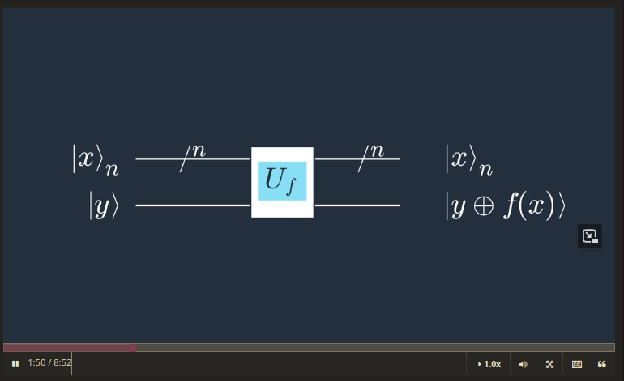

$$|x\rangle_{n}\xrightarrow{U_f}|x\rangle_{n}$$ $$|y\rangle\xrightarrow{U_f}|y\oplus f(x)\rangle$$

Oracle circuit. $U_f$ is drawn in a light-blue box. The top wire is an $n$-qubit bundle (slash labeled $n$ on both sides of the gate).

```
|x⟩_n  —— /n ——[ U_f ]—— /n ——  |x⟩_n
|y⟩    —————————[ U_f ]————————  |y ⊕ f(x)⟩
```

00:01:51,260 \--\> 00:01:54,890

is encoded by a quantum circuit that acts on n plus one qubits.

46

00:01:54,890 \--\> 00:01:57,280

The first n qubits are the input register.

47

00:01:57,280 \--\> 00:01:59,780

The last qubit is the output register.

48

00:01:59,780 \--\> 00:02:02,570

The circuit that implements f does not modify the input

49

00:02:02,570 \--\> 00:02:05,330

register, and it performs the modulo 2 addition

50

00:02:05,330 \--\> 00:02:08,180

between the output register and the result of f

51

00:02:08,180 \--\> 00:02:10,160

applied to the input register.

52

00:02:10,160 \--\> 00:02:12,890

Separating the input and the output registers

53

00:02:12,890 \--\> 00:02:16,220

is standard in the quantum world because it allows reversibility

54

00:02:16,220 \--\> 00:02:17,390

of the function.

55

00:02:17,390 \--\> 00:02:19,280

We are given a three-set formula that

56

00:02:19,280 \--\> 00:02:21,710

is the logical end of a series of clauses

57

00:02:21,710 \--\> 00:02:23,930

and Boolean variables, where each clause is

58

00:02:23,930 \--\> 00:02:28,790

the logical, or of three Boolean variables or their negation.

59

00:02:28,790 \--\> 00:02:32,120

We want to find an assignment of the Boolean variables

60

00:02:32,120 \--\> 00:02:35,240

that makes the formula evaluate to true, ensuring

61


<!-- frame 2:34 · diagram · week5/media/media/image34.png -->

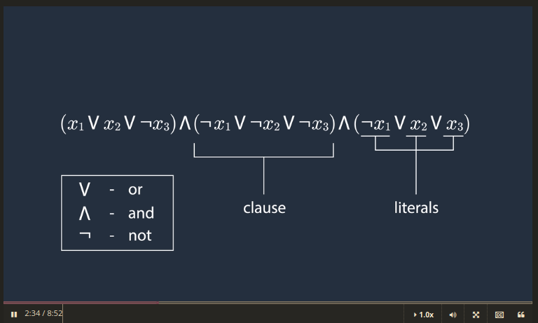

$$(x_1\vee x_2\vee\neg x_3)\wedge(\neg x_1\vee\neg x_2\vee\neg x_3)\wedge(\neg x_1\vee x_2\vee x_3)$$

$$(x_1\vee x_2\vee\neg x_3)\wedge(\neg x_1\vee\neg x_2\vee\neg x_3)\wedge(\neg x_1\vee x_2\vee x_3)$$

A bracket under the middle factor $(\neg x_1\vee\neg x_2\vee\neg x_3)$ is labeled **clause**.

Under the last factor, $\neg x_1$, $x_2$, and $x_3$ are each underlined and grouped by a bracket labeled **literals**.

Legend:

- $\vee$ — or
- $\wedge$ — and
- $\neg$ — not

00:02:35,240 \--\> 00:02:38,940

that there is exactly one true literal per clause.

62

00:02:38,940 \--\> 00:02:41,430

This is a variation of the well-know three-satisfiability

63

00:02:41,430 \--\> 00:02:43,770

problem, and it is NP-hard.

64

00:02:43,770 \--\> 00:02:47,220

In our implementation, when we use the instance of exactly one

65

00:02:47,220 \--\> 00:02:50,330

three-satisfiability, specified by the formula

66

00:02:50,330 \--\> 00:02:52,540

that you can see on the screen.

67

00:02:52,540 \--\> 00:02:56,300

In this video, we will only work with the formula shown here.

68

00:02:56,300 \--\> 00:02:59,180

To construct the function f, we need a quantum circuit

69

00:02:59,180 \--\> 00:03:02,330

that acts on qubits encoding the Boolean variables,

70

00:03:02,330 \--\> 00:03:05,240

and determines if this formula is satisfied.

71

00:03:05,240 \--\> 00:03:08,240

Notice that the circuit that implements f should simply

72

00:03:08,240 \--\> 00:03:11,090

be able to decide if the Boolean assignment corresponding

73

00:03:11,090 \--\> 00:03:15,730

to the binary string it is given as input satisfies the formula.

74

00:03:15,730 \--\> 00:03:18,320

Determining and returning the satisfying assignment

75

00:03:18,320 \--\> 00:03:20,070

we be the goal of Grover\'s algorithm,

76

00:03:20,070 \--\> 00:03:22,190

not of the function f.

77

00:03:22,190 \--\> 00:03:24,730

The example formula has three Boolean variables,

78


<!-- frame 3:24 · slide · week5/media/media/image16.png -->

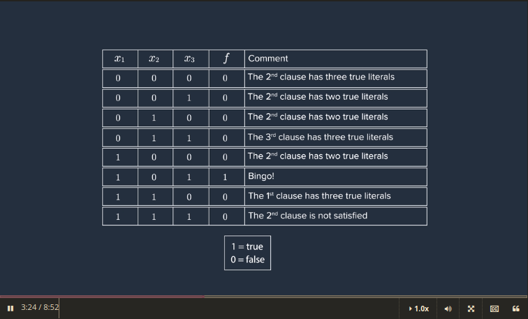

Truth table on a video slide. Legend under the table: $1=$ true, $0=$ false.

| $x_1$ | $x_2$ | $x_3$ | $f$ | Comment |
| --- | --- | --- | --- | --- |
| 0 | 0 | 0 | 0 | The 2nd clause has three true literals |
| 0 | 0 | 1 | 0 | The 2nd clause has two true literals |
| 0 | 1 | 0 | 0 | The 2nd clause has two true literals |
| 0 | 1 | 1 | 0 | The 3rd clause has three true literals |
| 1 | 0 | 0 | 0 | The 2nd clause has two true literals |
| 1 | 0 | 1 | 1 | Bingo! |
| 1 | 1 | 0 | 0 | The 1st clause has three true literals |
| 1 | 1 | 1 | 0 | The 2nd clause is not satisfied |

00:03:24,730 \--\> 00:03:26,560

x1, x2, and x3.

79

00:03:26,560 \--\> 00:03:28,450

There are eight possible assignments.

80

00:03:28,450 \--\> 00:03:31,360

And we can see in this table that only one

81

00:03:31,360 \--\> 00:03:33,970

possible assignment evaluates to true.

82

00:03:33,970 \--\> 00:03:36,150

You can verify this yourself.

83

00:03:36,150 \--\> 00:03:39,470

As usual, one means true and zero means false.

84

00:03:39,470 \--\> 00:03:42,770

Let\'s call uf the unitary matrix that implements f.

85

00:03:42,770 \--\> 00:03:45,247

We can implement uf in several ways.

86

00:03:45,247 \--\> 00:03:47,330

For simplicity, we have composed the problem

87

00:03:47,330 \--\> 00:03:50,420

of computing uf by introducing three auxiliary qubits, one

88

00:03:50,420 \--\> 00:03:51,800

for each clause.

89

00:03:51,800 \--\> 00:03:53,960

For each clause, we construct a circuit

90

00:03:53,960 \--\> 00:03:57,020

that sets the corresponding zero qubit to one

91


<!-- frame 3:55 · diagram · week5/media/media/image43.png -->

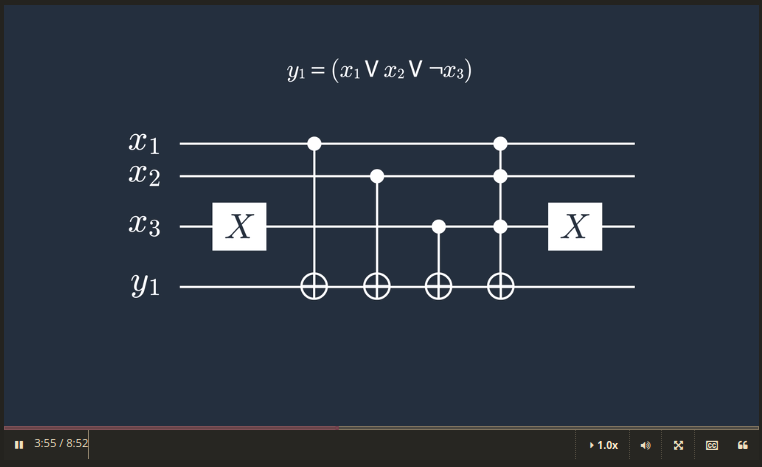

$$y_1=(x_1\vee x_2\vee\neg x_3)$$

$$y_1=(x_1\vee x_2\vee\neg x_3)$$

Quantum circuit, wires top to bottom: $x_1$, $x_2$, $x_3$, $y_1$. Left to right:

1. $X$ on $x_3$
2. CNOT, control $x_1$, target $y_1$ (line crosses $x_2$ and $x_3$ with no extra controls)
3. CNOT, control $x_2$, target $y_1$ (line crosses $x_3$ with no control)
4. CNOT, control $x_3$, target $y_1$
5. Multi-controlled $X$ with controls on $x_1$, $x_2$, and $x_3$, target $y_1$
6. $X$ on $x_3$

00:03:57,020 \--\> 00:04:01,830

if and only if the clause has exactly one true term.

92

00:04:01,830 \--\> 00:04:05,370

Finally, the output register of uf is set to one if and only

93

00:04:05,370 \--\> 00:04:08,490

if all three auxiliary qubits are one.

94

00:04:08,490 \--\> 00:04:11,970

For example, the circuit sets the bottom qubit,

95

00:04:11,970 \--\> 00:04:17,910

y1 to one for the close x1, or x2, or not x3.

96

00:04:17,910 \--\> 00:04:21,240

The x-gate flips the qubit corresponding to x3

97

00:04:21,240 \--\> 00:04:24,980

because x3 appears negated in the clause.

98

00:04:24,980 \--\> 00:04:32,390

Using three CNOT gates, we set y1 equal x1, x-or, x2, x-or, not

99

00:04:32,390 \--\> 00:04:36,300

x3, implying that y1 is equal to one

100

00:04:36,300 \--\> 00:04:39,930

if an odd number of literals is satisfied.

101

00:04:39,930 \--\> 00:04:42,390

Since we want y1 equals to one if and only

102

00:04:42,390 \--\> 00:04:45,030

if exactly one literal is satisfied,

103

00:04:45,030 \--\> 00:04:48,120

we use a triply-controlled not gate to finally implement

104

00:04:48,120 \--\> 00:04:50,130

the desired formula.

105

00:04:50,130 \--\> 00:04:54,130

The last x-gate simply resets the state of the qubit x3.

106

00:04:54,130 \--\> 00:04:55,750

In a similar way, we can implement

107

00:04:55,750 \--\> 00:04:58,160

the circuit that checks whether the second clause\--

108

00:04:58,160 \--\> 00:05:02,470

not x1, or not x2, or not x3\-- is satisfied,

109

00:05:02,470 \--\> 00:05:07,810

and one for the third clause\-- not x1, or x2, or x3.

110

00:05:07,810 \--\> 00:05:10,640

To implement this circuit there is a small obstacle,

111

00:05:10,640 \--\> 00:05:12,490

the triply-controlled not gate is not

112

00:05:12,490 \--\> 00:05:14,590

part of the basic gate set.

113

00:05:14,590 \--\> 00:05:17,080

Such a gate can be implemented in several ways.

114

00:05:17,080 \--\> 00:05:18,820

For simplicity, we choose to do it

115

00:05:18,820 \--\> 00:05:22,480

using 3 doubly-controlled not gates and one auxiliary qubit,

116

00:05:22,480 \--\> 00:05:24,910

as we show on the screen.

117

00:05:24,910 \--\> 00:05:27,190

In the circuit, we can quickly verify

118

00:05:27,190 \--\> 00:05:33,860

that q4 is set to one if and only if q0, q1, q2 are one.

119


<!-- frame 5:30 · diagram · week5/media/media/image15.png -->

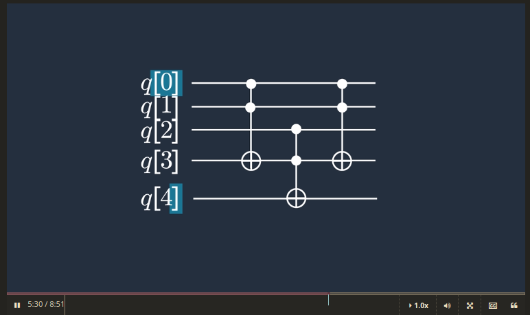

Five-qubit circuit. Labels $q[0]$ and $q[4]$ are highlighted blue. Three multi-controlled $X$ columns, left to right:

1. Controls on $q[0]$ and $q[1]$, target $\oplus$ on $q[3]$.
2. Controls on $q[0]$, $q[1]$, and $q[2]$, target $\oplus$ on $q[4]$.
3. Controls on $q[0]$ and $q[1]$, target $\oplus$ on $q[3]$.

```
q[0]  ——•————•————•——
q[1]  ——•————•————•——
q[2]  ———————•————————
q[3]  ——⊕————————⊕———
q[4]  ——————⊕—————————
```

00:05:33,860 \--\> 00:05:36,890

The final doubly-con trolled not resets the state

120

00:05:36,890 \--\> 00:05:38,870

of the auxiliary qubit q3.

121

00:05:38,870 \--\> 00:05:41,570

Remember that if you plan to re-use the auxiliary qubits,

122

00:05:41,570 \--\> 00:05:45,060

you should leave them in the same state as they begin.

123

00:05:45,060 \--\> 00:05:46,500

With this blocks, we can construct

124

00:05:46,500 \--\> 00:05:50,730

the full circuit that implements uf using four auxiliary qubits,

125


<!-- frame 5:50 · diagram · week5/media/media/image22.png -->

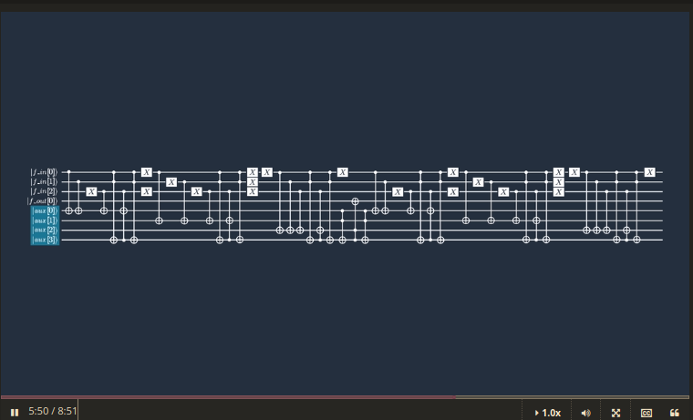

Wide Qiskit-style oracle circuit, eight wires top to bottom:

1. $|f_{\mathrm{in}}[0]\rangle$
2. $|f_{\mathrm{in}}[1]\rangle$
3. $|f_{\mathrm{in}}[2]\rangle$
4. $|f_{\mathrm{out}}[0]\rangle$
5. $\mathrm{anc}[0]$ (blue label)
6. $\mathrm{anc}[1]$ (blue label)
7. $\mathrm{anc}[2]$ (blue label)
8. $\mathrm{anc}[3]$ (blue label)

Gates are Pauli $X$ boxes, mostly on the three $f_{\mathrm{in}}$ wires (including a few stacked triples of $X$ on $|f_{\mathrm{in}}[0]\rangle$, $|f_{\mathrm{in}}[1]\rangle$, and $|f_{\mathrm{in}}[2]\rangle$), and many multi-controlled $X$ columns: filled control dots and $\oplus$ targets joined by vertical lines. Targets sit on $|f_{\mathrm{out}}[0]\rangle$ and the ancilla wires; controls sit on the $f_{\mathrm{in}}$ wires and, in later columns, on ancilla wires as well.

00:05:50,730 \--\> 00:05:52,680

one for each of the three clauses,

126

00:05:52,680 \--\> 00:05:55,110

and one for the triply-controlled not.

127

00:05:55,110 \--\> 00:05:57,060

For each of the three clauses, we

128

00:05:57,060 \--\> 00:05:59,670

set the corresponding auxiliary qubit to one

129

00:05:59,670 \--\> 00:06:01,840

if the clause is satisfied.

130

00:06:01,840 \--\> 00:06:04,890

Then we apply a logical end between these three

131

00:06:04,890 \--\> 00:06:06,420

auxiliary qubits.

132

00:06:06,420 \--\> 00:06:08,950

Finally, we run the same circuit in reverse

133


<!-- frame 6:08 · diagram · week5/media/media/image5.png -->

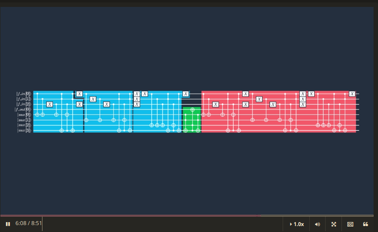

$$|f_{\mathrm{in}}[0]\rangle,\;|f_{\mathrm{in}}[1]\rangle,\;|f_{\mathrm{in}}[2]\rangle$$
$$|f_{\mathrm{out}}[0]\rangle$$
$$|\mathrm{aux}[0]\rangle,\;|\mathrm{aux}[1]\rangle,\;|\mathrm{aux}[2]\rangle,\;|\mathrm{aux}[3]\rangle$$

Video frame. Eight-wire quantum circuit, no measurements shown.

Left-edge labels, top to bottom:

- $|f_{\mathrm{in}}[0]\rangle$
- $|f_{\mathrm{in}}[1]\rangle$
- $|f_{\mathrm{in}}[2]\rangle$
- $|f_{\mathrm{out}}[0]\rangle$
- $|\mathrm{aux}[0]\rangle$
- $|\mathrm{aux}[1]\rangle$
- $|\mathrm{aux}[2]\rangle$
- $|\mathrm{aux}[3]\rangle$

Shaded regions left to right: several cyan blocks over all eight wires; then a short cyan cap on the upper wires with a green block on the lower wires; then a long red/pink region. Inside the blocks are boxed $X$ targets and open-circle controls joined by vertical lines. The $X$ boxes sit mostly on the $f_{\mathrm{in}}$ wires; open circles sit mostly on $|f_{\mathrm{out}}[0]\rangle$ and the aux wires. The green block is a lattice of open circles on the lower wires with no $X$ label inside it. Black vertical gaps separate some of the cyan blocks.

Player: 6:08 / 8:51, speed 1.0x.

00:06:08,950 \--\> 00:06:11,480

to reset the state of the auxiliary qubits.

134

00:06:11,480 \--\> 00:06:13,230

We have seen how to implement the function

135

00:06:13,230 \--\> 00:06:16,986

uf used in one of the building blocks of Grover\'s algorithm.

136

00:06:16,986 \--\> 00:06:18,360

Remember that Grover\'s algorithms

137

00:06:18,360 \--\> 00:06:22,290

has three steps, initialization, sign flip, and inversion

138

00:06:22,290 \--\> 00:06:23,730

about the average.

139

00:06:23,730 \--\> 00:06:26,220

Let\'s see how to implement these steps.

140

00:06:26,220 \--\> 00:06:28,170

We will use the first three qubits lines

141

00:06:28,170 \--\> 00:06:30,600

for the input, the fourth as output,

142

00:06:30,600 \--\> 00:06:33,750

and the remaining qubits will be auxiliary qubits.

143

00:06:33,750 \--\> 00:06:36,600

For the initialization, we apply Hadamard gates

144

00:06:36,600 \--\> 00:06:37,800

on the input lines.

145

00:06:37,800 \--\> 00:06:42,120

And on the output line, we apply an x-gate and then a Hadamard.

146

00:06:42,120 \--\> 00:06:44,700

This will be important for the science lab.

147

00:06:44,700 \--\> 00:06:47,070

At this point, the state of the input qubits

148

00:06:47,070 \--\> 00:06:48,930

is in the uniform superposition.

149

00:06:48,930 \--\> 00:06:50,580

All amplitudes are equal.

150

00:06:50,580 \--\> 00:06:53,130

For the sign flip, we simply applied the circuit

151

00:06:53,130 \--\> 00:06:55,140

that we constructed for uf.

152

00:06:55,140 \--\> 00:06:57,420

Because we prepared the state of the output qubit

153

00:06:57,420 \--\> 00:06:59,880

in the way we described, this has the effect

154

00:06:59,880 \--\> 00:07:02,070

of flipping the sign of the amplitude corresponding

155

00:07:02,070 \--\> 00:07:05,330

to the basis state for which uf outputs one.

156

00:07:05,330 \--\> 00:07:08,190

The last step is the inversion about the average.

157

00:07:08,190 \--\> 00:07:11,190

It is implemented by this simple circuit, which we can easily

158

00:07:11,190 \--\> 00:07:15,460

verify applies the matrix shown at the bottom.

159

00:07:15,460 \--\> 00:07:18,310

The matrix has the effect of mapping each amplitude

160

00:07:18,310 \--\> 00:07:22,900

to twice the average coefficient minus the amplitude itself.

161

00:07:22,900 \--\> 00:07:26,180

Because the average is smaller than most of the coefficients,

162

00:07:26,180 \--\> 00:07:29,530

all amplitudes except the negative one gets reduced.

163

00:07:29,530 \--\> 00:07:32,050

And the negative one gets amplified.

164

00:07:32,050 \--\> 00:07:34,840

This is one iteration of Grover\'s algorithm.

165

00:07:34,840 \--\> 00:07:37,030

The optimal number of iterations, k,

166

00:07:37,030 \--\> 00:07:39,130

can be found using the formula shown

167

00:07:39,130 \--\> 00:07:41,860

on the screen from which we derive that we

168

00:07:41,860 \--\> 00:07:44,050

must perform two iterations.

169

00:07:44,050 \--\> 00:07:47,080

This simply means that we should append to the overall circuit

170

00:07:47,080 \--\> 00:07:50,230

another copy of the circuit that performs a sign flip,

171

00:07:50,230 \--\> 00:07:52,160

and another copy of the circuit that

172

00:07:52,160 \--\> 00:07:54,790

performs the inversion about the average.

173

00:07:54,790 \--\> 00:07:56,080

And that\'s it.

174

00:07:56,080 \--\> 00:07:58,390

We can now run this circuit on the simulator

175

00:07:58,390 \--\> 00:08:00,260

and look at the results.

176

00:08:00,260 \--\> 00:08:02,380

This circuit is unfortunately a bit too large

177

00:08:02,380 \--\> 00:08:03,910

to run on a real device, so we will

178

00:08:03,910 \--\> 00:08:06,220

have to rely on the simulator.

179

00:08:06,220 \--\> 00:08:08,680

This is the histogram of the outcome probabilities

180

00:08:08,680 \--\> 00:08:11,590

after 2,048 samples.

181

00:08:11,590 \--\> 00:08:15,220

After two iterations and only two calls to the black box

182

00:08:15,220 \--\> 00:08:18,370

function uf, we sample the correct string,

183

00:08:18,370 \--\> 00:08:22,970

101 with probability of approximately 95%.

184

00:08:22,970 \--\> 00:08:25,930

In comparison, any deterministic classical algorithm

185


<!-- frame 8:26 · diagram · week5/media/media/image17.png -->

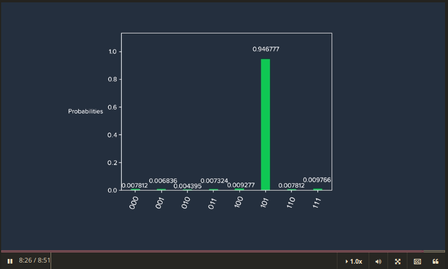

Bar chart of measurement probabilities. Vertical axis labeled **Probabilities**, ticks at 0.0, 0.2, 0.4, 0.6, 0.8, and 1.0. Horizontal axis is the 3-bit outcomes. The bar for `101` is near 1 and is drawn green; the others are small.

| Outcome | Probability |
| --- | --- |
| 000 | 0.007812 |
| 001 | 0.006836 |
| 010 | 0.004395 |
| 011 | 0.007324 |
| 100 | 0.009277 |
| 101 | 0.948777 |
| 110 | 0.007812 |
| 111 | 0.009766 |

00:08:25,930 \--\> 00:08:29,120

would have needed eight calls in the worst case.

186

00:08:29,120 \--\> 00:08:31,330

Notice that as we increase the number of iterations

187

00:08:31,330 \--\> 00:08:33,059

of Grover\'s algorithm, the probability

188

00:08:33,059 \--\> 00:08:36,659

of sampling the correct string actually goes down.

189

00:08:36,659 \--\> 00:08:38,919

This is the histogram for three iterations,

190

00:08:38,919 \--\> 00:08:41,690

and the probability dropped down to 32%.

191

00:08:41,690 \--\> 00:08:45,180

The number of iterations must be chosen optimally.

192

00:08:45,180 \--\> 00:08:49,707

## **PRACTICE (1 question)**
##  

Section:

# Page Title:Lab practicum: Grover's algorythm

# **Learn**

Recent IBMQ and government security policies have necessitated some
changes to our course experience. Previously, we had been able to offer
learners access to a coding interface on our learning platform that
connected directly to IBM\'s quantum cloud computing hardware. However,
it is now required that every individual who accesses IBM\'s cloud
computer *must* have their own account; we are no longer allowed to have
learners access these machines through MIT xPRO\'s shared account.

We invite you to [[create a free IBM
ID]{.underline}](https://quantum.ibm.com/) to access their cloud
computing site. On IBM\'s site, you will be able to work directly with
their graphic composer to build, run, and analyze quantum algorithms. At
the end of this section, we suggest an IBM tutorial to get started with
working on IBM\'s composer tool to explore gates and build circuits.

Additionally, once you set up an IBM account, you can explore [[IBM\'s
full catalog of
tutorials]{.underline}](https://learning.quantum.ibm.com/catalog/tutorials)
that can guide you on other quantum coding exercises.

The [[IBM Quantum
Experience]{.underline}](https://quantum-computing.ibm.com/login)
platform allows anyone with access to the internet to write and run
quantum algorithms on a real quantum computer. In this section, we will
review state tomography and density matrices. We encourage you to
[[register]{.underline}](https://auth.quantum-computing.ibm.com/auth/idaas)
on the IBM page to access the composer\'s graphical interface to try
your hand at working on the suggested activity.

The IBM Q composer allows one to express quantum circuits and quantum
algorithms in a simple graphical way, and on the IBM Q site you will be
able to save the results of your programs and access them later. To
introduce you to the use of the platform, IBM has a comprehensive [[user
guide]{.underline}](https://quantum-computing.ibm.com/docs/).

Once in the composer, you can create a new experiment and choose if you
want to run your program on a real quantum computer, or to simulate it
using a classical computer. When you decide to run your code on the
quantum computer, you will have to choose the number of times that you
want to run the code and which \"backend\" you will use. There are a
number of [[possible
backends]{.underline}](https://quantum.ibm.com/services/resources) on
which you can run your codes. You can [[learn more about these
backends]{.underline}](https://docs.quantum.ibm.com/guides/get-qpu-information#list-backends)
in the IBMQ documentation portal.

The IBM Q Experience platform not only allows you to use the composer,
but it also allows you write your code using Open QASM (Quantum Assembly
Language). This is a simple text language that has elements of C and
assembly languages. By using QASM you can describe any quantum circuit,
in principle, since it has built in a universal set of quantum gates. In
this section, you will learn how to express quantum circuits and write
quantum algorithms using QASM. If you want to learn more about the
theory behind QASM, we recommend that you read the following paper
written by IBM researchers (including former MIT graduate students):
[[Open Quantum Assembly
Language]{.underline}](https://arxiv.org/pdf/1707.03429.pdf).

If you choose to set up an account with IBMQ (or another cloud quantum
provider), you\'ll need to be patient. Any run requests must be queued
for execution, since hardware availability is limited and the access to
these cloud computers has a global reach.

### **Syntax of QASM**

The figure below shows the IBM composer for five qubits. Each horizontal
line, also called quantum wire, represents the evolution of a qubit with
time proceeding from left to right. The five qubits are labeled in order
as: q\[0\], q\[1\], q\[2\], q\[3\] and q\[4\]. The qubits are always
initialized in the quantum state:

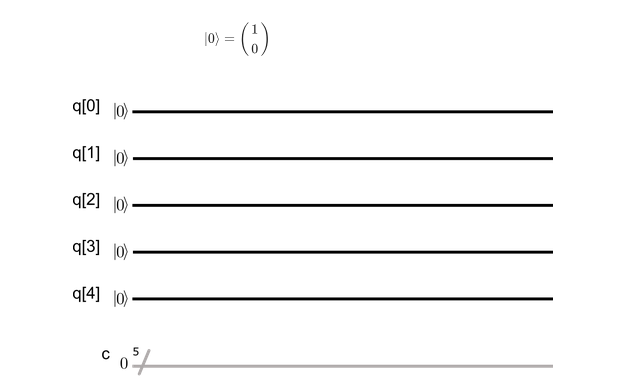

$$|0\rangle=\begin{pmatrix}1\\0\end{pmatrix}$$

Initialized five-qubit register, each wire in $|0\rangle$, plus a 5-bit classical bundle.

$$|0\rangle=\begin{pmatrix}1\\0\end{pmatrix}$$

```
q[0] |0⟩ ——————————
q[1] |0⟩ ——————————
q[2] |0⟩ ——————————
q[3] |0⟩ ——————————
q[4] |0⟩ ——————————
c  0⁵ / ——————————
```

The classical label is $c$, index $0$, width $5$, drawn with the usual slash on the bundled classical wire.

Classical bits \-- used to store measurement results \-- are indicated
by the letter \"c\" and the number \"5\" indicates that there are five
classical bits in the register being represented with the grey line.

The figure below shows a graphical representation of adding a
measurement block to the first qubit. The vertical grey line indicates
that the measurement result will be stored in the classical bit
register. The number below the grey arrowhead indicates into which
classical bit the result will be stored. In this case, the result is
stored in bit c\[0\].

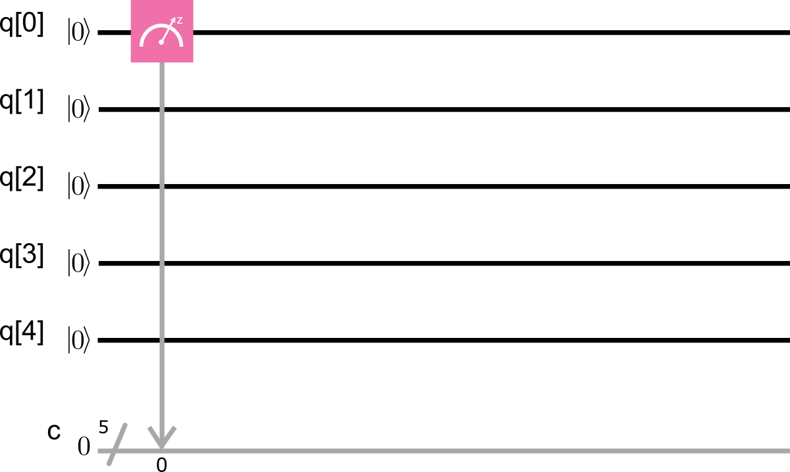

Circuit fragment on a black background. A pink square holds a white meter icon: a semicircular gauge, a needle toward the upper right, and a $z$ with an upward arrow. A vertical gray wire drops from that box to a horizontal classical wire. At the junction the classical wire has a slash (bundled register) and a downward arrow.

The following QASM code implements the quantum circuit above:

1 include \"qelib1.inc\";

2 qreg q\[5\];

3 creg c\[5\];

4

5 // This is a comment

6 measure q\[0\] -\> c\[0\];

Let\'s take a look at what each line of the previous code does.

-   Line 1: Includes all gates in the quantum gate library. By adding
    > this, you can then use the X-gate, Y-gate, Z-gate, CNOT gate, etc.
    > Notice that **each line has to end in a semicolon \";\" (without
    > quotes)**.

-   Line 2: Defines a quantum register of five qubits. In this example,
    > you are using five qubits but you can elect to use any number of
    > qubits from one to five. Note that even if you define a two-qubit
    > register, the quantum circuits depicted here and at the IBM
    > quantum experience site will always graphically illustrate all
    > five qubits by default. This is because the physical quantum
    > computer being used has 5 qubits. Nonetheless, you can choose to
    > work with only a subset of those five qubits.

-   Line 3: Defines a classical register of five bits. This register is
    > used to store the quantum measurement results. As with the quantum
    > register, even if you define a two-bit classical register, the
    > quantum circuits will still indicate all five bits by the gray
    > line. Nonetheless, you can choose to work with only a subset of
    > those five bits.

-   Line 4: You can insert blank lines to help you organize your
    > sections.

-   Line 5: You can also insert comments using the \"//\" (two
    > back-slashes, without quotes) . This helps other readers
    > understand your intention in each line. **Text that appears after
    > the \"//\" (without quotes) is not evaluated.\
    > **

-   Line 6: Measures the first qubit q\[0\] and stores the measurement
    > result in bit c\[0\]. You could alternatively store the
    > information on c\[1\], but, for organizational purposes, we
    > recommend a direct numerical mapping q\[0\] to c\[0\].

## **Transcript (no video in this page)**

## **PRACTICE (1 question)**

## 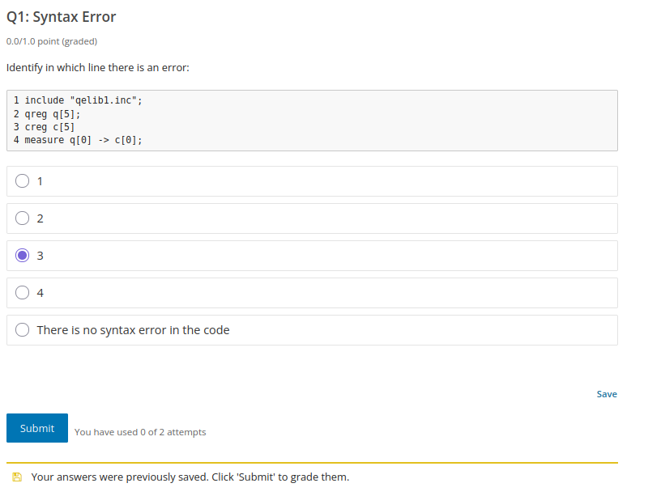

## Q1: Syntax Error

0.0/1.0 point (graded)

Identify in which line there is an error:

```
1 include "qelib1.inc";
2 qreg q[5];
3 creg c[5]
4 measure q[0] -> c[0];
```

- 1
- 2
- 3 *(selected)*
- 4
- There is no syntax error in the code

Save

**Submit** — You have used 0 of 2 attempts

Your answers were previously saved. Click 'Submit' to grade them.

## 

##  

Section: Lab practicum: Grover's Algorithm

# Page Title: Grover's algorithm: Introduction

# **Learn**

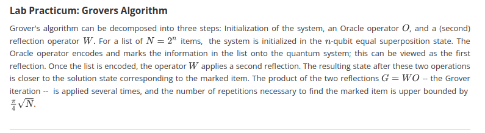

$$N=2^{n}$$ $$G=WO$$ $$\frac{\pi}{4}\sqrt{N}$$

**Lab Practicum: Grovers Algorithm**

Grover's algorithm can be decomposed into three steps: Initialization of the system, an Oracle operator $O$, and a (second) reflection operator $W$. For a list of $N=2^{n}$ items, the system is initialized in the $n$-qubit equal superposition state. The Oracle operator encodes and marks the information in the list onto the quantum system; this can be viewed as the first reflection. Once the list is encoded, the operator $W$ applies a second reflection. The resulting state after these two operations is closer to the solution state corresponding to the marked item. The product of the two reflections $G=WO$ -- the Grover iteration -- is applied several times, and the number of repetitions necessary to find the marked item is upper bounded by

$$\frac{\pi}{4}\sqrt{N}.$$

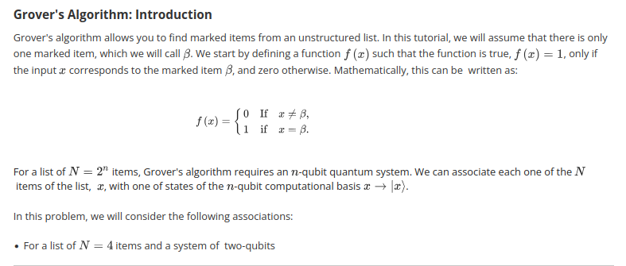

$$f(x)=\begin{cases} 0 & \text{If } x\neq\beta, \\ 1 & \text{if } x=\beta. \end{cases}$$

$$N=2^n$$

$$x\to |x\rangle$$

$$N=4$$

## Grover's Algorithm: Introduction

Grover's algorithm allows you to find marked items from an unstructured list. In this tutorial, we will assume that there is only one marked item, which we will call $\beta$. We start by defining a function $f(x)$ such that the function is true, $f(x)=1$, only if the input $x$ corresponds to the marked item $\beta$, and zero otherwise. Mathematically, this can be written as:

$$f(x)=\begin{cases} 0 & \text{If } x\neq\beta, \\ 1 & \text{if } x=\beta. \end{cases}$$

For a list of $N=2^n$ items, Grover's algorithm requires an $n$-qubit quantum system. We can associate each one of the $N$ items of the list, $x$, with one of states of the $n$-qubit computational basis $x\to|x\rangle$.

In this problem, we will consider the following associations:

- For a list of $N=4$ items and a system of two-qubits

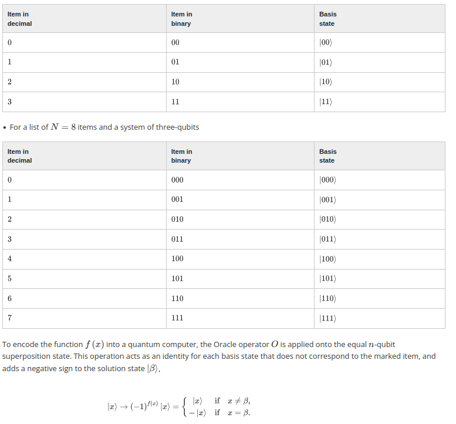

$$|x\rangle\to(-1)^{f(x)}|x\rangle=\begin{cases}|x\rangle&\text{if }x\neq\beta,\\ -|x\rangle&\text{if }x=\beta.\end{cases}$$

Two encoding tables, then the oracle sign flip.

| Item in decimal | Item in binary | Basis state |
| --- | --- | --- |
| 0 | 00 | \|00⟩ |
| 1 | 01 | \|01⟩ |
| 2 | 10 | \|10⟩ |
| 3 | 11 | \|11⟩ |

- For a list of $N=8$ items and a system of three-qubits

| Item in decimal | Item in binary | Basis state |
| --- | --- | --- |
| 0 | 000 | \|000⟩ |
| 1 | 001 | \|001⟩ |
| 2 | 010 | \|010⟩ |
| 3 | 011 | \|011⟩ |
| 4 | 100 | \|100⟩ |
| 5 | 101 | \|101⟩ |
| 6 | 110 | \|110⟩ |
| 7 | 111 | \|111⟩ |

To encode the function $f(x)$ into a quantum computer, the Oracle operator $O$ is applied onto the equal $n$-qubit superposition state. This operation acts as an identity for each basis state that does not correspond to the marked item, and adds a negative sign to the solution state $|\beta\rangle$,

$$|x\rangle\to(-1)^{f(x)}|x\rangle=\begin{cases}|x\rangle&\text{if }x\neq\beta,\\ -|x\rangle&\text{if }x=\beta.\end{cases}$$

## $$f(x)=\begin{cases}0& \text{if }x=00,01,11,\\ 1& \text{if }x=10.\end{cases}$$
$$|00\rangle\to(-1)^{f(00)}|00\rangle=|00\rangle$$
$$|01\rangle\to(-1)^{f(01)}|01\rangle=|01\rangle$$
$$|10\rangle\to(-1)^{f(10)}|10\rangle=-|10\rangle$$
$$|11\rangle\to(-1)^{f(11)}|11\rangle=|11\rangle$$

- **$N=4$ example:** If the marked item is $\beta=2$ in decimal, then the function $f$ is given by

$$f(x)=\begin{cases}0 & \text{if }x=00,01,11,\\ 1 & \text{if }x=10.\end{cases}$$

and therefore the oracle $O$ must transform the state according to:

$$|00\rangle\to(-1)^{f(00)}|00\rangle=|00\rangle,$$

$$|01\rangle\to(-1)^{f(01)}|01\rangle=|01\rangle,$$

$$|10\rangle\to(-1)^{f(10)}|10\rangle=-|10\rangle,$$

$$|11\rangle\to(-1)^{f(11)}|11\rangle=|11\rangle.$$

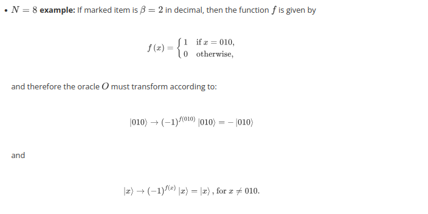

$$f(x)=\begin{cases} 1 & \text{if } x=010, \\ 0 & \text{otherwise,} \end{cases}$$

$$|010\rangle \to (-1)^{f(010)}|010\rangle = -|010\rangle$$

$$|x\rangle \to (-1)^{f(x)}|x\rangle = |x\rangle,\ \text{for } x\neq 010.$$

- **$N=8$ example:** If marked item is $\beta=2$ in decimal, then the function $f$ is given by

$$f(x)=\begin{cases} 1 & \text{if } x=010, \\ 0 & \text{otherwise,} \end{cases}$$

and therefore the oracle $O$ must transform according to:

$$|010\rangle \to (-1)^{f(010)}|010\rangle = -|010\rangle$$

and

$$|x\rangle \to (-1)^{f(x)}|x\rangle = |x\rangle,\ \text{for } x\neq 010.$$

## **Transcript (there is no video in this page)**

## **PRACTICE ( 1 question)**

## 

$$N=512$$

# Q1: How Many Qubits? N=512

0.0/1.0 point (graded)

For a list of $N=512$ items, how many qubits would you need to implement Grover's algorithm?

- (selected) 9 qubits
- ( ) 512 qubits
- ( ) $2^{512}$ qubits
- ( ) $2\cdot 512$ qubits

Save

Submit (highlighted). You have used 0 of 2 attempts.

Your answers were previously saved. Click 'Submit' to grade them.

## 

Section: Qiz

# Page Title: Quantum optimization Qiz

## **PRACTICE (5 questions)**

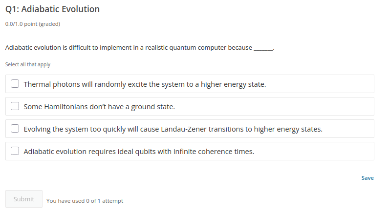

## Q1: Adiabatic Evolution

0.0/1.0 point (graded)

Adiabatic evolution is difficult to implement in a realistic quantum computer because ______.

Select all that apply

- [ ] Thermal photons will randomly excite the system to a higher energy state.
- [ ] Some Hamiltonians don't have a ground state.
- [ ] Evolving the system too quickly will cause Landau-Zener transitions to higher energy states.
- [ ] Adiabatic evolution requires ideal qubits with infinite coherence times.

Save

Submit (inactive) — You have used 0 of 1 attempt

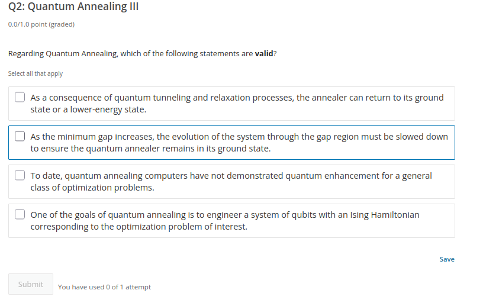

## Q2: Quantum Annealing III

0.0/1.0 point (graded)

Regarding Quantum Annealing, which of the following statements are **valid**?

Select all that apply

- [ ] As a consequence of quantum tunneling and relaxation processes, the annealer can return to its ground state or a lower-energy state.
- [ ] As the minimum gap increases, the evolution of the system through the gap region must be slowed down to ensure the quantum annealer remains in its ground state. *(choice outlined in blue; checkbox empty)*
- [ ] To date, quantum annealing computers have not demonstrated quantum enhancement for a general class of optimization problems.
- [ ] One of the goals of quantum annealing is to engineer a system of qubits with an Ising Hamiltonian corresponding to the optimization problem of interest.

Save

Submit (inactive) — You have used 0 of 1 attempt

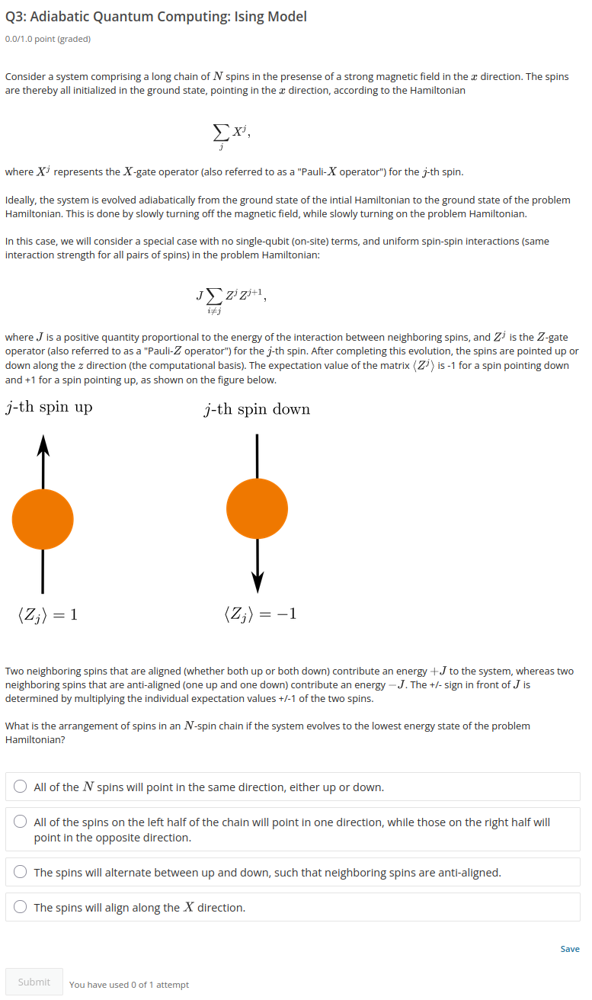

$$\sum_j X^j$$
$$J\sum_{i\neq j} Z^i Z^{j+1}$$
$$\langle Z_j\rangle=1$$
$$\langle Z_j\rangle=-1$$

# Q3: Adiabatic Quantum Computing: Ising Model

0.0/1.0 point (graded)

Consider a system comprising a long chain of $N$ spins in the presence of a strong magnetic field in the $x$ direction. The spins are thereby all initialized in the ground state, pointing in the $x$ direction, according to the Hamiltonian

$$\sum_j X^j,$$

where $X^j$ represents the $X$-gate operator (also referred to as a "Pauli-$X$ operator") for the $j$-th spin.

Ideally, the system is evolved adiabatically from the ground state of the intial Hamiltonian to the ground state of the problem Hamiltonian. This is done by slowly turning off the magnetic field, while slowly turning on the problem Hamiltonian.

In this case, we will consider a special case with no single-qubit (on-site) terms, and uniform spin-spin interactions (same interaction strength for all pairs of spins) in the problem Hamiltonian:

$$J\sum_{i\neq j} Z^i Z^{j+1},$$

where $J$ is a positive quantity proportional to the energy of the interaction between neighboring spins, and $Z^j$ is the $Z$-gate operator (also referred to as a "Pauli-$Z$ operator") for the $j$-th spin. After completing this evolution, the spins are pointed up or down along the $z$ direction (the computational basis). The expectation value of the matrix $\langle Z^j\rangle$ is -1 for a spin pointing down and +1 for a spin pointing up, as shown on the figure below.

- $j$-th spin up: orange circle, arrow up, $\langle Z_j\rangle=1$
- $j$-th spin down: orange circle, arrow down, $\langle Z_j\rangle=-1$

Two neighboring spins that are aligned (whether both up or both down) contribute an energy $+J$ to the system, whereas two neighboring spins that are anti-aligned (one up and one down) contribute an energy $-J$. The $+/-$ sign in front of $J$ is determined by multiplying the individual expectation values $+/-1$ of the two spins.

What is the arrangement of spins in an $N$-spin chain if the system evolves to the lowest energy state of the problem Hamiltonian?

- ( ) All of the $N$ spins will point in the same direction, either up or down.
- ( ) All of the spins on the left half of the chain will point in one direction, while those on the right half will point in the opposite direction.
- ( ) The spins will alternate between up and down, such that neighboring spins are anti-aligned.
- ( ) The spins will align along the $X$ direction.

Save

Submit. You have used 0 of 1 attempt.

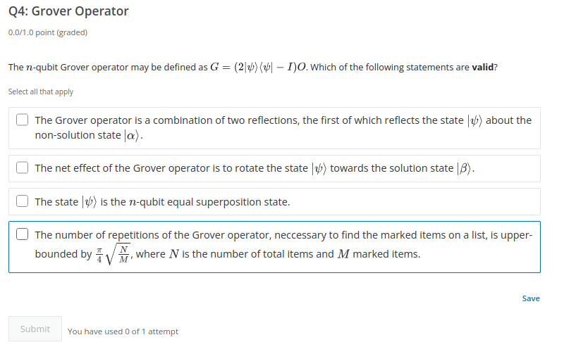

$$G=(2|\psi\rangle\langle\psi|-I)O$$

$$\frac{\pi}{4}\sqrt{\frac{N}{M}}$$

## Q4: Grover Operator

0.0/1.0 point (graded)

The $n$-qubit Grover operator may be defined as $G=(2|\psi\rangle\langle\psi|-I)O$. Which of the following statements are **valid**?

Select all that apply

- [ ] The Grover operator is a combination of two reflections, the first of which reflects the state $|\psi\rangle$ about the non-solution state $|\alpha\rangle$.
- [ ] The net effect of the Grover operator is to rotate the state $|\psi\rangle$ towards the solution state $|\beta\rangle$.
- [ ] The state $|\psi\rangle$ is the $n$-qubit equal superposition state.
- [ ] The number of repetitions of the Grover operator, neccessary to find the marked items on a list, is upper-bounded by $\dfrac{\pi}{4}\sqrt{\dfrac{N}{M}}$, where $N$ is the number of total items and $M$ marked items. *(choice outlined in blue; checkbox empty)*

Save

Submit (inactive) — You have used 0 of 1 attempt

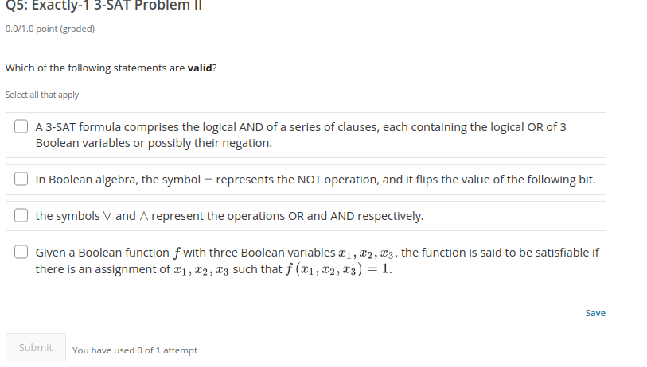

$$f(x_1,x_2,x_3)=1$$

## Q5: Exactly-1 3-SAT Problem II

0.0/1.0 point (graded)

Which of the following statements are **valid**?

Select all that apply

- [ ] A 3-SAT formula comprises the logical AND of a series of clauses, each containing the logical OR of 3 Boolean variables or possibly their negation.
- [ ] In Boolean algebra, the symbol $\neg$ represents the NOT operation, and it flips the value of the following bit.
- [ ] the symbols $\vee$ and $\wedge$ represent the operations OR and AND respectively.
- [ ] Given a Boolean function $f$ with three Boolean variables $x_1,x_2,x_3$, the function is said to be satisfiable if there is an assignment of $x_1,x_2,x_3$ such that $f(x_1,x_2,x_3)=1$.

Save

Submit (inactive) — You have used 0 of 1 attempt

##  

## 
