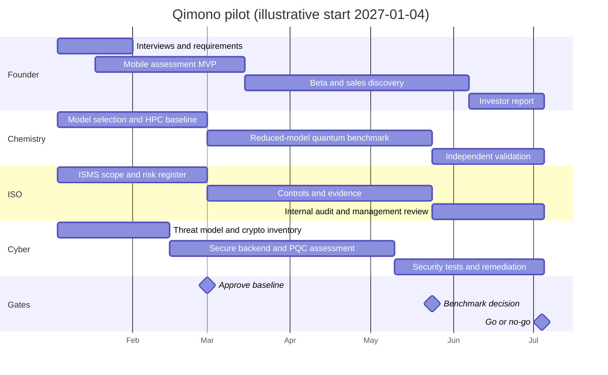

# Qimono: $275,000 angel-funded pilot

Hypothetical six-month runway after funding closes; four proposed team members, not confirmed hires. USD, gross contractor allocations, no equity terms assumed. This is an assessment business plus reduced-model chemistry R&D, not a promise to solve FeMoco.

## Team and budget

| Line | IBM route | IonQ via Braket route |
|---|---:|---:|
| Founder/developer (Qiskit, PennyLane, Q#, Python, React Native/Expo, Power Apps), 6 x $6,000 | 36,000 | 36,000 |
| Computational chemist, 6 x $7,000 | 42,000 | 42,000 |
| ISO/ISMS lead, 6 x $4,000 | 24,000 | 24,000 |
| Cybersecurity engineer, 6 x $5,000 | 30,000 | 30,000 |
| Classical HPC and storage | 22,000 | 22,000 |
| QPU access | 28,800 | 28,800 |
| Grok Ultra, 4 seats x 6 x $200 | 4,800 | 4,800 |
| App, backend, store fees, testing | 6,000 | 6,000 |
| Independent audit/certification reserve | 12,000 | 12,000 |
| Travel, including proposed UNAHUR visit | 4,000 | 4,000 |
| Legal, insurance, accounting | 8,000 | 8,000 |
| Tax/FX/contingency | 32,400 | 32,400 |
| **Original operating budget** | **250,000** | **250,000** |
| Local SpinQ lab acquisition ceiling | 25,000 | 25,000 |
| **Total** | **275,000** | **275,000** |

These are alternative budgets, not cumulative. Compensation assumes negotiated contractor/part-time scope (founder full-time, chemistry ~0.8 FTE, ISO ~0.4, cyber ~0.5; adjust rates/benefits locally). Cloud prices exclude taxes. Reserve must cover any local employment/tax obligations or scope must shrink.

IBM Flex starts at 400 minutes annually × $72 = $28,800; confirm eligibility, contract duration, backend access, expiration, and tax before purchase. PAYG alternative 300 minutes × $96 = $28,800 at starting price. [IBM pricing](https://www.ibm.com/quantum/products).

AWS Braket IonQ Forte on-demand: 350 tasks × ($0.30 + 1,000 shots × $0.08) = $28,105; $695 reserve within QPU line. Validate region, availability, minimum shots and mitigation overhead. This is a shot budget, not equivalent to IBM minutes. [AWS pricing](https://aws.amazon.com/braket/pricing/). Optional mixed-platform pilot: use PAYG IBM and Braket within same cap, reduce runs. No access purchased. Grok top current published self-service tier Ultra $200/seat/month; legacy Heavy availability uncertain. [official pricing](https://docs.x.ai/x-subscription/pricing). AI tool subscriptions are not API credits; never send confidential client data absent approved contractual controls.

## Existing technical portfolio and local lab

Founder stack: Qiskit, PennyLane and Q# (user-described portfolio; [QU repository](https://github.com/qimono-repos/qu) README explicitly documents Q#), Python, React Native/Expo and prior collaborative Gantt Power Apps development. Cybersecurity: [PROXORA](https://github.com/qimono-repos/proxora) README documents self-contained Debian packaging and post-quantum release verification; extend into Ubuntu/Debian package provenance, crypto-agility and signed release verification, not a claim of whole-system quantum safety.

Local lab: $25k acquisition ceiling added to original $250k; user reports previous base quote $19k, not independently verified. [SpinQ Gemini Mini series](https://www.spinq.com/en/products-services/spinq-gemini-mini) is two-qubit NMR NMR hardware; intended commercial local physical algorithm POCs, not teaching. Target three-qubit [Triangulum](https://www.spinq.com/products-services/spinq-triangulum) within $25k if quoted. RFQ sent to official sales address November 24 requesting operational deadline March 7, direct delivery or Australian authorized distributor collection, offline operation, local Ubuntu/Debian server SDK/API, Qiskit/PennyLane/Q#/OpenQASM adapters, fidelity, raw signals, licensing, calibration, acceptance and warranty. No purchase commitment. Request best configuration, SDK, warranty, training, dimensions and Australian collection option. Two proposed Argentina-based collaborators; former teammate may return March 2027 (must be early enough to meet deadline or choose direct delivery), no confirmed role or additional salary. Collection is conditional on legal import/export, airline and vendor approval; [ARCA baggage exclusions](https://www.arca.gob.ar/viajeros/ayuda/objetos.asp) distinguish commercial/industrial goods. Keep landed costs within cap or obtain new approval. Lab complements rather than replaces cloud hardware; no FeMoco-scale claims. Acceptance deadline March 7, 2027 (first week; earlier preferred): quote, import approval, serial asset registration, documented acceptance circuits, safety and support arrangements. Investor receives equity/contractual rights only if agreed; equipment ownership remains company asset unless contract specifies otherwise.

Live delivery: [[analyses/qimono-live-delivery]] is the twelve-sprint operating model. Existing Mermaid baseline below remains a portable view; live actual dates will supersede it.

## Six-month Gantt (relative to funding)

M1: 10 customer interviews, 4 signed role agreements, model/ISMS scope. M2: reproducible classical reference for at least 2 reduced instances, tested intake MVP, all assets in scope inventoried. M3: pre-register accuracy/time/cost, approve QPU spend, 10 beta testers. M4: 3 repeated benchmark runs per selected instance where budget allows, 3 qualified prospects. M5: 2 design-partner assessments targeted, no unresolved critical vulnerabilities, all risk treatments assigned. M6: independent review, 2 paid pilots targeted (not traction), report with go/no-go and next budget. On chemistry, agree tolerance with chemist, e.g. 1 kcal/mol on specified energy differences, uncertainty and total cost; no promise to reach it. If baseline or demand fails, stop discretionary spend.

ISO/IEC 27001:2022 (+ Amd 1:2024) ISMS scope: assessment app, backend, consulting data. Target 100% identified in-scope assets inventoried, 100% high risks assigned, documented Statement of Applicability, supplier review, incident exercise, tested restoration, internal audit, management review, no open critical findings before external audit. Independent accredited certification body alone can issue certification; readiness is not certification. ISO 9001 for quality/process control; ISO/IEC 42001 optional for AI governance; industrial homologation/customer qualification separate. [ISO](https://www.iso.org/standard/27001). Qimono offering: ISO certification readiness and coordination, no issuing certificates. Visit to UNAHUR subject to invitation: [university announcement](https://unahur.edu.ar/la-unahur-incorpora-la-primera-computadora-cuantica-del-sistema-universitario-argentino/); educational SpinQ equipment, not industrial QPU substitute.

## Angel pitch (practice, not submitted)

What if the biggest threat to your competitive advantage is a computational breakthrough your competitor sees before you do?

Qimono helps companies identify where quantum computing could improve their business, and where conventional computing remains the right choice. We also help them prepare for quantum-era cybersecurity risks.

Our first product is a mobile assessment: a company identifies its sector, size and competitive landscape, and receives an initial readiness profile and an invitation to a deeper consultation. We sell fixed-scope assessments, followed by paid benchmarking and implementation engagements.

Our technical differentiator is evidence. We compare the best classical approaches against quantum hardware, rather than selling a particular vendor. Our first research demonstrator targets reduced models inspired by nitrogenase, the enzyme behind biological nitrogen fixation. It connects quantum simulation to a real industrial challenge: fertilizer production. Recent classical research raises the bar, making it an ideal test of our methodology.

I am a software developer with prior machine-learning consulting experience, currently studying quantum algorithms through MIT xPRO. I propose recruiting three complementary specialists in computational chemistry, information-security management and cybersecurity.

We seek $275,000, including $25,000 for a local quantum prototyping laboratory, for six months to build and test the app, run reproducible classical and quantum benchmarks, establish security controls and target two paid pilot customers.

Our promise is not that every company needs quantum computing. It is that every assessment ends with a defensible decision: invest, investigate, secure, or continue classically.

Qimono: We help you find your quantum advantage.

[YC pitch guidance](https://www.ycombinator.com/library/6q-how-to-pitch-your-startup).

## Mobile-first MVP (React Native / Expo proposed)

Zero marketing website: QR to actual store listing once approved, separate Android/iOS codes. No fake listing URLs. Privacy and support URLs still required; use minimal static compliance pages, not a marketing funnel. One-screen intake: work email, business sector, competitor name (optional public company name), company size, consent; no trade secrets. Add locally computed preliminary readiness checklist/profile, save/share report and request call so it is useful beyond a lead form. This does not guarantee store approval. Apple 4.2 and Google limited-functionality rules make pure form risky. Backend: server validation, encryption, access control, rate limits, consent record, retention/deletion policy, no marketing opt-in by default. No automatic claims of security or competitor behavior based on four fields. [Apple review](https://developer.apple.com/app-store/review/guidelines/), [Google policy](https://support.google.com/googleplay/android-developer/answer/9898783), [Apple privacy](https://developer.apple.com/app-store/app-privacy-details/).

### Store copy (planned functionality, not live)

What if your industry's next competitive advantage is hiding inside a problem your company already solves every day?

Explore your Quantum Leap with Qimono. Start a business readiness assessment and discover which opportunities deserve a closer look: quantum optimization, post-quantum security, AI-to-QML exploration and ISO certification readiness.

Enter your business profile, receive a preliminary readiness checklist, and request a consultation to explore the next steps. No sensitive business data required.

Begin Quantum Assessment.

### Outcomes

Continue classical / Investigate quantum opportunity / Prioritize security readiness / Insufficient evidence. A no-go report is a paid deliverable, not a failed engagement. Security conclusions require actual crypto inventory and evidence. Suggested English for relevamiento: baseline assessment, discovery assessment, current-state assessment or readiness audit (formal audit only when appropriate).

See [[analyses/qimono-assessment-slides]] and [[analyses/reflect-rev-draft-002]].

## Delivery architecture and market discovery

Founder rejects GitHub Projects; self-hosted OpenProject is proposed first-class operational Gantt/Kanban/ISO system. Git hosts replaceable; portable scripts and eventual Ansible roles; GitHub Actions temporary. See [[analyses/qimono-live-delivery]]. Existing local Qimono server plus SpinQ forms minimum offline hybrid stack, pending vendor confirmation. Cloud QPUs optional larger experiments. See [[analyses/qimono-agri-prospects]] for Argentina/Australia prospect pipeline.
