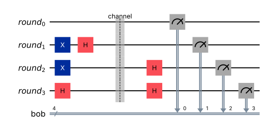

# BB84

BB84 is prepare-and-measure quantum key distribution. Alice sends single qubits prepared in one of two bases, usually $Z = \{|0\rangle, |1\rangle\}$ and $X = \{|+\rangle, |-\rangle\}$. Bob measures each qubit in a randomly chosen basis. They keep the bits where their bases match (sifting) and sacrifice a sample to estimate the error rate. If the error is below the abort threshold, error correction and privacy amplification turn the rest into a secret key. ^sifting

An eavesdropper who does not know the basis disturbs the state: the two bases are mutually unbiased, so a measurement in the wrong basis randomizes the bit. That disturbance shows up in the sacrificed sample. The course contrasts this with classical one-time pads and with the later entanglement-based protocols [[concepts/ekert91]].

## The course's polarization version

Alice sends photons through randomly chosen $H/V$ or $\pm45°$ polarizers. Bob measures each in a random basis and announces only his *basis*. Alice tells him which bases matched, and only those positions are kept. Within a matching basis the result is deterministic, "because the states within each basis are orthogonal." For mismatched bases Bob's result is random and is discarded. The quiz stems fix the bit convention: $|H\rangle, |{+45}\rangle \to 0$ and $|V\rangle, |{-45}\rangle \to 1$ ([raw week 3](/mit-raw/week3.md), BB84 Learn and CYU, ~line 3541). Error checking then compares parities of random subsets: matching pairs are kept and mismatches discarded, and the parity alone reveals nothing to Eve (same page). ^polarization-sifting

## Circuit (generated with Qiskit)

Four BB84 rounds side by side, one qubit per round. Alice sends bits $0,1,1,0$ in bases $Z,X,Z,X$ (X gate for bit 1, then H for the X basis). Bob measures in bases $Z,Z,X,X$ (H before measuring means the X basis). Generator: [`tools/circuits/circuits.py`](/tools/circuits/circuits.py) (`bb84`).



```text
                    channel      ┌─┐         
round_0: ──────────────░─────────┤M├─────────
         ┌───┐┌───┐    ░         └╥┘┌─┐      
round_1: ┤ X ├┤ H ├────░──────────╫─┤M├──────
         ├───┤└───┘    ░    ┌───┐ ║ └╥┘┌─┐   
round_2: ┤ X ├─────────░────┤ H ├─╫──╫─┤M├───
         ├───┤         ░    ├───┤ ║  ║ └╥┘┌─┐
round_3: ┤ H ├─────────░────┤ H ├─╫──╫──╫─┤M├
         └───┘         ░    └───┘ ║  ║  ║ └╥┘
  bob: 4/═════════════════════════╩══╩══╩══╩═
                                  0  1  2  3 
```

Simulated: rounds 0 and 3 (bases match) give Bob Alice's bit with certainty, so they're kept. Rounds 1 and 2 (bases differ) give Bob 50/50 noise, so they're discarded during sifting. Sifted key: $0, 0$. ^circuit-qiskit

## Sources

- [Quantum key distribution BB84](../sources/week-3-02-quantum-key-distribution-bb84.md)
- [Quantum cryptography: making codes](../sources/week-3-01-quantum-cryptography-making-codes.md)
- [Entangled photon sources and detectors](../sources/week-3-03-entangled-proton-sources-and-detectors.md)
- Raw: [week 3](/mit-raw/week3.md)
