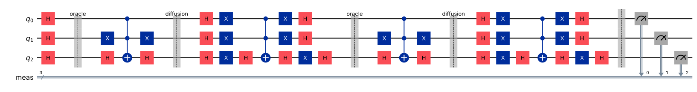

# Grover's algorithm

Grover's algorithm finds a marked item in an unstructured search space of size $N$ with $O(\sqrt{N})$ queries of a phase oracle. A classical algorithm needs $\Theta(N)$ queries in the worst case.

## Step

The oracle reflects the amplitude of every marked basis state $|w\rangle$:

$$
U_w |x\rangle = (-1)^{f(x)} |x\rangle, \qquad f(w) = 1.
$$

The diffusion operator reflects about the uniform superposition $|s\rangle$:

$$
D = 2|s\rangle\langle s| - I, \qquad |s\rangle = \frac{1}{\sqrt{N}}\sum_x |x\rangle.
$$

One Grover iterate is $G = D\, U_w$. In the course's notation, the oracle first reflects about the non-solution axis $|\alpha\rangle$ (it flips the sign of the solution component $|\beta\rangle$). The diffusion step, conditional phase shifts between Hadamards, then reflects about the starting superposition $|\psi\rangle$. Two reflections make a rotation toward $|\beta\rangle$ ([raw week 5](/mit-raw/week5.md), quantum search transcript ~7:27–7:47). In the course's angle convention (Nielsen & Chuang), the start state is $|\psi\rangle = \cos\frac{\theta}{2}|\alpha\rangle + \sin\frac{\theta}{2}|\beta\rangle$, i.e. it sits at $\theta/2$ from the $|\alpha\rangle$ axis, and each iterate rotates the state by $\theta$ toward $|\beta\rangle$ ([raw week 5](/mit-raw/week5.md), "Geometric Interpretation", transcript ~7:09–7:15). Some textbooks instead call the half-angle $\theta$ and the step $2\theta$; same physics, different label. ^two-reflections

$$
\sin \frac{\theta}{2} = \sqrt{\frac{M}{N}} \quad\left(= \frac{1}{\sqrt N} \text{ for a single marked item}\right)
$$

So $\theta \approx 2/\sqrt{N}$ for one marked item. After about $\lfloor \pi/4 \sqrt{N} \rfloor$ iterates the marked state is measured with high probability. With $M$ marked items the course bounds the number of repetitions by $R \le \frac{\pi}{4}\sqrt{N/M}$; overshooting lowers the success probability again. Exact count from the slide: $R = \mathrm{CI}\!\left(\arccos\sqrt{M/N}\,/\,\theta\right)$ (CI = closest integer), which reaches within $\theta/2 < \pi/4$ of $|\beta\rangle$, so success probability is $> 1/2$. Upper bound: $R \le \lceil \tfrac{\pi}{4}\sqrt{N/M}\rceil \to O(\sqrt N)$ ([raw week 5](/mit-raw/week5.md), "Number of Iterations" slide, line 3317). Transcript note: "state CI" in the captions is speech-to-text for "state $|\psi\rangle$". ^iteration-bound

**Register size.** The index register holds $x = 0, \dots, N-1$ with $N = 2^n$, so it needs $n = \log_2 N$ qubits (plus the oracle's ancilla), not $N$, $n^2$ or $2^N$ ([raw week 5](/mit-raw/week5.md), quantum search, ~2:23). ^register-size

## Circuit (generated with Qiskit)

Grover search on $N = 8$ items (3 qubits) for the marked state $|101\rangle$, with $R = 2$ iterations. Oracle: flip the sign of $|101\rangle$ (X gates map it to $|111\rangle$, then a multi-controlled Z built as H–CCX–H). Diffusion: reflect about $|\psi\rangle$ with $H^{\otimes 3} X^{\otimes 3}\,(\text{CCZ})\,X^{\otimes 3} H^{\otimes 3}$. Generator: [`tools/circuits/circuits.py`](/tools/circuits/circuits.py) (`grover`).



```text
        ┌───┐ oracle                 diffusion ┌───┐┌───┐          ┌───┐┌───┐      oracle                 diffusion ┌───┐┌───┐          ┌───┐┌───┐      ░ ┌─┐      
   q_0: ┤ H ├───░───────────■────────────░─────┤ H ├┤ X ├───────■──┤ X ├┤ H ├────────░───────────■────────────░─────┤ H ├┤ X ├───────■──┤ X ├┤ H ├──────░─┤M├──────
        ├───┤   ░    ┌───┐  │  ┌───┐     ░     ├───┤├───┤       │  ├───┤├───┤        ░    ┌───┐  │  ┌───┐     ░     ├───┤├───┤       │  ├───┤├───┤      ░ └╥┘┌─┐   
   q_1: ┤ H ├───░────┤ X ├──■──┤ X ├─────░─────┤ H ├┤ X ├───────■──┤ X ├┤ H ├────────░────┤ X ├──■──┤ X ├─────░─────┤ H ├┤ X ├───────■──┤ X ├┤ H ├──────░──╫─┤M├───
        ├───┤   ░    ├───┤┌─┴─┐├───┤     ░     ├───┤├───┤┌───┐┌─┴─┐├───┤├───┤┌───┐   ░    ├───┤┌─┴─┐├───┤     ░     ├───┤├───┤┌───┐┌─┴─┐├───┤├───┤┌───┐ ░  ║ └╥┘┌─┐
   q_2: ┤ H ├───░────┤ H ├┤ X ├┤ H ├─────░─────┤ H ├┤ X ├┤ H ├┤ X ├┤ H ├┤ X ├┤ H ├───░────┤ H ├┤ X ├┤ H ├─────░─────┤ H ├┤ X ├┤ H ├┤ X ├┤ H ├┤ X ├┤ H ├─░──╫──╫─┤M├
        └───┘   ░    └───┘└───┘└───┘     ░     └───┘└───┘└───┘└───┘└───┘└───┘└───┘   ░    └───┘└───┘└───┘     ░     └───┘└───┘└───┘└───┘└───┘└───┘└───┘ ░  ║  ║ └╥┘
meas: 3/═══════════════════════════════════════════════════════════════════════════════════════════════════════════════════════════════════════════════════╩══╩══╩═
                                                                                                                                                           0  1  2 
```

Simulated success probability: 1 iteration $0.781$, **2 iterations $0.945$**, 3 iterations $0.330$. Overshooting makes it worse, exactly as $\sin^2\!\big((2R+1)\theta/2\big)$ with $\sin(\theta/2) = 1/\sqrt 8$ predicts. The bound $\lceil \tfrac\pi4\sqrt{8}\rceil = 3$ is an upper bound, not the best choice: $R = \mathrm{CI}(\arccos\sqrt{1/8}/\theta) = 2$. ^circuit-qiskit

## In this course

Week 5 covers the algorithm, a walkthrough on the IBM Quantum Experience, and a lab in QASM (the OpenQASM syntax used by the composer: registers, `h`, `x`, `cx`, `ccx`, `measure`).

- [Quantum search](../sources/week-5-04-grover-s-algorithm-quantum-search.md)
- [Quantum Experience](../sources/week-5-05-introduction-to-grover-s-algorithm-on-the-quantum-experience.md)
- [Lab practicum](../sources/week-5-06-lab-practicum-grover-s-algorythm.md)
- Raw: [week 5](/mit-raw/week5.md)

## Related

- [[concepts/exactly-1-3-sat]]: the course's worked oracle example (3 variables, solution $|101\rangle$, 2 iterations ≈ 95%).
