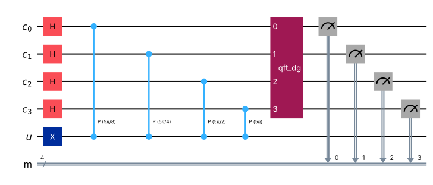

# Phase estimation

Quantum phase estimation writes the eigenphase of a unitary into a clock register. Given $U$ and an eigenstate $U|\psi\rangle = e^{2\pi i \varphi}|\psi\rangle$, a $t$-qubit clock estimates $\varphi$ to about $t$ bits. It is an *estimate* whose precision is set by the clock size, not the exact phase. ^precision

1. Clock in uniform superposition, target in $|\psi\rangle$.
2. Controlled-$U^{2^k}$ from clock qubit $k$ onto the target. The clock picks up the phase kickback $|k\rangle|\psi\rangle \mapsto e^{2\pi i \varphi k}|k\rangle|\psi\rangle$.
3. Inverse [[concepts/quantum-fourier-transform]] on the clock.
4. Measure the clock. The bits are the binary expansion of $\varphi$.

If the input is a superposition of eigenstates, the measurement both samples an eigenvalue and collapses the target onto the corresponding eigenstate. Shor's period finding is phase estimation applied to the unitary "multiply by $g$ modulo $N$". It uses the inverse QFT and serves as a subroutine in Shor's algorithm. In week 4 the same routine reads energies: if $U = e^{-iH\tau}$, then $\varphi$ is the energy in units of $2\pi/\tau$. ^uses

## The derivation, including the step eDX renders badly

First register after the controlled-$U^{2^j}$ gates (course notation, $n$ clock qubits, phase $\phi$; raw week 4 ~line 5030):

$$
\frac{1}{2^{n/2}}\left(|0\rangle+e^{2\pi i 2^{n-1}\phi}|1\rangle\right)\cdots\left(|0\rangle+e^{2\pi i 2^{0}\phi}|1\rangle\right)=\frac{1}{2^{n/2}}\sum_{k=0}^{2^{n}-1}e^{2\pi i k\phi}|k\rangle
$$

Apply $\mathrm{QFT}_n^{-1}|k\rangle = \frac{1}{2^{n/2}}\sum_{l} e^{-2\pi i kl/2^n}|l\rangle$. This is the step whose left-hand side the eDX page shows as a broken, vertically stacked column. Reconstructed (my derivation, consistent with the course's next line):

$$
\frac{1}{2^{n/2}}\sum_{k=0}^{2^{n}-1}e^{2\pi i k\phi}|k\rangle
\;\xrightarrow{\ \mathrm{QFT}_n^{-1}\ }\;
\frac{1}{2^{n}}\sum_{k=0}^{2^{n}-1}\sum_{l=0}^{2^{n}-1} e^{-2\pi i kl/2^{n}}\,e^{2\pi i k\phi}\,|l\rangle
=\frac{1}{2^{n}}\sum_{l=0}^{2^{n}-1}\left[\sum_{k=0}^{2^{n}-1}\left(e^{-\frac{2\pi i l}{2^{n}}}e^{2\pi i\phi}\right)^{k}\right]|l\rangle
$$

The bracket is a geometric sum:

$$
=\frac{1}{2^{n}}\sum_{l=0}^{2^{n}-1}\frac{1-e^{2\pi i(2^{n}\phi-l)}}{1-e^{2\pi i(\phi-l/2^{n})}}\,|l\rangle .
$$

If $\phi = 0.\phi_1\ldots\phi_n$ fits exactly in $n$ bits, the amplitude is 1 at $l = 2^n\phi$ and 0 elsewhere, so the readout is exact. Otherwise the amplitude spreads over neighbouring $l$ and you get the best $n$-bit estimate with high, not certain, probability. That's why the course says the output estimates $\phi$ "up to a precision $\propto n$" ([raw week 4](/mit-raw/week4.md), "Phase estimation (reading)"). ^derivation

## Circuit (generated with Qiskit)



Same circuit as text, which works in any viewer and diffs cleanly in git:

```text
     ┌───┐                                      ┌─────────┐┌─┐         
c_0: ┤ H ├─■────────────────────────────────────┤0        ├┤M├─────────
     ├───┤ │                                    │         │└╥┘┌─┐      
c_1: ┤ H ├─┼─────────■──────────────────────────┤1        ├─╫─┤M├──────
     ├───┤ │         │                          │  qft_dg │ ║ └╥┘┌─┐   
c_2: ┤ H ├─┼─────────┼─────────■────────────────┤2        ├─╫──╫─┤M├───
     ├───┤ │         │         │                │         │ ║  ║ └╥┘┌─┐
c_3: ┤ H ├─┼─────────┼─────────┼─────────■──────┤3        ├─╫──╫──╫─┤M├
     ├───┤ │P(5π/8)  │P(5π/4)  │P(5π/2)  │P(5π) └─────────┘ ║  ║  ║ └╥┘
  u: ┤ X ├─■─────────■─────────■─────────■──────────────────╫──╫──╫──╫─
     └───┘                                                  ║  ║  ║  ║ 
m: 4/═══════════════════════════════════════════════════════╩══╩══╩══╩═
                                                            0  1  2  3 
```

Generator: [`tools/circuits/phase_estimation.py`](/tools/circuits/phase_estimation.py), using $U = P(2\pi\theta)$ with eigenstate $|1\rangle$ and 4 clock qubits. Clock qubit $c_j$ controls $U^{2^j}$, so the angles double down the circuit. Simulating it (Qiskit statevector):

| $\theta$ | fits in 4 bits? | most likely readout | probability |
|---|---|---|---|
| $5/16 = 0.3125$ | yes ($0.0101$) | `0101` = 5 → $5/16$ | 1.000 |
| $0.3$ | no | `0101` = 5 → $0.3125$ | 0.876 (then `0100` 0.055, `0110` 0.025) |

Exact phases come out exact. Others come out as the nearest $n$-bit estimate, most of the time. ^qiskit-demo

## Sources

- [Phase estimation](../sources/week-4-05-phase-estimation.md)
- Raw: [week 4](/mit-raw/week4.md), and the order-finding pages in [week 1](/mit-raw/week1.md)
