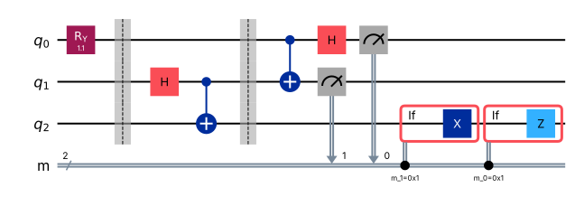

# Quantum teleportation

Teleportation moves an unknown qubit state from Alice to Bob using one shared Bell pair and two classical bits. It does not move the physical qubit, and it does not allow faster-than-light signaling: Bob's half of the pair is maximally mixed until the two classical bits arrive. ^summary

## Protocol

Shared resource $|\Phi^+\rangle = (|00\rangle + |11\rangle)/\sqrt{2}$. Alice holds $|\psi\rangle = \alpha|0\rangle + \beta|1\rangle$ and her half of the pair.

1. Alice applies CNOT from $|\psi\rangle$ onto her half of the pair, then a Hadamard on $|\psi\rangle$.
2. She measures both of her qubits, getting two bits $m_1 m_0$.
3. She sends those bits to Bob.
4. Bob applies $X^{m_0} Z^{m_1}$ (the Pauli named by the bits) to his qubit and holds $|\psi\rangle$.

The unknown state is destroyed on Alice's side by the measurement, which is why the protocol does not clone. ^no-clone-no-photon-sent

**The photonic version in the course.** An entangled source gives photon A to Alice and B to Bob (pre-shared Bell pair). Alice does a **Bell-state measurement** on A and her input photon C, projecting the pair onto one of the four Bell states (with a beam splitter and two detectors). She sends the outcome over a **classical channel**. Bob applies the matching **rotation/decoding** to photon B, which then carries $|\psi\rangle$. Alice never sends a photon to Bob ([raw week 3](/mit-raw/week3.md), teleportation page and quiz Q3 diagram, ~line 11206). Week 3 presents this next to QKD because both spend entanglement as a resource. ^photonic-teleportation

**Labels change between course sources** (watch out in questions):

| Source | Input photon $\lvert\psi\rangle$ | Entangled pair | Bell measurement on |
|---|---|---|---|
| Learn derivation (raw week 3, ~line 10049) | C | A (Alice), B (Bob) | C and A |
| Quiz Q3 figure | C | A (Alice), B (Bob) | A and C |
| Lecture transcript (~line 10175) | A | B (Alice's side), C (receiver) | A and B |
| Pre-assessment | 1 | 2, 3 | 1 and 2 |

The protocol is the same each time. Read the letters from the question in front of you. ^labels

**The lecture's metaphor** (transcript ~3:05–5:46). The twins Remus and Romulus answer every question at random, but always the same way as each other: the entangled pair. Alice's "speed date" with Remus is the Bell measurement. It destroys her memory, the original state. The phone call saying "they don't get along" is the two classical bits. The FBI then questions Romulus and reverses his answers: Bob's correction rotation. Alice's state ends up in Romulus, "but with a random rotation" that the classical message tells you how to undo. No one ever learns the state, and the original is destroyed (no cloning). ^metaphor

**Derivation check.** The Learn page's regrouping of $|\psi_0\rangle_C\otimes|\Psi^-\rangle_{AB}$ into four Bell-state terms is correct: verified numerically for $a = 0.6$, $b = 0.8$. The eDX page renders the left-hand side as a broken stacked column; the raw capture has it in clean LaTeX. ^derivation-check

## Circuit (generated with Qiskit)

Teleport $|\psi\rangle = R_Y(1.1)|0\rangle$ from $q_0$ to $q_2$. First barrier: make the Bell pair $q_1q_2$. Second: Alice's Bell-basis measurement (CNOT, H, measure). Then Bob applies $X$ if $m_1 = 1$ and $Z$ if $m_0 = 1$: two classical bits travel, and nothing faster than light. Generator: [`tools/circuits/circuits.py`](/tools/circuits/circuits.py) (`teleport`).



```text
     ┌─────────┐ ░            ░      ┌───┐┌─┐                                                    
q_0: ┤ Ry(1.1) ├─░────────────░───■──┤ H ├┤M├────────────────────────────────────────────────────
     └─────────┘ ░ ┌───┐      ░ ┌─┴─┐└┬─┬┘└╥┘                                                    
q_1: ────────────░─┤ H ├──■───░─┤ X ├─┤M├──╫─────────────────────────────────────────────────────
                 ░ └───┘┌─┴─┐ ░ └───┘ └╥┘  ║   ┌──────  ┌───┐ ───────┐   ┌──────  ┌───┐ ───────┐ 
q_2: ────────────░──────┤ X ├─░────────╫───╫───┤ If-0  ─┤ X ├  End-0 ├───┤ If-0  ─┤ Z ├  End-0 ├─
                 ░      └───┘ ░        ║   ║   └──╥───  └───┘ ───────┘   └──╥───  └───┘ ───────┘ 
                                       ║   ║ ┌────╨────┐               ┌────╨────┐               
m: 2/══════════════════════════════════╩═══╩═╡ m_1=0x1 ╞═══════════════╡ m_0=0x1 ╞═══════════════
                                       1   0 └─────────┘               └─────────┘               
```

Check (deferred-measurement version, with the corrections as CX and CZ): Bob's qubit equals $|\psi\rangle$ with fidelity $1.000000$. Note that $q_0$ ends up measured, so the original is destroyed: no cloning. ^circuit-qiskit

## Sources

- [Quantum teleportation](../sources/week-3-08-quantum-teleportation.md)
- Raw: [week 3](/mit-raw/week3.md)
