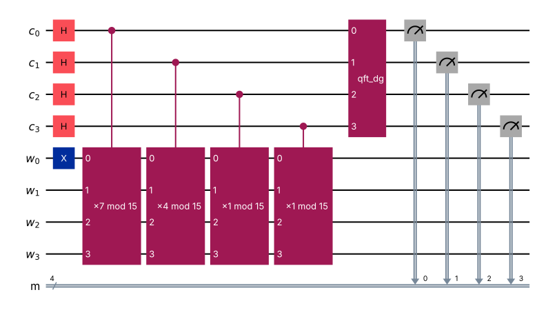

# Shor's algorithm

Shor's algorithm factors an integer by reducing factoring to order-finding, then finding that order with a quantum period-finding routine. The quantum part is not a direct search over factors. ^reduction-summary

## Reduction

Let $N = pq$ with $p$ and $q$ odd primes (the course treats the two-prime case). The classical trick used by the quadratic sieve, and reused here, is to find $x$ and $y$ such that

$$
x^2 \equiv y^2 \pmod N, \qquad x \not\equiv \pm y \pmod N.
$$

Then $N$ divides $(x-y)(x+y)$ but neither factor, so

$$
\gcd(x-y, N)
$$

yields a nontrivial factor via Euclid's algorithm.

Pick a random base $g$ with $1 < g < N$ and $\gcd(g, N) = 1$. The order $r$ is the period of

$$
f(x) = g^x \bmod N,
$$

i.e. the smallest positive integer with $g^r \equiv 1 \pmod N$. If $r$ is even and $g^{r/2} \not\equiv -1 \pmod N$, then

$$
g^{r/2} - 1 \quad\text{and}\quad g^{r/2} + 1
$$

supply the $x-y$ and $x+y$ above. If the condition fails, draw another $g$. (A success probability of at least $1/2$ per random $g$ is standard textbook background; the lint pass of 2026-11-21 did not find it stated in the course capture.)

Worked examples in the course, both with $N = 21$:

- $g = 2$: the powers of 2 mod 21 repeat with $2^6 \equiv 1 \pmod{21}$, so $r = 6$ and $\gcd(2^3 - 1, 21) = 7$ ([raw week 1](/mit-raw/week1.md), "How do we find x² and y²?").
- $g = 11$: the full quantum walk-through on a 9-qubit first register is on [[concepts/period-finding]].

## Quantum part

The circuit is the same shape as [[concepts/simons-algorithm]]: a uniform superposition, a reversible $f$, then a Fourier transform over the domain, then measurement and classical post-processing. Simon uses the Hadamard transform over $(\mathbb{Z}/2\mathbb{Z})^n$. Shor uses the [[concepts/quantum-fourier-transform]] over $\mathbb{Z}/2^q\mathbb{Z}$ with $2^q$ larger than the unknown period.

The period is recovered in time polynomial in $\log r$, not linear in $r$. An approximate QFT is enough and uses fewer gates than the exact one.

## Circuit: order finding for N = 15 (generated with Qiskit)

Order finding for $N = 15$, $a = 7$: phase estimation of $U|x\rangle = |7x \bmod 15\rangle$, with the work register starting in $|1\rangle$. Counting qubit $c_j$ controls $U^{2^j}$, i.e. multiplication by $7^{2^j} \bmod 15 = 7, 4, 1, 1$. The last two are the identity, because $7^4 \equiv 1$, a first hint that the order is 4. The multipliers are permutation-matrix gates, not an efficient modular-arithmetic circuit. Generator: [`tools/circuits/circuits.py`](/tools/circuits/circuits.py) (`shor_order_finding`).



```text
     ┌───┐                                                        ┌─────────┐┌─┐         
c_0: ┤ H ├──────■─────────────────────────────────────────────────┤0        ├┤M├─────────
     ├───┤      │                                                 │         │└╥┘┌─┐      
c_1: ┤ H ├──────┼─────────────■───────────────────────────────────┤1        ├─╫─┤M├──────
     ├───┤      │             │                                   │  qft_dg │ ║ └╥┘┌─┐   
c_2: ┤ H ├──────┼─────────────┼─────────────■─────────────────────┤2        ├─╫──╫─┤M├───
     ├───┤      │             │             │                     │         │ ║  ║ └╥┘┌─┐
c_3: ┤ H ├──────┼─────────────┼─────────────┼─────────────■───────┤3        ├─╫──╫──╫─┤M├
     ├───┤┌─────┴──────┐┌─────┴──────┐┌─────┴──────┐┌─────┴──────┐└─────────┘ ║  ║  ║ └╥┘
w_0: ┤ X ├┤0           ├┤0           ├┤0           ├┤0           ├────────────╫──╫──╫──╫─
     └───┘│            ││            ││            ││            │            ║  ║  ║  ║ 
w_1: ─────┤1           ├┤1           ├┤1           ├┤1           ├────────────╫──╫──╫──╫─
          │  ×7 mod 15 ││  ×4 mod 15 ││  ×1 mod 15 ││  ×1 mod 15 │            ║  ║  ║  ║ 
w_2: ─────┤2           ├┤2           ├┤2           ├┤2           ├────────────╫──╫──╫──╫─
          │            ││            ││            ││            │            ║  ║  ║  ║ 
w_3: ─────┤3           ├┤3           ├┤3           ├┤3           ├────────────╫──╫──╫──╫─
          └────────────┘└────────────┘└────────────┘└────────────┘            ║  ║  ║  ║ 
m: 4/═════════════════════════════════════════════════════════════════════════╩══╩══╩══╩═
                                                                              0  1  2  3 
```

Simulated readout: `0000`, `0100`, `1000`, `1100` with probability $0.25$ each, i.e. phases $0, \tfrac14, \tfrac12, \tfrac34 = s/r$ with $r = 4$. Then $7^{2} = 49$, and $\gcd(49 \pm 1, 15) = \gcd(48,15), \gcd(50,15) = 3, 5$, so $15 = 3 \times 5$. See also [[concepts/phase-estimation#^qiskit-demo]]. ^circuit-qiskit

## Where this is in the course

- [Reduction of factoring to order finding](../sources/week-1-02-shor-s-algorithm-reduction-of-factoring-to-order-finding.md) (week 1 raw)
- [Introduction to the quantum factoring algorithm](../sources/week-1-03-shor-s-algorithm-introduction-to-the-short-quantum-factorization-algorithm.md)
- [Factoring with a quantum computer: Shor's algorithm](../sources/week-2-06-factoring-with-a-quantum-computer-shor-s-algorithm.md)
- [How Shor's algorithm works](../sources/week-2-07-factoring-with-a-quantum-computer-how-shor-s-algorithm-works.md)
- [RSA cryptosystem](../sources/week-2-05-rsa-cryptosystem.md): why factoring matters
- [Demonstrations: introduction](../sources/week-1-07-demonstrations-of-shor-s-algorithm-introduction.md), [NMR](../sources/week-1-08-demonstrations-of-shor-s-algorithm-shor-s-algorithm-with-nmr.md), [trapped ions: results](../sources/week-1-12-demonstrations-of-shor-s-algorithm-quantum-factoring-with-trapped-ions-experimen.md), [pretending to factor](../sources/week-1-13-demonstrations-of-shor-s-algorithm-pretending-to-factor.md)
- See also [[concepts/period-finding]], [[concepts/quantum-fourier-transform]], [[concepts/shor-demonstrations]] (hardware runs: NMR 2001, trapped ions 2016)
