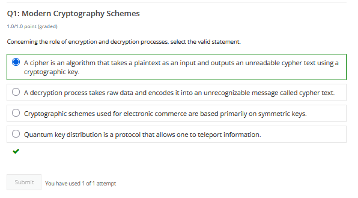
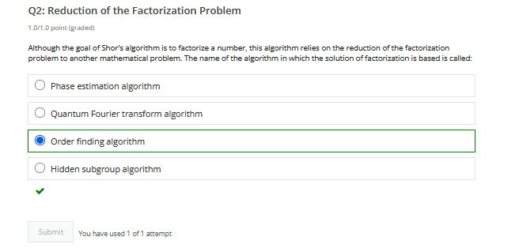
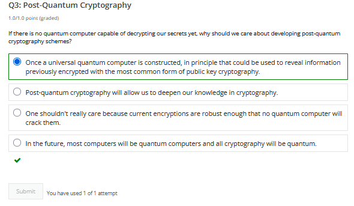
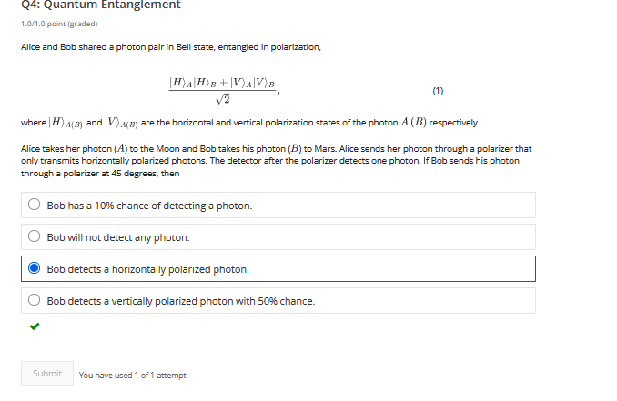
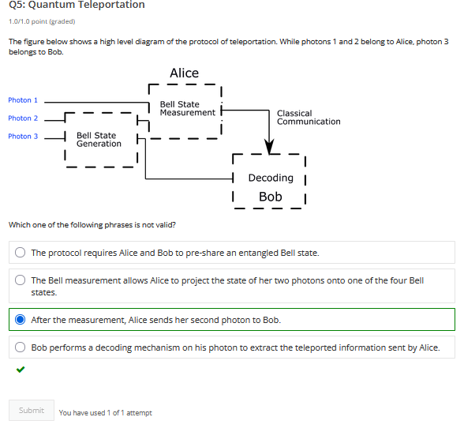
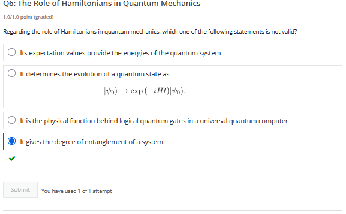
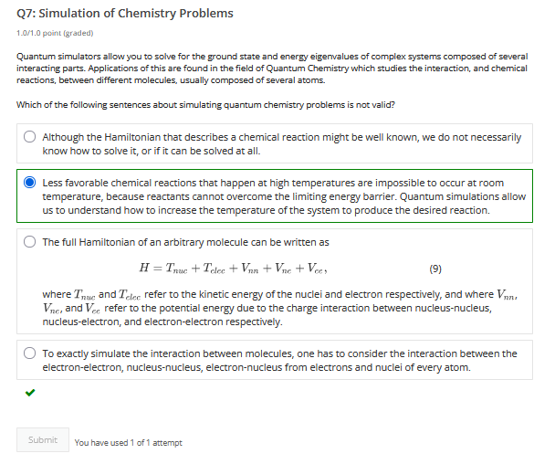
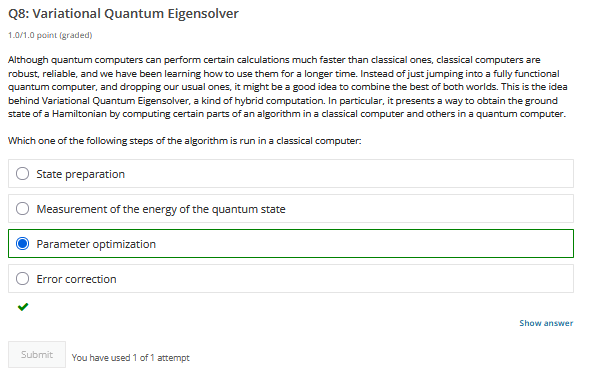
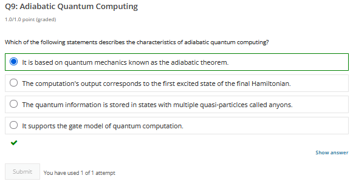

# Quizzes · Pre-Assessment

Every graded question of this week, transcribed from the eDX screenshots. Options are lettered **A, B, C, …**; the letters are *not* on the platform, they're added to match the Anki deck. **No answers here** (public repo). Status only tracks progress.

**Progress:** 9/9 ✅ CHECKED in eDX · 0 ⏳ pending

Back to [[quizzes/index|all quizzes]] · [[analyses/quiz-concept-map|quiz → concept map]]

### Q1: Modern Cryptography Schemes

> **Status:** ✅ CHECKED in eDX · **Type:** Select one · **Attempts:** 1  
> **Raw:** [week2.md:19](/mit-raw/week2.md) · **Concepts:** [[concepts/modern-cryptography|Modern cryptography]]

Concerning the role of encryption and decryption processes, select the valid statement.

- [ ] **A.** A cipher is an algorithm that takes a plaintext as an input and outputs an unreadable cypher text using a cryptographic key.
- [ ] **B.** A decryption process takes raw data and encodes it into an unrecognizable message called cypher text.
- [ ] **C.** Cryptographic schemes used for electronic commerce are based primarily on symmetric keys.
- [ ] **D.** Quantum key distribution is a protocol that allows one to teleport information.

> [!info]- Original eDX screenshot (shows saved selections)
> 

### Q2: Reduction of the Factorization Problem

> **Status:** ✅ CHECKED in eDX · **Type:** Select one · **Attempts:** 1  
> **Raw:** [week2.md:33](/mit-raw/week2.md) · **Concepts:** [[concepts/shors-algorithm|Shor's algorithm]] · [[concepts/period-finding|Period finding]]

Although the goal of Shor's algorithm is to factorize a number, this algorithm relies on the reduction of the factorization problem to another mathematical problem. The name of the algorithm in which the solution of factorization is based is called:

- [ ] **A.** Phase estimation algorithm
- [ ] **B.** Quantum Fourier transform algorithm
- [ ] **C.** Order finding algorithm
- [ ] **D.** Hidden subgroup algorithm

> [!info]- Original eDX screenshot (shows saved selections)
> 

### Q3: Post-Quantum Cryptography

> **Status:** ✅ CHECKED in eDX · **Type:** Select one · **Attempts:** 1  
> **Raw:** [week2.md:47](/mit-raw/week2.md) · **Concepts:** [[concepts/post-quantum-cryptography|Post-quantum cryptography]]

If there is no quantum computer capable of decrypting our secrets yet, why should we care about developing post-quantum cryptography schemes?

- [ ] **A.** Once a universal quantum computer is constructed, in principle that could be used to reveal information previously encrypted with the most common form of public key cryptography.
- [ ] **B.** Post-quantum cryptography will allow us to deepen our knowledge in cryptography.
- [ ] **C.** One shouldn't really care because current encryptions are robust enough that no quantum computer will crack them.
- [ ] **D.** In the future, most computers will be quantum computers and all cryptography will be quantum.

> [!info]- Original eDX screenshot (shows saved selections)
> 

### Q4: Quantum Entanglement

> **Status:** ✅ CHECKED in eDX · **Type:** Select one · **Attempts:** 1  
> **Raw:** [week2.md:63](/mit-raw/week2.md) · **Concepts:** [[concepts/photon-polarization-qubits|Photon polarization as a qubit]]

Alice and Bob shared a photon pair in Bell state, entangled in polarization,

$$\frac{|H\rangle_A|H\rangle_B + |V\rangle_A|V\rangle_B}{\sqrt{2}}, \qquad (1)$$

where $|H\rangle_{A(B)}$ and $|V\rangle_{A(B)}$ are the horizontal and vertical polarization states of the photon $A$ ($B$) respectively.

Alice takes her photon ($A$) to the Moon and Bob takes his photon ($B$) to Mars. Alice sends her photon through a polarizer that only transmits horizontally polarized photons. The detector after the polarizer detects one photon. If Bob sends his photon through a polarizer at 45 degrees, then

- [ ] **A.** Bob has a 10% chance of detecting a photon.
- [ ] **B.** Bob will not detect any photon.
- [ ] **C.** Bob detects a horizontally polarized photon.
- [ ] **D.** Bob detects a vertically polarized photon with 50% chance.

> [!tip]- 💡 Hint
> After Alice's click, write Bob's single-photon state. Then apply Malus' law: $P = |\langle \theta|\psi\rangle|^2 = \cos^2(\text{angle between them})$.

> [!info]- Original eDX screenshot (shows saved selections)
> 

### Q5: Quantum Teleportation

> **Status:** ✅ CHECKED in eDX · **Type:** Select one (which is NOT valid) · **Attempts:** 1  
> **Raw:** [week2.md:83](/mit-raw/week2.md) · **Concepts:** [[concepts/quantum-teleportation|Quantum teleportation]]

The figure below shows a high level diagram of the protocol of teleportation. While photons 1 and 2 belong to Alice, photon 3 belongs to Bob.

Diagram:
- Photon 1, Photon 2, and Photon 3 enter on the left.
- Photons 2 and 3 go into a dashed box **Bell State Generation**.
- Photon 1 and the upper output of that box go into Alice's dashed box **Bell State Measurement**.
- A downward arrow labeled **Classical Communication** goes from Alice's measurement to Bob.
- The lower output of Bell State Generation goes to Bob's dashed box **Decoding**.
- Alice is the upper dashed region; Bob is the lower dashed region.

Which one of the following phrases is not valid?

- [ ] **A.** The protocol requires Alice and Bob to pre-share an entangled Bell state.
- [ ] **B.** The Bell measurement allows Alice to project the state of her two photons onto one of the four Bell states.
- [ ] **C.** After the measurement, Alice sends her second photon to Bob.
- [ ] **D.** Bob performs a decoding mechanism on his photon to extract the teleported information sent by Alice.

> [!info]- Original eDX screenshot (shows saved selections)
> 

### Q6: The Role of Hamiltonians in Quantum Mechanics

> **Status:** ✅ CHECKED in eDX · **Type:** Select one (which is NOT valid) · **Attempts:** 1  
> **Raw:** [week2.md:109](/mit-raw/week2.md) · **Concepts:** [[concepts/hamiltonian-simulation|Hamiltonian simulation]]

Regarding the role of Hamiltonians in quantum mechanics, which one of the following statements is not valid?

- [ ] **A.** Its expectation values provide the energies of the quantum system.
- [ ] **B.** It determines the evolution of a quantum state as $$|\psi_0\rangle \to \exp(-iHt)|\psi_0\rangle.$$
- [ ] **C.** It is the physical function behind logical quantum gates in a universal quantum computer.
- [ ] **D.** It gives the degree of entanglement of a system.

> [!info]- Original eDX screenshot (shows saved selections)
> 

### Q7: Simulation of Chemistry Problems

> **Status:** ✅ CHECKED in eDX · **Type:** Select one (which is NOT valid) · **Attempts:** 1  
> **Raw:** [week2.md:128](/mit-raw/week2.md) · **Concepts:** [[concepts/quantum-chemistry|Quantum chemistry simulation]]

Quantum simulators allow you to solve for the ground state and energy eigenvalues of complex systems composed of several interacting parts. Applications of this are found in the field of Quantum Chemistry which studies the interaction, and chemical reactions, between different molecules, usually composed of several atoms.

Which of the following sentences about simulating quantum chemistry problems is not valid?

- [ ] **A.** Although the Hamiltonian that describes a chemical reaction might be well known, we do not necessarily know how to solve it, or if it can be solved at all.
- [ ] **B.** Less favorable chemical reactions that happen at high temperatures are impossible to occur at room temperature, because reactants cannot overcome the limiting energy barrier. Quantum simulations allow us to understand how to increase the temperature of the system to produce the desired reaction.
- [ ] **C.** The full Hamiltonian of an arbitrary molecule can be written as $$H = T_{nuc} + T_{elec} + V_{nn} + V_{nc} + V_{ee}, \qquad (9)$$
- [ ] **D.** To exactly simulate the interaction between molecules, one has to consider the interaction between the electron-electron, nucleus-nucleus, electron-nucleus from electrons and nuclei of every atom.

> [!info]- Original eDX screenshot (shows saved selections)
> 

### Q8: Variational Quantum Eigensolver

> **Status:** ✅ CHECKED in eDX · **Type:** Select one · **Attempts:** 1  
> **Raw:** [week2.md:148](/mit-raw/week2.md) · **Concepts:** [[concepts/vqe|Variational quantum eigensolver]]

Although quantum computers can perform certain calculations much faster than classical ones, classical computers are robust, reliable, and we have been learning how to use them for a longer time. Instead of just jumping into a fully functional quantum computer, and dropping our usual ones, it might be a good idea to combine the best of both worlds. This is the idea behind Variational Quantum Eigensolver, a kind of hybrid computation. In particular, it presents a way to obtain the ground state of a Hamiltonian by computing certain parts of an algorithm in a classical computer and others in a quantum computer.

Which one of the following steps of the algorithm is run in a classical computer:

- [ ] **A.** State preparation
- [ ] **B.** Measurement of the energy of the quantum state
- [ ] **C.** Parameter optimization
- [ ] **D.** Error correction

> [!info]- Original eDX screenshot (shows saved selections)
> 

### Q9: Adiabatic Quantum Computing

> **Status:** ✅ CHECKED in eDX · **Type:** Select one · **Attempts:** 1  
> **Raw:** [week2.md:164](/mit-raw/week2.md) · **Concepts:** [[concepts/adiabatic-quantum-computing|Adiabatic quantum computing]]

Which of the following statements describes the characteristics of adiabatic quantum computing?

- [ ] **A.** It is based on quantum mechanics known as the adiabatic theorem.
- [ ] **B.** The computation's output corresponds to the first excited state of the final Hamiltonian.
- [ ] **C.** The quantum information is stored in states with multiple quasi-particles called anyons.
- [ ] **D.** It supports the gate model of quantum computation.

> [!info]- Original eDX screenshot (shows saved selections)
> 

