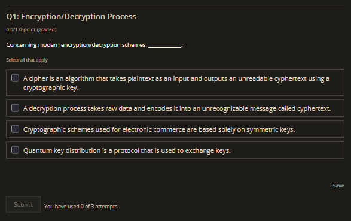
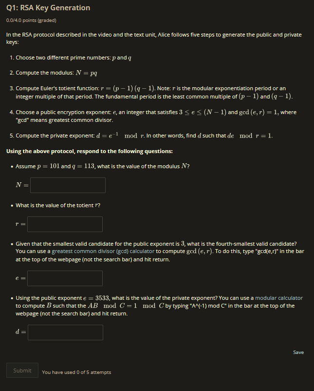
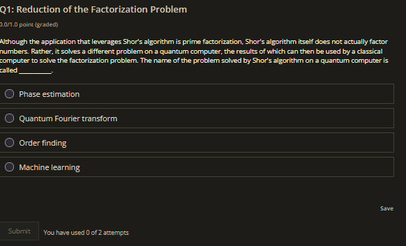
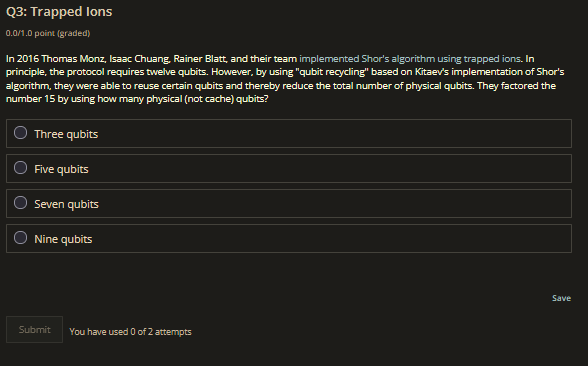
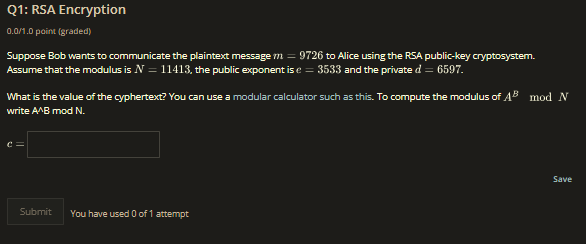
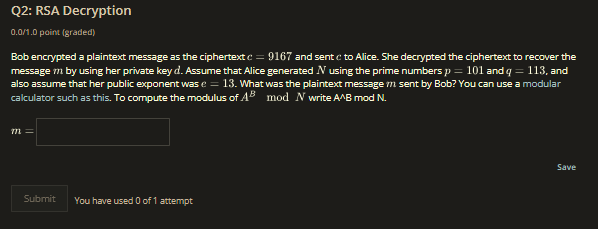
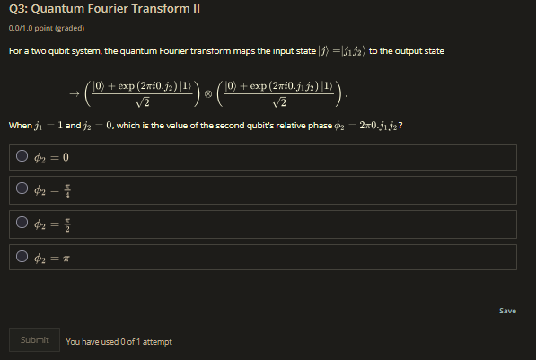
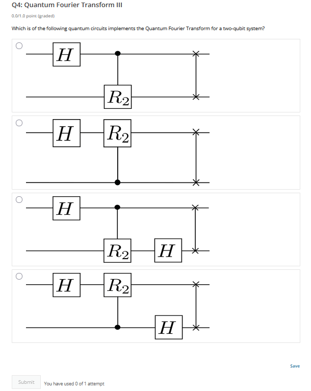
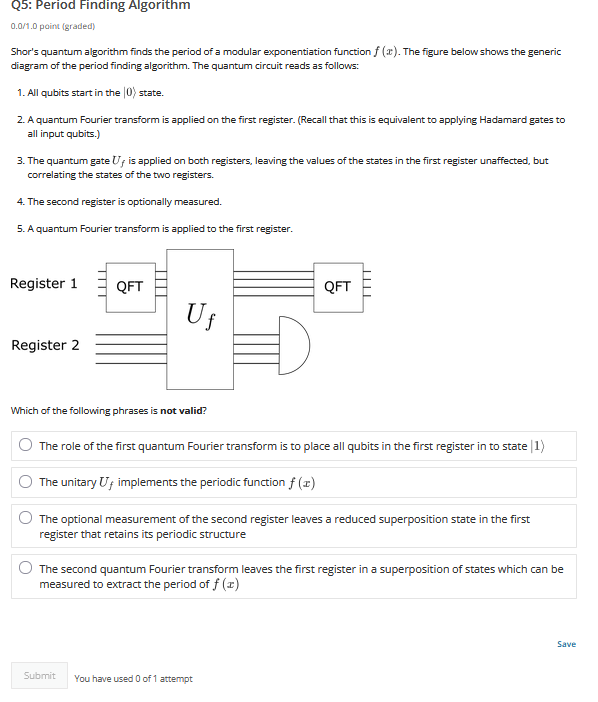

# Quizzes · Week 1 · Modern Cryptography and Shor's Algorithm

Every graded question of this week, transcribed from the eDX screenshots. Options are lettered **A, B, C, …**; the letters are *not* on the platform, they're added to match the Anki deck. **No answers here** (public repo). Status only tracks progress.

**Progress:** 0/9 ✅ CHECKED in eDX · 9 ⏳ pending · 1 ⚠️ not captured

Back to [[quizzes/index|all quizzes]] · [[analyses/quiz-concept-map|quiz → concept map]]

## CYU · Modern Cryptography

### Q1: Encryption/Decryption Process

> **Status:** ⏳ pending · **Type:** Select all that apply · **Attempts:** 3  
> **Raw:** [week2.md:714](/mit-raw/week2.md) · **Concepts:** [[concepts/modern-cryptography|Modern cryptography]]

Concerning modern encryption/decryption schemes, ________.

- [ ] **A.** A cipher is an algorithm that takes plaintext as an input and outputs an unreadable cyphertext using a cryptographic key.
- [ ] **B.** A decryption process takes raw data and encodes it into an unrecognizable message called cyphertext.
- [ ] **C.** Cryptographic schemes used for electronic commerce are based solely on symmetric keys.
- [ ] **D.** Quantum key distribution is a protocol that is used to exchange keys.

> [!info]- Original eDX screenshot
> 

## CYU · RSA Cryptosystem

### Q1: RSA Key Generation

> **Status:** ⏳ pending · **Type:** Enter a value · **Attempts:** 5  
> **Raw:** [week2.md:1981](/mit-raw/week2.md) · **Concepts:** [[concepts/rsa-cryptosystem|RSA cryptosystem]]

In the RSA protocol described in the video and the text unit, Alice follows five steps to generate the public and private keys:

1. Choose two different prime numbers: $p$ and $q$
2. Compute the modulus: $N = pq$
3. Compute Euler's totient function: $r = (p-1)(q-1)$. Note: $r$ is the modular exponentiation period or an integer multiple of that period. The fundamental period is the least common multiple of $(p-1)$ and $(q-1)$.
4. Choose a public encryption exponent: $e$, an integer that satisfies $3 \le e \le (N-1)$ and $\gcd(e,r) = 1$, where "gcd" means greatest common divisor.
5. Compute the private exponent: $d = e^{-1} \bmod r$. In other words, find $d$ such that $de \bmod r = 1$.

**Using the above protocol, respond to the following questions:**

- Assume $p = 101$ and $q = 113$, what is the value of the modulus $N$?
  - $N =$ (blank input)
- What is the value of the totient $r$?
  - $r =$ (blank input)
- Given that the smallest valid candidate for the public exponent is 3, what is the fourth-smallest valid candidate? You can use a greatest common divisor (gcd) calculator to compute $\gcd(e,r)$. To do this, type "gcd(e,r)" in the bar at the top of the webpage (not the search bar) and hit return.
  - $e =$ (blank input)
- Using the public exponent $e = 3533$, what is the value of the private exponent? You can use a modular calculator to compute $B$ such that $AB \bmod C = 1 \bmod C$ by typing "A^(-1) mod C" in the bar at the top of the webpage (not the search bar) and hit return.
  - $d =$ (blank input)

##

> [!info]- Original eDX screenshot
> 

## Case Study

### Q1: Reduction of the Factorization Problem

> **Status:** ⏳ pending · **Type:** Select one · **Attempts:** 2  
> **Raw:** [week1.md:10109](/mit-raw/week1.md) · **Concepts:** [[concepts/shors-algorithm|Shor's algorithm]]

Although the application that leverages Shor's algorithm is prime factorization, Shor's algorithm itself does not actually factor numbers. Rather, it solves a different problem on a quantum computer, the results of which can then be used by a classical computer to solve the factorization problem. The name of the problem solved by Shor's algorithm on a quantum computer is called ________.

- [ ] **A.** Phase estimation
- [ ] **B.** Quantum Fourier transform
- [ ] **C.** Order finding
- [ ] **D.** Machine learning

> [!info]- Original eDX screenshot
> 

### ⚠️ Q2 — NOT CAPTURED

> **Status:** ⚠️ not captured, re-capture from eDX. Q2 of the Case Study Concept Questions is missing from the capture (the screenshots jump from Q1 to Q3).

### Q3: Trapped Ions

> **Status:** ⏳ pending · **Type:** Select one · **Attempts:** 2  
> **Raw:** [week1.md:10124](/mit-raw/week1.md) · **Concepts:** [[concepts/shor-demonstrations|Experimental demonstrations of Shor's algorithm]]

In 2016 Thomas Monz, Isaac Chuang, Rainer Blatt, and their team implemented Shor's algorithm using trapped ions. In principle, the protocol requires twelve qubits. However, by using "qubit recycling" based on Kitaev's implementation of Shor's algorithm, they were able to reuse certain qubits and thereby reduce the total number of physical qubits. They factored the number 15 by using how many physical (not cache) qubits?

- [ ] **A.** Three qubits
- [ ] **B.** Five qubits
- [ ] **C.** Seven qubits
- [ ] **D.** Nine qubits

> [!info]- Original eDX screenshot
> 

## Quiz

### Q1: RSA Encryption

> **Status:** ⏳ pending · **Type:** Enter a value · **Attempts:** 1  
> **Raw:** [week1.md:10153](/mit-raw/week1.md) · **Concepts:** [[concepts/rsa-cryptosystem|RSA cryptosystem]]

Suppose Bob wants to communicate the plaintext message m = 9726 to Alice using the RSA public-key cryptosystem. Assume that the modulus is N = 11413, the public exponent is e = 3533 and the private d = 6597.

What is the value of the ciphertext? You can use a modular calculator such as this. To compute the modulus of A^B mod N write A^B mod N.

c = [empty text box]

> [!info]- Original eDX screenshot
> 

### Q2: RSA Decryption

> **Status:** ⏳ pending · **Type:** Enter a value · **Attempts:** 1  
> **Raw:** [week1.md:10170](/mit-raw/week1.md) · **Concepts:** [[concepts/rsa-cryptosystem|RSA cryptosystem]]

Bob encrypted a plaintext message as the ciphertext $c = 9167$ and sent it to Alice. She decrypted the ciphertext to recover the message $m$ by using her private key $d$. Assume that Alice generated $N$ using the prime numbers $p = 101$ and $q = 113$, and also assume that her public exponent was $e = 13$. What was the plaintext message $m$ sent by Bob? You can use a modular calculator such as this. To compute the modulus of $A^B \bmod N$ write $A^B \bmod N$.

$m =$ [empty text box]

> [!info]- Original eDX screenshot
> 

### Q3: Quantum Fourier Transform II

> **Status:** ⏳ pending · **Type:** Select one · **Attempts:** 1  
> **Raw:** [week1.md:10187](/mit-raw/week1.md) · **Concepts:** [[concepts/quantum-fourier-transform|Quantum Fourier transform]]

For a two qubit system, the quantum Fourier transform maps the input state $|j\rangle = |j_1 j_2\rangle$ to the output state

$$
\rightarrow \left(\frac{|0\rangle + \exp(2\pi i\, 0.j_2)|1\rangle}{\sqrt{2}}\right) \otimes \left(\frac{|0\rangle + \exp(2\pi i\, 0.j_1 j_2)|1\rangle}{\sqrt{2}}\right).
$$

When $j_1 = 1$ and $j_2 = 0$, which is the value of the second qubit's relative phase $\phi_2 = 2\pi\, 0.j_1 j_2$?

- [ ] **A.** $\phi_2 = 0$
- [ ] **B.** $\phi_2 = \pi/4$
- [ ] **C.** $\phi_2 = \pi/2$
- [ ] **D.** $\phi_2 = \pi$

> [!info]- Original eDX screenshot
> 

### Q4: Quantum Fourier Transform III

> **Status:** ⏳ pending · **Type:** Select one · **Attempts:** 1  
> **Raw:** [week1.md:10212](/mit-raw/week1.md) · **Concepts:** [[concepts/quantum-fourier-transform|Quantum Fourier transform]]

Which of the following quantum circuits implements the Quantum Fourier Transform for a two-qubit system?

- [ ] **A.** Top: H, then control •, then SWAP. Bottom: $R_2$ (target of that control), then SWAP.
- [ ] **B.** Top: H, $R_2$, SWAP. Bottom: control • under the $R_2$, then SWAP. ($R_2$ controlled from below.)
- [ ] **C.** Top: H, control •, SWAP. Bottom: $R_2$ (controlled from the top •), then H, then SWAP.
- [ ] **D.** Top: H, $R_2$, SWAP. Bottom: control • under the $R_2$, then H, then SWAP.

> [!info]- Original eDX screenshot
> 

### Q5: Period Finding Algorithm

> **Status:** ⏳ pending · **Type:** Select one (which is NOT valid) · **Attempts:** 1  
> **Raw:** [week1.md:10228](/mit-raw/week1.md) · **Concepts:** [[concepts/period-finding|Period finding]] · [[concepts/quantum-fourier-transform|Quantum Fourier transform]]

Shor's quantum algorithm finds the period of a modular exponentiation function $f(x)$. The figure below shows the generic diagram of the period finding algorithm. The quantum circuit reads as follows:

1. All qubits start in the $|0\rangle$ state.
2. A quantum Fourier transform is applied on the first register. (Recall that this is equivalent to applying Hadamard gates to all input qubits.)
3. The quantum gate $U_f$ is applied on both registers, leaving the values of the states in the first register unaffected, but correlating the states of the two registers.
4. The second register is optionally measured.
5. A quantum Fourier transform is applied to the first register.

**Circuit**

- **Register 1** (several wires): QFT → box $U_f$ → QFT.
- **Register 2** (several wires): enters the bottom of $U_f$, then a measurement symbol.

**Which of the following phrases is not valid?**

- [ ] **A.** The role of the first quantum Fourier transform is to place all qubits in the first register in to state $|1\rangle$
- [ ] **B.** The unitary $U_f$ implements the periodic function $f(x)$
- [ ] **C.** The optional measurement of the second register leaves a reduced superposition state in the first register that retains its periodic structure
- [ ] **D.** The second quantum Fourier transform leaves the first register in a superposition of states which can be measured to extract the period of $f(x)$

> [!info]- Original eDX screenshot
> 

