# Quizzes · Week 2 · Quantum Cryptography

Every graded question of this week, transcribed from the eDX screenshots. Options are lettered **A, B, C, …**; the letters are *not* on the platform, they're added to match the Anki deck. **No answers here** (public repo). Status only tracks progress.

**Progress:** 6/12 ✅ CHECKED in eDX · 6 ⏳ pending

Back to [[quizzes/index|all quizzes]] · [[analyses/quiz-concept-map|quiz → concept map]]

## CYU · Post-Quantum Cryptography

### Q1: Post-Quantum Cryptography

> **Status:** ⏳ pending · **Type:** Select one · **Attempts:** 2  
> **Raw:** [week3.md:447](/mit-raw/week3.md) · **Concepts:** [[concepts/post-quantum-cryptography|Post-quantum cryptography]]

Although there is currently no quantum computer available that is able to decrypt our encrypted communications, what is the primary reason one should care about developing post-quantum cryptography schemes today?

- [ ] **A.** Once a universal quantum computer is constructed, it could be used in principle to reveal information previously encrypted with the most common form of public key cryptography.
- [ ] **B.** Because it will allow us to deepen our knowledge in cryptography.
- [ ] **C.** One shouldn't really care, because current encryption schemes are robust enough that no quantum computer will ever compromise them.
- [ ] **D.** Because, in the future, most computers will be quantum computers and all cryptography will be quantum.

> [!info]- Original eDX screenshot
> 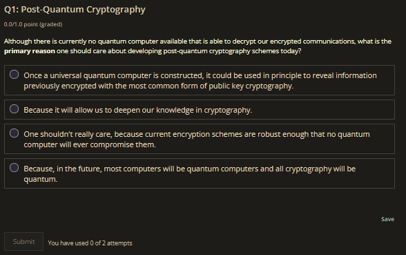

## CYU · Single-Photon Schemes

### Q1: Beam Splitters

> **Status:** ⏳ pending · **Type:** Select one · **Attempts:** 2  
> **Raw:** [week3.md:1590](/mit-raw/week3.md) · **Concepts:** [[concepts/photon-sources-and-detectors|Photon sources, beam splitters and detectors]]

When a single photon enters an ideal, lossless 50:50 spatial beam splitter at port 1 - shown in Figure 1 - it is partially transmitted to port 3 and partially reflected to port 4. Therefore, a single photon leaves the beamsplitter in a superposition state of being in both the tranmission and reflection arms. A detection event then randomly collapses the photon into one of those arms, with a 50% chance of detecting the photon in the transmission arm, and a 50% chance of detecting it in the reflection arm. On the other hand, if the beam splitter is a polarizing beam splitter - illustrated in Figure 2 - then the horizontal component of the photon is transmitted and detected at port 3, whereas the vertical component gets reflected and detected at port 4.

**Fig. 1** — Horizontally polarized photon enters **Input Port 1** from the left. **Input Port 2** is the dashed vertical input from above. A diagonal **Beam Splitter** sends light right to a detector at **Output Port 3** and down to a detector at **Output Port 4**.

**Fig. 2** — Same layout, but the element is a **Polarizer Beam Splitter**. Horizontal polarization from Input Port 1 goes to Output Port 3; the vertical path goes to Output Port 4.

Which of the following phrases is valid?

- [ ] **A.** In Figures 1 and 2, either detector can detect a photon.
- [ ] **B.** In Figures 1 and 2, no detector can detect a photon.
- [ ] **C.** In Figure 1, detectors in ports 3 and 4 can detect a photon, and in Figure 2, only the detector in port 3 can detect a photon.
- [ ] **D.** In Figure 1, detectors in ports 3 and 4 can detect a photon, and in Figure 2, only the detector in port 4 can detect a photon.

> [!info]- Original eDX screenshot
> 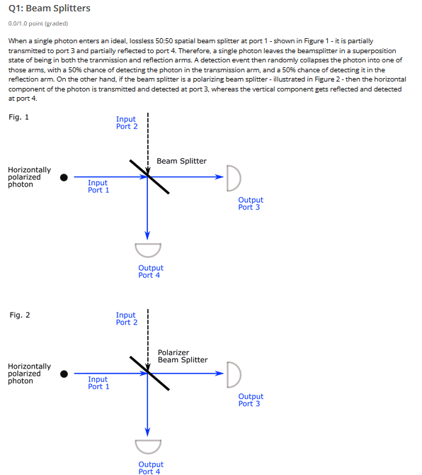
> 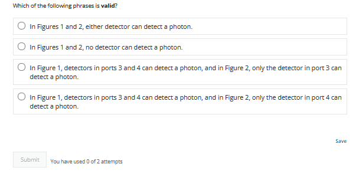

### Q1: The BB84 Protocol I

> **Status:** ⏳ pending · **Type:** Select one · **Attempts:** 2  
> **Raw:** [week3.md:3539](/mit-raw/week3.md) · **Concepts:** [[concepts/bb84|BB84]]

The figure below shows an example of the BB84 protocol. The horizontal and vertical arrows refer to the horizontal and vertical photon polarization, $|H\rangle$ and $|V\rangle$, respectively. The arrows in 45° counter-clockwise and 45° clockwise with respect to the horizontal arrow refer to the right-diagonal and left-diagonal photon polarization, $|+45\rangle$ and $|-45\rangle$, respectively.

Legend: orange arrow up = V; blue arrow horizontal = H; red diagonal = +45°; green diagonal = −45°.

| | Photon 1 | Photon 2 | Photon 3 | Photon 4 | Photon 5 | Photon 6 | Photon 7 | Photon 8 |
| --- | --- | --- | --- | --- | --- | --- | --- | --- |
| Alice sends | blue H | red +45° | orange V | orange V | green −45° | blue H | red +45° | red +45° |
| Bob's measurement basis | H/V | H/V | +45°/−45° | H/V | +45°/−45° | +45°/−45° | H/V | +45°/−45° |
| Bob's measurement result | blue H | blue H | red +45° | orange V | green −45° | green −45° | orange V | red +45° |

1. Alice randomly sends a series of photons either through a horizontal $|H\rangle$ or vertical $|V\rangle$ polarizer, OR through a right-diagonal $|+45\rangle$ or left-diagonal $|-45\rangle$ polarizer.
2. Bob randomly measures each photon either in the rectilinear basis $|H\rangle$ and $|V\rangle$, or in the diagonal basis $|+45\rangle$ and $|-45\rangle$.
3. He reports to Alice which basis he used for each measurement.
4. She compares Bob's basis with the sequence of polarizers that she used, and tells Bob if he measured in the correct basis or not.
5. Alice and Bob agree on which results to use. And, they associate the states $|H\rangle$ and $|+45\rangle$ to bit 0, they associate $|V\rangle$ and $|-45\rangle$ to bit 1.

Which is the key to be used by Alice and Bob?

- [ ] **A.** 0000
- [ ] **B.** 1001
- [ ] **C.** 0110
- [ ] **D.** 1111

> [!tip]- 💡 Hint
> Mark each column *match / no match* by basis only (rectilinear H/V vs diagonal ±45). Keep matches, then map H, +45 → 0 and V, −45 → 1.

> [!info]- Original eDX screenshot
> 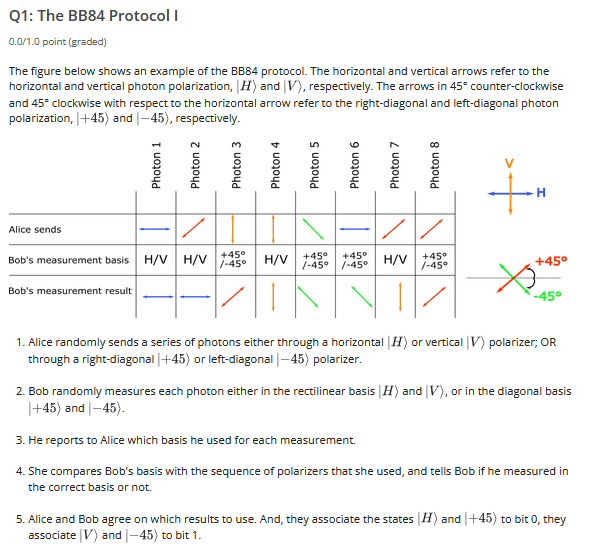
> 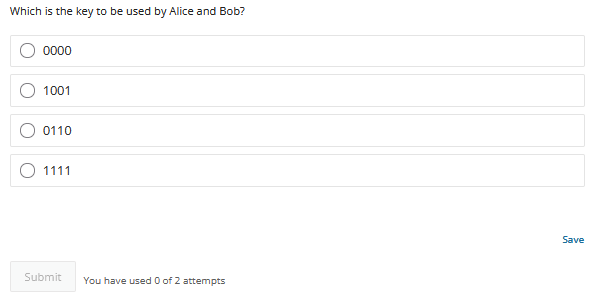

## CYU · Entangled-Photon Schemes

### Q1: Spontaneous Parametric Down-Conversion

> **Status:** ⏳ pending · **Type:** Select one (which is NOT valid) · **Attempts:** 2  
> **Raw:** [week3.md:5132](/mit-raw/week3.md) · **Concepts:** [[concepts/photon-sources-and-detectors|Photon sources, beam splitters and detectors]] · [[concepts/photon-polarization-qubits|Photon polarization as a qubit]]

According to the figure below, which phrase is **not valid**?

- [ ] **A.** If the created state is $(|H\rangle|H\rangle+|V\rangle|V\rangle)/\sqrt{2}$, then this is a type-I crystal.
- [ ] **B.** For a pair of photons of the same frequency, $\theta_1$ and $\theta_2$ are always equal.
- [ ] **C.** Detecting photon 1 immediately destroys photon 2.
- [ ] **D.** Not every photon that passes through the crystal is converted to an entangled photon pair.

> [!tip]- 💡 Hint
> Write energy and momentum conservation for pump → signal + idler. Then ask: does measuring one photon *destroy* the other, or only collapse the joint state?

> [!info]- Original eDX screenshot
> 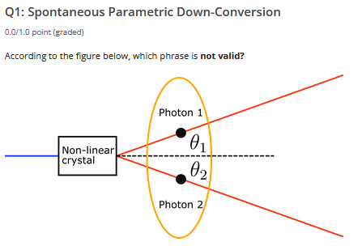
> 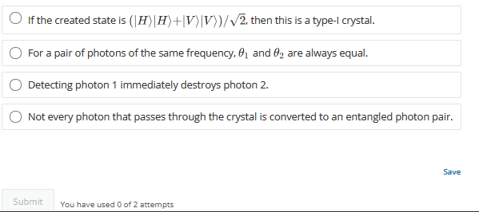

### Q1: The Ekert91 Protocol

> **Status:** ⏳ pending · **Type:** Select one (which is NOT valid) · **Attempts:** 2  
> **Raw:** [week3.md:6549](/mit-raw/week3.md) · **Concepts:** [[concepts/ekert91|Ekert 91 and BBM92]] · [[concepts/bell-inequality|Bell inequality]]

In the Ekert91 quantum key distribution protocol, an entangled photon source emits photon pairs in one of the four maximally entangled polarization states such as $(|HH\rangle + |VV\rangle)/\sqrt{2}$, where $|H\rangle$ and $|V\rangle$ refer to the horizontal and vertical polarization directions. Alice and Bob receive one photon each and measure their polarization in a measurement basis that each chooses at random from a predetermined set. They then coordinate on a public channel to determine which of their measurements had been made using the same basis; they use these results to communicate securely. In cases where they did not choose the same basis, the photon measurements are used to detect the presence/absence of an eavesdropper.

Regarding the Ekert91 protocol, which of the following is **not true**?

- [ ] **A.** Unlike the BB84 protocol, the Ekert91 requires the use of entangled photon pairs.
- [ ] **B.** Ekert91 requires three parties to implement the protocol successfully.
- [ ] **C.** Alice and Bob can detect the presence of an eavesdropper by calculating a pre-defined correlation function using the photons they measured in different bases.
- [ ] **D.** Ekert91 requires an entangled photon source, but it does not require a Bell state measurement.

> [!info]- Original eDX screenshot
> 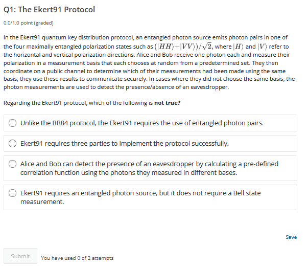

## CYU · Random Number Generators

### Q1: Bell's Inequality

> **Status:** ⏳ pending · **Type:** Select one (which is NOT valid) · **Attempts:** 2  
> **Raw:** [week3.md:8482](/mit-raw/week3.md) · **Concepts:** [[concepts/bell-inequality|Bell inequality]]

In the context of Bell's Inequality, which of the following statements is **not true**?

- [ ] **A.** With respect to the concept of local realism, "local" refers to the fact that it is not possible to send information faster then the speed of light.
- [ ] **B.** A "loophole" refers to ways in which nature can trick us in to think that local realism is incorrect.
- [ ] **C.** A way to close the locality loophole is to have Alice and Bob as close as possible such that they can agree on which basis to use.
- [ ] **D.** The free-choice loophole states that the basis election has to be independent of any classical variable. Alice and Bob have to select their basis freely.

> [!info]- Original eDX screenshot
> 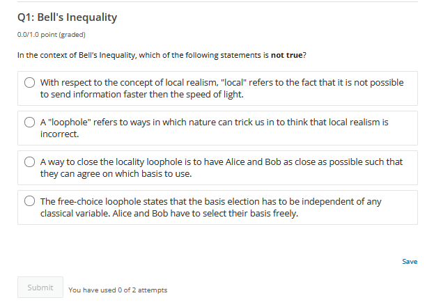

## CYU · Quantum Repeaters

### Q1: Quantum Entanglement I

> **Status:** ✅ CHECKED in eDX · **Type:** Select all that apply · **Attempts:** 3  
> **Raw:** [week3.md:10131](/mit-raw/week3.md) · **Concepts:** [[concepts/photon-polarization-qubits|Photon polarization as a qubit]]

Alice and Bob share polarization-entangled photons prepared in the Bell state,

$$
\frac{|H\rangle_A|H\rangle_B + |V\rangle_A|V\rangle_B}{\sqrt{2}}, \qquad (1)
$$

where $|H\rangle_{A(B)}$ and $|V\rangle_{A(B)}$ are the horizontal and vertical polarization states of the photon $A$ ($B$) respectively.

Alice takes her photon ($A$) to the Moon and Bob takes his photon ($B$) to Mars. Alice sends her photon through a polarizer that only transmits horizontally polarized photons. The detector after the polarizer detects one photon. If Bob sends his photon through a polarizer at +45 degrees followed by a polarization sensitive detector, then _____________.

- [ ] **A.** Bob detects a photon with a 50% chance.
- [ ] **B.** Bob will not detect any photon.
- [ ] **C.** If Bob's detector detects a photon, it registers a horizontally polarized photon.
- [ ] **D.** If Bob's detector detects a photon, it registers a vertically polarized with a 50% chance.

> [!tip]- 💡 Hint
> Collapse first (what is Bob's photon after Alice's click?), then compute $|\langle +45|\psi_B\rangle|^2$. Be clear about *which* polarization the detector reads.

> [!info]- Original eDX screenshot
> 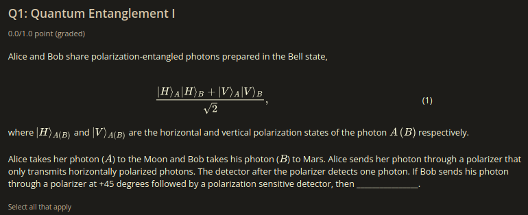
> 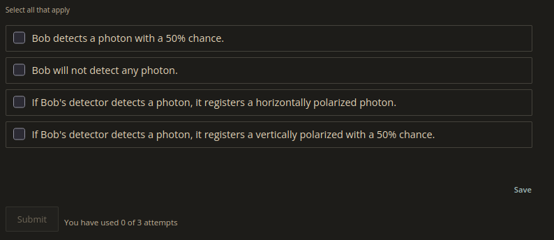

### Q1: Quantum Repeaters

> **Status:** ✅ CHECKED in eDX · 🎯 graded 1/1 · **Type:** Select all that apply · **Attempts:** 3  
> **Raw:** [week3.md:11119](/mit-raw/week3.md) · **Concepts:** [[concepts/quantum-repeaters|Quantum repeaters]]

Which of the following phrases are **true**?

- [ ] **A.** Quantum entanglement is a key resource needed to realize quantum repeaters.
- [ ] **B.** A distributed entangled state can be used as a resource for quantum communication protocols.
- [ ] **C.** When communicating over an optical fiber, the total attenuation of photons in the fiber is proportional to the distance of the transmission.
- [ ] **D.** The need for quantum repeaters comes from the loss of information due to scattering and absorption of photons during transmission over optical fibers.

> [!tip]- 💡 Hint
> Fiber loss is quoted in dB/km. Is a dB figure linear or exponential in distance, and what about the transmitted *power* $10^{-\alpha L/10}$?

> [!info]- Original eDX screenshot
> 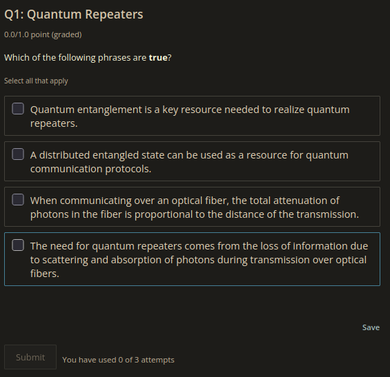

## Quiz

### Q1: BB84 Protocol II

> **Status:** ✅ CHECKED in eDX · 🎯 graded 1/1 · **Type:** Select one · **Attempts:** 1  
> **Raw:** [week3.md:11146](/mit-raw/week3.md) · **Concepts:** [[concepts/bb84|BB84]]

The figure below shows an example of the BB84 protocol. The horizontal and vertical arrows refer to the horizontal and vertical photon polarization, $|H\rangle$ and $|V\rangle$, respectively. The arrows in +45 and -45 degrees with respect to the horizontal arrow refer to the right-diagonal and left-diagonal photon polarization, $|R\rangle$ and $|L\rangle$, respectively.

Legend: orange double arrow vertical = V; blue double arrow horizontal = H; red diagonal = +45°; green diagonal = −45°.

| | Photon 1 | Photon 2 | Photon 3 | Photon 4 | Photon 5 | Photon 6 | Photon 7 | Photon 8 |
| --- | --- | --- | --- | --- | --- | --- | --- | --- |
| Alice sends | orange V (up) | green −45° | blue H (right) | blue H (right) | red +45° | orange V (up) | green −45° | green −45° |
| Bob's measurement basis | H/V | H/V | +45°/−45° | H/V | +45°/−45° | +45°/−45° | H/V | +45°/−45° |
| Bob's measurement result | orange V (up) | orange V (up) | green −45° | blue H (right) | red +45° | red +45° | blue H (right) | green −45° |

1. Alice randomly sends a series of photons either though a horizontal $|H\rangle$ or vertical $|V\rangle$ polarizer, OR though a right-diagonal $|R\rangle$ or left-diagonal $|L\rangle$ polarizer.
2. Bob randomly measures each photon either in the $|H\rangle$ and $|V\rangle$ basis, or in the $|R\rangle$ and $|L\rangle$ basis.
3. He reports to Alice which basis he used for each measurement.
4. She compares Bob's basis with the sequence of polarizers that she used, and tells Bob if he measured in the correct basis or not.
5. Alice and Bob agree on which results to use, and they associate the states $|H\rangle$ and $|R\rangle$ with bit 0, and states $|V\rangle$ and $|L\rangle$ with bit 1.

Which is the key to be used by Alice and Bob?

- [ ] **A.** 0000
- [ ] **B.** 1001
- [ ] **C.** 0110
- [ ] **D.** 1111

> [!tip]- 💡 Hint
> Mark each column *match / no match* by basis only (rectilinear H/V vs diagonal ±45). Keep matches, then map H, +45 → 0 and V, −45 → 1.

> [!info]- Original eDX screenshot
> 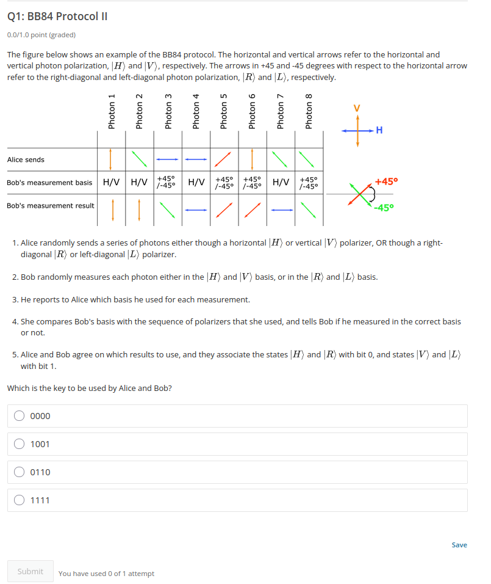

### Q2: Quantum Entanglement II

> **Status:** ✅ CHECKED in eDX · **Type:** Select all that apply · **Attempts:** 1  
> **Raw:** [week3.md:11179](/mit-raw/week3.md) · **Concepts:** [[concepts/photon-polarization-qubits|Photon polarization as a qubit]]

Alice and Bob shared polarization entangled photons prepared in the Bell state,

$$\frac{|H\rangle_A|H\rangle_B + |V\rangle_A|V\rangle_B}{\sqrt{2}}, \qquad (2)$$

where $|H\rangle_{A(B)}$ and $|V\rangle_{A(B)}$ are the horizontal and vertical polarization states of the photon $A$ ($B$) respectively.

Alice takes her photon ($A$) to Jupiter and Bob takes his photon ($B$) to Pluto. Alice sends her photon through a polarizer that only transmits vertically polarized photons. The detector after the polarizer detects one photon. If Bob sends his photon through a polarizer at +45 degrees followed by a polarization sensitive detector, then __________.

- [ ] **A.** Bob has 50% chance of detecting a photon.
- [ ] **B.** Bob will not detect any photon.
- [ ] **C.** If Bob's detector dectects a photon, it registers a vertically polarized photon with 75% chance.
- [ ] **D.** If Bob's detector dectects a photon, it registers a horizontally polarized photon with 50% chance.

> [!tip]- 💡 Hint
> Same steps as Entanglement I with $V$ instead of $H$: $|\langle +45|V\rangle|^2 = ?$

> [!info]- Original eDX screenshot
> 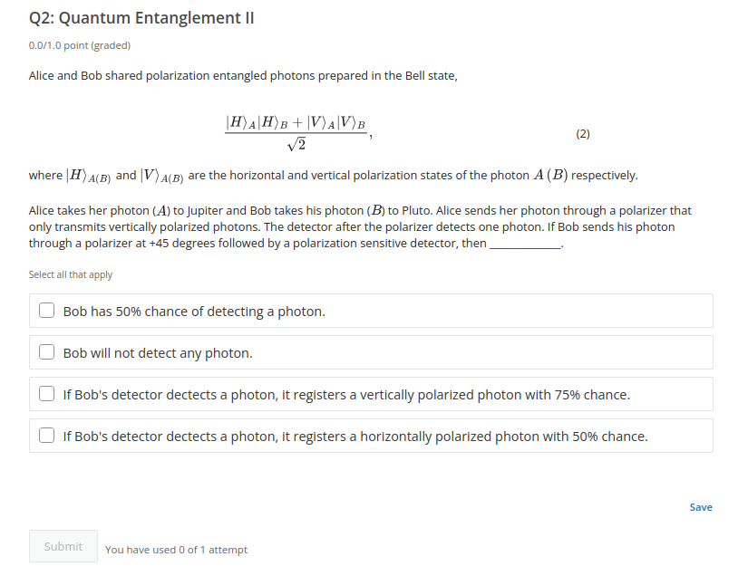

### Q3: Quantum Teleportation

> **Status:** ✅ CHECKED in eDX · 🎯 graded 1/1 · **Type:** Select one (which is NOT valid) · **Attempts:** 1  
> **Raw:** [week3.md:11206](/mit-raw/week3.md) · **Concepts:** [[concepts/quantum-teleportation|Quantum teleportation]]

The figure below shows a high-level diagram of the protocol of teleportation. While photons A and C belong to Alice, photon B belongs to Bob.

Diagram:

- Bottom center: an oval holding black dots A (left) and B (right), above a box "Entangled Photon Source (Photons A and B)".
- A green dashed box at upper left is labeled "Bell Measurement (Photons A and C)". Inside it, a purple vertical bar is labeled "Spatial Beamsplitter". Two dark semicircle detectors sit at the top of the box. A blue dashed path runs from photon A up through the beamsplitter into the left detector. An orange dashed path runs from photon C (black dot, lower left), past an input state $|\psi\rangle$, up through the beamsplitter into the right detector.
- A green curved arrow labeled "Classical Communication" leaves the Bell-measurement box and points to a box "Rotation (Photon B)".
- A blue dashed path runs from photon B up into that rotation box and continues up-right to an output state $|\psi\rangle$.

Which of the following phrases is **not valid**?

- [ ] **A.** The protocol requires Alice and Bob to pre-share an entangled Bell state.
- [ ] **B.** The Bell measurement allows Alice to project the state of her two photons onto one of the four Bell states.
- [ ] **C.** After the measurement, Alice sends her second photon to Bob.
- [ ] **D.** Bob performs a decoding mechanism on his photon to extract the teleported information sent by Alice.

> [!info]- Original eDX screenshot
> 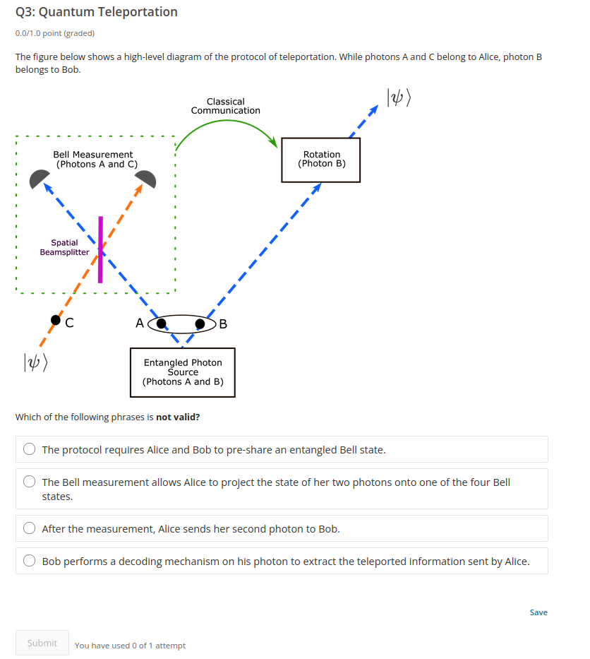

### Q4: Half-Wave Plate

> **Status:** ✅ CHECKED in eDX · 🎯 graded 1/1 · **Type:** Select all that apply · **Attempts:** 1  
> **Raw:** [week3.md:11241](/mit-raw/week3.md) · **Concepts:** [[concepts/photon-polarization-qubits|Photon polarization as a qubit]]

The quantum state of photon polarization is analogous to the quantum state of a qubit. The figure below illustrates this analogy by showing the Bloch sphere for a qubit (left) and the polarization of a photon (right). You can draw the following correspondence between states:

$$|0\rangle \rightarrow |H\rangle, \qquad (3)$$
$$|1\rangle \rightarrow |V\rangle. \qquad (4)$$

Photons that are depicted as being polarized at 45 degrees:

$$|\nearrow\rangle = \frac{|H\rangle+|V\rangle}{\sqrt{2}}, \qquad (5)$$
$$|\searrow\rangle = \frac{|H\rangle-|V\rangle}{\sqrt{2}}. \qquad (6)$$

Two Bloch spheres, each with axes $Z$ (up), $y$ (right), and $x$ (toward the front-left), and a white arrow lying in the equatorial plane.

- Left (qubit): north pole $|0\rangle$, south pole $|1\rangle$. Equatorial labels $\frac{|0\rangle-|1\rangle}{\sqrt{2}}$ (toward the back/side) and $\frac{|0\rangle+|1\rangle}{\sqrt{2}}$ (toward the front).
- Right (photon): north pole $|H\rangle$, south pole $|V\rangle$. Equatorial labels $\frac{|H\rangle-|V\rangle}{\sqrt{2}}$ and $\frac{|H\rangle+|V\rangle}{\sqrt{2}}$.

Let's consider here a photonic analog of a single-qubit gate. An optical component called a "half-wave plate" imparts a phase shift $\pi$ between the polarization components of an incoming photon as projected along the wave plate's "fast axis" and "slow axis". The resulting operation is defined by an angle $\theta$ between the plate's "fast axis" and the incoming photon polarization:

$$|H\rangle \rightarrow \cos 2\theta |H\rangle + \sin 2\theta |V\rangle, \qquad (7)$$
$$|V\rangle \rightarrow \sin 2\theta |H\rangle - \cos 2\theta |V\rangle. \qquad (8)$$

where $\theta$ is measured counterclockwise from horizontal.

For a half-wave plate with angle $\theta$ with respect to the horizontal, which of the following statements are **valid**?

- [ ] **A.** A half-wave plate with $\theta = 0$ corresponds to an $X$-gate in the circuit model.
- [ ] **B.** A half-wave plate with $\theta = 0$ corresponds to an $Z$-gate in the circuit model.
- [ ] **C.** A half-wave plate with $\theta = 45$ corresponds to an $X$-gate in the circuit model.
- [ ] **D.** A half-wave plate with $\theta = 45$ corresponds to an $Z$-gate in the circuit model.

> [!tip]- 💡 Hint
> Write the plate as a $2\times2$ matrix with columns = images of $|H\rangle, |V\rangle$, then plug in $\theta = 0$ and $45°$ and compare with $X = \left(\begin{smallmatrix}0&1\\1&0\end{smallmatrix}\right)$, $Z = \left(\begin{smallmatrix}1&0\\0&-1\end{smallmatrix}\right)$.

> [!info]- Original eDX screenshot
> 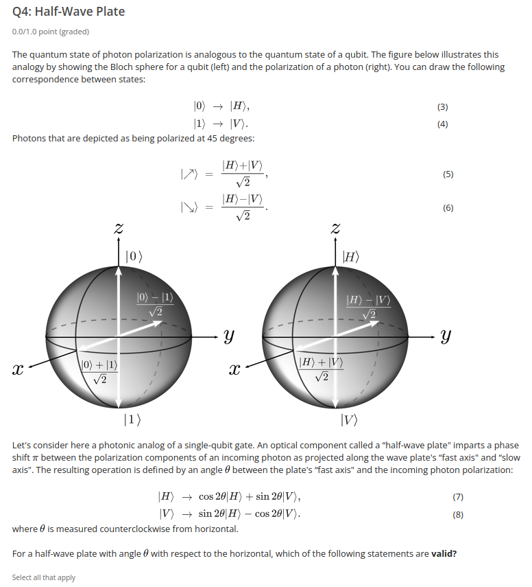
> 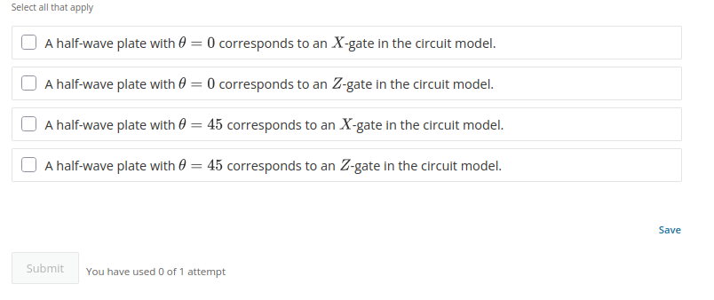

