# Quizzes · Week 3 · Hamiltonian Simulation

Every graded question of this week, transcribed from the eDX screenshots. Options are lettered **A, B, C, …**; the letters are *not* on the platform, they're added to match the Anki deck. **No answers here** (public repo). Status only tracks progress.

**Progress:** 3/11 ✅ CHECKED in eDX · 8 ⏳ pending · 1 ⚠️ not captured

Back to [[quizzes/index|all quizzes]] · [[analyses/quiz-concept-map|quiz → concept map]]

## CYU · Introduction

### Q1: Ultra-Cold Atoms

> **Status:** ⏳ pending · **Type:** Select all that apply · **Attempts:** 3  
> **Raw:** [week4.md:74](/mit-raw/week4.md) · **Concepts:** [[concepts/quantum-simulation|Quantum simulation: approaches and issues]]

Because of the numerous techniques that can be used to control their quantum properties, optically trapped ultracold atoms are a promising candidate for both quantum simulation and quantum computation.

As alluded to in the video, which of the following processes are commonly used in quantum simulations with ultra-cold atoms?

- [ ] **A.** Manipulating the behavior of Bose-Einstein condensates
- [ ] **B.** Performing multi-scale entanglement renormalization or MERA
- [ ] **C.** Creating time averaged Hamiltonians
- [ ] **D.** PEPS (applying two-qubit gates between pairs of neutral atoms)

> [!info]- Original eDX screenshot
> 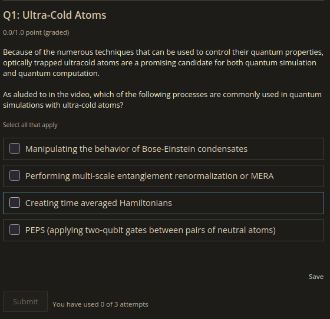

## CYU · Hamiltonian Simulation

### Q1: The Role of Hamiltonians in Quantum Mechanics

> **Status:** ⏳ pending · **Type:** Select one (which is NOT valid) · **Attempts:** 2  
> **Raw:** [week4.md:1080](/mit-raw/week4.md) · **Concepts:** [[concepts/hamiltonian-simulation|Hamiltonian simulation]]

Regarding the role of Hamiltonians in quantum mechanics, which of the following statements is **not valid**?

- [ ] **A.** Its expectation values give the energies of the quantum system
- [ ] **B.** It determines the evolution of a quantum state as $$|\psi_t\rangle = \exp\left(-i H t / \hbar\right) |\psi_0\rangle.$$
- [ ] **C.** It incorporates operators that implement the logical quantum gates in a universal quantum computer
- [ ] **D.** It gives the degree of entanglement of a system

> [!info]- Original eDX screenshot
> 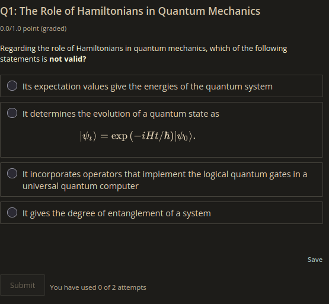

### Q1: Particle in a Box

> **Status:** ⏳ pending · **Type:** Select one (which is NOT valid) · **Attempts:** 2  
> **Raw:** [week4.md:2603](/mit-raw/week4.md) · **Concepts:** [[concepts/hamiltonian-simulation|Hamiltonian simulation]]

In the particle in a box problem, a particle is trapped between two large potential walls. For simplicity, it is assumed that the particle can only move in one dimension, usually denoted with $x$, and the potential $V(x)$ is then written as a function of $x$.

Which of the following is **not valid**?

- [ ] **A.** The position of a particle is usually described with a wave function
- [ ] **B.** The particle is generally not located at just one point at any given time, and so it is said to be delocalized
- [ ] **C.** The Hamiltonian used to simulate the particle position only needs the potential energy term $V(x)$, because the kinetic energy describes the particle momentum
- [ ] **D.** Although the position of a particle can take a continuous set of values, its quantum state can be written as a superposition of a discrete set of states

> [!tip]- 💡 Hint
> Write the full $\hat H$ for a particle and check: inside the box $V(x)=0$. What would be left if you dropped the kinetic term?

> [!info]- Original eDX screenshot
> 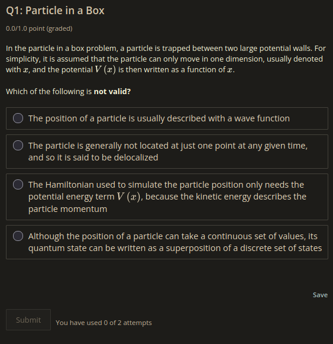

### Q1: Trotterization

> **Status:** ⏳ pending · **Type:** Select one (which is NOT valid) · **Attempts:** 2  
> **Raw:** [week4.md:3160](/mit-raw/week4.md) · **Concepts:** [[concepts/trotterization|Trotterization]]

The total Hamiltonian of a quantum system can be defined by more than one term, such as

$$H=H_1+H_2.$$

When $H_1H_2\neq H_2H_1$ it is said that $H_1$ and $H_2$ do not commute. Evolving the system under $H$ is not equivalent to evolving it under $H_1$ and then $H_2$, or vice versa.

If a quantum system in an initial state $|\psi_0\rangle$ is allowed to evolve for a time $t$ under the Hamiltonian $H$, then the state of the system after evolution is given by

$$|\psi(t)\rangle=\exp(-iHt)|\psi_0\rangle,$$

where we have set $\hbar=1$ as is often done to keep the equations simple. Since $H_1$ and $H_2$ do not commute, finding an explicit expression for $|\psi(t)\rangle$ is not as simple as computing

$$|\psi(t)\rangle=\exp(-iH_1 t)\exp(-iH_2 t)|\psi_0\rangle\quad(\mathrm{wrong}).$$

Which of the following phrases is **not valid**?

- [ ] **A.** Trotterization is a method that determines the evolution of a quantum system under non-commuting Hamiltonians
- [ ] **B.** The Trotter-Suzuki expansion comes from truncating the Lie product formula
- [ ] **C.** The Lie product formula given by, $$\exp\big(-i(H_1+H_2)t\big)=\lim_{n\to\infty}\left(\exp\left(-iH_1\frac{t}{n}\right)\exp\left(-iH_2\frac{t}{n}\right)\right)^{n},$$ can be used to determine the time evolution of $\exp(-iHt)\,|\psi_0\rangle$ and is exact in the limit $n\to\infty$
- [ ] **D.** The Trotter-Suzuki expansion can only be used for Hamiltonians of the form $H=H_1+H_2$

> [!tip]- 💡 Hint
> Does the product formula $\big(\prod_\ell e^{-iH_\ell t/n}\big)^n$ care how many terms $H_\ell$ there are?

> [!info]- Original eDX screenshot
> 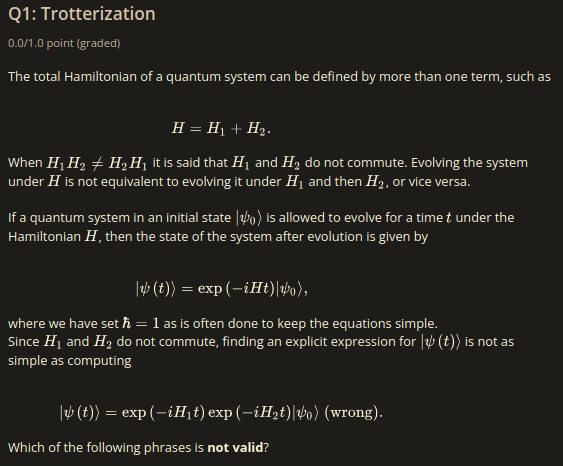
> 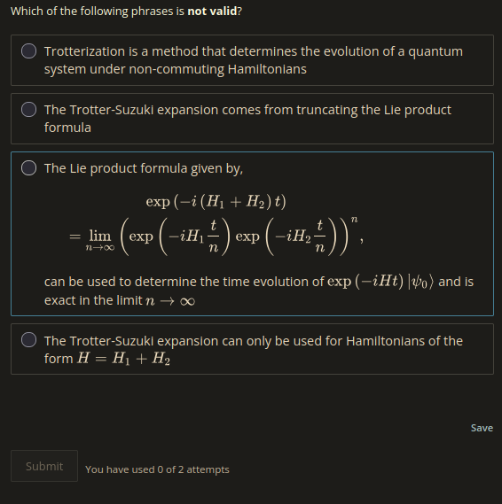

## CYU · Chemistry

### Q1: Simulation of Chemistry Problems

> **Status:** ⏳ pending · **Type:** Select all that are NOT valid · **Attempts:** 3  
> **Raw:** [week4.md:4012](/mit-raw/week4.md) · **Concepts:** [[concepts/quantum-chemistry|Quantum chemistry simulation]]

Quantum simulators allow you to solve for the ground state and energy eigenvalues of complex systems composed of several interacting parts. Applications are found in the field of Quantum Chemistry, which studies the interactions and chemical reactions between different molecules, usually composed of several atoms.

Which of the following sentences about simulating quantum chemistry problems is/are **not valid**?

- [ ] **A.** Although the Hamiltonian that describes a chemical reactions might be well known, we do not necessarily know how to solve it, or if it can be solved at all
- [ ] **B.** Less favorable chemical reactions that happen at high temperatures are impossible to occur at room temperature, because reactants cannot overcome the limiting energy barrier. Quantum simulations allow us to understand how to increase the temperature of the system to produce the desired reaction
- [ ] **C.** The full Hamiltonian of an arbitrary molecule can be written as $H=T_{\mathrm{nuc}}+T_{\mathrm{elec}}$, where $T_{\mathrm{nuc}}$ and $T_{\mathrm{elec}}$ refer to the kinetic energy of the nuclei and electrons respectively
- [ ] **D.** To exactly simulate the interaction between molecules, one has to consider the electron-electron, nucleus-nucleus, and electron-nucleus terms for the interaction between the electrons and nuclei of every atom

> [!tip]- 💡 Hint
> List every term of a molecular Hamiltonian: kinetic energies **and** all pairwise Coulomb interactions. Then check each option against that list.

> [!info]- Original eDX screenshot
> 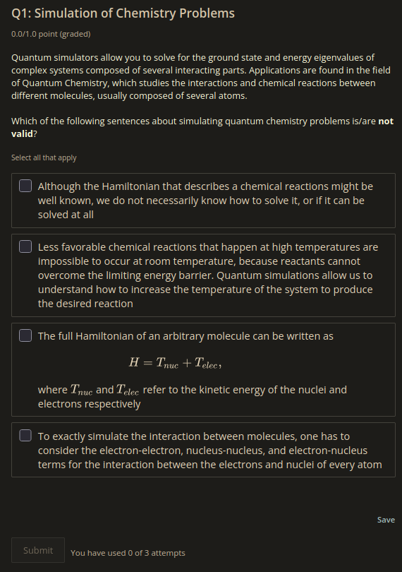

### Q1: Phase Estimation Algorithm

> **Status:** ⏳ pending · **Type:** Select one (which is NOT valid) · **Attempts:** 2  
> **Raw:** [week4.md:5062](/mit-raw/week4.md) · **Concepts:** [[concepts/phase-estimation|Phase estimation]]

Regarding the phase estimation algorithm, which of the following statements is **not valid**?

- [ ] **A.** It is used as a subroutine in other algorithms, e.g., Shor's algorithm
- [ ] **B.** It determines the phase associated with an eigenvalue of $U|\psi\rangle=\exp(i 2\pi\theta)|\psi\rangle$
- [ ] **C.** It finds the precise value of the phase $\theta$
- [ ] **D.** It uses the quantum Fourier transform

> [!tip]- 💡 Hint
> A $t$-qubit register can hold only $t$ binary digits of $\theta$. What if $\theta$ needs more?

> [!info]- Original eDX screenshot
> 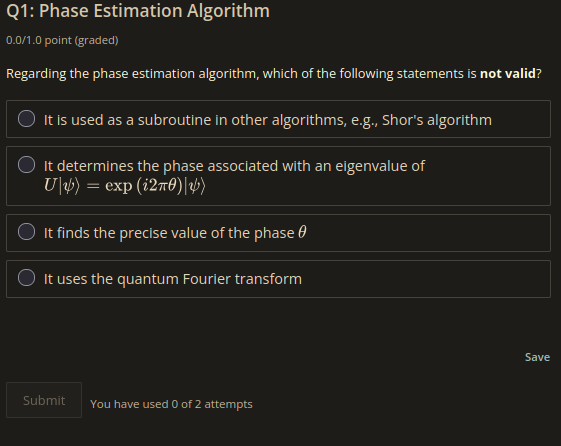

### Q1: Variational Quantum Eigensolver

> **Status:** ⏳ pending · **Type:** Select one · **Attempts:** 2  
> **Raw:** [week4.md:5782](/mit-raw/week4.md) · **Concepts:** [[concepts/vqe|Variational quantum eigensolver]]

Although quantum computers can perform certain calculations much faster than classical ones, classical computers are robust, reliable, and we have been learning how to use them for a longer time. Instead of just jumping into a fully functional quantum computer, and dropping our usual ones, it might be a good idea to combine the best of both worlds. This is the idea behind Variational Quantum Eigensolver, a kind of hybrid computation. In particular, it presents a way to obtain the ground state of a Hamiltonian by computing certain parts of an algorithm in a classical computer and others in a quantum computer. *(completed from the screenshot; the raw transcription is cut short)*solver, a kind of hybrid computation. In particular, it presents a way to obtain the ground state of a Hamiltonian by computing certain parts of an algorithm in a classical computer and others in a quantum computer.

Which one of the following steps of the algorithm is run in a classical computer:

- [ ] **A.** State preparation
- [ ] **B.** Measurement of the expectation values of the Hamiltonian
- [ ] **C.** Parameter optimization
- [ ] **D.** Error correction

> [!info]- Original eDX screenshot
> 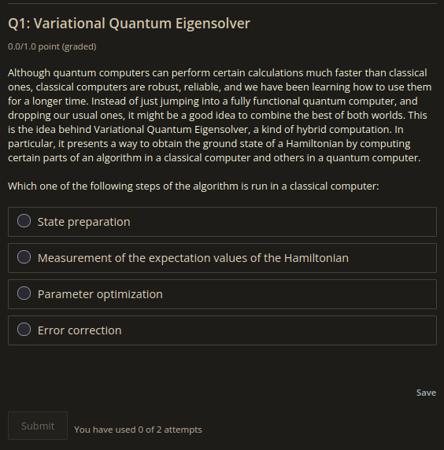

### ⚠️ Reflect and Review Activity — NOT CAPTURED

> **Status:** ⚠️ not captured, re-capture from eDX. The graded Reflect and Review Activity (1.5 h, 1 question) is not in the capture.

## Quiz

### Q1: Quantum-Inspired Approximations

> **Status:** ⏳ pending · **Type:** Select one · **Attempts:** 1  
> **Raw:** [week4.md:7777](/mit-raw/week4.md) · **Concepts:** [[concepts/quantum-simulation|Quantum simulation: approaches and issues]]

The idea behind quantum simulation is to use well-controlled quantum systems to simulate more complex ones. However, it is not an easy task to implement them properly. A different strategy to tackle this problem is to improve classical simulations of a quantum system by using better quantum-inspired approximations.

The first technique created with the propose of improving classical simulations was:

- [ ] **A.** The Density Matrix Renormalization Group algorithm or DMRG
- [ ] **B.** Analog deformation
- [ ] **C.** Projected entangled-pair states or PEPS
- [ ] **D.** Multi-scale entanglement renormalization ansatz or MERA

> [!info]- Original eDX screenshot
> 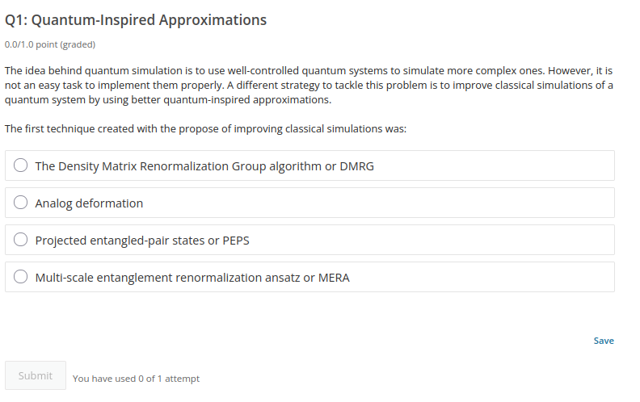

### Q2: Ideas and Issues of Quantum Simulation

> **Status:** ✅ CHECKED in eDX · **Type:** Select all that apply · **Attempts:** 1  
> **Raw:** [week4.md:7798](/mit-raw/week4.md) · **Concepts:** [[concepts/quantum-simulation|Quantum simulation: approaches and issues]]

Which of the following are **valid** statements?

- [ ] **A.** Even if you can simulate the evolution of a quantum system $\exp(-iHt)|\psi_{0}\rangle$, obtaining an output is still a challenge because you can only get one statistical sample from every measured state.
- [ ] **B.** The density matrix renormalization group algorithm comes from the idea of improving classical simulations of quantum systems by using quantum-inspired approximations.
- [ ] **C.** Analog deformation comes from the idea of deforming the Hamiltonian of a quantum system to make it more suitable for specific simulations.
- [ ] **D.** One of the ideas behind quantum simulation is to use well-controlled quantum systems to simulate more complex systems that can't be modeled with classical methods.

> [!info]- Original eDX screenshot
> 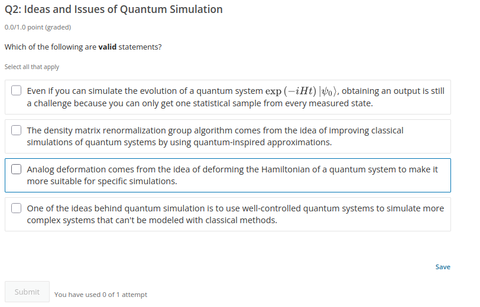

### Q3: Non-Commuting Terms

> **Status:** ✅ CHECKED in eDX · 🎯 graded 1/1 · **Type:** Select all that apply  
> **Raw:** [week4.md:7817](/mit-raw/week4.md) · **Concepts:** [[concepts/trotterization|Trotterization]]

Two operators, $U_1$ and $U_2$, are said to not commute if $U_1U_2\neq U_2U_1$. This means that the order in which the operators are applied matters. Applying $U_1$ and then $U_2$ is not the same as applying $U_2$ and then $U_1$.

*(Figure: original orientation of a 3D cow.)*

The figure above shows the original orientation of a 3D object, a cow. Using the figures in each alternative, identify which of the operations do not commute.

*(Each option shows two panels: left, the 90° rotation first, then the 45° one; right, the reverse order. The figures are helpers: the option text alone fixes the axes and angles.)*

- [ ] **A.** Rotation of 90 degrees around the x axis and rotation of 45 degrees around x
- [ ] **B.** Rotation of 90 degrees around the x axis and rotation of 45 degrees around y
- [ ] **C.** Rotation of 90 degrees around the y axis and rotation of 45 degrees around y
- [ ] **D.** Rotation of 90 degrees around the y axis and rotation of 45 degrees around x

> [!tip]- 💡 Hint
> Rotations about the *same* axis just add their angles. What happens when the axes differ? Try it with a book in your hands.

> [!info]- Original eDX screenshot (full page)
> 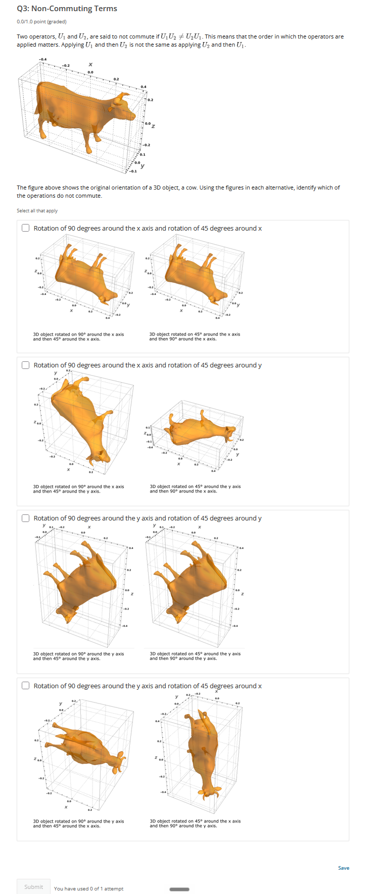

> [!info]- Original eDX screenshot
> 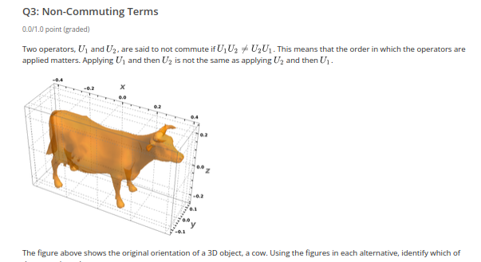
> 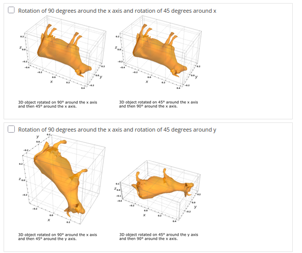
> 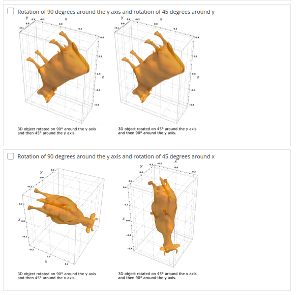

### Q4: Evolution of a State

> **Status:** ✅ CHECKED in eDX · 🎯 graded 1/1 · **Type:** Select one · **Attempts:** 1  
> **Raw:** [week4.md:7878](/mit-raw/week4.md) · **Concepts:** [[concepts/trotterization|Trotterization]]

Which of the following correspond to the exact time evolution of the initial quantum state $|\psi(0)\rangle$ under a Hamiltonian $H=H_1+H_2$?

- [ ] **A.** $|\psi(t)\rangle=H|\psi(0)\rangle$
- [ ] **B.** $|\psi(t)\rangle=\exp\big(-i(H_1+H_2)\,t/\hbar\big)|\psi(0)\rangle$
- [ ] **C.** $|\psi(t)\rangle=\exp(-iH_1 t/\hbar)\exp(-iH_2 t/\hbar)|\psi\rangle$
- [ ] **D.** $|\psi(t)\rangle=\exp(-iH_2 t/\hbar)\exp(-iH_1 t/\hbar)|\psi\rangle$

> [!tip]- 💡 Hint
> Solve Schrödinger's equation formally, then recall when $e^{A}e^{B} = e^{A+B}$ holds (Baker–Campbell–Hausdorff).

> [!info]- Original eDX screenshot
> 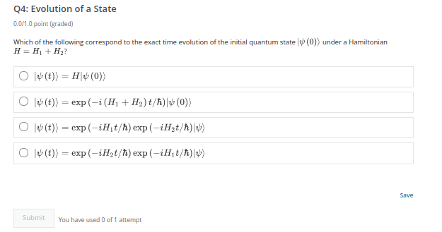

