# Quizzes · Week 4 · Quantum Optimization

Every graded question of this week, transcribed from the eDX screenshots. Options are lettered **A, B, C, …**; the letters are *not* on the platform, they're added to match the Anki deck. **No answers here** (public repo). Status only tracks progress.

**Progress:** 11/13 ✅ CHECKED in eDX · 2 ⏳ pending · 1 ⚠️ not captured

Back to [[quizzes/index|all quizzes]] · [[analyses/quiz-concept-map|quiz → concept map]]


## CYU · Adiabatic QC


### Q1: Adiabatic Quantum Computation I

> **Status:** ⏳ pending · **Type:** Select one (which is NOT valid) · **Attempts:** 2  
> **Raw:** [week5.md:148](/mit-raw/week5.md) · **Concepts:** [[concepts/adiabatic-quantum-computing|Adiabatic quantum computing]]

Regarding Adiabatic Quantum Computation, which of the following statements is **not valid**?

- [ ] **A.** Adiabatic Quantum Computation is a form of analog quantum computing.
- [ ] **B.** For Adiabatic Quantum Computation to succeed, the system is expected to remain in the ground state for the duration of the computation.
- [ ] **C.** In Adiabatic Quantum Computation, the quantum state evolves according to several constant Hamiltonians.
- [ ] **D.** Adiabatic evolution can simulate arbitrary quantum circuits; it is universal.

> [!tip]- 💡 Hint
> Write $H(t)$ as the course does. Is it a list of fixed Hamiltonians, or one interpolation?

> [!info]- Original eDX screenshot (shows saved selections)
> 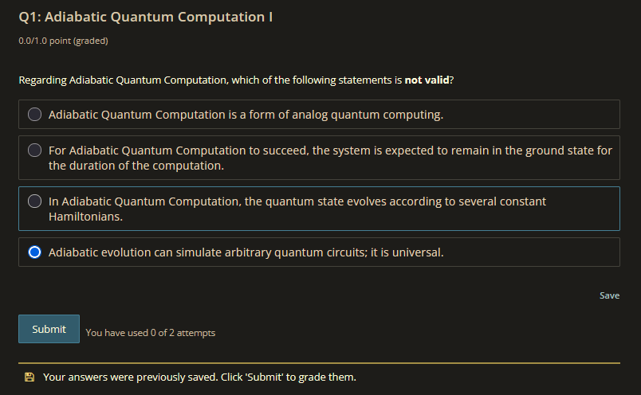


### Q1: Adiabatic Quantum Computation II

> **Status:** ⏳ pending · **Type:** Select all that apply · **Attempts:** 3  
> **Raw:** [week5.md:953](/mit-raw/week5.md) · **Concepts:** [[concepts/adiabatic-quantum-computing|Adiabatic quantum computing]]

Imagine you are running an optimization algorithm on an Adiabatic Quantum Computer. Unfortunately, the coherence time of the system is limited and it is close to the time set by the minimum energy gap of the optimization problem. What should you **not** do in this situation?

- [ ] **A.** Evolve the system faster, thereby perform the simulation in a shorter amount of time.
- [ ] **B.** Evaluate if it is possible to modify the evolution of the system to find a way to increase the minimum gap.
- [ ] **C.** Evaluate the probability for the system staying in the ground state through the evolution, knowing that the success will be probabilistic but perhaps with a high probability.
- [ ] **D.** Initialize the system in an arbitrary state of a Hamiltonian you want to optimize and let it decay to its ground state (without evolving the system).

> [!tip]- 💡 Hint
> The runtime must satisfy $T \gg 1/\Delta_{min}^2$ and fit inside the coherence time. Which options shrink the required $T$, and which just break the condition?

> [!info]- Original eDX screenshot
> 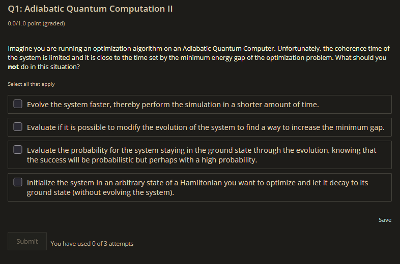


### ⚠️ Adiabatic QC 3rd CYU — NOT CAPTURED

> **Status:** ⚠️ not captured, re-capture from eDX. The outline lists 3 adiabatic + 2 annealing questions. Captured: 2 adiabatic (raw) + Quantum Annealing I and II (eDX screenshots, 2026-11-22). Still missing: the 3rd adiabatic CYU.


## CYU · Quantum Annealing


### Q1: Quantum Annealing I

> **Status:** ✅ CHECKED in eDX · 🎯 graded 1/1 · **Type:** Select all that are NOT valid · **Attempts:** 3  
> **Raw:** [week5-quantum-annealing.md](/mit-raw/week5-quantum-annealing.md) (question text from eDX screenshot, 2026-11-22) · **Concepts:** [[concepts/quantum-annealing|Quantum annealing]] · [[concepts/adiabatic-quantum-computing|Adiabatic quantum computing]]

Regarding Quantum Annealing, which of the following statements are **not valid**?

- [ ] **A.** Quantum Annealing is designed to solve a particular class of computations known as classical optimization problems.
- [ ] **B.** One of the goals of quantum annealing is to engineer a system of qubits with an Ising Hamiltonian corresponding to the optimization problem of interest.
- [ ] **C.** As a consequence of quantum tunneling and relaxation processes, the computer is intentionally evolved to an excited state.
- [ ] **D.** Quantum annealing has been proven to be a universal quantum computer.

> [!tip]- 💡 Hint
> This one is about *status*, not math. Two statements are lines lifted from the Quantum Annealing lecture (~4:40 and ~7:15). For the other two ask: do tunneling and relaxation push the energy **up** or **down**? And which of the two paradigms, AQC or annealing, has a universality proof (~9:20)?

> [!info]- Original eDX screenshot
> 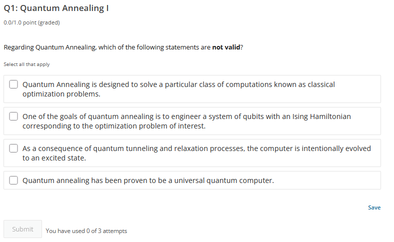


### Q1: Quantum Annealing II

> **Status:** ✅ CHECKED in eDX · 🎯 graded 1/1 · **Type:** Select one · **Attempts:** 2  
> **Raw:** [week5-quantum-annealing-expert-view.md](/mit-raw/week5-quantum-annealing-expert-view.md) (question text from eDX screenshot, 2026-11-22) · **Concepts:** [[concepts/quantum-annealing|Quantum annealing]] · [[concepts/adiabatic-quantum-computing|Adiabatic quantum computing]]

In quantum annealing, what is the most relevant consequence of the system temperature not being low enough?

- [ ] **A.** The minimum energy gap between the ground state and the first excited state is reduced due to the temperature, inducing Landau-Zener transitions.
- [ ] **B.** Energy from the environment excites the system, bringing it out of the ground state.
- [ ] **C.** The coherence time of the spins is reduced and the gate fidelity is reduced.
- [ ] **D.** The minimum computational time necessary to keep the system in its ground state decreases.

> [!tip]- 💡 Hint
> Compare two energy scales: the minimum gap $\Delta$ between ground and first excited state, and the thermal energy $k_BT$. Which one does temperature actually change? Then ask which options describe a *heat* effect and which describe a *sweep-speed* or *gate-model* effect. Course text: Adiabatic QC concept page, the noise paragraph.

> [!info]- Original eDX screenshot
> 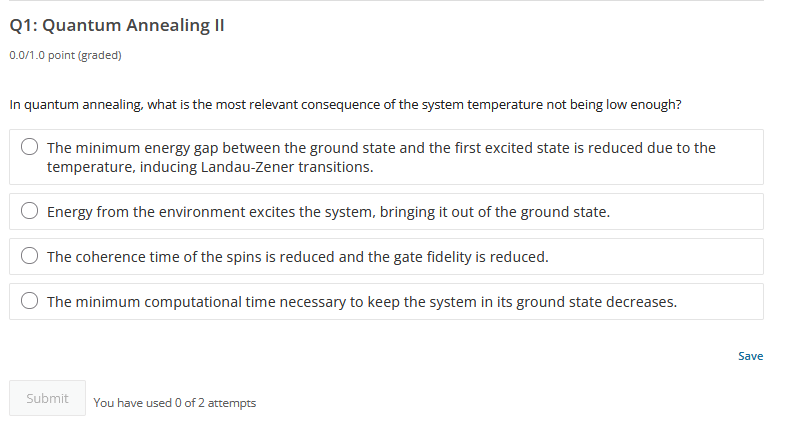


## CYU · Grover


### Q1: Grover's Algorithm

> **Status:** ✅ CHECKED in eDX · 🎯 graded 1/1 · **Type:** Select all that are NOT valid · **Attempts:** 3  
> **Raw:** [week5.md:1874](/mit-raw/week5.md) · **Concepts:** [[concepts/grovers-algorithm|Grover's algorithm]]

Regarding Grover's algorithm, which of the following statements are **not valid**?

- [ ] **A.** For a list of $N=2^n$ items, the algorithm needs $n^2$ qubits.
- [ ] **B.** The Grover Operator is composed of two reflections, the first of which is about the non-solution state $|\alpha\rangle$.
- [ ] **C.** The Grover Operator reflects the input state about the solution state $|\beta\rangle$.
- [ ] **D.** The number of iterations necessary for finding the solution state is bound by $R\le\left(\frac{\pi}{4}\sqrt{\frac{N}{M}}\right)$, where $M$ is the number of marked items in the list.

> [!tip]- 💡 Hint
> How many qubits index $2^n$ items? And write $G$ as a product of two reflections: about which two states?

> [!info]- Original eDX screenshot
> 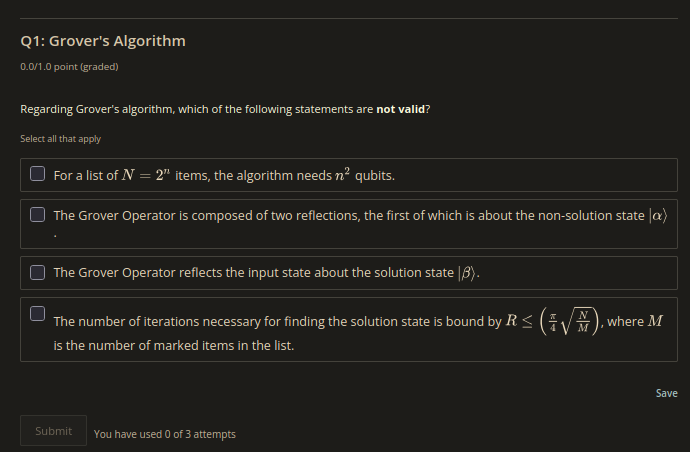


### Q1: How Many Qubits? N=512

> **Status:** ✅ CHECKED in eDX · 🎯 graded 1/1 · **Type:** Select one · **Attempts:** 2  
> **Raw:** [week5.md:5049](/mit-raw/week5.md) · **Concepts:** [[concepts/grovers-algorithm|Grover's algorithm]]

For a list of $N=512$ items, how many qubits would you need to implement Grover's algorithm?

- [ ] **A.** 9 qubits
- [ ] **B.** 512 qubits
- [ ] **C.** $2^{512}$ qubits
- [ ] **D.** $2\cdot 512$ qubits

> [!tip]- 💡 Hint
> Solve $2^n = 512$.

> [!info]- Original eDX screenshot (shows saved selections)
> 


## CYU · Lab


### Q1: Exactly-1 3-SAT Problem I

> **Status:** ✅ CHECKED in eDX · 🎯 graded 1/1 · **Type:** Select all that apply · **Attempts:** 3  
> **Raw:** [week5.md:3396](/mit-raw/week5.md) · **Concepts:** [[concepts/exactly-1-3-sat|Exactly-1 3-SAT]]

The Exactly-1 3-SAT problem requires us to find an assignment such that $f=1$ (or, True), and there is exactly one literal that evaluates to True in every clause of $f$.

Regarding the Exactly-1 3-SAT problem, which of the following statements are valid for the Boolean function:

$$f(x_1,x_2,x_3)=(x_1\lor x_2\lor\neg x_3)\land(\neg x_1\lor\neg x_2\lor\neg x_3)\land(\neg x_1\lor x_2\lor x_3)?$$

Recall that $x_1\lor x_2$ means $x_1$ OR $x_2$; $x_1\land x_2$ means $x_1$ AND $x_2$; and $\neg x_1$ means NOT $x_1$.

- [ ] **A.** The second clause has $x_1$, $x_2$, and $x_3$ as its literals.
- [ ] **B.** The input $(x_1,x_2,x_3)=(0,1,0)$ has three True literals in the third clause.
- [ ] **C.** Each clause of the Exactly-1 3-SAT problem can be represented by a sub-circuit and evaluated independently.
- [ ] **D.** The oracle operation is obtained by combining all sub-circuits for all clauses, such that it outputs True if and only if all clauses are satisfied with exactly one True literal each.

> [!tip]- 💡 Hint
> A *literal* includes its negation sign. Evaluate each literal of clause 3 at $(x_1,x_2,x_3)=(0,1,0)$ one by one: $\neg x_1 = ?,\ x_2 = ?,\ x_3 = ?$

> [!info]- Original eDX screenshot
> 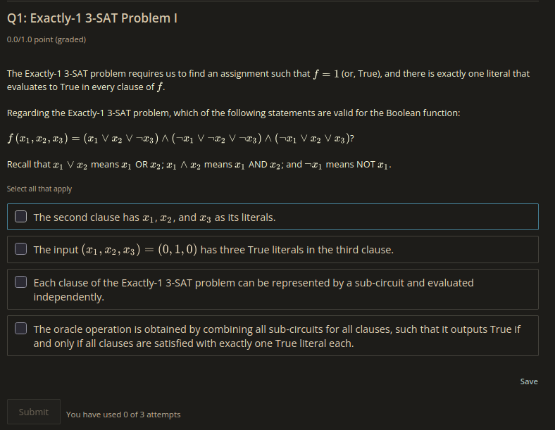


### Q1: Syntax Error

> **Status:** ✅ CHECKED in eDX · 🎯 graded 1/1 · **Type:** Select one · **Attempts:** 2  
> **Raw:** [week5.md:4904](/mit-raw/week5.md) · **Concepts:** [[concepts/openqasm|OpenQASM]]

Identify in which line there is an error:

```
1 include "qelib1.inc";
2 qreg q[5];
3 creg c[5]
4 measure q[0] -> c[0];
```

- [ ] **A.** 1
- [ ] **B.** 2
- [ ] **C.** 3
- [ ] **D.** 4
- [ ] **E.** There is no syntax error in the code

> [!info]- Original eDX screenshot (shows saved selections)
> 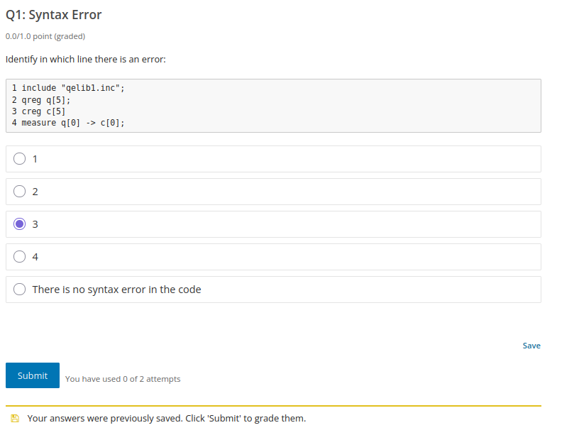


## Quiz


### Q1: Adiabatic Evolution

> **Status:** ✅ CHECKED in eDX · **Type:** Select all that apply · **Attempts:** 1  
> **Raw:** [week5.md:5076](/mit-raw/week5.md) · **Concepts:** [[concepts/adiabatic-quantum-computing|Adiabatic quantum computing]]

Adiabatic evolution is difficult to implement in a realistic quantum computer because ______.

- [ ] **A.** Thermal photons will randomly excite the system to a higher energy state.
- [ ] **B.** Some Hamiltonians don't have a ground state.
- [ ] **C.** Evolving the system too quickly will cause Landau-Zener transitions to higher energy states.
- [ ] **D.** Adiabatic evolution requires ideal qubits with infinite coherence times.

> [!tip]- 💡 Hint
> Start from the adiabatic condition $T \gg 1/\Delta_{min}^2$. Is that runtime finite? Which options describe real obstacles to meeting it?

> [!info]- Original eDX screenshot
> 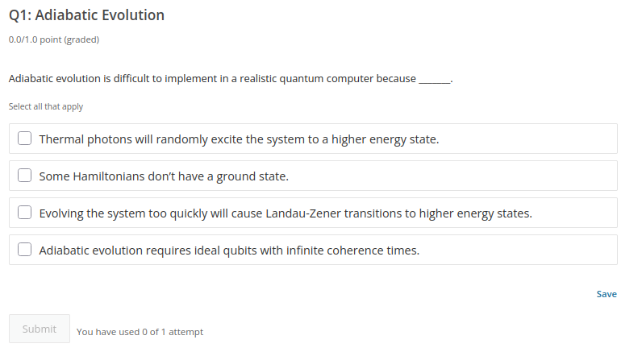


### Q2: Quantum Annealing III

> **Status:** ✅ CHECKED in eDX · **Type:** Select all that apply · **Attempts:** 1  
> **Raw:** [week5.md:5095](/mit-raw/week5.md) · **Concepts:** [[concepts/quantum-annealing|Quantum annealing]] · [[concepts/adiabatic-quantum-computing|Adiabatic quantum computing]]

Regarding Quantum Annealing, which of the following statements are **valid**?

- [ ] **A.** As a consequence of quantum tunneling and relaxation processes, the annealer can return to its ground state or a lower-energy state.
- [ ] **B.** As the minimum gap increases, the evolution of the system through the gap region must be slowed down to ensure the quantum annealer remains in its ground state.
- [ ] **C.** To date, quantum annealing computers have not demonstrated quantum enhancement for a general class of optimization problems.
- [ ] **D.** One of the goals of quantum annealing is to engineer a system of qubits with an Ising Hamiltonian corresponding to the optimization problem of interest.

> [!tip]- 💡 Hint
> Use $T \sim 1/\Delta_{min}^2$: if the minimum gap grows, does the required time grow or shrink?

> [!info]- Original eDX screenshot
> 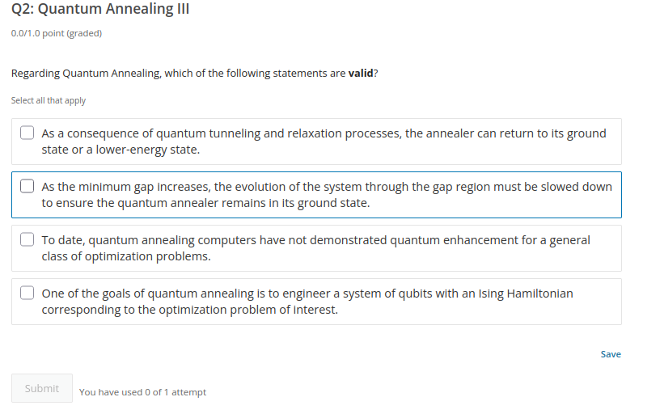


### Q3: Adiabatic Quantum Computing: Ising Model

> **Status:** ✅ CHECKED in eDX · **Type:** Select one · **Attempts:** 1  
> **Raw:** [week5.md:5119](/mit-raw/week5.md) · **Concepts:** [[concepts/adiabatic-quantum-computing|Adiabatic quantum computing]]

Consider a system comprising a long chain of $N$ spins in the presence of a strong magnetic field in the $x$ direction. The spins are thereby all initialized in the ground state, pointing in the $x$ direction, according to the Hamiltonian

$$\sum_j X^j,$$

where $X^j$ represents the $X$-gate operator (also referred to as a "Pauli-$X$ operator") for the $j$-th spin.

Ideally, the system is evolved adiabatically from the ground state of the intial Hamiltonian to the ground state of the problem Hamiltonian. This is done by slowly turning off the magnetic field, while slowly turning on the problem Hamiltonian.

In this case, we will consider a special case with no single-qubit (on-site) terms, and uniform spin-spin interactions (same interaction strength for all pairs of spins) in the problem Hamiltonian:

$$J\sum_{i\neq j} Z^i Z^{j+1},$$

where $J$ is a positive quantity proportional to the energy of the interaction between neighboring spins, and $Z^j$ is the $Z$-gate operator (also referred to as a "Pauli-$Z$ operator") for the $j$-th spin. After completing this evolution, the spins are pointed up or down along the $z$ direction (the computational basis). The expectation value of the matrix $\langle Z^j\rangle$ is -1 for a spin pointing down and +1 for a spin pointing up, as shown on the figure below.

- $j$-th spin up: orange circle, arrow up, $\langle Z_j\rangle=1$
- $j$-th spin down: orange circle, arrow down, $\langle Z_j\rangle=-1$

Two neighboring spins that are aligned (whether both up or both down) contribute an energy $+J$ to the system, whereas two neighboring spins that are anti-aligned (one up and one down) contribute an energy $-J$. The $+/-$ sign in front of $J$ is determined by multiplying the individual expectation values $+/-1$ of the two spins.

What is the arrangement of spins in an $N$-spin chain if the system evolves to the lowest energy state of the problem Hamiltonian?

- [ ] **A.** All of the $N$ spins will point in the same direction, either up or down.
- [ ] **B.** All of the spins on the left half of the chain will point in one direction, while those on the right half will point in the opposite direction.
- [ ] **C.** The spins will alternate between up and down, such that neighboring spins are anti-aligned.
- [ ] **D.** The spins will align along the $X$ direction.

> [!tip]- 💡 Hint
> Compute the total energy $\sum_{\text{bonds}} J\langle Z_j\rangle\langle Z_{j+1}\rangle$ for each configuration on a chain of $N$ spins ($N-1$ bonds), with $J>0$. Which is lowest?

> [!info]- Original eDX screenshot
> 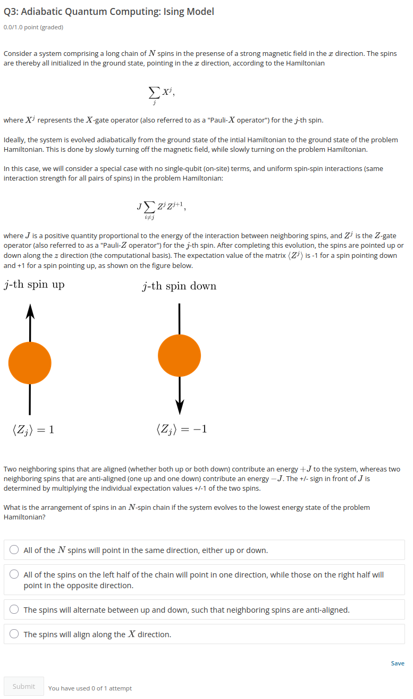


### Q4: Grover Operator

> **Status:** ✅ CHECKED in eDX · **Type:** Select all that apply · **Attempts:** 1  
> **Raw:** [week5.md:5159](/mit-raw/week5.md) · **Concepts:** [[concepts/grovers-algorithm|Grover's algorithm]]

The $n$-qubit Grover operator may be defined as $G=(2|\psi\rangle\langle\psi|-I)O$. Which of the following statements are **valid**?

- [ ] **A.** The Grover operator is a combination of two reflections, the first of which reflects the state $|\psi\rangle$ about the non-solution state $|\alpha\rangle$.
- [ ] **B.** The net effect of the Grover operator is to rotate the state $|\psi\rangle$ towards the solution state $|\beta\rangle$.
- [ ] **C.** The state $|\psi\rangle$ is the $n$-qubit equal superposition state.
- [ ] **D.** The number of repetitions of the Grover operator, neccessary to find the marked items on a list, is upper-bounded by $\dfrac{\pi}{4}\sqrt{\dfrac{N}{M}}$, where $N$ is the number of total items and $M$ marked items.

> [!tip]- 💡 Hint
> Expand $G$ in the 2D plane spanned by $|\alpha\rangle$ (non-solutions) and $|\beta\rangle$ (solutions). Two reflections compose to what?

> [!info]- Original eDX screenshot
> 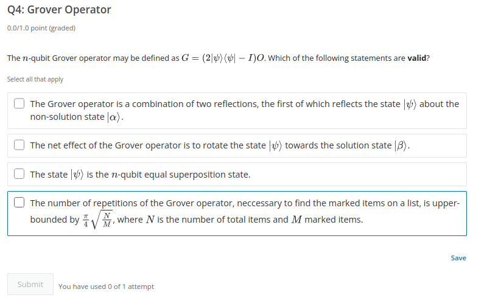


### Q5: Exactly-1 3-SAT Problem II

> **Status:** ✅ CHECKED in eDX · **Type:** Select all that apply · **Attempts:** 1  
> **Raw:** [week5.md:5180](/mit-raw/week5.md) · **Concepts:** [[concepts/exactly-1-3-sat|Exactly-1 3-SAT]]

Which of the following statements are **valid**?

- [ ] **A.** A 3-SAT formula comprises the logical AND of a series of clauses, each containing the logical OR of 3 Boolean variables or possibly their negation.
- [ ] **B.** In Boolean algebra, the symbol $\neg$ represents the NOT operation, and it flips the value of the following bit.
- [ ] **C.** the symbols $\vee$ and $\wedge$ represent the operations OR and AND respectively.
- [ ] **D.** Given a Boolean function $f$ with three Boolean variables $x_1,x_2,x_3$, the function is said to be satisfiable if there is an assignment of $x_1,x_2,x_3$ such that $f(x_1,x_2,x_3)=1$.

> [!tip]- 💡 Hint
> Check each statement against the formal definitions: CNF, literal, and *satisfiable* ($\exists x: f(x)=1$). See the external SAT source.

> [!info]- Original eDX screenshot
> 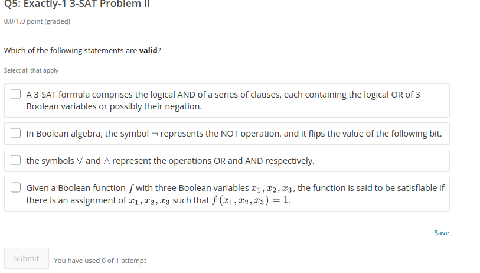

